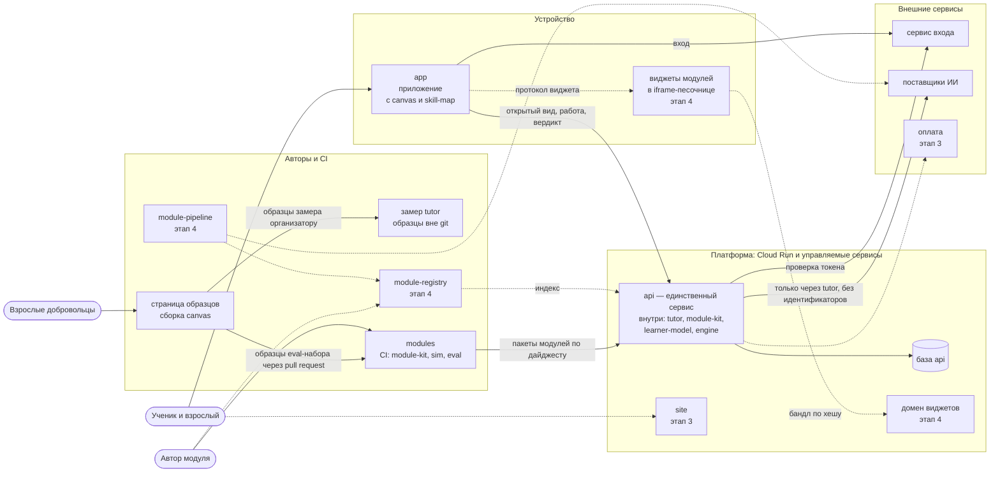
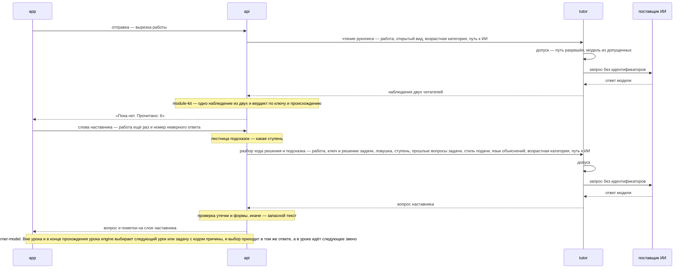

# NovaTrail — архитектура

> Статус: черновик для обсуждения, 2026-10-18.
>
> Из каких больших частей состоит платформа, что делает каждая и как они связаны. Это верхний уровень: внутреннее устройство и технологии каждой части решает её репозиторий (R11), начиная с её карточки из раздела 3. Где лежит код и в каком порядке появляются репозитории — в [repositories.md](repositories.md); открытые технические вопросы Т-… — в repositories 8.
>
> Понятия — в [concepts.md](concepts.md), приватность — в [privacy.md](privacy.md), решения — в [decisions.md](decisions.md).

## 1. Принципы

- **Граница R03 проходит по коду.**
  - Всё, что обращается к модели, — в `tutor`. Модель, которая читала бы работу на устройстве, — тоже его код: её веса, eval и допуск — у `tutor`, а вердикт — у `module-kit` (R66). В первом срезе такого чтения нет.
  - Вердикт выносит `module-kit`, модель ученика считает `learner-model`, следующий урок или задачу выбирает `engine`. Ни одна из этих библиотек модель не вызывает.
  - CI `api` проверяет полный список зависимостей: SDK поставщиков ИИ попадают в сборку только через `tutor` (R15).
- **Из частей платформы данные учеников на сервере хранит только `api`.**
  - `tutor` ничего не хранит. В типах его запросов нет полей для идентификаторов ученика и аккаунта, поэтому ИИ видит работу, но не знает чью (R15; privacy 1, 5.1).
  - Вне платформы часть данных держат сервис входа, поставщики ИИ и, с этапа 3, оплата (раздел 5).
- **Отдельный процесс — только там, где он нужен.** В первом срезе сервис один — `api`; `tutor`, `module-kit`, `learner-model` и `engine` — библиотеки в его процессе. `tutor` станет сервисом, когда у него появится второй потребитель (R15).
- **Ключ нерешённой задачи — только на сервере.** Приложение получает открытый вид задачи (R05). Открытый вид строит `module-kit` по пометкам `x-open` в схемах формата: поле без пометки закрыто, так что новое поле формата закрыто, пока его явно не открыли (R45).
- **Воспроизводимость** (R03):
  - попытка хранит дайджест своего пакета модуля, версию формата модуля, версию `module-kit` и зерно. Дайджест пакета — дайджест его описи, и он зависит только от файлов модуля и версии формата его паспорта ([текст формата](../format/README.md), раздел 25; R62). Модуль проверяется и исполняется по версии формата, которую называет его паспорт, и новая версия формата не меняет его вердикта, пока автор не переведёт модуль на неё (R44);
  - выбор движка хранит версии `engine` и `learner-model`, дайджесты пакетов, зерно и код причины, а ещё релиз `modules`, номер последнего свидетельства журнала, по которому он сделан, время выбора, класс, по которому модель считала отправную точку модулей без свидетельств, и был ли пул ограничен задачами без ИИ: без них повтор по журналу не знает, какой префикс журнала брать, какие отметки о снятии тогда действовали, на какое время модель считала удержание и срок повторения, по какому классу — отправную точку модулей без свидетельств, какие прохождения уроков и закрытые попытки задач с рубрикой видел движок — их причина и время конца, раз записаны, не меняются, — и из какого пула он выбирал (R80; В4, В14, В15 и В18 `api`; R04 и R08 learner-model; concepts 12);
  - вердикт повторяется по сохранённому наблюдению, выбор — по журналу свидетельств (R80); и то и другое — без ИИ;
  - генератор случайности и вывод зёрен задаёт `spec`, с тест-векторами: PCG, как в `math/rand/v2` Go, и места случайности, как у стенда standalone ([текст формата](../format/README.md), раздел 22; R59; Т-18 закрыт). Экземпляр шаблона задачи повторяется по пакету и зерну попытки: его выбирает одно число места `template`, ID задачи, `instance` ([текст формата](../format/README.md), раздел 23; R60).
- **Свои части интерфейса собираются при сборке, чужой код работает только в iframe-песочнице** (R16, раздел 6).
- **Без своих кластеров, очередей и шины событий** (R11). Части говорят синхронными запросами по контрактам из `spec`: `app` с `api` — по Connect, унарными вызовами, а код контрактов приходит из релизов `spec` (R83). Фоновые работы — задания Cloud Run по расписанию, как в canvas-api.
- **Журналы — без прямых идентификаторов, IP-адресов и содержания** (R09; privacy 4).
  - Cloud Run сам пишет журналы запросов со стандартным полем `httpRequest`, а в нём есть `remoteIp` — IP-адрес клиента. canvas-api записал то же о журналах Cloud Run и Firebase Hosting (privacy 4 canvas-api).
  - COPPA относит IP-адрес к постоянным идентификаторам, то есть к персональной информации (16 CFR 312.2).
  - Поэтому журналы запросов исключаются в Cloud Logging, а регион журналов выбирается до первого развёртывания (П-11).
  - Журналы хостинга `app` и сервиса входа решаются вместе с выбором этих сервисов (раздел 3.12; П-9).

  Источники — в разделе 8.

## 2. Общая схема

Сплошные стрелки — первый срез, пунктир — позже. `tutor`, `module-kit`, `learner-model` и `engine` отдельно не нарисованы: это библиотеки внутри `api`. Как репозитории зависят друг от друга при сборке — repositories 3.

## 3. Компоненты

У каждого компонента — карточка: что он делает и чего не делает, его данные и связи, репозиторий и этап (product 11). Пункты «Решить при детализации» — то, с чего начинается работа в его репозитории (repositories 2.2). Вопрос, который касается нескольких репозиториев, — в реестрах `spec`, и карточка ссылается на него.

Задача, которая заводила репозиторий (RUN.md, T04–T14), могла назвать пункты детализации сверх карточки, а могла пропустить пункт карточки. Карточку под это правит «Итог детализации» самого репозитория — строкой его таблицы 3 «в реестр spec», когда решение уже принято, а не заранее.

### 3.1. app — приложение ученика и взрослого

- **Делает:**
  - оболочку: вход через сервис входа, выбор ученика на общем устройстве, начало работы — возраст, страна, согласие; класс ученика — когда паспорт модуля называет классы (R49);
  - три входа в приложение: «Мои предметы», «Карта навыков» и, позже, «Задача с моей бумаги» (product 4);
  - плеер урока и экран задачи: канва, ячейки ответа, выбор варианта, панель наставника с шагами решения и подсказками, строка разговора. Строка разговора первого среза — кнопки просьб, подсказка и «объясни иначе» (R82), без своего текста ученика: свой текст — позже, своей возможностью `tutor` (product 10; В40 `app`). Текст пункта листа для рукописи `app` показывает вместе с вариантами `choice`, рядом с листом, а не на нём; строку пункта рабочей тетради показывает канва (R32 и R34 canvas). Навыков, полосы и сложности задачи в её открытом виде нет (R51), как нет и её приёмов, ловушек, случая попроще, фразы-утечки и решения (R57);
  - урок — по его открытому виду: звенья в порядке автора, объяснения, примеры с разбором, чей показ автора ученик открывает по одной части и может спрятать, и задачи урока, которые даёт `api`. Навыков и возрастных категорий урока в открытом виде нет (R58);
  - прогресс и карту навыков;
  - раздел для взрослых за PIN: профили, тариф, свой ключ, настройки, выгрузка и удаление;
  - раскрытие, что ученик говорит с ИИ, а не с человеком (privacy 5.3; П-15);
  - озвучку слов наставника и открытых текстов модуля синтезом речи устройства — голосом, который называет сам, по правилу Т-13. Включена ли озвучка и её скорость — в стиле подачи профиля ученика, а голос по языку и разрешение взрослого на Android и Linux — на устройстве (R07 app; О-23);
  - интерфейс на `en` и `ru`: язык интерфейса ученика — поле его профиля, которое задаёт взрослый, а экраны до выбора ученика и раздел для взрослых — на языке устройства (R92). Переводы — по общим правилам пакетов интерфейса, а слова, которые показывает больше одного пакета, — по таблице слов раздела 6 (R91);
  - доступность — по стандарту пакетов интерфейса, WCAG 2.2 AA с 2.5.5 и 2.3.3 (R90). Чему `app` и пакеты пока не отвечают, `app` называет на странице «Доступность», среди юридических страниц (раздел 3.13; R11 app).
- **Не делает:**
  - не получает ключ, решение и ловушки нерешённой задачи, а её приём — только от `api`, на шаге, который его даёт, или по просьбе ученика (R57);
  - не выносит вердикт;
  - не обращается к поставщикам ИИ;
  - не отправляет на сервер штрихи и целое фото.
- **Данные и связи:**
  - на устройстве — штрихи с временем и нажимом, артефакты, а свой ключ — только у профиля владельца категории `adult` и только по его выбору на этом устройстве, иначе в памяти вкладки. `app` шлёт ключ с каждым запросом этого профиля, который зовёт ИИ (R84; R08 app). Ещё — контекст каждой отправки: на листе для рукописи — где вырезка лежит на листе, её целые числа, рамки групп штрихов, таблица «метка группы → ID штрихов» и дайджест отправки, а на рабочей тетради — таблица «окошко → ID штрихов» и дайджест. Его отдаёт канва вместе с работой, а держит `app` как есть: по дайджесту канва принимает контекст назад (R36);
  - говорит с `api` и с сервисом входа;
  - конфигурацию развёртывания читает при каждом старте из `/deployment.json` в корне своего origin, рядом с подписанной сборкой, но не в ней, и проверяет строго — до первого запроса в сеть. Схема файла `deployment.schema.json` и шаблон CSP `csp.json` лежат в сборке, формат — R09 app, а в `spec` он переходит с первым развёртыванием (R85). Сам `app` стоит в корне своего origin;
  - открытый вид задачи получает от `api` и читает по типам из релизов `spec` (R36) — версий формата модуля в окне. Типы TypeScript — пакет npm `@altnovatrail/spec`, `@altnovatrail/spec/formatv0/open`, по точной версии в `devDependencies`, а `api` читает тот же вид типами Go `types/formatv0/open` (R72, R73). Пока формат — v0, `app` и `api` переходят на новую версию вместе (R44; repositories 4);
  - собирает в себя `canvas` и `skill-map` — веб-компонентами (R36), по точной версии из npm (R37). Подпись версии проверяет рецепт `spec` `release-verify` в CI pull request, который меняет lock-файл (R77). Канве он даёт с задачей открытый вид паспорта её модуля, свойством `manifest`, и файлы её картинок — функцией `media`, из файлов части пакета для устройства, которые раздаёт `api` (R36 и поправка 2026-11-02 к нему). Типы элемента — `@altnovatrail/spec/canvas`, в том же пакете и по той же точной версии (R74). Паспорт он получает от `api` по дайджесту пакета попытки, один раз на пакет, и кеширует по нему, а не с каждой задачей (R62). Открытые виды снятой с публикации версии модуля он из кеша удаляет (R63);
  - иконки своих кнопок берёт из набора Material Symbols по таблице значений раздела 6: пакет `@iconify-json/material-symbols` по точной версии, вшитый при сборке, — в `dependencies`, как всё, что вшивает сборщик (поправка 2026-11-02 к R39). К API Iconify приложение не обращается (R78);
  - позже, с текстовой канвой, — озвучивает её «прослушать» по событию `speak` тем же синтезом речи, что и всё приложение (R36; Т-13). В первом срезе текстовой канвы нет (R41);
  - виджеты модулей открывает через хост виджетов из `canvas` (раздел 3.4).
- **Репозиторий и этап:** `app`, этап 2.
- **Решить при детализации:** решено всё — детализация закончена 2026-11-02 (T08 `app`): фреймворк и сборка — R03 app; хранение на устройстве — R04 app; шаги решения — R05 app; плеер урока — R06 app; озвучка — R07 app; свой ключ — R08 app и R84; конфигурация развёртывания — R09 app и R85; языки интерфейса — R10 app и R92; доступность интерфейса — R11 app и R90 (В38 `app`). Что `app` решает дальше, — раздел 3.10 его `docs/architecture.md`.
  - фреймворк и сборка: в canvas-api — React 19 и Vite 8 (R47 canvas-api), в standalone — Preact. Пакеты интерфейса фреймворка не навязывают (R36). От типов `spec` каждый пакет зависит своей копией по точной версии, а не `peerDependencies`: пакет несёт одни объявления, и копии ничего не стоят (R73). Дополнено 2026-11-02: и чем сборка вшивает иконки набора — плагином сборщика или скриптом на `@iconify/utils`, без автоустановки наборов, — и как `app` держит ту же версию набора, что у собранных им пакетов (R78). Всё, что вшивает сборщик, стоит в `dependencies`, а в `devDependencies` — только инструменты (поправка 2026-11-02 к R39; Т-36 закрыт);
  - что и сколько хранится на устройстве, в том числе контекст отправки (R36);
  - шаги решения: `app` ведёт их по открытому виду, а условия выхода из шага — события на устройстве, без ключа. Дополнено 2026-10-27: шаги и их условия выхода — `givens_ticked`, `answer_slots_filled` и `none` — в открытом виде `solving-steps.yaml`, а фишки «что известно и что найти» — в открытом виде задачи. Что значит «в ячейке что-то есть» у привязок `anywhere` и `sheet`, решают `app` и `canvas` (R57; RUN.md, Д38). Дополнено 2026-10-27: на рабочей тетради это свойство канвы `filled` (R36; RUN.md, Д41). Дополнено 2026-11-01: условие выхода `answer_slots_filled` `app` читает по привязке ячейки — у `choice` по своему выбору варианта, у других ячеек по `filled` канвы, а на листе `filled` говорит, есть ли штрих у ячейки `anywhere` или `sheet` (вторая поправка 2026-11-01 к R36; RUN.md, Д58);
  - плеер урока: как звенья сменяют друг друга и как показ автора открывается по частям и прячется. Пометку «последовательный» у модуля, чей граф навыков — цепочка, `app` выводит из ярусов `skill_tiers`: навыков модуля не меньше двух, и каждый стоит в своём ярусе (R58 и поправка 2026-11-02 к нему; RUN.md, Д39). Дополнено 2026-11-01: части показа открывает и весь показ прячет ученик кнопками элемента канвы, а `app` ведёт звенья, даёт каждому звену новый элемент, хранит состояние показа по событию `demochange` и возвращает его свойством `demoState`. Что делать с состоянием, сохранённым у другой версии модуля, чьего показа у примера уже нет, решает эта детализация (вторая поправка 2026-11-01 к R36; RUN.md, Д58);
  - озвучка — сначала синтезом речи устройства (Т-13). Дополнено 2026-11-02 (В17 `app`): решена R07 app — в «Делает» выше;
  - свой ключ взрослого на общем планшете: для профиля ребёнка он не используется (Т-9, О-4). Дополнено 2026-11-02 (В20 и В21 `app`): решён R08 app и R84 — в «Данные и связи» выше;
  - конфигурация развёртывания — адрес `api`, параметры сервиса входа — читается во время работы, а не вшивается в сборку. Тогда self-hosting берёт ту же подписанную сборку. Дополнено 2026-11-02 (В24 `app`): решена R09 app — в «Данные и связи» выше;
  - языки интерфейса (О-2) и доступность интерфейса. Схема переводов и стандарт доступности — общие для пакетов интерфейса, а их вход — подписи и строка кнопок `canvas` (R36). Уровень доступности ждёт О-24, а лист одним указателем прокручивают кнопки «Выше» и «Ниже» в строке `canvas` (R33 canvas; О-24, дополнено 2026-10-27). Дополнено 2026-11-02 (В30, В32 и В33 `app`): решены — стандарт доступности пакетов интерфейса R90, и О-24 решён; переводы — R91; язык интерфейса — R92.

### 3.2. canvas — канвы

- **Делает:**
  - виды канвы (concepts 8); в первом срезе — лист для рукописи и рабочая тетрадь (product 10; R41). Рабочая тетрадь — страница 1000 × 1400 единиц, как лист, без сетки: строки пунктов с окошками кладёт на слой шаблона её раскладка, по задаче и своей таблице ширин, а не по шрифту устройства (R34–R36 canvas);
  - слои: шаблон, виджет, показ автора, работа ученика, слой наставника. На слое показа автора — показ примера с разбором урока: его части открываются по одной и прячутся все сразу, а картинка на участке листа стоит в размер участка. На листе примера ученик не пишет (R58). Части открывает по одной и весь показ прячет ученик кнопками элемента — «Дальше» и «Показ» (R42 canvas);
  - инструменты; ластик удаляет штрих целиком;
  - захват штрихов с временем и нажимом;
  - показ содержания модуля: условие задачи — над листом для рукописи и над страницей рабочей тетради (R23 и R34 canvas; R51) — и медиа; формул в условии формата v0 нет. Текст пункта листа и варианты `choice` показывает `app`, а строку пункта тетради — канва (R32 и R34 canvas);
  - вырезку работы для проверки: на листе для рукописи — только видимые штрихи листа 1000 × 1400 логических единиц (R06 canvas), а на рабочей тетради — вырезку каждого заполненного окошка по его штрихам; черновик — письмо вне окошек — не уходит (R34, R37 и R38 canvas; R53);
  - пометки наставника, привязанные к штрихам ученика (R43 canvas-api). На тетради пометка стоит на ячейке ответа по месту и держится за штрихи её окошка (R39 canvas);
  - страницу образцов — отдельную сборку `canvas` для образцов eval (R25):
    - образец делается той же канвой, что у учеников, и сохраняется файлом на устройстве. Формат файла — протокол eval: сообщение `Sample` пакета `novatrail.eval.v1`, один JSON на образец, без нажима, а у образца eval-набора — с лицензией в файле ([текст контрактов](../contracts/README.md), раздел 11; R93). Пишет его `canvas` кодом контракта из `@altnovatrail/contracts`, а сверяет рецептом `spec` через подмодуль, `just -f spec/justfile sample-check` ([текст контрактов](../contracts/README.md), раздел 11; RUN.md, T72). Группы, вырезки и таблица окошек образца — по правилам, которые одни у устройства и раннера, а вырезки рисуются по штрихам, которые держит файл, у итоговой геометрии тоже ([текст контрактов](../contracts/README.md), раздел 12; R94);
    - у образца взрослого два назначения, и выбирают его на самой странице: образец замера уходит организатору замера, вне git, а образец eval-набора — организатору eval-набора, и в `modules` его вносит он, pull request из ветки репозитория (R04 modules; поправка 2026-11-02 к R25). Согласие добровольцев — П-16;
    - согласие страница не берёт: она показывает уведомление назначения и пишет в файл версию набора текстов, а письменное согласие — подписанная форма, которую организатор принимает вне страницы. Пока тексты — черновик, открыт только замер автора проекта (R11 canvas; RUN.md, эпик E4);
    - образец ребёнка — с отдельным согласием (П-10) и без pull request: в репозитории он не попадает, а куда уходит файл и кто к нему допущен, решают П-10 и П-12;
    - на сервер платформы ничего не уходит;
    - к первому замеру на образцах добровольцев — без хостинга: сборка скачивается из релиза `canvas` и открывается на устройстве, а задачи и медиафайлы кладутся в неё при сборке из релиза `modules`. До первого содержания `modules` задачи замера приходят из релиза `tutor` (поправка 2026-10-21 к R25), а он ждёт в отложенном эпике E3 `tutor` (поправка 2026-10-26 к R43);
  - позже — хост виджетов: сторону протокола виджета в приложении. Тесты соответствия протоколу он проходит, как и виджет (раздел 3.4).
- **Не делает:** не знает аккаунтов, `api` и предметов. Слой наставника не меняет работу ученика (R05).
- **Данные и связи:**
  - своих данных нет: контекст отправки держит `app` (R36);
  - входит в потребителя веб-компонентом — одним элементом `<novatrail-canvas>` на все виды канвы. Историю письма элемент отдаёт свойством `history` и событием `historychange` и берёт тем же свойством, а работу для проверки — методом `exportWork()`: на листе — PNG вырезки и контекст отправки, на тетради — вырезки заполненных окошек с их местами и контекст тетради, а какие окошки заполнены, говорит свойство `filled`. Паспорт модуля задачи он берёт свойством `manifest`, а файлы картинок задачи и примера — функцией `media`, которая по ссылке на картинку отдаёт обещание `Blob`: по сети канва не ходит. Команды `undo()` и `clear()` зовут его же кнопки, и в договор они не входят (поправка 2026-11-02 к R36). Пометки наставника он берёт свойством `marks`, вместе с контекстом их отправки и после `task` и `history` (R26 canvas). Смену инструмента учеником он объявляет событием `toolchange`, а язык подписей своих кнопок берёт из своего атрибута `lang` (R36). Вместо задачи он берёт свойством `workedExample` пример с разбором урока, а как далеко ученик прошёл его показ, отдаёт свойством `demoState` и событием `demochange`. `app` хранит это состояние и возвращает тем же свойством, а каждому звену урока даёт новый элемент. На листе `filled` говорит, есть ли штрих у ячейки `anywhere` или `sheet` (вторая поправка 2026-11-01 к R36). Типы этого договора — `@altnovatrail/spec/canvas` с линии 0.5: `CanvasElement` и типы его событий, истории письма, работы, контекста отправки и состояния показа. `spec` пишет их руками (R74). Типы пометок — там же: `Marks`, `Mark` и `Anchor`, а вид и место пометки сверены с сообщением `Mark` контракта `novatrail.api.v1` (R97; вторая поправка 2026-11-03 к R74). Пустое окошко тетради пометка обводит само (R97), а `canvas` берёт это своим переходом на тег (RUN.md, Д50). Элемент в `HTMLElementTagNameMap` и его события в `GlobalEventHandlersEventMap` ставит пакет `canvas`. Стили своего Shadow DOM элемент ставит `adoptedStyleSheets`, без встроенного `<style>`, и от CSP потребителя требует только `img-src blob:` (вторая поправка 2026-11-02 к R36);
  - показывает открытый вид по типам из релизов `spec` — версий формата модуля в окне, а новый вид канвы выпускает раньше модуля, который его берёт (R44; repositories 4). Типы TypeScript — пакет npm `@altnovatrail/spec`, своей копией по точной версии в `dependencies`: на его типы ссылаются `.d.ts` пакета `canvas` (R73). С `v0.4.1` типы задачи и паспорта у `canvas` — из этого пакета (R41 canvas). Свои у него — суженные типы проверки и временное поле `canvas.tools`, а до перехода на линию 0.5 или новее — и типы элемента (RUN.md, Д50);
  - иконки кнопок строки — из набора Material Symbols, по таблице значений раздела 6: пакет `@iconify-json/material-symbols` по точной версии в `devDependencies`, вшитый при сборке. Имя кнопки остаётся её подписью, и подпись видна всегда (R78; R90);
  - доступность — по стандарту пакетов интерфейса (R90): масштаб листа до 200 % с прокруткой в двух направлениях, строки и окошки тетради в дереве доступности, клавиатура в лист и из него, строка кнопок, которая не липнет в низком окне, кадры `exportWork()` без темы и принудительных цветов и свой axe-core. Чему элемент пока не отвечает, `canvas` объявляет сам. Переводы подписей — по общим правилам пакетов, с подстановками вместо склейки и формами числа, а общие слова — по таблице слов раздела 6 (R91);
  - правила групп штрихов, вырезки, притяжки пометок и окошек тетради — протокол eval ([текст контрактов](../contracts/README.md), раздел 12), а их тест-векторы `canvas` берёт из пакета npm `@altnovatrail/contracts`, `vectors/eval/v1/`, той же точной версии, что подмодуль `spec`, проверенной `release-verify-npm` (R77). Свои векторы групп, вырезки, притяжки и окошек уходят, а `pages.json` остаётся до правила страницы тетради (R94; RUN.md, T38 и Д96);
  - потребители — `app` и страница образцов, а CI `tutor` берёт из релиза `canvas` синтетические образцы (R38);
  - всё, что выходит у `canvas`, — файлы одного релиза GitHub с подписью общего `release.yml` `.github`: пакет, сборка страницы образцов, синтетические образцы. Тот же файл пакета выходит в npm, `@altnovatrail/canvas` (R37; R08 canvas);
  - CI сборки страницы образцов берёт по точному тегу CLI `module-kit` и релиз `modules` — с подписью, проверенной рецептом `spec` `release-verify` (R77), — а пока у `modules` нет содержания — релиз `tutor`: так в неё попадают задачи и медиафайлы, а сам пакет предметов не знает (R25; repositories 3). Перед сборкой CI читает отметки о снятии в индексе новейшего релиза `modules` и из снятой версии модуля страницу не собирает, а сеанс образца ребёнка ведётся сборкой последнего релиза `canvas` (R63);
  - позже — предпросмотр модуля для автора и карточка канала MCP.
- **Репозиторий и этап:** `canvas`, этап 2 — первый код этапа, вместе с `tutor`. Его код начат раньше пунктов 3 и 4 repositories 6.
- **Решить при детализации:** решено всё — детализация закончена 2026-10-21 (T05 canvas). Дополнено 2026-10-22: рабочая тетрадь вошла в первый срез вместо текстовой канвы (R41), и её детализирует `canvas` — страницу, ячейки ответа, вырезку ячейки и слой шаблона. Дополнено 2026-10-26: формат задаёт пункт тетради строкой из кусков текста и окошек по порядку, а как строки лежат на странице, решает `canvas`; высоту цифры на вырезке задаёт паспорт модуля, а сетку и её шаг — задача листа (R51). Дополнено 2026-10-27: у задачи появились открытые поля `givens` и `unknown`, и временные типы открытого вида их берут; условие выхода шага `answer_slots_filled` спрашивает у элемента, в каждой ли ячейке что-то есть (R57; RUN.md, Д38). Дополнено 2026-10-27: слой показа автора, пустой в первом коде, получает показ примера с разбором — части по одной, картинки на участках листа, и показ можно спрятать (R58; RUN.md, Д39). Дополнено 2026-10-27: рабочая тетрадь решена (R34 canvas) и построена (R35–R39 canvas). Договор с `app` о ней и свойство `manifest` — поправка 2026-10-27 к R36, вырезка на окошко и место по ячейке — поправка 2026-10-27 к R53, правило окошек и образец тетради — протокол eval (RUN.md, эпик E3), предел строк для авторов — RUN.md, T38 (RUN.md, Д41). Дополнено 2026-11-01: типы договора с `app` выпускает `spec`, `@altnovatrail/spec/canvas`, а тест-векторы групп, вырезки, притяжки и окошек выходят в релизах `spec` вместе с протоколом eval, его задачей (R74; RUN.md, Д50). Дополнено 2026-11-01: поля задачи, `givens` и `unknown` тоже, элемент берёт с T55 `canvas`; `filled` на листе, пример с разбором и состояние его показа — вторая поправка 2026-11-01 к R36 (R42 canvas); предел строк тетради — правилом формата с T38, а пока — ориентир для авторов в [тексте формата](../format/README.md), раздел 14 (поправка 2026-11-01 к R51; RUN.md, Д57 и Д58). Дополнено 2026-11-02: иконки кнопок строки — набор Material Symbols по таблице значений раздела 6, вшитый при сборке (R78; RUN.md, Д61). Дополнено 2026-11-03: правила групп, вырезки, притяжки и окошек вышли с протоколом eval, а их тест-векторы — сообщениями протокола в релизах `spec` (R94; RUN.md, Д96).
  - Движок рисования — свой код на API браузера (R05 canvas).
  - Логические координаты — лист 1000 × 1400 единиц, а на проверку уходит вырезка (R06 canvas). Место в наблюдении — доли 0–1000 вырезки, а в единицы листа его переводит `canvas` (R53); на тетради место — ячейка ответа по месту (поправка 2026-10-27 к R53).
  - Стыковка — веб-компонент (Т-21, R36; R07 canvas). Публикация — npm (Т-26, R37; R08 canvas).
  - Состав файла образца — протокол eval (R93), по R09 canvas; шаги страницы образцов — R11 canvas. Разметку страница пишет в каждый образец полем `markup`, до сохранения: истину ячеек, а на листе — части записи с первой ошибкой и итогом, не строки. Кто размечал, файл не называет: это следует из происхождения и «кто писал», а отметки людей у сочинения добавляет организатор ([текст контрактов](../contracts/README.md), раздел 11; R95).
  - Рабочая тетрадь — R34–R39 canvas: страница и раскладка, слой шаблона, правило окошек и `filled`, работа для проверки и пометки на окошках.

  Открыто то, что ждёт `spec`: тексты согласия (эпик E4), рамки групп штрихов на проверке (Т-31), правило страницы тетради (RUN.md, T38). Уровень доступности решил R90, и О-24 решён (В30 `app`). Что `canvas` решает дальше, — его `docs/architecture.md`.

### 3.3. skill-map — карта навыков

- **Делает:** рисует граф навыков и состояние модели ученика по готовым данным от `api`: ярусы, пререквизиты, владение.
- **Не делает:** не ходит за данными и не считает владение.
- **Связи:** потребитель — `app`: экран ученика и раздел для взрослых; позже — `site` и инструменты автора.
- **Репозиторий и этап:** `skill-map`, этап 2.
- **Входит в потребителя** веб-компонентом и выходит в npm, в области `@altnovatrail`, — как все пакеты интерфейса (R36, R37). Свои элементы он называет сам.
- **Иконки** — из набора Material Symbols, вшитые при сборке, по таблице значений раздела 6 (R78).
- **Доступность и переводы** — по стандарту пакетов интерфейса (R90): текстовая замена графа, `lang` у названия навыка, освоенность не только цветом, клавиатура и сдвиг карты без перетаскивания. Переводы — по общим правилам пакетов, а общие слова — по таблице слов раздела 6 (R91). Названия навыков-опор — английские, с `lang="en"` (R50).
- **Решить при детализации:** какие данные для показа даёт `api` и как раскладывается граф; как карта показывает ярусы — их вычисляет `module-kit` по графу в канонический вид пакета, `api` даёт их карте, а имена даёт автор, и ярус без имени показывается номером (R49; R62); ранги (О-13).

### 3.4. Виджеты модулей

- **Что это:** интерактивные компоненты модуля на канве — код автора модуля (concepts 8).
- **Как работают** (R16):
  - в iframe-песочнице без `allow-same-origin`, на отдельном регистрируемом домене. Вместе с `allow-scripts` он позволил бы странице того же origin снять песочницу (раздел 8);
  - CSP не даёт коду виджета ходить в сеть: загружается только сам бандл;
  - с приложением виджет говорит только по протоколу из `spec`;
  - бандл подписан и закреплён по хешу в пакете модуля, а пакет закреплён за попыткой;
  - официальные виджеты работают в той же iframe-песочнице, что и чужие;
  - детям — только виджеты, прошедшие ревью (О-9).
- **Этап 4.** В первом срезе виджетов нет: ни одному из трёх его модулей они не нужны (R41). Привязки ячейки к состоянию виджета в формате v0 нет: она придёт с протоколом виджета, минорной версией (R51). Образец для авторов — `widget-template` (раздел 3.13).
- **Решить при детализации** — в эпике E5 RUN.md:
  - протокол виджета. Что ему решать сверх R16 — по анализу автора 2026-10-21 (product 14). Сторона протокола в приложении — хост виджетов `canvas`, который `app` собирает в себя (раздел 3.2); «`app`» ниже — это он (В22 `canvas`):
    - канал. Отправителя сообщения HTML Standard велит проверять по origin, а у виджета без `allow-same-origin` origin непрозрачный и сериализуется как "null". Сверка `event.source` с окном iframe документы не различает: окно у iframe одно, а при переходе меняется только документ за ним. Поэтому анализ советует порт `MessageChannel`: `app` передаёт его виджету один раз, при первой загрузке iframe, и дальше слушает только его, а документ, на который виджет перешёл потом, этого порта не получал (раздел 8). Как `app` замечает такой переход, решает протокол;
    - версия состояния в каждом сообщении виджета: `app` знает, к какой версии относятся вердикт и слова наставника, а пометку на части виджета, которая с тех пор изменилась, не рисует — как пометку листа, чьи штрихи стёрты (architecture 3.2 canvas);
    - части виджета для пометок: слой наставника лежит над виджетом (concepts 8), поэтому виджет называет свои части и их рамки, а пометка держится за часть, как на листе — за штрихи;
    - виджет сообщает состояние и события ученика, а не вердикт. Верно ли, решает `module-kit` (concepts 9.2), а по какому состоянию — сообщённому виджетом или повторённому на сервере по зерну и событиям, — решает Т-24. Зерно виджета — своё, не зерно попытки: зерно попытки на устройство не уходит, а как виджет получает своё, решает протокол виджета (R59);
    - тесты соответствия протоколу — в `spec`, рядом с протоколом, как тест-векторы вердикта, и в его релизах тем же путём, что файлы формата: своим файлом релиза и в модуле Go (R64). Они на обе стороны протокола: их проходят и виджет, и хост виджетов `canvas`, каждый в своём CI (В22 `canvas`). Тесты одной стороны держат только её: хост, который разошёлся с тестовым, ломал бы виджеты, прошедшие тесты, и этого никто бы не заметил. Тестовый хост — в среде разработки `widget-template` (раздел 3.13); будет ли им сам `canvas`, решит эпик E5 вместе с `widget-template`, а условие для хоста от этого не меняется. Протоколу виджет отвечает, если проходит тесты, а библиотека для авторов — удобство, а не условие;
  - можно ли верить состоянию, о котором сообщает виджет (Т-24);
  - снятие с публикации версии виджета, которая оказалась вредной. Снятая версия модуля снимает и бандлы своих виджетов: устройство их больше не грузит, а причина «опасный бандл» придёт минорной версией формата вместе с протоколом виджета (R63; Т-30 закрыт).

### 3.5. api — сервис платформы

- **Делает:**
  - вход: проверяет токен сервиса входа;
  - учеников: псевдоним, возрастная категория, страна, стиль подачи, режим по умолчанию (concepts 10), языки, класс — если его спрашивает модуль (R49); записи согласия; права;
  - попытки: хранит дайджест пакета модуля, версию формата модуля, версию `module-kit` и зерно (R44). Зерно попытки `api` берёт из криптостойкого источника, когда попытка начинается, и на устройство его не отдаёт: по состоянию места случайности видно его зерно, а генератор не криптостойкий (R59); отдаёт открытый вид. Задачу ученику даёт, только если он в одной из её возрастных категорий, `age_categories` (R51), а урок — только если ученику подходят и урок, и каждая его задача (R58);
  - урок: его открытый вид — без навыков и возрастных категорий — и задачи урока по его звеньям. Задача урока — такая же попытка, как вне урока (R58). Урок `api` ведёт прохождением урока — строкой на профиль и урок, на пакете, где урок начат, одной на все устройства, со своим ID (concepts 5; R13 api). Место в уроке и состояние показа держит `app`. Обычный конец урока — «урок пройден» от `app`, который `api` принимает, когда кончились все звенья задачи; сам `api` кончает прохождение «без проверки», «не подходит» и «брошен» — 30 дней без действий, — а досрочно — если его введёт детализация `engine`; что контракт несёт уроку — RUN.md, T64 (В15 `app`, В16 `api`; R06 app);
  - шаблон задачи: экземпляр попытки — по её зерну, из пакета, и Starlark на попытке не запускается — ключ каждого экземпляра `module-kit` посчитал и проверил при проверке модуля. Приложению — открытый вид экземпляра, без поля `template` (R60). Пакет несёт числа каждого экземпляра, и `api` берёт номер `below(count)` и подставляет его числа кодом `module-kit`, не исполняя выражений (R62);
  - проверку: отправка → `tutor` читает работу — у рукописи два читателя → `module-kit` сводит их наблюдения в одно и выносит по нему вердикт на каждую ячейку ответа и на пункт. Хранит `api` сведённое наблюдение и рядом выбор касанием: по ним вердикт повторяется без ИИ (R03). Частей записи и других прочтений в наблюдении нет ([текст контрактов](../contracts/README.md), раздел 10; R86). Условия проверки ячеек `api` вычисляет кодом `module-kit` в потоке запроса и сразу — не больше, чем у процесса CPU (`GOMAXPROCS`): часы `module-kit`, 1 с на условие, идут по стенному времени, и «без проверки» не должно зависеть от нагрузки. Отмена `context` запроса — ошибка без вердикта: «без проверки» `api` её не записывает, и отправка остаётся без вердикта (В13 `module-kit`; R11 module-kit). У задачи с рубрикой — оценка по рубрике в `tutor` и отзыв по рубрике, без вердикта (R04; R41): отправка кончается отзывом, «не прочитать» или «без проверки», а попытку закрывает «Готово» ученика. Из такой попытки сервер хранит, чем кончилась каждая отправка, а у отзыва — отметки критериев и источник слов, без текста сочинения и слов отзыва (R87; R14 и R15 api). Проверка ячейки — в части пакета для сервера: ни её, ни её вида приложение не получает (R56);
  - по итогу попытки — свидетельство в `learner-model`, затем `engine` выбирает следующий урок или задачу и пишет код причины — из пула и уроков, которые `api` при закрытом ИИ ограничивает задачами без ИИ (concepts 12; В14 `api`; R11 api). Внутри урока дальше идёт звено в порядке автора, а движок `api` зовёт, когда прохождение урока кончилось или ученик просит другое (concepts 5; R13 api; В15 `api`). Выбор движка приходит в ответе, которым кончилась попытка вне урока или прохождение урока (R13, R17 api);
  - лестницу подсказок: какую ступень дать и о какой ячейке она говорит — о первой «пока нет» по порядку, — когда предложить взрослого или показ решения и когда нужен запасной текст (R82). Запасной текст ступеней 1–2 — текст значения ловушки, совет ловушки или шаблон ступени модуля, а третьей — случай попроще пункта (R57);
  - показ решения: ребёнку — с четвёртого неверного ответа, а при настройке взрослого «спросить перед показом», по умолчанию включённой, — только действием взрослого, иначе отказ «нужен взрослый»; ученику категории `adult` — с начала попытки. Показ закрывает попытку исходом «решение показано», и решение с ключом уходит на устройство, только когда попытка закрыта им или верным ответом (R82; поправка 2026-11-02 к R05);
  - приём задачи — на шаге решения, который его даёт: `app` называет попытку и место шага, а `api` отвечает ID приёмов задачи, пусто — если их нет. И по просьбе ученика до первого неверного ответа — без ИИ и без чтения работы. Какой приём он выдал, на шаге или по просьбе, `api` записывает, и свидетельство это несёт (R57; R82). «Что известно и что найти» открыты и приходят с открытым видом задачи: их показывает `app`, и `api` их не записывает (В12 `app`; R82; RUN.md, T62);
  - подсказку по просьбе после неверного ответа — ещё раз слова текущей ступени, без ИИ, — и «объясни иначе» — ту же ступень другими словами, один вызов ИИ на ступень, без работы, с прошлыми вопросами задачи (R82; раздел 4.1);
  - проверку утечки — до того, как любой текст наставника уйдёт на устройство. Поэтому слова наставника уходят целиком, не потоком (R54). Как она ищет ключи и фразы-утечки, нормативно говорит [текст формата](../format/README.md), раздел 20, а код её — в `module-kit` (R57);
  - там же — проверку формы подсказки и правило отзыва по рубрике (R70). Подсказка — ровно один вопрос, не больше двух предложений, буквы языка объяснений и не больше 30 слов по-русски и 35 по-английски, а на языке, которого замер не мерил, — без предела слов. Отзыв — не больше трёх предложений и 80 слов по-английски, а отрезок в кавычках от четырёх слов — только слова ученика. Подсказка, которая проверку не прошла, — запасной текст, а отзыв — фраза `app` «отзыва на этот раз нет», без повтора вызова (R87). Код обеих проверок — в `tutor`, тот же, что в его eval;
  - квоту ИИ платформы — в долларах по сообщению о расходе `tutor`, на сутки семьи, с потолками профиля и аккаунта по тарифу аккаунта, который приходит с инвайт-кодом. Исчерпанная квота — «без проверки» и запасной текст, а попытка ждёт (R11, R12 api; concepts 14). С этапа 3 — тарифы сверх закрытого среза и оплату (О-14);
  - свой ключ — только с запросом профиля категории `adult` (R04 api) и только в памяти запроса. При подключении `api` проверяет ключ через `tutor`, запросом без содержания ученика, а поставщиков, открытых своему ключу у профиля, называет по функции допуска (Т-20; R84);
  - свою часть выгрузки и удаление (раздел 4.5);
  - задания и команды оператора, как `admin` в canvas-api, а не отдельное приложение:
    - миграции;
    - сроки хранения (П-9);
    - проверку согласия (П-1);
    - допуск в закрытый срез;
    - список стран до DPIA (П-2);
    - задание после выкладки (R07 api);
    - смену тарифа по коду и открытие ИИ платформы после «лимита платформы» (R11 api);
    - очистку кортежей и `changelog` OpenFGA (R04, R05 api);
    - доведение удалений и удаление пользователей сервиса входа без аккаунта `api` (R21 api);
  - в первом срезе держит в своём образе пакеты модулей — все версии индекса закреплённого релиза `modules` в окне формата, снятые тоже (R07 api), — и раздаёт файлы их частей для устройства — медиафайлы, `LICENSE` и `NOTICE` (раздел 3.10). Новую попытку `api` даёт только по версии, которую индекс закреплённого релиза `modules` не отмечает снятой с публикации. Снятая версия остаётся в образе только для повтора вердикта: начатые на ней попытки закрываются «без проверки», а файлов её части для устройства `api` больше не раздаёт (R63). Открытые виды строит `module-kit` из части для сервера: паспорта, графа навыков, каталога приёмов и шагов решения `api` отдаёт по дайджесту пакета попытки, урока — ученику, которому урок подходит, задачи — с попыткой (R62).
- **Не делает:**
  - не хранит картинки и звук, которые уходят на проверку, и свои ключи; артефакты — только по выбору владельца аккаунта (П-8);
  - не обращается к поставщикам ИИ в обход `tutor`;
  - не пишет в журналы прямые идентификаторы, IP-адреса и содержание.
- **Данные и связи:**
  - база `api` — единственное хранилище данных учеников среди частей платформы. Это Neon Postgres, а хранилище OpenFGA — вторая база того же проекта (R04, R05 api);
  - говорит с сервисом входа, с поставщиками ИИ — через `tutor`, позже — с оплатой.
- **Репозиторий и этап:** `api`, этап 2.
- **Решить при детализации:**
  - вход и права — решено R03, R04 и R20 api: Firebase Auth, вход через Google, Apple — к первому развёртыванию; ID token с отзывом на каждом запросе; права — OpenFGA в процессе `api`, субъект — аккаунт, профиль — параметр запроса; свежий вход — `auth_time` не старше 5 минут. Для учителей права понадобятся в виде «кто, к чему и в какой роли получил доступ»;
  - база и где живёт модель ученика (П-7) — решено: база — Neon Postgres, а хранилище OpenFGA — вторая база того же проекта (R04, R05 api); модель ученика — в базе `api` (R80; R06 api);
  - журнал свидетельств и состояние навыков (Т-22) — решено R80: журнал только на дозапись, а состояние — кэш;
  - какую версию модуля получает новая попытка — решено R07 api: новейшую по semver неснятую версию закреплённого индекса в окне формата `api`, одну на всех учеников, а задача урока — на пакете, на котором урок начат (R13 api). Попытка хранит дайджест своего пакета. Конфигурация — `modules.json`: тег релиза `modules` и дайджест его индекса (R63). Попытки на снятой версии и вне окна закрывают «без проверки» задание после выкладки и проверка при запросе, а ни файлов части для устройства, ни открытых видов такой версии `api` не отдаёт (R44, R63);
  - перенос прогресса по таблице соответствия старых ID навыков новым после мажорной версии — `retired_skills` графа навыков (concepts 3; R49). Решено: `api` отсекает свидетельства `wrong_key` и отдаёт журнал и графы текущих версий, а переносит `learner-model` по условиям карточки 3.8 (R08 api; поправка 2026-11-02 к R80);
  - показ решения (О-7) и подсказка по просьбе ученика (О-21) — решено R82 (R09 и R10 api): показ ребёнку — с четвёртого неверного ответа и с настройкой взрослого «спросить перед показом», ученику категории `adult` — с начала попытки; просьба до первого неверного ответа — «что известно и что найти» и приём, после — текущая ступень без ИИ, а «объясни иначе» — раз на ступень; ячейка ступени и запасного текста — первая «пока нет» по порядку. Неотправленную работу просьба на чтение не шлёт, а на паузе работу не читают — только мигает кнопка (R69);
  - что ученик видит вместо отзыва по рубрике, который не прошёл правило отзыва (R70), и сочинение, которое не прочитать (R75), — решено R87 (R14 и R15 api): фраза `app` «отзыва на этот раз нет» и конец отправки «не прочитать», без вердикта, а из попытки сервер хранит только, чем кончилась каждая отправка, и отметки критериев (П-19 закрыт);
  - урок — решено R13 api: прохождение урока, его начало по запросу `app`, конец звена и причины конца прохождения; что нужно от контракта — RUN.md, T64 (В16 `api`), а от `engine` — карточка 3.8 (В15 `api`; R58; RUN.md, Д39);
  - тарифы (О-14) и оплата — этап 3. Квота этапа 2 — решено R11 и R12 api, а её числа — вход О-14;
  - протокол между `app` и `api` — решено R17 и R18 api: запросы по таблице architecture 3.9 api, на проводе — двоичный protobuf (третья поправка 2026-11-02 к R83). Формат, protobuf и buf, решил R11, а раскладку, правила buf, версии, сгенерированный код и транспорт Connect — R83; что `api` нужно от контракта — RUN.md, у таблицы 1 и в T62–T64 (В25 `api`). Контракт — пакет `novatrail.api.v1`: проверка попытки, `AttemptService`, — отправка, вердикт, слова наставника и пометки, «Подскажи», начало шага, показ решения и «Готово» — с одним перечислением причин отказов и исходов (R97; [текст контрактов](../contracts/README.md), раздел 15). `api` получает его своим переходом на тег (RUN.md, Д99);
  - канал реального времени — решено R19 api: в первом срезе его нет, а проверка рукописи — два запроса (Т-25);
  - с этапа 4 — условия проверки сторонних модулей в отдельном процессе с пределом памяти: go.starlark.net памяти не считает, а нехватку памяти и переполнение стека Go `recover` не ловит (О-9; R11 module-kit). Вычисление, которое остановил предел, — ошибка вычисления, то есть «без проверки» ([текст формата](../format/README.md), раздел 15);
  - удаление — решено R20 и R21 api: по свежему входу, а не по PIN (раздел 4.5).

### 3.6. tutor — наставник: чтение и слова

- **Делает:**
  - возможности ИИ (concepts 10, 15):
    - чтение рукописи и чтение текста: работа превращается в наблюдение, ключа модель не видит. Значение ячейки чтение отдаёт так, как оно записано: нормализует его вид проверки в `module-kit` (R56). Рукопись читают два читателя одного поставщика, двумя вызовами, и ячейка, которую они прочли по-разному, — «не прочитать» (R68). Так — у ячеек, чья проверка даёт вердикт, а лист под рубрикой читает один читатель (вторая поправка 2026-11-01 к R68). `tutor` отдаёт наблюдения обоих читателей или исход вызова, а сводит их `module-kit`. О проверке ячейки читатель не знает ничего — ни вида, ни вариантов выбора. Части записи и другие прочтения остаются у него: по ним он решает, что отдать ([текст контрактов](../contracts/README.md), раздел 10; R86);
    - разбор хода решения: модель видит ещё ключ и решение задачи и ищет первую ошибку в решении ученика (privacy 5.1). Ловушки задачи, которые может предположить ИИ, и совпавшую ловушку она получает помеченным блоком данных, с описаниями из каталога (R02; R57). Отдаёт разбор рамку первой ошибки в долях вырезки или ничего и ловушку из блока или ничего — типом `tutor`, а не наблюдением; рамка — та же рамка на вырезке, что в наблюдении (R86);
    - подсказку: слова для ступени, которую выбрала программа. На устройство они уходят целиком, после проверки утечки, а не потоком; поток — только у чтения, ответ которого читает программа (R54);
    - оценку по рубрике — с первого среза, для модуля сочинений (R41), двумя вызовами: чтение сочинения в текст, затем оценка прочитанного текста по критериям рубрики, без картинки (R75). Чтение сочинения отдаёт «не прочитать» только у сочинения целиком, а как оно отдаёт слово, которого не прочитать, — Т-37 (R87); позже — голос.

    Чтение и разбор — два вызова: ключ и решение задачи модель видит только в разборе. Один вызов — только для модели, которая пройдёт порог R03 `tutor` на почерке взрослых добровольцев, новым решением (R67). Слова модели проверяет `api`: утечку, форму подсказки и правило отзыва, а пола ученика они не выдают (R70);
  - промпты платформы: по одному на возможность, у каждого — свой eval-набор, а у возможности, которая пишет слова ученику, в нём есть пункт о роде (R70) и пункт о безопасности (R54 tutor). У разбора хода решения и подсказки вызов один (раздел 4.1), и промпт у них тоже один на обе, а мерят его оба eval-набора (R59 tutor). Модель для возможности допускают, когда она проходит и его, и eval-наборы модулей, где эта возможность нужна (R02; раздел 4.6);
  - адаптеры поставщиков: OpenAI, Anthropic. Рукопись адаптер шлёт модели картинкой или вырезкой, без истории письма (R52), а место, которое назвала модель, переводит в доли 0–1000 вырезки (R53). Модели Google на платформе закрыты — и Gemini API, и Vertex AI, для учеников и для конвейера авторов (R47; privacy 5.3), — а можно ли их в отдельном развёртывании только для взрослых, решит юрист (П-3);
  - список допущенных моделей: точные ID на каждую возможность (R07);
  - модель чтения на устройстве, если оно придёт: веса с дайджестом в релизе `tutor`, eval и допуск. В первом срезе её нет (R66);
  - функция допуска — одна чистая функция (R57 tutor). Её зовёт `api` до попытки, а `tutor` — перед каждым вызовом модели с работой ученика; eval-раннер и доска её не зовут. Правила — таблица допуска `spec`, [`admission/`](../admission/README.md): `tutor` берёт её как `spec.Admission` модуля Go, с типами `admissionv0`, а его тесты гоняют её векторы ответов (R96). Факты развёртывания — файл конфигурации `api`, по словарю фактов таблицы;
  - расход каждого вызова — модель, токены и оценка в долларах, одним сообщением для обоих путей к ИИ, — и исход «лимит исчерпан» с причиной (R55 tutor). По расходу `api` считает квоты ИИ платформы, а расход своего ключа не копится: его лимит держит поставщик (concepts 14). Для резерва квоты `tutor` даёт ещё ожидаемую и худшую цену каждого вида вызова: ожидаемую — по токенам вида в своих замерах и таблице цен с моделью вида, худшую — по наибольшему входу вида и его `MaxOutputTokens`. `MaxOutputTokens` каждого вида вызова продукта ограничен: так резерв `api` близок к расходу, а перерасход за потолок мал. Пока цен вида нет, `api` берёт значение вида из своей конфигурации (В13 `api`; R12 api);
  - проверку своего ключа — вызов без содержания ученика — и отказ ключа, неверный или отозван, своим исходом, отдельно от сбоя ИИ и «лимит исчерпан» (R84);
  - eval-раннер — CLI на том же коде (R15). Он же обслуживает доску проверки — локальную страницу на 127.0.0.1 в devcontainer: автор решает задачи доски, модели Claude, которые он выбирает, читают и оценивают его работу, а автор отмечает, права ли каждая. Это не сервис (R15; R43). В режиме записи доски автор писал и лист для замера хода письма, а остальные листы нарисовал код (поправка 2026-10-26 к R25).
- **Не делает:**
  - не выносит вердикт и не выбирает урок или задачу;
  - ничего не хранит;
  - не получает идентификаторы ученика и аккаунта, псевдоним и данные взрослого — кроме своего ключа (раздел 4.3);
  - не помечает тревожного в работах детей: мониторинг — только у поставщика (R54 tutor; П-15);
  - не озвучивает слова наставника, пока озвучка — синтез речи устройства (R56 tutor; Т-13).
- **Связи:**
  - в первом срезе его вызывает только `api`, в своём процессе; сам `tutor` вызывает поставщиков ИИ. Запрос чтения и ответ разбора — его типы, а наблюдение и рамку на вырезке он берёт из пакета контракта `novatrail.observation.v1`, модулем Go `github.com/altnovatrail/spec/contracts` (R83; R86);
  - CI `tutor` берёт из релиза `canvas` синтетические образцы, проверив их подпись рецептом `spec` `release-verify` (R77), и проверяет, что eval-раннер их читает (R38). Файл образца — сообщение `Sample` пакета `novatrail.eval.v1` того же модуля Go: раннер читает его строго, незнакомое поле — отказ, и не шлёт к ИИ образец ребёнка, пока П-3 не дал договора ([текст контрактов](../contracts/README.md), раздел 11; R93). Свёртку истории, группы штрихов — и стёртых тоже — и вырезку раннер считает по правилам, которые одни у него и устройства, а их тест-векторы берёт как `contracts.Vectors` того же модуля, `eval/v1/`, вместо своих копий векторов `canvas` ([текст контрактов](../contracts/README.md), раздел 12; R94; RUN.md, Д96). Чтение моделей раннер сравнивает с разметкой образца: её истина ячеек — наблюдение верно читающего, а вердикт по ней и по чтению выносит `module-kit`. Что лежит в eval-наборе, когда раннер отвергает образец и что отдаёт — отчёт `Report` без содержания работ, по которому считаются меры, — пишет протокол ([текст контрактов](../contracts/README.md), разделы 11, 13 и 14; R95). Для допуска годится только отчёт с вердиктами `module-kit` (поправка 2026-11-03 к R07), а журнал прогона, отчёты для людей, границы и пороги остаются у `tutor`. А его релиз, пока у `modules` нет содержания, даёт CI `canvas` открытые виды задач замера — без ключей, решений и ловушек (поправка 2026-10-21 к R25). Открытые виды вышли с релизом `tutor` v0.1.1, 2026-11-02: файл `tutor_<версия>_open-tasks.json` в формате `tutor-open-tasks` v0 — 56 открытых видов задач формата 0.2, по банкам, у каждого путь в репозитории, дайджест байтов и язык (R64 tutor). CI `canvas` берёт его по тегу и сумме, проверив подпись рецептом `release-verify`. Синтетика `canvas` в CI `tutor` ждёт первого релиза `canvas` (эпик E3 `tutor`);
  - с этапа 4 — ещё `module-pipeline` (раздел 3.13). Тогда и решить, библиотека он для него или сервис: сервисом `tutor` станет, когда у него появится второй потребитель (R15).
- **Репозиторий и этап:** `tutor`, этап 2 — первый код этапа: доска проверки, а за ней — замер хода письма на моделях Claude. Он сделан 2026-10-26 и пользы хода письма не показал (R52), а остальные замеры чтения ИИ — эпик E4 `tutor` (поправка 2026-10-26 к R43; repositories 6). E4 сделан 2026-10-28 на синтетике и трёх листах автора: по его выводам — R67–R71 и поправки того же дня к R51–R53, R56 и R57.
- **Решить при детализации:** решено всё, кроме пути голоса, — детализация закончена 2026-11-01 (R59 tutor). Меры для несовершеннолетних разложены по компонентам (R54 tutor; П-15), лимит трат своего ключа — у поставщика (R55 tutor), допуск — функция `tutor` (R57 tutor), а таблица допуска — `spec` (R96).
  - Голос (Т-13) — на этапе 3, граница решена (R56 tutor).

### 3.7. module-kit — формат модуля в коде

- **Делает** (R17):
  - читает модуль автора — YAML с ограничениями формата — и проверяет его: схему, граф без циклов, ссылки, навыки-опоры общей таксономии и зависимости паспорта (R50), задачи и их ссылки на навыки, полосы и картинки, зоны листа, имена файлов и сигнатуры медиафайлов (R51), проверки ячеек — ключ выбора среди его вариантов, варианты без повторов после нормализации, несократимый ключ дроби, выражение условия и оцениваемость навыков пункта (R56), каталоги ловушек и приёмов, значения ловушек и шаблоны ступеней в паспорте (R57), уроки — их навыки, задачи и картинки, участки листа, возрастные категории и порядок уроков без цикла (R58), шаблоны задач — имена, выражения, подстановки и все экземпляры, каждый — всеми правилами задачи (R60), и их решатели — на каждом экземпляре (R61), тексты автора, которые ученик видит до решения, — проверкой утечки (`task.no-leaks`, а в уроке — `lesson.no-leaks`). Отказ по правилу формата называет ID правила (R45). О картинке с прозрачными пикселями предупреждает, но не отказывает: у картинки модуля — непрозрачный светлый фон ([текст формата](../format/README.md), раздел 14; вторая поправка 2026-11-01 к R51);
  - читает версии формата модуля в окне — пока формат v0, только текущую, а с v1 текущую мажорную и предыдущую, причём v0 уходит с выходом v1, — и проверяет, собирает и исполняет модуль по версии, которую называет его паспорт. Модуль вне окна отклоняет с причиной (R44);
  - собирает пакет модуля — канонический вид с ярусом каждого навыка и числами каждого экземпляра шаблона, часть для устройства и опись ([текст формата](../format/README.md), раздел 25; R49; R62) — и индекс модулей: из индекса прошлого релиза, с записью каждой опубликованной версии по дайджесту пакета и с отметками о снятии ([текст формата](../format/README.md), раздел 26; R63); сравнивает новую версию с каждой опубликованной по правилам сравнения версий и сверяет упразднённые навыки (concepts 3; R49; R89);
  - шаблоны задач (concepts 9.3): перебирает сочетания параметров в порядке счётчика, считает производные числа и ограничение — выражения узкого подмножества Starlark — и строит экземпляры, не больше 10 000 сочетаний на шаблон. Экземпляр попытки — номер `below(count)` места `template`, ID задачи, `instance` её зерна (R59; R60). Векторы шаблонов — в `format/vectors/templates/` `spec`: его CI считает их второй реализацией, а CI `module-kit` проходит их все;
  - решатели шаблонов (concepts 9.3): исполняет программу `template.solver` в диалекте go.starlark.net из [текста формата](../format/README.md), раздел 24, и вызывает `solve` на каждом экземпляре по порядку, с числами его открытых полей, — не больше 100 000 000 шагов на все экземпляры шаблона вместе. Результаты встают в ключ, значения ловушек, решение и фразы-утечки, и каждый экземпляр с ними проходит все правила задачи. Результаты векторов шаблонов CI `module-kit` считает сам, а векторы `task.template-solver` проходит все (R61);
  - открытый вид — по пометкам `x-open` в схемах (R05; R45): отметка считается, только где её подсхема применяется и проходит, а векторы открытого вида `spec` проверяет и сам (R51);
  - виды проверки и нормализацию (concepts 9.2): в формате v0 — `number`, `fraction`, `choice`, `predicate` и `rubric`, а как каждый читает значение и выносит вердикт ячейки и пункта, говорит [текст формата](../format/README.md), раздел 15. Векторы вердикта — в `format/vectors/verdicts/` `spec`: его CI считает их второй реализацией, а CI `module-kit` проходит их все, вердикты условия тоже (R56);
  - сведение двух чтений и вердикт по наблюдению (concepts 9.1): наблюдения двух читателей он сводит в одно по проверке ячейки, а вердикт выносит по сведённому наблюдению целиком, с причинами «не прочитать» из наблюдения ([текст контрактов](../contracts/README.md), раздел 10; R68; R86). Векторы сведения и вердикта по наблюдению — в `contracts/vectors/observation/v1/` `spec`: его CI считает их второй реализацией, а CI `module-kit` проходит их все, вердикты условия тоже (поправка 2026-11-03 к R86). Тем же кодом он выносит eval-раннеру `tutor` вердикт по истине разметки образца — наблюдению верно читающего (R95);
  - допускает вердикт, только если ключ или условие дал автор, решатель или взрослый (concepts 9.4);
  - проверку утечки (concepts 10) — как говорит [текст формата](../format/README.md), раздел 20. Векторы утечки — в `format/vectors/leaks/` `spec`: его CI считает их второй реализацией, а CI `module-kit` проходит их все (R57). Её вызывает `api` на словах наставника, а проверка модуля — на текстах автора;
  - ловушку по неверному значению — сравнением со значениями ловушек ячейки, как с ключом (R57);
  - песочницу Starlark для решателей шаблонов и условий проверки, как в standalone. Условие проверки — выражение Starlark от целого `value`, и лимит его шагов — 1 000 000 в счёте go.starlark.net — часть формата: сработавший лимит или ошибка дают «без проверки» (R56). Бюджет решателя шаблона — тоже в формате (R61). Версию go.starlark.net и диалект, один на весь Starlark формата, с перечнем встроенных имён, называет формат 0.3, а до него `module-kit` закрепляет ту же версию (R88; R11 module-kit);
  - сверку пакета по цепочке дайджестов от индекса, который закрепил pull request `api`: индекс → опись → части → файлы (R62, R63). Подпись ставит общий workflow релиза из `.github`, а проверяет её рецепт `spec` `release-verify` там, где файл входит в NovaTrail, — библиотека подписей не проверяет (R77; поправка 2026-11-01 к R17);
  - выбор версии модуля для новой попытки — новейшая по semver неснятая версия закреплённого индекса в окне формата — функцией библиотеки; ею же пользуется команда `open` (R16 module-kit; R07 api);
  - CLI автора: проверить, собрать, построить индекс, сравнить версии — команда `diff` (R13 module-kit) — и открытые виды для страницы образцов — команда `open`: у шаблона — экземпляр по зерну, а дайджест открытого вида — `sha256:` и SHA-256 его канонического текста, у экземпляра — с подставленными числами (R15 module-kit; R93). Код завершения у всех команд один: 0 — принято, 1 — отказ по правилам формата, с их ID, 2 — команда не смогла сделать своё. Чего нет — прошлого индекса, снятий, опубликованных версий, — команда слышит явно, а не по пропущенному файлу (R16 module-kit). Индекс CLI строит внутри общего релиза `modules`, после номера и до публикации: новая запись называет тег своего релиза (R63). «Собрать» пишет пакет файлами ([текст формата](../format/README.md), раздел 25), а архив пакета для релиза кладёт рецепт `modules` (R03 modules). Снятия «построить индекс» читает файлом `withdrawals.yaml` `modules` — по `$defs/withdrawals` схемы индекса (RUN.md, T67).
- **Не делает:** не обращается к ИИ. Библиотека не ходит в сеть, а CLI только читает и пишет файлы модуля. Данных учеников не хранит. Мест и памяти песочницы Starlark не держит: сколько вычислений идёт сразу, решает вызывающий, а Starlark стороннего модуля с этапа 4 исполняется в отдельном процессе с пределом памяти у вызывающего (О-9; R11 module-kit).
- **Связи:**
  - схемы, примеры и тест-векторы формата берёт модулем Go `github.com/altnovatrail/spec` — `spec.Format` по тегу релиза, тому же, что у подмодуля `spec/`, — а не из подмодуля (R64). Типы частей, их открытых видов, канонического вида, описи и индекса — пакеты `types/formatv0` и `types/formatv0/open` того же модуля (R72);
  - наблюдение — пакет контракта `novatrail.observation.v1` вложенного модуля Go `github.com/altnovatrail/spec/contracts`, по тегу `contracts/vX.Y.Z` с номером того же тега `spec` (R83; R86). Модуль, подмодуль и пакет двигают вместе, одним переходом на тег (поправка 2026-11-02 к R21), а модуль `spec/contracts`, как и модуль `spec`, `module-kit` исключает из Dependabot `gomod`: его тег выходит с каждым релизом `spec` (R64). Векторы наблюдения — `contracts.Vectors` того же модуля (поправка 2026-11-03 к R64);
  - потребители — `api`, eval-раннер `tutor`, CI `modules` и CI `canvas`, который собирает страницу образцов (R25);
  - позже — `module-registry` и `module-pipeline`.
- **Репозиторий и этап:** `module-kit`, этап 1.
- **Решить при детализации:** решено всё — детализация закончена 2026-11-02 (T05 `module-kit`): канонический текст — R09 module-kit; векторы генератора — свой код, а `math/rand/v2` и `hash/fnv` — эталон в тестах (R10 module-kit); песочница — R11 module-kit и R88; сравнение версий — R13 module-kit и R89 (В16 `module-kit`). Отложено: память стороннего Starlark с этапа 4 (О-9). Шаблоны и дайджест в `open` решил протокол eval (R93; строка В17 `module-kit`). Что `module-kit` решает дальше, — его `docs/architecture.md`.
  - чем писать канонический текст пакета: `encoding/json` Go экранирует то, что текст формата пишет как есть (R62 и поправка 2026-11-02 к нему; Т-15 закрыт);
  - как его CI проходит векторы генератора `format/vectors/random/` — стандартной библиотекой Go, `math/rand/v2` и `hash/fnv`, или своим кодом (R59; Т-18 закрыт);
  - лимиты песочницы Starlark — решено (R11 module-kit; В13 `module-kit`). Шаги, диалект и версию go.starlark.net держит формат: условие проверки — 1 000 000 шагов (R56), решатель шаблона — 100 000 000 на все экземпляры (R61), а версию и диалект формат 0.3 называет сам (R88). Часы — константы релиза `module-kit`: 1 с на вычисление условия и 60 с на решатель шаблона, страховка с запасом не меньше 10× над временем бюджета шагов. Мест библиотека не держит: одновременность — у вызывающего, у `api` — не больше `GOMAXPROCS` сразу (раздел 3.5), у CLI — решатель на CPU. Starlark стороннего модуля с этапа 4 идёт в отдельном процессе с пределом памяти (О-9). Выражения шаблона лимита шагов не требуют: они не зовут функций и не держат циклов (R60; поправка 2026-11-02 к R60). В standalone было 25 000 000 шагов и 2 секунды на запуск, по одному запуску на vCPU (SPEC 6.6 standalone).
  - сравнение версий модуля, semver `diff` (R49; T04 `module-kit`): новая версия сравнивается с каждой опубликованной ниже неё по semver, снятые тоже. Снятие ID навыков не освобождает, а исправление снятой стоит выше неё (поправка 2026-11-02 к R49). Дополнено 2026-11-02 (В3 и В12 `modules`; поправка 2026-11-02 к R03 modules): CI `modules` сравнивает папку модуля с пакетом каждой опубликованной версии модуля, снятые тоже, — новая версия выше каждой из них. Пакет каждой CI скачивает из релиза, который называет её запись в индексе новейшего релиза, и сверяет по цепочке дайджестов от проверенного индекса (R77). Одной новейшей хватило бы по индукции, но только пока каждая опубликованная версия сама прошла сравнение, поэтому `modules` берёт каждую — ценой архива каждой версии в pull request, который поднимает версию модуля. Дополнено 2026-11-02 (В14 и В15 `module-kit`; R89): правила сравнения, части версии и 0.y.z входят в текст формата с форматом 0.3 (RUN.md, T69). Пакет прошлой версии формата `diff` читает по местам, которые формат держит во всех версиях, и через переход формата сверяет навыки и ID записей так же, как внутри одной версии, а не только рост версии.

### 3.8. learner-model и engine

- **learner-model** — оценка владения навыками по свидетельствам (concepts 11):
  - отправная точка — модель standalone: модель Раша с полом угадывания, обновление по Elo, осторожное «освоено» (standalone: SPEC 2, R187);
  - уровень — на модуль: у каждого модуля ученика свой, на шкале полос этого модуля, а поправка на тему из standalone — у навыка: оценка владения навыком — уровень модуля плюс поправка навыка. Модули связывает только навык-опора, а предмета в модели нет (R03 learner-model);
  - «освоено» — с полосой освоения: высшей из полос, где навыку учат, на которой осторожная оценка держит порог «освоено». Порог — константа `learner-model`; новая цель коридора `engine` — новая константа модели, и оба изменения проходят `sim` одним прогоном (поправка 2026-11-02 к R23);
  - забывание — удержание навыка: без практики оценка не меняется, а тает удержание, и с ним вероятность верного ответа; практика вразбивку растит стабильность навыка. «Освоено» время не снимает, а даёт срок повторения — когда осторожная вероятность с удержанием падает ниже того же порога. Закон и константы — одни на все модули (R04 learner-model). Удержание и вероятности с ним на текущее время и срок повторения модель считает при чтении и в кэш не пишет (R80; R08 api);
  - веса свидетельств — решено R06 learner-model: в шаг идёт первый вердикт каждого пункта, а помощь — ступень лестницы до него, приём по просьбе, уже виденное решение — только не даёт поставить «освоено»; каждый из N ответов одной попытки весит 1/(1 + (N − 1)/3); ключ от автора, решателя или взрослого весит 1, ключ или навыки от ИИ — 0;
  - проба, повтор задачи, «освоено» и ловушки (R06 learner-model): пробу модель не узнаёт и подъёма за неё не даёт — проба весит как любая задача, а вернуть навык с паузы по её верному ответу — правило `engine`. Повтор задачи, не шаблона, чьё решение уже уходило на устройство, — помощь: ответ идёт в оценку и стабильность, но «освоено» не ставит. «Освоено» ставится и снимается по свидетельствам: снимают его два свидетельства подряд, где верных у навыка меньше половины. У навыка — каждая ловушка, которую нашла программа, с числом свидетельств и временем последнего, а какие частые, выбирает читатель;
  - перенос по таблице соответствия старых ID навыков новым после мажорной версии модуля — `retired_skills`: свидетельства упразднённого навыка идут каждому навыку, который его заменил, — каждая замена получает долю упразднённого навыка целиком, а «освоено» замена выводит из перенесённых свидетельств заново (R49; R08 learner-model). Переносит `learner-model` по журналу и графам текущих версий модулей журнала, которые даёт `api` (R08 api). Навык модуля, которого нет ни в `skills`, ни в `retired_skills` текущей версии, не идёт ни одному навыку, без ошибки; навык-опора идёт как есть, если его знает словарь какой-нибудь версии формата в окне `api`, а иначе — ни одному; навыки ловушки — по тем же правилам. Пересчёт не открывает пакетов прежних версий (поправка 2026-11-02 к R80);
  - свидетельства попыток на версии, снятой с публикации из-за неверного ключа, `wrong_key`, больше не идут в модель: их отсекает `api`, прежде чем отдать журнал, и модель пересчитывается по журналу свидетельств (R63; R80);
  - навык-опора общей таксономии — по его ID, `core.<имя>`, а не по полному. Владеет ли им ученик, решает `learner-model` по навыкам, которые ему учат, в модулях ученика (R50), и решил R07 learner-model: «владеет» — «освоено» хотя бы у одного такого навыка в любом модуле, чей граф пришёл; «не владеет» — только по модулям движка, где навыки с вердиктом, которые ему учат, не освоены или ещё без свидетельств; иначе «неизвестно» — учить некому или учат только навыки без вердикта. Каждое состояние модель отдаёт с причиной и навыками, которые учат, и забывание владения не снимает (concepts 4). Считает она их при чтении, и входы чтения — кэш, графы, время, класс и ID модулей движка — подключённых и подходящих ученику (R07, R08 learner-model);
  - отправная точка — полоса сложности класса ученика, а трудность задачи — по её полосе и сложности от 1 до 5 внутри полосы; как далеко отстоят полосы и где начинает ученик вне полос, решает `learner-model` (R51), и решил R03 learner-model. Угадывание — у пункта, по его ячейкам: пункт верен, только когда верна каждая ячейка, и угадать его — угадать каждую. У выбора — 1/k по числу вариантов ячейки, у привязки `choice` или у самой проверки, у свободного ответа — около нуля; числа — `learner-model` (concepts 11; R03 learner-model);
  - сборка — решено R09 и R10 learner-model: одни биты на любой сборке одной версии, WebAssembly тоже, и сборка для устройства как есть; код — только стандартная библиотека Go, а exp и log — свои, в пакете `detmath`; CI проверяет это с первого кода.
- **engine** — выбор следующего урока или задачи (concepts 12): пререквизиты, коридор успеха (R23), повторение, коды причин, зерно. На время выбора модель отдаёт ему вероятность верного ответа пункта с удержанием — для коридора, — оценку навыка с неуверенностью и удержанием, а у освоенного навыка ещё «освоено» с полосой освоения, осторожную вероятность с удержанием и срок повторения, с пометкой «уже», если порог не держится и без забывания. «Пора повторить» — время выбора не раньше срока, а возвращать ли освоенный навык в ротацию, когда давать навык, чей срок настал, сколько повторений в день и как они делят очередь, — правило движка (поправка 2026-11-02 к R23; R04 learner-model). Шаблон задачи для движка — одна задача, какой бы экземпляр ни выпал: повтор шаблона даёт новое зерно попытки и, скорее всего, другие числа (R60). Пререквизит из другого модуля — навык-опора, и навык-опора «неизвестно» урока не держит (concepts 4). Порядок уроков задаёт граф навыков, а где он порядка не даёт, выбирает правило движка. В уроке, чьи навыки не все с вердиктом, движок ничего не добавляет и не пропускает (R58). Урок у ученика идёт прохождением урока (concepts 5), и на входе движка — прохождения профиля: открытые — с местами звеньев задачи, которые кончились, — и кончившиеся, с причиной и временем конца. Навыки урока открытого прохождения на прежнем пакете приходят переведёнными по `retired_skills` текущей версии тем же правилом, что свидетельства (поправка 2026-11-02 к R80). Внутри урока движок не зовётся: звенья он не переставляет, и вызов на каждом звене ничего бы не решал. `api` зовёт его, когда прохождение кончилось и когда ученик просит другое, а выбор может быть и продолжением открытого прохождения (R13 api; В15 `api`). Попытка задачи с рубрикой свидетельства не даёт (О-17), и из модели ученика движку не узнать, какие сочинения уже написаны. Поэтому `api` даёт ему и закрытые попытки задач с рубрикой — ID задачи, причину и время закрытия, без отметок критериев: по ним движок держит порядок автора у навыков с рубрикой и вне урока (concepts 4; В18 `api`). Список кодов причин — контракт в `spec` (R29); генератор случайности и вывод зёрен — из `spec`, общие с `module-kit` и `sim` (R27). Нужна ли движку случайность, решает он сам, и тогда у него своё зерно выбора и свои имена мест (R59).
- **Общее:**
  - чистые вычисления без ввода-вывода: время приходит снаружи, а зерно — только движку, если ему нужна случайность (R59): `learner-model` случайности не берёт (R09 learner-model);
  - типы графа — свои и простые, не из `module-kit`; так библиотеки можно собрать и для устройства (Т-10). Задаёт их `learner-model`, а `engine` берёт у него (R28). Граф — на модуль: полный ID модуля, полосы по порядку с ID и классами, навыки и `retired_skills`; у навыка — полный ID, оцениваемость, `teaches`, полосы, где ему учат, пререквизиты и ярус из `skill_tiers`. Полосы, где навыку учат, выводит функция `learner-model` из навыков и описаний задач модуля, которые дают `api` и `sim`. Описание задачи — одно для свидетельства и для задачи-кандидата из пула движка: ID задачи или шаблона, полоса местом и ID, сложность, основные и вспомогательные навыки, происхождение ключа и тегов, пункты с навыками и ячейками. Что ещё нужно правилам движка, — строкой его T04; уроки и пул — типы `engine` (R10 learner-model);
  - каждое изменение проходит стенд `sim` по критерию, записанному до первого прогона кандидата (R163 standalone; Т-16).
- **Не делают:** не читают пакеты модулей и базу: граф и свидетельства им передаёт `api`. Пул задач, уроки, прохождения уроков и закрытые попытки задач с рубрикой движку тоже задаёт `api`: при закрытом ИИ в них только задачи, которые проверяются без ИИ, и уроки только из таких задач, а о причине движок не знает (В14 `api`; concepts 12).
- **Репозитории и этап:** `learner-model` и `engine`, этап 1.
- **Решить при детализации:**
  - веса свидетельств — решено R06 learner-model;
  - правило повторения `engine`: когда давать навык, чей срок настал, сколько повторений в день и как они делят очередь с новыми навыками, закреплением и пробами (R04 learner-model);
  - владение навыком-опорой — решено R07 learner-model (concepts 4). У `engine` остаются: держать ли урок при «не владеет», когда свидетельств ещё нет, что с открытыми навыками, когда владение уходит, и что движок делает с циклом пререквизитов между модулями через навыки-опоры, где с обеих сторон «не владеет»: формат проверяет каждый модуль отдельно и такого цикла не видит (R50);
  - свидетельство — решено R08 learner-model (R06, R10 learner-model; поправка 2026-11-02 к R82): факты попытки, а не выводы модели, — всё, что называет R82, и всё, что читает модель. У попытки: задача, полоса задачи и полоса старта — местом и ID, — сложность, навыки, происхождение ключа и тегов, исход (concepts 11; поправки 2026-11-02 к R80), время последнего действия в целых секундах UTC, приём на шаге и по просьбе, число «объясни иначе», уходило ли решение на устройство. У пункта: навыки, вид проверки и число вариантов ячеек, отправлен ли он и причины отправок без вердикта, первый вердикт и число неверных ответов до отправки, которая его дала, вердикт в конце и число неверных ответов до первого «верно». У ловушки, которую нашла программа: её навыки и места пунктов. Звена урока свидетельство не несёт: весов оно не меняет. Журнал хранит `api` как есть (R80), а в кэше — только то, что задают журнал, графы и версия `learner-model`; отправную точку навыков без свидетельств и владение навыком-опорой модель считает при чтении (поправка 2026-11-02 к R80). Полосу старта `api` берёт у `BandByGrade`, а `Append` заменяет её полосой из состояния, если у модуля оно уже есть, и отдаёт свидетельство, которое `api` хранит. Дозапись — тот же шаг, что пересчёт, и даёт те же биты на любой сборке одной версии `learner-model`. Вид только прирастает: прежняя версия читает новый, пропуская незнакомое, так что откат `api` — только вперёд, прежним кодом (Т-19), — журнала не ломает. Байты — двоичный вид protobuf по схеме `.proto` `learner-model`; её пакет `novatrail.learnermodel.v1` — схема библиотеки, а не контракт `spec`. Операции — `BandByGrade`, `Append`, `Read` с `Readout.Task` и `Recompute`;
  - задача — не шаблон, — чьё решение уже уходило на устройство ученика: движок сразу снова её не даёт, а через сколько даёт — решает `engine` (R82);
  - сборка для устройства (Т-10) — у `learner-model` решено R09 и R10 learner-model; у `engine` — его T05, а предложение `learner-model` — та же дисциплина кода и пакет `detmath`;
  - уроки (R58; RUN.md, Д39): когда движок даёт урок, а когда задачу вне урока; как правило выбирает между уроками, которых граф не упорядочил, — у навыков без вердикта без модели ученика; добавляет ли он закрепление в урок, чьи навыки все с вердиктом, и кончает ли такой урок раньше; и что движок отдаёт, когда пул и уроки пусты: при закрытом ИИ в первом срезе это частый случай (В14 `api`; R29). Введёт детализация закрепление и досрочный конец — `api` будет звать движок на конце звена урока, чьи навыки все с вердиктом, а ответ — следующее звено, задача закрепления — попытка прохождения «после звена k» — или конец прохождения «досрочно»: место для них в прохождении есть (R13 api; В15 `api`). Типы входа об уроках и о попытках с рубрикой — свои и простые, как типы графа (R28). Дополнено 2026-11-02 (В14 `modules`; R07 modules): у первой пачки олимпиадной математики — урок на навык и полосу, и задачи урока — одной полосы. Полосы у урока нет, и порядок по графу ставит каждый урок `pigeonhole-basic` после каждого урока `combinatorics-enumeration`, и после урока 5–6 тоже ([текст формата](../format/README.md), раздел 21). Предложение `modules` к T01 `engine`: полоса урока — полоса его задач; движок даёт урок полосы ученика, а порядок читает среди уроков, которые даёт ему, так что урок другой полосы урока не держит. Урок с задачами разных полос и урок без задач — тоже правило движка. Поле `band` у урока `modules` отверг: оно повторяло бы полосы задач и могло бы с ними разойтись, а отдельного поля порядка у урока нет и так (R58).

### 3.9. sim — стенд виртуальных учеников

- **Делает:**
  - гоняет `learner-model` и `engine` на тысячах виртуальных учеников разных профилей;
  - держит критерий и полосы допуска;
  - служит гейтом CI (repositories 4; Т-16).
- **Данные:** пакеты модулей — закреплённые по версии данные. Читает их часть для сервера, `server.json`, по типам канонического вида из `spec` — `formatv0.CanonicalView` модуля Go `spec` (R72), — без `module-kit` (R62), в том же окне версий формата модуля, что и `module-kit` (R44). Зёрна виртуальных учеников выводит генератором из `spec`, а не своей схемой (R27). Функция `seeded` стенда standalone — частный случай вывода `spec`: место главного зерна с именами «эксперимент, единица, назначение», так что числа стенда сохраняются. Нормальное и показательное распределения в формат не входят, и за их переносимость отвечает `sim` (R59). Данных живых учеников нет.
- **Не делает:** не меняет алгоритмы, а только меряет их.
- **Образец:** `tools/learners` и `docs/learners.md` в standalone.
- **Репозиторий и этап:** `sim`, этап 1.
- **Решить при детализации:** профили виртуальных учеников, и среди них — забывание: у учеников дни, занятия и перерывы, а забывают они по законам, отличным от закона модели; есть и ученики, которые не забывают, и ученики, чей уровень падает после перерыва. Языковых модулей в первом срезе нет, и забывание стенд проверяет на двух математиках (R41; R04 learner-model); критерий и полосы допуска — до первого кандидата (R163 standalone), со своими мерами забывания. Какие это меры, решает T02 sim; предложение `learner-model` — калибровка вероятности по длине паузы, сколько ответов модель догоняет настоящее падение, доля повторений со временем, ложное «освоено» после перерыва, а на учениках, которые не забывают, модель с забыванием не хуже модели без него (architecture 3.2 learner-model); веса свидетельств: ученики со страницами рабочей тетради, где ответы зависят друг от друга по закону, отличному от скидки модели, — ошибка, которую ученик повторяет на всей странице, день, когда всё идёт хуже, — с подсказками, приёмом по просьбе и повторами задач. Какие это профили и меры, решают T01 и T02 sim; предложение `learner-model` — ложное и раннее «освоено» с одной-двух страниц, калибровка вероятности на страницах и на ответах с помощью, сдвиг оценки после повтора задачи (R06 learner-model); владение навыком-опорой: ученик с обеими математиками и мера ложного «владеет» (R07 learner-model); что включает гейт `sim` в CI `modules` — граф или всё, что стенд читает из пакета (В5 `modules`; Т-16).

### 3.10. modules и доставка пакетов

- **modules** — официальные модули первого среза: олимпиадная математика 1–6, школьная математика 3 класса и короткие сочинения на английском (R41).
  - Пока формат меняется, все модули лежат в одном репозитории (R18).
  - В модуле — YAML, медиа и eval-набор: синтетические образцы, образцы авторов и взрослых добровольцев (R02; concepts 3; П-16; R04 modules). Работ учеников в модулях нет (concepts 3).
  - Что внутри папки модуля — паспорт `manifest.yaml`, файлы частей, задачи в `tasks/<id>.yaml`, `media/`, `eval/` и `NOTICE` — задаёт формат ([текст формата](../format/README.md), раздел 10; R46, R51), а где лежат сами папки и как называются — `modules`. Картинки задач standalone `modules` рисует при порте в файлы `media/` с описанием (R51).
  - Порт: модуль `novatrail/olympiad-math` переносит 705 задач standalone на коммите 89986bc с теми же ID; ответ-число — от руки, выбор — у задач, чей ответ не число или чей вопрос указывает на варианты (R05 modules). Первая пачка — 27 задач трёх навыков, по три на навык и полосу, и 9 уроков, по уроку на навык и полосу, на английском, с `under_13` и `adult` в аудитории (R07 modules; R76).
- **CI `modules`:**
  - проверка `module-kit`;
  - `sim`, если изменился граф, — с первого тега `sim`: первые релизы `modules` выходят раньше стенда, и до его тега гейта графа нет (R76);
  - с этапа 2, когда появятся `tutor` и страница образцов, — eval-раннер `tutor` на eval-наборе модуля, отдельным ключом платформы только для eval (R24). Образец набора — каждый файл `eval/`, имя которого кончается на `.json`, с разметкой, на задачу своего модуля. Задачу раннер берёт из пакета pull request по ID, и дайджест её открытого вида должен совпасть с образцом. Образец, который не подходит, раннер отвергает, и прогон не проходит, так что pull request, который меняет открытый вид задачи, в нём же переделывает или убирает её образцы ([текст контрактов](../contracts/README.md), раздел 13; R95);
  - файл образца eval-набора — по протоколу eval, без ключа и на pull request с форка тоже: рецептом `spec` через подмодуль, `just -f spec/justfile sample-check`, тем же кодом, что проверяет примеры `spec`; у PNG вырезок — ни одного вспомогательного чанка ([текст контрактов](../contracts/README.md), раздел 11; R93; RUN.md, T72);
  - на релизе — пакеты и индекс модулей; подпись ставит общий workflow релиза. Индекс прошлого релиза общий релиз скачивает с его bundle и проверяет рецептом `spec` `release-verify` на раннере, до сборки нового, а рецепт `release-files` `modules` получает уже проверенный файл — входом `previous-file`, по architecture 3.3 .github (R77; поправки 2026-11-01 и 2026-11-02 к R63), а CI `modules` берёт CLI `module-kit` бинарником релиза с проверенной подписью, а не через `go install` (R77).
- **Доставка по этапам:**
  - этап 1 — пакеты и индекс в релизах `modules`;
  - этап 2 — конфигурация `api`, `modules.json`, закрепляет тег релиза `modules` и дайджест его индекса, а дайджесты пакетов называет индекс (R63; R07 api). Pull request, который её меняет, — якорь доверия, а его CI проверяет подпись индекса рецептом `release-verify` (R77): с ним до `api` доходят и отметки о снятии, и снятые версии `api` не исполняет для новых попыток (R63). Файлы части для устройства раздаёт `api`;
  - с этапа 2 релиз `modules` по точному тегу берёт и CI `canvas`: сборка страницы образцов кладёт в неё задачи и медиа через CLI `module-kit` (R25; раздел 3.2), а отметки о снятии читает в индексе новейшего релиза (R63). До первого содержания `modules` задачи замера сборка берёт из релиза `tutor` (поправка 2026-10-21 к R25);
  - образ `api` держит все версии закреплённого индекса в окне формата, снятые тоже, и сборке база не нужна (R07 api). Для повтора вердикта старые версии берутся из релизов `modules`. Пакет, чья версия формата модуля ушла из окна, `api` уже не исполнит, и попытку на нём закрывает «без проверки» (R07 api), а повтор её вердикта идёт вне `api`, тем релизом `module-kit`, который её проверял (R44);
  - потом — хранилище с CDN, а индекс пишет сервис реестра (Т-17).
- **Две части пакета и опись** ([текст формата](../format/README.md), раздел 25; R62; Т-15 закрыт):
  - часть для сервера — канонический вид модуля: всё содержание, в том числе ключи, решения и ловушки, с ярусом каждого навыка и числами каждого экземпляра шаблона;
  - часть для устройства — `LICENSE`, `NOTICE` и медиафайлы, а когда в формате будут виджеты, — их бандлы; ключей и текстов модуля в ней нет;
  - опись пакета называет модуль и обе части по дайджестам, а дайджест пакета — дайджест описи (concepts 15);
  - eval-набор в пакет не входит: образцы eval-раннер берёт из папки модуля в CI `modules`.
- **Индекс модулей** ([текст формата](../format/README.md), раздел 26; R63; Т-30 закрыт):
  - файл `module-index.json` в каждом релизе `modules`, один на все модули. Он накопительный: называет каждую опубликованную версию каждого модуля по дайджесту пакета, с тегом релиза, в файлах которого лежит пакет, и с навыками-опорами, которым версия учит;
  - релиз собирает его из индекса прошлого релиза и своих пакетов, внутри общего релиза: после номера и до публикации. Записи не удаляются и не меняются;
  - версию снимает следующий релиз: его индекс помечает её запись `withdrawn` с причиной — `wrong_key`, `answer_leak` или `unsuitable_content`. Снятая версия остаётся только для повтора вердикта;
  - снятую новейшую мажорную исправляет версия выше неё по semver, и, когда исправление готово, — в том же релизе, что её снимает. Снятие исправления не ждёт (вторая поправка 2026-11-02 к R63);
  - имя файла пакета в релизе выводится из записи индекса — без перебора файлов релиза и без REST API: так пакет находят сборка образа `api`, CI `canvas` и повтор вердикта (вторая поправка 2026-11-02 к R63);
  - пакет лежит в релизе архивом `sha256-<hex>.tar.gz` — `package_digest` записи, где `:` заменено на `-`. Внутри — пакет файлами, в корне архива, без верхней папки, и ничего, кроме них и их папок. Адрес — `https://github.com/altnovatrail/modules/releases/download/<release>/sha256-<hex>.tar.gz`, публичный, без токена. Релиз несёт архивы только тех версий, которые публикует сам (В4 `modules`; R03 modules);
  - прежние версии модуля для сравнения версий CI `modules` берёт из релизов, которые называют записи индекса новейшего релиза: пакет каждой опубликованной версии, снятые тоже, по цепочке дайджестов от проверенного индекса (В12 `modules`; поправка 2026-11-02 к R03 modules; раздел 3.7).
- **Репозиторий и этап:** `modules`, этап 1.
- **Решить при детализации:** решено всё (R03–R05 и R07 modules; поправка 2026-11-02 к R03 modules): раскладка модулей, имя файла пакета и откуда CI берёт прежние версии, путь образцов добровольцев в eval-набор (R04 modules; П-16), порт задач standalone (R05 modules) и первая пачка олимпиадной математики (R07 modules). Лицензия — Apache-2.0, и у кода, и у содержания (R20), а содержание standalone входит под MIT, с его уведомлением в `NOTICE` модуля (R12; R05 modules).

### 3.11. infra и .github

- **infra:**
  - проекты, Workload Identity Federation для CI, Artifact Registry, домены, Secret Manager, бюджеты;
  - журналы: регион — П-11, журналы запросов исключены;
  - хостинг сборки `app` (Т-17) и, позже, домен виджетов — отдельный регистрируемый (R16);
  - список версий для выкладки (Т-19). Выкатка сборки `app` проверяет подпись архива (R77), пишет `/deployment.json` из списка выкатки, проверив его по `deployment.schema.json` этой сборки, собирает заголовок CSP по её `csp.json` и выпускает сборку, файл и заголовок одним выпуском хостинга (R09 app; R85; Т-17, Т-19);
  - self-hosting и локальный запуск всей платформы.

  Образец — `infra/` canvas-api: `bootstrap.sh` и один корневой модуль Terraform. Будет ли это Terraform или его открытый форк OpenTofu, решит первый код `infra` (Т-29). Репозиторий заводится сейчас ради документов, а код появится, когда решён П-11.
- **.github:**
  - профиль организации — `profile/README.md`;
  - файлы сообщества по умолчанию: CONTRIBUTING, SECURITY, кодекс поведения, а с ними шаблоны issue и pull request — формы «Bug report» и «Change proposal» и чек-лист pull request (поправка 2026-11-01 к R22). GitHub берёт их из публичного репозитория `.github` для всех репозиториев организации, у которых нет своих, и свои шаблоны репозиторий не заводит: они отменили бы общие (раздел 8);
  - общие workflow, с actions, закреплёнными по SHA (R03–R05 .github):
    - до кода и у всех репозиториев — поиск секретов, DCO, CodeQL, Scorecard и проверка документов; у `spec` проверка документов своя. Scorecard общий: его сервер принимает результат общего workflow, вызванного из другого репозитория. API Scorecard отдаёт результаты `spec` и всех одиннадцати репозиториев компонентов, прочитано 2026-10-20 (RUN.md, T17, T16 и T21; architecture 2.2 .github);
    - для кода — обёртки Go и TypeScript над рецептами репозитория, с проверкой лицензий и загрузкой покрытия тестов в Codecov по OIDC, и релиз с подписью. Что у его подписи и у подписи файлов `spec` сверяет потребитель, решил R77, а сверяет её один рецепт `spec`, `release-verify`. `spec` общий релиз позвать не может — тот берёт рецепты из подмодуля `spec`, — и его `release.yml` свой: подписывает файлы тем же cosign без ключа и публикует в npm пакет типов `@altnovatrail/spec` теми же шагами, что общий, а общую обёртку Go `spec` зовёт, как любой репозиторий на Go, — job «Go» со своими рецептами `ci-*` (R64, R72; вторая поправка 2026-10-29 к R37; поправка 2026-11-01 к R30). Список лицензий и проверку lock-файла npm обёртки берут рецептами `spec` (R39), а релиз зовёт рецепты релиза `spec` его скриптом `tools/toolchain/toolchain.sh` (поправки к R31). Пакет интерфейса из подписанного релиза тот же релиз публикует в npm — шаг пишет `.github` (R37). Каждую проверяет настоящий код (R03 .github): обёртка Go и релиз приходят с первым кодом `module-kit`, а обёртка TypeScript — с первым кодом на TypeScript, у `canvas`;
    - общие workflow выходят релизами `.github`, а вызывающие закрепляют их по SHA (R04 .github);
    - вызывающие файлы, общие для всех, сессия `spec` даёт репозиторию при заведении и правит у всех сразу. Что добавляет код репозитория — job языка, вход CodeQL, экосистему Dependabot, релиз, — пишет сессия самого репозитория, по текстам architecture 3.3 .github (поправка 2026-10-21 к R30).
- **Этапы:** `.github` — 0, `infra` — 2.
- **Решить при детализации:**
  - infra: регион (П-11); список версий и кто выкатывает (Т-19); хостинг сборки `app` и домены (Т-17; домен виджетов — отдельный, R16); Terraform или OpenTofu (Т-29);
  - .github: какие workflow общие, а какие у репозитория свои, решено (R03 .github); что в нём ещё открыто, — в его `docs/architecture.md`.

### 3.12. Управляемые и внешние сервисы

| Что | Зачем | Кто выбирает продукт |
|---|---|---|
| база данных | данные учеников | решено: Neon Postgres, хранилище OpenFGA — в том же проекте (R05 api) |
| сервис входа | вход владельца аккаунта. Устройство зовёт скрипт `https://apis.google.com/js/api.js` — он исполняется в origin `app` с правами его кода, — скрытый iframe `https://<authDomain>/__/auth/iframe`, окно `https://<authDomain>/__/auth/handler` со страницами входа Google и запросы к `identitytoolkit.googleapis.com` и `securetoken.googleapis.com`. На iPad, в Safari и в мобильных браузерах скрипт и iframe грузятся при каждом старте, даже когда вход уже есть (по коду SDK Firebase 13.1.0, прочитано `app` 2026-11-02; architecture 3.7 app). Домен `app` стоит в разрешённых доменах проекта Firebase каждого развёртывания, а локально — `127.0.0.1` | решено: Firebase Auth, вход через Google (R03 api), окном — R09 app |
| хостинг сборки `app` | раздача приложения; свои заголовки ответа — CSP и кеш (Т-17) | `infra`; в canvas-api — Firebase Hosting |
| домен и хостинг виджетов | бандлы виджетов, этап 4 | `infra`; домен — отдельный регистрируемый (R16), хостинг — Т-17 |
| Secret Manager | ключи поставщиков ИИ | `infra` |
| Artifact Registry | образы | `infra` |
| Cloud Logging и Trace | журналы без прямых идентификаторов и IP-адресов | `infra`; регион — П-11 |
| Cloud Scheduler и задания Cloud Run | миграции, сроки хранения, задание после выкладки, ежедневное задание оператора (R07, R21 api) | `api`, `infra` |
| поставщики ИИ | чтение и слова наставника | `tutor`; privacy 5.3 |
| оплата | подписка, этап 3 | `api`; О-14 |
| GitHub и Sigstore | CI, релизы, подписи без ключей, как R52 canvas-api | `.github`; у `spec` — свой `release.yml` (R64). Что проверяет подпись — R77, рецептом `spec` `release-verify`: корень доверия Sigstore он читает по TUF на каждом прогоне, а теги и историю `main` — у GitHub через git, без токена. Если Sigstore или GitHub не отвечают, файл отклоняется (поправка 2026-11-01 к R77) |
| прокси модулей Go и база контрольных сумм — proxy.golang.org и sum.golang.org | модули Go `spec` и его контрактов, которые код берёт по тегу релиза — `vX.Y.Z` и `contracts/vX.Y.Z`: прокси строит их zip, база навсегда записывает хеш | решено: R64; модуль контрактов — с линии 0.7 (вторая поправка 2026-11-02 к R64) |
| реестр npm | пакеты интерфейса в области `@altnovatrail`, типы формата для TypeScript, `@altnovatrail/spec`, и код контрактов, `@altnovatrail/contracts` | решено: R37; `@altnovatrail/contracts` — файлом релиза `spec` с линии 0.7 (четвёртая поправка 2026-11-02 к R83); пакеты интерфейса публикует общий релиз `.github`, а `@altnovatrail/spec` и `@altnovatrail/contracts` — свой `release.yml` `spec`, каждый файлом его релиза, через trusted publishing (R73; вторая поправка 2026-10-29 и поправка 2026-11-03 к R37) |
| Iconify | иконки пакетов интерфейса: набор Material Symbols пакетом npm `@iconify-json/material-symbols`, вшитым при сборке. Во время работы к API Iconify нет ни одного запроса, и IP-адрес ученика ему не уходит | решено: R78; чем вшивать — каждый пакет интерфейса (раздел 6) |
| SonarQube Cloud | анализ кода и quality gate, который держит мерж; меры на значках README | решено: R30; значки — R48 |
| OpenSSF Scorecard | оценка того, как ведётся репозиторий; значок README | решено: R09 .github; значок — R48 |
| shields.io | значки README: номер релиза, язык, лицензия, а через него и значок Scorecard | решено: R48 |
| Codecov | покрытие тестов и порог изменённых строк; значок README | решено: R48; у `spec` — с T40 (поправка 2026-10-23 к R30), его покрытие Go — с T50 (поправка 2026-11-01 к R48); у других — загрузкой обёрток Go и TypeScript `.github` с v0.1.12, по RUN.md, Д29 |
| OpenSSF Best Practices | проект на bestpractices.dev и его значок | решено: R48; у `spec` — проект 15977, passing с 2026-10-27 (T41), у других — RUN.md, Д34 |

### 3.13. Позже

- **site**, этап 3: лендинг, юридические тексты, каталог модулей, документация для авторов. Статический, как сайт standalone. В первом срезе юридические тексты — страницы `app`. Чьи тексты показывает копия self-hosting — П-24.
- **module-registry**, этап 4:
  - издатели и пространства имён;
  - публикация сторонних модулей и ревью модулей для детей (О-9);
  - проверка стороннего модуля: решатели его шаблонов — Starlark автора — `module-kit` исполняет в отдельном процессе с пределом памяти, ведь go.starlark.net памяти не считает (О-9; R11 module-kit);
  - подпись и индекс: сервис пишет индекс модулей и ставит отметки о снятии с публикации, как до него релиз `modules` (R63).

  На пути запроса ученика его нет: `api` читает индекс.
- **module-pipeline**, этап 4: помощь автору — разметка навыков и ловушек, варианты задач, проверки.
  - Всё, что предложил ИИ, помечено «выведено ИИ», пока автор не проверит (concepts 9.4).
  - К поставщикам ИИ он ходит через `tutor` и становится его вторым потребителем (раздел 3.6).
- **widget-template**, этап 4: образец виджета, сторона протокола для автора и среда разработки виджета.
- **Канал MCP** (О-15): второй транспорт `api` или отдельный сервис — решить вместе с О-15.
- **Оплата**, этап 3: часть `api` и внешний поставщик.
- **Учителя и школы**, этап 5: роли и права в `api`.

## 4. Потоки

### 4.1. Проверка рукописного ответа

`tutor` — библиотека в процессе `api`. На схеме он нарисован отдельно, чтобы была видна граница R03. Чтение и разбор — два вызова (R67). Чтение рукописи — ещё и два читателя одного поставщика (R68): на схеме они — одна стрелка «запрос».

- Чтение и разбор — разные возможности ИИ: разбор видит ключ, чтение — нет (раздел 3.6; R67). Наблюдения двух читателей `module-kit` сводит в одно, и ячейка, которую они прочли по-разному, в нём неоднозначна: вердикт — «не прочитать» (R68; R86).
- Стиль подачи на схеме и ниже — только то из него, что меняет слова: озвучка в вызов ИИ не идёт, как и режим (privacy 4; О-23).
- Читают работу только по действию ученика — по «Проверить»; «шаг готов» в формате v0 работу не читает (поправка 2026-11-02 к R69), а на паузе ИИ не зовут (R69). Вердикт `module-kit` выносит по наблюдению целиком, а не по строкам, пока они приходят (поправка 2026-10-28 к R54).
- Свидетельство — итог попытки, а не отдельной отправки (concepts 11).
- Сбой ИИ или исчерпанная квота — нейтральная фраза, а не «пока нет» (R04).
- Картинку сервер не хранит, поэтому для разбора приложение присылает работу ещё раз (R09).
- **Подсказка по просьбе** работу не шлёт и чтения не зовёт (R69). До первого неверного ответа она даёт «что известно и что найти» и приём задачи, после — ещё раз слова текущей ступени, без ИИ. «Объясни иначе» — тот же вызов подсказки, что на схеме, но без работы: ключ и решение задачи, ловушка ячейки ступени, ступень, прошлые вопросы задачи, стиль подачи, язык объяснений, возрастная категория и путь к ИИ, — один раз на ступень. Прошлые вопросы той же задачи получает каждый вызов слов попытки, чтобы их не повторять (R82; privacy 4).
- На рабочей тетради работа — вырезки заполненных окошек с их местами, без текста пункта, а место в наблюдении — ячейка ответа (поправки 2026-10-27 и 2026-10-28 к R53).
- **Задача с рубрикой** — тоже два вызова, но другие: чтение сочинения и оценка по рубрике (R75). Вердикта у пункта с рубрикой нет: вместо `module-kit` и лестницы подсказок — оценка и отзыв.
  1. `app` шлёт работу — вырезку листа для рукописи.
  2. `api` зовёт чтение сочинения — с тем же, что получает чтение рукописи: работой, открытым видом, возрастной категорией и путём к ИИ. Лист читает один читатель (вторая поправка 2026-11-01 к R68), без рубрики, и `api` получает наблюдение — текст, как он написан.
  3. `api` зовёт оценку по рубрике — с прочитанным текстом, условием задачи как темой, критериями рубрики по порядку, стилем подачи, языком объяснений, возрастной категорией и путём к ИИ. Картинки, ключа и решения задачи в ней нет. Модель отдаёт по каждому критерию обоснование и выполнен ли он, и один отзыв на всё сочинение.
  4. Отзыв проходит проверку утечки и правило отзыва (R70) и уходит на устройство.

  Сочинение, которое не прочитать, до оценки не доходит, и ученик видит просьбу переписать лист, как при «не прочитать» (concepts 9.1). Вердикта у пункта с рубрикой нет: отправка кончается «не прочитать», и записывается только её время (R87; R14 и R15 api). Попытка открыта для переписки, а кончает её «Готово» ученика.

### 4.2. Ответ вводом, выбором, правкой или состоянием виджета

ИИ здесь не нужен: `app` присылает значение, а `module-kit` сравнивает его с ключом или условием (concepts 9.2). Так же работают режим без ИИ (О-5) и платформа совсем без поставщика ИИ — например, self-hosting без договоров с поставщиками.

### 4.3. Свой ключ

- Ключ бывает только у профиля владельца категории `adult` (R04 api; О-4). На устройстве он лежит, только если так решил владелец ключа на этом устройстве, а иначе — в памяти вкладки, пока открыт его профиль; шифрования в браузере нет, и `app` говорит это прямо (R84; R08 app).
- Ключ и его поставщик приходят с каждым запросом профиля владельца, который зовёт ИИ: с работой на чтение, со словами ступени и с «объясни иначе», который работы не шлёт (раздел 4.1). Поставщика без ключа `app` называет в начале попытки. В `api` и `tutor` ключ живёт только в памяти запроса — не в базе и не в журналах (privacy 5.2); с профилем другой категории `api` его не принимает.
- При подключении `api` проверяет ключ через `tutor` запросом без содержания ученика; поставщиков, открытых своему ключу, называет функция допуска. Отказ поставщика по лимиту — «лимит исчерпан» с причиной (R55 tutor), отказ ключа — свой исход, и ни один не переводит вызов на ИИ платформы без действия владельца ключа (privacy 5.1, 5.2).
- Функция допуска пропускает его, только если это разрешают условия поставщика для возрастной категории ученика (privacy 5.3), — по ячейке таблицы допуска: у своего ключа открыта только категория `adult`, без фактов развёртывания (R96). Рекомендация О-4 — свой ключ только для 18+.
- Модель — только из допущенных: свой ключ не открывает модель без eval (R07).

### 4.4. От автора к ученику

Модуль → CI `modules` (`module-kit`, `sim`; с этапа 2 — eval) → пакет → `api` закрепляет его за попыткой → `app` получает открытый вид. Подробно — repositories 4.

### 4.5. Выгрузка и удаление

- **Выгрузку собирает `app`.**
  - Штрихи, артефакты и задачи с бумаги лежат на устройстве, а свою часть отдаёт `api`.
  - Работы с других устройств выгружаются с них.
  - Формат выгрузки — открытый, в `spec` (R09).
  - Своего ключа в выгрузке нет: выгрузка — данные учеников, а ключ — секрет владельца ключа (R84; privacy 5.2).
- **Удаление подтверждается свежим входом.**
  - `api` удаляет данные из базы и удаляет аккаунт у сервиса входа.
  - Другие устройства стирают свои данные при следующем обращении к `api`, пока живёт их ID token — около часа после удаления: тот отвечает, что аккаунта больше нет. Отзыв токенов прежних ID token не гасит — «existing ID tokens may remain active until their natural expiration (one hour)» (Admin SDK Firebase для Go v4.22.0, `auth/user_mgt.go`, прочитано `api` 2026-11-02; architecture 4 api). Позже сервис входа на устройстве выходит сам, и данные стираются при следующем входе на нём: новый вход даёт новый UID без аккаунта `api`, и «нет допуска», когда в реестре устройства есть аккаунт, `app` читает как вход другого аккаунта (RUN.md, Д89). Устройство, которое не откроют, держит их, пока их не сотрёт браузер или взрослый (R20, R21 api; architecture 3.10 api).
- **Честные сроки** называют резервные копии базы, сервис входа, журналы платформы и поставщиков ИИ и другие устройства (privacy 1).
- **Что остаётся от согласия** после удаления — П-14.

### 4.6. Смена модели ИИ и смена алгоритма

- Новую модель для возможности ИИ допускают, когда она проходит eval-набор возможности и eval-наборы всех опубликованных модулей с этой возможностью. Ложные тревоги считаются по вердикту, через `module-kit` (repositories 4): по отчёту раннера — сообщению протокола eval без содержания работ, — и для допуска годится только отчёт с вердиктами `module-kit` ([текст контрактов](../contracts/README.md), раздел 14; R95; поправка 2026-11-03 к R07). У оценки по рубрике вердикта нет, и её мерят ложные тревоги на выполненных критериях, а вторая мера — согласие с людьми и каппа по критерию (R71). Модель на устройстве допускают так же (R66). Eval-наборы модулей лежат в git `modules`, вне пакета и файлов релиза (R62; R03 modules), и встречаются с раннером в CI `modules`: модель допущена, когда слит pull request `modules`, который переходит на тег `tutor` с ней в списке допущенных и прогоняет eval-наборы всех модулей. Порядок — repositories 4 (В9 `modules`; R04 modules).
- eval у поставщика сверх OpenAI и Anthropic идёт по его условиям: Together, Cerebras и Fireworks запрещают benchmarking, а SambaNova — публиковать его результаты без её согласия (R65; privacy 5.3).
- Изменение `learner-model` или `engine` проходит `sim` по критерию, записанному заранее (repositories 4).

## 5. Где живут данные

| Где | Что | Основание |
|---|---|---|
| устройство | штрихи с временем и нажимом и контекст отправки — до конца попытки; артефакты, пока их не сотрёт взрослый; открытые виды урока и состояние показа; кеш открытых видов по дайджесту пакета; сессия входа; фото с бумаги; свой ключ — в памяти вкладки, а в базе профиля — только если так решил владелец ключа на этом устройстве. Сроки — П-9, раздельно по ученикам общего устройства (R04 app) | R09; privacy 4, 6; П-9; R84 |
| база `api` и рядом с ней хранилище прав OpenFGA | аккаунт, профили учеников, согласие, попытки и наблюдения, модель ученика; артефакты — только по выбору владельца аккаунта; что хранится из попытки сочинения — П-19. Хранилище OpenFGA — вторая база `api` с кортежами «аккаунт — профиль» по ID, без псевдонимов. Выгрузка, удаление и резервные копии покрывают обе базы | privacy 4; П-7, П-8, П-19; R04 api |
| резервные копии баз `api` | то же, что в обеих базах, до конца срока копий | privacy 1; П-9 |
| память запроса | картинка или вырезка работы, звук, свой ключ | R09; privacy 4 |
| сервис входа | способ входа владельца аккаунта | privacy 4 |
| поставщики ИИ | только то, что нужно для одного вызова: по договору платформы, а со своим ключом — по условиям, которые принял владелец ключа | privacy 5 |
| оплата, этап 3 | данные оплаты владельца аккаунта | О-14 |
| журналы | события, коды, время, версии | R09 |
| образцы eval из работ учеников | только с отдельным согласием и вне репозиториев | П-10, П-12 |
| пакеты модулей | содержание модулей; работ учеников нет, а образцы добровольцев лежат в eval-наборах модулей в `modules`, не в пакетах | R02; R62; П-16 |

Поля, сроки и места хранения — privacy 4 и П-9.

## 6. Интерфейс: пакеты и iframe-песочница

- **Микрофронтенды.** Автор хотел «микрофронтенды в своих репозиториях». В NovaTrail это пакеты интерфейса — `canvas` и `skill-map`: части интерфейса в своих репозиториях, со своими релизами.
  - `app` собирает их по точной версии в одно приложение (R16).
  - Во время разработки `app` подключает рабочие копии пакетов, а в релиз идут только точные версии.
- **Почему без загрузки во время работы** (R16):
  - При точных версиях `app` всё равно закрепил бы версию каждой части, поэтому независимой выкладки не получилось бы.
  - Цена при этом осталась бы: расхождение версий, дубли фреймворка, более сложные CSP, кэш и офлайн.
- **Как пакеты стыкуются с приложением** — веб-компонентами, с типами данных из релизов `spec` (R36): у пакетов несколько потребителей, а фреймворк каждого решает его репозиторий. Выходят пакеты в npm, в области `@altnovatrail` (R37).
- **Чужой код** — только виджеты модулей, и только в iframe-песочнице (раздел 3.4).
  - Shadow DOM — не средство защиты: он изолирует стили и дерево DOM, но не код (раздел 8).
  - Поэтому модуль не встраивается в страницу веб-компонентом через `<script src>`, как предлагал Gemini (R16).
- **Второй потребитель пакета** — например, сайт или карточка канала MCP — получает вторую сборку того же пакета. Так в standalone собран виджет чата: одна HTML-страница в iframe хоста.
- **Иконки** — один набор каталога Iconify, Material Symbols, у всех пакетов интерфейса (R78).
  - Каждый пакет берёт пакет набора `@iconify-json/material-symbols` сам, по точной версии, и вшивает при сборке только свои иконки: `canvas` и `skill-map` — из `devDependencies`, а `app` — из `dependencies` (поправка 2026-11-02 к R39). Во время работы к API Iconify нет ни одного запроса.
  - Имя иконки — `material-symbols:<база>-outline-rounded`. Выбранный вариант выбора и включённый режим — та же иконка с заливкой, `material-symbols:<база>-rounded`.
  - Одно значение — одна иконка, и одна иконка — одно значение. Таблица ниже называет кнопки строки `canvas` — их видит экран задачи `app` — и значения, которые нужны больше чем одному пакету. Новое значение встаёт в неё строкой «в реестр spec». Иконку для значения, которое есть только у него, пакет выбирает из набора сам, но не из тех, что в таблице; если она уже стоит у другого пакета на другом значении, оба значения встают в таблицу.
  - У иконки нет своего имени для программы чтения с экрана: имя кнопки — её подпись (R36).

  | Значение | Кнопки | База имени | Заливка | Справа налево |
  |---|---|---|---|---|
  | перо | `canvas`: «Перо» | `ink-pen` | когда выбрано | как есть |
  | ластик | `canvas`: «Ластик» | `ink-eraser` | когда выбран | как есть |
  | отменить | `canvas`: «Отменить» | `undo` | — | отражается |
  | очистить | `canvas`: «Очистить» | `delete-sweep` | — | как есть |
  | выше | `canvas`: «Выше» | `arrow-upward` | — | как есть |
  | ниже | `canvas`: «Ниже» | `arrow-downward` | — | как есть |
  | дальше | `canvas`: «Дальше» | `arrow-forward` | — | отражается |
  | показ раскрыт | `canvas`: «Показ», когда показ виден | `keyboard-arrow-down` | — | как есть |
  | показ спрятан | `canvas`: «Показ», когда показ спрятан | `keyboard-arrow-right` | — | отражается |
  | рисовать пальцем | `canvas`: «Рисовать пальцем» | `touch-app` | когда режим включён | как есть |

  Кнопка плеера урока `app` «Продолжить», к следующему звену, — своё значение `app`, с иконкой не из таблицы (третья поправка 2026-11-02 к R78).
- **Доступность** — один стандарт у всех пакетов интерфейса: WCAG 2.2 уровня AA и сверх него 2.5.5 — цели не меньше 44 × 44 CSS px — и 2.3.3 — движение по `prefers-reduced-motion` (R90). Подпись рядом с иконкой видна всегда. Чему пакет пока не отвечает, он объявляет сам, а `app` называет это на своей странице «Доступность». Свой контейнер прокрутки — только с `tabindex="0"`, ролью `region` и именем (ошибка WebKit 277290).
- **Переводы** — правила общие, а таблицы у каждого пакета свои (R91):
  - язык подписей — атрибут `lang` на самом элементе; язык в таблице ищется усечением тега, RFC 4647, раздел 3.4, а не найденный — английский, со своим `lang`;
  - подстановки по имени вместо склейки строк, формы числа — категории CLDR, `other` всегда;
  - строки без рода ученика и без первого лица ИИ;
  - каждый пакет несёт каждый язык интерфейса — `en` и `ru` (R92);
  - названия навыков-опор — английские, с `lang="en"` (R50).

  Слова, которые показывает больше одного пакета, — таблица ниже, и держит её `spec`. Первые строки — подписи кнопок строки `canvas` (`src/element/labels.ts` `canvas`, `main` 0419717, прочитано 2026-11-02): о них говорят и строки `app` (architecture 3.8 app). Новое слово встаёт в таблицу строкой «в реестр spec», а слова одного пакета — в его документах.

  | Значение | `en` | `ru` | Пакеты |
  |---|---|---|---|
  | перо | Pen | Перо | `canvas`, `app` |
  | ластик | Eraser | Ластик | `canvas`, `app` |
  | отменить | Undo | Отменить | `canvas`, `app` |
  | очистить | Clear | Очистить | `canvas`, `app` |
  | выше | Up | Выше | `canvas`, `app` |
  | ниже | Down | Ниже | `canvas`, `app` |
  | дальше | Next | Дальше | `canvas`, `app` |
  | показ | Demo | Показ | `canvas`, `app` |
  | рисовать пальцем | Draw with finger | Рисовать пальцем | `canvas`, `app` |

## 7. Чего в архитектуре нет

- Своих кластеров, очередей и шины событий (R11).
- Сервиса на каждую область: без очередей это распределённый монолит из синхронных цепочек (R15).
- Картинок и звука, которые уходят на проверку, и своих ключей на сервере (R09; R84).
- Канала реального времени в первом срезе (Т-25).
- Рассылок и уведомлений: контакты взрослого нужны только для входа и подписки (privacy 1).
- Консоли оператора как отдельного приложения: в первом срезе это команды и задания `api`.

## 8. Источники

Прочитано 2026-10-18:
- Google Cloud, [Cloud Run: logging](https://docs.cloud.google.com/run/docs/logging) — обновлено 2026-10-13:
  - «Request logs (services only): logs of requests sent to Cloud Run services. These logs are created automatically»;
  - «Although you cannot control the amount of request logs directly from Cloud Run, you can make use of the logs exclusion feature from Cloud Logging».
- Google Cloud, [LogEntry, HttpRequest](https://docs.cloud.google.com/logging/docs/reference/v2/rest/v2/LogEntry) — обновлено 2026-09-04. Поле `remoteIp`: «The IP address (IPv4 or IPv6) of the client that issued the HTTP request».
- [16 CFR 312.2](https://www.law.cornell.edu/cfr/text/16/312.2), определение «Personal information», пункт (7): «A persistent identifier that can be used to recognize a user over time and across different websites or online services. Such persistent identifier includes, but is not limited to, a customer number held in a cookie, an Internet Protocol (IP) address, a processor or device serial number, or unique device identifier».
- [Web Speech API](https://webaudio.github.io/web-speech-api/) — Draft Community Group Report от 15.10.2026. Атрибут `localService`: «This attribute is true for voices supplied by a local speech synthesizer, and is false for voices supplied by a remote speech synthesizer service».

Прочитано 2026-10-19:
- [HTML Standard](https://html.spec.whatwg.org/multipage/iframe-embed-object.html), атрибут `sandbox` у `iframe` — обновлено 16.10.2026:
  - «When the attribute is set, the content is treated as being from a unique opaque origin, forms, scripts, and various potentially annoying APIs are disabled, and links are prevented from targeting other navigables»;
  - «Setting both the allow-scripts and allow-same-origin keywords together when the embedded page has the same origin as the page containing the iframe allows the embedded page to simply remove the sandbox attribute and then reload itself, effectively breaking out of the sandbox altogether».
- web.dev, [Shadow DOM v1 — Self-Contained Web Components](https://web.dev/articles/shadowdom-v1) — обновлено 2016-08-01: «Shadow DOM is not a security feature. It's a lightweight tool for scoping CSS and hiding away DOM trees in component».
- GitHub Docs:
  - [Creating a default community health file](https://docs.github.com/en/communities/setting-up-your-project-for-healthy-contributions/creating-a-default-community-health-file): «You can add default community health files to a repository called .github. The .github repository must be public»;
  - [Customizing your organization's profile](https://docs.github.com/en/organizations/collaborating-with-groups-in-organizations/customizing-your-organizations-profile): «In your organization's .github repository, create a README.md file in the profile folder».

Прочитано 2026-10-21 — [HTML Standard](https://html.spec.whatwg.org/multipage/), обновлено 20.10.2026 (раздел 3.4):
- [Origins](https://html.spec.whatwg.org/multipage/browsers.html#concept-origin-opaque), о непрозрачном origin: «An internal value, with no serialization it can be recreated from (it is serialized as "null" per serialization of an origin), for which the only meaningful operation is testing for equality»;
- [Cross-document messaging, Authors](https://html.spec.whatwg.org/multipage/web-messaging.html#authors): «Authors should check the origin attribute to ensure that messages are only accepted from domains that they expect to receive messages from»;
- [Ports as the basis of an object-capability model on the web](https://html.spec.whatwg.org/multipage/web-messaging.html#ports-as-the-basis-of-an-object-capability-model-on-the-web), раздел не нормативный: «Ports can be viewed as a way to expose limited capabilities (in the object-capability model sense) to other actors in the system»;
- [The WindowProxy exotic object](https://html.spec.whatwg.org/multipage/nav-history-apis.html#the-windowproxy-exotic-object): «Each browsing context has an associated WindowProxy object. When the browsing context is navigated, the Window object wrapped by the browsing context's associated WindowProxy object is changed».

Прочитано 2026-11-01 — GitHub Docs:
- [Creating a default community health file](https://docs.github.com/en/communities/setting-up-your-project-for-healthy-contributions/creating-a-default-community-health-file): «Store issue templates and their configuration file in `.github/ISSUE_TEMPLATE`» и «if a repository defines valid issue templates or issue template configuration in its own `.github/ISSUE_TEMPLATE` folder, none of the contents of the default `.github/ISSUE_TEMPLATE` folder will be used»;
- [Creating a pull request template for your repository](https://docs.github.com/en/communities/using-templates-to-encourage-useful-issues-and-pull-requests/creating-a-pull-request-template-for-your-repository): «You can create default pull request templates for your organization or personal account».

Прочитано 2026-11-02 — озвучка синтезом речи устройства (Т-13; privacy 6; R07 app). Цитаты сверены `curl` с текстом страниц и файлов; что выведено из кода, а не сказано поставщиком, так и названо:
- [Web Speech API](https://webaudio.github.io/web-speech-api/) — Draft Community Group Report от 27.10.2026. Его [README](https://github.com/WebAudio/web-speech-api): «This is an incubaiton with no official status. This is not a standard.» — опечатка источника. Атрибут `localService` описан той же фразой, что 2026-10-18, выше. Голос фразы: «If this attribute is unset or null at the time of the speak() method call, then the user agent must use a user agent default voice», а этот голос «can be a local or remote speech service».
- Chromium, ветка `main`, коммит 88a24da:
  - [`manifest.json`](https://chromium.googlesource.com/chromium/src/+/88a24da8ad5dbef9b947545887d4da2c33f45759/chrome/browser/resources/network_speech_synthesis/manifest.json): «Component extension providing speech via the Google network text-to-speech service.», а у голосов «Google US English» и «Google русский» — `"remote": true`. [`tts_extension.js`](https://chromium.googlesource.com/chromium/src/+/88a24da8ad5dbef9b947545887d4da2c33f45759/chrome/browser/resources/network_speech_synthesis/tts_extension.js): адрес `https://www.google.com/speech-api/v2/synthesize?` и `url += '&text=' + encodeURIComponent(utterance);`;
  - [`speech_synthesis_impl.cc`](https://chromium.googlesource.com/chromium/src/+/88a24da8ad5dbef9b947545887d4da2c33f45759/content/browser/speech/speech_synthesis_impl.cc): `out_voice->is_local_service = !voices[i].remote;`. [`component_loader.cc`](https://chromium.googlesource.com/chromium/src/+/88a24da8ad5dbef9b947545887d4da2c33f45759/chrome/browser/extensions/component_loader.cc): `#if BUILDFLAG(GOOGLE_CHROME_BRANDING) && !BUILDFLAG(IS_CHROMEOS)` перед `AddNetworkSpeechSynthesisExtension();` — сетевые голоса Google есть только у Chrome от Google и не у ChromeOS;
  - [`tts_controller_impl.cc`](https://chromium.googlesource.com/chromium/src/+/88a24da8ad5dbef9b947545887d4da2c33f45759/content/browser/speech/tts_controller_impl.cc): голос, которого фраза не называет, Chrome подбирает по очкам — язык фразы, нужные события, язык приложения — и «Start with a best score of -1, that way even if none of the criteria match, something will be returned if there are any voices». Локальности среди очков нет: это чтение кода;
  - [`TtsPlatformImpl.java`](https://chromium.googlesource.com/chromium/src/+/88a24da8ad5dbef9b947545887d4da2c33f45759/content/public/android/java/src/org/chromium/content/browser/TtsPlatformImpl.java): на Android голос — `new TtsVoice(name, locale.toString())`, без пометки «сетевой», и `localService` истинен у каждого голоса. Это чтение кода.
- Microsoft, [Microsoft Edge Privacy Whitepaper](https://learn.microsoft.com/en-us/microsoft-edge/privacy-whitepaper/), дата страницы — 31.08.2026, раздел «Read aloud» — о чтении вслух в Edge, а не о Web Speech API: «If your content is converted to speech by using a client-side library, no information is sent to Microsoft servers.»; «If your content is converted to speech by using Azure Cognitive Services (as indicated by the word "Online" in any of the voice names), the text, along with a randomly generated token, is sent to Microsoft.» Ставит ли Edge голосам «Online» `localService` ложным, Microsoft не пишет.
- WebKit, ветка `main`, коммит 72780a2, [`PlatformSpeechSynthesizerCocoa.mm`](https://github.com/WebKit/WebKit/blob/72780a2/Source/WebCore/platform/cocoa/PlatformSpeechSynthesizerCocoa.mm): `if (voice.isSystemVoice)` и `/* localService */ true, /* isDefault */ true` — только голоса системы Apple, и `localService` истинен у каждого. Это чтение кода.
- Android, [Voice](https://developer.android.com/reference/android/speech/tts/Voice), `isNetworkConnectionRequired()`: «Does the Voice require a network connection to work».
- speech-dispatcher, ветка `master`, коммит 8972b11: [README](https://github.com/brailcom/speechd/blob/8972b11/README.md) называет среди синтезов «Edge TTS», а [`edgetts-generic.conf`](https://github.com/brailcom/speechd/blob/8972b11/config/modules/edgetts-generic.conf) — «It uses the edge-tts command-line client to synthesize speech» и передаёт ему текст `$DATA`. [edge-tts](https://github.com/rany2/edge-tts/blob/bd44c1d/README.md), коммит bd44c1d: «`edge-tts` is a Python module that allows you to use Microsoft Edge's online text-to-speech service».
- Остальное, что `app` прочитал об озвучке, — architecture 4 app.

MathTrail:
- MathTrail Canvas, [docs/](https://github.com/mathtrail/canvas-api/tree/main/docs) — коммит 0901af0:
  - spec и self-hosting;
  - решения canvas-api: R15, R43, R47, R52;
  - privacy 4: «Платформенные журналы запросов Cloud Run и Firebase Hosting сами пишут IP-адрес и user agent».
- [mathtrail-standalone](https://github.com/mathtrail/mathtrail-standalone) — коммит c6cbeb2: SPEC (2 — модель ученика, 6.6 — песочница решателей), `docs/architecture/`, `docs/learners.md`.
- Диалог автора с Gemini — в репозиторий не входит; доводы, на которые здесь опираемся, пересказаны в R16 и R18.
- Анализ автора «Базовая канва и контракт „канва ↔ агент“», 2026-10-21, — в репозиторий не входит. Его писала модель, которая не видела ни кода, ни принятых решений NovaTrail: из него взяты вопросы, а не факты (раздел 3.4; Т-30).
