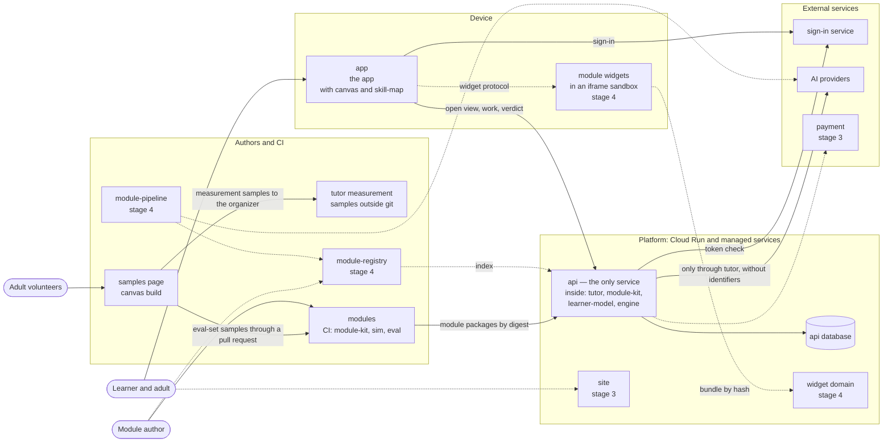

# NovaTrail — architecture

> Status: a draft for discussion, 2026-10-18.
>
> What large parts the platform consists of, what each does and how they are connected. This is the top level: the internal structure and technologies of each part are decided by its repository (R11), starting from its card in section 3. Where the code lives and in what order the repositories appear is in [repositories.md](repositories.md); the open technical questions Т-… are in repositories 8.
>
> The concepts are in [concepts.md](concepts.md), privacy is in [privacy.md](privacy.md), the decisions are in [decisions.md](decisions.md).

## 1. Principles

- **The boundary of R03 runs along the code.**
  - Everything that calls a model is in `tutor`. A model that would read the work on the device is its code too: its weights, eval and admission are with `tutor`, and the verdict is with `module-kit` (R66). In the first slice there is no such reading.
  - The verdict is given by `module-kit`, the learner model is computed by `learner-model`, the next lesson or task is chosen by `engine`. None of these libraries calls a model.
  - CI of `api` checks the full list of dependencies: the SDKs of AI providers get into the build only through `tutor` (R15).
- **Of the platform's parts, only `api` stores learners' data on the server.**
  - `tutor` stores nothing. The types of its requests have no fields for the learner's and account's identifiers, so AI sees the work but does not know whose it is (R15; privacy 1, 5.1).
  - Outside the platform, part of the data is held by the sign-in service, the AI providers and, from stage 3, payment (section 5).
- **A separate process only where it is needed.** In the first slice there is one service, `api`; `tutor`, `module-kit`, `learner-model` and `engine` are libraries in its process. `tutor` will become a service when it gets a second consumer (R15).
- **The key of an unsolved task is only on the server.** The app gets the task's open view (R05). The open view is built by `module-kit` by the marks `x-open` in the format's schemas: a field without the mark is closed, so a new field of the format is closed until it is explicitly opened (R45).
- **Reproducibility** (R03):
  - an attempt stores the digest of its module package, the module format version, the version of `module-kit` and the seed. A package digest is the digest of its inventory, and it depends only on the module's files and the format version of its manifest ([format text](../format/README.md), section 25; R62). A module is checked and executed by the format version that its manifest names, and a new format version does not change its verdict until the author moves the module to it (R44);
  - an engine choice stores the versions of `engine` and `learner-model`, the package digests, the seed and the reason code, and also the release of `modules`, the number of the last evidence of the log by which it was made, the time of the choice, the grade by which the model computed the starting point of modules without evidence, and whether the pool was limited to tasks without AI: without them a replay by the log does not know which prefix of the log to take, which withdrawal marks were in effect then, for what time the model computed retention and the review date, by which grade — the starting point of modules without evidence, which lesson runs and closed attempts of tasks with a rubric the engine saw — their reason and end time, once written, do not change, — and from which pool it chose (R80; В4, В14, В15 and В18 `api`; R04 and R08 learner-model; concepts 12). The summary of issues the replay assembles anew from the records of choices and attempts before this choice: once written, they do not change (R104). The choice also stores the skill chosen on the skill map — it holds until the learner asks for something else, and the record carries it into the next one, — the age category of the profile at the time of the choice, by which `api` selected the pool and the lessons, and a mark of which of the digests are the engine's modules, connected and suitable for the learner: the category changes at the yearly refinement and at a change of country, the connections at any time, and the digests also name the modules of the log, which only `learner-model` gets. The seed is empty while the engine takes no randomness, and it takes none: that this is so is seen from the version of `engine` in the same record. The last attempt and its outcome the replay derives from the records of choices and attempts before the time of the choice (R107);
  - a verdict is repeated by the stored observation, a choice by the evidence log (R80); both without AI;
  - the generator of randomness and the derivation of seeds are set by `spec`, with test vectors: PCG, as in Go's `math/rand/v2`, and places of randomness, as at standalone's simulator ([format text](../format/README.md), section 22; R59; Т-18 closed). An instance of a task template is repeated by the attempt's package and seed: it is chosen by one number of the place `template`, the task's ID, `instance` ([format text](../format/README.md), section 23; R60).
- **Our own parts of the interface are assembled at build time, others' code runs only in an iframe sandbox** (R16, section 6).
- **No clusters, queues or event bus of our own** (R11). The parts talk by synchronous requests by the contracts from `spec`: `app` with `api` by Connect, with unary calls, and the code of the contracts comes from the releases of `spec` (R83). Background work is Cloud Run jobs on a schedule, as in canvas-api.
- **Logs without direct identifiers, IP addresses and content** (R09; privacy 4).
  - Cloud Run itself writes request logs with the standard field `httpRequest`, and it has `remoteIp`, the client's IP address. canvas-api recorded the same about the logs of Cloud Run and Firebase Hosting (privacy 4 canvas-api).
  - COPPA counts an IP address among persistent identifiers, that is, among personal information (16 CFR 312.2).
  - So the request logs are excluded in Cloud Logging by the filter of each sink: Google accepts the record and discards it before storage (R07 infra), — and the logs' region is `us-east4`, as for the whole platform (R109).
  - The hosting of `app`, Firebase Hosting, and the sign-in service, Firebase Auth, store IP addresses in their logs themselves, for several months and several weeks; `infra` does not turn on the export of the Hosting logs to Cloud Logging (R06 infra; section 3.12; П-9).

  Sources: sources 3.1, 4.1, 4.2 and 4.4.

## 2. The overall diagram

Solid arrows are the first slice, dashed ones are later. `tutor`, `module-kit`, `learner-model` and `engine` are not drawn separately: they are libraries inside `api`. How the repositories depend on each other at build time is in repositories 3.

## 3. Components

Each component has a card: what it does and does not do, its data and links, its repository and stage (product 11). The items "To decide when detailed" are what the work in its repository begins with (repositories 2.2). A question that concerns several repositories is in the registers of `spec`, and the card refers to it.

The task that set up a repository (RUN.md, T04–T14) could name items of detailing beyond the card, and could skip an item of the card. The card is corrected for this by the repository's own «Итог детализации», by a row of its table 3 «в реестр spec», when the decision has already been made, and not in advance.

### 3.1. app — the learner's and adult's app

- **Does:**
  - the shell: sign-in through the sign-in service, the choice of the learner on a shared device, the start of work — age, country, consent; the learner's grade — when the module manifest names grades (R49);
  - three entries into the app: "My subjects", "Skill map" and, later, "A task from my paper" (product 4);
  - the lesson player and the task screen: the canvas, answer slots, the choice of an option, the tutor's panel with the solving steps and hints, the conversation line. The conversation line of the first slice is buttons of requests, a hint and "explain differently" (R82), without the learner's own text: own text comes later, as a capability of `tutor` of its own (product 10; В40 `app`). The text of an item of a handwriting sheet `app` shows together with the options of `choice`, beside the sheet, not on it; the item line of a workbook is shown by the canvas (R32 and R34 canvas). The task's skills, band and difficulty are not in its open view (R51), nor are its techniques, traps, simpler case, leak phrase and solution (R57);
  - a lesson by its open view: the segments in the author's order, explanations — and the numbers of a numbered list in them are drawn by `app` (R111), — worked examples, whose demo the learner opens one part at a time and may hide, and the lesson's tasks, which `api` gives. The lesson's skills and age categories are not in the open view (R58);
  - progress and the skill map;
  - the section for adults behind a PIN: profiles, tariff, own key, settings, export and deletion;
  - the disclosure that the learner talks with AI, not with a person (privacy 5.3; П-15);
  - before sending a work that goes to AI whole, a reminder not to write names, and to a learner under 18, at work with a rubric and in the section "Help", open to them from any screen, where to turn if something is wrong: to an adult and to the helplines of their country, by name and number, without links, by a list with a date of checking (R127);
  - voicing of the tutor's words and the module's open texts by the device's speech synthesis, in a voice that it names itself, by the rule of Т-13. Whether voicing is on and its speed are in the presentation style of the learner's profile, and the voice by language and the adult's permission on Android and Linux are on the device (R07 app; О-23);
  - the interface in `en` and `ru`: the learner's interface language is a field of their profile, which the adult sets, and the screens before the choice of the learner and the section for adults are in the device's language (R92). Translations follow the shared rules of the UI packages, and the words that more than one package shows follow the table of words in section 6 (R91);
  - legal pages and consents: the texts from `api`, by the method `LegalService.GetLegalTexts`, as its own pages, without external links, and for a consent, its gist in the screen's language beside the English text (R115, R116, R130);
  - accessibility by the standard of the UI packages, WCAG 2.2 AA with 2.5.5 and 2.3.3 (R90). What `app` and the packages do not meet yet, `app` names on the page "Accessibility", among the legal pages (section 3.13; R11 app).
- **Does not:**
  - does not get the key, the solution and the traps of an unsolved task, and its technique only from `api`, at the step that gives it, or at the learner's request, and the task's leading question also from `api`, on request (R57; R108);
  - does not give a verdict;
  - does not call AI providers;
  - does not send strokes and the whole photo to the server, but for a stored work, while the storage of the profile's works is on (R113).
- **Data and links:**
  - on the device: strokes with time and pressure, artifacts, and the own key only for an owner profile of the category `adult` and only by its choice on this device, otherwise in the tab's memory. `app` sends the key with each request of this profile that calls AI (R84; R08 app). Also the context of each submission: on a handwriting sheet, where the crop lies on the sheet, its integers, the group boxes of the stroke groups, the table "group label → stroke IDs" and the submission's digest, and on a workbook, the table "box → stroke IDs" and the digest. The canvas gives it together with the work, and `app` holds it as it is: by the digest the canvas accepts the context back (R36);
  - talks with the sign-in service and with `api` by the contract `novatrail.api.v1`: the check of an attempt is `AttemptService` (R97), the account and profiles are `AccountService`, and by the list of profiles and the refusal "account gone" `app` erases what lies on the device (R98); the path from a module to a task is `PackageService`, `ModuleService`, `LearningService` and `ProgressService`: open views by package digest, the catalog and the connected modules, the engine choice, the start and the open attempt, lessons by runs, the skill map and the adult's progress (R99); the stored works are `WorkService`: `app` puts a work at each submission and when the attempt closes, while the storage is on, and takes it back on another device and into the export (R113, the 2026-11-13 amendment);
  - reads the deployment configuration at each start from `/deployment.json` at the root of its origin, beside the signed build but not in it, and checks it strictly, before the first request to the network. The file's format is the part of `spec` `deployment/` with its own version, and version 1 is the format of R09 app: `format`, `api` and `signIn` ([the part's text](../deployment/README.md); R85 with the amendments of 2026-11-08 and 2026-11-09). The build carries a copy of the part's schema from the release of `spec` it stands on, `deployment.schema.json`, and by it names the version it reads, and the CSP template `csp.json` is its own, by its own code (the second 2026-11-09 amendment to R85). The form of the template — an object "directive → string of sources" with the places `{api}` and `{authDomain}` — and the layout of the archive — at the root `index.html`, `assets/`, `deployment.schema.json`, `csp.json`, `NOTICE` and `LICENSE`, without `deployment.json` (the 2026-11-11 amendment to R85), — are held by architecture 3.7 app as the rollout of `infra` reads them (R17 infra; the third 2026-11-09 amendment to R85). `app` itself stands at the root of its origin;
  - gets the task's open view from `api` and reads it by the types from the releases of `spec` (R36), of the module format versions in the window. The TypeScript types are the npm package `@altnovatrail/spec`, `@altnovatrail/spec/formatv0/open`, by an exact version in `devDependencies`, and `api` reads the same view by the Go types `types/formatv0/open` (R72, R73). While the format is v0, `app` and `api` move to a new version together (R44; repositories 4);
  - builds into itself `canvas` and `skill-map` as web components (R36), by an exact version from npm (R37). The version's signature is checked by the recipe of `spec` `release-verify` in CI of the pull request that changes the lock file (R77). To the canvas, with the task, it gives the open view of the manifest of its module, by the property `manifest`, and the files of its pictures, by the function `media`, from the files of the device part, which `api` serves (R36 and the 2026-11-02 amendment to it). The element's types are `@altnovatrail/spec/canvas`, in the same package and by the same exact version (R74). The manifest it gets from `api` by the package digest — of the attempt, and before the first attempt, of the current version of the connected module, — once per package, and caches it by it, not with each task (R62 and the 2026-11-04 amendment to it). The open views of a withdrawn version of a module it removes from the cache: about withdrawal it asks `api` at launch, by the request `CheckPackages` (R63; R99);
  - takes the icons of its buttons from the set Material Symbols by the table of values in section 6: the package `@iconify-json/material-symbols` by an exact version, embedded at build time, in `dependencies`, like everything the bundler embeds (the 2026-11-02 amendment to R39). The app does not call the Iconify API (R78);
  - later, with the text canvas, voices its "listen" by the event `speak` with the same speech synthesis as the whole app (R36; Т-13). In the first slice there is no text canvas (R41);
  - opens module widgets through the widget host from `canvas` (section 3.4).
- **Repository and stage:** `app`, stage 2.
- **To decide when detailed:** everything is decided: the detailing ended 2026-11-02 (T08 `app`): the framework and build — R03 app; storage on the device — R04 app; the solving steps — R05 app; the lesson player — R06 app; voicing — R07 app; the own key — R08 app and R84; the deployment configuration — R09 app and R85; the interface languages — R10 app and R92; accessibility — R11 app and R90 (В38 `app`). What `app` decides next is in its `docs/architecture.md`, section 3.10.
  - the framework and build: in canvas-api, React 19 and Vite 8 (R47 canvas-api), in standalone, Preact. The UI packages do not impose a framework (R36). Each package depends on the types of `spec` by its own copy at an exact version, not by `peerDependencies`: the package carries only declarations, and the copies cost nothing (R73). Added 2026-11-02: and by what the build embeds the icons of the set — a bundler plugin or a script on `@iconify/utils`, without auto-installing sets, — and how `app` keeps the same version of the set as the packages it built in (R78). Everything the bundler embeds stands in `dependencies`, and in `devDependencies` only tools (the 2026-11-02 amendment to R39; Т-36 closed);
  - what is stored on the device and how much, including the submission context (R36);
  - the solving steps: `app` leads them by the open view, and the exit conditions of a step are events on the device, without the key. Added 2026-10-27: the steps and their exit conditions — `givens_ticked`, `answer_slots_filled` and `none` — are in the open view of `solving-steps.yaml`, and the chips "givens and unknown" are in the task's open view. What "there is something in the slot" means for the bindings `anywhere` and `sheet` is decided by `app` and `canvas` (R57; RUN.md, Д38). Added 2026-10-27: on a workbook it is the canvas property `filled` (R36; RUN.md, Д41). Added 2026-11-01: the exit condition `answer_slots_filled` `app` reads by the slot binding — for `choice` by its own choice of an option, for other slots by the canvas's `filled`, and on a sheet `filled` says whether a slot `anywhere` or `sheet` has a stroke (the second 2026-11-01 amendment to R36; RUN.md, Д58);
  - the lesson player: how the segments follow one another and how the demo opens by parts and hides. The mark "sequential" of a module whose skill graph is a chain `app` derives from the tiers `skill_tiers`: the module has no fewer than two skills, and each stands in its own tier (R58 and the 2026-11-02 amendment to it; RUN.md, Д39). Added 2026-11-01: the parts of the demo are opened and the whole demo is hidden by the learner with the buttons of the canvas element, and `app` leads the segments, gives each segment a new element, keeps the state of the demo by the event `demochange` and returns it by the property `demoState`. What to do with a state saved for another version of the module, whose example no longer has the demo, is decided by this detailing (the second 2026-11-01 amendment to R36; RUN.md, Д58);
  - voicing, at first by the device's speech synthesis (Т-13). Added 2026-11-02 (В17 `app`): decided by R07 app, in "Does" above;
  - the adult's own key on a shared tablet: for a child's profile it is not used (Т-9, О-4). Added 2026-11-02 (В20 and В21 `app`): decided by R08 app and R84, in "Data and links" above;
  - the deployment configuration — the address of `api`, the parameters of the sign-in service — is read at run time, not embedded in the build. Then self-hosting takes the same signed build. Added 2026-11-02 (В24 `app`): decided by R09 app, in "Data and links" above;
  - the interface languages (О-2) and accessibility. The translation scheme and the accessibility standard are shared by the UI packages, and their input is the captions and the row of buttons of `canvas` (R36). The accessibility level waits for О-24, and the sheet is scrolled with a single pointer by the buttons "Up" and "Down" in the row of `canvas` (R33 canvas; О-24, added 2026-10-27). Added 2026-11-02 (В30, В32 and В33 `app`): decided — the accessibility standard of the UI packages R90, and О-24 is solved; translations — R91; the interface language — R92.

### 3.2. canvas — canvases

- **Does:**
  - canvas kinds (concepts 8); in the first slice, the handwriting sheet and the workbook (product 10; R41). A workbook is a page of 1000 × 1400 units, like a sheet, without a grid: the item lines with boxes are put on the template layer by its layout, by the task and its own table of widths, not by the device's font (R34–R36 canvas);
  - layers: the template, the widget, the demo, the learner's work, the tutor's layer. On the demo layer is the demo of a lesson's worked example: its parts open one at a time and hide all at once, and a picture in a sheet area stands at the size of the area. From format 0.4 an example stands on a workbook too: the example's lines by the page layout, and a part of the demo fills a box with its value (R111). On the sheet and on the workbook of an example the learner does not write (R58). The parts are opened one at a time and the whole demo is hidden by the learner with the element's buttons, "Next" and "Demo" (R42 canvas);
  - tools; the eraser removes a stroke whole;
  - the capture of strokes with time and pressure;
  - the display of the module's content: the task statement, above the handwriting sheet and above the workbook page (R23 and R34 canvas; R51), and media; there are no formulas in the statement of format v0. The text of a sheet's item and the options of `choice` are shown by `app`, and the item line of a workbook by the canvas (R32 and R34 canvas);
  - the crop of the work for the check: on a handwriting sheet, only the visible strokes of the sheet of 1000 × 1400 logical units (R06 canvas), and on a workbook, a crop of each filled box by its strokes; the draft — writing outside the boxes — does not go (R34, R37 and R38 canvas; R53);
  - the tutor's marks, tied to the learner's strokes (R43 canvas-api). On a workbook a mark stands on an answer slot by place and holds on to the strokes of its box (R39 canvas);
  - the samples page, a separate build of `canvas` for eval samples (R25):
    - a sample is made by the same canvas as the learners have, and is saved as a file on the device. The file's format is the eval protocol: the message `Sample` of the package `novatrail.eval.v1`, one JSON per sample, without pressure, and for an eval-set sample, with the license in the file ([contracts text](../contracts/README.md), section 11; R93). It is written by `canvas` with the contract's code from `@altnovatrail/contracts`, and checked by a recipe of `spec` through the submodule, `just -f spec/justfile sample-check` ([contracts text](../contracts/README.md), section 11; RUN.md, T72). The groups, crops and box table of a sample follow the rules that are the same for the device and the runner, and the crops are drawn by the strokes that the file holds, for the final geometry too ([contracts text](../contracts/README.md), section 12; R94);
    - an adult's sample has two purposes, and it is chosen on the page itself: a measurement sample goes to the measurement organizer, outside git, and an eval-set sample to the eval-set organizer, and it is they who add it to `modules`, by a pull request from a branch of the repository (R04 modules; the 2026-11-02 amendment to R25). The volunteers' consent is П-16;
    - the page takes no consent: it shows the purpose's notice and writes the version of the text set into the file, and the written consent is a signed form that the organizer accepts outside the page. The sets `measure` and `eval-set` are in force, and the page opens the volunteers' measurement and the eval set, and the child sample session is closed until the set `child-sample` is in force (R139, R141; RUN.md, T117; R11 and R72 canvas);
    - a child sample is with a separate consent (П-10) and without a pull request: it does not get into the repositories, and the file goes to the operator's closed bucket, to the measurement organizer, for 2 years from the session (R125; П-10 and П-12 closed);
    - nothing goes to the platform's server;
    - for the first measurement on the volunteers' samples, without hosting: the build is downloaded from the release of `canvas` and opened on a computer and on Android; on an iPad, only from hosting: the page will move to Firebase Hosting as a separate site with its own origin when the author so decides: the analysis is done, Google is a processor for Hosting, and it keeps IP addresses "a few months" (the second 2026-11-08 amendment to R25; R128), and until then the page says that it cannot be opened here (the 2026-11-08 amendment to R25); and the tasks and media files are put into it at build time from the release of `modules`. Until the build has moved to `modules` — by a task of `canvas` of its own, Д4 of its RUN.md, — the measurement tasks come from the release of `tutor`: the file of open views, since its v0.1.1, `canvas` keeps as a copy in the tree, which CI checks by the recipe `release-verify` on every pull request, and the build of the page and the synthetic data read it without the network (the 2026-10-21 amendment to R25; the amendment of T21 to R08 canvas; the `canvas` row В73);
  - later, the widget host: the app's side of the widget protocol. It passes the tests of conformance to the protocol, as the widget does (section 3.4).
- **Does not:** does not know accounts, `api` or subjects. The tutor's layer does not change the learner's work (R05).
- **Data and links:**
  - it has no data of its own: the submission context is held by `app` (R36);
  - enters its consumer as a web component, one element `<novatrail-canvas>` for all canvas kinds. The element gives the writing history by the property `history` and the event `historychange` and takes it by the same property, and the work for the check by the method `exportWork()`: on a sheet, the PNG of the crop and the submission context, on a workbook, the crops of the filled boxes with their places and the workbook's context, and which boxes are filled is told by the property `filled`. The module manifest of the task it takes by the property `manifest`, and the files of the pictures of the task and the example by the function `media`, which for a link to a picture gives a promise of a `Blob`: the canvas does not go to the network. The commands `undo()` and `clear()` are called by its own buttons, and they are not part of the agreement (the 2026-11-02 amendment to R36). The tutor's marks it takes by the property `marks`, together with the context of their submission and after `task` and `history` (R26 canvas). The learner's change of tool it announces by the event `toolchange`, and the language of its buttons' captions it takes from its attribute `lang` (R36). Instead of a task it takes by the property `workedExample` a worked example of a lesson, and how far the learner has gone through its demo it gives by the property `demoState` and the event `demochange`. `app` keeps this state and returns it by the same property, and gives each segment of a lesson a new element. On a sheet `filled` says whether a slot `anywhere` or `sheet` has a stroke (the second 2026-11-01 amendment to R36). The types of this agreement are `@altnovatrail/spec/canvas` from line 0.5: `CanvasElement` and the types of its events, of the writing history, the work, the submission context and the state of the demo. `spec` writes them by hand (R74). The types of the marks are there too: `Marks`, `Mark` and `Anchor`, and the kind and place of a mark are checked against the message `Mark` of the contract `novatrail.api.v1` (R97; the second 2026-11-03 amendment to R74). An empty box of a workbook the mark circles by itself (R97), and `canvas` takes this by its move to the tag (RUN.md, Д50). The element in `HTMLElementTagNameMap` and its events in `GlobalEventHandlersEventMap` are put by the package `canvas`. The styles of its Shadow DOM the element sets by `adoptedStyleSheets`, without an embedded `<style>`, and of the consumer's CSP it requires only `img-src blob:` (the second 2026-11-02 amendment to R36);
  - shows the open view by the types from the releases of `spec`, of the module format versions in the window, and releases a new canvas kind earlier than the module that takes it (R44; repositories 4). The TypeScript types are the npm package `@altnovatrail/spec`, by its own copy at an exact version in `dependencies`: the `.d.ts` of the package `canvas` refer to its types (R73). Since `v0.4.1` the types of the task and the manifest in `canvas` are from this package (R41 canvas). Its own are the narrowed types of the check and the temporary field `canvas.tools`, and until the move to line 0.5 or newer, the types of the element too (RUN.md, Д50);
  - the icons of the row's buttons are from the set Material Symbols, by the table of values in section 6: the package `@iconify-json/material-symbols` by an exact version in `devDependencies`, embedded at build time. The button's name stays its caption, and the caption is always visible (R78; R90);
  - accessibility by the standard of the UI packages (R90): zoom of the sheet up to 200 % with scrolling in two directions, the workbook's lines and boxes in the accessibility tree, the keyboard into the sheet and out of it, a row of buttons that does not stick in a low window, frames of `exportWork()` without the theme and forced colors, and its own axe-core. What the element does not meet yet, `canvas` declares itself, in architecture 3.10 canvas (R74 canvas), and `app` takes it onto the page "Accessibility": 1.4.12 — the printing of the workbook's lines keeps the width of the pieces by the page rule `format/page.yaml`, and it gives no margin for the user's text spacing, — and 3.1.2 — the name of the sheet's region when the element has no attribute `lang`: `app` always sets it, and this does not happen with it. The nonconformance 3.1.2 of the value of the demo step `fill` went away with the release `canvas` `v0.3.14` (the second 2026-11-12 amendment to R90). The element has no nonconformance 1.4.4: the sheet is enlarged up to 200 % by the buttons "Zoom in" and "Zoom out", and scrolled sideways by "Left" and "Right" (R73 canvas; the 2026-11-12 amendment to R90). Translations of the captions follow the shared rules of the packages, with placeholders instead of concatenation and plural forms, and the shared words follow the table of words in section 6 (R91);
  - the rules of stroke groups, the crop, the snapping of marks and the workbook's boxes are the eval protocol ([contracts text](../contracts/README.md), section 12), and their test vectors `canvas` takes from the npm package `@altnovatrail/contracts`, `vectors/eval/v1/`, of the same exact version as the submodule `spec`, checked by `release-verify-npm` (R77). Its own vectors of groups, the crop, snapping and boxes go away, and `pages.json` stays until the page rule of the workbook (R94; RUN.md, T38 and Д96);
  - the consumers are `app` and the samples page, and CI of `tutor` takes synthetic samples from the release of `canvas` (R38);
  - synthetic data on the module's tasks: the generator `synthetic` takes the open views of the tasks from the module package of the commit where the samples go, as `module-kit build` writes it — the call gives the package, — and writes samples with the source `modules` and the tag of the newest release of `modules`; the tasks and seeds are named by the call (R110);
  - the text sets of its purposes the samples page takes from the file of the release of `spec` `legal-<version>.tar.gz`, which `release-verify` accepted, and opens a purpose only with the current set; into the sample file it writes the set's ID and its version (R130; R11 canvas; the 2026-11-09 amendment to R93);
  - the samples page opens a sample file without the network — the strokes of the final geometry, the crops and the texts of the markup, — changing nothing, saving nothing and not calling AI: so the eval-set organizer and the module author look at a sample before push (R110; П-12);
  - everything that `canvas` puts out is the files of one GitHub release with the signature of the shared `release.yml` of `.github`: the package, the build of the samples page, the synthetic samples. The same package file goes out to npm, `@altnovatrail/canvas` (R37; R08 canvas);
  - CI of the build of the samples page takes, by an exact tag, the CLI of `module-kit` — its command `open`, by the form of the call in architecture 3.6 module-kit (R43 module-kit; R102), — and the release of `modules`, with the signature checked by the recipe of `spec` `release-verify` (R77), — and while `modules` has no content, the release of `tutor`: so the tasks and media files get into it, and the package itself does not know subjects (R25; repositories 3). Before the build CI reads the withdrawal marks in the index of the newest release of `modules` and does not build the page from a withdrawn version of a module, and the child sample session is run by the build of the latest release of `canvas` (R63);
  - later, the module preview for the author and the card of the MCP channel.
- **Repository and stage:** `canvas`, stage 2, the first code of the stage, together with `tutor`. Its code was started before items 3 and 4 of repositories 6.
- **To decide when detailed:** everything is decided: the detailing ended 2026-10-21 (T05 canvas). Added 2026-10-22: the workbook entered the first slice instead of the text canvas (R41), and `canvas` details it — the page, the answer slots, the slot's crop and the template layer. Added 2026-10-26: the format sets a workbook item as a line of pieces of text and boxes in order, and how the lines lie on the page is decided by `canvas`; the digit height on the crop is set by the module manifest, and the grid and its step by the sheet's task (R51). Added 2026-10-27: the task got the open fields `givens` and `unknown`, and the temporary types of the open view take them; the step's exit condition `answer_slots_filled` asks the element whether there is something in each slot (R57; RUN.md, Д38). Added 2026-10-27: the demo layer, empty in the first code, gets the demo of a worked example — parts one at a time, pictures in sheet areas, and the demo can be hidden (R58; RUN.md, Д39). Added 2026-10-27: the workbook is decided (R34 canvas) and built (R35–R39 canvas). The agreement with `app` about it and the property `manifest` are the 2026-10-27 amendment to R36, the crop per box and the place by slot are the 2026-10-27 amendment to R53, the rule of boxes and the workbook sample are the eval protocol (RUN.md, epic E3), the limit of lines for authors is RUN.md, T38 (RUN.md, Д41). Added 2026-11-01: the types of the agreement with `app` are released by `spec`, `@altnovatrail/spec/canvas`, and the test vectors of groups, the crop, snapping and boxes come out in the releases of `spec` together with the eval protocol, by its task (R74; RUN.md, Д50). Added 2026-11-01: the task's fields, `givens` and `unknown` too, the element takes from T55 `canvas`; `filled` on a sheet, the worked example and the state of its demo are the second 2026-11-01 amendment to R36 (R42 canvas); the limit of a workbook's lines is a format rule from T38, and for now a guide for authors in the [format text](../format/README.md), section 14 (the 2026-11-01 amendment to R51; RUN.md, Д57 and Д58). Added 2026-11-02: the icons of the row's buttons are the set Material Symbols by the table of values in section 6, embedded at build time (R78; RUN.md, Д61). Added 2026-11-03: the rules of groups, the crop, snapping and boxes came out with the eval protocol, and their test vectors as messages of the protocol in the releases of `spec` (R94; RUN.md, Д96).
  - The drawing engine is our own code on the browser's API (R05 canvas).
  - The logical coordinates are a sheet of 1000 × 1400 units, and a crop goes to the check (R06 canvas). A place in the observation is in fractions 0–1000 of the crop, and `canvas` converts it into the sheet's units (R53); on a workbook the place is an answer slot by place (the 2026-10-27 amendment to R53).
  - The docking is a web component (Т-21, R36; R07 canvas). Publishing is npm (Т-26, R37; R08 canvas).
  - The composition of the sample file is the eval protocol (R93), by R09 canvas; the steps of the samples page are R11 canvas. The page writes the markup into each sample by the field `markup`, before saving: the slot truth, and on a sheet, the writing parts with the first error and the result, not the lines. Who did the markup the file does not name: it follows from the origin and "who wrote", and the people's marks on an essay are added by the organizer ([contracts text](../contracts/README.md), section 11; R95).
  - The workbook is R34–R39 canvas: the page and the layout, the template layer, the rule of boxes and `filled`, the work for the check and the marks on boxes.

  Open is what waits for `spec`: the set `child-sample` in force (RUN.md, T117) and the group boxes of stroke groups at the check (Т-31). The accessibility level was decided by R90, and О-24 is solved (В30 `app`). What `canvas` decides next is its `docs/architecture.md`.

### 3.3. skill-map — the skill map

- **Does:** draws the skill graph and the state of the learner model by ready data from `api`: tiers, prerequisites, knowing. The graph and the tiers `app` takes by the digest of the current version of the module, `GetSkillGraph`, and the state of the skills by `GetSkillMap` (R99).
  - The package lays out the graph on the device itself, in bands of tiers from top to bottom, with a band of anchor skills before tier 1 (R06 skill-map).
  - The state of a skill with a verdict it derives from the graph and the ready marks of `learner-model` — "mastered", "time to review", "in progress", "can start" or "still closed", — and a skill with a rubric or without assessment has a mark instead of a state (R03 skill-map).
  - Only a skill that is not closed may be chosen for a session, and the engine takes this rule as an input (R104).
- **Does not:** does not fetch data and does not compute knowing. It holds no learner's data on the device: the state of the skills lives only in the element's memory while it is on the page. It shows no ranks in the first slice (R03 and R07 skill-map; О-13).
- **Links:** the consumer is `app`: the learner's screen and the section for adults; later, `site` and the author's tools.
- **Repository and stage:** `skill-map`, stage 2.
- **Enters its consumer** as a web component and goes out to npm, in the scope `@altnovatrail`, like all UI packages (R36, R37). It names its elements itself: it is one element, `<novatrail-skill-map>`, — the properties `graph`, `tiers`, `manifest` and `skillMap`, the attributes `view`, `lang` and `heading-level` and the event `skillchoose` with the full ID of the skill for `ChooseNext`, without methods (R04 skill-map). Everything that `skill-map` puts out is the files of one GitHub release with the signature of the shared `release.yml` of `.github`: the package archive, `LICENSE` and the sums. The same archive goes out to npm, `@altnovatrail/skill-map`: the first version, 0.1.0, came out 2026-11-08 by hand, and the next ones by the npm step of the release through trusted publishing (R37; R13 skill-map).
- **Icons** are from the set Material Symbols, embedded at build time, by the table of values in section 6 (R78).
- **Accessibility and translations** follow the standard of the UI packages (R90): a text alternative of the graph, `lang` on a skill's name, mastery not by color alone, the keyboard and moving the map without dragging. Translations follow the shared rules of the packages, and the shared words follow the table of words in section 6 (R91). The names of anchor skills are English, with `lang="en"` (R50).
- **To decide when detailed:** everything is decided: the detailing ended 2026-11-07 (T05 skill-map; В5 `skill-map`). The items were these: what data for the display `api` gives and how the graph is laid out; how the map shows the tiers — `module-kit` computes them by the graph into the package's canonical view, `api` gives them to the map, and the names are given by the author, and a tier without a name is shown by its number (R49; R62); ranks (О-13). Added 2026-11-04: the contract recorded the map's data before this detailing — the state of the skills of the current version, as `Read` of `learner-model` reads it, and the state of the anchor skills, and the tiers come with the open view of the graph. Whatever else the map needs comes as a row «в реестр spec» and a field of the contract (R99; RUN.md, Д105). The detailing answered: the map needs no fields beyond R99 (R03 skill-map), the tiers are bands (R06 skill-map), and the ranks wait for О-13 (R07 skill-map; В4 `skill-map`). What `skill-map` decides next is its `docs/architecture.md`.

### 3.4. Module widgets

- **What it is:** interactive components of a module on the canvas, the module author's code (concepts 8).
- **How they work** (R16):
  - in an iframe sandbox without `allow-same-origin`, on a separate registrable domain. Together with `allow-scripts` it would let a page of the same origin remove the sandbox (sources 5.1);
  - CSP does not let the widget's code go to the network: only the bundle itself is loaded;
  - the widget talks with the app only by the protocol from `spec`;
  - the bundle is signed and pinned by hash in the module package, and the package is pinned to the attempt;
  - official widgets run in the same iframe sandbox as others';
  - to children, only widgets that passed review (О-9).
- **Stage 4.** In the first slice there are no widgets: none of its three modules needs them (R41). There is no binding of a slot to the widget's state in format v0: it will come with the widget protocol, as a minor version (R51). The template for authors is `widget-template` (section 3.13).
- **To decide when detailed**, in epic E5 of RUN.md:
  - the widget protocol. What it has to decide beyond R16 is by the author's analysis of 2026-10-21 (sources 8.4). The app's side of the protocol is the widget host of `canvas`, which `app` builds into itself (section 3.2); "`app`" below is it (В22 `canvas`):
    - the channel. The HTML Standard says to check the sender of a message by origin, and a widget without `allow-same-origin` has an opaque origin, serialized as "null". A comparison of `event.source` with the iframe's window does not tell documents apart: an iframe has one window, and at a navigation only the document behind it changes. So the analysis advises a `MessageChannel` port: `app` passes it to the widget once, at the first load of the iframe, and then listens only to it, and a document to which the widget navigated later never got this port (sources 5.2). How `app` notices such a navigation is decided by the protocol;
    - the version of the state in each message of the widget: `app` knows to which version the verdict and the tutor's words belong, and a mark on a part of the widget that has changed since then it does not draw, like a mark of a sheet whose strokes were erased (architecture 3.2 canvas);
    - the parts of the widget for marks: the tutor's layer lies over the widget (concepts 8), so the widget names its parts and their boxes, and a mark holds on to a part, as on a sheet it holds on to strokes;
    - the widget reports the learner's state and events, not a verdict. Whether it is correct is decided by `module-kit` (concepts 9.2), and by which state — the one the widget reported or the one repeated on the server by the seed and the events — is decided by Т-24. The widget's seed is its own, not the attempt's seed: the attempt's seed does not go to the device, and how the widget gets its own is decided by the widget protocol (R59);
    - the tests of conformance to the protocol are in `spec`, beside the protocol, like the verdict vectors, and in its releases by the same path as the format's files: as a release file of their own and in the Go module (R64). They are for both sides of the protocol: both the widget and the widget host of `canvas` pass them, each in its own CI (В22 `canvas`). Tests of one side hold only that side: a host that diverged from the test one would break widgets that passed the tests, and nobody would notice. The test host is in the development environment of `widget-template` (section 3.13); whether `canvas` itself will be it, epic E5 will decide together with `widget-template`, and the condition for the host does not change from that. A widget conforms to the protocol if it passes the tests, and the library for authors is a convenience, not a condition;
  - whether the state the widget reports can be trusted (Т-24);
  - the withdrawal of a version of a widget that turned out harmful. A withdrawn version of a module withdraws the bundles of its widgets too: the device no longer loads them, and the reason "dangerous bundle" will come as a minor version of the format together with the widget protocol (R63; Т-30 closed).

### 3.5. api — the platform's service

- **Does:**
  - sign-in: checks the token of the sign-in service;
  - learners: the pseudonym, age category, country, presentation style, default solving mode (concepts 10), interface language (R92, R98), grade — if the module asks for it (R49); consent records; permissions;
  - attempts: stores the digest of the module package, the module format version, the version of `module-kit` and the seed (R44). The attempt's seed `api` takes from a cryptographically secure source when the attempt begins, and does not give it to the device: from the state of a place of randomness its seed can be seen, and the generator is not cryptographically secure (R59); it gives the open view. It gives a task to a learner only if they are in one of its age categories, `age_categories` (R51), and a lesson only if both the lesson and each of its tasks suit the learner (R58);
  - the lesson: its open view — without skills and age categories — and the lesson's tasks by its segments. A lesson's task is the same attempt as outside a lesson (R58). `api` leads a lesson by a lesson run — a row per profile and lesson, on the package where the lesson began, one for all devices, with its own ID (concepts 5; R13 api). The place in the lesson and the state of the demo are held by `app`. The usual end of a lesson is "lesson passed" from `app`, which `api` accepts when all task segments have ended; `api` itself ends a run "unchecked", "not suitable" and "abandoned" — 30 days without actions, — and an early end the rule of `engine` does not give in the first slice (R107); what the contract carries to a lesson is `LearningService`: open a lesson by the choice, a run by its ID and "lesson passed", and the answer that ends a segment's attempt names the next segment (R99; В15 `app`, В16 `api`; R06 app);
  - the task template: the attempt's instance is by its seed, from the package, and Starlark is not run on an attempt: the key of each instance `module-kit` computed and checked at the module's check. To the app, the instance's open view, without the field `template` (R60). The package carries the numbers of each instance, and `api` takes the number `below(count)` and substitutes its numbers by the code of `module-kit`, without executing expressions (R62);
  - the check: a submission → `tutor` reads the work, with two readers for handwriting → `module-kit` joins their observations into one and gives by it a verdict for each answer slot and for the item. `api` stores the joined observation and beside it the tapped choice: by them the verdict is repeated without AI (R03). There are no writing parts and other readings in the observation ([contracts text](../contracts/README.md), section 10; R86). The slot checks' predicates `api` computes by the code of `module-kit` in the request's flow and at once, no more than the process has CPUs (`GOMAXPROCS`): the clock of `module-kit`, 1 s per predicate, runs by wall time, and "unchecked" must not depend on the load. A cancellation of the request's `context` is an error without a verdict: `api` does not record it as "unchecked", and the submission stays without a verdict (В13 `module-kit`; R11 module-kit). A task with a rubric has an assessment by the rubric in `tutor` and feedback by the rubric, without a verdict (R04; R41): a submission ends with feedback, "unreadable" or "unchecked", and the attempt is closed by the learner's "Done". Of such an attempt the server stores how each submission ended, and for feedback, the criteria's marks and the source of the words, without the text of the essay and the words of the feedback (R87; R14 and R15 api). The slot check is in the server part: the app gets neither it nor its kind (R56);
  - by the result of an attempt, evidence into `learner-model`, then `engine` chooses the next lesson or task and writes the reason code, from the pool and lessons, which `api`, when AI is closed, limits to tasks without AI (concepts 12; В14 `api`; R11 api). Inside a lesson the next segment goes in the author's order, and `api` calls the engine when the lesson run has ended or the learner asks for something else (concepts 5; R13 api; В15 `api`). The engine choice comes in the answer by which an attempt outside a lesson or a lesson run ended, and in the answer to "something else" (R13, R17 api; R99). The skill chosen on the skill map `api` stores with the choice and calls the engine with it both for `next` and at the end of a run, until the learner asks for something else (R107). The reason code `api` stores with the choice, and it goes to the device only to an adult, in progress (R100). To the engine `api` also gives the summary of issues, from its records of choices and attempts (concepts 12; R104);
  - the hint ladder: which rung to give and which slot it speaks about — the first "not yet" in order, — when to offer an adult or showing the solution, and when the fallback text is needed (R82). The fallback text of rungs 1–2 is the text of a trap value, a trap advice or the module's rung template, and of the third, the item's simpler case (R57);
  - showing the solution: to a child, from the fourth incorrect answer, and with the adult's setting "ask before showing", on by default, only by an adult action, otherwise the refusal "an adult is needed"; to a learner of the category `adult`, from the start of the attempt. Showing closes the attempt with the outcome "solution shown", and the solution with the key goes to the device only when the attempt was closed by it or by a correct answer (R82; the 2026-11-02 amendment to R05);
  - the task's technique, at the solving step that gives it: `app` names the attempt and the step's place, and `api` answers with the IDs of the task's techniques, empty if there are none. And at the learner's request before the first incorrect answer, without AI and without reading the work, and from format 0.4 together with the task's leading question, when there is one. Which technique it gave, at a step or on request, and whether it gave the question, `api` records, and the evidence carries it (R57; R82; R108). "Givens and unknown" are open and come with the task's open view: `app` shows them, and `api` does not record them (В12 `app`; R82; RUN.md, T62);
  - a hint on request after an incorrect answer — once more the words of the current rung, without AI, — and "explain differently" — the same rung in other words, one call to AI per rung, without the work, with the task's past questions (R82; section 4.1);
  - the leak check, before any text of the tutor goes to the device. So the tutor's words go whole, not as a stream (R54). How it looks for keys and leak phrases is said normatively by the [format text](../format/README.md), section 20, and its code is in `module-kit` (R57);
  - there too, the form check of a hint and the feedback rule of a rubric (R70). A hint is exactly one question, no more than two sentences, letters of the explanation language and no more than 30 words in Russian and 35 in English, and in a language that the measurement did not measure, without a limit of words. Feedback is no more than three sentences and 80 words in English, and a stretch in quotation marks of four words or more is only the learner's words. A hint that did not pass the check is the fallback text, and feedback is the phrase of `app` "no feedback this time", without a repeated call (R87). The code of both checks is in `tutor`, the same as in its eval;
  - the platform AI quota, in dollars by the spending message of `tutor`, per family day, with the caps of the profile and the account by the account's tariff, which comes with the invite code. An exhausted quota is "unchecked" and the fallback text, and the attempt waits (R11, R12 api; concepts 14). From stage 3, tariffs beyond the closed slice and payment (О-14);
  - the own key, only with a request of a profile of the category `adult` (R04 api) and only in the request's memory. At connection `api` checks the key through `tutor`, by a request without the learner's content, and the providers open to the own key of a profile it names by the admission function (Т-20; R84);
  - the legal texts, `LegalService.GetLegalTexts`, without a token: for the platform, the part of `spec` `legal/` from `spec.Legal`, and for a self-hosting copy, from its operator's folder by the configuration's path; with a folder that breaks the part's rules `api` does not start (R115, R130);
  - the account and its profiles, the service `AccountService` of the contract: the list of profiles, by which `app` erases what was deleted on another device, the owner profile, a child's profile — after consent, — consent: the scan of the parent's form by the consent request code, the learner's own consent and its withdrawal, the removal of a waiting one, the age and country anew, — the storage of works, the PIN, the own key check, the share of the platform AI quota, its part of the export and deletion (R98; R136; section 4.5); "report a problem" at an attempt is `AttemptService` (R123; R136);
  - jobs and commands of the operator, like `admin` in canvas-api, and not a separate app:
    - migrations;
    - retention periods (П-9);
    - the consent check: the scan of the form, checked against the consent request code (R116; R136);
    - the triage of problem reports (R123);
    - admission to the closed slice;
    - the list of countries: a learner from the EU or the UK, and an adult too, only after the signing of the DPIA and of the conditions that concern them (П-2 closed: R119; [DPIA](dpia.md), sections 7 and 8);
    - the job after a deployment (R07 api);
    - the change of tariff by code and opening the platform AI after "platform limit" (R11 api);
    - the cleanup of the tuples and `changelog` of OpenFGA (R04, R05 api);
    - finishing deletions and deleting users of the sign-in service without an account of `api` (R21 api);
  - in the first slice, holds in its image the module packages — all versions of the index of the pinned release of `modules` in the format's window, withdrawn ones too (R07 api), — and serves the files of their device parts — media files, `LICENSE` and `NOTICE` (section 3.10). A new attempt `api` gives only on a version that the index of the pinned release of `modules` does not mark as withdrawn. A withdrawn version stays in the image only for repeating a verdict: the attempts begun on it are closed "unchecked", and `api` no longer serves the files of its device part (R63). The open views are built by `module-kit` from the server part: the manifest, the skill graph with tiers, the technique catalog and the solving steps `api` gives without a token by the digest of any package that the image gives — of an attempt, of a lesson run and of the current version of a module, — a lesson's to a learner whom the lesson suits, a task's with an attempt (R62 and the 2026-11-04 amendment to it; R99).
- **Does not:**
  - does not store the pictures and sound that go to the check, nor own keys; stored works only while the storage of the profile's works is on, and by default not, each put, listed, read back and erased one at a time by `WorkService`, at most 4 MiB, and not read by the server (R113, the 2026-11-13 amendment);
  - does not call AI providers bypassing `tutor`;
  - does not write direct identifiers, IP addresses and content into logs.
- **Data and links:**
  - the database of `api` is the only store of learners' data among the parts of the platform. It is Neon Postgres, and the store of OpenFGA is a second database of the same project (R04, R05 api);
  - talks with the sign-in service, with the AI providers through `tutor`, later with payment.
- **Repository and stage:** `api`, stage 2.
- **To decide when detailed:**
  - sign-in and permissions — decided by R03, R04 and R20 api: Firebase Auth, sign-in through Google, Apple by the first deployment; an ID token with revocation on every request; permissions are OpenFGA in the process of `api`, the subject is the account, the profile is a parameter of the request; a fresh sign-in is `auth_time` no older than 5 minutes. For teachers, permissions will be needed in the form "who got access to what and in what role";
  - the database and where the learner model lives (П-7) — decided: the database is Neon Postgres, and the store of OpenFGA is a second database of the same project (R04, R05 api); the learner model is in the database of `api` (R80; R06 api);
  - the evidence log and the state of the skills (Т-22) — decided by R80: the log is append-only, and the state is a cache;
  - which version of a module a new attempt gets — decided by R07 api: the newest by semver non-withdrawn version of the pinned index in the format window of `api`, one for all learners, and a lesson's task is on the package on which the lesson began (R13 api). An attempt stores the digest of its package. The configuration is `modules.json`: the tag of the release of `modules` and the digest of its index (R63). Attempts on a withdrawn version and outside the window are closed "unchecked" by the job after a deployment and by the check at a request, and `api` gives neither the files of the device part nor the open views of such a version (R44, R63);
  - the transfer of progress by the table of correspondence of old skill IDs to new ones after a major version — `retired_skills` of the skill graph (concepts 3; R49). Decided: `api` cuts off evidence `wrong_key` and gives the log and the graphs of the current versions, and the transfer is done by `learner-model` by the conditions of card 3.8 (R08 api; the 2026-11-02 amendment to R80);
  - showing the solution (О-7) and a hint at the learner's request (О-21) — decided by R82 (R09 and R10 api): showing to a child from the fourth incorrect answer and with the adult's setting "ask before showing", to a learner of the category `adult` from the start of the attempt; a request before the first incorrect answer gives "givens and unknown" and the technique, and from format 0.4 also the task's leading question, which the evidence carries, like the technique (R108; the 2026-11-08 amendment to R82), after it, the current rung without AI, and "explain differently" once per rung; the slot of the rung and of the fallback text is the first "not yet" in order. An unsent work the request does not send for reading, and on a pause the work is not read: only the button blinks (R69);
  - what the learner sees instead of rubric feedback that did not pass the feedback rule (R70), and an essay that cannot be read (R75) — decided by R87 (R14 and R15 api): the phrase of `app` "no feedback this time" and the submission end "unreadable", without a verdict, and of the attempt the server stores only how each submission ended and the criteria's marks (П-19 closed);
  - the lesson — decided by R13 api: the lesson run, its start at the request of `app`, the end of a segment and the run end reasons; the contract is `LearningService` (R99; В16 `api`), and what is needed from `engine` is card 3.8 (В15 `api`; R58; RUN.md, Д39);
  - tariffs (О-14) and payment — stage 3. The quota of stage 2 — decided by R11 and R12 api, and its numbers are an input of О-14;
  - the protocol between `app` and `api` — decided by R17 and R18 api: the requests by the table of architecture 3.9 api, on the wire binary protobuf (the third 2026-11-02 amendment to R83). The format, protobuf and buf, was decided by R11, and the layout, the rules of buf, the versions, the generated code and the transport Connect by R83; what `api` needs from the contract is in RUN.md, at table 1 and in T62–T64 (В25 `api`). The contract is the package `novatrail.api.v1`: the check of an attempt, `AttemptService`, — the submission, the verdict, the tutor's words and the marks, "Hint", the start of a step, showing the solution and "Done", — with one enumeration of the causes of refusals and outcomes (R97; [contracts text](../contracts/README.md), section 15), and the account and profiles, `AccountService`, — sign-in, the list of profiles, the owner profile and a child's profile, the PIN, the own key check, deletion and export (R98), and the path from a module to a task, `PackageService`, `ModuleService`, `LearningService` and `ProgressService` (R99). `api` gets it by its move to the tag (RUN.md, Д99, Д101 and Д103);
  - the real-time channel — decided by R19 api: in the first slice there is none, and the check of handwriting is two requests (Т-25);
  - from stage 4, the predicates of the checks of third-party modules in a separate process with a memory limit: go.starlark.net does not count memory, and Go's `recover` does not catch running out of memory and a stack overflow (О-9; R11 module-kit). A computation that the limit stopped is a computation error, that is, "unchecked" ([format text](../format/README.md), section 15);
  - deletion — decided by R20 and R21 api: by a fresh sign-in, not by the PIN (section 4.5).

### 3.6. tutor — the tutor: reading and words

- **Does:**
  - AI capabilities (concepts 10, 15):
    - the reading of handwriting and the reading of text: the work turns into an observation, the model does not see the key. The reading gives a slot's value as it is written: its check kind in `module-kit` normalizes it (R56). Handwriting is read by two readers of one provider, by two calls, and a slot that they read differently is "unreadable" (R68). So it is for slots whose check gives a verdict, and a sheet under a rubric is read by one reader (the second 2026-11-01 amendment to R68). `tutor` gives the observations of both readers or the AI call outcome, and `module-kit` joins them. The reader knows nothing about the slot check, neither the kind nor the options of a choice. The writing parts and other readings stay with it: by them it decides what to give ([contracts text](../contracts/README.md), section 10; R86);
    - the analysis of the course of solution: the model also sees the key and the task's solution and looks for the first error in the learner's solution (privacy 5.1). The task's traps that AI may suggest, and the matched trap, it gets as a marked block of data, with the descriptions from the catalog (R02; R57). The analysis gives the box of the first error in fractions of the crop or nothing, and a trap from the block or nothing, as a type of `tutor`, not as an observation; the box is the same crop box as in the observation (R86);
    - a hint: the words for the rung that the program chose. They go to the device whole, after the leak check, not as a stream; a stream is only for reading, whose answer a program reads (R54);
    - the correct answer words: the praise of a step and the question which technique helped, by a call of their own, with the work, the key and the task's solution and its techniques, and with a form rule of their own beside R70 (RUN.md, Д188). They have a capability of their own, `correct_answer_words`, with its own eval set: a model that was measured on the hint is not admitted on these words (the 2026-11-11 amendment to R96). `api` makes this call at `GetCorrectAnswerWords` (R97);
    - the assessment by a rubric, from the first slice, for the essay module (R41), by two calls: the reading of the essay into text, then the assessment of the text read by the rubric's criteria, without the picture (R75). The reading of an essay gives "unreadable" only for the essay as a whole, and how it gives a word that cannot be read is Т-37 (R87); later, voice.

    Reading and analysis are two calls: the reading model never sees the task's key and solution, and the analysis and the correct answer words see them. One call is only for a model that passes the threshold of R03 `tutor` on the handwriting of adult volunteers, by a new decision (R67). The model's words are checked by `api`: the leak, the form of the hint and of the correct answer words, and the feedback rule, and they do not give away the learner's gender (R70);
  - the platform's prompts: one per capability, each with its own eval set, and for a capability that writes words to the learner, the set has an item about grammatical gender (R70) and an item about safety (R54 tutor). The analysis of the course of solution and the hint have one call (section 4.1), and their prompt is also one for both, and both eval sets measure it (R59 tutor). A model is admitted for a capability when it passes both it and the eval sets of the modules where this capability is needed (R02; section 4.6);
  - the providers' adapters: OpenAI, Anthropic. The adapter sends handwriting to the model as a picture or a crop, without the writing history (R52), and converts the place the model named into fractions 0–1000 of the crop (R53). Google's models are closed on the platform — both the Gemini API and Vertex AI, for learners and for the authors' pipeline (R47; privacy 5.3), — and whether they are allowed in a separate deployment only for adults the author will decide by an analysis (R112; П-3);
  - the list of admitted models: exact IDs for each capability (R07), in order, and each entry has a rung of the admission rule of `tutor` (R80 tutor): "author" — on the handwriting of one author, only for the first app, "full" — the upper bounds of the shares of false alarms and of false "correct" no more than 1 % (product 10). The lower rung is named by the deployment: "author" `api` passes only where one author learns, and before a model reads the work of anyone else, it passes "full" on the samples of adult volunteers (the 2026-11-08 amendment to R76; П-16);
  - the model of reading on the device, if it comes: the weights with a digest in the release of `tutor`, eval and admission. In the first slice there is none (R66);
  - the admission function, one pure function (R57 tutor). `api` calls it before an attempt, and `tutor` before each call of a model with the learner's work; the eval runner and the board do not call it. The rules are the admission table of `spec`, [`admission/`](../admission/README.md): `tutor` takes it as `spec.Admission` of the Go module, with the types `admissionv0`, and its tests run its answer vectors (R96). The deployment facts are the configuration file of `api`, by the table's dictionary of facts;
  - the spending of each call — the model, the tokens and the estimate in dollars, as one message for both AI routes, — and the outcome "limit reached" with a cause (R55 tutor). By the spending `api` counts the platform AI quotas, and the spending of an own key does not accumulate: its limit is held by the provider (concepts 14). For the quota's reserve `tutor` also gives the expected and the worst price of each kind of call: the expected one by the tokens of the kind in its measurements and the price table with the kind's model, the worst one by the largest input of the kind and its `MaxOutputTokens`. `MaxOutputTokens` of each kind of call of the product is limited: so the reserve of `api` is close to the spending, and an overspend beyond the cap is small. While there are no prices of a kind, `api` takes the kind's value from its configuration (В13 `api`; R12 api);
  - the own key check — a call without the learner's content — and the key's refusal, wrong or revoked, as an outcome of its own, separately from an AI failure and "limit reached" (R84);
  - routes to the providers, only those that zero data retention covers: at OpenAI, Responses with `store: false`, without `/v1/files`, at Anthropic, Messages, without the Files API and Batch; Anthropic's models that need storage of 30 days are outside the list of admitted ones for learners' works; safety rules for minors in its prompts — a prompt by Anthropic's article only if Anthropic gives it (the 2026-11-10 amendment to R123), — and not a single call that judges the learner's feelings (R121, R123);
  - the eval runner, a CLI on the same code (R15); in CI of `tutor` its keys are secrets of the Secret Manager of `infra`, by the GitHub environment `eval` (R120). It also serves the review board, a local page on 127.0.0.1 in the devcontainer: the author solves the board's tasks, the Claude models that they choose read and assess their work, and the author marks whether each is right. This is not a service (R15; R43). In the board's recording mode the author also wrote the sheet for the measurement of the course of writing, and the other sheets were drawn by code (the 2026-10-26 amendment to R25).
- **Does not:**
  - does not give a verdict and does not choose a lesson or a task;
  - stores nothing;
  - does not get the learner's and account's identifiers, the pseudonym and the adult's data, except the own key (section 4.3);
  - does not flag anything alarming in children's works: monitoring is only at the provider (R54 tutor; П-15);
  - does not voice the tutor's words while voicing is the device's speech synthesis (R56 tutor; Т-13).
- **Links:**
  - in the first slice only `api` calls it, in its process; `tutor` itself calls the AI providers. The reading request and the analysis answer are its types, and the observation and the crop box it takes from the contract package `novatrail.observation.v1`, by the Go module `github.com/altnovatrail/spec/contracts` (R83; R86);
  - CI of `tutor` takes synthetic samples from the release of `canvas`, having checked their signature by the recipe of `spec` `release-verify` (R77), and checks that the eval runner reads them (R38). The sample file is the message `Sample` of the package `novatrail.eval.v1` of the same Go module: the runner reads it strictly, an unknown field is a refusal, and it does not send a child sample to AI until П-3 has given an agreement ([contracts text](../contracts/README.md), section 11; R93). The folding of the history, the stroke groups — erased ones too — and the crop the runner computes by the rules that are the same for it and the device, and their test vectors it takes as `contracts.Vectors` of the same module, `eval/v1/`, instead of its copies of the vectors of `canvas` ([contracts text](../contracts/README.md), section 12; R94; RUN.md, Д96). The models' reading the runner compares with the sample's markup: its slot truth is the observation of one who reads correctly, and the verdict by it and by the reading is given by `module-kit`. What lies in an eval set, when the runner rejects a sample and what it gives — the report `Report` without the content of works, by which the measures are counted, — is written by the protocol ([contracts text](../contracts/README.md), sections 11, 13 and 14; R95). The reports that the runner writes CI of `tutor` checks by the recipe of `spec` through the submodule, `just -f spec/justfile report-check`, and with the samples after `--samples`, also by checking against them, by the same code that holds the examples of `spec`, without a check of its own (the second and fourth 2026-11-08 amendments to R95; RUN.md, T75). For admission only a report with the verdicts of `module-kit` will do (the 2026-11-03 amendment to R07), and the run log, the reports for people, the bounds and the thresholds stay with `tutor`. And its release, while `modules` has no content, gives CI of `canvas` the open views of the measurement tasks, without keys, solutions and traps (the 2026-10-21 amendment to R25). The open views came out with the release `tutor` v0.1.1, 2026-11-02: the file `tutor_<version>_open-tasks.json` in the format `tutor-open-tasks` v0 — 56 open views of tasks of format 0.2, by banks, each with its path in the repository, the digest of the bytes and the language (R64 tutor). CI of `canvas` takes it by tag and sum, having checked the signature by the recipe `release-verify`. The synthetic data of `canvas` in CI of `tutor` waits for the first release of `canvas` (epic E3 `tutor`);
  - from stage 4, also `module-pipeline` (section 3.13). Then decide too whether it is a library for it or a service: `tutor` will become a service when it gets a second consumer (R15).
- **Repository and stage:** `tutor`, stage 2, the first code of the stage: the review board, and after it the measurement of the course of writing on Claude models. It was done 2026-10-26 and showed no benefit of the course of writing (R52), and the other measurements of AI reading are epic E4 `tutor` (the 2026-10-26 amendment to R43; repositories 6). E4 was done 2026-10-28 on synthetic data and three sheets of the author: by its conclusions, R67–R71 and the amendments of the same day to R51–R53, R56 and R57.
- **To decide when detailed:** everything is decided except the voice route: the detailing ended 2026-11-01 (R59 tutor). The measures for minors are laid out by components (R54 tutor; П-15), the spending limit of the own key is at the provider (R55 tutor), admission is a function of `tutor` (R57 tutor), and the admission table is `spec` (R96).
  - Voice (Т-13) is at stage 3, the boundary is decided (R56 tutor).

### 3.7. module-kit — the module format in code

- **Does** (R17):
  - reads an author's module — YAML with the format's constraints — and checks it: the schema, the graph without cycles, the references, the anchor skills of the shared taxonomy and the manifest's dependencies (R50), the tasks and their references to skills, bands and pictures, the sheet's zones, the names of files and the signatures of media files (R51), the slot checks — the key of a choice among its options, options without repeats after normalization, an irreducible key of a fraction, the predicate's expression and the assessability of the item's skills (R56), the trap and technique catalogs, the trap values and the rung templates in the manifest (R57), the lessons — their skills, tasks and pictures, sheet areas, age categories and the order of lessons without a cycle (R58), the task templates — names, expressions, placeholders and every instance, each by all the rules of a task (R60), and their solvers — on each instance (R61), the author's texts that the learner sees before solving, by the leak check (`task.no-leaks`, and in a lesson `lesson.no-leaks`). A refusal by a format rule names the rule's ID (R45). Of a picture with transparent pixels it warns but does not refuse: a module's picture has an opaque light background ([format text](../format/README.md), section 14; the second 2026-11-01 amendment to R51). Of a number in a text of the whole module — a rung template, a trap advice, a technique — it also warns but does not refuse ([format text](../format/README.md), section 20; the 2026-11-08 amendment to R57);
  - reads the module format versions in the window — while the format is v0, only the current one, and from v1 the current major and the previous one, with v0 leaving when v1 comes out — and checks, builds and executes a module by the version its manifest names. A module outside the window it rejects with a reason (R44);
  - builds the module package — the canonical view with the tier of each skill and the numbers of each instance of a template, the device part and the inventory ([format text](../format/README.md), section 25; R49; R62) — and the module index: from the previous release's index, with an entry of each published version by its package digest and with the marks of withdrawal ([format text](../format/README.md), section 26; R63); compares a new version with each published one by the rules of version comparison and checks retired skills ([format text](../format/README.md), section 27; concepts 3; R49; R89). The comparison vectors are in `format/vectors/versions/` of `spec`: its CI counts them as a second implementation, and CI of `module-kit` passes them all (R101);
  - task templates (concepts 9.3): goes through the combinations of parameters in the order of a counter, computes the derived numbers and the constraint — expressions of a narrow subset of Starlark — and builds the instances, no more than 10,000 combinations per template. The instance of an attempt is the number `below(count)` of the place `template`, the task's ID, `instance` of its seed (R59; R60). The template vectors are in `format/vectors/templates/` of `spec`: its CI counts them as a second implementation, and CI of `module-kit` passes them all;
  - template solvers (concepts 9.3): executes the program `template.solver` in the dialect of go.starlark.net from the [format text](../format/README.md), section 24, and calls `solve` on each instance in order, with the numbers of its open fields — no more than 100,000,000 steps for all the instances of a template together. The results go into the key, the trap values, the solution and the leak phrases, and each instance with them passes all the rules of a task. The results of the template vectors CI of `module-kit` computes itself, and it passes all the vectors of `task.template-solver` (R61);
  - the open view — by the marks `x-open` in the schemas (R05; R45): a mark counts only where its subschema applies and passes, and the open view vectors `spec` checks itself too (R51);
  - the check kinds and normalization (concepts 9.2): in format v0, `number`, `fraction`, `choice`, `predicate` and `rubric`, and from 0.4 also `time` (R111); how each reads a value and gives the verdict of a slot and of an item, the [format text](../format/README.md), section 15, says. The verdict vectors are in `format/vectors/verdicts/` of `spec`: its CI counts them as a second implementation, and CI of `module-kit` passes them all, the predicate's verdicts too (R56);
  - the join of two readings and the verdict by an observation (concepts 9.1): it joins the observations of two readers into one by the slot check, and gives the verdict by the joined observation as a whole, with the causes of "unreadable" from the observation ([contracts text](../contracts/README.md), section 10; R68; R86). The vectors of the join and of the verdict by an observation are in `contracts/vectors/observation/v1/` of `spec`: its CI counts them as a second implementation, and CI of `module-kit` passes them all, the predicate's verdicts too (the 2026-11-03 amendment to R86). With the same code it gives the eval runner of `tutor` the verdict by the truth of a sample's markup — the observation of a reader who reads correctly (R95);
  - admits a verdict only if the key or the predicate was given by the author, a solver or an adult (concepts 9.4);
  - the leak check (concepts 10) — as the [format text](../format/README.md), section 20, says. The leak vectors are in `format/vectors/leaks/` of `spec`: its CI counts them as a second implementation, and CI of `module-kit` passes them all (R57). `api` calls it on the tutor's words, and the module check on the author's texts;
  - a trap by an incorrect value — by comparison with the slot's trap values, as with the key (R57);
  - the Starlark sandbox for template solvers and check predicates, as in standalone. A check predicate is a Starlark expression of an integer `value`, and the limit of its steps — 1,000,000 as go.starlark.net counts them — is part of the format: a limit reached or an error gives "unchecked" (R56). The budget of a template solver is in the format too (R61). The version of go.starlark.net and the dialect, one for all the Starlark of the format, with the list of built-in names, the format names from version 0.3 ([format text](../format/README.md), section 24), and `module-kit` pins that version (R88; R11 module-kit);
  - the check of a package by the chain of digests from the index that a pull request of `api` pinned: index → inventory → parts → files (R62, R63). The signature is put by the shared release workflow of `.github`, and checked by the recipe `release-verify` of `spec` where the file enters NovaTrail — the library checks no signatures (R77; the 2026-11-01 amendment to R17);
  - the choice of a module's version for a new attempt — the newest by semver unwithdrawn version of the pinned index within the format's window — by a function of the library; the command `open` uses it too (R16 module-kit; R07 api);
  - the author's CLI: check, build, build the index, compare versions — the command `diff` (R13 module-kit) — and the open views for the samples page — the command `open`: for a template, the instance by the seed, and the digest of an open view is `sha256:` and the SHA-256 of its canonical text, for an instance with the numbers substituted (R15 module-kit; R93). The exit code is one for all the commands: 0 — accepted, 1 — a refusal by the format rules, with their IDs, 2 — the command could not do its work. What is absent — a previous index, withdrawals, published versions — a command is told explicitly, not by a missing file (R16 module-kit). The CLI builds the index inside the shared release of `modules`, after the number and before publication: a new entry names its release's tag (R63). "Build" writes the package as files ([format text](../format/README.md), section 25), and the package's archive for the release is put by a recipe of `modules` (R03 modules). The withdrawals "build the index" reads from the file `withdrawals.yaml` of `modules` — by `$defs/withdrawals` of the index's schema (RUN.md, T67). The form of the call of each command and the file `open-views.json`, the output of `open`, are kept by `module-kit` — architecture 3.6 module-kit (R40 and R43 module-kit) —, and the recipes of `modules` and CI of `canvas` cite it and check the call with their tests (R102).
- **Does not:** does not call AI. The library does not go to the network, and the CLI only reads and writes the module's files. It stores no learners' data. It holds no places and no memory of the Starlark sandbox: how many computations run at once is decided by the caller, and the Starlark of a third-party module from stage 4 is executed in a separate process with a memory limit at the caller (О-9; R11 module-kit).
- **Links:**
  - the format's schemas, examples and test vectors it takes as the Go module `github.com/altnovatrail/spec` — `spec.Format` at the release tag, the same as that of the submodule `spec/` —, not from the submodule (R64). The schemas the CLI needs at run time `module-kit` embeds as its own copy of `format/schemas/` and holds it by a test byte for byte against `spec.Format`: an import of the package `spec` would carry the vectors into the binary too, more than 5 MB (R23 module-kit; R102). The types of the parts, of their open views, of the canonical view, of the inventory and of the index are the packages `types/formatv0` and `types/formatv0/open` of the same module (R72);
  - the observation is the contract package `novatrail.observation.v1` of the nested Go module `github.com/altnovatrail/spec/contracts`, at the tag `contracts/vX.Y.Z` with the number of the same tag of `spec` (R83; R86). The module, the submodule and the package are moved together, by one move to a tag (the 2026-11-02 amendment to R21), and the module `spec/contracts`, like the module `spec`, `module-kit` excludes from Dependabot `gomod`: its tag comes out with each release of `spec` (R64). The observation vectors are `contracts.Vectors` of the same module (the 2026-11-03 amendment to R64);
  - consumers: `api`, the eval runner of `tutor`, CI of `modules` and CI of `canvas`, which builds the samples page (R25);
  - later, `module-registry` and `module-pipeline`.
- **Repository and stage:** `module-kit`, stage 1.
- **To decide when detailed:** everything is decided — the detailing ended on 2026-11-02 (T05 `module-kit`): the canonical text is R09 module-kit; the generator vectors are its own code, and `math/rand/v2` and `hash/fnv` are the reference in tests (R10 module-kit); the sandbox is R11 module-kit and R88; version comparison is R13 module-kit and R89 (В16 `module-kit`). Put off: the memory of third-party Starlark from stage 4 (О-9). Templates and the digest in `open` were decided by the eval protocol (R93; row В17 `module-kit`). What `module-kit` decides next is in its `docs/architecture.md`.
  - what to write the package's canonical text with: Go's `encoding/json` escapes what the format text writes as it is (R62 and the 2026-11-02 amendment to it; Т-15 closed);
  - how its CI passes the generator vectors `format/vectors/random/` — with Go's standard library, `math/rand/v2` and `hash/fnv`, or with its own code (R59; Т-18 closed);
  - the limits of the Starlark sandbox — decided (R11 module-kit; В13 `module-kit`). The steps, the dialect and the version of go.starlark.net are held by the format: a check predicate has 1,000,000 steps (R56), a template solver 100,000,000 for all instances (R61), and the version and the dialect from version 0.3 the format names itself (R88; [format text](../format/README.md), section 24). The clocks are constants of the release of `module-kit`: 1 s for evaluating a predicate and 60 s for a template solver, a safeguard with a margin of no less than 10× over the time of the steps' budget. The library holds no places: concurrency is the caller's, in `api` no more than `GOMAXPROCS` at once (section 3.5), in the CLI one solver per CPU. The Starlark of a third-party module from stage 4 runs in a separate process with a memory limit (О-9). Template expressions need no limit of steps: they call no functions and hold no loops (R60; the 2026-11-02 amendment to R60). In standalone there were 25,000,000 steps and 2 seconds per run, one run per vCPU (SPEC 6.6 standalone).
  - version comparison of a module, semver `diff` (R49; T04 `module-kit`): a new version is compared with each published one below it by semver, withdrawn ones too. A withdrawal does not free the skills' IDs, and a fix of a withdrawn one stands above it (the 2026-11-02 amendment to R49). Added on 2026-11-02 (В3 and В12 `modules`; the 2026-11-02 amendment to R03 modules): CI of `modules` compares the module's folder with the package of each published version of the module, withdrawn ones too — the new version is above each of them. The package of each CI downloads from the release that its entry in the index of the newest release names, and checks it by the chain of digests from the checked index (R77). The newest one alone would suffice by induction, but only while each published version has itself passed the comparison, so `modules` takes each — at the cost of an archive of each version in the pull request that raises the module's version. Added on 2026-11-02 (В14 and В15 `module-kit`; R89): the rules of comparison, the version parts and 0.y.z are the [format text](../format/README.md), section 27, from format 0.3 (R101). A package of a previous format version `diff` reads by the places that the format keeps in all versions, and across a format transition checks the skills and the IDs of entries the same way as within one version, not only the growth of the version.

### 3.8. learner-model and engine

- **learner-model** — the estimate of knowing skills by evidence (concepts 11):
  - the starting point is the model of standalone: the Rasch model with a guessing floor, an Elo update, a cautious "mastered" (standalone: SPEC 2, R187);
  - the level is per module: each of the learner's modules has its own, on the scale of that module's bands, and the correction for the topic from standalone is the skill's: the estimate of knowing a skill is the module's level plus the skill's correction. Modules are linked only by an anchor skill, and the model has no subject (R03 learner-model);
  - "mastered" comes with a mastery band: the highest of the bands where the skill is taught at which the cautious estimate holds the threshold "mastered". The threshold is a constant of `learner-model`; a new target of the corridor of `engine` is a new constant of the model, and both changes pass `sim` in one run (the 2026-11-02 amendment to R23);
  - forgetting is the skill's retention: without practice the estimate does not change, but the retention fades, and with it the probability of a correct answer; spaced practice grows the skill's stability. Time does not take "mastered" away but gives a review date — when the cautious probability with retention falls below the same threshold. The law and the constants are one for all modules (R04 learner-model). The retention and the probabilities with it at the current time and the review date the model computes at reading and does not write to the cache (R80; R08 api);
  - the weights of evidence — decided by R06 learner-model: into the step goes the first verdict of each item, and help — a rung of the ladder before it, a technique on request, an already seen solution — only keeps "mastered" from being set; a leading question on request, which evidence from format 0.4 carries as its own field, is help, like a technique on request (R108; R21 learner-model), and the check kind `time` is a free answer, without guessing (R19 learner-model); each of N answers of one attempt weighs 1/(1 + (N − 1)/3); a key from the author, a solver or an adult weighs 1, a key or skills from AI weigh 0. An answer by a second way in a slot with a number — by the keyboard or by digit buttons — weighs as an answer in handwriting, and a submission whose verdict the learner saw the model always counts (О-25; В23 `learner-model`);
  - a probe, a repeat of a task, "mastered" and traps (R06 learner-model): the model does not recognize a probe and gives no rise for it — a probe weighs as any task, and returning a skill from a pause by its correct answer is a rule of `engine`. A repeat of a task, not a template, whose solution has already gone to the device is help: the answer goes into the estimate and the stability, but does not set "mastered". "Mastered" is set and removed by evidence: it is removed by two pieces of evidence in a row where the skill has fewer than half correct. The skill holds each trap the program found, with the number of pieces of evidence and the time of the last one, and which are frequent the reader chooses;
  - the transfer by the table of correspondence of old skill IDs to new ones after a major version of a module — `retired_skills`: the evidence of a retired skill goes to each skill that replaced it — each replacement gets the retired skill's share whole, and "mastered" the replacement derives anew from the transferred evidence (R49; R08 learner-model). `learner-model` transfers by the log and the graphs of the current versions of the log's modules, which `api` gives (R08 api). A module's skill that is in neither `skills` nor `retired_skills` of the current version goes to no skill, without an error; an anchor skill goes as it is if the dictionary of some format version in the window of `api` knows it, and otherwise to none; the skills of a trap by the same rules. The recomputation opens no packages of earlier versions (the 2026-11-02 amendment to R80);
  - the evidence of attempts on a version withdrawn because of a wrong key, `wrong_key`, no longer goes into the model: `api` cuts it off before giving the log, and the model is recomputed by the evidence log (R63; R80);
  - an anchor skill of the shared taxonomy is by its ID, `core.<name>`, not by the full one. Whether the learner knows it `learner-model` decides by the skills that teach it, in the learner's modules (R50), and R07 learner-model decided: "knows" is "mastered" on at least one such skill in any module whose graph came; "does not know" only by the engine's modules where the skills with a verdict that teach it are not mastered or still without evidence; otherwise "unknown" — nobody to teach it, or only skills without a verdict teach it. Each state the model gives with a reason and the skills that teach it, and forgetting does not remove knowing (concepts 4). It computes them at reading, and the inputs of reading are the cache, the graphs, the time, the grade and the IDs of the engine's modules — connected and suitable for the learner (R07, R08 learner-model);
  - the starting point is the difficulty band of the learner's grade, and the hardness of a task is by its band and its difficulty from 1 to 5 within the band; how far apart the bands are and where a learner outside the bands starts `learner-model` decides (R51), and R03 learner-model decided. Guessing is the item's, by its slots: an item is correct only when each slot is correct, and to guess it is to guess each one. For a choice it is 1/k by the number of the slot's options, of the binding `choice` or of the check itself, for a free answer about zero; the numbers are `learner-model`'s (concepts 11; R03 learner-model);
  - the build — decided by R09 and R10 learner-model: the same bits on any build of one version, WebAssembly too, and the build for the device as it is; the code is only Go's standard library, and exp and log are its own, in the package `detmath`; CI checks this from the first code.
- **engine** — the choice of the next lesson or task (concepts 12): prerequisites, the success corridor (R23), repetition, reason codes. The detailing is decided (R107): the core of the rule — the rule of standalone on the module's skills, with the corridor, the prerequisites and the queue — is R03 engine; several modules in turn, anchor skills, a skill from the map and what the engine does not read are R04 engine; lessons are R05 engine; repetition is R06 engine; reason codes, the rule without randomness and the repeat of a choice are R07 engine; the types are R09 engine; the build for the device is R10 engine. For the time of the choice the model gives it the probability of a correct answer of an item with retention — for the corridor —, the estimate of a skill with uncertainty and retention, and for a mastered skill also "mastered" with the mastery band, the cautious probability with retention and the review date, with the mark "already" if the threshold does not hold even without forgetting. "Time to review" is a time of choice no earlier than the date, and whether to return a mastered skill into the rotation, when to give a skill whose date has come, how many repetitions a day and how they share the queue is the engine's rule (the 2026-11-02 amendment to R23; R04 learner-model). A task template for the engine is one task, whichever instance comes up: a repeat of a template gives a new seed of the attempt and, most likely, other numbers (R60). A prerequisite from another module is an anchor skill, and an anchor skill "unknown" does not hold a lesson back (concepts 4). The order of lessons is set by the skill graph, and where it gives no order, the engine's rule chooses. In a lesson whose skills are not all with a verdict, the engine adds nothing and skips nothing (R58). A lesson goes for the learner as a lesson run (concepts 5), and at the engine's input are the profile's runs: the lesson, its skills, the end reason — an open one has none — and the time of the end; the places of finished segments the rule does not read (R09 engine). The skills of the lesson of an open run on an earlier package come translated by `retired_skills` of the current version by the same rule as evidence (the 2026-11-02 amendment to R80). Inside a lesson the engine is not called: it does not reorder segments, and a call at each segment would decide nothing. `api` calls it when a run has ended and when the learner asks for something else, and the choice may also be the continuation of an open run (R13 api; В15 `api`). An attempt at a task with a rubric gives no evidence (О-17), and from the learner model the engine cannot learn which essays have already been written. So `api` also gives it the attempts at tasks with a rubric closed by "Done" — the task's ID and the time of closing, without the marks of criteria: by them the engine keeps the author's order for skills with a rubric outside a lesson too, and reads no other close reasons (concepts 4; В18 `api`; R09 engine). The time of practice from the model is not the time of issue: a task issued without evidence gives no practice. So `api` also gives the engine a summary of issues from the records of choices and attempts that it keeps anyway: for a skill, the time of the last issue, and the issue of a lesson is the issue of each of its skills, and, if the last closed attempt of the skill was a probe or a repetition, its result on the skill — as facts: how many items where the skill is primary got a first verdict, how many of them "correct" and whether the solution was shown; for a module, the number of choices, of a task and of a lesson separately; for a task, when its solution last went to the device (R82). By it the rule keeps the queue, the course of a probe and of repetition, the return of a skill from a pause by a correct answer of a probe or of a repetition and the pause before a task with a seen solution, and "failure" and "correct" by the facts it computes itself, not `api`; the types of the summary are its own and simple, like the types of the graph (R09 engine; R107). In the trial series of a module the engine does not work through an error and gives no probes (SPEC 3.2 standalone, step 1), and the series is a state of the model: `Read` gives for a module whether its trial series has ended and whether its last evidence was still in it — the second is needed so that the error of the series' last answer is not worked through (R104). The rule "open" of the skill map (R03 skill-map) the engine takes as an input: for a skill that the map opened and the learner chose, it gives a lesson or a task on it if the pool and the lessons hold at least one, and the reachability for "My subjects" may be its own (В2 `skill-map`; R104). The list of reason codes is a contract in `spec`, the enumeration `ReasonCode` ([contracts text](../contracts/README.md), section 15; R29; R100): a branch of the rule that is not in it `engine` asks for with a row «в реестр spec». So came the ninth value, `REASON_CODE_ROTATION`, "in rotation": a skill already issued earlier comes again in rotation, though it does not suit the queue — all the reachable ones are mastered and no dates have come, no skill is reachable, or a mastered skill whose recommended task went above the mastery band (R07 engine; R107). The generator of randomness and the derivation of seeds are from `spec`, shared with `module-kit` and `sim` (R27), and the engine's rule needs no randomness: it breaks each tie by the order of the graph or by ID, and it has no seed of the choice. Should a new version need it, it will have its own seed of the choice and its own names of places (R59; R07 engine). Repetition is a turn of the engine, once in three choices of a module, and the rule does not read the daily goal or the age category: the pool and the lessons by category `api` has already selected (R04, R06 engine; R107). The build — decided by R10 engine: the same choice and the same code on any build of one version, WebAssembly too, only Go's standard library and `learner-model`, and CI checks this from the first code, as for `learner-model`.
- **Common:**
  - pure computations without input and output: the time comes from outside, and neither takes randomness — neither `learner-model` (R09 learner-model) nor `engine` (R07 engine) —, and no seed comes to them (R59; R107);
  - the types of the graph are their own and simple, not from `module-kit`; so the libraries can be built for the device too (Т-10). `learner-model` defines them, and `engine` takes them from it (R28). The graph is per module: the module's full ID, the bands in order with IDs and grades, the skills and `retired_skills`; for a skill, the full ID, the assessability, `teaches`, the bands where it is taught, the prerequisites and the tier from `skill_tiers`. The bands where a skill is taught are derived by a function of `learner-model` from the skills and the descriptions of the module's tasks, which `api` and `sim` give. The description of a task is one for evidence and for a candidate task from the engine's pool: the ID of the task or template, the band by place and ID, the difficulty, the primary and supporting skills, the provenance of the key and the tags, the items with skills and slots. For the engine's rules the graph and the description of a task cover everything, and the traps of items by `trap_values` are with its candidate; lessons, the pool, runs, the summary of issues and the choice are types of `engine` (R10 learner-model; R09 engine);
  - each change passes the simulator `sim` by a criterion written down before the candidate's first run (R163 standalone; Т-16). The first version of each library is the baseline before the first tag of `sim`: its own tests check it, and the gate holds each change after it (R103).
- **Do not:** do not read module packages or the database: the graph and the evidence `api` passes to them. The pool of tasks, the lessons, the lesson runs and the closed attempts at tasks with a rubric are also set for the engine by `api`: with AI closed, they hold only tasks that are checked without AI, and lessons only of such tasks, and the engine does not know the reason (В14 `api`; concepts 12).
- **Repositories and stage:** `learner-model` and `engine`, stage 1.
- **To decide when detailed:**
  - the weights of evidence — decided by R06 learner-model;
  - the repetition rule of `engine` — decided by R06 engine (R04 learner-model): repetition is a task on a mastered skill whose date has come, on the module's turn of repetition — once in three of its choices —, and when the new, the author's order and the queue have nothing to give, outside the turn too; the rule does not read the daily goal (R107);
  - knowing an anchor skill — decided by R07 learner-model (concepts 4). For `engine` — decided by R04 engine: "does not know" holds a skill back even when there is no evidence yet, except for a cycle of prerequisites between modules — a strongly connected component of the skill graph of the engine's modules, which the format does not see (R50) —, and an anchor that nothing teaches; a skill with its own evidence stays open when knowing goes away;
  - evidence — decided by R08 learner-model (R06, R10 learner-model; the 2026-11-02 amendment to R82): the facts of an attempt, not the model's conclusions — everything R82 names and everything the model reads. For an attempt: the task, the task's band and the start band — by place and ID —, the difficulty, the skills, the provenance of the key and the tags, the outcome (concepts 11; the 2026-11-02 amendments to R80), the time of the last action in whole seconds of UTC, a technique at a step and on request, from format 0.4 a leading question on request, as its own field (R21 learner-model; the 2026-11-09 amendment to R82), the number of "explain differently", whether the solution went to the device. For an item: the skills, the check kind and the number of the slots' options, whether it was submitted and the causes of submissions without a verdict, the first verdict and the number of incorrect answers before the submission that gave it, the verdict at the end and the number of incorrect answers before the first "correct". For a trap the program found: its skills and the places of items. Evidence carries no segment of a lesson: a segment does not change the weights. `api` stores the log as it is (R80), and in the cache only what the log, the graphs and the version of `learner-model` define; the starting point of skills without evidence and knowing an anchor skill the model computes at reading (the 2026-11-02 amendment to R80). The start band `api` takes from `BandByGrade`, and `Append` replaces it with the band from the state if the module already has one, and gives the evidence that `api` stores. Appending is the same step as recomputation, and gives the same bits on any build of one version of `learner-model`. The form only grows: an earlier version reads a new one, skipping what it does not know, so a rollback of `api` — only forward, with the earlier code (Т-19) — does not break the log. The bytes are the binary form of protobuf by the schema `.proto` of `learner-model`; its package `novatrail.learnermodel.v1` is the library's schema, not a contract of `spec`. The operations are `BandByGrade`, `Append`, `Read` with `Readout.Task` and `Recompute`. `Read` gives for a module two more signs of the trial series — whether it has ended and whether the module's last evidence was still in it: the model computes the series, and the engine does not repeat its rules (R104);
  - a task — not a template — whose solution has already gone to the learner's device — decided by R03 engine (R82): for 24 hours it is not a candidate, and when the choice gave nothing, the second pass gives it too, after the others, but not the task of the last closed attempt. "At once" of R82 is "not as the next task" (R107);
  - the build for the device (Т-10) — for `learner-model` decided by R09 and R10 learner-model; for `engine` decided by R10 engine: the same discipline of code, and it needs no `detmath` — it computes no exp and log. Т-10 is open until stage 5 (R107);
  - lessons — decided by R05 engine (R58; В14 `modules`): a lesson is given on the new — to a skill with a verdict when it is new or when its recommended task has gone into a band whose lesson the learner has not yet passed; lessons whose skills are not all with a verdict go in the author's order — by the graph, and where the graph gives no order, by the lesson's tier, the lowest tier of its skills ([format text](../format/README.md), section 12), then by the lesson's ID (the 2026-11-08 amendment to R05 engine; В18 `engine`). A lesson's band is the set of its tasks' bands: a lesson suits a skill when the band of its recommended task is in this set, a lesson without tasks suits any band, and a lesson of another band does not hold the order. So `engine` accepted the proposal of `modules` and answered what it left to it; a lesson has no field `band` (R107). There is no consolidation in a lesson and no early end in the first slice, and at the end of a segment `api` does not call the engine. When the choice gave nothing, the rule passes a second time, and only then "nothing to give": with AI closed, an empty pool is a frequent case (В14 `api`; R29). The types of the input about lessons and about attempts with a rubric are its own and simple, like the types of the graph (R28; R09 engine).

### 3.9. sim — the learner simulator

- **Does:**
  - runs `learner-model` and `engine` on thousands of virtual learners of different populations (concepts 15);
  - holds the criteria and the tolerance bands;
  - serves as the CI gate of the libraries and of `modules` (repositories 4; R103).
- **Data:** module packages — data pinned by version. It reads their server part, `server.json`, by the types of the canonical view from `spec` — `formatv0.CanonicalView` of the Go module `spec` (R72) —, without `module-kit` (R62), in the same window of module format versions as `module-kit` (R44). The seeds of virtual learners it derives with the generator from `spec`, not by a scheme of its own (R27). The function `seeded` of the simulator of standalone is a particular case of the derivation of `spec`: the place of the main seed with the names "experiment, unit, assignment", so the simulator's numbers are kept. The normal and the exponential distributions are not part of the format, and `sim` is responsible for their portability (R59). The gate's bands lie in `sim`, in the gate file: it names the commits of `learner-model` and `engine`, the release of `modules` — by the tag and the digest of the index — and the packages by digests. Synthetic packages `sim` has only for its code and tests, not for judging candidates (R103). There are no data of live learners.
- **Does not:** does not change the algorithms, only measures them.
- **Limit:** an anchor skill that no module of the learner teaches the simulator's truth counts as known, and knowledge of an anchor outside the platform enters it only as a shift of the skills that teach it (the population `A-unpractised`, the measure `M9` of architecture 3.5 sim). A learner of olympiad maths alone who does not know the anchor the simulator does not see. This does not hinder the rule of `engine` — it has no check of the anchor (the 2026-11-11 amendment to R04 engine) —, but a candidate with a check of the anchor or with proposing a module needs, before judging, a population of olympiad maths alone where the learner does not know the anchor, and a measure that reads it: the criterion comes before the first candidate (R103; `engine` row В37).
- **Example:** `tools/learners` and `docs/learners.md` in standalone.
- **Repository and stage:** `sim`, stage 1. A release of `sim` comes out by itself after green CI on `main`, and the first tag after the first versions of `learner-model` and `engine`, which before it are checked by their own tests (R103).
- **To decide when detailed:** everything is decided (R03–R05 sim): populations of virtual learners with a calendar and forgetting; two criteria, of the model and of the engine, on a common basis — with measures of forgetting, of the weights of evidence and of a false "knows", the gate's bands and pinned seeds; the gate in CI of `modules` — everything the simulator reads from a package (R103). Beyond the card's items, the detailing decided how CI of the libraries takes the simulator, and the order of releases (R103).

### 3.10. modules and the delivery of packages

- **modules** — the official modules of the first slice: olympiad maths 1–6, school maths of grade 3 and short essays in English (R41).
  - While the format changes, all modules lie in one repository (R18).
  - A module holds YAML, media and an eval set: synthetic samples, samples of authors and of adult volunteers (R02; concepts 3; П-16; R04 modules). There are no learners' works in modules (concepts 3).
  - What is inside a module's folder — the manifest `manifest.yaml`, the files of the parts, the tasks in `tasks/<id>.yaml`, `media/`, `eval/` and `NOTICE` — the format defines ([format text](../format/README.md), section 10; R46, R51), and where the folders themselves lie and what they are called, `modules`. The pictures of the tasks of standalone `modules` draws at the port into files of `media/` with a description (R51).
  - The port: the module `novatrail/olympiad-math` carries over 753 tasks of standalone with the same IDs — the first batch from commit 89986bc, the other 726 from 42b4408 (the 2026-11-08 amendment to R05 modules); a number answer is by hand, a choice for tasks whose answer is not a number or whose question points to options (R05 modules). The first batch is 27 tasks of three skills, three per skill and band, and 9 lessons, a lesson per skill and band, in English, with `under_13` and `adult` in the audience (R07 modules; R76).
- **CI of `modules`:**
  - the check of `module-kit`;
  - `sim`, if what the simulator reads from a package has changed — `sim` decides this —, on the package of the pull request, with invariants and absolute thresholds, without bands; from the first tag of `sim`: the first releases of `modules` come out before the simulator, and before its tag there is no gate (R76; R103). A pull request that changes the tag of `sim` runs all the graphs, and a format transition goes without the simulator (repositories 4);
  - the volunteer's form the eval-set organizer takes from the file of `spec`'s release `legal-<version>.tar.gz` (R126, R130);
  - from stage 2, when `tutor` and the samples page appear, the eval runner of `tutor` on the module's eval set, with a separate key of the platform only for eval (R24): the key is a secret of Secret Manager of `infra`, which the eval job reads through Workload Identity Federation, with the pool `github-eval`, from the GitHub environment `eval`, on a pull request from a branch and on a push to `main`; on a pull request from a fork and from Dependabot the job fails and names the reason (R120). A sample of the set is each file of `eval/` whose name ends in `.json`, with markup, for a task of its own module. The runner takes the task from the pull request's package by ID, and the digest of its open view must match the sample. A sample that does not fit the runner rejects, and the run does not pass, so a pull request that changes a task's open view remakes or removes its samples in the same pull request ([contracts text](../contracts/README.md), section 13; R95);
  - the file of an eval-set sample — by the eval protocol, without a key and on a pull request from a fork too: by a recipe of `spec` through the submodule, `just -f spec/justfile sample-check`, with the same code that checks the examples of `spec`, and the eval set of each module also together, by the mode `sample-check --eval-set <module ID>` on the files of its `eval/`: the purpose `PURPOSE_EVAL_SET`, markup, the source `modules` with the module's ID, no two samples with one ID (the 2026-11-06 amendment to R93; RUN.md, T76); in the PNG of crops, not one ancillary chunk ([contracts text](../contracts/README.md), section 11; R93; RUN.md, T72);
  - the synthetic data of an eval set — samples of the generator of `canvas` on the module package of the pull request's commit, with the source `modules` with the tag of the newest release; a sample is looked at before the push with the samples page of `canvas`, in the mode "open a file" (R110);
  - the runner's report `Report`, which CI of `modules` reads, the same way: by the recipe of `spec` `just -f spec/justfile report-check`, and with the module's files of `eval/` after `--samples` also by a check against them, with the same code that holds the examples of `spec` ([contracts text](../contracts/README.md), section 14; the second and fourth 2026-11-08 amendments to R95; RUN.md, T75);
  - on a release, the packages and the module index; the signature is put by the shared release workflow. The previous release's index the shared release downloads with its bundle and checks with the recipe `release-verify` of `spec` on the runner, before building the new one, and the recipe `release-files` of `modules` gets the already checked file — as the input `previous-file`, by architecture 3.3 .github (R77; the 2026-11-01 and 2026-11-02 amendments to R63), and CI of `modules` takes the CLI of `module-kit` as a release binary with a checked signature, not through `go install` (R77).
- **Delivery by stages:**
  - stage 1 — packages and the index in releases of `modules`;
  - stage 2 — the configuration of `api`, `modules.json`, pins the tag of a release of `modules` and the digest of its index, and the index names the digests of the packages (R63; R07 api). The pull request that changes it is the anchor of trust, and its CI checks the index's signature with the recipe `release-verify` (R77): with it the marks of withdrawal reach `api` too, and withdrawn versions `api` does not execute for new attempts (R63). The files of the device part `api` serves: HTTP GET by the path `/packages/sha256-<hex>/device/<path>`, without a token ([contracts text](../contracts/README.md), section 15; R99);
  - from stage 2 CI of `canvas` also takes a release of `modules` by an exact tag: the build of the samples page puts tasks and media into it through the CLI of `module-kit` (R25; section 3.2), and reads the marks of withdrawal in the index of the newest release (R63). Until the build has moved to `modules` (Д4 RUN.md `canvas`), it takes the measurement tasks from the open views file of a release of `tutor`, as a copy checked by `release-verify` (the 2026-10-21 amendment to R25; `canvas` row В73);
  - the image of `api` holds all the versions of the pinned index within the format's window, withdrawn ones too, and the build needs no database (R07 api). For a repeat of a verdict old versions are taken from releases of `modules`. A package whose module format version has left the window `api` will no longer execute, and closes an attempt on it as "unchecked" (R07 api), and a repeat of its verdict goes outside `api`, with the release of `module-kit` that checked it (R44);
  - later, storage with a CDN, and the index is written by the registry service (Т-17).
- **The two parts of a package and the inventory** ([format text](../format/README.md), section 25; R62; Т-15 closed):
  - the server part is the module's canonical view: all the content, keys, solutions and traps included, with the tier of each skill and the numbers of each instance of a template;
  - the device part is `LICENSE`, `NOTICE` and the media files, and when the format has widgets, their bundles; there are no keys and no texts of the module in it;
  - the package inventory names the module and both parts by digests, and the package digest is the digest of the inventory (concepts 15);
  - the eval set is not part of the package: the eval runner takes the samples from the module's folder in CI of `modules`.
- **The module index** ([format text](../format/README.md), section 26; R63; Т-30 closed):
  - the file `module-index.json` in each release of `modules`, one for all modules. It is cumulative: it names each published version of each module by its package digest, with the tag of the release in whose files the package lies, and with the anchor skills that the version teaches;
  - a release builds it from the previous release's index and its own packages, inside the shared release: after the number and before publication. Entries are neither removed nor changed;
  - a version is withdrawn by the next release: its index marks its entry `withdrawn` with a reason — `wrong_key`, `answer_leak` or `unsuitable_content`. A withdrawn version stays only for a repeat of a verdict;
  - the withdrawals `modules` keeps as the file `withdrawals.yaml` at the root — an object by `$defs/withdrawals` of the index's schema: the module's ID, the version, the reason. While nothing is withdrawn, there is no file, and with the first withdrawal it only grows: a repeat of a withdrawal with the same reason changes nothing ([format text](../format/README.md), section 26; R03 modules; RUN.md, T67);
  - a withdrawn newest major is fixed by a version above it by semver, and, when the fix is ready, in the same release that withdraws it. A withdrawal does not wait for the fix (the second 2026-11-02 amendment to R63);
  - the name of a package's file in a release is derived from the index's entry — without going through the release's files and without the REST API: so the package is found by the build of the image of `api`, CI of `canvas` and a repeat of a verdict (the second 2026-11-02 amendment to R63);
  - a package lies in a release as the archive `sha256-<hex>.tar.gz` — the entry's `package_digest`, with `:` replaced by `-`. Inside is the package as files, at the root of the archive, without a top folder, and nothing but them and their folders. The address is `https://github.com/altnovatrail/modules/releases/download/<release>/sha256-<hex>.tar.gz`, public, without a token. A release carries the archives only of the versions it publishes itself (В4 `modules`; R03 modules);
  - the earlier versions of a module for version comparison CI of `modules` takes from the releases that the entries of the index of the newest release name: the package of each published version, withdrawn ones too, by the chain of digests from the checked index (В12 `modules`; the 2026-11-02 amendment to R03 modules; section 3.7).
- **Repository and stage:** `modules`, stage 1.
- **To decide when detailed:** everything is decided (R03–R05 and R07 modules; the 2026-11-02 amendment to R03 modules): the module layout, the name of a package's file and where CI takes the earlier versions from, the path of the volunteers' samples into the eval set (R04 modules; П-16), the port of the tasks of standalone (R05 modules) and the first batch of olympiad maths (R07 modules). The license is Apache-2.0, for the code and for the content (R20), and the content of standalone enters under MIT, with its notice in the module's `NOTICE` (R12; R05 modules).

### 3.11. infra and .github

- **infra:**
  - projects, Workload Identity Federation for CI, Artifact Registry, domains, Secret Manager, budgets; the platform's keys for eval are the secrets `eval-key-<provider code>` in Secret Manager, which only the job of the GitHub environment `eval` of the repositories `modules` and `tutor` reads, with its own Workload Identity Federation pool `github-eval`, separate from the CI pool: the pool and the provider are made by `bootstrap.sh`, and the secrets and the rights to them by the module (R120 and the 2026-11-09 amendment to it);
  - logs: the request logs of Cloud Run are excluded by a filter in each sink; the platform's logs are 30 days in a bucket in `us-east4`, and the audit in `_Required` 400 days in `global`, while there is no Google Cloud organization, and the period is not configurable; traces of Cloud Run are possible — the Trace API is enabled, and it cannot be turned off: Cloud Scheduler depends on it — and go to `_Trace` in `us-east4`; their attributes the first deployment will check against privacy 4 (T24 `infra`), and an IP address or an identifier in them is a new question (В16 `infra`) (R07 infra; R109);
  - the region: the USA, one place for all learners — Cloud Run, Artifact Registry, secrets with replication by choice, the buckets of logs and traces in `us-east4`, Neon in `aws-us-east-1` (R109; П-11 closed);
  - the hosting of the build of `app` is Firebase Hosting, the project's default site; the first deployment has no domain of its own: `app` is on `<project>.web.app`, `api` on `*.run.app`, with CORS to the exact origin of `app` (R06 infra; Т-17). The main domain and the widgets' domain — a separate registrable one (R16) — are bought together after О-16, before the public launch;
  - the sign-in in the platform's production project is Firebase Authentication with Identity Platform: the module moves the project to it and keeps its settings as code — the authorized domains `<project>.firebaseapp.com` and `<project>.web.app`, sign-in only by the Google window, email, phone and anonymous sign-in turned off, the activity log turned off, and only `api` deletes a user (R16 infra). Without it the sign-in settings are not written as code, and the argument of R03 api against the move — the limit of the Spark plan — does not apply to a project on Blaze (R06 infra); "without the move" of R03 api is about the dev project of `api`, and `api` adds this as an amendment to R03 api with its move to a tag. Sign-in through Google — the OAuth client and the consent screen — the operator turns on in the Firebase console after the first `apply`: they cannot be set up by a program, and the client's secret is neither in the repository nor in the state (R16 infra). The service account of `api` gets its own role `signInUsers` — `firebaseauth.users.get`, `.update` and `.delete` — for the calls of Identity Toolkit that `api` makes with users: the check of revocation and listing, the revocation of tokens and deletion (R32 api; R16 infra). What `api` expects of the sign-in settings and which calls it makes its release names; a new call `api` brings as a row «в реестр spec» before the release that makes it, and `infra` widens the role before the deployment of that release: a call without the right will be refused. `api` itself configures sign-in only in its own dev project (Д5 api), and it has no access to production (R12 infra; R106).
  - the deployment of the services and of the build of `app` by one list of exact versions and digests — decided by R106, Т-19 closed; the list is `deploy/production.json` with its own schema, changed by a pull request, and what CI and the deployment check is R05 infra. The service's image is built by the deployment: the binary and the `Dockerfile` from the service's release, checked by `release-verify`, the base by digest, a private Artifact Registry, the revision by the image's digest (R105, R106). The rollout of the build of `app` checks the archive's signature (R77), writes `/deployment.json` from the rollout list, having checked it against `deployment.schema.json` of this build and with the schema of the part `deployment/` of its submodule `spec` of the same version, with the reading rules of the part and its vectors, and refuses a build of another version (the 2026-11-09 amendments to R85), builds the CSP header by its `csp.json` and releases the build, the file and the header in one release of the hosting (R09 app; R85; Т-17, Т-19);
  - the jobs of `api` that are tied to the deployment run as Cloud Run jobs with the same image: the migrations of both databases before the revision accepts requests, and the job that closes attempts and lesson runs on packages that have left the image when the revision has taken all the traffic; the names of the commands the release of `api` names (the 2026-11-08 amendment to R106);
  - the deployment facts for the admission function to AI and the lower rung of the rule of admission of models of `api` are beside the rollout list, changed by a pull request of `infra`; the revision of `api` gets the facts as a file — a volume on an exact version of a secret, the path in `API_ADMISSION_FACTS_FILE` — and the rung as the variable `API_ADMISSION_RUNG`, and the deployment, before the migrations, calls as a job the command of `api` that checks the configuration (R25 api; R05 infra; the 2026-11-08 amendment and second amendment to R106);
  - the image of `api` is by the contract of its release: the binary `api_<tag>_linux_amd64` as the file `api` in the build context `binary`, `docker build --target release --build-context binary=<folder>` by the release's `Dockerfile` (R28 api; the second 2026-11-08 amendment to R106);
  - the operator's bucket is a private Cloud Storage bucket in `us-east4` for the samples from the samples page, the forms for them and the scans of consents, with a prefix per purpose. Access is only for the measurement organizer, the eval-set organizer and the operator, each to their own, without CI and agents. Files come by an upload link with an expiry, and the scan of a consent form through `api`, which writes it under its own prefix (R136): the service and the daily job `api sweep`, which erases a scan after its period, get the bucket and the prefix as the variables `API_CONSENT_FORMS_BUCKET` and `API_CONSENT_FORMS_PREFIX`, and their service accounts the right to create and erase objects on the prefix, without reading (Д11 `infra`; R136), and the measurement samples and the children's samples are deleted by a lifecycle rule 2 years from the upload — the link is valid for a day from the session, so this is 2 years from the session; the scan of a parent's form lives 5 years after the samples under it are erased (R125, R126; the 2026-11-09 amendment to R116). Hosting is not connected with Cloud Logging (R128);
  - self-hosting is a fork of `infra` with its own values, by the operator's guide `SELF-HOSTING.md`: the same folder `deploy/` and the same checks and steps of deployment (R05 infra). The main path is GitHub Actions, as at the platform, and without them the same recipes with the operator's rights, and the constraints of `infra-config` then do not apply (R21 infra); what a copy sets itself is held by tests on the copy's values. A local run of the whole platform is from the sources: `api` and `app`, each in its own devcontainer and with its own recipes, and the browser on the developer's machine; `infra` runs and creates nothing for it, but gives a description (R22 infra; `infra` row В21). Each devcontainer stands on a Docker network of its own, `novatrail-<repository>`, the first of its `runArgs`, under the repository's name in it, `--network-alias=<repository>`, which Docker gives the first network alone (repositories 2.2; sources 9.1). The container of `app` joins `novatrail-api` too (R19 app), so its proxy can reach `api` at `http://api:8080`, whatever address a rebuild gives the container, once `api` and `app` take the name (DEBT.md, Д195). One container of a repository at a time: a second would take the same name in the network.

  The example is `infra/` of canvas-api: `bootstrap.sh` and one root module in HCL. The tool is OpenTofu, an open fork of Terraform, at an exact version in the stage `toolchain` (the 2026-11-08 amendment to R11; Т-29 closed). The code is the epic of the first code of `infra`.
- **.github:**
  - the organization's profile — `profile/README.md`;
  - the default community files: CONTRIBUTING, SECURITY, the code of conduct, and with them the templates of an issue and a pull request — the forms "Bug report" and "Change proposal" and the pull request checklist (the 2026-11-01 amendment to R22). GitHub takes them from the public repository `.github` for all the organization's repositories that have none of their own, and a repository sets up no templates of its own: they would cancel the shared ones (sources 6.1);
  - the shared workflows, with actions pinned by SHA (R03–R05 .github):
    - before code and in all repositories — secret scanning, DCO, CodeQL, Scorecard and the documents check; `spec` has its own documents check. Scorecard is shared: its server accepts the result of a shared workflow called from another repository. The Scorecard API gives the results of `spec` and of all eleven component repositories, read 2026-10-20 (RUN.md, T17, T16 and T21; architecture 2.2 .github);
    - for code — the Go and TypeScript wrappers over the repository's recipes, with the license check and the upload of test coverage to Codecov by OIDC, and the release with a signature. The Go wrapper has the input `same-bits`: with it go runs on the targets, the differential check of assembly `fma-diff`, a run on arm64 and the test of code rules by the tool of `.github` with the caller's lists in `.github/coderules.json` (R107; the 2026-11-08 amendments to R16 .github). What the consumer checks of its signature and of the signature of the files of `spec` R77 decided, and one recipe of `spec`, `release-verify`, checks it. `spec` cannot call the shared release — that one takes the recipes from the submodule `spec` —, and its `release.yml` is its own: it signs the files with the same keyless cosign and publishes to npm the types package `@altnovatrail/spec` with the same steps as the shared one, and the shared Go wrapper `spec` calls like any repository in Go — the job "Go" with its own recipes `ci-*` (R64, R72; the second 2026-10-29 amendment to R37; the 2026-11-01 amendment to R30). The list of licenses and the check of the npm lock file the wrappers take as recipes of `spec` (R39), and the release calls the release recipes of `spec` with its script `tools/toolchain/toolchain.sh` (the amendments to R31). The UI package from the signed release the same release publishes to npm — the step is written by `.github` (R37). Each is checked by real code (R03 .github): the Go wrapper and the release come with the first code of `module-kit`, and the TypeScript wrapper with the first code in TypeScript, at `canvas`. The own code of `.github` is one CI tool, the test of code rules `tools/coderules/`: it is checked by the same `go.yml` from `self-ci.yml`, with coverage in Codecov and CodeQL for Go, and a change of the tool gives a release of `.github` (R33 .github);
    - the shared workflows come out as releases of `.github`, and the callers pin them by SHA (R04 .github);
    - the calling files shared by all the session of `spec` gives a repository when it is set up and changes in all at once. What a repository's code adds — the language job, the input of CodeQL, the Dependabot ecosystem, the release — the session of the repository itself writes, by the texts of architecture 3.3 .github (the 2026-10-21 amendment to R30).
- **Stages:** `.github` — 0, `infra` — 2.
- **To decide when detailed:**
  - infra: how to sign the upload link to the operator's bucket (R125); the rest — the tool was decided by the 2026-11-08 amendment to R11 (Т-29), the rollout list and its checks by R05 infra, hosting and addresses by R06 infra, logs and traces by R07 infra; what is still open in it is in its `docs/architecture.md`;
  - .github: which workflows are shared and which a repository has of its own is decided (R03 .github); what is still open in it is in its `docs/architecture.md`.

### 3.12. Managed and external services

| What | What for | Who chooses the product |
|---|---|---|
| database | learners' data | decided: Neon Postgres, the store of OpenFGA in the same project (R05 api) |
| sign-in service | the sign-in of the account owner. The device calls the script `https://apis.google.com/js/api.js` — it executes in the origin of `app` with the rights of its code —, the hidden iframe `https://<authDomain>/__/auth/iframe`, the window `https://<authDomain>/__/auth/handler` with the Google sign-in pages and requests to `identitytoolkit.googleapis.com` and `securetoken.googleapis.com`. On an iPad, in Safari and in mobile browsers the script and the iframe load at each start, even when the sign-in is already there (by the code of the Firebase SDK 13.1.0, read by `app` 2026-11-02; architecture 3.7 app). The domain of `app` stands in the authorized domains of the Firebase project of each deployment. The project of a local run is the dev project of `api` on the Spark plan (R03, R39 api), one for `api` and `app`: it holds a Web App whose `appId` and key go into `signIn` of `app`, and `127.0.0.1` in the authorized domains — a step of the author (`infra` row В20). When an account is deleted, the device revokes the Google access token of the fresh sign-in at `https://oauth2.googleapis.com/revoke` (R144; sources 4.6). In the platform's production project there is neither `localhost` nor `127.0.0.1` (R16 infra) The SDK `@firebase/app` keeps on the device the database `firebase-heartbeat-database` — the SDK versions by UTC days, up to 30 records — and sends it as the header `X-Firebase-Client` with requests to Firebase Auth; there is no switch, and there are no learner's data in it (`app` row В48) | decided: Firebase Auth, sign-in through Google (R03 api), by a window — R09 app; in the platform's production project with Identity Platform, the configuration by `infra` (R16 infra; section 3.11) |
| hosting of the build of `app` | serving the application; its own response headers — CSP and cache (Т-17) | decided: Firebase Hosting, the project's default site, the Blaze plan, without a domain of its own — `<project>.web.app` (R06 infra; Т-17) |
| domain and hosting of widgets | widget bundles, stage 4 | `infra`; the domain is a separate registrable one (R16), bought together with the main one after О-16 (R06 infra), the hosting — Т-17 |
| operator's storage | samples from the samples page, the forms for them and the scans of consents (R116, R125, R126) | decided: a private Cloud Storage bucket in the project of `infra`, `us-east4` (R125) |
| Secret Manager | the keys of AI providers; the keys for eval — `eval-key-anthropic`, `eval-key-openai`, read by CI of `modules` and `tutor` through Workload Identity Federation, with the pool `github-eval` (R120); the deployment facts file of `api` — a version of a secret, as a volume in the revision (R05 infra) | `infra` |
| Artifact Registry | images | `infra` |
| Cloud Logging and Trace | logs without direct identifiers and IP addresses; the Google Cloud audit — with the email and IP address of the operator and of CI, 400 days (R07 infra) | `infra`; the region — `us-east4` (R109); traces of Cloud Run are possible and are checked against privacy 4 at the first deployment (R07 infra; В16 `infra`) |
| Cloud Scheduler and Cloud Run jobs | migrations, retention periods, the job after the deployment, the operator's daily job (R07, R21 api) | `api`, `infra` |
| AI providers | reading and the tutor's words | `tutor`; privacy 5.3 |
| payment | subscription, stage 3 | `api`; О-14 |
| GitHub and Sigstore | CI, releases, keyless signatures, as R52 canvas-api | `.github`; `spec` has its own `release.yml` (R64). What checks the signature is R77, with the recipe `release-verify` of `spec`: it reads the Sigstore root of trust by TUF on each run, and the tags and the history of `main` from GitHub through git, without a token. If Sigstore or GitHub does not answer, the file is rejected (the 2026-11-01 amendment to R77) |
| Go module proxy and checksum database — proxy.golang.org and sum.golang.org | the Go modules of `spec` and of its contracts, which code takes by the release tag — `vX.Y.Z` and `contracts/vX.Y.Z`: the proxy builds their zip, the database records the hash forever | decided: R64; the contracts module from line 0.7 (the second 2026-11-02 amendment to R64) |
| npm registry | the UI packages in the scope `@altnovatrail`, the format's types for TypeScript, `@altnovatrail/spec`, and the code of the contracts, `@altnovatrail/contracts` | decided: R37; `@altnovatrail/contracts` as a file of `spec`'s release from line 0.7 (the fourth 2026-11-02 amendment to R83); the UI packages are published by the shared release of `.github`, and `@altnovatrail/spec` and `@altnovatrail/contracts` by the own `release.yml` of `spec`, each as a file of its release, through trusted publishing (R73; the second 2026-10-29 amendment and the 2026-11-03 amendment to R37) |
| Iconify | the icons of the UI packages: the set Material Symbols as the npm package `@iconify-json/material-symbols`, built in at build time. At run time there is not one request to the Iconify API, and the learner's IP address does not go to it | decided: R78; what to build it in with — each UI package (section 6) |
| SonarQube Cloud | code analysis and the quality gate that holds the merge; the measures on the README badges | decided: R30; the badges — R48 |
| OpenSSF Scorecard | the assessment of how a repository is run; a README badge | decided: R09 .github; the badge — R48 |
| shields.io | the README badges: the release number, the language, the license, and through it the Scorecard badge too | decided: R48 |
| Codecov | test coverage and the threshold of changed lines; a README badge | decided: R48; for `spec` from T40 (the 2026-10-23 amendment to R30), its Go coverage from T50 (the 2026-11-01 amendment to R48); for the others, by the upload of the Go and TypeScript wrappers of `.github` from v0.1.12, by RUN.md, Д29 |
| OpenSSF Best Practices | the project on bestpractices.dev and its badge | decided: R48; for `spec`, project 15977, passing since 2026-10-27 (T41), for the others — RUN.md, Д34 |

### 3.13. Later

- **site**, stage 3: the landing page, the legal texts, the module catalog, the documentation for authors. Static, like the site of standalone. In the first slice the legal texts are pages of `app`. Whose texts a self-hosting copy shows is П-24.
- **module-registry**, stage 4:
  - publishers and namespaces;
  - the publication of third-party modules and the review of modules for children (О-9);
  - the check of a third-party module: the solvers of its templates — the author's Starlark — `module-kit` executes in a separate process with a memory limit, since go.starlark.net does not count memory (О-9; R11 module-kit);
  - signature and index: the service writes the module index and puts the marks of withdrawal from publication, as the release of `modules` did before it (R63).

  It is not on the path of a learner's request: `api` reads the index.
- **module-pipeline**, stage 4: help to the author — the markup of skills and traps, variants of tasks, checks.
  - Everything AI proposed is marked "derived by AI" until the author checks it (concepts 9.4).
  - It goes to AI providers through `tutor` and becomes its second consumer (section 3.6).
- **widget-template**, stage 4: a sample widget, the author's side of the protocol and the environment for developing a widget.
- **The MCP channel** (О-15): a second transport of `api` or a separate service — to decide together with О-15.
- **Payment**, stage 3: a part of `api` and an external provider.
- **Teachers and schools**, stage 5: roles and rights in `api`.

## 4. Flows

### 4.1. Checking a handwritten answer

`tutor` is a library in the process of `api`. On the diagram it is drawn separately, so that the boundary of R03 is visible. Reading and the analysis are two calls (R67). Reading handwriting is also two readers of one provider (R68): on the diagram they are one arrow "request".

- Reading and the analysis are different AI capabilities: the analysis sees the key, reading does not (section 3.6; R67). The observations of two readers `module-kit` joins into one, and a slot that they read differently is ambiguous in it: the verdict is "unreadable" (R68; R86).
- The presentation style on the diagram and below is only what of it changes the words: voicing does not go into the AI call, nor does the solving mode (privacy 4; О-23).
- The work is read only on the learner's action — on "Check"; "Step done" in format v0 does not read the work (the 2026-11-02 amendment to R69), and on a pause AI is not called (R69). `module-kit` gives the verdict by the observation as a whole, not by lines while they come (the 2026-10-28 amendment to R54).
- Evidence is the result of an attempt, not of a separate submission (concepts 11).
- A failure of AI or an exhausted quota is a neutral phrase, not "not yet" (R04).
- The server does not store the picture, so for the analysis the application sends the work once more (R09).
- **A hint on request** sends no work and does not call reading (R69). Before the first incorrect answer it gives "givens and unknown" and the task's technique, after it the words of the current rung once more, without AI. "Explain differently" is the same call of a hint as on the diagram, but without the work: the key and the solution of the task, the trap of the rung's slot, the rung, the task's past questions, the presentation style, the explanation language, the age category and the AI route — once per rung. The past questions of the same task each call of the attempt's words gets, so as not to repeat them (R82; privacy 4).
- On a workbook the work is the crops of the filled boxes with their places, without the item's text, and the place in the observation is the answer slot (the 2026-10-27 and 2026-10-28 amendments to R53).
- **A task with a rubric** is also two calls, but other ones: reading an essay and the assessment by the rubric (R75). An item with a rubric has no verdict: instead of `module-kit` and the hint ladder, an assessment and feedback.
  1. `app` sends the work — a crop of the handwriting sheet.
  2. `api` calls reading the essay — with the same as reading handwriting gets: the work, the open view, the age category and the AI route. The sheet is read by one reader (the second 2026-11-01 amendment to R68), without the rubric, and `api` gets the observation — the text, as it is written.
  3. `api` calls the assessment by the rubric — with the read text, the task statement as the topic, the rubric's criteria in order, the presentation style, the explanation language, the age category and the AI route. There is no picture, key or solution of the task in it. The model gives for each criterion a justification and whether it is met, and one feedback on the whole essay.
  4. The feedback passes the leak check and the rule of feedback (R70) and goes to the device.

  An essay that is unreadable does not reach the assessment, and the learner sees a request to rewrite the sheet, as at "unreadable" (concepts 9.1). An item with a rubric has no verdict: the submission ends with "unreadable", and only its time is recorded (R87; R14 and R15 api). The attempt is open for rewriting, and the learner's "Done" ends it.

### 4.2. An answer by typing, choice, edit or widget state

AI is not needed here: `app` sends the value, and `module-kit` compares it with the key or the predicate (concepts 9.2). The mode without AI (О-5) works the same way, and so does the platform with no AI provider at all — for example, self-hosting without agreements with providers.

### 4.3. Own key

- A key exists only for the owner profile of the category `adult` (R04 api; О-4). On the device it lies only if the key's owner decided so on this device, and otherwise in the tab's memory while their profile is open; there is no encryption in the browser, and `app` says so plainly (R84; R08 app).
- The key and its provider come with each request of the owner profile that calls AI: with the work for reading, with the rung's words, with the correct answer words and with "explain differently", which sends no work (section 4.1). A provider without a key `app` names at the start of the attempt, and with each request whose answer or refusal may give an engine choice, so that the choice goes by the same route (the 2026-11-12 amendments in T143 to R84 and R99). In `api` and `tutor` the key lives only in the request's memory — not in the database and not in the logs (privacy 5.2); with a profile of another category `api` does not accept it.
- On connection `api` checks the key through `tutor` with a request without the learner's content, `CheckOwnKey`: the key is accepted, wrong, the key has no rights, or the provider is closed for the profile; the providers open to an own key the admission function names, `ListOwnKeyProviders` (R98). A provider's refusal by a limit is "limit reached" with a cause (R55 tutor), a refusal of the key is an outcome of its own, and neither moves the call to platform AI without an action of the key's owner (privacy 5.1, 5.2).
- The admission function lets it through only if the provider's terms allow it for the learner's age category (privacy 5.3) — by the cell of the admission table: for an own key only the category `adult` is open, without deployment facts (R96). The recommendation of О-4 is an own key only for 18+.
- The model is only from the admitted ones: an own key does not open a model without eval (R07).

### 4.4. From the author to the learner

Module → CI of `modules` (`module-kit`, `sim`; from stage 2 eval) → package → `api` pins it to the attempt → `app` gets the open view. In detail — repositories 4.

### 4.5. Export and deletion

- **The export is assembled by `app`.**
  - Strokes, artifacts and tasks from paper lie on the device, and `api` gives its own part.
  - Works from other devices are exported from them, but for the stored works: while the storage of works is on, `api` keeps the last work each device put, and its part of the export carries them (R113; R135, the 2026-11-13 amendment).
  - The export format is open, in `spec`: [the part `export/`](../export/README.md) — a ZIP of JSON files, where the manifest and the device's files are written by `app`, and `api.zip` is the part of `api`, byte for byte; the evidence log, the state and the observation are the JSON of their protobuf messages with their own `.proto` (R09, R135).
  - There is no own key in the export: the export is learners' data, and the key is a secret of the key's owner (R84; privacy 5.2).
- **Deletion is confirmed by a fresh sign-in.**
  - `api` deletes the data from the database and deletes the account at the sign-in service. Without a fresh sign-in the deletion gets the refusal "fresh sign-in needed", `CAUSE_FRESH_SIGN_IN_NEEDED` (R98; [contracts text](../contracts/README.md), section 15).
  - The connection "Sign in with Google" in the owner's Google account is not removed by the deletion at the sign-in service. After the answer "deleted" `app` removes it: it revokes the Google access token of the fresh sign-in at `https://oauth2.googleapis.com/revoke`, and `api` does not get this token (R144; sources 4.6). While `app` has no deletion screen, the connection stays, and the owner removes it themselves on the page of Google's connected apps (DEBT.md, Д221).
  - A deleted profile other devices erase by the account's list of profiles, which `app` reads at start.
  - Other devices erase their data at the next call to `api` while their ID token lives — about an hour after the deletion: it answers that the account is gone, `CAUSE_ACCOUNT_GONE`. The revocation of tokens does not put out earlier ID tokens — "existing ID tokens may remain active until their natural expiration (one hour)" (the Firebase Admin SDK for Go v4.22.0, `auth/user_mgt.go`, read by `api` 2026-11-02; architecture 4 api). Later the sign-in service on the device signs out by itself, and the data are erased at the next sign-in on it: a new sign-in gives a new UID without an account of `api`, and "no access", when the device's register holds an account, `app` reads as the sign-in of another account (RUN.md, Д89). A device that is not opened keeps them until the browser or an adult erases them (R20, R21 api; architecture 3.10 api).
- **Honest retention periods** name the backups of the database, the sign-in service, the logs of the platform and of AI providers, and other devices (privacy 1).
- **What remains of consent** after deletion is П-14.

### 4.6. A change of AI model and a change of algorithm

- A new model for an AI capability is admitted when it passes the capability eval set and the eval sets of all the published modules with this capability. False alarms are counted by the verdict, through `module-kit` (repositories 4): by the runner's report — a message of the eval protocol without the content of works —, and for admission only a report with the verdicts of `module-kit` will do ([contracts text](../contracts/README.md), section 14; R95; the 2026-11-03 amendment to R07). The assessment by a rubric has no verdict, and it is measured by false alarms on met criteria, and the second measure is agreement with people and kappa per criterion (R71). A model on the device is admitted the same way (R66). The eval sets of modules lie in the git of `modules`, outside the package and the release files (R62; R03 modules), and meet the runner in CI of `modules`: a model is admitted when the pull request of `modules` is merged that moves to the tag of `tutor` with it in the list of admitted models and runs the eval sets of all modules. The order is repositories 4 (В9 `modules`; R04 modules).
- eval at a provider beyond OpenAI and Anthropic goes by its terms: Together, Cerebras and Fireworks forbid benchmarking, and SambaNova forbids publishing its results without its consent (R65; privacy 5.3).
- A change of `learner-model` or `engine` passes `sim` by a criterion written down in advance (repositories 4).
- A change of the rule of `engine` does not rewrite the reason codes saved with the choices and does not change the meaning of a code. A new branch of the rule comes with a new code, and the code of a branch that the engine removed stays in the list and is no longer given ([contracts text](../contracts/README.md), section 15; R100).

## 5. Where the data live

| Where | What | Basis |
|---|---|---|
| device | strokes with time and pressure and the context of the submission — until the end of the attempt; artifacts, until an adult erases them; the open views of a lesson and the state of the demo; the cache of open views by package digest; the sign-in session; photos from paper; the own key — in the tab's memory, and in the profile's database only if the key's owner decided so on this device. The periods are П-9, separately for the learners of a shared device (R04 app) | R09; privacy 4, 6; П-9; R84 |
| the database of `api` and beside it the rights store of OpenFGA | the account, the learners' profiles, consent, attempts and observations, the learner model; stored works only while the storage of works is on (R113); what is stored of an essay attempt is П-19. The store of OpenFGA is the second database of `api` with tuples "account — profile" by ID, without pseudonyms. Export, deletion and backups cover both databases | privacy 4; П-7, П-19; R04 api, R113 |
| backups of the databases of `api` | the same as in both databases, until the end of the backups' period | privacy 1; П-9 |
| the request's memory | the picture or the crop of the work, sound, the own key | R09; privacy 4 |
| sign-in service | the account owner's way of signing in | privacy 4 |
| AI providers | only what is needed for one call: by the platform's agreement, and with an own key by the terms the key's owner accepted | privacy 5 |
| payment, stage 3 | the account owner's payment data | О-14 |
| logs | events, codes, time, versions | R09 |
| samples from the samples page | the operator's private bucket: measurement samples and children's samples — 2 years from the session, the volunteers' forms — while their samples are published; learners' works from `app` are not taken into eval | R114, R125, R126 |
| module packages | the content of modules; there are no learners' works, and the volunteers' samples lie in the eval sets of modules in `modules`, not in packages | R02; R62; П-16 |

The fields, periods and places of storage are privacy 4 and П-9.

## 6. Interface: packages and the iframe sandbox

- **Micro-frontends.** The author wanted «микрофронтенды в своих репозиториях», "micro-frontends in their own repositories". In NovaTrail these are the UI packages — `canvas` and `skill-map`: parts of the interface in their own repositories, with their own releases.
  - `app` builds them by exact version into one application (R16).
  - During development `app` connects working copies of the packages, and only exact versions go into a release.
- **Why without loading at run time** (R16):
  - With exact versions `app` would pin the version of each part anyway, so there would be no independent deployment.
  - The cost would remain: diverging versions, duplicates of the framework, more complex CSP, cache and offline.
- **How the packages join the application** — as web components, with data types from the releases of `spec` (R36): the packages have several consumers, and the framework of each is decided by its repository. The packages come out in npm, in the scope `@altnovatrail` (R37).
- **Foreign code** is only the widgets of modules, and only in the iframe sandbox (section 3.4).
  - Shadow DOM is not a means of protection: it isolates styles and the DOM tree, but not code (sources 5.3).
  - So a module is not embedded into the page as a web component through `<script src>`, as Gemini proposed (R16).
- **The second consumer of a package** — for example, the site or a card of the MCP channel — gets a second build of the same package. So the chat widget of standalone is built: one HTML page in an iframe of the host.
- **Icons** — one set of the Iconify catalog, Material Symbols, for all UI packages (R78).
  - Each package takes the set's package `@iconify-json/material-symbols` itself, by exact version, and builds in at build time only its own icons: `canvas` and `skill-map` from `devDependencies`, and `app` from `dependencies` (the 2026-11-02 amendment to R39). At run time there is not one request to the Iconify API.
  - An icon's name is `material-symbols:<base>-outline-rounded`. The selected option of a choice and a mode turned on are the same icon with a fill, `material-symbols:<base>-rounded`.
  - One value is one icon, and one icon is one value. The table below names the buttons of the row of `canvas` — the task screen of `app` shows them — and the values that more than one package needs. A new value enters it as a row «в реестр spec». An icon for a value that only it has a package chooses from the set itself, but not from those in the table; if it already stands at another package for another value, both values enter the table.
  - An icon has no name of its own for a screen reader: the button's name is its caption (R36).

  | Value | Buttons | Name base | Fill | Right to left |
  |---|---|---|---|---|
  | pen | `canvas`: "Pen" | `ink-pen` | when selected | as is |
  | eraser | `canvas`: "Eraser" | `ink-eraser` | when selected | as is |
  | undo | `canvas`: "Undo" | `undo` | — | mirrored |
  | clear | `canvas`: "Clear" | `delete-sweep` | — | as is |
  | up | `canvas`: "Up" | `arrow-upward` | — | as is |
  | down | `canvas`: "Down" | `arrow-downward` | — | as is |
  | zoom in | `canvas`: "Zoom in" | `zoom-in` | — | as is |
  | zoom out | `canvas`: "Zoom out" | `zoom-out` | — | as is |
  | left | `canvas`: "Left" | `arrow-left-alt` | — | as is |
  | right | `canvas`: "Right" | `arrow-right-alt` | — | as is |
  | next | `canvas`: "Next" | `arrow-forward` | — | mirrored |
  | demo open | `canvas`: "Demo", when the demo is visible | `keyboard-arrow-down` | — | as is |
  | demo hidden | `canvas`: "Demo", when the demo is hidden | `keyboard-arrow-right` | — | mirrored |
  | draw with finger | `canvas`: "Draw with finger" | `touch-app` | when the mode is on | as is |

  The button of the lesson player of `app` "Continue", to the next segment, is a value of `app` of its own, with an icon not from the table (the third 2026-11-02 amendment to R78).
- **Accessibility** — one standard for all UI packages: WCAG 2.2 level AA and beyond it 2.5.5 — targets no smaller than 44 × 44 CSS px — and 2.3.3 — motion by `prefers-reduced-motion` (R90). The caption beside an icon is always visible. What a package does not meet yet it declares itself, and `app` names it on its page "Accessibility". An own scroll container only with `tabindex="0"`, the role `region` and a name (WebKit bug 277290).
- **Translations** — the rules are shared, and each package has its own tables (R91):
  - the language of captions is the attribute `lang` on the element itself; the language in a table is looked up by truncating the tag, RFC 4647, section 3.4, and one not found is English, with its own `lang`;
  - named placeholders instead of concatenating strings, the plural forms are the categories of CLDR, `other` always;
  - strings without the learner's gender and without the first person of AI;
  - each package carries each interface language — `en` and `ru` (R92);
  - the names of anchor skills are English, with `lang="en"` (R50).

  The words that more than one package shows are the table below, and `spec` keeps it. The first rows are the captions of the buttons of the row of `canvas` (`src/element/labels.ts` of `canvas`, `main` c8d8f52, read 2026-11-12): the strings of `app` speak of them too (architecture 3.8 app). A new word enters the table as a row «в реестр spec», and the words of one package go in its documents.

  | Value | `en` | `ru` | Packages |
  |---|---|---|---|
  | pen | Pen | «Перо» | `canvas`, `app` |
  | eraser | Eraser | «Ластик» | `canvas`, `app` |
  | undo | Undo | «Отменить» | `canvas`, `app` |
  | clear | Clear | «Очистить» | `canvas`, `app` |
  | up | Up | «Выше» | `canvas`, `app` |
  | down | Down | «Ниже» | `canvas`, `app` |
  | zoom in | Zoom in | «Крупнее» | `canvas`, `app` |
  | zoom out | Zoom out | «Мельче» | `canvas`, `app` |
  | left | Left | «Левее» | `canvas`, `app` |
  | right | Right | «Правее» | `canvas`, `app` |
  | next | Next | «Дальше» | `canvas`, `app` |
  | demo | Demo | «Показ» | `canvas`, `app` |
  | draw with finger | Draw with finger | «Рисовать пальцем» | `canvas`, `app` |

## 7. What the architecture does not have

- Its own clusters, queues and event bus (R11).
- A service per area: without queues that is a distributed monolith of synchronous chains (R15).
- Pictures and sound that go for checking, and own keys, on the server (R09; R84).
- A real-time channel in the first slice (Т-25).
- Mailings and notifications: an adult's contacts are needed only for the sign-in and the subscription (privacy 1).
- An operator's console as a separate application: in the first slice it is the commands and jobs of `api`.

## 8. Sources

The records of sources are in [sources.md](sources.md). What stood here is sources 3.1, 4.1, 4.2, 5, 6 and 8. The section stays because the decision log and the archives link to it (R143; RUN.md, T133).
