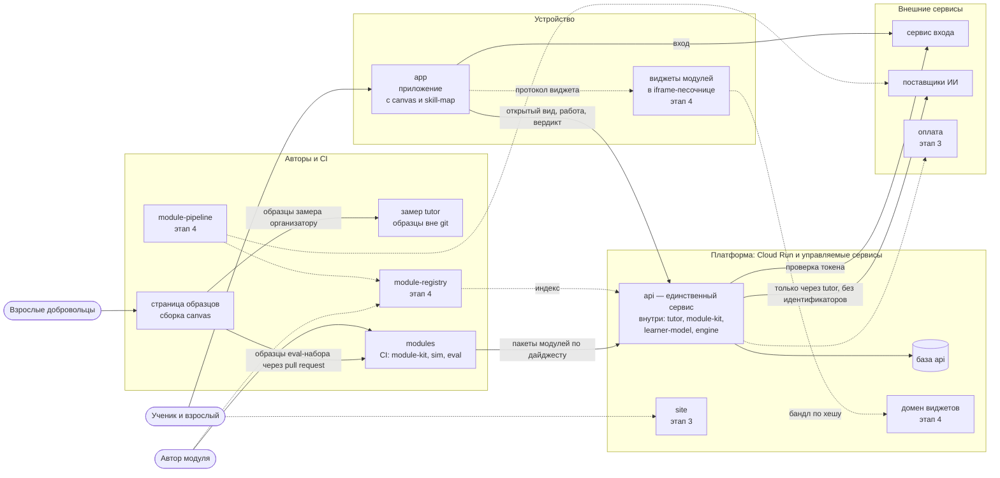
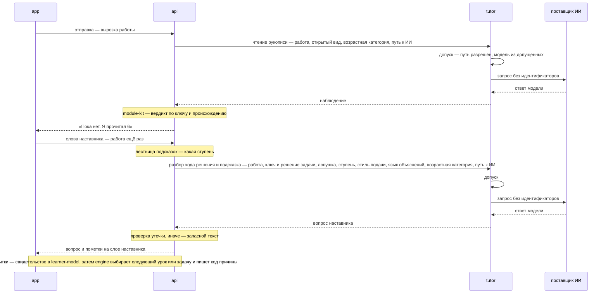

# NovaTrail — архитектура

> Статус: черновик для обсуждения, 2026-10-18.
>
> Из каких больших частей состоит платформа, что делает каждая и как они связаны. Это верхний уровень: внутреннее устройство и технологии каждой части решает её репозиторий (R11), начиная с её карточки из раздела 3. Где лежит код и в каком порядке появляются репозитории — в [repositories.md](repositories.md); открытые технические вопросы Т-… — в repositories 8.
>
> Понятия — в [concepts.md](concepts.md), приватность — в [privacy.md](privacy.md), решения — в [decisions.md](decisions.md).

## 1. Принципы

- **Граница R03 проходит по коду.**
  - Всё, что обращается к модели, — в `tutor`.
  - Вердикт выносит `module-kit`, модель ученика считает `learner-model`, следующий урок или задачу выбирает `engine`. Ни одна из этих библиотек модель не вызывает.
  - CI `api` проверяет полный список зависимостей: SDK поставщиков ИИ попадают в сборку только через `tutor` (R15).
- **Из частей платформы данные учеников на сервере хранит только `api`.**
  - `tutor` ничего не хранит. В типах его запросов нет полей для идентификаторов ученика и аккаунта, поэтому ИИ видит работу, но не знает чью (R15; privacy 1, 5.1).
  - Вне платформы часть данных держат сервис входа, поставщики ИИ и, с этапа 3, оплата (раздел 5).
- **Отдельный процесс — только там, где он нужен.** В первом срезе сервис один — `api`; `tutor`, `module-kit`, `learner-model` и `engine` — библиотеки в его процессе. `tutor` станет сервисом, когда у него появится второй потребитель (R15).
- **Ключ нерешённой задачи — только на сервере.** Приложение получает открытый вид задачи (R05). Открытый вид строит `module-kit` по пометкам `x-open` в схемах формата: поле без пометки закрыто, так что новое поле формата закрыто, пока его явно не открыли (R45).
- **Воспроизводимость** (R03):
  - попытка хранит дайджест своего пакета модуля, версию формата модуля, версию `module-kit` и зерно. Дайджест пакета — дайджест его описи, и он зависит только от файлов модуля и версии формата его паспорта ([текст формата](../format/README.md), раздел 25; R62). Модуль проверяется и исполняется по версии формата, которую называет его паспорт, и новая версия формата не меняет его вердикта, пока автор не переведёт модуль на неё (R44);
  - выбор движка хранит версии `engine` и `learner-model`, дайджесты пакетов, зерно и код причины;
  - вердикт повторяется по сохранённому наблюдению, выбор — по журналу свидетельств (Т-22); и то и другое — без ИИ;
  - генератор случайности и вывод зёрен задаёт `spec`, с тест-векторами: PCG, как в `math/rand/v2` Go, и места случайности, как у стенда standalone ([текст формата](../format/README.md), раздел 22; R59; Т-18 закрыт). Экземпляр шаблона задачи повторяется по пакету и зерну попытки: его выбирает одно число места `template`, ID задачи, `instance` ([текст формата](../format/README.md), раздел 23; R60).
- **Свои части интерфейса собираются при сборке, чужой код работает только в iframe-песочнице** (R16, раздел 6).
- **Без своих кластеров, очередей и шины событий** (R11). Части говорят синхронными запросами по контрактам из `spec`. Фоновые работы — задания Cloud Run по расписанию, как в canvas-api.
- **Журналы — без прямых идентификаторов, IP-адресов и содержания** (R09; privacy 4).
  - Cloud Run сам пишет журналы запросов со стандартным полем `httpRequest`, а в нём есть `remoteIp` — IP-адрес клиента. canvas-api записал то же о журналах Cloud Run и Firebase Hosting (privacy 4 canvas-api).
  - COPPA относит IP-адрес к постоянным идентификаторам, то есть к персональной информации (16 CFR 312.2).
  - Поэтому журналы запросов исключаются в Cloud Logging, а регион журналов выбирается до первого развёртывания (П-11).
  - Журналы хостинга `app` и сервиса входа решаются вместе с выбором этих сервисов (раздел 3.12; П-9).

  Источники — в разделе 8.

## 2. Общая схема

Сплошные стрелки — первый срез, пунктир — позже. `tutor`, `module-kit`, `learner-model` и `engine` отдельно не нарисованы: это библиотеки внутри `api`. Как репозитории зависят друг от друга при сборке — repositories 3.

## 3. Компоненты

У каждого компонента — карточка: что он делает и чего не делает, его данные и связи, репозиторий и этап (product 11). Пункты «Решить при детализации» — то, с чего начинается работа в его репозитории (repositories 2.2). Вопрос, который касается нескольких репозиториев, — в реестрах `spec`, и карточка ссылается на него.

Задача, которая заводила репозиторий (RUN.md, T04–T14), могла назвать пункты детализации сверх карточки, а могла пропустить пункт карточки. Карточку под это правит «Итог детализации» самого репозитория — строкой его таблицы 3 «в реестр spec», когда решение уже принято, а не заранее.

### 3.1. app — приложение ученика и взрослого

- **Делает:**
  - оболочку: вход через сервис входа, выбор ученика на общем устройстве, начало работы — возраст, страна, согласие; класс ученика — когда паспорт модуля называет классы (R49);
  - три входа в приложение: «Мои предметы», «Карта навыков» и, позже, «Задача с моей бумаги» (product 4);
  - плеер урока и экран задачи: канва, ячейки ответа, выбор варианта, панель наставника с шагами решения и подсказками, строка разговора. Текст пункта листа для рукописи `app` показывает вместе с вариантами `choice`, рядом с листом, а не на нём; строку пункта рабочей тетради показывает канва (R32 и R34 canvas). Навыков, полосы и сложности задачи в её открытом виде нет (R51), как нет и её приёмов, ловушек, случая попроще, фразы-утечки и решения (R57);
  - урок — по его открытому виду: звенья в порядке автора, объяснения, примеры с разбором, чей показ автора ученик открывает по одной части и может спрятать, и задачи урока, которые даёт `api`. Навыков и возрастных категорий урока в открытом виде нет (R58);
  - прогресс и карту навыков;
  - раздел для взрослых за PIN: профили, тариф, свой ключ, настройки, выгрузка и удаление;
  - раскрытие, что ученик говорит с ИИ, а не с человеком (privacy 5.3; П-15).
- **Не делает:**
  - не получает ключ, решение и ловушки нерешённой задачи, а её приём — только от `api`, на шаге, который его даёт, или по просьбе ученика (R57);
  - не выносит вердикт;
  - не обращается к поставщикам ИИ;
  - не отправляет на сервер штрихи и целое фото.
- **Данные и связи:**
  - на устройстве — штрихи с временем и нажимом, артефакты, свой ключ (Т-9). Ещё — контекст каждой отправки: на листе для рукописи — где вырезка лежит на листе, её целые числа, рамки групп штрихов, таблица «метка группы → ID штрихов» и дайджест отправки, а на рабочей тетради — таблица «окошко → ID штрихов» и дайджест. Его отдаёт канва вместе с работой, а держит `app` как есть: по дайджесту канва принимает контекст назад (R36);
  - говорит с `api` и с сервисом входа;
  - открытый вид задачи получает от `api` и читает по типам из релизов `spec` (R36) — версий формата модуля в окне. Пока формат — v0, `app` и `api` переходят на новую версию вместе (R44; repositories 4);
  - собирает в себя `canvas` и `skill-map` — веб-компонентами (R36), по точной версии из npm (R37). Канве он даёт с задачей открытый вид паспорта её модуля, свойством `manifest` (R36). Паспорт он получает от `api` по дайджесту пакета попытки, один раз на пакет, и кеширует по нему, а не с каждой задачей (R62). Открытые виды снятой с публикации версии модуля он из кеша удаляет (R63);
  - позже, с текстовой канвой, — озвучивает её «прослушать» по событию `speak` тем же синтезом речи, что и всё приложение (R36; Т-13). В первом срезе текстовой канвы нет (R41);
  - виджеты модулей открывает через хост виджетов из `canvas` (раздел 3.4).
- **Репозиторий и этап:** `app`, этап 2.
- **Решить при детализации:**
  - фреймворк и сборка: в canvas-api — React 19 и Vite 8 (R47 canvas-api), в standalone — Preact. Пакеты интерфейса фреймворка не навязывают (R36). Как они зависят от типов `spec` — `peerDependencies` по точной версии или своя копия у каждого, — решается вместе с RUN.md, T35;
  - что и сколько хранится на устройстве, в том числе контекст отправки (R36);
  - шаги решения: `app` ведёт их по открытому виду, а условия выхода из шага — события на устройстве, без ключа. Дополнено 2026-10-27: шаги и их условия выхода — `givens_ticked`, `answer_slots_filled` и `none` — в открытом виде `solving-steps.yaml`, а фишки «что известно и что найти» — в открытом виде задачи. Что значит «в ячейке что-то есть» у привязок `anywhere` и `sheet`, решают `app` и `canvas` (R57; RUN.md, Д38). Дополнено 2026-10-27: на рабочей тетради это свойство канвы `filled` (R36; RUN.md, Д41);
  - плеер урока: как звенья сменяют друг друга и как показ автора открывается по частям и прячется. Пометку «последовательный» у модуля, чей граф навыков — цепочка, `app` выводит из графа (R58; RUN.md, Д39);
  - озвучка — сначала синтезом речи устройства (Т-13);
  - свой ключ взрослого на общем планшете: для профиля ребёнка он не используется (Т-9, О-4);
  - конфигурация развёртывания — адрес `api`, параметры сервиса входа — читается во время работы, а не вшивается в сборку. Тогда self-hosting берёт ту же подписанную сборку;
  - языки интерфейса (О-2) и доступность интерфейса. Схема переводов и стандарт доступности — общие для пакетов интерфейса, а их вход — подписи и строка кнопок `canvas` (R36). Уровень доступности ждёт О-24, а лист одним указателем прокручивают кнопки «Выше» и «Ниже» в строке `canvas` (R33 canvas; О-24, дополнено 2026-10-27).

### 3.2. canvas — канвы

- **Делает:**
  - виды канвы (concepts 8); в первом срезе — лист для рукописи и рабочая тетрадь (product 10; R41). Рабочая тетрадь — страница 1000 × 1400 единиц, как лист, без сетки: строки пунктов с окошками кладёт на слой шаблона её раскладка, по задаче и своей таблице ширин, а не по шрифту устройства (R34–R36 canvas);
  - слои: шаблон, виджет, показ автора, работа ученика, слой наставника. На слое показа автора — показ примера с разбором урока: его части открываются по одной и прячутся все сразу, а картинка на участке листа стоит в размер участка. На листе примера ученик не пишет (R58);
  - инструменты; ластик удаляет штрих целиком;
  - захват штрихов с временем и нажимом;
  - показ содержания модуля: условие задачи — над листом для рукописи и над страницей рабочей тетради (R23 и R34 canvas; R51) — и медиа; формул в условии формата v0 нет. Текст пункта листа и варианты `choice` показывает `app`, а строку пункта тетради — канва (R32 и R34 canvas);
  - вырезку работы для проверки: на листе для рукописи — только видимые штрихи листа 1000 × 1400 логических единиц (R06 canvas), а на рабочей тетради — вырезку каждого заполненного окошка по его штрихам; черновик — письмо вне окошек — не уходит (R34, R37 и R38 canvas; R53);
  - пометки наставника, привязанные к штрихам ученика (R43 canvas-api). На тетради пометка стоит на ячейке ответа по месту и держится за штрихи её окошка (R39 canvas);
  - страницу образцов — отдельную сборку `canvas` для образцов eval (R25):
    - образец делается той же канвой, что у учеников, и сохраняется файлом на устройстве. Что в файле, — R09 canvas, пока формат не задал протокол eval (RUN.md, эпик E3);
    - у образца взрослого два назначения, и выбирают его на самой странице: образец замера уходит организатору замера, вне git, а образец eval-набора — pull request в `modules`. Согласие добровольцев — П-16;
    - согласие страница не берёт: она показывает уведомление назначения и пишет в файл версию набора текстов, а письменное согласие — подписанная форма, которую организатор принимает вне страницы. Пока тексты — черновик, открыт только замер автора проекта (R11 canvas; RUN.md, эпик E4);
    - образец ребёнка — с отдельным согласием (П-10) и без pull request: в репозитории он не попадает, а куда уходит файл и кто к нему допущен, решают П-10 и П-12;
    - на сервер платформы ничего не уходит;
    - к первому замеру на образцах добровольцев — без хостинга: сборка скачивается из релиза `canvas` и открывается на устройстве, а задачи и медиафайлы кладутся в неё при сборке из релиза `modules`. До первого содержания `modules` задачи замера приходят из релиза `tutor` (поправка 2026-10-21 к R25), а он ждёт в отложенном эпике E3 `tutor` (поправка 2026-10-26 к R43);
  - позже — хост виджетов: сторону протокола виджета в приложении. Тесты соответствия протоколу он проходит, как и виджет (раздел 3.4).
- **Не делает:** не знает аккаунтов, `api` и предметов. Слой наставника не меняет работу ученика (R05).
- **Данные и связи:**
  - своих данных нет: контекст отправки держит `app` (R36);
  - входит в потребителя веб-компонентом — одним элементом `<novatrail-canvas>` на все виды канвы. Историю письма элемент отдаёт свойством `history` и событием `historychange` и берёт тем же свойством, а работу для проверки — методом `exportWork()`: на листе — PNG вырезки и контекст отправки, на тетради — вырезки заполненных окошек с их местами и контекст тетради, а какие окошки заполнены, говорит свойство `filled`. Паспорт модуля задачи он берёт свойством `manifest`, а пометки наставника — свойством `marks`, вместе с контекстом их отправки и после `task` и `history` (R26 canvas). Смену инструмента учеником он объявляет событием `toolchange`, а язык подписей своих кнопок берёт из своего атрибута `lang` (R36);
  - показывает открытый вид по типам из релизов `spec` — версий формата модуля в окне, а новый вид канвы выпускает раньше модуля, который его берёт (R44; repositories 4);
  - потребители — `app` и страница образцов, а CI `tutor` берёт из релиза `canvas` синтетические образцы (R38);
  - всё, что выходит у `canvas`, — файлы одного релиза GitHub с подписью общего `release.yml` `.github`: пакет, сборка страницы образцов, синтетические образцы. Тот же файл пакета выходит в npm, `@altnovatrail/canvas` (R37; R08 canvas);
  - CI сборки страницы образцов берёт по точному тегу CLI `module-kit` и релиз `modules`, а пока у `modules` нет содержания — релиз `tutor`: так в неё попадают задачи и медиафайлы, а сам пакет предметов не знает (R25; repositories 3). Перед сборкой CI читает отметки о снятии в индексе новейшего релиза `modules` и из снятой версии модуля страницу не собирает, а сеанс образца ребёнка ведётся сборкой последнего релиза `canvas` (R63);
  - позже — предпросмотр модуля для автора и карточка канала MCP.
- **Репозиторий и этап:** `canvas`, этап 2 — первый код этапа, вместе с `tutor`. Его код начат раньше пунктов 3 и 4 repositories 6.
- **Решить при детализации:** решено всё — детализация закончена 2026-10-21 (T05 canvas). Дополнено 2026-10-22: рабочая тетрадь вошла в первый срез вместо текстовой канвы (R41), и её детализирует `canvas` — страницу, ячейки ответа, вырезку ячейки и слой шаблона. Дополнено 2026-10-26: формат задаёт пункт тетради строкой из кусков текста и окошек по порядку, а как строки лежат на странице, решает `canvas`; высоту цифры на вырезке задаёт паспорт модуля, а сетку и её шаг — задача листа (R51). Дополнено 2026-10-27: у задачи появились открытые поля `givens` и `unknown`, и временные типы открытого вида их берут; условие выхода шага `answer_slots_filled` спрашивает у элемента, в каждой ли ячейке что-то есть (R57; RUN.md, Д38). Дополнено 2026-10-27: слой показа автора, пустой в первом коде, получает показ примера с разбором — части по одной, картинки на участках листа, и показ можно спрятать (R58; RUN.md, Д39). Дополнено 2026-10-27: рабочая тетрадь решена (R34 canvas) и построена (R35–R39 canvas). Договор с `app` о ней и свойство `manifest` — поправка 2026-10-27 к R36, вырезка на окошко и место по ячейке — поправка 2026-10-27 к R53, правило окошек и образец тетради — протокол eval (RUN.md, эпик E3), предел строк для авторов — RUN.md, T38 (RUN.md, Д41).
  - Движок рисования — свой код на API браузера (R05 canvas).
  - Логические координаты — лист 1000 × 1400 единиц, а на проверку уходит вырезка (R06 canvas). Место в наблюдении — доли 0–1000 вырезки, а в единицы листа его переводит `canvas` (R53); на тетради место — ячейка ответа по месту (поправка 2026-10-27 к R53).
  - Стыковка — веб-компонент (Т-21, R36; R07 canvas). Публикация — npm (Т-26, R37; R08 canvas).
  - Состав файла образца — R09 canvas; шаги страницы образцов — R11 canvas.
  - Рабочая тетрадь — R34–R39 canvas: страница и раскладка, слой шаблона, правило окошек и `filled`, работа для проверки и пометки на окошках.

  Открыто то, что ждёт `spec`: протокол eval и формат образцов (эпик E3), тексты согласия (эпик E4), рамки групп штрихов на проверке (Т-31), уровень доступности (О-24), предел строк тетради для авторов (RUN.md, T38). Что `canvas` решает дальше, — его `docs/architecture.md`.

### 3.3. skill-map — карта навыков

- **Делает:** рисует граф навыков и состояние модели ученика по готовым данным от `api`: ярусы, пререквизиты, владение.
- **Не делает:** не ходит за данными и не считает владение.
- **Связи:** потребитель — `app`: экран ученика и раздел для взрослых; позже — `site` и инструменты автора.
- **Репозиторий и этап:** `skill-map`, этап 2.
- **Входит в потребителя** веб-компонентом и выходит в npm, в области `@altnovatrail`, — как все пакеты интерфейса (R36, R37). Свои элементы он называет сам.
- **Решить при детализации:** какие данные для показа даёт `api` и как раскладывается граф; как карта показывает ярусы — их вычисляет `module-kit` по графу в канонический вид пакета, `api` даёт их карте, а имена даёт автор, и ярус без имени показывается номером (R49; R62); ранги (О-13).

### 3.4. Виджеты модулей

- **Что это:** интерактивные компоненты модуля на канве — код автора модуля (concepts 8).
- **Как работают** (R16):
  - в iframe-песочнице без `allow-same-origin`, на отдельном регистрируемом домене. Вместе с `allow-scripts` он позволил бы странице того же origin снять песочницу (раздел 8);
  - CSP не даёт коду виджета ходить в сеть: загружается только сам бандл;
  - с приложением виджет говорит только по протоколу из `spec`;
  - бандл подписан и закреплён по хешу в пакете модуля, а пакет закреплён за попыткой;
  - официальные виджеты работают в той же iframe-песочнице, что и чужие;
  - детям — только виджеты, прошедшие ревью (О-9).
- **Этап 4.** В первом срезе виджетов нет: ни одному из трёх его модулей они не нужны (R41). Привязки ячейки к состоянию виджета в формате v0 нет: она придёт с протоколом виджета, минорной версией (R51). Образец для авторов — `widget-template` (раздел 3.13).
- **Решить при детализации** — в эпике E5 RUN.md:
  - протокол виджета. Что ему решать сверх R16 — по анализу автора 2026-10-21 (product 14). Сторона протокола в приложении — хост виджетов `canvas`, который `app` собирает в себя (раздел 3.2); «`app`» ниже — это он (В22 `canvas`):
    - канал. Отправителя сообщения HTML Standard велит проверять по origin, а у виджета без `allow-same-origin` origin непрозрачный и сериализуется как "null". Сверка `event.source` с окном iframe документы не различает: окно у iframe одно, а при переходе меняется только документ за ним. Поэтому анализ советует порт `MessageChannel`: `app` передаёт его виджету один раз, при первой загрузке iframe, и дальше слушает только его, а документ, на который виджет перешёл потом, этого порта не получал (раздел 8). Как `app` замечает такой переход, решает протокол;
    - версия состояния в каждом сообщении виджета: `app` знает, к какой версии относятся вердикт и слова наставника, а пометку на части виджета, которая с тех пор изменилась, не рисует — как пометку листа, чьи штрихи стёрты (architecture 3.2 canvas);
    - части виджета для пометок: слой наставника лежит над виджетом (concepts 8), поэтому виджет называет свои части и их рамки, а пометка держится за часть, как на листе — за штрихи;
    - виджет сообщает состояние и события ученика, а не вердикт. Верно ли, решает `module-kit` (concepts 9.2), а по какому состоянию — сообщённому виджетом или повторённому на сервере по зерну и событиям, — решает Т-24. Зерно виджета — своё, не зерно попытки: зерно попытки на устройство не уходит, а как виджет получает своё, решает протокол виджета (R59);
    - тесты соответствия протоколу — в `spec`, рядом с протоколом, как тест-векторы вердикта, и в его релизах тем же путём, что файлы формата: своим файлом релиза и в модуле Go (R64). Они на обе стороны протокола: их проходят и виджет, и хост виджетов `canvas`, каждый в своём CI (В22 `canvas`). Тесты одной стороны держат только её: хост, который разошёлся с тестовым, ломал бы виджеты, прошедшие тесты, и этого никто бы не заметил. Тестовый хост — в среде разработки `widget-template` (раздел 3.13); будет ли им сам `canvas`, решит эпик E5 вместе с `widget-template`, а условие для хоста от этого не меняется. Протоколу виджет отвечает, если проходит тесты, а библиотека для авторов — удобство, а не условие;
  - можно ли верить состоянию, о котором сообщает виджет (Т-24);
  - снятие с публикации версии виджета, которая оказалась вредной. Снятая версия модуля снимает и бандлы своих виджетов: устройство их больше не грузит, а причина «опасный бандл» придёт минорной версией формата вместе с протоколом виджета (R63; Т-30 закрыт).

### 3.5. api — сервис платформы

- **Делает:**
  - вход: проверяет токен сервиса входа;
  - учеников: псевдоним, возрастная категория, страна, стиль подачи, языки, класс — если его спрашивает модуль (R49); записи согласия; права;
  - попытки: хранит дайджест пакета модуля, версию формата модуля, версию `module-kit` и зерно (R44). Зерно попытки `api` берёт из криптостойкого источника, когда попытка начинается, и на устройство его не отдаёт: по состоянию места случайности видно его зерно, а генератор не криптостойкий (R59); отдаёт открытый вид. Задачу ученику даёт, только если он в одной из её возрастных категорий, `age_categories` (R51), а урок — только если ученику подходят и урок, и каждая его задача (R58);
  - урок: его открытый вид — без навыков и возрастных категорий — и задачи урока по его звеньям. Задача урока — такая же попытка, как вне урока (R58);
  - шаблон задачи: экземпляр попытки — по её зерну, из пакета, и Starlark на попытке не запускается — ключ каждого экземпляра `module-kit` посчитал и проверил при проверке модуля. Приложению — открытый вид экземпляра, без поля `template` (R60). Пакет несёт числа каждого экземпляра, и `api` берёт номер `below(count)` и подставляет его числа кодом `module-kit`, не исполняя выражений (R62);
  - проверку: отправка → `tutor` читает работу → наблюдение → вердикт `module-kit` на каждую ячейку ответа и на пункт. У задачи с рубрикой — оценка по рубрике в `tutor` и отзыв по рубрике, без вердикта (R04; R41), а что сервер хранит из такой попытки — П-19. Проверка ячейки — в части пакета для сервера: ни её, ни её вида приложение не получает (R56);
  - по итогу попытки — свидетельство в `learner-model`, затем `engine` выбирает следующий урок или задачу и пишет код причины;
  - лестницу подсказок: какую ступень дать, когда предложить взрослого или решение (О-7), когда нужен запасной текст. Запасной текст ступеней 1–2 — текст значения ловушки, совет ловушки или шаблон ступени модуля, а третьей — случай попроще пункта (R57);
  - приём задачи и «что известно и что найти» — на шаге решения, который их даёт, и по просьбе ученика до первой отправки, без ИИ и без чтения работы; что ученик их видел, `api` записывает (R57; О-21);
  - проверку утечки — до того, как любой текст наставника уйдёт на устройство. Поэтому слова наставника уходят целиком, не потоком (R54). Как она ищет ключи и фразы-утечки, нормативно говорит [текст формата](../format/README.md), раздел 20, а код её — в `module-kit` (R57);
  - квоты ИИ платформы — по расходу, о котором сообщает `tutor`; позже тариф и оплату;
  - свою часть выгрузки и удаление (раздел 4.5);
  - задания и команды оператора, как `admin` в canvas-api, а не отдельное приложение:
    - миграции;
    - сроки хранения (П-9);
    - проверку согласия (П-1);
    - допуск в закрытый срез;
    - список стран до DPIA (П-2);
  - в первом срезе держит пакеты модулей в своём образе, закреплённые по дайджесту, и раздаёт файлы их частей для устройства — медиафайлы, `LICENSE` и `NOTICE` (раздел 3.10). Новую попытку `api` даёт только по версии, которую индекс закреплённого релиза `modules` не отмечает снятой с публикации. Снятая версия остаётся в образе только для повтора вердикта: начатые на ней попытки закрываются «без проверки», а файлов её части для устройства `api` больше не раздаёт (R63). Открытые виды строит `module-kit` из части для сервера: паспорта, графа навыков, каталога приёмов и шагов решения `api` отдаёт по дайджесту пакета попытки, урока — ученику, которому урок подходит, задачи — с попыткой (R62).
- **Не делает:**
  - не хранит картинки и звук, которые уходят на проверку, и свои ключи; артефакты — только по выбору владельца аккаунта (П-8);
  - не обращается к поставщикам ИИ в обход `tutor`;
  - не пишет в журналы прямые идентификаторы, IP-адреса и содержание.
- **Данные и связи:**
  - база `api` — единственное хранилище данных учеников среди частей платформы. Какая — решает `api` (R11); в canvas-api — Neon Postgres;
  - говорит с сервисом входа, с поставщиками ИИ — через `tutor`, позже — с оплатой.
- **Репозиторий и этап:** `api`, этап 2.
- **Решить при детализации:**
  - вход и права. В canvas-api — Firebase Auth и OpenFGA. Для учителей права понадобятся в виде «кто, к чему и в какой роли получил доступ»;
  - база и где живёт модель ученика (П-7);
  - журнал свидетельств и состояние навыков (Т-22);
  - какую версию модуля получает новая попытка: последнюю опубликованную или ту, что закреплена за подключением модуля у ученика. Попытка в любом случае хранит дайджест своего пакета. Что с попытками на версии, которую сняли с публикации, решил R63, а как `api` это делает и какой формы его конфигурация — релиз `modules` и его индекс, — решается здесь. Здесь же — что с начатой попыткой, чья версия формата модуля ушла из окна: в своём процессе `api` её уже не проверит, а рекомендация R44 — «без проверки», как у снятой версии;
  - перенос прогресса по таблице соответствия старых ID навыков новым после мажорной версии — `retired_skills` графа навыков (concepts 3; R49);
  - показ решения (О-7), пауза (О-8) и подсказка по просьбе ученика (О-21): что модуль даёт до первой отправки, решил R57, а что просьба даёт после неверного ответа и «объясни иначе» — здесь. И ещё — о какой ячейке говорит запасной текст, когда неверных в отправке несколько (R57);
  - урок: как приложение получает его звенья и задачи, и что `api` записывает о пройденном уроке (R58; RUN.md, Д39);
  - тарифы (О-14); оплата — этап 3;
  - протокол между `app` и `api` — его сообщения и сервисы; формат, protobuf и buf, решил R11;
  - канал реального времени (Т-25);
  - удаление — по свежему входу, а не по PIN.

### 3.6. tutor — наставник: чтение и слова

- **Делает:**
  - возможности ИИ (concepts 10, 15):
    - чтение рукописи и чтение текста: работа превращается в наблюдение, ключа модель не видит. Значение ячейки чтение отдаёт так, как оно записано: нормализует его вид проверки в `module-kit` (R56);
    - разбор хода решения: модель видит ещё ключ и решение задачи и ищет первую ошибку в решении ученика (privacy 5.1). Ловушки задачи, которые может предположить ИИ, и совпавшую ловушку она получает помеченным блоком данных, с описаниями из каталога (R02; R57);
    - подсказку: слова для ступени, которую выбрала программа. На устройство они уходят целиком, после проверки утечки, а не потоком; поток — только у чтения, ответ которого читает программа (R54);
    - оценку по рубрике — с первого среза, для модуля сочинений (R41); позже — голос.

    Чтение и разбор пока разделены; один это вызов или два — Т-23;
  - промпты платформы: по одному на возможность, у каждого — свой eval-набор. Модель для возможности допускают, когда она проходит и его, и eval-наборы модулей, где эта возможность нужна (R02; раздел 4.6);
  - адаптеры поставщиков: OpenAI, Anthropic. Рукопись адаптер шлёт модели картинкой или вырезкой, без истории письма (R52), а место, которое назвала модель, переводит в доли 0–1000 вырезки (R53). Модели Google на платформе закрыты — и Gemini API, и Vertex AI, для учеников и для конвейера авторов (R47; privacy 5.3), — а можно ли их в отдельном развёртывании только для взрослых, решит юрист (П-3);
  - список допущенных моделей: точные ID на каждую возможность (R07);
  - путь к ИИ и допуск по возрастной категории — одна чистая функция, её вызывают до каждого запроса (Т-20);
  - расход каждого вызова — по нему `api` считает квоты;
  - eval-раннер — CLI на том же коде (R15). Он же обслуживает доску проверки — локальную страницу на 127.0.0.1 в devcontainer: автор решает пять задач, модели Claude, которые он выбирает, читают и оценивают его работу, а автор отмечает, права ли каждая. Это не сервис (R15; R43). В режиме записи доски автор писал и лист для замера хода письма, а остальные листы нарисовал код (поправка 2026-10-26 к R25).
- **Не делает:**
  - не выносит вердикт и не выбирает урок или задачу;
  - ничего не хранит;
  - не получает идентификаторы ученика и аккаунта, псевдоним и данные взрослого — кроме своего ключа (раздел 4.3).
- **Связи:**
  - в первом срезе его вызывает только `api`, в своём процессе; сам `tutor` вызывает поставщиков ИИ;
  - CI `tutor` берёт из релиза `canvas` синтетические образцы и проверяет, что eval-раннер их читает (R38). А его релиз, пока у `modules` нет содержания, даёт CI `canvas` открытые виды задач замера — без ключей, решений и ловушек (поправка 2026-10-21 к R25). Обе связи ждут в отложенном эпике E3 `tutor`: замеру хода письма они не понадобились (поправка 2026-10-26 к R43);
  - с этапа 4 — ещё `module-pipeline` (раздел 3.13). Тогда и решить, библиотека он для него или сервис: сервисом `tutor` станет, когда у него появится второй потребитель (R15).
- **Репозиторий и этап:** `tutor`, этап 2 — первый код этапа: доска проверки, а за ней — замер хода письма на моделях Claude. Он сделан 2026-10-26 и пользы хода письма не показал (R52), а остальные замеры чтения ИИ — эпик E4 `tutor` (поправка 2026-10-26 к R43; repositories 6).
- **Решить при детализации:**
  - один вызов или два (Т-23);
  - оценку по рубрике: её eval и метрику (О-22) и то, как отзыв по рубрике не пишет сочинение за ученика (R05): проверке утечки здесь нечего искать — ключа нет;
  - меры для несовершеннолетних, которых требуют поставщики: проверка возраста, фильтры, мониторинг, раскрытие, что ученик говорит с ИИ (privacy 5.3; П-15);
  - лимит трат своего ключа;
  - голос (Т-13).

### 3.7. module-kit — формат модуля в коде

- **Делает** (R17):
  - читает модуль автора — YAML с ограничениями формата — и проверяет его: схему, граф без циклов, ссылки, навыки-опоры общей таксономии и зависимости паспорта (R50), задачи и их ссылки на навыки, полосы и картинки, зоны листа, имена файлов и сигнатуры медиафайлов (R51), проверки ячеек — ключ выбора среди его вариантов, варианты без повторов после нормализации, несократимый ключ дроби, выражение условия и оцениваемость навыков пункта (R56), каталоги ловушек и приёмов, значения ловушек и шаблоны ступеней в паспорте (R57), уроки — их навыки, задачи и картинки, участки листа, возрастные категории и порядок уроков без цикла (R58), шаблоны задач — имена, выражения, подстановки и все экземпляры, каждый — всеми правилами задачи (R60), и их решатели — на каждом экземпляре (R61), тексты автора, которые ученик видит до решения, — проверкой утечки (`task.no-leaks`, а в уроке — `lesson.no-leaks`). Отказ по правилу формата называет ID правила (R45);
  - читает версии формата модуля в окне — пока формат v0, только текущую, а с v1 текущую мажорную и предыдущую, причём v0 уходит с выходом v1, — и проверяет, собирает и исполняет модуль по версии, которую называет его паспорт. Модуль вне окна отклоняет с причиной (R44);
  - собирает пакет модуля — канонический вид с ярусом каждого навыка и числами каждого экземпляра шаблона, часть для устройства и опись ([текст формата](../format/README.md), раздел 25; R49; R62) — и индекс модулей: из индекса прошлого релиза, с записью каждой опубликованной версии по дайджесту пакета и с отметками о снятии ([текст формата](../format/README.md), раздел 26; R63); сравнивает новую версию с прошлой по правилам semver и сверяет упразднённые навыки (concepts 3; R49);
  - шаблоны задач (concepts 9.3): перебирает сочетания параметров в порядке счётчика, считает производные числа и ограничение — выражения узкого подмножества Starlark — и строит экземпляры, не больше 10 000 сочетаний на шаблон. Экземпляр попытки — номер `below(count)` места `template`, ID задачи, `instance` её зерна (R59; R60). Векторы шаблонов — в `format/vectors/templates/` `spec`: его CI считает их второй реализацией, а CI `module-kit` проходит их все;
  - решатели шаблонов (concepts 9.3): исполняет программу `template.solver` в диалекте go.starlark.net из [текста формата](../format/README.md), раздел 24, и вызывает `solve` на каждом экземпляре по порядку, с числами его открытых полей, — не больше 100 000 000 шагов на все экземпляры шаблона вместе. Результаты встают в ключ, значения ловушек, решение и фразы-утечки, и каждый экземпляр с ними проходит все правила задачи. Результаты векторов шаблонов CI `module-kit` считает сам, а векторы `task.template-solver` проходит все (R61);
  - открытый вид — по пометкам `x-open` в схемах (R05; R45): отметка считается, только где её подсхема применяется и проходит, а векторы открытого вида `spec` проверяет и сам (R51);
  - виды проверки и нормализацию (concepts 9.2): в формате v0 — `number`, `fraction`, `choice`, `predicate` и `rubric`, а как каждый читает значение и выносит вердикт ячейки и пункта, говорит [текст формата](../format/README.md), раздел 15. Векторы вердикта — в `format/vectors/verdicts/` `spec`: его CI считает их второй реализацией, а CI `module-kit` проходит их все, вердикты условия тоже (R56);
  - допускает вердикт, только если ключ или условие дал автор, решатель или взрослый (concepts 9.4);
  - проверку утечки (concepts 10) — как говорит [текст формата](../format/README.md), раздел 20. Векторы утечки — в `format/vectors/leaks/` `spec`: его CI считает их второй реализацией, а CI `module-kit` проходит их все (R57). Её вызывает `api` на словах наставника, а проверка модуля — на текстах автора;
  - ловушку по неверному значению — сравнением со значениями ловушек ячейки, как с ключом (R57);
  - песочницу Starlark для решателей шаблонов и условий проверки, как в standalone. Условие проверки — выражение Starlark от целого `value`, и лимит его шагов — 1 000 000 в счёте go.starlark.net — часть формата: сработавший лимит или ошибка дают «без проверки» (R56). Бюджет решателя шаблона — тоже в формате (R61);
  - проверку подписи пакета. Саму подпись ставит общий workflow релиза из `.github`, а что именно проверяется — Т-27;
  - CLI автора: проверить, собрать, построить индекс. Индекс CLI строит внутри общего релиза `modules`, после номера и до публикации: новая запись называет тег своего релиза (R63).
- **Не делает:** не обращается к ИИ. Библиотека не ходит в сеть, а CLI только читает и пишет файлы модуля. Данных учеников не хранит.
- **Связи:**
  - схемы, примеры и тест-векторы формата берёт модулем Go `github.com/altnovatrail/spec` — `spec.Format` по тегу релиза, тому же, что у подмодуля `spec/`, — а не из подмодуля (R64);
  - потребители — `api`, eval-раннер `tutor`, CI `modules` и CI `canvas`, который собирает страницу образцов (R25);
  - позже — `module-registry` и `module-pipeline`.
- **Репозиторий и этап:** `module-kit`, этап 1.
- **Решить при детализации:**
  - чем писать канонический текст пакета: `encoding/json` Go экранирует то, что текст формата пишет как есть, а `jsontext.Value.Canonicalize` в go1.27.3 — только под экспериментом `jsonv2` (R62; Т-15 закрыт);
  - как его CI проходит векторы генератора `format/vectors/random/` — стандартной библиотекой Go, `math/rand/v2` и `hash/fnv`, или своим кодом (R59; Т-18 закрыт);
  - лимиты песочницы Starlark. В standalone — 25 000 000 шагов и 2 секунды на запуск, по одному запуску на vCPU (SPEC 6.6 standalone). Лимиты шагов решил формат — условия проверки (R56) и решателя шаблона, 100 000 000 на все экземпляры (R61); часы и одновременные запуски — T03 `module-kit`. Выражения шаблона лимита шагов не требуют: их шагов не больше, чем знаков (R60).

### 3.8. learner-model и engine

- **learner-model** — оценка владения навыками по свидетельствам (concepts 11):
  - отправная точка — модель standalone: модель Раша с полом угадывания, обновление по Elo, осторожное «освоено» (standalone: SPEC 2, R187);
  - уровень — на модуль или область; забывание;
  - веса свидетельств — по происхождению и исходу попытки;
  - перенос по таблице соответствия старых ID навыков новым после мажорной версии модуля — `retired_skills`: свидетельства упразднённого навыка идут каждому навыку, который его заменил, а вес — его решение (R49);
  - свидетельства попыток на версии, снятой с публикации из-за неверного ключа, `wrong_key`, больше не идут в модель, и она пересчитывается по журналу свидетельств (R63; Т-22);
  - навык-опора общей таксономии — по его ID, `core.<имя>`, а не по полному. Владеет ли им ученик, решает `learner-model` по навыкам, которые ему учат, в модулях ученика (R50);
  - отправная точка — полоса сложности класса ученика, а трудность задачи — по её полосе и сложности от 1 до 5 внутри полосы; как далеко отстоят полосы и где начинает ученик вне полос, решает `learner-model`. Угадывание у выбора — 1/k по числу вариантов задачи (R51).
- **engine** — выбор следующего урока или задачи (concepts 12): пререквизиты, коридор успеха (R23), повторение, коды причин, зерно. Шаблон задачи для движка — одна задача, какой бы экземпляр ни выпал: повтор шаблона даёт новое зерно попытки и, скорее всего, другие числа (R60). Пререквизит из другого модуля — навык-опора, и навык-опора, которому не учит ни один модуль ученика, урока не держит (concepts 4). Порядок уроков задаёт граф навыков, а где он порядка не даёт, выбирает правило движка. В уроке, чьи навыки не все с вердиктом, движок ничего не добавляет и не пропускает (R58). Список кодов причин — контракт в `spec` (R29); генератор случайности и вывод зёрен — из `spec`, общие с `module-kit` и `sim` (R27). Нужна ли движку случайность, решает он сам, и тогда у него своё зерно выбора и свои имена мест (R59).
- **Общее:**
  - чистые вычисления без ввода-вывода: время и зерно приходят снаружи;
  - типы графа — свои и простые, не из `module-kit`; так библиотеки можно собрать и для устройства (Т-10). Задаёт их `learner-model`, а `engine` берёт у него (R28);
  - каждое изменение проходит стенд `sim` по критерию, записанному до первого прогона кандидата (R163 standalone; Т-16).
- **Не делают:** не читают пакеты модулей и базу: граф и свидетельства им передаёт `api`.
- **Репозитории и этап:** `learner-model` и `engine`, этап 1.
- **Решить при детализации:**
  - уровень — на модуль или на область; модель забывания; веса свидетельств;
  - как владение навыком-опорой выводится из навыков, которые ему учат, — и из навыков с `rubric` или `none`, у которых вердикта нет (О-17), — и что движок делает с циклом пререквизитов между модулями через навыки-опоры: формат проверяет каждый модуль отдельно и такого цикла не видит (R50);
  - журнал свидетельств (Т-22);
  - сборка для устройства (Т-10);
  - уроки (R58; RUN.md, Д39): когда движок даёт урок, а когда задачу вне урока; как правило выбирает между уроками, которых граф не упорядочил, — у навыков без вердикта без модели ученика; добавляет ли он закрепление в урок, чьи навыки все с вердиктом, и кончает ли такой урок раньше.

### 3.9. sim — стенд виртуальных учеников

- **Делает:**
  - гоняет `learner-model` и `engine` на тысячах виртуальных учеников разных профилей;
  - держит критерий и полосы допуска;
  - служит гейтом CI (repositories 4; Т-16).
- **Данные:** пакеты модулей — закреплённые по версии данные. Читает их часть для сервера, `server.json`, по типам канонического вида из `spec`, без `module-kit` (R62), в том же окне версий формата модуля, что и `module-kit` (R44). Зёрна виртуальных учеников выводит генератором из `spec`, а не своей схемой (R27). Функция `seeded` стенда standalone — частный случай вывода `spec`: место главного зерна с именами «эксперимент, единица, назначение», так что числа стенда сохраняются. Нормальное и показательное распределения в формат не входят, и за их переносимость отвечает `sim` (R59). Данных живых учеников нет.
- **Не делает:** не меняет алгоритмы, а только меряет их.
- **Образец:** `tools/learners` и `docs/learners.md` в standalone.
- **Репозиторий и этап:** `sim`, этап 1.
- **Решить при детализации:** профили виртуальных учеников; критерий и полосы допуска — до первого кандидата (R163 standalone).

### 3.10. modules и доставка пакетов

- **modules** — официальные модули первого среза: олимпиадная математика 1–6, школьная математика 3 класса и короткие сочинения на английском (R41).
  - Пока формат меняется, все модули лежат в одном репозитории (R18).
  - В модуле — YAML, медиа и eval-набор: синтетические образцы и образцы добровольцев (R02; П-16). Работ учеников в модулях нет (concepts 3).
  - Что внутри папки модуля — паспорт `manifest.yaml`, файлы частей, задачи в `tasks/<id>.yaml`, `media/`, `eval/` и `NOTICE` — задаёт формат ([текст формата](../format/README.md), раздел 10; R46, R51), а где лежат сами папки и как называются — `modules`. Картинки задач standalone `modules` рисует при порте в файлы `media/` с описанием (R51).
- **CI `modules`:**
  - проверка `module-kit`;
  - `sim`, если изменился граф;
  - с этапа 2, когда появятся `tutor` и страница образцов, — eval-раннер `tutor` на eval-наборе модуля, отдельным ключом платформы только для eval (R24);
  - на релизе — пакеты и индекс модулей; подпись ставит общий workflow релиза.
- **Доставка по этапам:**
  - этап 1 — пакеты и индекс в релизах `modules`;
  - этап 2 — при сборке образа `api` дайджесты пакетов берутся из индекса релиза. Pull request закрепляет их в конфигурации `api` и служит якорем доверия: с ним до `api` доходят и отметки о снятии, и снятые версии `api` не исполняет для новых попыток (R63). Файлы части для устройства раздаёт `api`;
  - с этапа 2 релиз `modules` по точному тегу берёт и CI `canvas`: сборка страницы образцов кладёт в неё задачи и медиа через CLI `module-kit` (R25; раздел 3.2), а отметки о снятии читает в индексе новейшего релиза (R63). До первого содержания `modules` задачи замера сборка берёт из релиза `tutor` (поправка 2026-10-21 к R25);
  - образ `api` держит все версии пакетов, за которыми закреплены незавершённые попытки. Для повтора вердикта старые версии берутся из релизов `modules`. Пакет, чья версия формата модуля ушла из окна, `api` уже не исполнит: что с такой попыткой, решает детализация `api` (раздел 3.5), а повтор её вердикта идёт вне `api`, тем релизом `module-kit`, который её проверял (R44);
  - потом — хранилище с CDN, а индекс пишет сервис реестра (Т-17).
- **Две части пакета и опись** ([текст формата](../format/README.md), раздел 25; R62; Т-15 закрыт):
  - часть для сервера — канонический вид модуля: всё содержание, в том числе ключи, решения и ловушки, с ярусом каждого навыка и числами каждого экземпляра шаблона;
  - часть для устройства — `LICENSE`, `NOTICE` и медиафайлы, а когда в формате будут виджеты, — их бандлы; ключей и текстов модуля в ней нет;
  - опись пакета называет модуль и обе части по дайджестам, а дайджест пакета — дайджест описи (concepts 15);
  - eval-набор в пакет не входит: образцы eval-раннер берёт из папки модуля в CI `modules`.
- **Индекс модулей** ([текст формата](../format/README.md), раздел 26; R63; Т-30 закрыт):
  - файл `module-index.json` в каждом релизе `modules`, один на все модули. Он накопительный: называет каждую опубликованную версию каждого модуля по дайджесту пакета, с тегом релиза, в файлах которого лежит пакет, и с навыками-опорами, которым версия учит;
  - релиз собирает его из индекса прошлого релиза и своих пакетов, внутри общего релиза: после номера и до публикации. Записи не удаляются и не меняются;
  - версию снимает следующий релиз: его индекс помечает её запись `withdrawn` с причиной — `wrong_key`, `answer_leak` или `unsuitable_content`. Снятая версия остаётся только для повтора вердикта.
- **Репозиторий и этап:** `modules`, этап 1.
- **Решить при детализации:** раскладку модулей в репозитории; как образцы добровольцев попадают в eval-набор (П-16). Лицензия — Apache-2.0, и у кода, и у содержания (R20).

### 3.11. infra и .github

- **infra:**
  - проекты, Workload Identity Federation для CI, Artifact Registry, домены, Secret Manager, бюджеты;
  - журналы: регион — П-11, журналы запросов исключены;
  - хостинг сборки `app` (Т-17) и, позже, домен виджетов — отдельный регистрируемый (R16);
  - список версий для выкладки (Т-19);
  - self-hosting и локальный запуск всей платформы.

  Образец — `infra/` canvas-api: `bootstrap.sh` и один корневой модуль Terraform. Будет ли это Terraform или его открытый форк OpenTofu, решит первый код `infra` (Т-29). Репозиторий заводится сейчас ради документов, а код появится, когда решён П-11.
- **.github:**
  - профиль организации — `profile/README.md`;
  - файлы сообщества по умолчанию: CONTRIBUTING, SECURITY, кодекс поведения. GitHub берёт их из публичного репозитория `.github` для всех репозиториев организации (раздел 8);
  - общие workflow, с actions, закреплёнными по SHA (R03–R05 .github):
    - до кода и у всех репозиториев — поиск секретов, DCO, CodeQL, Scorecard и проверка документов; у `spec` проверка документов своя. Scorecard общий: его сервер принимает результат общего workflow, вызванного из другого репозитория. API Scorecard отдаёт результаты `spec` и всех одиннадцати репозиториев компонентов, прочитано 2026-10-20 (RUN.md, T17, T16 и T21; architecture 2.2 .github);
    - для кода — обёртки Go и TypeScript над рецептами репозитория, с проверкой лицензий, и релиз с подписью. `spec` общий релиз позвать не может — тот берёт рецепты из подмодуля `spec`, — и его `release.yml` свой: подписывает файлы тем же cosign без ключа, а общую обёртку Go `spec` берёт с RUN.md, T45 (R64). Список лицензий и проверку lock-файла npm обёртки берут рецептами `spec` (R39), а релиз зовёт рецепты релиза `spec` его скриптом `tools/toolchain/toolchain.sh` (поправки к R31). Пакет интерфейса из подписанного релиза тот же релиз публикует в npm — шаг пишет `.github` (R37). Каждую проверяет настоящий код (R03 .github): обёртка Go и релиз приходят с первым кодом `module-kit`, а обёртка TypeScript — с первым кодом на TypeScript, у `canvas`;
    - общие workflow выходят релизами `.github`, а вызывающие закрепляют их по SHA (R04 .github);
    - вызывающие файлы, общие для всех, сессия `spec` даёт репозиторию при заведении и правит у всех сразу. Что добавляет код репозитория — job языка, вход CodeQL, экосистему Dependabot, релиз, — пишет сессия самого репозитория, по текстам architecture 3.3 .github (поправка 2026-10-21 к R30).
- **Этапы:** `.github` — 0, `infra` — 2.
- **Решить при детализации:**
  - infra: регион (П-11); список версий и кто выкатывает (Т-19); хостинг сборки `app` и домены (Т-17; домен виджетов — отдельный, R16); Terraform или OpenTofu (Т-29);
  - .github: какие workflow общие, а какие у репозитория свои, решено (R03 .github); что в нём ещё открыто, — в его `docs/architecture.md`.

### 3.12. Управляемые и внешние сервисы

| Что | Зачем | Кто выбирает продукт |
|---|---|---|
| база данных | данные учеников | `api` (R11); в canvas-api — Neon Postgres |
| сервис входа | вход владельца аккаунта | `api`; в canvas-api — Firebase Auth |
| хостинг сборки `app` | раздача приложения | `infra`; в canvas-api — Firebase Hosting |
| домен и хостинг виджетов | бандлы виджетов, этап 4 | `infra`; домен — отдельный регистрируемый (R16), хостинг — Т-17 |
| Secret Manager | ключи поставщиков ИИ | `infra` |
| Artifact Registry | образы | `infra` |
| Cloud Logging и Trace | журналы без прямых идентификаторов и IP-адресов | `infra`; регион — П-11 |
| Cloud Scheduler и задания Cloud Run | миграции, сроки хранения | `api`, `infra` |
| поставщики ИИ | чтение и слова наставника | `tutor`; privacy 5.3 |
| оплата | подписка, этап 3 | `api`; О-14 |
| GitHub и Sigstore | CI, релизы, подписи без ключей, как R52 canvas-api | `.github`; у `spec` — свой `release.yml` (R64) |
| прокси модулей Go и база контрольных сумм — proxy.golang.org и sum.golang.org | модуль Go `spec`, который код берёт по тегу релиза: прокси строит его zip, база навсегда записывает хеш | решено: R64 |
| реестр npm | пакеты интерфейса в области `@altnovatrail` | решено: R37; публикует общий релиз `.github` |
| SonarQube Cloud | анализ кода и quality gate, который держит мерж; меры на значках README | решено: R30; значки — R48 |
| OpenSSF Scorecard | оценка того, как ведётся репозиторий; значок README | решено: R09 .github; значок — R48 |
| shields.io | значки README: номер релиза, язык, лицензия, а через него и значок Scorecard | решено: R48 |
| Codecov | покрытие тестов и порог изменённых строк; значок README | решено: R48; у `spec` — с T40 (поправка 2026-10-23 к R30), у других — RUN.md, Д29 |
| OpenSSF Best Practices | проект на bestpractices.dev и его значок | решено: R48; у `spec` — проект 15977, passing с 2026-10-27 (T41), у других — RUN.md, Д34 |

### 3.13. Позже

- **site**, этап 3: лендинг, юридические тексты, каталог модулей, документация для авторов. Статический, как сайт standalone. В первом срезе юридические тексты — страницы `app`.
- **module-registry**, этап 4:
  - издатели и пространства имён;
  - публикация сторонних модулей и ревью модулей для детей (О-9);
  - подпись и индекс: сервис пишет индекс модулей и ставит отметки о снятии с публикации, как до него релиз `modules` (R63).

  На пути запроса ученика его нет: `api` читает индекс.
- **module-pipeline**, этап 4: помощь автору — разметка навыков и ловушек, варианты задач, проверки.
  - Всё, что предложил ИИ, помечено «выведено ИИ», пока автор не проверит (concepts 9.4).
  - К поставщикам ИИ он ходит через `tutor` и становится его вторым потребителем (раздел 3.6).
- **widget-template**, этап 4: образец виджета, сторона протокола для автора и среда разработки виджета.
- **Канал MCP** (О-15): второй транспорт `api` или отдельный сервис — решить вместе с О-15.
- **Оплата**, этап 3: часть `api` и внешний поставщик.
- **Учителя и школы**, этап 5: роли и права в `api`.

## 4. Потоки

### 4.1. Проверка рукописного ответа

`tutor` — библиотека в процессе `api`. На схеме он нарисован отдельно, чтобы была видна граница R03. Чтение и разбор здесь — два вызова; один или два — Т-23.

- Чтение и разбор — разные возможности ИИ: разбор видит ключ, чтение — нет (раздел 3.6; Т-23).
- Свидетельство — итог попытки, а не отдельной отправки (concepts 11).
- Сбой ИИ или исчерпанная квота — нейтральная фраза, а не «пока нет» (R04).
- Картинку сервер не хранит, поэтому для разбора приложение присылает работу ещё раз (R09).
- На рабочей тетради работа — вырезки заполненных окошек с их местами, а место в наблюдении — ячейка ответа (поправка 2026-10-27 к R53).

### 4.2. Ответ вводом, выбором, правкой или состоянием виджета

ИИ здесь не нужен: `app` присылает значение, а `module-kit` сравнивает его с ключом или условием (concepts 9.2). Так же работают режим без ИИ (О-5) и платформа совсем без поставщика ИИ — например, self-hosting без договоров с поставщиками.

### 4.3. Свой ключ

- Ключ хранится на устройстве (Т-9) и приходит с запросом. В `api` и `tutor` он живёт только в памяти запроса — не в базе и не в журналах (privacy 5.2).
- Функция допуска пропускает его, только если это разрешают условия поставщика для возрастной категории ученика (privacy 5.3). Рекомендация О-4 — свой ключ только для 18+.
- Модель — только из допущенных: свой ключ не открывает модель без eval (R07).

### 4.4. От автора к ученику

Модуль → CI `modules` (`module-kit`, `sim`; с этапа 2 — eval) → пакет → `api` закрепляет его за попыткой → `app` получает открытый вид. Подробно — repositories 4.

### 4.5. Выгрузка и удаление

- **Выгрузку собирает `app`.**
  - Штрихи, артефакты и задачи с бумаги лежат на устройстве, а свою часть отдаёт `api`.
  - Работы с других устройств выгружаются с них.
  - Формат выгрузки — открытый, в `spec` (R09).
- **Удаление подтверждается свежим входом.**
  - `api` удаляет данные из базы и удаляет аккаунт у сервиса входа.
  - Другие устройства стирают свои данные при следующем обращении к `api`: тот отвечает, что аккаунта больше нет.
- **Честные сроки** называют резервные копии базы, сервис входа, журналы платформы и поставщиков ИИ и другие устройства (privacy 1).
- **Что остаётся от согласия** после удаления — П-14.

### 4.6. Смена модели ИИ и смена алгоритма

- Новую модель для возможности ИИ допускают, когда она проходит eval-набор возможности и eval-наборы всех опубликованных модулей с этой возможностью. Ложные тревоги считаются по вердикту, через `module-kit` (repositories 4). У оценки по рубрике вердикта нет — чем её мерить, О-22.
- Изменение `learner-model` или `engine` проходит `sim` по критерию, записанному заранее (repositories 4).

## 5. Где живут данные

| Где | Что | Основание |
|---|---|---|
| устройство | штрихи с временем и нажимом, артефакты, фото с бумаги, свой ключ | R09; privacy 4, 6; Т-9 |
| база `api` | аккаунт, профили учеников, согласие, попытки и наблюдения, модель ученика; артефакты — только по выбору владельца аккаунта; что хранится из попытки сочинения — П-19 | privacy 4; П-7, П-8, П-19 |
| резервные копии базы | то же, что в базе, до конца срока копий | privacy 1; П-9 |
| память запроса | картинка или вырезка работы, звук, свой ключ | R09; privacy 4 |
| сервис входа | способ входа владельца аккаунта | privacy 4 |
| поставщики ИИ | только то, что нужно для одного вызова: по договору платформы, а со своим ключом — по условиям, которые принял владелец ключа | privacy 5 |
| оплата, этап 3 | данные оплаты владельца аккаунта | О-14 |
| журналы | события, коды, время, версии | R09 |
| образцы eval из работ учеников | только с отдельным согласием и вне репозиториев | П-10, П-12 |
| пакеты модулей | содержание модулей; работ учеников нет, а образцы добровольцев лежат в eval-наборах модулей в `modules`, не в пакетах | R02; R62; П-16 |

Поля, сроки и места хранения — privacy 4 и П-9.

## 6. Интерфейс: пакеты и iframe-песочница

- **Микрофронтенды.** Автор хотел «микрофронтенды в своих репозиториях». В NovaTrail это пакеты интерфейса — `canvas` и `skill-map`: части интерфейса в своих репозиториях, со своими релизами.
  - `app` собирает их по точной версии в одно приложение (R16).
  - Во время разработки `app` подключает рабочие копии пакетов, а в релиз идут только точные версии.
- **Почему без загрузки во время работы** (R16):
  - При точных версиях `app` всё равно закрепил бы версию каждой части, поэтому независимой выкладки не получилось бы.
  - Цена при этом осталась бы: расхождение версий, дубли фреймворка, более сложные CSP, кэш и офлайн.
- **Как пакеты стыкуются с приложением** — веб-компонентами, с типами данных из релизов `spec` (R36): у пакетов несколько потребителей, а фреймворк каждого решает его репозиторий. Выходят пакеты в npm, в области `@altnovatrail` (R37).
- **Чужой код** — только виджеты модулей, и только в iframe-песочнице (раздел 3.4).
  - Shadow DOM — не средство защиты: он изолирует стили и дерево DOM, но не код (раздел 8).
  - Поэтому модуль не встраивается в страницу веб-компонентом через `<script src>`, как предлагал Gemini (R16).
- **Второй потребитель пакета** — например, сайт или карточка канала MCP — получает вторую сборку того же пакета. Так в standalone собран виджет чата: одна HTML-страница в iframe хоста.

## 7. Чего в архитектуре нет

- Своих кластеров, очередей и шины событий (R11).
- Сервиса на каждую область: без очередей это распределённый монолит из синхронных цепочек (R15).
- Картинок и звука, которые уходят на проверку, и своих ключей на сервере (R09; Т-9).
- Канала реального времени в первом срезе (Т-25).
- Рассылок и уведомлений: контакты взрослого нужны только для входа и подписки (privacy 1).
- Консоли оператора как отдельного приложения: в первом срезе это команды и задания `api`.

## 8. Источники

Прочитано 2026-10-18:
- Google Cloud, [Cloud Run: logging](https://docs.cloud.google.com/run/docs/logging) — обновлено 2026-10-13:
  - «Request logs (services only): logs of requests sent to Cloud Run services. These logs are created automatically»;
  - «Although you cannot control the amount of request logs directly from Cloud Run, you can make use of the logs exclusion feature from Cloud Logging».
- Google Cloud, [LogEntry, HttpRequest](https://docs.cloud.google.com/logging/docs/reference/v2/rest/v2/LogEntry) — обновлено 2026-09-04. Поле `remoteIp`: «The IP address (IPv4 or IPv6) of the client that issued the HTTP request».
- [16 CFR 312.2](https://www.law.cornell.edu/cfr/text/16/312.2), определение «Personal information», пункт (7): «A persistent identifier that can be used to recognize a user over time and across different websites or online services. Such persistent identifier includes, but is not limited to, a customer number held in a cookie, an Internet Protocol (IP) address, a processor or device serial number, or unique device identifier».
- [Web Speech API](https://webaudio.github.io/web-speech-api/) — Draft Community Group Report от 15.10.2026. Атрибут `localService`: «This attribute is true for voices supplied by a local speech synthesizer, and is false for voices supplied by a remote speech synthesizer service».

Прочитано 2026-10-19:
- [HTML Standard](https://html.spec.whatwg.org/multipage/iframe-embed-object.html), атрибут `sandbox` у `iframe` — обновлено 16.10.2026:
  - «When the attribute is set, the content is treated as being from a unique opaque origin, forms, scripts, and various potentially annoying APIs are disabled, and links are prevented from targeting other navigables»;
  - «Setting both the allow-scripts and allow-same-origin keywords together when the embedded page has the same origin as the page containing the iframe allows the embedded page to simply remove the sandbox attribute and then reload itself, effectively breaking out of the sandbox altogether».
- web.dev, [Shadow DOM v1 — Self-Contained Web Components](https://web.dev/articles/shadowdom-v1) — обновлено 2016-08-01: «Shadow DOM is not a security feature. It's a lightweight tool for scoping CSS and hiding away DOM trees in component».
- GitHub Docs:
  - [Creating a default community health file](https://docs.github.com/en/communities/setting-up-your-project-for-healthy-contributions/creating-a-default-community-health-file): «You can add default community health files to a repository called .github. The .github repository must be public»;
  - [Customizing your organization's profile](https://docs.github.com/en/organizations/collaborating-with-groups-in-organizations/customizing-your-organizations-profile): «In your organization's .github repository, create a README.md file in the profile folder».

Прочитано 2026-10-21 — [HTML Standard](https://html.spec.whatwg.org/multipage/), обновлено 20.10.2026 (раздел 3.4):
- [Origins](https://html.spec.whatwg.org/multipage/browsers.html#concept-origin-opaque), о непрозрачном origin: «An internal value, with no serialization it can be recreated from (it is serialized as "null" per serialization of an origin), for which the only meaningful operation is testing for equality»;
- [Cross-document messaging, Authors](https://html.spec.whatwg.org/multipage/web-messaging.html#authors): «Authors should check the origin attribute to ensure that messages are only accepted from domains that they expect to receive messages from»;
- [Ports as the basis of an object-capability model on the web](https://html.spec.whatwg.org/multipage/web-messaging.html#ports-as-the-basis-of-an-object-capability-model-on-the-web), раздел не нормативный: «Ports can be viewed as a way to expose limited capabilities (in the object-capability model sense) to other actors in the system»;
- [The WindowProxy exotic object](https://html.spec.whatwg.org/multipage/nav-history-apis.html#the-windowproxy-exotic-object): «Each browsing context has an associated WindowProxy object. When the browsing context is navigated, the Window object wrapped by the browsing context's associated WindowProxy object is changed».

MathTrail:
- MathTrail Canvas, [docs/](https://github.com/mathtrail/canvas-api/tree/main/docs) — коммит 0901af0:
  - spec и self-hosting;
  - решения canvas-api: R15, R43, R47, R52;
  - privacy 4: «Платформенные журналы запросов Cloud Run и Firebase Hosting сами пишут IP-адрес и user agent».
- [mathtrail-standalone](https://github.com/mathtrail/mathtrail-standalone) — коммит c6cbeb2: SPEC (2 — модель ученика, 6.6 — песочница решателей), `docs/architecture/`, `docs/learners.md`.
- Диалог автора с Gemini — в репозиторий не входит; доводы, на которые здесь опираемся, пересказаны в R16 и R18.
- Анализ автора «Базовая канва и контракт „канва ↔ агент“», 2026-10-21, — в репозиторий не входит. Его писала модель, которая не видела ни кода, ни принятых решений NovaTrail: из него взяты вопросы, а не факты (раздел 3.4; Т-30).
