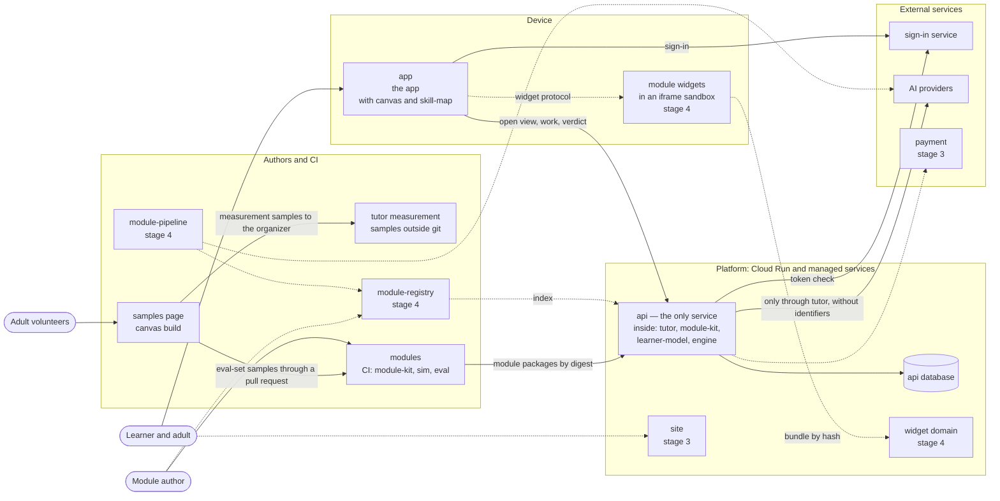
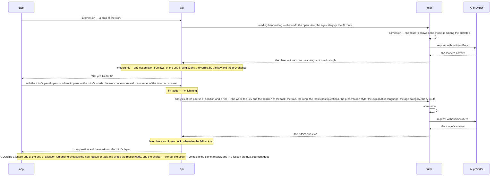

# NovaTrail — architecture

> Status: a draft for discussion.
>
> What large parts the platform consists of, what each does and how they are connected. This is the top level: the internal structure and technologies of each part are decided by its repository, starting from its card below. Where the code lives, in what order the repositories appear and the open technical questions Т-… are in [repositories.md](repositories.md).
>
> The concepts are in [concepts.md](concepts.md), privacy is in [privacy.md](privacy.md), the decisions are in [decisions.md](decisions.md).

## 1. Principles

- **The boundary between the program and AI runs along the code.**
  - Everything that calls a model is in `tutor`. A model that would read the work on the device is its code too: its weights, eval and admission are with `tutor`, and the verdict is with `module-kit`. In the first slice there is no such reading.
  - The verdict is given by `module-kit`, the learner model is computed by `learner-model`, the next lesson or task is chosen by `engine`. None of these libraries calls a model.
  - A task from the learner's paper is the one exception: it has no key, and its verdict is a model's, given by the Check of `tutor`, one call that also gives the place of a mistake and the hints. The program holds the Check's answer to its schema, turns it into the verdicts of the attempt and checks its words for the model's hidden answer. Such a verdict moves nothing but the learner's own view of that task: the task is in no module, and neither `learner-model` nor `engine` sees it.
  - CI of `api` checks the full list of dependencies: the SDKs of AI providers get into the build only through `tutor`.
- **Of the platform's parts, only `api` stores learners' data on the server.**
  - `tutor` stores nothing. The types of its requests have no fields for the learner's and account's identifiers, so AI sees the work but does not know whose it is.
  - Outside the platform, part of the data is held by the sign-in service, the AI providers and, from stage 3, payment.
- **A separate process only where it is needed.** In the first slice there is one service, `api`; `tutor`, `module-kit`, `learner-model` and `engine` are libraries in its process. `tutor` will become a service when it gets a second consumer.
- **The key of an unsolved task is only on the server.** The app gets the task's open view. The open view is built by `module-kit` by the marks `x-open` in the format's schemas: a field without the mark is closed, so a new field of the format is closed until it is explicitly opened. Of a task from paper, the model's hidden solution and answer, which its Check gives, stay on the server too.
- **Reproducibility**:
  - an attempt stores the digest of its module package, the module format version, the version of `module-kit` and the seed. A package digest is the digest of its inventory, and it depends only on the module's files and the format version of its manifest, as [the format's text](../format/README.md) sets it. A module is checked and executed by the format version that its manifest names, and a new format version does not change its verdict until the author moves the module to it;
  - an engine choice stores what its replay by the evidence log needs: the versions of `engine` and `learner-model`; the package digests, and which of them are the engine's modules, connected and suitable for the learner; the seed, empty, since the engine takes no randomness, as the version of `engine` in the record shows; the reason code; the release of `modules`, by whose index the withdrawal marks are known; the number of the last evidence it was made by; the time of the choice, for which the model computed retention and the review date; the grade by which the model computed the starting point of modules without evidence; whether the pool was limited to tasks without AI; the skill chosen on the skill map; the age category of the profile, by which `api` selected the pool and the lessons. The category changes at the yearly refinement and at a change of country, and the connections at any time, and the digests also name the modules of the log, which only `learner-model` gets: so the record keeps them. The summary of issues, the lesson runs and closed attempts with a rubric the engine saw, and the last attempt and its outcome the replay derives from the records of choices and attempts before the time of the choice: once written, they do not change;
  - a verdict is repeated by the stored observation, a choice by the evidence log; both without AI. A verdict of a task from paper is a model's and is not repeated: the same work may get another at another Check, and once the attempt ends `api` keeps nothing of it;
  - the generator of randomness and the derivation of seeds are set by `spec`, with test vectors: PCG, as in Go's `math/rand/v2`, and places of randomness, as at standalone's simulator, by [the format's text](../format/README.md). An instance of a task template is repeated by the attempt's package and seed: it is chosen by one number of the place `template`, the task's ID, `instance`, by the same text.
- **Our own parts of the interface are assembled at build time, others' code runs only in an iframe sandbox**.
- **No clusters, queues or event bus of our own**. The parts talk by synchronous requests by the contracts from `spec`: `app` with `api` by Connect, with unary calls, and the code of the contracts comes from the releases of `spec`. Background work is Cloud Run jobs on a schedule, as in canvas-api.
- **Logs without direct identifiers, IP addresses and content**.
  - Cloud Run itself writes request logs ([Cloud Run: logging](https://docs.cloud.google.com/run/docs/logging); sources 4.1) with the standard field `httpRequest`, and it has `remoteIp`, the client's IP address ([LogEntry](https://docs.cloud.google.com/logging/docs/reference/v2/rest/v2/LogEntry), `HttpRequest`; sources 4.2). canvas-api recorded the same about the logs of Cloud Run and Firebase Hosting ([`docs/privacy.md` of canvas-api@0901af0](https://github.com/mathtrail/canvas-api/blob/0901af0/docs/privacy.md)).
  - COPPA counts an IP address among persistent identifiers, that is, among personal information (16 CFR 312.2; sources 3.1).
  - So the request logs are excluded in Cloud Logging by the filter of each sink: Google accepts the record and discards it before storage ([Cloud Run: logging](https://docs.cloud.google.com/run/docs/logging), "the logs exclusion feature from Cloud Logging"; sources 4.1), — and the logs' region is `us-east4`, as for the whole platform.
  - The hosting of `app`, Firebase Hosting, and the sign-in service, Firebase Auth, store IP addresses in their logs themselves, for several months and several weeks (sources 4.4); `infra` does not turn on the export of the Hosting logs to Cloud Logging.

## 2. The overall diagram

Solid arrows are the first slice, dashed ones are later. `tutor`, `module-kit`, `learner-model` and `engine` are not drawn separately: they are libraries inside `api`. How the repositories depend on each other at build time is in [repositories.md](repositories.md).

## 3. Components

Each component has a card: what it does and does not do, its data and links, its repository and stage. The items "To decide when detailed" are what the work in its repository begins with. A question that concerns several repositories is in the registers of `spec`, and the card refers to it.

A repository's detailing may name items beyond its card or skip one of them; the card follows it by a row «в реестр spec» of the repository's table 3 once the decision is made, not in advance.

### 3.1. app — the learner's and adult's app

- **Does:**
  - the shell: sign-in through the sign-in service, the choice of the learner on a shared device, the start of work — age, country, consent; the learner's grade — when the module manifest names grades. The owner's profile offers every code of `Country` of [consent-age/](../consent-age/README.md), and a country the deployment does not accept is answered by the refusal `CAUSE_COUNTRY_NOT_ACCEPTED` of `api`;
  - the places of the app in a row of places at the top left, on the phone a tab bar at the bottom — Home, Subjects, the cognitive map shut until it comes —, from 600 CSS px to 72em each its icon alone with a tooltip of its words, but the place shown, and at the top right the tutor, shut until it comes, as the cognitive map, the notifications and the profile's menu, which holds everything that is not a place: who is learning and Switch learner, Settings — the section for adults —, Help and Sign out; three entries into the work: the modules' cards on Home, under "Next up", the skill map of a module from Subjects, and "A task from my paper", the main one, by the card "Tasks from my paper" on Home, open to every profile (the mockup, `draft/mockup/`);
  - the paper flow: the camera, or a photo picked from the device; the page sent once, for `api` to find its tasks, whose task frames come back, every one picked, each with the frame of its instruction above it when the page prints one, with no text; the learner unpicks a task, removes any frame by its cross, or frames one the AI missed — a rectangle dragged from one of its corners to the opposite with a finger or the pen, or two taps on opposite corners —, a frame which its corner resizes; each picked task's crop and the crop of its instruction cut on the device; and each task on a dotted sheet of `canvas` under its crop as tracing paper, with the row Hint · Check, no "Show the solution" and no buttons of options; Check sends the crop as printed, the work and the crop of the instruction, and may be pressed before an answer is written; the tutor's words in its panel — those of the Check, `tutor_text`, which come with its verdict, the ladder's first rung by Hint before the first Check, which sends the work as it stands to the Check's call, the rung's words after "Not yet", "Explain differently" and "Report a problem" for an adult —, and the wavy line from the box of the first mistake that the Check gave, beside the rung's words in the mode "Show where", until other work or the tracing paper moves. The profile's hint mode, "Questions only" or "Show where", stands in the pop-over Grown-ups of the row of places — on a child's home behind the PIN —, and a child's also on the profile's page in the section for adults;
  - a module solved on the sheet, the check board: Continue on its card begins its tasks by `BeginPaperAttempts` with the module's ID and opens them on the screen of solving of a task from paper, whole, each statement the module's text drawn as the task's picture, which the tracing paper shows and the Check sends; no camera, no frames and no Add, and the page in the tab's memory alone;
  - the lesson player and the task screen: the canvas, answer slots, the choice of an option, the tutor's panel with the solving steps and hints, the conversation line. The tutor's panel is one component on every screen, which gives it its context and which of its parts are on. Its field is on the page to pick from of a task from paper, for a request about which tasks to take and how to split them, which `FindTasks` sends to the finding as data and whose answer is frames alone, and on a task from paper, for a question about the task, which `AskTutor` sends with the conversation on the task that `app` holds in the tab's memory, at most 8 turns, and no export holds; on a task of a module and on Home the conversation line is buttons of requests, a hint and "explain differently". The field's microphone, for a learner of the category `adult` alone, is the browser's `SpeechRecognition`, asked to recognise on the device where the browser offers it, in the language of the screens: its text stands in the field to read and correct before Send, and `app` keeps and sends no audio; a child's stays off, "Voice comes later" (П-5). Each request for the tutor's words of a task from paper names the language of the screens `app` shows, `words_language`, and `app` voices the words by it. The text of an item of a handwriting sheet `app` shows together with the options of `choice`, beside the sheet, not on it; the item line of a workbook is shown by the canvas. The task's skills, band and difficulty are not in its open view, nor are its techniques, traps, simpler case, leak phrase and solution;
  - grown-up mode on a task from paper: the key in the head of the tutor's panel, the dialog of the grown-ups' PIN — for now a static one that `app` checks (run/DEBT.md, Д305) —, the band "Grown-up mode · No limits, up to the full solution · Turn off", and the field's request by `AskGrownUp`, with the conversation, the work as it stands and the strokes the crop shows, which the element's `cropStrokes` gives, thinned to at most 128 points each; its client waits 300 s. It puts the act on the sheet by the element's `drawTutor`, and the tutor's words in the conversation. The mode lives in the tab's memory for the task: Turn off, another task or a reload ends it;
  - a lesson by its open view: the segments in the author's order, explanations — and the numbers of a numbered list in them are drawn by `app` —, worked examples, whose demo the learner opens one part at a time and may hide, and the lesson's tasks, which `api` gives. The lesson's skills and age categories are not in the open view;
  - progress and the skill map; at a module's level, when an adult set it, "the level was set by an adult" with the date, for every learner;
  - the section for adults behind a PIN: profiles, tariff, own key, settings, export and deletion, and a module's level — "Easier" and "Harder", a band in one step, by `ProgressService.SetModuleLevel` with the band it sets, next to the band of the level that `GetSkillMap` gives, so a repeat changes nothing, and with the right `can_manage` at every profile of the account;
  - the disclosure that the learner talks with AI, not with a person: in the adult's Help, as the first line of the tutor's panel on Home — "The tutor is an AI — a computer program, not a person. The AI checks a task from paper, a program the rest" —, and on the page on the tutor, `#/tutor`, the learning material on the safe use of AI that the providers' measures for minors ask for. The tutor's panel on a task — of a module or a lesson, an essay, a task from paper — opens with no such line. How the disclosure holds for a child, by Anthropic's term for minors, is a condition before the first child (sources 2.4);
  - on the camera of a task from paper, under the viewfinder, before the photo, a reminder to keep names out of it, and in the adult's Help the line that the name is made up, so no real names go into the work; no reminder of names stands before Check, nor over the field of a request. To a learner under 18, at work with a rubric and in the section "Help", open to them from any screen, where to turn if something is wrong: to an adult and to the helplines of their country, by name and number, without links, by a list with a date of checking;
  - voicing of the tutor's words and the module's open texts by the device's speech synthesis, in a voice that it names itself, by the rule of Т-13. Whether voicing is on and its speed are in the presentation style of the learner's profile, and the voice by language and the adult's permission on Android and Linux are on the device (О-23);
  - the interface in `en` and `ru`: one language for the whole device, which the adult chooses on the page Language of Settings, and every screen is in it, a learner's too. A new owner profile gets it in its field of the interface language, which `app` sets nowhere else. Translations follow the shared rules of the UI packages, and the words that more than one package shows follow the table of words that `spec` keeps for them;
  - legal pages and consents: the texts from `api`, by the method `LegalService.GetLegalTexts`, as its own pages, without external links, and for a consent, its gist in the screen's language beside the English text;
  - accessibility by the standard of the UI packages, WCAG 2.2 AA with 2.5.5 and 2.3.3. What `app` and the packages do not meet yet, `app` names on the page "Accessibility", among the legal pages;
  - the look by the interface mockup, `draft/mockup/`, on a phone, a tablet and a computer; where the mockup and the documents differ, the documents win. The tutor's panel opens at the side — part of the app, not of a canvas — with Hint, "Explain differently" and the speaker of voicing, and the program's verdict comes into it as a line, or as a card while it is closed; on the page to pick from its field takes a request about the frames, answered with the program's line and Undo, and on a task from paper a question, answered with the tutor's words and "Report a problem", and to an adult the tutor is neutral, without a name (О-13). The panel opens by the tutor's button, by Hint and by the pill of the step, not by a verdict, and the tutor speaks of the work only while it is open: with it closed, "Check" gives the reading and the program's verdict, and `app` asks neither `GetRungWords` nor `GetCorrectAnswerWords`; on a task from paper the verdict is the model's, and the Check's answer holds the tutor's words, which the panel shows when it opens; an opening asks them once, for the last submission of the task on screen when it gave "not yet" or "correct", with the work that `app` holds while the task's screen is open. On a phone the panel is a sheet from the bottom, half the height or, by its grabber, the whole. The solving steps of the task screen stand at the top of this panel, and while it is closed, a pill of the current step stands above the row Hint · Check; the options of a choice open from a button of the row, and the lesson's segments from its title. Every profile shows its avatar, the owner's too: the one chosen, or the set's own. The adult's Help says that the tutor is an AI, that the AI checks a task from paper and a program the rest, what to do when the AI has misread the work, and that names are made up, and links to the legal pages and "Accessibility"; the helplines are in the Help of a learner under 18. The module card shows the states of its skills by the function `./states` of `skill-map`. Buttons with an icon alone are only those of a closed list. "Add a learner" is shown disabled, with a line why, until the children are open, and "Take from my paper" is open and opens the camera. The tool bar of `canvas` takes the accent and the glass of `app` by `--novatrail-canvas-accent` and `--novatrail-canvas-glass`, and by `--novatrail-canvas-top` the offset, from the top of what scrolls the element, of the band in whose middle the bar stands — the height of a sticky header of `app`, where it has one; on a phone `app` hides the bar by the element's attribute `tools-hidden` while the tutor's sheet is open, and on a worked example it puts its "Continue" into the element's slot `actions`, one row with "Next" and "Demo". The task statement is `app`'s card above the element, by the mockup: its picture with a description and its speaker, `app`'s voicing, folded to one line on a phone; the element leaves its own statement out by the attribute `statement-hidden`.
- **Does not:**
  - does not get the key, the solution and the traps of an unsolved task, and its technique only from `api`, at the step that gives it, or at the learner's request, and the task's leading question also from `api`, on request; of a task from paper it never gets the model's hidden solution and answer, only the verdicts, the boxes of what was read and of the first mistake, the tutor's words and the rungs shown;
  - does not give a verdict;
  - does not call AI providers;
  - does not send strokes to the server, but for a stored work, while the storage of the profile's works is on, and in grown-up mode their points, without time and pressure, for the drawing alone. The photo of a page it sends only for its tasks to be found, a task's crop, bare or with the work on it, and the crop of its instruction only for its Check, the crop as printed also for Recognise and "explain differently"; none of them is put as a stored work. Of what an adult says into the tutor's field it sends the text alone, never audio.
- **Data and links:**
  - on the device: strokes with time, pressure and style, artifacts, and the own key only for an owner profile of the category `adult` and only by its choice on this device, otherwise in the tab's memory. `app` sends the key with each request of this profile that calls AI. Also the context of each submission: on a handwriting sheet, where the crop lies on the sheet, its integers, the group boxes of the stroke groups, the table "group label → stroke IDs" and the submission's digest, and on a workbook, the table "box → stroke IDs" and the digest. The canvas gives it together with the work, and `app` holds it as it is: by the digest the canvas accepts the context back. And the history of tasks from paper: the photo of each page, the crops and the work, in the profile's storage, which the profile's history shows and its export holds — the five newest pages, a new one past them taking the oldest —, erased with the profile;
  - talks with the sign-in service and with `api` by the contract `novatrail.api.v1`: the check of an attempt is `AttemptService`, the account and profiles are `AccountService`, and by the list of profiles and the refusal "account gone" `app` erases what lies on the device; the path from a module to a task is `PackageService`, `ModuleService`, `LearningService` and `ProgressService`: open views by package digest, the catalog and the connected modules, the engine choice, the start and the open attempt, lessons by runs, the skill map and the adult's progress; the stored works are `WorkService`: `app` puts a work at each submission and when the attempt closes, while the storage is on, and takes it back on another device and into the export;
  - reads the deployment configuration at each start from `/deployment.json` at the root of its origin, beside the signed build but not in it, and checks it strictly, before the first request to the network. The file's format is the part of `spec` `deployment/` with its own version, and version 1 holds `format`, `api` and `signIn` ([the part's text](../deployment/README.md)). The build carries a copy of the part's schema from the release of `spec` it stands on, `deployment.schema.json`, and by it names the version it reads, and the CSP template `csp.json` is its own, by its own code. The form of the template — an object "directive → string of sources" with the places `{api}` and `{authDomain}` — and the layout of the archive — at the root `index.html`, `assets/`, `deployment.schema.json`, `csp.json`, `NOTICE` and `LICENSE`, without `deployment.json`, — are held by `app`'s `docs/architecture.md` as the rollout of `infra` reads them. `app` itself stands at the root of its origin;
  - gets the task's open view from `api` and reads it by the types from the releases of `spec`, of the module format versions in the window. The TypeScript types are the npm package `@altnovatrail/spec`, `@altnovatrail/spec/formatv0/open`, by an exact version in `devDependencies`, and `api` reads the same view by the Go types `types/formatv0/open`. While the format is v0, `app` and `api` move to a new version together;
  - builds into itself `canvas` and `skill-map` as web components, by an exact version from npm. The version's signature is checked by the recipe of `spec` `release-verify` in CI of the pull request that changes the lock file. To the canvas, with the task, it gives the open view of the manifest of its module, by the property `manifest`, and the files of its pictures, by the function `media`, from the files of the device part, which `api` serves. The element's types are `@altnovatrail/spec/canvas`, in the same package and by the same exact version. The manifest it gets from `api` by the package digest — of the attempt, and before the first attempt, of the current version of the connected module, — once per package, and caches it by it, not with each task. The open views of a withdrawn version of a module it removes from the cache: about withdrawal it asks `api` at launch, by the request `CheckPackages`;
  - takes the icons of its buttons from the set Material Symbols by the table of icon values that `spec` keeps for the UI packages: the package `@iconify-json/material-symbols` by an exact version, embedded at build time, in `dependencies`, like everything the bundler embeds. The app does not call the Iconify API;
  - later, with the text canvas, voices its "listen" by the event `speak` with the same speech synthesis as the whole app (Т-13). In the first slice there is no text canvas;
  - opens module widgets through the widget host from `canvas`.
- **Repository and stage:** `app`, stage 2.
- **To decide when detailed:** everything is decided: the camera, the pick of the tasks, the path when AI is closed, the screen of solving and the check of a task from paper are decided in `app`'s decision log, and its sheet and tracing paper in `canvas`'s. What `app` decides next is in its `docs/architecture.md`.
  - The paper flow: the camera and the photo picker, the frame drawn by hand, the crop and the crop of the instruction, the history of tasks from paper on the device and its part of the export. The requests to `api` are `PaperService` and `AttemptService` of [the contracts text](../contracts/README.md), and the pages are files of the export.
  - The framework and build — decided. The UI packages impose no framework, and each depends on the types of `spec` by its own copy at an exact version, not by `peerDependencies`: the package carries only declarations, and the copies cost nothing. The build embeds the icons of the set by a bundler plugin or a script on `@iconify/utils`, without auto-installing sets, keeping the same version of the set as the packages it builds in; everything the bundler embeds stands in `dependencies`, and in `devDependencies` only tools.
  - Storage on the device, the submission context too — decided.
  - The solving steps — decided. `app` leads them by the open view, and the exit conditions of a step — `givens_ticked`, `answer_slots_filled` and `none` of `solving-steps.yaml` — are events on the device, without the key; the chips "givens and unknown" are in the task's open view. `answer_slots_filled` `app` reads by the slot binding: for `choice` by its own choice of an option, for other slots by the canvas's `filled`, which on a sheet says whether a slot `anywhere` or `sheet` has a stroke.
  - The lesson player — decided. The mark "sequential" of a module whose skill graph is a chain `app` derives from the tiers `skill_tiers`: the module has no fewer than two skills, and each stands in its own tier. The learner opens the parts of the demo and hides it with the buttons of the canvas element; `app` leads the segments, gives each segment a new element, keeps the state of the demo by the event `demochange` and returns it by the property `demoState`.
  - Voicing — decided, by the device's speech synthesis (Т-13). The own key — decided; a child's profile does not use it (О-4). The deployment configuration — decided: read at run time, not embedded in the build, so that self-hosting takes the same signed build. The interface languages and the translations — decided (О-2). Accessibility — decided. The translation scheme and the accessibility standard are shared by the UI packages, and their input is the captions and the row of buttons of `canvas`.

### 3.2. canvas — canvases

- **Does:**
  - canvas kinds; in the first slice, the handwriting sheet and the workbook. A workbook is a page of 1000 × 1400 units, like a sheet, without a grid: the item lines with boxes are put on the template layer by its layout, by the task and its own table of widths, not by the device's font. A task from paper is solved on a sheet whose grid the learner turns by the bar's last button — dots as it comes, lines, blank, squares, round —, with the task's crop over it as tracing paper in place of the template: the learner moves it by its grip "Move the task", hides and shows it by the button atop the tools, and writes on it as on the sheet;
  - layers: the template, the widget, the demo, the learner's work, the tutor's layer. On the demo layer is the demo of a lesson's worked example: its parts open one at a time and hide all at once, and a picture in a sheet area stands at the size of the area. From format 0.4 an example stands on a workbook too: the example's lines by the page layout, and a part of the demo fills a box with its value. On the sheet and on the workbook of an example the learner does not write. The parts are opened one at a time and the whole demo is hidden by the learner with the element's buttons, "Next" and "Demo". An example has no bar: "Next" and "Demo" stand in a glass row at the element's bottom, and after them the named slot `actions`, where `app` puts its "Continue"; the row's accessibility is the element's;
  - tools; the pen writes in the learner's style — a kind of pen — pen, liner or marker —, its width of five, its opacity and its colour, the palette's or another, each kind its own, in the popover a second press of the chosen pen opens, by the mockup `draft/Pero-nastrojki.html` —, and a pen's hover shows a circle of its size; the eraser takes a stroke whole or, by its own popover, only what it passes over, of one of five sizes, cutting the strokes it crosses into pieces, new strokes of the history; Select, the element's own tool on every sheet the learner writes on and not the format's, draws a lasso or, by its popover, a rectangle on the layer where its press began — the sheet's or the tracing paper's —, takes the strokes of that layer it holds four points in five of, and moves them by a drag inside their dashed box, or copies them just below themselves or deletes them from the bar over the box, each one event of the history — a move, a copy, an erasing — which one undo takes back whole, its shape kept in `pens`; and the hand, the element's own tool too, moves the sheet under any pointer. The tool panel is the vertical glass bar of the interface mockup, in the style properties that `app` sets, as it sets `--novatrail-canvas-*` — the accent of the tool in use and of the focus ring `--novatrail-canvas-accent`, the glass `--novatrail-canvas-glass`, `--novatrail-canvas-top`, the offset of the band in whose middle the bar stands, and `--novatrail-canvas-pad-top` and `--novatrail-canvas-pad-bottom`, how far the bars of `app` float over the element's top and bottom —, and its accessibility stays the element's. The boolean attribute `tools-hidden` takes the bar, and on a worked example its row with the slot `actions`, out of sight and of the accessibility tree: `app` sets it on a phone while the tutor's sheet is open. On a phone the bar stays at the left edge. The sheet goes past the task's page, which stands at its left, right as far as the ink and one view more, and down as far and two views more; "Zoom in" and "Zoom out" of the bar step the page's zoom of it by quarters from 50 % to 200 %, and a pinch of two fingers sets it; the hand, two fingers, the wheel and the keys move it. The mockup's highlighter is not a tool of the element: a new tool is behaviour;
  - the capture of strokes with time, pressure and style: a line of the kind pen is drawn wider and finer by a pen's pressure, or without one by the pointer's speed, which it never writes into the pressure;
  - the display of the module's content: the task statement, above the handwriting sheet and above the workbook page, but not while the element has the attribute `statement-hidden`, by which `app` draws it as its card, and media; there are no formulas in the statement of format v0. The text of a sheet's item and the options of `choice` are shown by `app`, and the item line of a workbook by the canvas;
  - the crop of the work for the check, each stroke in its style and at its width, with no pressure — in colour, by the rules that are the same for the device and the runner: on a handwriting sheet, only the visible strokes of the sheet of 1000 × 1400 logical units, and on a workbook, a crop of each filled box by its strokes; the draft — writing outside the boxes — does not go; on a task from paper, the crop with the strokes on it and the sheet's strokes;
  - the tutor's marks, tied to the learner's strokes. On a workbook a mark stands on an answer slot by place and holds on to the strokes of its box. On a task from paper with "Show where" the mark is a new kind, a wavy line under the place of the first mistake, by the box of it that the Check gives, shown with the rung's words, on the tutor's layer, with the contrast 3:1 of the accessibility standard of the UI packages; and by each answer of a task from paper, a tick or a cross at the box of what the Check read, over a white halo, which `app` gives by the verdict of each task of the frame;
  - the tutor's act in grown-up mode: `cropStrokes` gives the strokes a crop of a task from paper shows, in the crop's pixels, and `drawTutor` puts the act on as one event `tutor` of the history — its strokes of the pointer "tutor" and the pen kind "liner", on the tracing paper while it is shown, else on the sheet, and the strokes it takes off —, drawn one after another at the speed of a hand but all within 3 s, at once under reduced motion; one undo takes it back whole;
  - the samples page, a separate build of `canvas` for eval samples:
    - a sample is made by the same canvas as the learners have, and is saved as a file on the device. The file's format is the eval protocol: the message `Sample` of the package `novatrail.eval.v1`, one JSON per sample, without pressure, and for an eval-set sample, with the license in the file. It is written by `canvas` with the contract's code from `@altnovatrail/contracts`, and checked by a recipe of `spec` through the submodule, `just -f spec/justfile sample-check`. The groups, crops and box table of a sample follow the rules that are the same for the device and the runner, and the crops are drawn by the strokes that the file holds, for the final geometry too;
    - an adult's sample has two purposes, and it is chosen on the page itself: a measurement sample goes to the measurement organizer, outside git, and an eval-set sample to the eval-set organizer, and it is they who add it to `modules`, by a pull request from a branch of the repository;
    - the page takes no consent: it shows the purpose's notice and writes the version of the text set into the file, and the written consent is a signed form that the organizer accepts outside the page. The sets `measure` and `eval-set` are in force, and the page opens the volunteers' measurement and the eval set, and the child sample session is closed until the set `child-sample` is in force;
    - a child sample is with a separate consent and without a pull request: it does not get into the repositories, and the file goes to the operator's closed bucket, to the measurement organizer, for 2 years from the session;
    - nothing goes to the platform's server;
    - for the first measurement on the volunteers' samples, without hosting: the build is downloaded from the release of `canvas` and opened on a computer and on Android; on an iPad, only from hosting: the page moves to Firebase Hosting as a separate site with its own origin when the author so decides — Google is a processor for Hosting and keeps IP addresses "a few months" (sources 4.4) —, and until then the page says that it cannot be opened here. The tasks and media files are put into it at build time from the release of `modules`; until the build moves to `modules` (Д4 `canvas`), the measurement tasks come from the release of `tutor`: its file of open views `canvas` keeps as a copy in the tree, which CI checks by the recipe `release-verify` on every pull request, and the build of the page and the synthetic data read it without the network;
  - later, the widget host: the app's side of the widget protocol. It passes the tests of conformance to the protocol, as the widget does.
- **Does not:** does not know accounts, `api` or subjects. The tutor's layer does not change the learner's work; the tutor's act in grown-up mode does, as the grown-up asks, and only by `drawTutor`, which `app` calls.
- **Data and links:**
  - it has no data of its own: the submission context is held by `app`;
  - enters its consumer as a web component, one element `<novatrail-canvas>` for all canvas kinds. The element gives the writing history by the property `history` and the event `historychange` and takes it by the same property, and the settings of its pen and eraser by the property `pens` and the event `penchange`, which `app` keeps across one visit's tasks and lessons, stored nowhere, and the work for the check by the method `exportWork()`: on a sheet, the PNG of the crop and the submission context, on a workbook, the crops of the filled boxes with their places and the workbook's context, and which boxes are filled is told by the property `filled`. The picture of a work, `StoredWork.picture` of `PutWork`, the element gives by its method `exportPicture()`, a promise of a `Blob`: always the PNG of the strokes its sheet's or workbook's surface shows — the page and the ink past it —, with no condition, drawn as it draws the sheet and the crop, its size `canvas`'s and in its PNG's header. The method is part of the agreement, and `app` puts each stored work with its picture. The module manifest of the task it takes by the property `manifest`, and the files of the pictures of the task and the example by the function `media`, which for a link to a picture gives a promise of a `Blob`: the canvas does not go to the network. The commands `undo()` and `clear()` are called by its own buttons, and they are not part of the agreement. The tutor's marks it takes by the property `marks`, together with the context of their submission and after `task` and `history`. The learner's change of tool it announces by the event `toolchange`, and the language of its buttons' captions it takes from its attribute `lang`. On a task from paper the grid the learner turns is the property `grid` and the event `gridchange`, and `app` keeps it in its solving screen's state across one visit's tasks, stored nowhere. `app` sets the colours of its bar by the style properties `--novatrail-canvas-accent` and `--novatrail-canvas-glass`, its band by `--novatrail-canvas-top` and the room its own bars cover by `--novatrail-canvas-pad-top` and `--novatrail-canvas-pad-bottom`, hides the bar by the boolean attribute `tools-hidden`, and puts its "Continue" on a worked example into the named slot `actions`. Instead of a task it takes by the property `workedExample` a worked example of a lesson, and how far the learner has gone through its demo it gives by the property `demoState` and the event `demochange`. `app` keeps this state and returns it by the same property, and gives each segment of a lesson a new element. On a sheet `filled` says whether a slot `anywhere` or `sheet` has a stroke. The types of this agreement are `@altnovatrail/spec/canvas`: `CanvasElement` and the types of its events, of the writing history, the work, the submission context and the state of the demo. `spec` writes them by hand. The types of the marks are there too: `Marks`, `Mark` and `Anchor`, and the kind and place of a mark are checked against the message `Mark` of the contract `novatrail.api.v1`. An empty box of a workbook the mark circles by itself. The element in `HTMLElementTagNameMap` and its events in `GlobalEventHandlersEventMap` are put by the package `canvas`. The styles of its Shadow DOM the element sets by `adoptedStyleSheets`, without an embedded `<style>`, and of the consumer's CSP it requires only `img-src blob:`;
  - shows the open view by the types from the releases of `spec`, of the module format versions in the window, and releases a new canvas kind earlier than the module that takes it. The TypeScript types are the npm package `@altnovatrail/spec`, by its own copy at an exact version in `dependencies`: the `.d.ts` of the package `canvas` refer to its types. The types of the task, the manifest and the element in `canvas` are from this package; its own are the narrowed types of the check and the temporary field `canvas.tools`;
  - the icons of the bar's buttons are from the set Material Symbols, by the shared table of icon values of this document: the package `@iconify-json/material-symbols` by an exact version in `devDependencies`, embedded at build time. The button's name stays its caption, and the caption is visible but on the tools of a closed list, which show the icon alone, with the caption as the accessible name and a tooltip;
  - accessibility by the standard of the UI packages: the sheet past the page, with scrolling in two directions, the workbook's lines and boxes in the accessibility tree, the keyboard into the sheet and out of it, a bar of tools that takes no room of the layout and in a low window scrolls inside its glass, frames of `exportWork()` without the theme and forced colors, and its own axe-core. What the element does not meet yet, `canvas` declares itself, in its own `docs/architecture.md`, and `app` takes it onto the page "Accessibility": 1.4.12 — the printing of the workbook's lines keeps the width of the pieces by the page rule `format/page.yaml`, and it gives no margin for the user's text spacing; 3.1.2 — the name of the sheet's region when the element has no attribute `lang`, which `app` always sets; 2.5.7 — moving the sheet, which has no buttons for it and moves by dragging — the hand, one finger in pen mode, two fingers always —, by the wheel and by the keyboard. Translations of the captions follow the shared rules of the packages, with placeholders instead of concatenation and plural forms, and the shared words follow the shared table of words of this document;
  - the rules of stroke groups, the crop, the snapping of marks and the workbook's boxes are the eval protocol, and their test vectors `canvas` takes from the npm package `@altnovatrail/contracts`, `vectors/eval/v1/`, of the same exact version as the submodule `spec`, checked by `release-verify-npm`, instead of vectors of its own;
  - the consumers are `app` and the samples page, and CI of `tutor` takes synthetic samples from the release of `canvas`;
  - synthetic data on the module's tasks: the generator `synthetic` takes the open views of the tasks from the module package of the commit where the samples go, as `module-kit build` writes it — the call gives the package, — and writes samples with the source `modules` and the tag of the newest release of `modules`; the tasks and seeds are named by the call;
  - the text sets of its purposes the samples page takes from the file of the release of `spec` `legal-<version>.tar.gz`, which `release-verify` accepted, and opens a purpose only with the current set; into the sample file it writes the set's ID and its version;
  - the samples page opens a sample file without the network — the strokes of the final geometry, the crops and the texts of the markup, — changing nothing, saving nothing and not calling AI: so the eval-set organizer and the module author look at a sample before push;
  - everything that `canvas` puts out is the files of one GitHub release with the signature of the shared `release.yml` of `.github`: the package, the build of the samples page, the synthetic samples. The same package file goes out to npm, `@altnovatrail/canvas`;
  - CI of the build of the samples page takes, by an exact tag, the CLI of `module-kit` — its command `open`, by the form of the call that `module-kit` sets, — and the release of `modules`, with the signature checked by the recipe of `spec` `release-verify`, — and while `modules` has no content, the release of `tutor`: so the tasks and media files get into it, and the package itself does not know subjects. Before the build CI reads the withdrawal marks in the index of the newest release of `modules` and does not build the page from a withdrawn version of a module, and the child sample session is run by the build of the latest release of `canvas`;
  - later, the module preview for the author and the card of the MCP channel.
- **Repository and stage:** `canvas`, stage 2.
- **To decide when detailed:** everything is decided but the task from paper; what `canvas` decides next is its `docs/architecture.md`.
  - The drawing engine is our own code on the browser's API.
  - The logical coordinates are a sheet of 1000 × 1400 units, and a crop goes to the check. A place in the observation is in fractions 0–1000 of the crop, and `canvas` converts it into the sheet's units; on a workbook the place is an answer slot by place.
  - The docking is a web component. Publishing is npm.
  - The composition of the sample file is the eval protocol; the steps of the samples page are `canvas`'s own. The page writes the markup into each sample by the field `markup`, before saving: the slot truth, and on a sheet, the writing parts with the first error and the result, not the lines. Who did the markup the file does not name: it follows from the origin and "who wrote", and the people's marks on an essay are added by the organizer.
  - The workbook is decided in `canvas`: the page and the layout, the template layer, the rule of boxes and `filled`, the work for the check and the marks on boxes. A workbook item is a line of pieces of text and boxes in order, laid out by the page rule of the format; the digit height on the crop is set by the module manifest, and the grid and its step by the sheet's task.

  - The task from paper: the tracing paper's layer and its grip, its picture a photo's crop or, for a module solved on the sheet, the module's text the consumer drew, under the sign "Task of the module" and with no Recognise, and how the wavy line is drawn — under the strokes of its box, over a light halo; it goes with other work, by `app`, and with the tracing paper moved, by the element. What the element takes and gives — the crop on a dotted sheet, the place of the tracing paper, the work for the check, and the wavy line under a box, over a light halo that keeps 3:1 against any page, with its name for a screen reader — are the types of `spec`, drawn by the element.

  Open is what waits for `spec`: the set `child-sample` in force and the group boxes of stroke groups at the check (Т-31).

### 3.3. skill-map — the skill map

- **Does:** draws the skill graph and the state of the learner model by ready data from `api`: tiers, prerequisites, knowing. The graph and the tiers `app` takes by the digest of the current version of the module, `GetSkillGraph`, and the state of the skills by `GetSkillMap`.
  - The package lays out the graph on the device itself: the tiers as columns from left to right, every link drawn, where the map's width holds them, and otherwise as bands from top to bottom; the anchor skills in a row before them. A chosen skill lights its whole chain — what it builds on and what builds on it —, and its card at the bottom of the window holds "Practise".
  - The state of a skill with a verdict it derives from the graph and the ready marks of `learner-model` — "mastered", "time to review", "in progress", "ready to start" or "locked" (the shared words), — and a skill with a rubric or without assessment has a mark instead of a state.
  - Only a skill that is not closed may be chosen for a session, and the engine takes this rule as an input.
- **Does not:** does not fetch data and does not compute knowing. It holds no learner's data on the device: the state of the skills lives only in the element's memory while it is on the page. It shows no ranks in the first slice (О-13).
- **Links:** the consumer is `app`: the learner's screen and the section for adults; later, `site` and the author's tools. The rule of the states serves the module card of `app` on the home screen too, as one function at a second entry point of the package, `./states`: the graph, the answer of `GetSkillMap` and the time in, the states and marks out, and `app` draws the card and its legend. It is `skillStates(graph, skillMap, now)`: the open view `open.SkillGraph`, the answer `GetSkillMapResponse` and the device's time in; out, for each skill of the module in the order of the graph, one of seven values — the states `time-to-review`, `mastered`, `in-progress`, `ready-to-start` and `locked`, and the marks `feedback-by-criteria` and `not-assessed` — the rule the element draws by, and nothing else of its core goes out. The words and icons of the states are shared, in the shared tables of words and icons of this document.
- **Repository and stage:** `skill-map`, stage 2.
- **Enters its consumer** as a web component and goes out to npm, in the scope `@altnovatrail`, like all UI packages. It names its elements itself: it is one element, `<novatrail-skill-map>`, — the properties `graph`, `tiers`, `manifest` and `skillMap`, the attributes `view`, `lang` and `heading-level` and the event `skillchoose` with the full ID of the skill for `ChooseNext`, without methods. Everything that `skill-map` puts out is the files of one GitHub release with the signature of the shared `release.yml` of `.github`: the package archive, `LICENSE` and the sums. The same archive goes out to npm, `@altnovatrail/skill-map`, by the npm step of the release through trusted publishing.
- **Icons** are from the set Material Symbols, embedded at build time, by the shared table of icon values of this document.
- **Accessibility and translations** follow the standard of the UI packages: a text alternative of the graph, `lang` on a skill's name, mastery not by color alone, the keyboard and moving the map without dragging. Translations follow the shared rules of the packages, and the shared words follow the shared table of words of this document. The names of anchor skills are English, with `lang="en"`.
- **To decide when detailed:** everything is decided; what `skill-map` decides next is its `docs/architecture.md`. The map needs no data beyond what `GetSkillGraph` and `GetSkillMap` give: the state of the skills of the current version, as `Read` of `learner-model` reads it, and of the anchor skills, and the tiers with the open view of the graph; whatever else it needs comes as a row «в реестр spec» and a field of the contract. The tiers `module-kit` computes by the graph into the package's canonical view, the author names them, and a tier without a name is shown by its number; the map draws them as columns or bands. The ranks wait for О-13.

### 3.4. Module widgets

- **What it is:** interactive components of a module on the canvas, the module author's code.
- **How they work**:
  - in an iframe sandbox without `allow-same-origin`, on a separate registrable domain. Together with `allow-scripts` it would let a page of the same origin remove the sandbox ([HTML Standard](https://html.spec.whatwg.org/multipage/iframe-embed-object.html#attr-iframe-sandbox), the attribute `sandbox`);
  - CSP does not let the widget's code go to the network: only the bundle itself is loaded;
  - the widget talks with the app only by the protocol from `spec`;
  - the bundle is signed and pinned by hash in the module package, and the package is pinned to the attempt;
  - official widgets run in the same iframe sandbox as others';
  - to children, only widgets that passed review (О-9).
- **Stage 4.** In the first slice there are no widgets: none of its three modules needs them. There is no binding of a slot to the widget's state in format v0: it will come with the widget protocol, as a minor version. The template for authors is `widget-template`.
- **To decide when detailed**, in epic E5 of the plan (`run/EPICS.md`):
  - the widget protocol. What it has to decide beyond the rules above is by an analysis outside the repository (sources 8.4). The app's side of the protocol is the widget host of `canvas`, which `app` builds into itself; "`app`" below is it (В22 `canvas`):
    - the channel. The HTML Standard says to check the sender of a message by origin, and a widget without `allow-same-origin` has an opaque origin, serialized as "null". A comparison of `event.source` with the iframe's window does not tell documents apart: an iframe has one window, and at a navigation only the document behind it changes. So the analysis advises a `MessageChannel` port: `app` passes it to the widget once, at the first load of the iframe, and then listens only to it, and a document to which the widget navigated later never got this port ([HTML Standard](https://html.spec.whatwg.org/multipage/web-messaging.html#authors): cross-document messaging, its ports and the WindowProxy). How `app` notices such a navigation is decided by the protocol;
    - the version of the state in each message of the widget: `app` knows to which version the verdict and the tutor's words belong, and a mark on a part of the widget that has changed since then it does not draw, like a mark of a sheet whose strokes were erased;
    - the parts of the widget for marks: the tutor's layer lies over the widget, so the widget names its parts and their boxes, and a mark holds on to a part, as on a sheet it holds on to strokes;
    - the widget reports the learner's state and events, not a verdict. Whether it is correct is decided by `module-kit`, and by which state — the one the widget reported or the one repeated on the server by the seed and the events — is decided by Т-24. The widget's seed is its own, not the attempt's seed: the attempt's seed does not go to the device, and how the widget gets its own is decided by the widget protocol;
    - the tests of conformance to the protocol are in `spec`, beside the protocol, like the verdict vectors, and in its releases by the same path as the format's files: as a release file of their own and in the Go module. They are for both sides of the protocol: both the widget and the widget host of `canvas` pass them, each in its own CI (В22 `canvas`). Tests of one side hold only that side: a host that diverged from the test one would break widgets that passed the tests, and nobody would notice. The test host is in the development environment of `widget-template`; whether `canvas` itself will be it, epic E5 will decide together with `widget-template`, and the condition for the host does not change from that. A widget conforms to the protocol if it passes the tests, and the library for authors is a convenience, not a condition;
  - whether the state the widget reports can be trusted (Т-24);
  - the withdrawal of a version of a widget that turned out harmful. A withdrawn version of a module withdraws the bundles of its widgets too: the device no longer loads them, and the reason "dangerous bundle" will come as a minor version of the format together with the widget protocol.

### 3.5. api — the platform's service

- **Does:**
  - sign-in: checks the token of the sign-in service;
  - learners: the pseudonym, age category, country, presentation style, default solving mode and hint mode, interface language, grade — if the module asks for it; consent records; permissions;
  - attempts: stores the digest of the module package, the module format version, the version of `module-kit` and the seed. The attempt's seed `api` takes from a cryptographically secure source when the attempt begins, and does not give it to the device: from the state of a place of randomness its seed can be seen, and the generator is not cryptographically secure; it gives the open view. It gives a task to a learner only if they are in one of its age categories, `age_categories`, and a lesson only if both the lesson and each of its tasks suit the learner;
  - the lesson: its open view — without skills and age categories — and the lesson's tasks by its segments. A lesson's task is the same attempt as outside a lesson. `api` leads a lesson by a lesson run — a row per profile and lesson, on the package where the lesson began, one for all devices, with its own ID. The place in the lesson and the state of the demo are held by `app`. The usual end of a lesson is "lesson passed" from `app`, which `api` accepts when all task segments have ended; `api` itself ends a run "unchecked", "not suitable" and "abandoned" — 30 days without actions, — and an early end the rule of `engine` does not give in the first slice; what the contract carries to a lesson is `LearningService`: open a lesson by the choice, a run by its ID and "lesson passed", and the answer that ends a segment's attempt names the next segment;
  - the task template: the attempt's instance is by its seed, from the package, and Starlark is not run on an attempt: the key of each instance `module-kit` computed and checked at the module's check. To the app, the instance's open view, without the field `template`. The package carries the numbers of each instance, and `api` takes the number `below(count)` and substitutes its numbers by the code of `module-kit`, without executing expressions;
  - the check: a submission → `tutor` reads the work, with two readers for handwriting → `module-kit` joins their observations into one and gives by it a verdict for each answer slot and for the item. The operator chooses the reading mode, `API_READING_MODE`: `pair`, by default, or `single`, one reader, Haiku 5.5 · `medium`, whose observation gets the verdict without the join, for every learner, and `api` accepts it at every rung; in `single` the admission is the pair's entry with Haiku as its reader, and a rung that admits no entry refuses the reading as an admission refuses it, not the configuration at the start. `api` stores the joined observation, or the one reader's, and beside it the tapped choice: by them the verdict is repeated without AI. There are no writing parts and other readings in the observation. The slot checks' predicates `api` computes by the code of `module-kit` in the request's flow and at once, no more than the process has CPUs (`GOMAXPROCS`): the clock of `module-kit`, 1 s per predicate, runs by wall time, and "unchecked" must not depend on the load. A cancellation of the request's `context` is an error without a verdict: `api` does not record it as "unchecked", and the submission stays without a verdict. A task with a rubric has an assessment by the rubric in `tutor` and feedback by the rubric, without a verdict: a submission ends with feedback, "unreadable" or "unchecked", and the attempt is closed by the learner's "Done". Of such an attempt the server stores how each submission ended, and for feedback, the criteria's marks and the source of the words, without the text of the essay and the words of the feedback. The slot check is in the server part: the app gets neither it nor its kind;
  - tasks from paper, for every profile, each call of AI through `tutor` and admitted by the table of `admission/`:
    - finding the tasks: the photo of a page, in the request's memory, to `tutor` in one request, and the task frames, each with the frame of its instruction above it when the page prints one, with no text, and the turn that put the page upright back to the device; with the learner's request about the page, the request and the frames on the page now go with it, `api` checks their bounds, and keeps none of them;
    - the Check: each `SubmitWork` of a work with something written is one call of `task_checking`, with the task's crop as printed, the work — the crop with the strokes on it and the sheet's strokes —, the crop of its instruction when there is one, the language of the tutor's words that the request names, the learner's age category and the attempt's history, which `api` gathers from what it keeps: the verdicts of the Checks before, the rungs shown and the tutor's words before; the strokes go only as drawn in the work, with no stroke's points and no writing history. The verdict of each task the frame holds — one, or up to 20 — is the model's: `api` holds the answer to its schema, gives the attempt an item for each task, at the box read, solved when every task is correct and one wrong answer counted by a Check with any task not yet, an error before the answer among them, a slot with no answer and no error "So far correct", which counts none, and checks the tutor's words and each rung of the ladder for the hidden answer of a task not yet answered correctly, a number the statement prints or the learner wrote being no leak, leaving out the words and giving a rung's fallback text for what names it. A Check that read nothing of a solution in any slot is "Couldn't check this one", `CAUSE_NO_KEY`, and an empty sheet `app` does not send; an `unreadable` slot asks to rewrite. Each call of AI of a task from paper asks up to three models in turn, the next only when the one before did not do, so `FindTasks` and `SubmitWork` run up to 90 s, and the request's reserve of the quota is the expected price of the three, the Check's with its three pictures;
    - the Check's progress, `GetCheckProgress`: when the Check goes on to a later model, `tutor` tells `api`, which writes the model's place and how many models there are into the record "going" of the request's idempotency key; `app` asks it every 2 s while its `SubmitWork` waits, and its card of the reading says that the work went on to the next model;
    - the model's hidden solution and answer, the ladder and the boxes of the errors kept on the open attempt, with the verdicts, the count of wrong answers and the words of the hints, and the reading of `ReadStatement` for Recognise, which the Check does not take: none of them goes to the device, and all are erased when the attempt closes, 7 days without actions closing it;
    - the hint ladder without "Show the solution" at any rung: Hint while the attempt has no ladder, before its first Check, is `GetOpeningWords`, which sends the work as it stands to the Check's call and gives the ladder's first rung, with no verdict and no wrong answer counted; after a Check `GetHint` and `GetRungWords` give rung k of the latest Check's ladder, k the wrong answers counted, its first when there are none and its last when it has fewer, without AI; "explain differently" is one call per rung, with the task's crop as printed, the rung, the hidden solution and answer and the questions before, without the work; with the profile's "Show where", the wavy line under the box of the first mistake that the Check gave;
    - a question of the learner's own, `AskTutor`: one call of the words of a task from paper, with the question, the conversation on the task that `app` sends, the tasks of the frame as the Check gave them and the hints given, without the work, after a Check of the work as it stands, with no verdict shown, while the attempt keeps none; the answer passes the leak check and the form check, else it is the opening question's fallback text; `api` keeps neither the question nor the conversation, in no log and no record of the idempotency key;
    - grown-up mode, `AskGrownUp`: an adult's action, with the right `can_manage`, on a task from paper alone — one call of `drawing` with the request, the conversation, the work and the strokes the crop shows, by its own cascade, with no leak check and no form check, the act held to its schema and each ID to take off one the request named; the quota as `AskTutor`'s, and 300 s of its own, `API_GROWN_UP_REQUEST_TIMEOUT`, which the server's write timeout holds; `api` keeps nothing of it, in no log and no record of the idempotency key;
    - no evidence and no call of `engine`: an attempt of a task from paper is the profile's history on the device, and `api` keeps no photo, crop or work of it;
    - for an account with the right of the debug mode, on a local run and on the deployment, `DebugService`: one model, with its effort and thinking, chosen for every call of a task from paper past the admission list, in every profile of the account, and each call's answer, tokens and cost held in the memory of its process until `app` takes them, never logged;
  - the adult's correction of a module's level, by `ProgressService.SetModuleLevel`: `api` checks that the band is next to the band of the level, appends it to the evidence log as a fact for `learner-model`, which moves the module's level a band, and gives on the skill map the band of the level and when an adult last set it, which every learner sees, and in the adult's progress the last correction of each module;
  - by the result of an attempt, evidence into `learner-model`, then `engine` chooses the next lesson or task and writes the reason code, from the pool and lessons, which `api`, when AI is closed, limits to tasks without AI. Inside a lesson the next segment goes in the author's order, and `api` calls the engine when the lesson run has ended or the learner asks for something else. The engine choice comes in the answer by which an attempt outside a lesson or a lesson run ended, and in the answer to "something else". The skill chosen on the skill map `api` stores with the choice and calls the engine with it both for `next` and at the end of a run, until the learner asks for something else. The reason code `api` stores with the choice, and it goes to the device only to an adult, in progress. To the engine `api` also gives the summary of issues, from its records of choices and attempts;
  - the hint ladder: which rung to give and which slot it speaks about — the first "not yet" in order, — when to offer an adult or showing the solution, and when the fallback text is needed. The fallback text of rungs 1–2 is the text of a trap value, a trap advice or the module's rung template, and of the third, the item's simpler case;
  - showing the solution: to a child, from the fourth incorrect answer, and with the adult's setting "ask before showing", on by default, only by an adult action, otherwise the refusal "an adult is needed"; to a learner of the category `adult`, from the start of the attempt. Showing closes the attempt with the outcome "solution shown", and the solution with the key goes to the device only when the attempt was closed by it or by a correct answer; a task from paper has none;
  - the task's technique, at the solving step that gives it: `app` names the attempt and the step's place, and `api` answers with the IDs of the task's techniques, empty if there are none. And at the learner's request before the first incorrect answer, without AI and without reading the work, and from format 0.4 together with the task's leading question, when there is one. Which technique it gave, at a step or on request, and whether it gave the question, `api` records, and the evidence carries it. "Givens and unknown" are open and come with the task's open view: `app` shows them, and `api` does not record them;
  - a hint on request after an incorrect answer — once more the words of the current rung, without AI, — and "explain differently" — the same rung in other words, one call to AI per rung, without the work, with the task's past questions;
  - the rung's words, with the analysis of the course of solution, and the correct answer words only by `GetRungWords` and `GetCorrectAnswerWords`, never at a submission: `app` asks them while the tutor's panel is open or when it opens, and `api` gives them for the last submission at any time later, with no window; on a task from paper they came with the Check, and `GetRungWords` gives them from the ladder kept, without AI;
  - the leak check, before any text of the tutor goes to the device. So the tutor's words go whole, not as a stream. How it looks for keys and leak phrases is said normatively by the [format text](../format/README.md), and its code is in `module-kit`;
  - there too, the form check of a hint and the feedback rule of a rubric. A hint is exactly one question, no more than two sentences, letters of the explanation language and no more than 30 words in Russian and 35 in English, and in a language that the measurement did not measure, without a limit of words. Feedback is no more than three sentences and 80 words in English, and a stretch in quotation marks of four words or more is only the learner's words. A hint that did not pass the check is the fallback text, and feedback is the phrase of `app` "no feedback this time", without a repeated call. The code of both checks is in `tutor`, the same as in its eval;
  - the platform AI quota, in dollars by the spending message of `tutor`, per family day, with the caps of the profile and the account by the account's tariff, which comes with the invite code. An exhausted quota is "unchecked" and the fallback text, and the attempt waits. From stage 3, tariffs beyond the closed slice and payment (О-14);
  - the own key, only with a request of a profile of the category `adult` and only in the request's memory. At connection `api` checks the key through `tutor`, by a request without the learner's content, as many times in a sliding window as it lets an account check, and names the providers open to the own key of a profile: those whose key `tutor` admits at the profile's category for at least one kind of call of `api`, by the admission table and the models admitted at the deployment's rung, so that a provider out of the list is closed to the check too;
  - the legal texts, `LegalService.GetLegalTexts`, without a token: for the platform, the part of `spec` `legal/` from `spec.Legal`, and for a self-hosting copy, from its operator's folder by the configuration's path; with a folder that breaks the part's rules `api` does not start;
  - the account and its profiles, the service `AccountService` of the contract: the list of profiles, by which `app` erases what was deleted on another device, the owner profile, a child's profile — after consent, — consent: the scan of the parent's form by the consent request code, the learner's own consent and its withdrawal, the removal of a waiting one, the age and country anew, — the storage of works, the PIN, the own key check, the share of the platform AI quota, its part of the export and deletion; "report a problem" at an attempt is `AttemptService`;
  - jobs and commands of the operator, like `admin` in canvas-api, and not a separate app:
    - migrations;
    - retention periods;
    - the consent check: the scan of the form, checked against the consent request code;
    - the triage of problem reports;
    - admission to the closed slice;
    - the list of countries: a learner from the EU or the UK, and an adult too, only after the signing of the DPIA and of the conditions that concern them;
    - the job after a deployment;
    - the change of tariff by code and opening the platform AI after "platform limit";
    - the cleanup of the tuples and `changelog` of OpenFGA;
    - finishing deletions and deleting users of the sign-in service without an account of `api`;
  - in the first slice, holds in its image the module packages — all versions of the index of the pinned release of `modules` in the format's window, withdrawn ones too, — and serves the files of their device parts — media files, `LICENSE` and `NOTICE`. A new attempt `api` gives only on a version that the index of the pinned release of `modules` does not mark as withdrawn. The catalog of a deployment gives only the modules its operator lists in a setting of `api`, when it has one: on `novatrail`, olympiad mathematics and the check board. A withdrawn version stays in the image only for repeating a verdict: the attempts begun on it are closed "unchecked", and `api` no longer serves the files of its device part. The open views are built by `module-kit` from the server part: the manifest, the skill graph with tiers, the technique catalog and the solving steps `api` gives without a token by the digest of any package that the image gives — of an attempt, of a lesson run and of the current version of a module, — a lesson's to a learner whom the lesson suits, a task's with an attempt.
- **Does not:**
  - does not store the pictures and sound that go to the check, the photo of a page from paper, nor own keys; stored works only while the storage of the profile's works is on, and by default not, each put, listed, read back and erased one at a time by `WorkService`, at most 4 MiB, and not read by the server;
  - does not call AI providers bypassing `tutor`;
  - does not write direct identifiers, IP addresses and content into logs.
- **Data and links:**
  - the database of `api` is the only store of learners' data among the parts of the platform. It is Neon Postgres, and the store of OpenFGA is a second database of the same project;
  - talks with the sign-in service, with the AI providers through `tutor`, later with payment.
- **Repository and stage:** `api`, stage 2.
- **To decide when detailed:**
  - sign-in and permissions — decided: Firebase Auth, sign-in through Google alone, and sign-in through Apple is the question Т-41; an ID token with revocation on every request; permissions are OpenFGA in the process of `api`, the subject is the account, the profile is a parameter of the request; a fresh sign-in is `auth_time` no older than 5 minutes. For teachers, permissions will be needed in the form "who got access to what and in what role";
  - the database and where the learner model lives — decided: the database is Neon Postgres, and the store of OpenFGA is a second database of the same project; the learner model is in the database of `api`;
  - the evidence log and the state of the skills — decided: the log is append-only, and the state is a cache;
  - which version of a module a new attempt gets — decided: the newest by semver non-withdrawn version of the pinned index in the format window of `api`, one for all learners, and a lesson's task is on the package on which the lesson began. An attempt stores the digest of its package. The configuration is `modules.json`: the tag of the release of `modules` and the digest of its index. Attempts on a withdrawn version and outside the window are closed "unchecked" by the job after a deployment and by the check at a request, and `api` gives neither the files of the device part nor the open views of such a version;
  - the transfer of progress by the table of correspondence of old skill IDs to new ones after a major version — `retired_skills` of the skill graph. Decided: `api` cuts off evidence `wrong_key` and gives the log and the graphs of the current versions, and the transfer is done by `learner-model`: the evidence of a retired skill goes to each skill that replaced it;
  - showing the solution and a hint at the learner's request — decided: showing to a child from the fourth incorrect answer and with the adult's setting "ask before showing", to a learner of the category `adult` from the start of the attempt; a request before the first incorrect answer gives "givens and unknown" and the technique, and from format 0.4 also the task's leading question, which the evidence carries, like the technique, after it, the current rung without AI, and "explain differently" once per rung; the slot of the rung and of the fallback text is the first "not yet" in order. An unsent work the request does not send for reading, and on a pause the work is not read: only the button blinks;
  - what the learner sees instead of rubric feedback that did not pass the feedback rule, and an essay that cannot be read — decided: the phrase of `app` "no feedback this time" and the submission end "unreadable", without a verdict, and of the attempt the server stores only how each submission ended and the criteria's marks;
  - the lesson — decided: the lesson run, its start at the request of `app`, the end of a segment and the run end reasons; the contract is `LearningService`, and what it needs from `engine` is in the card of learner-model and engine;
  - tariffs (О-14) and payment — stage 3. The quota of stage 2 — decided, and its numbers are an input of О-14;
  - the protocol between `app` and `api` — decided: the requests by the table in `api`'s own `docs/architecture.md`, on the wire binary protobuf. The format is protobuf and buf, and [contracts/README.md](../contracts/README.md) sets the layout, the rules of buf, the versions, the generated code and the transport Connect. The contract is the package `novatrail.api.v1`: the check of an attempt, `AttemptService`, — the submission, the verdict, the tutor's words and the marks, "Hint", the start of a step, showing the solution and "Done", — with one enumeration of the causes of refusals and outcomes, and the account and profiles, `AccountService`, — sign-in, the list of profiles, the owner profile and a child's profile, the PIN, the own key check, deletion and export, and the path from a module to a task, `PackageService`, `ModuleService`, `LearningService` and `ProgressService`;
  - the real-time channel — decided: in the first slice there is none, and the check of handwriting is two requests (Т-25);
  - from stage 4, the predicates of the checks of third-party modules in a separate process with a memory limit: go.starlark.net does not count memory, and Go's `recover` does not catch running out of memory and a stack overflow (О-9). A computation that the limit stopped is a computation error, that is, "unchecked";
  - deletion — decided: by a fresh sign-in, not by the PIN;
  - the modules solved on the sheet, the check board alone, named in `api`'s code: `ConnectedModule.on_sheet`, the engine choosing none of their tasks, and `BeginPaperAttempts` with a module's ID beginning an attempt of a task from paper for each task of its current version, at most 20, with their open views — decided;
  - tasks from paper: the attempts of one page open beside the one of a module, a new page closing the earlier page's `CLOSE_REASON_LEFT`, and `FindTasks` and `BeginPaperAttempts` refusing by the quota, the platform's limit or admission when AI is closed to the profile — decided; one Check per `SubmitWork` with its reserve, the attempt's history gathered for the model, and the model's hidden solution and answer, the ladder and the boxes of the errors on the attempt's record, beside the verdicts and the count of wrong answers, erased once it ends, and a check when AI is closed, an outcome with the slot `unchecked`, decided; the hint mode on the profile, Hint before the first Check as the Check's call, the rungs from the latest Check's ladder without AI, the words of a rung about the first task of the frame that is not yet, the wavy line in the mode "Show where" and the platform's fallback texts, decided. The requests are in [the contracts text](../contracts/README.md).

### 3.6. tutor — the tutor: reading and words

- **Does:**
  - AI capabilities:
    - the reading of handwriting and the reading of text: the work turns into an observation, the model does not see the key. The reading gives a slot's value as it is written: its check kind in `module-kit` normalizes it. Handwriting is read by two readers of one provider, by two calls, and a slot that they read differently is "unreadable"; in the mode `single`, which the deployment chooses, by one reader, Haiku 5.5 · `medium`, the second of the admitted pair. So it is for slots whose check gives a verdict, and a sheet under a rubric is read by one reader. `tutor` gives the observations of both readers, or in `single` of the one, or the AI call outcome, and `module-kit` joins two. The reader knows nothing about the slot check, neither the kind nor the options of a choice. The writing parts and other readings stay with it: by them it decides what to give, as the [contracts text](../contracts/README.md) sets it;
    - the analysis of the course of solution: the model also sees the key and the task's solution and looks for the first error in the learner's solution. The task's traps that AI may suggest, and the matched trap, it gets as a marked block of data, with the descriptions from the catalog. The analysis gives the box of the first error in fractions of the crop or nothing, and a trap from the block or nothing, as a type of `tutor`, not as an observation; the box is the same crop box as in the observation;
    - a hint: the words for the rung that the program chose. They go to the device whole, after the leak check, not as a stream; a stream is only for reading, whose answer a program reads;
    - the correct answer words: the praise of a step and the question which technique helped, by a call of their own, with the work, the key and the task's solution and its techniques, and with a form rule of their own beside the hint's form check. They have a capability of their own, `correct_answer_words`, with its own eval set: a model that was measured on the hint is not admitted on these words. `api` makes this call at `GetCorrectAnswerWords`;
    - the assessment by a rubric, from the first slice, for the essay module, by two calls: the reading of the essay into text, then the assessment of the text read by the rubric's criteria, without the picture. The reading of an essay gives "unreadable" only for the essay as a whole, and how it gives a word that cannot be read is Т-37; later, voice;
    - for a task from paper, three of their own: finding the tasks on the photo of a whole page, turned upright first by the model's word of which way up it is, whose answer is their task frames, each with the frame of its instruction above it when the page prints one, with no text, and the turn, each sum or equation that says by itself what to do a task of its own — with the learner's request about the page, the request and the frames on it now as data, and none of its frames repeating one the learner drew; reading the statement on a task's crop for Recognise, as printed, "□" for each box an answer goes in, never a formula or a key; and the Check, `task_checking`, one call with its instructions, the schema of its answer, its request, the read of its answer and its version, as each call of `tutor` has them. The Check gets Image 1, the task's crop as printed, Image 2, the work, each stroke drawn in its style, in colour, Image 3, the crop of the instruction, when there is one, their sizes, the language of the tutor's words, the age category and the attempt's history, all as data, never instructions, and the strokes only as drawn in the work, with no stroke's points and no writing history. It gives for each answer slot, 1 to 20 in the order of the page, its verdict — `correct`, `incorrect`, `unreadable` or `no_answer` —, its confidence, what it read with its box, its assumptions, its errors, each a box on Image 2 with the place in words, its kind and an explanation, and its own solution and answer, hidden; and for the frame the tutor's words, `tutor_text`, and a ladder of 2 or 3 hints, from a question to a pointer at the place. There is no call that solves the task and no reading of the work apart: the verdict, the place of the mistake and the hints come in the one call. Each of the three asks up to three models of one provider in turn — Haiku 5.5 · `high`, Sonnet 5.5 · `medium`, Opus 5.5 · `medium` —, the next only when the one before did not do by the program's rule of its call; the Check's goes on at a failure, an answer off its schema, a `low` confidence or an `unreadable` slot. The answers are of the contract `novatrail.paper.v1`, which the [contracts text](../contracts/README.md) sets. The leak check of the Check holds `tutor_text` and each rung against the hidden answer of a task not yet answered correctly, a number the statement prints or the learner wrote being no leak: words that name it do not do, and a rung that names it gives way to its rung's fallback text. "Explain differently" of a task from paper is a prompt of its own under `hint` and `solution_analysis`, by the same cascade, with the task's crop as printed, the rung, the hidden solution and answer and the questions before, without the work; a question of the learner's own is the same prompt, on its version 3, with the question and the conversation before it as data, answered as a tutor does — what the task asks or what a word means, a question that leads on —, never with the answer or a step, no nearer than the current rung. Beside them, the drawing of grown-up mode, `drawing`, the first call by tool use — one tool, `draw`, with `tool_choice` `auto` —, on its prompt of version 2: it gets the request, the conversation, the work and the strokes the crop shows, by their IDs and points in the crop's pixels, all as data, and gives the tutor's words to the grown-up and its act — the strokes to write, each its points, colour and width, and the IDs to take off —, with none of the tutor's limits and no leak check or form check. Its cascade is Haiku 5.5 · `medium`, then Sonnet 5.5 · `medium`, each with `max_tokens` 64000 (run/DEBT.md, Д306), the next when the one before gave no act the program holds.

    Reading and analysis are two calls: the reading model never sees the task's key and solution, and the analysis and the correct answer words see them. One call is only for a model that passes the threshold of `tutor` for reading with the key on the handwriting of adult volunteers, by a new decision. A task from paper, which has no key, is checked by one call, the Check, of one model at a time. The model's words are checked by `api`: the leak, the form of the hint and of the correct answer words, and the feedback rule, and they do not give away the learner's gender;
  - the platform's prompts: one per capability, each with its own eval set, and for a capability that writes words to the learner, the set has an item about grammatical gender and an item about safety. The analysis of the course of solution and the hint have one call, and their prompt is also one for both, and both eval sets measure it. A model is admitted for a capability when it passes both it and the eval sets of the modules where this capability is needed;
  - the providers' adapters: OpenAI, Anthropic. The adapter sends handwriting to the model as a picture or a crop, without the writing history — the drawing of grown-up mode alone gets the strokes' points beside the crop —, and converts the place the model named into fractions 0–1000 of the crop. Google's models are closed on the platform — both the Gemini API and Vertex AI, for learners and for the authors' pipeline, — and whether they are allowed in a separate deployment only for adults is to be decided by an analysis. The Anthropic adapter caches the instructions of the words — the hint, the rung's words and the correct answer words —, never the work: after the cached block come only the task's data and the work;
  - the list of admitted models: exact IDs for each capability, in order — of a call of a task from paper, the order of its attempts —, and each entry has a rung of the admission rule of `tutor`: "author" — on the handwriting of one author, "full" — the upper bounds of the shares of false alarms and of false "correct" no more than 1 %. The lower rung is named by the deployment: on `novatrail` it is "author", for adults, and "full" is the target of quality measured on the samples of adult volunteers, no longer a condition of admission for adults;
  - the model of reading on the device, if it comes: the weights with a digest in the release of `tutor`, eval and admission. In the first slice there is none;
  - for an account with the right of `api`'s debug mode, the one model, with its effort and thinking, that `api` names for every call of a task from paper, past the list and the admission function, one attempt with no cascade, and each call's answer as the model returned it, to `api` and to no log;
  - the admission function, one pure function. `api` calls it before an attempt, and `tutor` before each call of a model with the learner's work; the eval runner and the board do not call it. The rules are the admission table of `spec`, [`admission/`](../admission/README.md): `tutor` takes it as `spec.Admission` of the Go module, with the types `admissionv0`, and its tests run its answer vectors. The deployment facts are the configuration file of `api`, by the table's dictionary of facts;
  - the spending of each call — the model, the tokens and the estimate in dollars, as one message for both AI routes, — and the outcome "limit reached" with a cause. By the spending `api` counts the platform AI quotas, and the spending of an own key does not accumulate: its limit is held by the provider. For the quota's reserve `tutor` also gives the expected and the worst price of each kind of call: the expected one by the tokens of the kind in its measurements and the price table with the kind's model, the worst one by the largest input of the kind and its `MaxOutputTokens`; of a call of a task from paper, the expected price of all three of its attempts, the Check's with its three pictures. `MaxOutputTokens` of each kind of call of the product is limited: so the reserve of `api` is close to the spending, and an overspend beyond the cap is small. While there are no prices of a kind, `api` takes the kind's value from its configuration;
  - the own key check — a call without the learner's content — and the key's refusal, wrong or revoked, as an outcome of its own, separately from an AI failure and "limit reached";
  - routes to the providers, only those that zero data retention covers: at OpenAI, Responses with `store: false`, without `/v1/files`, at Anthropic, Messages, without the Files API and Batch; Anthropic's models that need storage of 30 days are outside the list of admitted ones for learners' works; safety rules for minors in its prompts — a prompt by Anthropic's article only if Anthropic gives it, — and not a single call that judges the learner's feelings;
  - the eval runner, a CLI on the same code; in CI of `tutor` its keys are secrets of the Secret Manager of `infra`, by the GitHub environment `eval`. It also serves the review board, a local page on 127.0.0.1 in the devcontainer: the author solves the board's tasks, the Claude models that they choose read and assess their work, and the author marks whether each is right. This is not a service.
- **Does not:**
  - does not give the verdict of a task of a module and does not choose a lesson or a task; of a task from paper the Check's verdict is the model's, and the program holds its answer to its schema;
  - stores nothing;
  - does not get the learner's and account's identifiers, the pseudonym and the adult's data, except the own key;
  - does not flag anything alarming in children's works: monitoring is only at the provider;
  - does not voice the tutor's words while voicing is the device's speech synthesis (Т-13).
- **Links:**
  - in the first slice only `api` calls it, in its process; `tutor` itself calls the AI providers. The reading request and the analysis answer are its types, and the observation and the crop box it takes from the contract package `novatrail.observation.v1`, by the Go module `github.com/altnovatrail/spec/contracts`;
  - CI of `tutor` takes synthetic samples from the release of `canvas`, having checked their signature by the recipe of `spec` `release-verify`, and checks that the eval runner reads them. The sample file is the message `Sample` of the package `novatrail.eval.v1` of the same Go module: the runner reads it strictly, an unknown field is a refusal, and it does not send a child sample to AI until the admission table admits to it the work of a child under 13. The folding of the history, its cuts among it, the stroke groups — erased ones too — and the crop, in colour by the strokes' styles, the runner computes by the rules that are the same for it and the device, and their test vectors it takes as `contracts.Vectors` of the same module, `eval/v1/`, instead of its copies of the vectors of `canvas`. The models' reading the runner compares with the sample's markup: its slot truth is the observation of one who reads correctly, and the verdict by it and by the reading is given by `module-kit`. What lies in an eval set, when the runner rejects a sample and what it gives — the report `Report` without the content of works, by which the measures are counted, — is written by the protocol, in the [contracts text](../contracts/README.md). The reports that the runner writes CI of `tutor` checks by the recipe of `spec` through the submodule, `just -f spec/justfile report-check`, and with the samples after `--samples`, also by checking against them, by the same code that holds the examples of `spec`, without a check of its own. For admission only a report with the verdicts of `module-kit` will do, and the run log, the reports for people, the bounds and the thresholds stay with `tutor`. And its release, while `modules` has no content, gives CI of `canvas` the open views of the measurement tasks, without keys, solutions and traps: the file `tutor_<version>_open-tasks.json` in the format `tutor-open-tasks` v0 — the open views by banks, each with its path in the repository, the digest of the bytes and the language —, which CI of `canvas` takes by tag and sum, having checked the signature by the recipe `release-verify`;
  - from stage 4, also `module-pipeline`. Then decide too whether it is a library for it or a service: `tutor` will become a service when it gets a second consumer.
- **Repository and stage:** `tutor`, stage 2.
- **To decide when detailed:** everything is decided but the voice route; finding the tasks on a page, reading the statement and the Check of a task from paper, and the attempts of each, are decided in `tutor`. The measures for minors are laid out by components, the spending limit of the own key is at the provider, admission is a function of `tutor`, and the admission table is `spec`.
  - Voice (Т-13) is at stage 3, the boundary is decided.
  - The capabilities of tasks from paper: for each of `task_finding`, `statement_reading` and `task_checking` of the admission table its prompt, its eval set and the models `tutor`'s list admits, until 2027-01-17 at the rung "author", which admits a model without a run of eval, with no threshold of accuracy before it; the Check's eval set is the eval set of verdicts, which measures it first, the share of false "Not yet" apart, and that of false "Correct". The tutor's words of a task from paper come with the Check, and "explain differently" and the answer to a question of the learner's own by the cascade of models under `hint`, on version 3 of their prompt, admitted by the author's word until the same day, their leak check by the model's hidden answer, decided in `tutor`; their eval set and its paid run are Д24 tutor. The drawing of grown-up mode, `drawing`: its prompt and its cascade are `tutor`'s, admitted by the author's word until the same day; its eval set is Д307.

### 3.7. module-kit — the module format in code

- **Does:**
  - reads an author's module — YAML with the format's constraints — and checks it: the schema, the graph without cycles, the references, the anchor skills of the shared taxonomy and the manifest's dependencies, the tasks and their references to skills, bands and pictures, the sheet's zones, the names of files and the signatures of media files, the slot checks — the key of a choice among its options, options without repeats after normalization, an irreducible key of a fraction, the predicate's expression and the assessability of the item's skills, the trap and technique catalogs, the trap values and the rung templates in the manifest, the lessons — their skills, tasks and pictures, sheet areas, age categories and the order of lessons without a cycle, the task templates — names, expressions, placeholders and every instance, each by all the rules of a task, and their solvers — on each instance, the author's texts that the learner sees before solving, by the leak check (`task.no-leaks`, and in a lesson `lesson.no-leaks`). A refusal by a format rule names the rule's ID. Of a picture with transparent pixels it warns but does not refuse: a module's picture has an opaque light background. Of a number in a text of the whole module — a rung template, a trap advice, a technique — it also warns but does not refuse;
  - reads the module format versions in the window — while the format is v0, only the current one, and from v1 the current major and the previous one, with v0 leaving when v1 comes out — and checks, builds and executes a module by the version its manifest names. A module outside the window it rejects with a reason;
  - builds the module package — the canonical view with the tier of each skill and the numbers of each instance of a template, the device part and the inventory — and the module index: from the previous release's index, with an entry of each published version by its package digest and with the marks of withdrawal, as the [format text](../format/README.md) sets them; compares a new version with each published one by the rules of version comparison and checks retired skills. The comparison vectors are in `format/vectors/versions/` of `spec`: its CI counts them as a second implementation, and CI of `module-kit` passes them all;
  - task templates: goes through the combinations of parameters in the order of a counter, computes the derived numbers and the constraint — expressions of a narrow subset of Starlark — and builds the instances, no more than 10,000 combinations per template. The instance of an attempt is the number `below(count)` of the place `template`, the task's ID, `instance` of its seed. The template vectors are in `format/vectors/templates/` of `spec`: its CI counts them as a second implementation, and CI of `module-kit` passes them all;
  - template solvers: executes the program `template.solver` in the dialect of go.starlark.net from the [format text](../format/README.md), and calls `solve` on each instance in order, with the numbers of its open fields — no more than 100,000,000 steps for all the instances of a template together. The results go into the key, the trap values, the solution and the leak phrases, and each instance with them passes all the rules of a task. The results of the template vectors CI of `module-kit` computes itself, and it passes all the vectors of `task.template-solver`;
  - the open view — by the marks `x-open` in the schemas: a mark counts only where its subschema applies and passes, and the open view vectors `spec` checks itself too;
  - the check kinds and normalization: in format v0, `number`, `fraction`, `choice`, `predicate` and `rubric`, and from 0.4 also `time`; how each reads a value and gives the verdict of a slot and of an item, the [format text](../format/README.md) says. The verdict vectors are in `format/vectors/verdicts/` of `spec`: its CI counts them as a second implementation, and CI of `module-kit` passes them all, the predicate's verdicts too;
  - the join of two readings and the verdict by an observation: it joins the observations of two readers into one by the slot check, and gives the verdict by the joined observation as a whole — in the reading mode `single`, by the one reader's, with nothing to join —, with the causes of "unreadable" from the observation, as the [contracts text](../contracts/README.md) sets them. The vectors of the join and of the verdict by an observation are in `contracts/vectors/observation/v1/` of `spec`: its CI counts them as a second implementation, and CI of `module-kit` passes them all, the predicate's verdicts too. With the same code it gives the eval runner of `tutor` the verdict by the truth of a sample's markup — the observation of a reader who reads correctly;
  - admits a verdict only if the key or the predicate was given by the author, a template solver or an adult; a task from the learner's paper, which has no key, gets no verdict of `module-kit`: its verdict is the model's, by the Check of `tutor`;
  - the leak check — as the [format text](../format/README.md) says. The leak vectors are in `format/vectors/leaks/` of `spec`: its CI counts them as a second implementation, and CI of `module-kit` passes them all. `api` calls it on the tutor's words, and the module check on the author's texts;
  - a trap by an incorrect value — by comparison with the slot's trap values, as with the key;
  - the Starlark sandbox for template solvers and check predicates, as in standalone. A check predicate is a Starlark expression of an integer `value`, and the limit of its steps — 1,000,000 as go.starlark.net counts them — is part of the format: a limit reached or an error gives "unchecked". The budget of a template solver is in the format too. The version of go.starlark.net and the dialect, one for all the Starlark of the format, with the list of built-in names, the format names from version 0.3, and `module-kit` pins that version;
  - the check of a package by the chain of digests from the index that a pull request of `api` pinned: index → inventory → parts → files. The signature is put by the shared release workflow of `.github`, and checked by the recipe `release-verify` of `spec` where the file enters NovaTrail — the library checks no signatures;
  - the choice of a module's version for a new attempt — the newest by semver unwithdrawn version of the pinned index within the format's window — by a function of the library; the command `open` uses it too;
  - the author's CLI: check, build, build the index, compare versions — the command `diff` — and the open views for the samples page — the command `open`: for a template, the instance by the seed, and the digest of an open view is `sha256:` and the SHA-256 of its canonical text, for an instance with the numbers substituted. The exit code is one for all the commands: 0 — accepted, 1 — a refusal by the format rules, with their IDs, 2 — the command could not do its work. What is absent — a previous index, withdrawals, published versions — a command is told explicitly, not by a missing file. The CLI builds the index inside the shared release of `modules`, after the number and before publication: a new entry names its release's tag. "Build" writes the package as files, and the package's archive for the release is put by a recipe of `modules`. The withdrawals "build the index" reads from the file `withdrawals.yaml` of `modules` — by `$defs/withdrawals` of the index's schema. The form of the call of each command and the file `open-views.json`, the output of `open`, are kept by `module-kit` in its `docs/architecture.md`, and the recipes of `modules` and CI of `canvas` cite it and check the call with their tests.
- **Does not:** does not call AI. The library does not go to the network, and the CLI only reads and writes the module's files. It stores no learners' data. It holds no places and no memory of the Starlark sandbox: how many computations run at once is decided by the caller, and the Starlark of a third-party module from stage 4 is executed in a separate process with a memory limit at the caller (О-9).
- **Links:**
  - the format's schemas, examples and test vectors it takes as the Go module `github.com/altnovatrail/spec` — `spec.Format` at the release tag, the same as that of the submodule `spec/` —, not from the submodule. The schemas the CLI needs at run time `module-kit` embeds as its own copy of `format/schemas/` and holds it by a test byte for byte against `spec.Format`: an import of the package `spec` would carry the vectors into the binary too, more than 5 MB. The types of the parts, of their open views, of the canonical view, of the inventory and of the index are the packages `types/formatv0` and `types/formatv0/open` of the same module;
  - the observation is the contract package `novatrail.observation.v1` of the nested Go module `github.com/altnovatrail/spec/contracts`, at the tag `contracts/vX.Y.Z` with the number of the same tag of `spec`. The module, the submodule and the package are moved together, by one move to a tag, and the module `spec/contracts`, like the module `spec`, `module-kit` excludes from Dependabot `gomod`: its tag comes out with each release of `spec`. The observation vectors are `contracts.Vectors` of the same module;
  - consumers: `api`, the eval runner of `tutor`, CI of `modules` and CI of `canvas`, which builds the samples page;
  - later, `module-registry` and `module-pipeline`.
- **Repository and stage:** `module-kit`, stage 1.
- **To decide when detailed:** everything is decided. The canonical text of the package `module-kit` writes with its own code: Go's `encoding/json` escapes what the format text writes as it is. The generator vectors `format/vectors/random/` its CI passes with its own code, and `math/rand/v2` and `hash/fnv` are the reference in its tests. Templates and the digest in `open` are by the eval protocol. Put off: the memory of third-party Starlark from stage 4 (О-9). What `module-kit` decides next is in its `docs/architecture.md`.
  - The Starlark sandbox. The steps, the dialect and the version of go.starlark.net the format holds: a check predicate has 1,000,000 steps, a template solver 100,000,000 for all its instances, and the version and the dialect the format names. The clocks are constants of the release of `module-kit`: 1 s for evaluating a predicate and 60 s for a template solver, a safeguard at least 10× over the time of the steps' budget. The library holds no places: concurrency is the caller's, in `api` no more than `GOMAXPROCS` at once, in the CLI one solver per CPU. Template expressions need no limit of steps: they call no functions and hold no loops. In standalone there were 25,000,000 steps and 2 seconds per run, one run per vCPU.
  - Version comparison, the command `diff`: a new version is compared with each published one below it by semver, withdrawn ones too, by the rules, the version parts and 0.y.z of the [format text](../format/README.md). A withdrawal does not free the skills' IDs, and a fix of a withdrawn version stands above it. A package of a previous format version `diff` reads by the places that the format keeps in all versions, and across a format transition checks the skills and the IDs of entries the same way as within one version, not only the growth of the version. CI of `modules` compares the module's folder with the package of each published version, not only the newest: the newest alone would suffice by induction only while each published version has itself passed the comparison.

### 3.8. learner-model and engine

- **learner-model** — the estimate of knowing skills by evidence:
  - the starting point is the model of standalone: the Rasch model with a guessing floor, an Elo update, a cautious "mastered" ([standalone@42b4408](https://github.com/mathtrail/mathtrail-standalone/tree/42b4408));
  - the level is per module: each of the learner's modules has its own, on the scale of that module's bands, and the correction for the topic from standalone is the skill's: the estimate of knowing a skill is the module's level plus the skill's correction. Modules are linked only by an anchor skill, and the model has no subject;
  - "mastered" comes with a mastery band: the highest of the bands where the skill is taught at which the cautious estimate holds the threshold "mastered". The threshold is a constant of `learner-model`; a new target of the corridor of `engine` is a new constant of the model, and both changes pass `sim` in one run;
  - forgetting is the skill's retention: without practice the estimate does not change, but the retention fades, and with it the probability of a correct answer; spaced practice grows the skill's stability. The module's level forgets too, at the next evidence: after a pause of the module of at least 14 days since the last practice of any of its skills, the weight of the module's answers, if above 20, falls to 20 before the step, so the answers after the break move the level more, and every skill of the module is less certain — "mastered" comes later and the review date nearer; a reading changes nothing. Time does not take "mastered" away but gives a review date — when the cautious probability with retention falls below the same threshold. The law and the constants are one for all modules. The retention and the probabilities with it at the current time and the review date the model computes at reading and does not write to the cache;
  - the weights of evidence: into the step goes the first verdict of each item, and help — a rung of the ladder before it, a technique on request, an already seen solution — only keeps "mastered" from being set; a leading question on request, which evidence from format 0.4 carries as its own field, is help, like a technique on request, and the check kind `time` is a free answer, without guessing; each of N answers of one attempt weighs 1/(1 + (N − 1)/3); a key from the author, a solver or an adult weighs 1, a key or skills from AI weigh 0. An answer by a second way in a slot with a number — by the keyboard or by digit buttons — weighs as an answer in handwriting, and a submission whose verdict the learner saw the model always counts (О-25);
  - a probe, a repeat of a task, "mastered" and traps: the model does not recognize a probe and gives no rise for it — a probe weighs as any task, and returning a skill from a pause by its correct answer is a rule of `engine`. A repeat of a task, not a template, whose solution has already gone to the device is help: the answer goes into the estimate and the stability, but does not set "mastered". "Mastered" is set and removed by evidence: it is removed by two pieces of evidence in a row where the skill has fewer than half correct. The skill holds each trap the program found, with the number of pieces of evidence and the time of the last one, and which are frequent the reader chooses;
  - the transfer by the table of correspondence of old skill IDs to new ones after a major version of a module — `retired_skills`: the evidence of a retired skill goes to each skill that replaced it — each replacement gets the retired skill's share whole, and "mastered" the replacement derives anew from the transferred evidence. `learner-model` transfers by the log and the graphs of the current versions of the log's modules, which `api` gives. A module's skill that is in neither `skills` nor `retired_skills` of the current version goes to no skill, without an error; an anchor skill goes as it is if the dictionary of some format version in the window of `api` knows it, and otherwise to none; the skills of a trap by the same rules. The recomputation opens no packages of earlier versions;
  - the evidence of attempts on a version withdrawn because of a wrong key, `wrong_key`, no longer goes into the model: `api` cuts it off before giving the log, and the model is recomputed by the evidence log;
  - an anchor skill of the shared taxonomy is by its ID, `core.<name>`, not by the full one. Whether the learner knows it `learner-model` decides by the skills that teach it, in the learner's modules: "knows" is "mastered" on at least one such skill in any module whose graph came; "does not know" only by the engine's modules where the skills with a verdict that teach it are not mastered or still without evidence; otherwise "unknown" — nobody to teach it, or only skills without a verdict teach it. Each state the model gives with a reason and the skills that teach it, and forgetting does not remove knowing. It computes them at reading, and the inputs of reading are the cache, the graphs, the time, the grade and the IDs of the engine's modules — connected and suitable for the learner;
  - the rules in place of calibration: the starting point is a band below the difficulty band of the learner's grade — a band's width below on the module's scale, below the lowest band too —; the adult's correction, a fact of the evidence log that `api` appends, moves the module's level a band easier or harder in one step; three failures in a row of the module — a failure as `learner-model` defines it by its evidence — lower the level by a band. `sim` checks them in a short run;
  - the hardness of a task is by its band and its difficulty from 1 to 5 within the band; how far apart the bands are and where a learner outside the bands starts `learner-model` decides. Guessing is the item's, by its slots: an item is correct only when each slot is correct, and to guess it is to guess each one. For a choice it is 1/k by the number of the slot's options, of the binding `choice` or of the check itself, for a free answer about zero; the numbers are `learner-model`'s;
  - the build: the same bits on any build of one version, WebAssembly too, and the build for the device as it is; the code is only Go's standard library, and exp and log are its own, in the package `detmath`; CI checks this.
- **engine** — the choice of the next lesson or task: prerequisites, the success corridor, repetition, reason codes. The detailing is decided, in `engine`'s own decisions: the core of the rule — the rule of standalone on the module's skills, with the corridor, the prerequisites and the queue; several modules in turn, anchor skills, a skill from the map and what the engine does not read; lessons; repetition; reason codes, the rule without randomness and the repeat of a choice; the types; the build for the device. For the time of the choice the model gives it the probability of a correct answer of an item with retention — for the corridor —, the estimate of a skill with uncertainty and retention, and for a mastered skill also "mastered" with the mastery band, the cautious probability with retention and the review date, with the mark "already" if the threshold does not hold even without forgetting. "Time to review" is a time of choice no earlier than the date, and whether to return a mastered skill into the rotation, when to give a skill whose date has come, how many repetitions a day and how they share the queue is the engine's rule. A task template for the engine is one task, whichever instance comes up: a repeat of a template gives a new seed of the attempt and, most likely, other numbers. A prerequisite from another module is an anchor skill, and an anchor skill "unknown" does not hold a lesson back. The order of lessons is set by the skill graph, and where it gives no order, the engine's rule chooses. In a lesson whose skills are not all with a verdict, the engine adds nothing and skips nothing. A lesson goes for the learner as a lesson run, and at the engine's input are the profile's runs: the lesson, its skills, the end reason — an open one has none — and the time of the end; the places of finished segments the rule does not read. The skills of the lesson of an open run on an earlier package come translated by `retired_skills` of the current version by the same rule as evidence. Inside a lesson the engine is not called: it does not reorder segments, and a call at each segment would decide nothing. `api` calls it when a run has ended and when the learner asks for something else, and the choice may also be the continuation of an open run. An attempt at a task with a rubric gives no evidence (О-17), and from the learner model the engine cannot learn which essays have already been written. So `api` also gives it the attempts at tasks with a rubric closed by "Done" — the task's ID and the time of closing, without the marks of criteria: by them the engine keeps the author's order for skills with a rubric outside a lesson too, and reads no other close reasons. The time of practice from the model is not the time of issue: a task issued without evidence gives no practice. So `api` also gives the engine a summary of issues from the records of choices and attempts that it keeps anyway: for a skill, the time of the last issue, and the issue of a lesson is the issue of each of its skills, and, if the last closed attempt of the skill was a probe or a repetition, its result on the skill — as facts: how many items where the skill is primary got a first verdict, how many of them "correct" and whether the solution was shown; for a module, the number of choices, of a task and of a lesson separately; for a task, when its solution last went to the device. By it the rule keeps the queue, the course of a probe and of repetition, the return of a skill from a pause by a correct answer of a probe or of a repetition and the pause before a task with a seen solution, and "failure" and "correct" by the facts it computes itself, not `api`; the types of the summary are its own and simple, like the types of the graph. In the trial series of a module the engine does not work through an error and gives no probes, and the series is a state of the model: `Read` gives for a module whether its trial series has ended and whether its last evidence was still in it — the second is needed so that the error of the series' last answer is not worked through. The rule "open" of the skill map the engine takes as an input: for a skill that the map opened and the learner chose, it gives a lesson or a task on it if the pool and the lessons hold at least one, and the reachability for "My subjects" may be its own. The list of reason codes is a contract in `spec`, the enumeration `ReasonCode` of the contracts' text, [contracts/README.md](../contracts/README.md): a branch of the rule that is not in it `engine` asks for with a row «в реестр spec». The value `REASON_CODE_ROTATION`, "in rotation", means: a skill already issued earlier comes again in rotation, though it does not suit the queue — all the reachable ones are mastered and no dates have come, no skill is reachable, or a mastered skill whose recommended task went above the mastery band. The generator of randomness and the derivation of seeds are from `spec`, shared with `module-kit` and `sim`, and the engine's rule needs no randomness: it breaks each tie by the order of the graph or by ID, and it has no seed of the choice. Should a new version need it, it will have its own seed of the choice and its own names of places. Repetition is a turn of the engine, once in three choices of a module, and the rule does not read the daily goal or the age category: the pool and the lessons by category `api` has already selected. The build: the same choice and the same code on any build of one version, WebAssembly too, only Go's standard library and `learner-model`, and CI checks this, as for `learner-model`.
- **Common:**
  - pure computations without input and output: the time comes from outside, and neither takes randomness — neither `learner-model` nor `engine` —, and no seed comes to them;
  - the types of the graph are their own and simple, not from `module-kit`; so the libraries can be built for the device too (Т-10). `learner-model` defines them, and `engine` takes them from it. The graph is per module: the module's full ID, the bands in order with IDs and grades, the skills and `retired_skills`; for a skill, the full ID, the assessability, `teaches`, the bands where it is taught, the prerequisites and the tier from `skill_tiers`. The bands where a skill is taught are derived by a function of `learner-model` from the skills and the descriptions of the module's tasks, which `api` and `sim` give. The description of a task is one for evidence and for a candidate task from the engine's pool: the ID of the task or template, the band by place and ID, the difficulty, the primary and supporting skills, the provenance of the key and the tags, the items with skills and slots. For the engine's rules the graph and the description of a task cover everything, and the traps of items by `trap_values` are with its candidate; lessons, the pool, runs, the summary of issues and the choice are types of `engine`;
  - each change passes the simulator `sim` by a criterion written down before the candidate's first run.
- **Do not:** do not read module packages or the database: the graph and the evidence `api` passes to them. The pool of tasks, the lessons, the lesson runs and the closed attempts at tasks with a rubric are also set for the engine by `api`: with AI closed, they hold only tasks that are checked without AI, and lessons only of such tasks, and the engine does not know the reason.
- **Repositories and stage:** `learner-model` and `engine`, stage 1.
- **To decide when detailed:** everything is decided; the weights of evidence and knowing an anchor skill are in the items above.
  - Repetition: a task on a mastered skill whose date has come, on the module's turn of repetition — once in three of its choices —, and, when the new, the author's order and the queue have nothing to give, outside the turn too; the rule does not read the daily goal. What each library decides next is in its `docs/architecture.md`.
  - An anchor skill in `engine`: "does not know" holds a skill back even when there is no evidence yet, except for a cycle of prerequisites between modules — a strongly connected component of the skill graph of the engine's modules, which the format does not see —, and an anchor that nothing teaches; a skill with its own evidence stays open when knowing goes away.
  - Evidence holds the facts of an attempt, not the model's conclusions — everything the rule of hints and of showing the solution names and everything the model reads —, and no segment of a lesson: a segment does not change the weights. Its fields:
    - for an attempt: the task, the task's band and the start band — by place and ID —, the difficulty, the skills, the provenance of the key and the tags, the outcome, the time of the last action in whole seconds of UTC, a technique at a step and on request, from format 0.4 a leading question on request as its own field, the number of "explain differently", whether the solution went to the device;
    - for an item: the skills, the check kind and the number of the slots' options, whether it was submitted and the causes of submissions without a verdict, the first verdict and the number of incorrect answers before the submission that gave it, the verdict at the end and the number of incorrect answers before the first "correct";
    - for a trap the program found: its skills and the places of items.
  - The log of evidence: `api` stores it as it is, and in the cache only what the log, the graphs and the version of `learner-model` define; the starting point of skills without evidence and knowing an anchor skill the model computes at reading. The start band `api` takes from `BandByGrade`, and `Append` replaces it with the band from the state if the module already has one, and gives the evidence that `api` stores. Appending is the same step as recomputation, and gives the same bits on any build of one version of `learner-model`. The form only grows: an earlier version reads a new one, skipping what it does not know, so a rollback of `api` — only forward, with the earlier code — does not break the log. The bytes are the binary form of protobuf by the schema `.proto` of `learner-model`; its package `novatrail.learnermodel.v1` is the library's schema, not a contract of `spec`. The operations are `BandByGrade`, `Append`, `Read` with `Readout.Task` and `Recompute`; `Read` gives the two signs of the trial series.
  - A task with a key — not a template — whose solution has already gone to the learner's device: for 24 hours it is not a candidate, and when the choice gave nothing, the second pass gives it too, after the others, but not the task of the last closed attempt. Not giving it again at once means not as the next task. The solution of a task with a rubric, open after "Done", does not count.
  - The build for the device (Т-10): for `engine` it is the discipline of code of `learner-model`, without `detmath` — it computes no exp and log. Т-10 is open until stage 5.
  - Lessons: a lesson is given on the new — to a skill with a verdict when it is new or when its recommended task has gone into a band whose lesson the learner has not yet passed. Lessons whose skills are not all with a verdict go in the author's order — by the graph, and where the graph gives no order, by the lesson's tier, the lowest tier of its skills, then by the lesson's ID. A lesson's band is the set of its tasks' bands: a lesson suits a skill when the band of its recommended task is in this set, a lesson without tasks suits any band, and a lesson of another band does not hold the order; a lesson has no field `band`. There is no consolidation in a lesson and no early end in the first slice, and at the end of a segment `api` does not call the engine. When the choice gave nothing, the rule passes a second time, and only then "nothing to give": with AI closed, an empty pool is a frequent case. The types of the input about lessons and about attempts with a rubric are its own and simple, like the types of the graph.

### 3.9. sim — the learner simulator

- **Does:**
  - runs `learner-model` and `engine` on thousands of virtual learners of different populations;
  - holds the criteria and the tolerance bands;
  - serves as the CI gate of the libraries and of `modules`.
- **Data:** module packages — data pinned by version. It reads their server part, `server.json`, by the types of the canonical view from `spec` — `formatv0.CanonicalView` of the Go module `spec` —, without `module-kit`, in the same window of module format versions as `module-kit`. The seeds of virtual learners it derives with the generator from `spec`, not by a scheme of its own. The function `seeded` of the simulator of standalone is a particular case of the derivation of `spec`: the place of the main seed with the names "experiment, unit, assignment", so the simulator's numbers are kept. The normal and the exponential distributions are not part of the format, and `sim` is responsible for their portability. The gate's bands lie in `sim`, in the gate file: it names the commits of `learner-model` and `engine`, the release of `modules` — by the tag and the digest of the index — and the packages by digests. Synthetic packages `sim` has only for its code and tests, not for judging candidates. There are no data of live learners.
- **Does not:** does not change the algorithms, only measures them.
- **Limit:** an anchor skill that no module of the learner teaches the simulator's truth counts as known, and knowledge of an anchor outside the platform enters it only as a shift of the skills that teach it (the population `A-unpractised`, the measure `M9` of `sim`). A learner of olympiad maths alone who does not know the anchor the simulator does not see. This does not hinder the rule of `engine` — it has no check of the anchor —, but a candidate with a check of the anchor or with proposing a module needs, before judging, a population of olympiad maths alone where the learner does not know the anchor, and a measure that reads it: the criterion comes before the first candidate.
- **Example:** `tools/learners` and `docs/learners.md` in standalone.
- **Repository and stage:** `sim`, stage 1. A release of `sim` comes out by itself after green CI on `main`.
- **To decide when detailed:** everything is decided: populations of virtual learners with a calendar and forgetting; two criteria, of the model and of the engine, on a common basis — with measures of forgetting, of the weights of evidence and of a false "knows", the gate's bands and pinned seeds; the gate in CI of `modules` — everything the simulator reads from a package; how CI of the libraries takes the simulator, and the order of releases. What `sim` decides next is in its `docs/architecture.md`.
  - The third criterion is the fairness of the learner model by the grade: virtual learners of the same skill and different grades come to the same estimate and the same kind of task within a number of attempts written down before the first run. `sim` holds it by an evaluation of the base, whose result is in [dpia.md](dpia.md), and by the constraint `fair` of the criteria of the model and of the engine, which holds a candidate no worse than the base. The base does not hold it, and the judgement waits for 100 children.
  - Until then a short run checks the three rules in place of calibration against the base by a criterion written before it: grade 5's `M11.same` by the 50th answer above 0.5525, no cell worse by `fair`, the guard lowering the level of at most 5 % of the learners under grade 3. Its numbers, with the one check of `fair` that failed and was accepted, are in [dpia.md](dpia.md).

### 3.10. modules and the delivery of packages

- **modules** — the official modules of the first slice: olympiad maths 1–6, school maths of grade 3 and short essays in English. Beside them, not among them, is a small module of maths, `novatrail/check-board` «Ознакомительный блок»: the eleven tasks of the check board of `tutor`, in Russian, for adults alone, so that the author solves them in the app on the path a learner takes, and so that its eval set checks every new tag of `tutor` once the eval runner is in CI of `modules`. The goal of the first slice does not change with it.
  - While the format changes, all modules lie in one repository.
  - A module holds YAML, media and an eval set: synthetic samples, samples of authors and of adult volunteers. There are no learners' works in modules.
  - What is inside a module's folder — the manifest `manifest.yaml`, the files of the parts, the tasks in `tasks/<id>.yaml`, `media/`, `eval/` and `NOTICE` — the format defines ([format text](../format/README.md)), and where the folders themselves lie and what they are called, `modules`. The pictures of the tasks of standalone `modules` draws at the port into files of `media/` with a description.
  - The port: the module `novatrail/olympiad-math` carries over 753 tasks of standalone with the same IDs, from its commits 89986bc and 42b4408; a number answer is by hand, a choice for tasks whose answer is not a number or whose question points to options. Its lessons are a lesson per skill and band.
- **CI of `modules`:**
  - the check of `module-kit`;
  - `sim`, if what the simulator reads from a package has changed — `sim` decides this —, on the package of the pull request, with invariants and absolute thresholds, without bands. A pull request that changes the tag of `sim` runs all the graphs, and a format transition goes without the simulator;
  - the volunteer's form the eval-set organizer takes from the file of `spec`'s release `legal-<version>.tar.gz`;
  - from stage 2, when `tutor` and the samples page appear, the eval runner of `tutor` on the module's eval set, with a separate key of the platform only for eval: the key is a secret of Secret Manager of `infra`, which the eval job reads through Workload Identity Federation, with the pool `github-eval`, from the GitHub environment `eval`, on a pull request from a branch and on a push to `main`; on a pull request from a fork and from Dependabot the job fails and names the reason. A sample of the set is each file of `eval/` whose name ends in `.json`, with markup, for a task of its own module. The runner takes the task from the pull request's package by ID, and the digest of its open view must match the sample. A sample that does not fit the runner rejects, and the run does not pass, so a pull request that changes a task's open view remakes or removes its samples in the same pull request ([contracts text](../contracts/README.md));
  - the file of an eval-set sample — by the eval protocol, without a key and on a pull request from a fork too: by a recipe of `spec` through the submodule, `just -f spec/justfile sample-check`, with the same code that checks the examples of `spec`, and the eval set of each module also together, by the mode `sample-check --eval-set <module ID>` on the files of its `eval/`: the purpose `PURPOSE_EVAL_SET`, markup, the source `modules` with the module's ID, no two samples with one ID; in the PNG of crops, not one ancillary chunk ([contracts text](../contracts/README.md));
  - the synthetic data of an eval set — samples of the generator of `canvas` on the module package of the pull request's commit, with the source `modules` with the tag of the newest release; a sample is looked at before the push with the samples page of `canvas`, in the mode "open a file";
  - the runner's report `Report`, which CI of `modules` reads, the same way: by the recipe of `spec` `just -f spec/justfile report-check`, and with the module's files of `eval/` after `--samples` also by a check against them, with the same code that holds the examples of `spec` ([contracts text](../contracts/README.md));
  - on a release, the packages and the module index; the signature is put by the shared release workflow. The previous release's index the shared release downloads with its bundle and checks with the recipe `release-verify` of `spec` on the runner, before building the new one, and the recipe `release-files` of `modules` gets the already checked file — as the input `previous-file`, as `.github`'s `docs/architecture.md` sets it, and CI of `modules` takes the CLI of `module-kit` as a release binary with a checked signature, not through `go install`.
- **Delivery by stages:**
  - stage 1 — packages and the index in releases of `modules`;
  - stage 2 — the configuration of `api`, `modules.json`, pins the tag of a release of `modules` and the digest of its index, and the index names the digests of the packages. The pull request that changes it is the anchor of trust, and its CI checks the index's signature with the recipe `release-verify`: with it the marks of withdrawal reach `api` too, and withdrawn versions `api` does not execute for new attempts. The files of the device part `api` serves: HTTP GET by the path `/packages/sha256-<hex>/device/<path>`, without a token ([contracts text](../contracts/README.md));
  - from stage 2 CI of `canvas` also takes a release of `modules` by an exact tag: the build of the samples page puts tasks and media into it through the CLI of `module-kit`, and reads the marks of withdrawal in the index of the newest release. The measurement tasks it takes from the open views file of a release of `tutor`, as a copy checked by `release-verify`, until they move to `modules`;
  - the image of `api` holds all the versions of the pinned index within the format's window, withdrawn ones too, and the build needs no database. For a repeat of a verdict old versions are taken from releases of `modules`. A package whose module format version has left the window `api` will no longer execute, and closes an attempt on it as "unchecked", and a repeat of its verdict goes outside `api`, with the release of `module-kit` that checked it;
  - later, storage with a CDN, and the index is written by the registry service (Т-17).
- **The two parts of a package and the inventory** ([format text](../format/README.md)):
  - the server part is the module's canonical view: all the content, keys, solutions and traps included, with the tier of each skill and the numbers of each instance of a template;
  - the device part is `LICENSE`, `NOTICE` and the media files, and when the format has widgets, their bundles; there are no keys and no texts of the module in it;
  - the package inventory names the module and both parts by digests, and the package digest is the digest of the inventory;
  - the eval set is not part of the package: the eval runner takes the samples from the module's folder in CI of `modules`.
- **The module index** ([format text](../format/README.md)):
  - the file `module-index.json` in each release of `modules`, one for all modules. It is cumulative: it names each published version of each module by its package digest, with the tag of the release in whose files the package lies, and with the anchor skills that the version teaches;
  - a release builds it from the previous release's index and its own packages, inside the shared release: after the number and before publication. Entries are neither removed nor changed;
  - a version is withdrawn by the next release: its index marks its entry `withdrawn` with a reason — `wrong_key`, `answer_leak` or `unsuitable_content`. A withdrawn version stays only for a repeat of a verdict;
  - the withdrawals `modules` keeps as the file `withdrawals.yaml` at the root — an object by `$defs/withdrawals` of the index's schema: the module's ID, the version, the reason. While nothing is withdrawn, there is no file, and with the first withdrawal it only grows: a repeat of a withdrawal with the same reason changes nothing ([format text](../format/README.md));
  - a withdrawn newest major is fixed by a version above it by semver, and, when the fix is ready, in the same release that withdraws it. A withdrawal does not wait for the fix;
  - the name of a package's file in a release is derived from the index's entry — without going through the release's files and without the REST API: so the package is found by the build of the image of `api`, CI of `canvas` and a repeat of a verdict;
  - a package lies in a release as the archive `sha256-<hex>.tar.gz` — the entry's `package_digest`, with `:` replaced by `-`. Inside is the package as files, at the root of the archive, without a top folder, and nothing but them and their folders. The address is `https://github.com/altnovatrail/modules/releases/download/<release>/sha256-<hex>.tar.gz`, public, without a token. A release carries the archives only of the versions it publishes itself;
  - the earlier versions of a module for version comparison CI of `modules` takes from the releases that the entries of the index of the newest release name: the package of each published version, withdrawn ones too, by the chain of digests from the checked index.
- **Repository and stage:** `modules`, stage 1.
- **To decide when detailed:** everything is decided: the module layout, the name of a package's file and where CI takes the earlier versions from, the path of the volunteers' samples into the eval set, the port of the tasks of standalone and the first batch of olympiad maths. The license is Apache-2.0, for the code and for the content, and the content of standalone enters under MIT, with its notice in the module's `NOTICE`.

### 3.11. infra and .github

- **infra:**
  - projects, Workload Identity Federation for CI, Artifact Registry, domains, Secret Manager, budgets; the platform's keys for eval are the secrets `eval-key-<provider code>` in Secret Manager, which only the job of the GitHub environment `eval` of the repositories `modules` and `tutor` reads, with its own Workload Identity Federation pool `github-eval`, separate from the CI pool: the pool and the provider are made by `bootstrap.sh`, and the secrets and the rights to them by the module;
  - logs: the request logs of Cloud Run are excluded by a filter in each sink; the platform's logs are 30 days in a bucket in `us-east4`, with the audit of Secret Manager's reads of secret versions, Data Access, which names the reader by email and IP address — the service accounts, CI, the eval jobs and the operator, never an account owner or a learner —, and the audit in `_Required` 400 days in `global`, while there is no Google Cloud organization, and the period is not configurable; traces of Cloud Run are possible — the Trace API is enabled, and it cannot be turned off: Cloud Scheduler depends on it — and go to `_Trace` in `us-east4`; their attributes are checked against the kinds of data the platform keeps with the first trace, and an IP address or an identifier in them is a new question;
  - the region: the USA, one place for all learners — Cloud Run, Artifact Registry, secrets with replication by choice, the buckets of logs and traces in `us-east4`, Neon in `aws-us-east-1`;
  - the hosting of the build of `app` is Firebase Hosting, the project's default site; the first deployment has no domain of its own: `app` is on `<project>.web.app`, `api` on `*.run.app`, with CORS to the exact origin of `app` (Т-17). The main domain and the widgets' domain — a separate registrable one — are bought together after О-16, before the public launch;
  - the sign-in in the platform's production project is Firebase Authentication with Identity Platform: the module moves the project to it and keeps its settings as code — the authorized domains `<project>.firebaseapp.com` and `<project>.web.app`, sign-in only by the Google window, email, phone and anonymous sign-in turned off, the activity log turned off, and only `api` deletes a user. Without it the sign-in settings are not written as code; the limit of the Spark plan, which `api` names against the move, does not bind a project on Blaze, and the "without the move" of `api` is about its dev project. Sign-in through Google — the OAuth client and the consent screen — the operator turns on in the Firebase console after the first `apply`: they cannot be set up by a program, and the client's secret is neither in the repository nor in the state. The service account of `api` gets its own role `signInUsers` — `firebaseauth.users.get`, `.update` and `.delete` — for the calls of Identity Toolkit that `api` makes with users: the check of revocation and listing, the revocation of tokens and deletion. What `api` expects of the sign-in settings and which calls it makes its release names; a new call `api` brings as a row «в реестр spec» before the release that makes it, and `infra` widens the role before the deployment of that release: a call without the right will be refused. `api` itself configures sign-in only in its own dev project, and it has no access to production.
  - the deployment of the services and of the build of `app` by one list of exact versions and digests: the list is `deploy/production.json` with its own schema, changed by a pull request, and what CI and the deployment check `infra` sets. The service's image is built by the deployment: the binary and the `Dockerfile` from the service's release, checked by `release-verify`, the base by digest, a private Artifact Registry, the revision by the image's digest. The rollout of the build of `app` checks the archive's signature, writes `/deployment.json` from the rollout list, having checked it against `deployment.schema.json` of this build and with the schema of the part `deployment/` of its submodule `spec` of the same version, with the reading rules of the part and its vectors, and refuses a build of another version, builds the CSP header by its `csp.json` and releases the build, the file and the header in one release of the hosting (Т-17);
  - the jobs of `api` that are tied to the deployment run as Cloud Run jobs with the same image: the migrations of both databases before the revision accepts requests, and the job that closes attempts and lesson runs on packages that have left the image when the revision has taken all the traffic; the names of the commands the release of `api` names;
  - the deployment facts for the admission function to AI and the lower rung of the rule of admission of models of `api` are beside the rollout list, changed by a pull request of `infra`; the revision of `api` gets the facts as a file — a volume on an exact version of a secret, the path in `API_ADMISSION_FACTS_FILE` — and the rung as the variable `API_ADMISSION_RUNG`, and the reading mode as `API_READING_MODE` — on `novatrail` `single`, one reader —, and the deployment, before the migrations, calls as a job the command of `api` that checks the configuration;
  - the image of `api` is by the contract of its release: the binary `api_<tag>_linux_amd64` as the file `api` in the build context `binary`, `docker build --target release --build-context binary=<folder>` by the release's `Dockerfile`;
  - the operator's buckets are two private Cloud Storage buckets in the platform's project, `us-east4`, which `bootstrap.sh` makes and keeps with the operator's rights, not the module. `<project>-operator` holds the samples from the samples page, the forms for them and the organizers' records, with a prefix per purpose, and only the measurement organizer and the eval-set organizer reach it, each their own, without agents. Files come by an upload link: a POST policy signed through IAM without a key, valid for at most 12 hours from the session, which only writes under the session's prefixes, on a page that `infra`'s tool makes and the organizer gives the adult. `<project>-consent-forms` holds the scans of the consents from `app`, under `consent-forms/`, and only the operator reads and lists it: the service, `api sweep`, which erases a scan after its period, and `api check` get the bucket and the prefix as `API_CONSENT_FORMS_BUCKET` and `API_CONSENT_FORMS_PREFIX`, and `api-run` may create and erase objects on the prefix, without reading. CI of `infra` reads and changes both all the same, through `roles/firebase.admin` of `infra-config`, until they move to a project of the operator's own before the first child. The periods are kept by lifecycle rules: the measurement samples and the children's samples are erased 2 years from the upload, which is 2 years from the session; the measurement form and the parent's form of the samples page live 5 years after the samples under them are erased; the volunteer's form lives while its samples are published, and 12 months without them; an eval-set file lives until it enters the module's repository, at most 12 months from the upload; the scan of a consent from `app` lives while the consent is in force and 5 years after, and `sweep` erases it. Hosting is not connected with Cloud Logging;
  - self-hosting is a fork of `infra` with its own values, by the operator's guide `SELF-HOSTING.md`: the same folder `deploy/` and the same checks and steps of deployment. The main path is GitHub Actions, as at the platform, and without them the same recipes with the operator's rights, and the constraints of `infra-config` then do not apply; what a copy sets itself is held by tests on the copy's values. A local run of the whole platform is from the sources: `api` and `app`, each in its own devcontainer and with its own recipes, and the browser on the developer's machine; `infra` runs and creates nothing for it, but gives a description. Each devcontainer stands on a Docker network of its own, `novatrail-<repository>`, the first of its `runArgs`, under the repository's name in it, `--network-alias=<repository>`, which Docker gives the first network alone (`parseNetworkOpts` of [`opts.go`](https://github.com/docker/cli/blob/fdd4b8e5da335e1d0d83d29af5045f57280cd694/cli/command/container/opts.go), docker/cli at fdd4b8e). The container of `app` joins `novatrail-api` too, so its proxy can reach `api` at `http://api:8080`, whatever address a rebuild gives the container. One container of a repository at a time: a second would take the same name in the network.

  The example is `infra/` of canvas-api: `bootstrap.sh` and one root module in HCL. The tool is OpenTofu, an open fork of Terraform, at an exact version in the stage `toolchain`.
- **.github:**
  - the organization's profile — `profile/README.md`;
  - the default community files: CONTRIBUTING, SECURITY, the code of conduct, and with them the templates of an issue and a pull request — the forms "Bug report" and "Change proposal" and the pull request checklist. GitHub takes them from the public repository `.github` for all the organization's repositories that have none of their own, and a repository sets up no templates of its own: they would cancel the shared ones ([Creating a default community health file](https://docs.github.com/en/communities/setting-up-your-project-for-healthy-contributions/creating-a-default-community-health-file));
  - the shared workflows, with actions pinned by SHA:
    - before code and in all repositories — secret scanning, DCO, CodeQL, Scorecard and the documents check; `spec` has its own documents check. Scorecard is shared: its server accepts the result of a shared workflow called from another repository;
    - for code — the Go and TypeScript wrappers over the repository's recipes, with the license check and the upload of test coverage to Codecov by OIDC, and the release with a signature. The Go wrapper has the input `same-bits`: with it go runs on the targets, the differential check of assembly `fma-diff`, a run on arm64 and the test of code rules by the tool of `.github` with the caller's lists in `.github/coderules.json`. What the consumer checks of its signature and of the signature of the files of `spec` — who signed, by whose call, on what branch and from what commit — one recipe of `spec`, `release-verify`, checks. `spec` cannot call the shared release — that one takes the recipes from the submodule `spec` —, and its `release.yml` is its own: it signs the files with the same keyless cosign and publishes to npm the types package `@altnovatrail/spec` with the same steps as the shared one, and the shared Go wrapper `spec` calls like any repository in Go — the job "Go" with its own recipes `ci-*`. The list of licenses and the check of the npm lock file the wrappers take as recipes of `spec`, and the release calls the release recipes of `spec` with its script `tools/toolchain/toolchain.sh`. The UI package from the signed release the same release publishes to npm — the step is written by `.github`. Each is checked by real code: the Go wrapper and the release by `module-kit`, the TypeScript wrapper by `canvas`. The own code of `.github` is one CI tool, the test of code rules `tools/coderules/`: it is checked by the same `go.yml` from `self-ci.yml`, with coverage in Codecov and CodeQL for Go, and a change of the tool gives a release of `.github`;
    - the shared workflows come out as releases of `.github`, and the callers pin them by SHA;
    - beside them, the shared composite action `toolchain`, `.github/actions/toolchain`: the image of the caller's stage `toolchain` and the Go caches for a job of the caller's own that runs Go in that stage, called twice — before the job's work, and after it with `save: "true"`. A caller takes it as `altnovatrail/.github/.github/actions/toolchain@<sha> # vX.Y.Z`, by the SHA of a release, and Dependabot moves it with the shared workflows in the group `shared-workflows`; the job `arm64` of the shared `go.yml` takes it by the self reference `$/.github/actions/toolchain`;
    - the calling files shared by all the session of `spec` gives a repository when it is set up and changes in all at once. What a repository's code adds — the language job, the input of CodeQL, the Dependabot ecosystem, the release — the session of the repository itself writes, by the texts of `.github`'s `docs/architecture.md`.
- **Stages:** `.github` — 0, `infra` — 2.
- **To decide when detailed:**
  - infra: what the card says is decided — the upload link, the tool, the rollout list and its checks, hosting and addresses, logs and traces; what is still open in it is in its `docs/architecture.md`;
  - .github: which workflows are shared and which a repository has of its own is decided; what is still open in it is in its `docs/architecture.md`.

### 3.12. Managed and external services

| What | What for | Who chooses the product |
|---|---|---|
| database | learners' data | decided: Neon Postgres, the store of OpenFGA in the same project |
| sign-in service | the sign-in of the account owner. The device calls the script `https://apis.google.com/js/api.js` — it executes in the origin of `app` with the rights of its code —, the hidden iframe `https://<authDomain>/__/auth/iframe`, the window `https://<authDomain>/__/auth/handler` with the Google sign-in pages and requests to `identitytoolkit.googleapis.com` and `securetoken.googleapis.com`. On an iPad, in Safari and in mobile browsers the script and the iframe load at each start, even when the sign-in is already there (by the code of the Firebase SDK 13.1.0, read by `app` 2026-11-02). In WebKit, which the SDK takes for Safari, Google's page in that iframe also asks `https://www.googleapis.com/identitytoolkit/v3/relyingparty/getProjectConfig`, twice in a path of `just walk` of `app`: the address is not in the code of `@firebase/auth` 1.13.9, Google's page calls it, and the device gives this host its IP address too — on an iPad, where every browser is WebKit, at each start. The domain of `app` stands in the authorized domains of the Firebase project of each deployment. The project of a local run is the dev project of `api` on the Spark plan, one for `api` and `app`: it holds a Web App whose `appId` and key go into `signIn` of `app`, and `127.0.0.1` in the authorized domains — a step of the author. When an account is deleted, the device revokes the Google access token of the fresh sign-in at `https://oauth2.googleapis.com/revoke` ([OAuth 2.0 for Client-side Web Applications](https://developers.google.com/identity/protocols/oauth2/javascript-implicit-flow), "Token revocation"). In the platform's production project there is neither `localhost` nor `127.0.0.1`. The SDK `@firebase/app` keeps on the device the database `firebase-heartbeat-database` — the SDK versions by UTC days, up to 30 records — and sends it as the header `X-Firebase-Client` with requests to Firebase Auth; there is no switch, and there are no learner's data in it | decided: Firebase Auth, sign-in through Google, by a window; in the platform's production project with Identity Platform, the configuration by `infra` |
| hosting of the build of `app` | serving the application; its own response headers — CSP and cache (Т-17) | decided: Firebase Hosting, the project's default site, the Blaze plan, without a domain of its own — `<project>.web.app` (Т-17) |
| domain and hosting of widgets | widget bundles, stage 4 | `infra`; the domain is a separate registrable one, bought together with the main one after О-16, the hosting — Т-17 |
| operator's storage | samples from the samples page, the forms for them and the scans of consents | decided: two private Cloud Storage buckets in the project of `infra`, `us-east4` — the operator's bucket and the bucket of the scans; made by `infra` |
| Secret Manager | the keys of AI providers; the keys for eval — `eval-key-anthropic`, `eval-key-openai`, read by CI of `modules` and `tutor` through Workload Identity Federation, with the pool `github-eval`; the deployment facts file of `api` — a version of a secret, as a volume in the revision; the connection strings of the databases `api` and `openfga` in Neon — the pooler's for the service, `sweep` and `after`, the direct ones for `migrate`: the operator puts the values, of the platform's service accounts only that of `api` reads them, and the deployment, which runs revisions and jobs as that account, reaches them that way; whoever reads them reads the learners' data | `infra` |
| Artifact Registry | images | `infra` |
| Cloud Logging and Trace | logs without direct identifiers and IP addresses; the Google Cloud audit — with the email and IP address of the operator and of CI, 400 days | `infra`; the region — `us-east4`; traces of Cloud Run are possible and are checked against the kinds of data of [privacy.md](privacy.md) with the first trace |
| Cloud Scheduler and Cloud Run jobs | migrations, retention periods, the job after the deployment, the operator's daily job | `api`, `infra` |
| AI providers | reading and the tutor's words | `tutor`, by the providers' terms on age |
| payment | subscription, stage 3 | `api`; О-14 |
| GitHub and Sigstore | CI, releases, keyless signatures, as in MathTrail | `.github`; `spec` has its own `release.yml`. The signature is checked by the recipe `release-verify` of `spec`: it reads the Sigstore root of trust by TUF on each run, and the tags and the history of `main` from GitHub through git, without a token. If Sigstore or GitHub does not answer, the file is rejected |
| Go module proxy and checksum database — proxy.golang.org and sum.golang.org | the Go modules of `spec` and of its contracts, which code takes by the release tag — `vX.Y.Z` and `contracts/vX.Y.Z`: the proxy builds their zip, the database records the hash forever | decided |
| npm registry | the UI packages in the scope `@altnovatrail`, the format's types for TypeScript, `@altnovatrail/spec`, and the code of the contracts, `@altnovatrail/contracts` | decided; the UI packages are published by the shared release of `.github`, and `@altnovatrail/spec` and `@altnovatrail/contracts` by the own `release.yml` of `spec`, each as a file of its release, through trusted publishing |
| Iconify | the icons of the UI packages: the set Material Symbols as the npm package `@iconify-json/material-symbols`, built in at build time. At run time there is not one request to the Iconify API, and the learner's IP address does not go to it | decided; what to build it in with — each UI package |
| SonarQube Cloud | code analysis and the quality gate that holds the merge; the measures on the README badges | decided, with the badges |
| OpenSSF Scorecard | the assessment of how a repository is run; a README badge | decided, with the badge |
| shields.io | the README badges: the release number, the language, the license, and through it the Scorecard badge too | decided |
| Codecov | test coverage and the threshold of changed lines; a README badge | decided; `spec` uploads its own coverage, and the other repositories by the upload of the Go and TypeScript wrappers of `.github` |
| OpenSSF Best Practices | the project on bestpractices.dev and its badge | decided; for `spec`, project 15977, its answers in `.bestpractices.json`; each other repository, a project of its own and its `.bestpractices.json` |

### 3.13. Later

- **site**, stage 3: the landing page, the legal texts, the module catalog, the documentation for authors. Static, like the site of standalone. In the first slice the legal texts are pages of `app`. A self-hosting copy shows the texts of its own operator.
- **module-registry**, stage 4:
  - publishers and namespaces;
  - the publication of third-party modules and the review of modules for children (О-9);
  - the check of a third-party module: the solvers of its templates — the author's Starlark — `module-kit` executes in a separate process with a memory limit, since go.starlark.net does not count memory (О-9);
  - signature and index: the service writes the module index and puts the marks of withdrawal from publication, as the release of `modules` did before it.

  It is not on the path of a learner's request: `api` reads the index.
- **module-pipeline**, stage 4: help to the author — the markup of skills and traps, variants of tasks, checks.
  - Everything AI proposed is marked "derived by AI" until the author checks it.
  - It goes to AI providers through `tutor` and becomes its second consumer.
- **widget-template**, stage 4: a sample widget, the author's side of the protocol and the environment for developing a widget.
- **The MCP channel** (О-15): a second transport of `api` or a separate service — to decide together with О-15.
- **Payment**, stage 3: a part of `api` and an external provider.
- **Teachers and schools**, stage 5: roles and rights in `api`.

## 4. Flows

### 4.1. Checking a handwritten answer

`tutor` is a library in the process of `api`. On the diagram it is drawn separately, so that the boundary between the program and AI is visible. Reading and the analysis are two calls. Reading handwriting is also two readers of one provider: on the diagram they are one arrow "request". In the reading mode `single` there is one reader, and nothing to join.

- Reading and the analysis are different AI capabilities: the analysis sees the key, reading does not. The observations of two readers `module-kit` joins into one, and a slot that they read differently is ambiguous in it: the verdict is "unreadable". In the reading mode `single` the one reader's observation gets the verdict as it is.
- The presentation style on the diagram and below is only what of it changes the words: voicing does not go into the AI call, nor does the solving mode (О-23).
- The work is read only on the learner's action — on "Check"; "Step done" in format v0 does not read the work, and on a pause AI is not called. `module-kit` gives the verdict by the observation as a whole, not by lines while they come.
- Evidence is the result of an attempt, not of a separate submission.
- A failure of AI or an exhausted quota is a neutral phrase, not "not yet".
- The server does not store the picture, so for the analysis the application sends the work once more. It asks for the tutor's words only while the tutor's panel is open, or once when it opens; with the panel closed, "Check" ends at the verdict.
- **A hint on request** sends no work and does not call reading. Hint with the tutor's panel closed opens it, and the opening asks the rung's words of the last wrong answer, when they were not asked, as on the diagram, with the work. Before the first incorrect answer it gives "givens and unknown" and the task's technique, after it the words of the current rung once more, without AI. "Explain differently" is the same call of a hint as on the diagram, but without the work: the key and the solution of the task, the trap of the rung's slot, the rung, the task's past questions, the presentation style, the explanation language, the age category and the AI route — once per rung. The past questions of the same task each call of the attempt's words gets, so as not to repeat them.
- On a workbook the work is the crops of the filled boxes with their places, without the item's text, and the place in the observation is the answer slot.
- **A task with a rubric** is also two calls, but other ones: reading an essay and the assessment by the rubric. An item with a rubric has no verdict: instead of `module-kit` and the hint ladder, an assessment and feedback.
  1. `app` sends the work — a crop of the handwriting sheet.
  2. `api` calls reading the essay — with the same as reading handwriting gets: the work, the open view, the age category and the AI route. The sheet is read by one reader, without the rubric, and `api` gets the observation — the text, as it is written.
  3. `api` calls the assessment by the rubric — with the read text, the task statement as the topic, the rubric's criteria in order, the presentation style, the explanation language, the age category and the AI route. There is no picture, key or solution of the task in it. The model gives for each criterion a justification and whether it is met, and one feedback on the whole essay.
  4. The feedback passes the leak check and the rule of feedback and goes to the device.

  An essay that is unreadable does not reach the assessment, and the learner sees a request to rewrite the sheet, as at "unreadable". An item with a rubric has no verdict: the submission ends with "unreadable", and only its time is recorded. The attempt is open for rewriting, and the learner's "Done" ends it.

### 4.2. An answer by typing, choice, edit or widget state

AI is not needed here: `app` sends the value, and `module-kit` compares it with the key or the predicate. The mode without AI (О-5) works the same way, and so does the platform with no AI provider at all — for example, self-hosting without agreements with providers.

### 4.3. Own key

- A key exists only for the owner profile of the category `adult` (О-4). On the device it lies only if the key's owner decided so on this device, and otherwise in the tab's memory while their profile is open; there is no encryption in the browser, and `app` says so plainly.
- The key and its provider come with each request of the owner profile that calls AI: with the work for reading, with the rung's words, with the correct answer words and with "explain differently", which sends no work. A provider without a key `app` names at the start of the attempt, and with each request whose answer or refusal may give an engine choice, so that the choice goes by the same route. In `api` and `tutor` the key lives only in the request's memory — not in the database and not in the logs; with a profile of another category `api` does not accept it.
- On connection `api` checks the key through `tutor` with a request without the learner's content, `CheckOwnKey`: the key is accepted, wrong, the key has no rights, or the provider is closed for the profile; the providers open to an own key `ListOwnKeyProviders` names, by what `tutor` admits for at least one kind of call of `api`. A provider's refusal by a limit is "limit reached" with a cause, a refusal of the key is an outcome of its own, and neither moves the call to platform AI without an action of the key's owner.
- The admission function lets it through only if the provider's terms allow it for the learner's age category — by the cell of the admission table: for an own key only the category `adult` is open, without deployment facts. The recommendation of О-4 is an own key only for 18+.
- The model is only from the admitted ones: an own key does not open a model without eval.

### 4.4. From the author to the learner

Module → CI of `modules` (`module-kit`, `sim`; from stage 2 eval) → package → `api` pins it to the attempt → `app` gets the open view. In detail — the flows between repositories in [repositories.md](repositories.md).

### 4.5. Export and deletion

- **The export is assembled by `app`.**
  - Strokes, artifacts and tasks from paper lie on the device, and `api` gives its own part, which holds the open attempts of tasks from paper — their counts and rungs — without the model's hidden solution and answer.
  - Works from other devices are exported from them, but for the stored works: while the storage of works is on, `api` keeps the last work each device put, its part of the export names them, and `app` writes each into the export beside that part, by `GetWork`, one at a time, so that no answer is larger than a work.
  - The export format is open, in `spec`: [the part `export/`](../export/README.md) — a ZIP of JSON files, where the manifest, the device's files, the stored works and the pages from paper are written by `app`, and `api.zip` is the part of `api`, byte for byte; the evidence log, the state and the observation are the JSON of their protobuf messages with their own `.proto`.
  - There is no own key in the export: the export is learners' data, and the key is a secret of the key's owner.
- **Deletion is confirmed by a fresh sign-in.**
  - `api` deletes the data from the database and deletes the account at the sign-in service. Without a fresh sign-in the deletion gets the refusal "fresh sign-in needed", `CAUSE_FRESH_SIGN_IN_NEEDED`.
  - The connection "Sign in with Google" in the owner's Google account is not removed by the deletion at the sign-in service. After the answer "deleted" `app` removes it: it revokes the Google access token of the fresh sign-in at `https://oauth2.googleapis.com/revoke`, and `api` does not get this token ([OAuth 2.0 for Client-side Web Applications](https://developers.google.com/identity/protocols/oauth2/javascript-implicit-flow), "Token revocation"; sources 4.6; measurements 4.1). While `app` has no deletion screen, the connection stays, and the owner removes it themselves on the page of Google's connected apps.
  - A deleted profile other devices erase by the account's list of profiles, which `app` reads at start.
  - Other devices erase their data at the next call to `api` while their ID token lives — about an hour after the deletion: it answers that the account is gone, `CAUSE_ACCOUNT_GONE`. The revocation of tokens does not put out earlier ID tokens — "existing ID tokens may remain active until their natural expiration (one hour)" (the Firebase Admin SDK for Go v4.22.0, `auth/user_mgt.go`, read by `api` 2026-11-02; sources 11.1 api). Later the sign-in service on the device signs out by itself, and the data are erased at the next sign-in on it: a new sign-in gives a new UID without an account of `api`, and "no access", when the device's register holds an account, `app` reads as the sign-in of another account. A device that is not opened keeps them until the browser or an adult erases them.
- **Honest retention periods** name the backups of the database, the sign-in service, the logs of the platform and of AI providers, and other devices.
- **What remains of consent** after deletion is the minimal record of a child consent — its ID, the date, the method of verification and the date of deletion, without the account and profile IDs —, kept for 5 years.

### 4.6. A change of AI model and a change of algorithm

- A new model for an AI capability is admitted when it passes the capability eval set and the eval sets of all the published modules with this capability. False alarms are counted by the verdict, through `module-kit`: by the runner's report — a message of the eval protocol without the content of works —, and for admission only a report with the verdicts of `module-kit` will do. The assessment by a rubric has no verdict, and it is measured by false alarms on met criteria, and the second measure is agreement with people and kappa per criterion. A model on the device is admitted the same way. The eval sets of modules lie in the git of `modules`, outside the package and the release files, and meet the runner in CI of `modules`: a model is admitted when the pull request of `modules` is merged that moves to the tag of `tutor` with it in the list of admitted models and runs the eval sets of all modules.
- eval at a provider beyond OpenAI and Anthropic goes by its terms: Together, Cerebras and Fireworks forbid benchmarking, and SambaNova forbids publishing its results without its consent.
- A change of `learner-model` or `engine` passes `sim` by a criterion written down in advance.
- A change of the rule of `engine` does not rewrite the reason codes saved with the choices and does not change the meaning of a code. A new branch of the rule comes with a new code, and the code of a branch that the engine removed stays in the list and is no longer given.

## 5. Where the data live

| Where | What |
|---|---|
| device | strokes with time, pressure and style and the context of the submission — until the end of the attempt; artifacts, until an adult erases them; the open views of a lesson and the state of the demo; the cache of open views by package digest; the sign-in session; the history of tasks from paper — the photo of each page, the crops and the work, — of the five newest pages, until the profile is erased; the own key — in the tab's memory, and in the profile's database only if the key's owner decided so on this device. The periods stand in the written retention policy, separately for the learners of a shared device |
| the database of `api` and beside it the rights store of OpenFGA | the account, the learners' profiles, consent, attempts and observations, the learner model, the hint mode of a profile; of an open attempt of a task from paper, the model's hidden solution and answer, the ladder, the boxes of the errors, the verdicts, the words of the hints and the reading for Recognise, until it closes; stored works only while the storage of works is on; of an essay attempt, how each submission ended and the mark of each criterion, without the text, the justifications and the words of the feedback. The store of OpenFGA is the second database of `api` with tuples "account — profile" by ID, without pseudonyms. Export, deletion and backups cover both databases |
| backups of the databases of `api` | the same as in both databases, until the end of the backups' period |
| the request's memory | the picture or the crop of the work, sound, the photo of a page from paper, and a task's crop, its work and the crop of its instruction for its Check, in grown-up mode the request, the conversation and the strokes the crop shows, the own key |
| sign-in service | the account owner's way of signing in |
| AI providers | only what is needed for one call: by the platform's agreement, and with an own key by the terms the key's owner accepted |
| payment, stage 3 | the account owner's payment data (О-14) |
| logs | events, codes, time, versions |
| samples from the samples page | the operator's private bucket: measurement samples and children's samples — 2 years from the session, the volunteers' forms — while their samples are published; learners' works from `app` are not taken into eval |
| module packages | the content of modules; there are no learners' works, and the volunteers' samples lie in the eval sets of modules in `modules`, not in packages |

The fields, periods and places of storage are set in [privacy.md](privacy.md) and in the written retention policy.

## 6. Interface: packages and the iframe sandbox

- **Micro-frontends.** Micro-frontends in their own repositories: in NovaTrail these are the UI packages — `canvas` and `skill-map`: parts of the interface in their own repositories, with their own releases.
  - `app` builds them by exact version into one application.
  - During development `app` connects working copies of the packages, and only exact versions go into a release.
- **Why without loading at run time**:
  - With exact versions `app` would pin the version of each part anyway, so there would be no independent deployment.
  - The cost would remain: diverging versions, duplicates of the framework, more complex CSP, cache and offline.
- **How the packages join the application** — as web components, with data types from the releases of `spec`: the packages have several consumers, and the framework of each is decided by its repository. The packages come out in npm, in the scope `@altnovatrail`.
- **Foreign code** is only the widgets of modules, and only in the iframe sandbox.
  - Shadow DOM is not a means of protection: it isolates styles and the DOM tree, but not code: "Shadow DOM is not a security feature" ([Shadow DOM v1](https://web.dev/articles/shadowdom-v1)).
  - So a module is not embedded into the page as a web component through `<script src>`.
- **The second consumer of a package** — for example, the site or a card of the MCP channel — gets a second build of the same package. So the chat widget of standalone is built: one HTML page in an iframe of the host.
- **Icons** — one set of the Iconify catalog, Material Symbols, for all UI packages.
  - Each package takes the set's package `@iconify-json/material-symbols` itself, by exact version, and builds in at build time only its own icons: `canvas` and `skill-map` from `devDependencies`, and `app` from `dependencies`. At run time there is not one request to the Iconify API. The three raise it together and on purpose, one version for all, by a row of COORDINATION.md each raise; Dependabot raises it in none of them.
  - An icon's name is `material-symbols:<base>-outline-rounded`. The selected option of a choice and a mode turned on are the same icon with a fill, `material-symbols:<base>-rounded`.
  - One value is one icon, and one icon is one value. The table below names the buttons of the bar of `canvas` — the task screen of `app` shows them — and the values that more than one package needs. A new value enters it as a row «в реестр spec». An icon for a value that only it has a package chooses from the set itself, but not from those in the table; if it already stands at another package for another value, both values enter the table.
  - An icon has no name of its own for a screen reader: the button's name is its caption.

  | Value | Buttons | Name base | Fill | Right to left |
  |---|---|---|---|---|
  | pen | `canvas`: "Pen" | `ink-pen` | when selected | as is |
  | eraser | `canvas`: "Eraser" | `ink-eraser` | when selected | as is |
  | undo | `canvas`: "Undo" | `undo` | — | mirrored |
  | redo | `canvas`: "Redo" | `redo` | — | mirrored |
  | clear | `canvas`: "Clear" | `delete-sweep` | — | as is |
  | select: lasso | `canvas`: "Select" while its shape is the lasso, and "Lasso" in its popover | `lasso-select` | when selected | as is |
  | select: rectangle | `canvas`: "Select" while its shape is the rectangle, and "Rectangle" | `select` | when selected | as is |
  | hand | `canvas`: "Hand" | `pan-tool` | when selected | as is |
| zoom in | `canvas`: "Zoom in", the page's zoom of the sheet | `zoom-in` | — | as is |
| zoom out | `canvas`: "Zoom out" | `zoom-out` | — | as is |
  | next | `canvas`: "Next" | `arrow-forward` | — | mirrored |
  | demo open | `canvas`: "Demo", when the demo is visible | `keyboard-arrow-down` | — | as is |
  | demo hidden | `canvas`: "Demo", when the demo is hidden | `keyboard-arrow-right` | — | mirrored |
  | task from paper | `canvas`: "Hide the task" and "Show the task", atop the tools of a task from paper | `article` | while the task is shown | as is |
  | grid: dots | `canvas`: "Grid: dots", the last button of a task from paper | `background-dot-small` | — | as is |
  | grid: lines | `canvas`: "Grid: lines" | `view-headline` | — | as is |
  | grid: blank | `canvas`: "Grid: blank" | `crop-square` | — | as is |
  | grid: squares | `canvas`: "Grid: squares" | `grid-on` | — | as is |
  | smaller | `canvas`: "Smaller", the bar of the tracing paper | `remove` | — | as is |
  | larger | `canvas`: "Larger" | `add` | — | as is |
  | fit | `canvas`: "Fit" | `fit-screen` | — | as is |
  | copy | `canvas`: "Copy", the bar over the strokes Select took | `content-copy` | — | as is |
  | delete | `canvas`: "Delete" | `delete` | — | as is |
  | recognise | `canvas`: "Recognise"; the sign "Recognised by AI" | `auto-awesome` | — | as is |
  | original | `canvas`: "Original"; the sign "Photo of the task" | `image` | — | as is |
  | task of the module | `canvas`: the sign "Task of the module" | `menu-book` | — | as is |
  | time to review | `skill-map`, `app`: the state of a skill | `update` | — | as is |
  | mastered | `skill-map`, `app`: the state of a skill | `check-circle` | — | as is |
  | in progress | `skill-map`, `app`: the state of a skill | `timelapse` | — | as is |
  | ready to start | `skill-map`, `app`: the state of a skill | `lock-open-right` | — | as is |
  | locked | `skill-map`, `app`: the state of a skill | `lock` | — | as is |
  | feedback by criteria | `skill-map`, `app`: the mark of a skill with a rubric | `rate-review` | — | as is |
  | not assessed | `skill-map`, `app`: the mark of a skill without assessment | `remove-done` | — | as is |

  The button of the lesson player of `app` "Continue", to the next segment, is a value of `app` of its own, with an icon not from the table, and so are the buttons of `app` of the closed list of buttons that show an icon alone. The states and marks of the skills are the icons of `src/element/icons.ts` of `skill-map`: the map and the module card of `app` show them.
- **Accessibility** — one standard for all UI packages: WCAG 2.2 level AA and beyond it 2.5.5 — targets no smaller than 44 × 44 CSS px — and 2.3.3 — motion by `prefers-reduced-motion`. The caption beside an icon is always visible, but on the closed list of buttons that show an icon alone, whose caption is the accessible name and a tooltip. What a package does not meet yet it declares itself, and `app` names it on its page "Accessibility". An own scroll container only with `tabindex="0"`, the role `region` and a name (WebKit bug 277290).
- **Translations** — the rules are shared, and each package has its own tables:
  - the language of captions is the attribute `lang` on the element itself; the language in a table is looked up by truncating the tag, the Lookup of RFC 4647, and one not found is English, with its own `lang`;
  - named placeholders instead of concatenating strings, the plural forms are the categories of CLDR, `other` always;
  - strings without the learner's gender and without the first person of AI;
  - each package carries each interface language — `en` and `ru`;
  - the names of anchor skills are English, with `lang="en"`.

  The words that more than one package shows are the table below, and `spec` keeps it. The first rows are the captions of the buttons of the bar of `canvas` (`src/element/labels.ts` of `canvas`): the strings of `app` speak of them too. A new word enters the table as a row «в реестр spec», and the words of one package go in its documents.

  | Value | `en` | `ru` | Packages |
  |---|---|---|---|
  | pen | Pen | «Перо» | `canvas`, `app` |
  | eraser | Eraser | «Ластик» | `canvas`, `app` |
  | undo | Undo | «Отменить» | `canvas`, `app` |
  | redo | Redo | «Повторить» | `canvas` |
  | clear | Clear | «Очистить» | `canvas`, `app` |
  | select | Select | «Выделение» | `canvas` |
  | hand | Hand | «Рука» | `canvas`, `app` |
| zoom in | Zoom in | «Крупнее» | `canvas`, `app` |
| zoom out | Zoom out | «Мельче» | `canvas`, `app` |
  | next | Next | «Дальше» | `canvas`, `app` |
  | demo | Demo | «Показ» | `canvas`, `app` |
  | hide the task | Hide the task | «Спрятать задачу» | `canvas` |
  | show the task | Show the task | «Показать задачу» | `canvas` |
  | move the task | Move the task | «Подвинуть задачу» | `canvas` |
  | grid: dots | Grid: dots | «Сетка: точки» | `canvas` |
  | grid: lines | Grid: lines | «Сетка: строчки» | `canvas` |
  | grid: blank | Grid: blank | «Сетка: пусто» | `canvas` |
  | grid: squares | Grid: squares | «Сетка: клетки» | `canvas` |
  | task scale | Task scale | «Масштаб задачи» | `canvas` |
  | smaller | Smaller | «Уменьшить» | `canvas` |
  | larger | Larger | «Увеличить» | `canvas` |
  | back to 100% | {percent}: back to 100% | «{percent}: вернуть 100 %» | `canvas` |
  | fit | Fit | «Вписать» | `canvas` |
  | selected strokes | Selected strokes | «Выделенные штрихи» | `canvas` |
  | copy | Copy | «Копировать» | `canvas` |
  | delete | Delete | «Удалить» | `canvas` |
  | recognise | Recognise | «Распознать» | `canvas` |
  | recognising | Recognising… | «Распознаём…» | `canvas` |
  | original | Original | «Оригинал» | `canvas` |
  | photo of the task | Photo of the task | «Фото задачи» | `canvas` |
  | recognised by AI | Recognised by AI | «Распознано ИИ» | `canvas` |
  | task of the module | Task of the module | «Задача модуля» | `canvas` |
  | time to review | Time to review | «Пора повторить» | `skill-map`, `app` |
  | mastered | Mastered | «Освоено» | `skill-map`, `app` |
  | in progress | In progress | «В работе» | `skill-map`, `app` |
  | ready to start | Ready to start | «Можно начинать» | `skill-map`, `app` |
  | locked | Locked | «Ещё закрыт» | `skill-map`, `app` |
  | feedback by criteria | Feedback by criteria | «Отзыв по критериям» | `skill-map`, `app` |
  | not assessed | Not assessed | «Без оценки» | `skill-map`, `app` |

  The words of the states and marks are those of `src/element/words.ts` of `skill-map`: the legend of the module card of `app` shows them too.

## 7. What the architecture does not have

- Its own clusters, queues and event bus.
- A service per area: without queues that is a distributed monolith of synchronous chains.
- Pictures and sound that go for checking, and own keys, on the server.
- A real-time channel in the first slice (Т-25).
- Mailings and notifications: an adult's contacts are needed only for the sign-in and the subscription.
- An operator's console as a separate application: in the first slice it is the commands and jobs of `api`.

## 8. Sources

The records of sources are in [sources.md](sources.md). What a link to this section cites is in sources 3.1, 4.1, 4.2, 5 and 8, and MathTrail Canvas's documents are [canvas-api at 0901af0](https://github.com/mathtrail/canvas-api/tree/0901af0/docs); what it cited of GitHub is a link where the claim stands. The section stays because the epic archives link to it.
