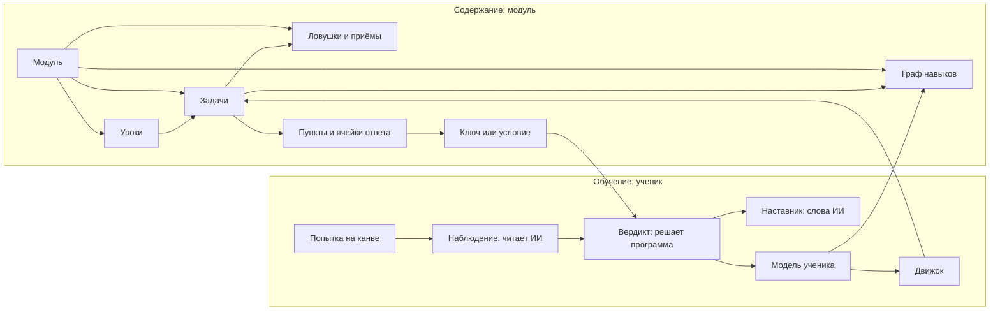
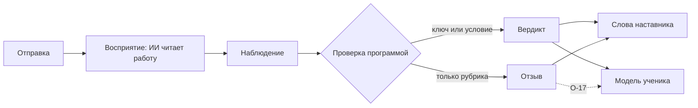

# NovaTrail — понятия платформы

> Статус: черновик для обсуждения, 2026-10-18.
>
> Общий словарь платформы: модуль, навык, урок, задача, канва, проверка, наставник, модель ученика, движок. Документ описательный. Имена полей и форматы появятся позже, в схемах `spec`, и будут сверяться с ним.
>
> Зачем всё это — в [product.md](product.md), приватность и возраст — в [privacy.md](privacy.md), компоненты — в [architecture.md](architecture.md), репозитории — в [repositories.md](repositories.md), решения — в [decisions.md](decisions.md). Открытые вопросы, на которые здесь ссылки, живут там: О-… — в product 13, П-… — в privacy 9, Т-… — в repositories 8.

## 1. Зачем этот документ

- Платформа нарезана на репозитории (R10). Движок, сервис, приложение и авторы модулей должны понимать друг друга, поэтому словарь у них один.
- Понятия здесь не зависят от предмета. Каждое проверено на четырёх непохожих случаях:
  - олимпиадная математика ребёнка, решение от руки;
  - испанский A1 взрослого;
  - физика на интерактивном стенде;
  - рисование, где верного ответа нет.

  Понятие, которое работает только для одного из них, живёт в модуле, а не здесь.
- В коде и схемах термины — на английском (R14), соответствие — в словаре (раздел 15). В схемах формата имена полей и значения перечней — эти термины в snake_case: `answer_slot` (R45). В контрактах API — тоже, и в их JSON (R83).
- Примеры в разделе 16 — иллюстрации, а не формат.

## 2. Карта понятий



Модуль приносит содержание: граф навыков, уроки, задачи, каталоги ловушек и приёмов. Движок по модели ученика выбирает задачу. Ученик работает на канве, ИИ превращает его работу в наблюдение, а программа сверяет наблюдение с ключом и выносит вердикт. Вердикт уходит в модель ученика, а наставник подбирает слова.

## 3. Модуль

**Модуль** — версионируемый набор содержания одного автора: всё, что нужно платформе, чтобы учить предмету или его части. Примеры: «Олимпиадная математика 1–6», «Испанский A1», «Оптика, 8 класс».

- **Идентификатор и пространство имён.** У каждого издателя своё пространство имён. Официальные модули издаёт проект, сторонние — их авторы. Идентификатор модуля и ID его навыков лежат в пространстве имён издателя, поэтому два автора не столкнутся именами.
  - ID модуля — `<издатель>/<имя>`: `novatrail/olympiad-math`.
  - Навык, задача, ловушка, приём и урок называются ID в модуле — `counting-gaps`. Он единственный в своём роде внутри модуля, и им модуль ссылается на свои части.
  - Вне модуля часть называет полный ID — модуль, род и ID в модуле: `novatrail/olympiad-math/skill/counting-gaps`. По нему её знают модель ученика, движок и прогресс (R46).
  - Навык-опора общей таксономии — не часть модуля и не в пространстве имён издателя: ID у него свой, `core.<имя>`, один и тот же в модуле и вне его (раздел 4; R50).
- **Версия** — semver `X.Y.Z`, без пред-релизов (R46). Часть версии находит сравнение новой версии с каждой опубликованной ниже неё, снятые тоже, а автор может поднять выше, но не ниже (R89). Правила сравнения — [текст формата](../format/README.md), раздел 27, с версии формата 0.3 (R101):
  - мажорная — что-то из того, что было у ученика прошлой версии, ушло или значит другое: удалена запись с полным ID — навык, задача, урок, ловушка или приём, — сужена аудитория, навык больше не учит навыку-опоре, изменилась проверка у задачи, которая осталась, например её ключ. Переход модуля на новую версию формата — тоже новая версия модуля: его паспорт изменился (R44), а пока формат v0, эта версия мажорная;
  - минорная — всё прежнее на месте и значит то же, а модуль даёт больше или ведёт иначе; патч — те же записи, проверки и путь, другие слова или картинки;
  - у 0.y.z мажорную играет y, а минорную и патч — z, как в Cargo; у 0.0.z каждая версия — своя мажорная;
  - упразднение навыка несёт таблицу соответствия старых ID новым, чтобы прогресс ученика не ломался: упразднённые навыки графа навыков, `retired_skills`, и навыки, которые их заменили (R49);
  - опубликованный ID навыка, задачи, урока, ловушки или приёма никогда не называет другой записи своего рода: новый смысл — новый ID;
  - полоса опубликованной версии стоит в новой на том же месте и с тем же ID, а новая полоса — только после последней; классы полосы менять можно, а ID полосы не называет другой полосы. Иначе прежние свидетельства ученика легли бы на другую шкалу (поправка 2026-11-02 к R89).
- **Паспорт:**
  - идентификатор, версия, название, предмет;
  - аудитория: для каких возрастных категорий годится модуль (раздел 13), а у модуля для школьных классов — ещё и его классы, `audience.grades` (R49). Стиль подачи паспорт v0 не называет: он идёт по возрасту ученика, и его можно выбрать отдельно (R41; privacy 3.3). Что модуль может сказать о нём, — О-23;
  - языки: на каком языке объяснения — он у модуля один (R46) — и, у языковых модулей, какой язык изучается;
  - авторы и лицензия содержания — идентификатор SPDX: у официальных модулей — `Apache-2.0` (R20), у сторонних — О-10;
  - версия формата модуля — MAJOR.MINOR. По ней модуль проверяется, собирается и исполняется, и новая версия формата его не меняет, пока автор не переведёт модуль на неё (R44). В паспорте это поле `module_format_version` (R46);
  - зависимости — навыки-опоры общей таксономии, на которые опираются навыки модуля, `dependencies`: ровно те, что его граф навыков называет пререквизитами (раздел 4; R50);
  - полосы сложности — шкала сложности модуля, по порядку, у модуля с классами — с классами каждой полосы (раздел 6; R51);
  - высота цифры на вырезке — настройка канвы модуля (раздел 8; R51);
  - шаблоны ступеней — два запасных текста лестницы подсказок на языке объяснений модуля; без них не обойтись модулю, где есть пункт с вердиктом (раздел 10; R57).
- **Состав:** граф навыков, уроки, задачи, каталоги ловушек и приёмов, шаги решения, настройки канвы, медиафайлы (картинки, звук), необязательные виджеты и eval-набор.
- **Раскладка.** Модуль — папка: паспорт `manifest.yaml`, файлы частей, медиафайлы в `media/`, eval-набор в `eval/`, текст лицензии в `LICENSE` и уведомления лицензий в `NOTICE`. Часть, которая у модуля одна, — файл в корне, названный её термином: граф навыков `skill-graph.yaml`, каталоги ловушек и приёмов `traps.yaml` и `techniques.yaml`, шаги решения `solving-steps.yaml`. Частей одного рода, которых много, — задач и уроков — по файлу на каждую, названному её ID: задачи — `tasks/<id>.yaml`, уроки — `lessons/<id>.yaml` ([текст формата](../format/README.md), раздел 10; R46, R51, R57, R58). `LICENSE` есть у каждого модуля (R62).
- **Пакет.** На релизе `module-kit` собирает модуль в пакет модуля. Часть для сервера — канонический вид: модуль одним JSON-объектом, с ярусом каждого навыка и числами каждого экземпляра шаблона. Часть для устройства — `LICENSE`, `NOTICE` и медиафайлы. Опись пакета называет обе части по дайджестам, а дайджест пакета — дайджест описи: его хранит попытка. Пакет зависит только от файлов модуля и версии формата его паспорта ([текст формата](../format/README.md), раздел 25; R62).
- **Eval-набор модуля** — образцы работ, на которых проверяется, что ИИ верно читает работу в этом модуле. Это синтетические образцы или образцы, которые для eval сделали взрослые добровольцы и авторы. Работы учеников — детей и взрослых — в модуль не входят: модуль публикуется под открытой лицензией, и отозвать его нельзя. Работы учеников из `app` в eval не берутся: образцы детей делаются только сеансом страницы образцов, по отдельной форме родителя, и хранятся вне репозиториев, в бакете оператора, 2 года от сеанса (R125; R15). В пакет модуля eval-набор не входит (R62). Образец набора — каждый файл `eval/`, имя которого кончается на `.json`, с разметкой, на задачу своего модуля; какой файл образец и что в нём, говорит протокол eval, а не формат (R95; [текст контрактов](../contracts/README.md), раздел 13).
- **Модуль даёт данные, а не инструкции модели (R02):**
  - поля модуля типизированы и проверяются схемой;
  - промпты принадлежат платформе: по одному на возможность ИИ, у каждого свой eval-набор, а у разбора хода решения и подсказки промпт один на обе (раздел 10);
  - свободный текст модуля — условие, совет ловушки, решение — попадает к модели только отдельным помеченным блоком данных, который не может изменить её задачу. Так в standalone передавались заметки о ребёнке (R16 standalone).

  Отсюда отличие от навыков Claude. Навык Claude — инструкции, которые модель исполняет так, как их поняла. Модуль NovaTrail платформа исполняет одинаково при одинаковом входе (R03).
- **Официальные и сторонние модули.** Кто и как публикует сторонние модули — О-9.

## 4. Навык и граф навыков

**Навык** — то, чему учит модуль и что можно оценить у ученика. Примеры: «промежутки и столбы», «ser и estar», «закон преломления», «штриховка».

- **У навыка:** ID, название, описание, ярус, пререквизиты, оцениваемость и навыки-опоры, которым он учит. Граф навыков модуля — файл `skill-graph.yaml`, и навыки в нём названы ID в модуле (R49).
- **Граф навыков** — направленный граф без циклов: «чтобы браться за B, нужен A». Платформа проверяет его на циклы при публикации, как standalone проверял связи `builds_on` при старте, — это правило формата `skill-graph.acyclic` (R49).
- **Ярус** — группа навыков одной сложности в модуле.
  - В MathTrail ярусов три: «основы», «правила» и «сложные задачи»; в прототипе они называются Basics, Rules и Hard tasks.
  - Ярус темы там не задавал автор: его вычисляли по самой длинной цепочке тем-основ под ней (SPEC 8.12.2 standalone).
  - В NovaTrail ярус тоже вычисляется: ярус навыка — 1 плюс самая длинная цепочка пререквизитов модуля под ним, и предела числа ярусов нет. Имена ярусам даёт автор, а ярус без имени показывается номером. Вычисляет ярусы `module-kit`, когда собирает пакет, и кладёт их в его канонический вид, а до карты навыков их доносит `api` (R49; R62; О-18 решён).
- **Ссылки между модулями.**
  - Модулю физики могут понадобиться линейные уравнения, но на внутренние ID чужого модуля он не ссылается.
  - Ссылаться можно только на навыки **общей таксономии** — курируемого платформой словаря навыков-опор (R50). Тогда переименование навыка в чужом модуле ничего не сломает.
  - Навык-опора — навык вне модулей, с ID `core.<имя>`: `core.linear-equations`. Навык модуля опирается на него пререквизитом и учит ему полем `teaches`, а паспорт перечисляет навыки-опоры, на которые опираются навыки модуля. Словарь — схема формата, и меняется он по версиям формата (R44).
  - Владеет ли ученик навыком-опорой, модель ученика решает по навыкам, которые ему учат, в модулях ученика (раздел 11), и отдаёт одно из трёх состояний — с причиной и навыками, которые учат (R07 learner-model):
    - «владеет» — «освоено» стоит хотя бы у одного такого навыка, на любой полосе и в любом модуле, где у ученика есть свидетельства или который подключён;
    - «не владеет» — в модулях, которые получает движок, — подключённых и подходящих ученику, — навыки с вердиктом, которые ему учат, не освоены или ещё без свидетельств;
    - «неизвестно» — учить некому: ни один модуль, который получает движок, ему не учит, — или учат только навыки без вердикта.
  - «Неизвестно» урока не блокирует: движок может предложить короткую проверку или модуль. Какие модули учат навыку-опоре, говорит индекс модулей (R63). Держать ли урок при «не владеет», когда свидетельств ещё нет, что с открытыми навыками, когда владение уходит, и как разорвать цикл пререквизитов между модулями, где с обеих сторон «не владеет», — правило движка (R07 learner-model).
  - Формат проверяет каждый модуль отдельно, поэтому цикла пререквизитов между модулями через навыки-опоры он не видит.
- **Оцениваемость** решает, как платформа учит навыку:

  | Оцениваемость | Что это | Пример |
  |---|---|---|
  | вердикт | задачи навыка проверяет программа: по ключу — у ответа одно верное значение — или по условию — верных ответов много, и программа проверяет условие | 21 столб; «любое число, которое делится на 3 и на 4» |
  | рубрика | оценка по критериям автора — только отзыв, не вердикт (R04) | перспектива на рисунке, произношение |
  | никак | навык тренируется, но не оценивается | свободное рисование |

  В формате это значения `verdict`, `rubric` и `none` (R49). Для навыков с рубрикой и без оценки движок не подстраивается под ученика: порядок задаёт автор — графом навыков и порядком звеньев урока, а где граф порядка не даёт, правило движка выбирает без модели ученика (раздел 5; R58). Оцениваемость совпадает с тем, как проверяются пункты навыка: основной навык пункта с ключом или условием — `verdict`, пункта с рубрикой — `rubric`, а навык `none` бывает только вспомогательным (правило формата `task.assessability`; R56).
- **Открытие навыка и доступ к содержанию.**
  - Навык открывается по пререквизитам, а не по классу или возрасту. Класс или возраст задаёт только отправную точку, как в standalone: «The grade decides one thing: where the child starts» (О-56 standalone).
  - Отдельно от этого модуль может пометить содержание как неподходящее для возрастной категории. Это доступ к содержанию, а не порядок обучения. В формате — возрастные категории задачи, `age_categories`: их меньше, чем у модуля, и задачу получают только ученики этих категорий (R51).

## 5. Урок

**Урок** — последовательность, которую составил автор: объяснение, пример с разбором, задачи и иногда проверка в конце. Обещание «интерактивных уроков» — об этом. В модуле урок — файл `lessons/<id>.yaml` ([текст формата](../format/README.md), раздел 21; R58).

- **Навыки урока** — навыки модуля, которым он учит. Они закрыты, как навыки задачи (раздел 6): приложению хватает названия урока, а навыки читает движок. Каждая задача урока тренирует хотя бы один из них как основной.
- **Звенья урока** идут в порядке автора, и движок их не переставляет. Звено — одно из трёх:
  - объяснение — абзацы и картинки, а с формата 0.4 — и нумерованные списки, `numbered_list`: тексты по порядку, номера к которым рисует приложение (R111);
  - пример с разбором — условие, лист для рукописи и показ автора: части решения примера, которые ученик открывает по одной (раздел 8). С формата 0.4 пример может стоять и на рабочей тетради: строки с окошками, которые показ заполняет по одному (R111). Пример открыт: это не задача модуля, и ключа у него нет;
  - задача модуля по её ID. Следующее звено идёт, когда задача кончилась.

  Особого звена проверки в конце нет: проверка — последние задачи урока.
- **Прохождение урока** — урок у одного ученика на пакете, на котором урок начат. Его начинает запрос приложения за уроком, который выбрал движок, а уход на другую задачу его не кончает. Открытое прохождение одно на ученика и урок, на всех устройствах, и у каждого прохождения свой ID: новое прохождение того же урока на том же пакете — другое. Звено задачи кончилось, когда его попытка закрыта верным ответом или показом решения, а у задачи с рубрикой — «Готово» ученика; уход и срок его не кончают. Кончается прохождение «пройден» — по «урок пройден» приложения, когда кончились все звенья задачи, — «без проверки», «не подходит» и «брошен» — 30 дней без действий, — а «досрочно» — если его введёт детализация движка. Место среди объяснений и примеров и состояние показа держит приложение, а сервер их не знает (R13 api; R06 app).
- **Порядок уроков** задаёт граф навыков, и автор не пишет его отдельно (О-19 решён: R58). Урок идёт после уроков, которые учат пререквизитам его навыков. У последовательного модуля граф — цепочка: навыков модуля не меньше двух, и каждый стоит в своём ярусе, так что одна цепочка пререквизитов проходит через все (поправка 2026-11-02 к R58). Пометку «последовательный», как *Sequential* в прототипе, приложение выводит из ярусов, `skill_tiers`. Где граф порядка не даёт — два урока одного навыка, навыки без связи, — выбирает правило движка.
- **Адаптация.** Какой урок или задачу дать дальше, решает движок по модели ученика (раздел 12). В уроке, чьи навыки не все с вердиктом, движок ничего не добавляет и не пропускает: урок идёт в порядке автора, без адаптации. Добавит ли движок закрепление в урок с вердиктом и кончит ли его раньше — решает его детализация (architecture 3.8).
- **Возраст.** Урок получает только ученик, которому подходят и урок, и каждая его задача (раздел 13). Урок, которого не получит ни один ученик, — ошибка модуля.
- Задачи живут и вне уроков: движок может дать задачу на закрепление без объяснения.
- Проверка утечки ищет ответ каждой задачи урока во всех его текстах, и после задачи тоже: открытый вид урока уходит в приложение целиком (раздел 10; R05).

## 6. Задача

**Задача** — то, что ученик решает и что платформа может проверить или прокомментировать.

- **Условие задачи** — что ученик видит: текст и картинки. У картинки — описание для программы чтения с экрана и размер. Условие — часть шаблона автора, которого ученик не стирает (раздел 8), а над канвой оно или на ней, решает вид канвы: лист для рукописи показывает его над листом. Звука и формул в условии формата v0 нет (R51).
- **Пункты.** Задача — один пункт или набор.
  - Лист с десятью примерами на дроби — одна задача из десяти пунктов.
  - У каждого пункта своя область на канве, свои ячейки ответа, свои навыки и своё состояние: не начат, начат, проверен.
  - Вердикт пункта складывается из вердиктов его ячеек, а итог задачи — из пунктов (раздел 9.1; R56).
  - Пункт называет его место в задаче, с 1. На листе для рукописи у пункта — ячейки ответа, а на рабочей тетради пункт — строка: куски текста и окошки по порядку, «7 × [ ] = 56» (R51).
- **Ячейка ответа и её привязка** — где ученик даёт ответ:
  - в зоне — отведённом месте на листе;
  - где угодно на листе: итог находит ИИ, как в canvas-api (R61 canvas-api), а если итогов несколько, ученика просят обвести свой;
  - в состоянии виджета — например, положение линзы или показание амперметра;
  - правками в тексте условия — на текстовой канве: зачеркнуть, вставить, переставить;
  - вводом с клавиатуры или выбором варианта;
  - весь лист — работа целиком, как сочинение.

  Привязку задаёт модуль на каждую ячейку. Так снимается спор «поле Answer или свободный лист» между прототипом и MathTrail Canvas. В формате v0 — где угодно на листе, весь лист, зона, окошко рабочей тетради и выбор варианта; зона — прямоугольник в единицах листа. Ячейка «где угодно» или «весь лист» — единственная в задаче. Ввод с клавиатуры, правка и состояние виджета придут потом (R51).
- **Проверка ячейки** — у каждой ячейки ответа своя: **вид проверки** и его параметры — ключ, условие или критерии рубрики (раздел 9.2). Приложение до решения задачи её не получает (R05; R56).
- **Навыки задачи** бывают двух видов:
  - основные — задача их тренирует, и ошибка в ней — свидетельство против них;
  - вспомогательные — нужны для решения, но ошибка их не роняет: неверный ответ по оптике не снижает оценку алгебры. Вспомогательный навык бывает и навыком-опорой: линейные уравнения у задачи по оптике (раздел 4; R51).

  Свои навыки бывают и у пункта: они заменяют для него навыки задачи.
- **Ловушки** — какие типичные ошибки ловит задача и по какому признаку. Обе — из каталога ловушек модуля (раздел 7):
  - по неверному значению — такую ловушку определяет программа. Значение ловушки стоит в проверке своей ячейки и сравнивается ею, как ключ; оно может нести текст ловушки — что ученик прочтёт при этой ошибке (R57);
  - по виду ошибки в решении ученика — такую ловушку предполагает ИИ, и её происхождение — «выведено ИИ» (раздел 9.4). Какие ловушки ИИ может предположить, задача перечисляет сама (R57).
- **Приёмы** — какой приём здесь помогает, из каталога приёмов модуля. Приёмы задачи закрыты: название приёма подсказывает способ решения. Приложение получает приём от `api` на шаге, который его даёт, или по просьбе ученика (раздел 10; R57).
- **Что известно и что найти** — заготовки для шага «понять»; в прототипе это фишки «We know» и «We need to find». Они открыты: они пересказывают условие, а способа не подсказывают (R57).
- **Подсказки:**
  - лестница от общего вопроса к конкретному и к похожему случаю попроще;
  - запасные тексты автора — на случай, когда вопрос модели не пришёл или не прошёл проверки (раздел 10): текст ловушки у значения ловушки и похожий случай попроще у пункта (R57);
  - фразы-утечки — по ним проверка утечки узнаёт ответ в тексте, который увидит ученик (раздел 10; R57).
- **Решение** — показывается после верного ответа или по просьбе, показом решения, который закрывает попытку: ребёнку — с четвёртого неверного ответа, ученику категории `adult` — с начала попытки (раздел 10; R82). До того ни решение, ни ключ на устройство не уходят (R05). В задаче оно — тексты и картинки, как условие; оно закрыто и обязательно у задачи, где есть пункт с вердиктом (R57). У задачи с рубрикой решение, если оно есть, и критерии — после «Готово» ученика (вторая поправка 2026-11-02 к R05).
- **Сложность** — по шкале модуля: задача называет полосу сложности и сложность от 1 до 5 внутри неё, как в standalone (R51).
- **Шаги решения** и условие выхода из каждого шага — у модуля, раздел 7.
- **Происхождение** ключа, тегов навыков и ловушек — раздел 9.4. В модуле всё — от автора.
- **Файл.** Задача — файл `tasks/<id>.yaml` модуля, названный её ID ([текст формата](../format/README.md), раздел 14; R51).
- **Шаблон.** Задача может быть шаблоном с параметрами: тогда каждая попытка получает один её экземпляр, с числами от зерна попытки (раздел 9.3; R60).

Задача без детерминированной проверки — рисунок, произношение, сочинение — получает отзыв, а не вердикт (R04).

## 7. Ловушка, приём, шаги решения

- **Ловушка** — именованная типичная ошибка, общая для многих задач модуля. Примеры: «посчитал промежутки вместо столбов», «перепутал ser и estar», «забыл перевести сантиметры в метры».
  - У ловушки: ID, описание, навыки, к которым она относится, и совет для взрослого или ученика. В модуле — каталог ловушек `traps.yaml`, ловушки по ID в модуле; он закрыт целиком (R05; R57).
  - Каталог ловушек модуля закрыт: неверный ответ становится диагнозом, только если ловушки можно посчитать, а свободные названия ошибок посчитать нельзя (SPEC 1.3 standalone).
  - Повторяющиеся ловушки видны в прогрессе — в прототипе это блок «Mistakes that repeat». Ловушка повторяется, когда программа нашла её в двух закрытых попытках профиля или больше, по полному ID; попытка на версии, снятой из-за неверного ключа, ловушек не считает. Описание и совет ловушки прогресс берёт из каталога версии последней из них (R99).
- **Приём** — стратегия решения, которую можно назвать и которой можно научить. Примеры: «начни с маленьких чисел», «найди глагол», «нарисуй силы».
  - Каталог приёмов — у модуля, файл `techniques.yaml`: название и описание каждого приёма. Он открыт, как навыки в карте навыков, а какие приёмы помогают в задаче — закрыто (R57). В математике MathTrail их 11, с номерами; номеров в каталоге формата v0 нет.
  - После верного ответа наставник может спросить, какой приём помог.
- **Шаги решения** — рамка, по которой наставник ведёт ученика внутри одной задачи. Их задаёт модуль:

  | Предмет | Шаги |
  |---|---|
  | олимпиадная математика | понять → составить план → решить → проверить (Пойа) |
  | физика | гипотеза → опыт → расчёт → вывод |
  | язык | прочитать → найти ошибки → исправить → произнести |

  - Шаг «произнести» требует голосового ввода и появится вместе с ним (О-6).
  - В модуле — файл `solving-steps.yaml`: шаги по порядку, у каждого — название, с формата 0.4 — описание, как по нему идти, что он даёт и условие выхода (R108). Шаги открыты: приложение ведёт их само (R57).
  - Шаг может давать заготовки задачи: `givens` — «что известно и что найти», `techniques` — её приём, который `api` отдаёт, когда шаг начался (R57).
  - У каждого шага есть условие выхода: событие («отмечены все известные»), состояние виджета, заполненная ячейка или ничего. В формате v0 — `givens_ticked`, ученик отметил всё, что известно и что найти; `answer_slots_filled`, в каждой ячейке ответа что-то есть; `none`, когда ученик идёт дальше сам. Состояние виджета придёт с этапом 4 (R57).
  - Условие выхода открывает кнопку «шаг готов», и она ведёт к следующему шагу. В формате v0 «шаг готов» работу не читает: работу читают по «Проверить» (поправка 2026-11-02 к R69).
  - Режим «сам» (в прототипе — Free solve) пропускает шаги: наставник отвечает, только когда его позовут.

## 8. Канва

**Канва** — рабочее место задачи: что ученик видит и где он пишет, рисует, вводит, двигает и говорит. Вид канвы на каждую задачу задаёт модуль.

**Слои**, снизу вверх:

1. **Шаблон автора** — условие задачи, сетка, картинки, предложения, пункты. Ученик его не стирает и не меняет. Условие задачи вид канвы может показать и над ней: так делают лист для рукописи и рабочая тетрадь (R51; R34 canvas).
2. **Виджет модуля** — интерактивный стенд: оптическая скамья, электрическая цепь, числовая прямая.
3. **Показ автора** — пример или демонстрация, которые автор приготовил для урока. В формате v0 это показ примера с разбором — на листе, а с формата 0.4 и на рабочей тетради, где он заполняет окошки строк примера по одному (R111): ученик открывает его части по одной и может спрятать весь показ, а картинка на участке листа стоит на этом слое, в размер участка (раздел 5; R58). На листе примера ученик не пишет.
4. **Работа ученика** — штрихи, текст, перетаскивания, ответы голосом, изменения виджета.
5. **Слой наставника** — пометки наставника: рамки, номера и короткие надписи, — и пунктирный набросок «как начать».
   - Набросок рисуется под записью ученика, пометки — над ней.
   - Ни то, ни другое не меняет и не закрывает работу ученика (R05).
   - Пометку ставит программа (R03): от `api` она приходит видом и местом вместе со словами наставника, к которым относится, а имя для программы чтения с экрана ей пишет `app` (R97).

**Виды канвы.** Каждый — код платформы, общий для всех модулей:

| Вид | Что это | Пример |
|---|---|---|
| лист для рукописи | свободный лист в клетку, линейку или точку | олимпиадная задача, черновик |
| рабочая тетрадь | нестираемые пункты и ячейки на одной странице | десять примеров на дроби |
| текстовая | предложения и слова: зачеркнуть, вставить, переставить, выделить, прослушать | поиск ошибок по-испански |
| песочница | виджет модуля и место для расчётов | опыт с преломлением света |
| творческая | кисти, палитра, слои, нажим | рисунок с натуры |

В формате v0 виды канвы — лист для рукописи, `handwriting_sheet`, и рабочая тетрадь, `workbook` (R51). Канва кода и проверка запуском программы ученика — О-20.

**Инструменты** разрешает задача: перо, ластик, линейка, транспортир, калькулятор, клавиатура, микрофон. Ластик удаляет штрих целиком: пометки наставника привязаны к штрихам ученика, и стёртая половина штриха их бы сломала (canvas-api: R42, R43). В формате v0 у каждой задачи — перо и ластик, а поле инструментов придёт с первым модулем, которому оно понадобится (R51).

**Высота цифры** — высота цифры или буквы ученика на вырезке для проверки, в px. Это настройка канвы модуля в его паспорте, без неё — 24 (поправка 2026-10-28 к R51). Так с версии формата 0.2, а в 0.1 без неё было 32 (R51; R08 tutor).

**Контракт виджета:**
- виджет объявляет схему своего состояния и события;
- проверка может ссылаться на состояние виджета (раздел 9);
- версия виджета закрепляется за попыткой, а случайность в нём — только от зерна (seed), чтобы попытку можно было повторить. Это своё зерно виджета, а не зерно попытки: зерно попытки на устройство не уходит, и как виджет получает своё, решает протокол виджета (R59; Т-24);
- где и как исполняется код чужого виджета — R16 (architecture 3.4).

**Артефакт ученика** — работа, которая сама результат: рисунок, сочинение или запись. Она принадлежит ученику, её можно выгрузить и удалить (privacy 4), и это не «картинка для проверки». Работа над задачей с ключом — штрихи, ответы, контекст отправки — не артефакт: её нужно лишь проверить, и устройство стирает её с концом попытки (П-9; R04 app).

## 9. Проверка

### 9.1. Цикл



- **Отправка** — по кнопке. Работу читают только по действию ученика — по «Проверить». «Шаг готов» в режиме «по шагам» ведёт к следующему шагу и в формате v0 работу не читает (поправка 2026-11-02 к R69). На паузе наставник её не читает — только мигает кнопка (R69).
- **Восприятие** — ИИ превращает работу ученика в наблюдение. Это единственное место, где ИИ участвует в проверке (R03). Рукопись читают два читателя одного поставщика, без ключа, и ячейка, которую они прочли по-разному, — неоднозначна (R68). Так — у ячеек, чья проверка даёт вердикт, а лист под рубрикой читает один читатель: у рубрики вердикта нет (вторая поправка 2026-11-01 к R68; R75). Ответ вводом или выбором ИИ не читает: его сразу проверяет программа.
- **Наблюдение** — что ИИ прочитал в работе, ячейка за ячейкой, до проверки (R86). На каждую ячейку, ответ которой читает ИИ:
  - значение, как оно записано, — только если оно видно в самой записи (R62 canvas-api), — или почему значения нет: ячейка пуста, запись неразборчива или неоднозначна — так и с цифрой, написанной зеркально (R56), — а у ячейки «где угодно» итога нет или их несколько;
  - место: у ячейки «где угодно» — рамка итога в долях вырезки, если читатель её назвал, а у зоны и окошка тетради — сама ячейка (R53).

  Части записи, другие прочтения и зеркальность — дело читателя: по ним он решает, что отдать, а в наблюдении их нет. Наблюдения двух читателей сводит в одно `module-kit`, по проверке ячейки: ячейка, которую они прочли по-разному, неоднозначна (R68). Выбор касанием ИИ не читает, и в наблюдении его нет: вариант, который ученик выбрал, `api` даёт проверке рядом. Ученик видит, что прочитано: «Прочитано: 6».
- **Проверка** — программа сравнивает прочитанное значение каждой ячейки с её проверкой: ключом или условием. Модель не решает, верно ли (R03). Значение читатель отдаёт так, как оно записано, а приводит его к записи вида — нормализует — `module-kit` (раздел 9.2; R56). Значение, которое получило «пока нет», программа сравнивает тем же способом со значениями ловушек ячейки, и совпавшее называет ловушку (раздел 6; R57).
- **Вердикты** — как в R38 canvas-api:

  | Вердикт | Когда | Что видит ученик |
  |---|---|---|
  | верно, `correct` | значение совпало с ключом или выполнило условие | «Верно» и что прочитано |
  | пока нет, `not_yet` | прочитано уверенно, по форме, и не совпало | что прочитано, место ошибки и вопрос наставника |
  | не прочитать, `unreadable` | неразборчиво, неоднозначно — два читателя прочли по-разному (R68), цифра написана зеркально (R56), — не по форме; итогов несколько или нет; ячейка пуста | просьба переписать или обвести — это не ошибка |
  | без проверки, `unchecked` | сбой ИИ, исчерпан лимит, ИИ не допущен (Т-20); условие не досчиталось | нейтральная фраза — это не ошибка |

  При любом сомнении — «не прочитать», а не «пока нет» (R04). Почему «не прочитать», говорит причина. У значения причину даёт формат: пусто, `blank`, или значение не в записи вида, `notation` (R56). Наблюдение без значения даёт свою: пусто, `blank`, неразборчиво, `illegible`, неоднозначно, `ambiguous`, итога нет, `no_final_answer`, или итогов несколько, `several_final_answers` (R86).
- **Вердикт пункта** — из вердиктов его ячеек: все верны — «верно»; хоть одна «пока нет» — «пока нет»; иначе — «не прочитать», а если и такой нет — «без проверки». Ячейка, прочитанная уверенно и неверно, — уже не сомнение, и пункт верным не станет, что бы ни было в остальных (R56).
- **Разбор хода решения** — после «пока нет», отдельным вызовом, который видит ключ и решение задачи (R67): место первой ошибки в решении ученика — рамка в долях вырезки — и ловушка-кандидат, одна из тех, что задача называет для ИИ (раздел 6; R57). Это ответ `tutor` для слов наставника, а не наблюдение (R86).
- **Отзыв** — там, где детерминированной проверки нет. ИИ оценивает работу по критериям автора, и ученик видит это как отзыв, а не как оценку. Влияет ли отзыв на модель ученика — О-17. Отправка с рубрикой кончается отзывом, «не прочитать» — лист пуст или сочинения целиком не прочитать, и до оценки оно не доходит, — или «без проверки». Это не вердикт: у пункта с рубрикой его нет, хотя «не прочитать» и «без проверки» значат здесь то же, что одноимённые вердикты. Отзыв, который не прошёл проверку утечки или правило отзыва, заменяет фраза приложения «отзыва на этот раз нет», без нового вызова. Попытка открыта для переписки, а кончает её «Готово» ученика (R87).

### 9.2. Виды проверки

| Вид | Пример | Что задаёт модуль |
|---|---|---|
| число | 21 столб | значение |
| дробь и форма | 3/6 и 1/2 равны, но задание «сократи» требует 1/2 | значение и правило формы отдельно; как записываются числа — десятичная запятая, смешанные числа |
| величина | 2,0·10⁸ м/с | размерность, допустимые единицы и их перевод, допуск (абсолютный или относительный), значащие цифры, знак |
| выбор | вариант C | варианты |
| текст | «está» | допустимые варианты; нормализация: регистр, пробелы, пунктуация, значимы ли ударения |
| правка | исправить ошибки в предложении | обязательные правки по местам, частичный зачёт, что считать новой ошибкой |
| порядок и множество | расставить события по порядку; назвать все варианты | важен ли порядок, нужна ли полнота |
| условие | «любое число, которое делится на 3 и на 4» | условие, которое считает программа |
| состояние виджета | луч после линзы проходит через фокус | условие на состояние виджета |
| рубрика | рисунок, произношение, сочинение | критерии; итог — отзыв, а не вердикт |

- Новый вид проверки — код платформы, общий для всех модулей: модуль выбирает вид и задаёт параметры (R02). Этот код живёт в `module-kit` (R17).
- **Проверка ячейки** — у каждой ячейки ответа своя: вид и его параметры. Она закрыта целиком, вместе с видом: приложение до решения задачи её не получает, а у задачи с рубрикой — до «Готово» (R05 и вторая поправка 2026-11-02 к нему). Критерии рубрики или знаки, которые ждёт окошко, автор может назвать в условии задачи (R56).
- **В формате v0** виды проверки — те, что нужны трём модулям первого среза, и условие (R56; [текст формата](../format/README.md), раздел 15):
  - `number`, число — целое, десятичная дробь с точкой или простая дробь; сравнивается по значению, точно. Слова единиц после числа, `units`, проверка отбрасывает;
  - `fraction`, дробь и форма — простая дробь; правило формы `form` — любая дробь того же значения или только несократимая;
  - `choice`, выбор — касанием из вариантов ячейки с привязкой `choice`, или от руки: тогда варианты — у самой проверки, как знаки <, > и = в окошке тетради;
  - `time`, время суток — ключ `Ч:ММ`, часы 0–23; верно, когда часы и минуты как числа равны ключу, так что `07:30` верно при `7:30`, а время от 60 минут, как `5:60`, — неверное время, которое может показать ловушку. Суток 24 часа: `19:30` — не `7:30` (R111);
  - `predicate`, условие — выражение Starlark от прочитанного целого `value`, с лимитом шагов в формате. Решатели-программы для ключей шаблонов — раздел 9.3;
  - `rubric`, рубрика — критерии `criteria`, только на весь лист.

  Текста, правки, величины, порядка и множества, состояния виджета и «шагов» — проверки каждой строки хода решения (В10 `tutor`) — в v0 нет. «Текст» и «правка» первым срезом не проверены (R41), остальных модули среза не берут, а виджетов в нём нет.
- **Нормализация** — часть вида проверки: прочитанное значение приводится к записи вида — NFKC, минусы и тире, пробелы, а у выбора и регистр, — и только потом сравнивается. Что из неё задаёт модуль, — параметры вида: единицы у числа, правило формы у дроби. В MathTrail Canvas нормализация знала только числа и выбор: NFKC, знак «−» превращался в «-», слово единицы измерения отбрасывалось (spec 5.2 canvas-api).

### 9.3. Шаблоны и генерация

- Задача может быть **шаблоном** с параметрами — полем `template` ([текст формата](../format/README.md), раздел 23; R60). У каждого параметра — область, целые от `from` до `to`. Производные числа шаблон считает из параметров, а ограничение отбирает их сочетания; и то и другое — выражения узкого подмножества Starlark, которые считает и сам `spec`. Сочетание, которое проходит ограничение, даёт **экземпляр** — задачу, где на месте подстановок `{имя}` стоят числа.
- Шаблон перебирается целиком: сочетаний не больше 10 000, и `module-kit` строит каждый экземпляр и проверяет его всеми правилами задачи ещё при проверке модуля — ключ, значения ловушек, утечку. Попытка получает один экземпляр: его номер выбирает генератор платформы из зерна (seed) попытки, из места случайности `template`, ID задачи, `instance` ([текст формата](../format/README.md), раздел 22; R59). На попытке Starlark не запускается, а зерно и числа, которых нет в открытых полях экземпляра, на устройство не уходят.
- Ключ шаблона — подстановка параметра, производного числа или результата решателя. **Решатель** — программа на Starlark в поле `template.solver`, которая перебором считает ключ, когда формулы нет, как решатели standalone ([текст формата](../format/README.md), раздел 24; R61). Его функция `solve` получает только числа открытых полей экземпляра — решает ту задачу, что видит ученик, — и возвращает свои результаты. Результаты стоят только в ключе, значениях ловушек, решении и фразах-утечках, а всё, что ученик видит до решения, `spec` строит без решателя. Бюджет — 100 000 000 шагов на все экземпляры шаблона, и запускает решатель только `module-kit`, при проверке модуля. Условие проверки — не он, а выражение в самой проверке ячейки (раздел 9.2; R56).
- Шаблон — одна задача: урок называет его как задачу, а модель ученика и движок видят одну задачу, какой бы экземпляр ни выпал. Страницу тетради из независимых строк шаблоном v0 не описать — у неё слишком много сочетаний; параметры у пункта придут потом (RUN.md, T38).
- Задачи с помощью ИИ генерируются только при подготовке модуля, и автор их проверяет. Генерации на лету, как в standalone, нет: О-12 решён (R60).

### 9.4. Происхождение

У задачи, ключа, тегов навыков и ловушек есть **происхождение**:

| Происхождение | Пример |
|---|---|
| от автора | ключ задачи в модуле |
| проверено решателем | ключ экземпляра шаблона посчитан программой: выражением шаблона (R60) или решателем шаблона (R61) |
| введено взрослым | ключ из ответов в конце учебника для задачи с бумаги |
| выведено ИИ | ИИ сам разметил навыки задачи с бумаги, сам решил её или сам предположил ловушку по ходу решения ученика |
| нет | ключа нет вовсе |

От происхождения зависит:
- **возможен ли вердикт.** И «верно», и «пока нет» выносятся только при ключе или условии от автора, решателя или взрослого. При ключе, выведенном ИИ, вердикта нет и ответ не оценивается: иначе это был бы вердикт модели, который R04 отвергает. Можно лишь показать решение, помеченное «выведено ИИ», и то не ребёнку (О-11);
- **вес свидетельства** для модели ученика. Задача с бумаги, которую ИИ сам разметил и решил, рейтинг не двигает, а с ключом взрослого двигает, только когда у неё есть полоса и сложность на шкале модуля и навыки не от ИИ (О-11; R06 learner-model). Ловушку по неверному значению находит программа, и она весит как вердикт. Ловушка, которую ИИ предположил по ходу решения ученика, — ловушка-кандидат разбора — нужна наставнику для слов, а в модель ученика не идёт: свидетельство несёт только ловушки, которые нашла программа (R82; R06 learner-model). Нужна ли она выбору задачи вместе с последней попыткой (раздел 12), решает детализация `engine`;
- **что показывается.** Решение, выведенное ИИ, так и помечено.

Только так детерминированное ядро (R03) выдерживает фото с бумаги, рубрики и виджеты.

В модуле всё — от автора, и поля происхождения у задачи нет: ключ шаблона считает программа, и это видно по самому шаблону (раздел 9.3; R60), а «введено взрослым» и «выведено ИИ» бывают только у задач с бумаги (R51).

## 10. Наставник

- **У ИИ две роли:**
  - восприятие — читает работу (раздел 9);
  - слова — подсказки, объяснения, похвала, вопрос.

  Решений наставник не принимает: вердикт выносит программа, следующую задачу выбирает движок (R03).
- **Правила подсказки** — из product 5.4 canvas-api:
  - не называть ответ;
  - один вопрос, не больше двух коротких предложений, слова по возрасту;
  - указывать на место в работе ученика;
  - начинать с того, что уже получилось;
  - говорить только о задаче.

  Форму подсказки проверяет программа — «Проверка формы» ниже (R70).
- **Пол ученика** слова наставника не выдают — ни подсказка, ни похвала, ни объяснение, ни отзыв. Модели он не известен, а в языках, где форма слова выдаёт род, слова — в формах без рода: «здесь всё верно», а не «ты верно нашёл». Программа этого не проверяет: проверяет пункт о роде в eval-наборе каждой возможности, которая пишет слова ученику (R70).
- **Лестница подсказок** — по числу неверных ответов на задаче:
  1. общий вопрос о месте ошибки;
  2. вопрос о правиле или ловушке;
  3. похожий случай попроще.

  Ступень выбирает программа по числу неверных ответов, а наставник только подбирает слова для неё (R03). Неверный ответ — отправка, где хоть одна ячейка получила «пока нет»; «не прочитать» и «без проверки» ступени не дают (R04). Ступень, её слова и запасной текст говорят об одной ячейке — первой ячейке «пока нет» по порядку в отправке, которая дала ступень: пункты — по месту, ячейки — по порядку в пункте (R82). Лестница — на задачу, а не на пункт: на странице рабочей тетради четыре отправки с ошибкой предлагают показать решение всей страницы.
- **После третьей ступени** новой нет. С четвёртого неверного ответа ребёнку программа предлагает позвать взрослого или показать решение, а взрослому ученику — показать решение. Ученик категории `adult` может показать решение и с начала попытки. Ребёнку при настройке взрослого «спросить перед показом», по умолчанию включённой, решение показывает взрослый. Показ закрывает попытку исходом «решение показано» (раздел 11; R82).
- **Подсказка по просьбе** работы на чтение не шлёт (R69) и ступени не поднимает (R82):
  - до первого неверного ответа — «что известно и что найти» и приём задачи, без ИИ, а с формата 0.4 — и наводящий вопрос задачи, когда он у неё есть: вопрос автора, который разбивает задачу. Он закрыт, как приём, а получил ли его ученик, свидетельство несёт своим полем, отдельно от приёма по просьбе (R108; поправки 2026-11-08 и 2026-11-09 к R82). Наброска «как начать» в формате v0 нет (R57);
  - после неверного ответа — ещё раз слова текущей ступени, без ИИ;
  - «объясни иначе» — та же ступень другими словами: один вызов ИИ на ступень, без работы, с прошлыми вопросами той же задачи (privacy 4). В режиме без ИИ его нет.
- **Запасные тексты.** Если вопрос модели не пришёл или не прошёл проверки — утечки или формы, — ученик получает запасной текст (R24 canvas-api; R57; R70):
  - на ступенях 1–2 — текст ловушки, который автор написал для этого неверного значения; без него — совет ловушки из каталога, а без совета — шаблон ступени;
  - на третьей ступени — похожий случай попроще от автора, а без него — то же, что на второй.

  Шаблоны ступеней — у модуля, в его паспорте и на его языке объяснений: платформе не нужно переводить их на язык каждого модуля (R57).
- **Проверка утечки.** Программа ищет в тексте модели ключи и фразы-утечки, которые указал автор (R24 canvas-api). Это страховка, а не доказательство. Тексты автора, которые ученик видит до решения, проходят ту же проверку, когда проверяется модуль (R17). Как она ищет, нормативно говорит [текст формата](../format/README.md), раздел 20 (R57):
  - ключ ищется отдельным токеном, а число — по значению: `7` не найдётся в `17`, а `0.5` найдётся в `1/2`;
  - ключ, который уже стоит в условии или в тексте, строке и вариантах своего пункта, — «2 ноги» в задаче о кроликах — не ищется: там ответ держат фразы-утечки автора. В этом формат отходит от R24 canvas-api, где ключ запрещён всегда;
  - числа словами и записи, которых проверка не читает числом, ловят только фразы-утечки.

  Ложные утечки — вопрос, который повторяет верную строку ученика или берёт число ключа в похожем случае, — держат промпт и запасной текст, а проверка остаётся строгой (поправка 2026-10-28 к R57).
- **Проверка формы.** Подсказка — ровно один вопрос, не больше двух предложений, буквы языка объяснений и предел слов по языку: 30 по-русски, 35 по-английски, а на языке, которого замер не мерил, — без предела. Отзыв по рубрике — не больше трёх предложений и 80 слов по-английски, и отрезок в кавычках от четырёх слов — только слова ученика: отзыв не пишет работу за него (R05). Проверяет `api` вместе с утечкой, кодом `tutor` (R70).
- **Промпты — у платформы.** Свой промпт у каждой возможности ИИ: чтение рукописи, чтение текста, разбор хода решения, оценка по рубрике, подсказка, голос. У каждого — eval-набор. Разбор хода решения и подсказка — две возможности, каждая со своим eval-набором, но вызов у них один (architecture 4.1), и промпт у них тоже один, который мерят оба eval-набора (R59 tutor). Модуль даёт данные — ловушки, приёмы, решение, критерии рубрики — отдельным помеченным блоком (R02).
- **Персонаж** — друг в прототипе: лис, робот, сова, кошка, динозавр или тот, кого нарисовал ребёнок. Он меняет тон и голос, но не содержание. Персонаж для взрослых — О-13.
- **Голос** — озвучка наставника и голосовой ввод ученика. Голосовой ввод — О-6 и П-5. Возможность ИИ «голос» пока одна, и в ней обе стороны: ввод, который зависит от возрастной категории (privacy 3.2), и озвучка, которая — вывод, а не сбор данных, пока текст не уходит с устройства (privacy 6). Пока возможность одна, функции допуска различать их нечем. Делить ли её — на этапе 3, по eval-наборам голоса (R56 tutor; Т-13).
- **Режимы:**
  - «по шагам» — приложение ведёт по шагам решения модуля, а наставник говорит на каждом шаге: до отправки — названием шага, тем, что шаг даёт, и строкой приложения, без ИИ (R05 app);
  - «сам» — наставник ждёт, когда его позовут, и на просьбу отвечает, как в «Подсказке по просьбе» выше (R82).

  Режим по умолчанию задаёт взрослый у профиля ученика, у нового профиля — «по шагам», и хранится он на сервере (privacy 4). Ученик переключает режим на экране задачи: выбор держится до конца попытки, на устройстве, и умолчания не меняет (R05 app). Режим — не часть стиля подачи: стиль идёт по возрасту, а режим от возраста не зависит. К ИИ режим не уходит (О-23).
- **Что получает модель:**
  - работу — картинку, вырезку, текст или звук;
  - данные задачи и наблюдения, нужные для слов;
  - из стиля подачи — только то, что меняет слова, чтобы говорить по возрасту. Озвучка слов не меняет и к модели не уходит (раздел 13; privacy 4).

  Чего платформа ей не передаёт никогда: идентификаторов, псевдонима, имени ученика и данных взрослого. Но на картинке может оказаться всё, что ученик написал сам, в том числе имя (privacy 1).

## 11. Модель ученика

**Модель ученика** — что платформа знает о том, как ученик владеет навыками во всех подключённых модулях. Модель у ученика одна. Её видимая часть — **карта навыков**.

- **Состояние навыка:** оценка владения, неуверенность этой оценки, число свидетельств, время последней практики, стабильность — как долго навык держится без практики, — ловушки, которые нашла программа, с числом свидетельств и временем последнего — какие из них частые, решает читатель, — «освоено» — с полосой освоения — или нет (R06 learner-model).
- **Свидетельство** — исход попытки, а не только «верно» и «неверно»:
  - с первой отправки;
  - после подсказки номер k;
  - с наброском-подсказкой;
  - решение показано;
  - оставлена — ученик ушёл с задачи, начав другую, или бросил её, а неверные ответы в ней были (R82), — и так же попытка урока, которую закрыл конец прохождения «не подходит» (третья поправка 2026-11-02 к R80);
  - без проверки.

  Попытка, с которой ушли, которую бросили или которую закрыл конец урока «не подходит», без неверных ответов свидетельства не даёт, как и попытка задачи с рубрикой, чем бы её ни закрыли, «Готово» тоже (О-17; поправки 2026-11-02 к R80). Просьба о подсказке и «объясни иначе» исхода не меняют. Сверх исхода свидетельство несёт ловушки, которые нашла программа, у каждого пункта — отправлен ли он, первый вердикт и число неверных ответов до него и вердикт в конце, — пункты, верные до конца, тоже, приём задачи — на шаге или по просьбе — и, с формата 0.4, наводящий вопрос по просьбе (поправка 2026-11-08 к R82), сколько раз ученик просил «объясни иначе» и уходило ли решение этой задачи — не шаблона — на его устройство раньше, после верного ответа или показа. Что ученик видел «что известно и что найти», не записывается: они открыты, потому что способа не подсказывают (R57). Звена урока свидетельство не несёт. Веса исхода и каждого факта — у `learner-model` (R82 и поправка 2026-11-02 к нему; R08 learner-model).

  Вес свидетельства зависит от исхода и от происхождения ключа (раздел 9.4). Пункты одной попытки весят меньше суммы: десять дробей за пять минут — это не десять независимых свидетельств (R06 learner-model). Отзыв по рубрике — О-17.
- **Уровень — на модуль, а не на предмет и не на всю модель.** У каждого модуля ученика свой уровень, на шкале полос этого модуля: шкала у каждого модуля своя (R51), и не складываются ни математика с испанским, ни две математики первого среза (R41). Связи между модулями несут только пререквизиты через навыки-опоры, а не уровень (раздел 4; R03 learner-model).
- **Навык-опора** общей таксономии модель знает по его ID — `core.multiplication-table`, — а не по полному: он не принадлежит ни одному модулю. Владеет ли им ученик, она решает по навыкам, которые ему учат, в модулях ученика, и отдаёт «владеет», «не владеет» или «неизвестно», с причиной и навыками, которые учат; забывание владения не снимает (раздел 4; R50; R07 learner-model).
- **Основные и вспомогательные навыки** задачи — раздел 6.
- **Отправная точка:**
  - пробная серия — в standalone это первые пять ответов;
  - исходная оценка — по классу: ученик начинает в полосе сложности, к которой паспорт относит его класс (R51); по возрасту, по самооценке — например, уровню CEFR у языкового модуля — или по короткой проверке.
- **«Освоено»** — осторожная оценка с учётом неуверенности. Она ставится свидетельством без провала, где у навыка есть верный ответ без помощи — без ступени лестницы до первого вердикта пункта, без приёма по просьбе и не в задаче, чьё решение уже уходило на устройство, — а сумма весов его ответов не меньше пяти, и теряется после двух провалов подряд — свидетельств, где верных у навыка меньше половины (R187 standalone; R06 learner-model). Ставится оно на полосе освоения — высшей из полос, где навыку учат, на которой осторожная оценка держит порог «освоено» на средней задаче полосы, — и вниз не двигается. Порог — константа `learner-model`, связанная с целью коридора движка (поправка 2026-11-02 к R23; R03 learner-model). Время «освоено» не снимает (R04 learner-model).
- **Забывание и повторение.** Без практики тает не сама оценка, а удержание навыка, и с ним — вероятность верного ответа и осторожная вероятность освоенного навыка. Практика вразбивку растит стабильность навыка, и забывание замедляется, а практика подряд её почти не растит. «Освоено» время не снимает: модель даёт срок повторения — момент, когда осторожная вероятность с удержанием падает ниже порога «освоено», — и по нему движок возвращает навык на повторение (раздел 12; R04 learner-model). Для слов и грамматики это обязательно; в standalone забывания не было.
- **Угадывание** зависит от вида ответа: 1/k при выборе из k вариантов — касанием или от руки, — около нуля при свободном ответе. Считается оно у пункта, по его ячейкам: пункт верен, только когда верна каждая ячейка (раздел 6; R56), и угадать его — угадать каждую. В standalone оно было зашито как 0,2 на пять вариантов; числа — `learner-model` (R03 learner-model).
- **Отправная модель** — модель Раша с полом угадывания и обновлением по Elo из standalone: общий уровень плюс поправка на тему, пробная серия, осторожное «освоено». Отличия — уровень на модуль и забывание. Коридор успеха из того же standalone — правило движка, а не модели: модель отдаёт вероятность верного ответа (раздел 12; R23).
  - Алгоритмы — дело библиотеки learner-model (repositories 2).
  - Модель меняют, только если новый вариант прошёл стенд виртуальных учеников по критерию, записанному до первого прогона (R163 standalone).
- **Отображение** — карта навыков, рейтинги, ранги, «сильные стороны», «что развивать» — выводится из модели. Задача с рубрикой в модель не идёт (О-17): «что развивать» по ней прогресс взрослого читает из отметок критериев её закрытых попыток (R87; П-19). Обратно на модель ни то, ни другое не влияет.

## 12. Движок

**Движок** выбирает, что дальше: урок или задачу — на новый навык, закрепление, повторение, пробу, — а когда давать нечего, говорит и это (R99). Пункта внутри задачи он не выбирает: пункты — часть задачи, и проверка, свидетельство и решение у задачи целиком (R104). Он работает по правилу, без ИИ; случайность — только от зерна (seed) (R03). Правилу `engine` она не нужна: каждое равенство он разбивает порядком графа или ID, и зерна выбора у него нет (R107). Понадобится она новой версии движка — у неё будет своё зерно выбора и свои места случайности, а генератор — общий (R27; R59).

- **Входы:**
  - модель ученика и графы навыков подключённых модулей;
  - уроки и пул задач: навыки урока и его звенья, а порядок уроков — по графу навыков (раздел 5; R58). Пул и уроки задаёт `api`. Когда ИИ, который нужен проверке, ученику закрыт — квотой, допуском или отказом поставщика по лимиту, — в пуле только задачи, которые проверяются без ИИ: каждая их ячейка ответа выбирается касанием ([текст формата](../format/README.md), раздел 14; architecture 4.2). Уроки тогда — только из таких задач, и пул может быть пуст. О причине движок не знает, а выбор хранит, был ли пул так ограничен (architecture 1; В14 `api`; R11 api). Ещё — прохождения уроков профиля: урок, его навыки, причина конца — у открытого её нет — и время конца; мест кончившихся звеньев правило не читает (раздел 5; R13 api; R09 engine). Внутри урока движок не зовётся: его зовут, когда прохождение кончилось и когда ученик просит другое. И попытки задач с рубрикой, закрытые «Готово», — задача и время закрытия, без отметок: отзыв в модель не идёт (О-17), а порядок автора у навыков с рубрикой движку держать нужно, и других причин закрытия правило не читает (раздел 4; В15 и В18 `api`; R09 engine);
  - последняя попытка и её ловушка;
  - сводка выдач от `api` — из записей выбора и попыток, которые он и так хранит: у навыка — время последней выдачи, а выдача урока — выдача каждого его навыка, и, если последняя закрытая попытка навыка была пробой или повторением, её результат на навыке — фактами: сколько пунктов, где навык основной, получили первый вердикт, у скольких он «верно» и показано ли решение; у модуля — число выборов, задачи и урока по одному; у задачи — когда её решение последний раз уходило на устройство (R82). По ней правило держит очередь «дольше всех не выдавался», ход пробы и повторения, возврат навыка с паузы по верному ответу пробы или повторения и паузу перед задачей с виденным решением: время практики из модели ученика — не время выдачи (R104). «Провал» и «верно» по этим фактам считает движок, по своему правилу, а не `api` (R107);
  - интересы ученика — для оформления задачи;
  - время: оно приходит снаружи, сам движок его не берёт, а время выбора хранит сам выбор, чтобы повторяться по журналу (architecture 1, 3.8). Зерна движку не нужно (R107);
  - режим:
    - ведёт движок — «Мои предметы» в прототипе;
    - ученик выбрал навык на карте навыков. Выбор держится, пока ученик не попросит другое: запись выбора хранит навык и несёт его в следующую, а `api` зовёт движок с ним и за `next`, и на конце прохождения урока (R107);
    - задача с бумаги.

  Возрастная категория — не вход движка, а фильтр `api`: модули, уроки и пул задач `api` уже отобрал по `age_categories`, и движок получает только то, что подходит ученику, как уроки и задачи, которые `api` начинает ([текст контрактов](../contracts/README.md), раздел 15; R07 api). Дневной цели среди входов нет: её нет ни в профиле, ни в контракте, а только в прототипе, и вход придёт, когда продукт скажет, что она значит и где хранится (R107).
- **Выход:** что дать и **код причины** — почему дано. Список кодов — контракт в `spec` (R29), закрытый и без параметров (R100):
  - закрепление: после ошибки — ещё задача на тот же навык, пока он в досягаемости;
  - новый навык: он ещё не выдавался, а его пререквизиты засчитаны правилом движка или их нет;
  - очередь: из досягаемых неосвоенных навыков, которые уже выдавались, — тот, который дольше всех не выдавался в своём модуле;
  - повторение: у освоенного навыка настал срок повторения;
  - проба: отложенный навык вернулся проверкой;
  - навык выбрал ученик на карте навыков, а урок или задачу на нём — движок;
  - порядок автора: навык с рубрикой или без оценки идёт следующим по графу навыков, без модели ученика (раздел 4);
  - урок открытого прохождения: ученик его продолжает;
  - по кругу: навык, уже выданный раньше, снова идёт по кругу — первым тот, что дольше всех не выдавался, — хотя очереди он не подходит: он освоен или ни один навык не досягаем (R107).

  У выбора один код — той ветви правила, которая его сделала, у урока так же, как у задачи. Навык, выбранный учеником на карте, — всегда «навык выбрал ученик», а урок открытого прохождения — всегда «урок открытого прохождения», что бы ещё к ним ни подошло. Причину видит взрослый — в прогрессе, у попытки, — а ребёнку её не называют (как в standalone): в ответ ученику код не идёт. Слова для взрослого — у `app`. Ветвь правила, которой в списке нет, приходит новым кодом, а смысл прежних не меняется ([текст контрактов](../contracts/README.md), раздел 15). Приложению выбор приходит со своим ID, по которому оно открывает урок или начинает попытку, — сам выбор ничего не начинает, — а когда давать нечего, приходит «нечего дать», без кода (R99).
- **Правила верхнего уровня.**
  - Из правила standalone (SPEC 3 standalone):
    - коридор успеха: ученик решает задачу с вероятностью от 0,70 до 0,85, целясь в 0,775;
    - закрепление: после ошибки — ещё задача на тот же навык, если он в досягаемости;
    - пробы: отложенный навык изредка возвращается проверкой;
    - очередь: из досягаемых неосвоенных навыков первым идёт тот, который дольше всего не выдавался;
    - частые ловушки ученика: задача, которая их ловит;
    - интересы: оформление задачи под интересы ученика, если модуль даёт такие варианты. В формате v0 их нет: они придут минорной версией (R51).
  - Новое в NovaTrail:
    - пререквизиты: навык предлагается, когда его пререквизиты освоены. Правило standalone связей между темами не читало;
    - повторение освоенного: навык возвращается, когда настаёт его срок повторения: без практики тает удержание навыка, и осторожная вероятность решить задачу его полосы освоения падает ниже порога «освоено» (раздел 11). Срок даёт модель, а когда давать навык, чей срок настал, сколько повторений в день и как они делят очередь, решает движок (R04 learner-model). Решил R06 engine: повторение — задача на освоенном навыке, чей срок настал, на ходу повторения модуля, раз на три его выбора, а когда другим ветвям давать нечего, — и вне хода (R107). В standalone забывания не было: ища новое, правило пропускало освоенную тему, пока не освоены все досягаемые. В ротацию она возвращалась и раньше — когда её рекомендуемая точка поднималась выше уровня, на котором тема освоена, или когда две ошибки подряд снимали с неё «освоено» (SPEC 2.5, 3.2 standalone). Возвращать ли освоенный навык, когда его рекомендуемая точка ушла выше полосы освоения, — тоже правило движка, а «освоено» модели при этом остаётся (поправка 2026-11-02 к R23). Движок его возвращает, с кодом «по кругу» (R03 engine; R107).
- **Объяснимость и воспроизводимость.** Тот же вход даёт тот же выход, и у каждого выбора есть причина. Это проверяет стенд виртуальных учеников.

## 13. Ученик, взрослые, возраст, языки

- **Ученик** — тот, кто учится.
- **Владелец аккаунта** — тот, кто управляет аккаунтом и данными:
  - у взрослого ученика — он сам;
  - у ребёнка — родитель или опекун (R06).

  Один аккаунт может держать и профиль самого владельца как ученика, и профили его детей (R26).

  Аккаунт подростка — П-13.
- **Возраст — два разных понятия:**
  - **возрастная категория** — от неё зависят аккаунт, согласие, пути к ИИ и голос (privacy 3). В скобках — её код в паспорте модуля и в схемах формата (R46):
    - младше 13 (`under_13`);
    - от 13 до возраста цифрового согласия страны (`from_13_to_consent`);
    - от возраста цифрового согласия до 18 (`from_consent_to_18`);
    - 18 и старше (`adult`).

    Возраст цифрового согласия по GDPR страна выбирает от 13 до 16, поэтому без страны категорию не определить. По странам он — в таблице возраста цифрового согласия, [части `consent-age/`](../consent-age/README.md), а у страны вне таблицы — 18: согласие за ученика младше 18 там даёт родитель (privacy 3; R134);
  - **стиль подачи** — как платформа говорит и показывает: длина фраз, озвучка, персонаж, ранги. Паспорт модуля v0 его не называет (О-23).
    - Стиль идёт по возрасту ученика, и его можно выбрать отдельно (privacy 3.3). Озвучка в нём — включена ли она и её скорость, «обычная» или «медленная». У нового профиля категории `under_13` она включена, у старших — выключена, а меняют её и ученик, и взрослый; голос выбирается на устройстве (R07 app).
    - К ИИ из стиля подачи уходит только то, что меняет слова, — например, длина фраз. Озвучка слов не меняет и к ИИ не уходит (раздел 10; privacy 4).
- **Как указывается возраст.**
  - Владелец аккаунта указывает возраст ученика и страну.
  - Платформа вычисляет возрастную категорию и хранит её, страну, дату, когда возраст указан, и возраст цифрового согласия страны, по которому она дана (R134). Ни даты рождения, ни возраста в годах она не хранит.
  - Раз в год категория уточняется. До уточнения действует прежняя: она строже, потому что ученик с тех пор только повзрослел (privacy 3).
  - При смене страны возраст указывается заново: возраст в годах не хранится, и пересчитать категорию не из чего. Так же — когда возраст цифрового согласия страны стал выше того, по которому дана категория, у ученика, который давал согласие сам (R134).
  - Возраст ребёнка в годах владелец называет в заявке на согласие, и профиль ребёнка заводится, когда согласие подтверждено. У профиля владельца категория — `adult` по его заявлению, без возраста (R98).
- **Языки:**
  - интерфейса — на котором говорит экран: `en` или `ru`. Язык интерфейса ученика — поле его профиля, которое задаёт взрослый, а экраны до выбора ученика и раздел для взрослых — на языке устройства. К ИИ он не идёт (R92);
  - объяснений — на котором модуль объясняет, а наставник говорит с учеником; у модуля он один (R46);
  - изучаемый — у языковых модулей.

  Например, русскоязычный взрослый учит испанский: интерфейс — русский, объяснения — русские, предмет — испанский. Ловушки языкового модуля могут зависеть от родного языка ученика.
- **Класс** (школьный) — метка модуля, а не свойство ученика вообще: в паспорте — `audience.grades`, классы от 1 до 12, как их считает автор модуля (R49). Модуль с классами спрашивает класс ученика, и класс хранится в профиле ученика (privacy 4). Класс ничего не закрывает, а по нему модуль даёт отправную точку — полосу сложности, к которой паспорт относит класс (R51).

## 14. Путь к ИИ

- **Путь к ИИ** — через кого идёт вызов (R07):
  - **ИИ платформы** — по договорам платформы с поставщиками;
  - **свой ключ** — ключ владельца аккаунта, который учится сам, у OpenAI, Anthropic или другого поставщика — у его профиля категории `adult` (R84; R08 app).
- **Допуск по возрастной категории.** Путь и поставщик доступны ученику, только если их условия разрешают его возраст (privacy 5). Правила — таблица допуска `spec` (R96): правило каждой возможности ИИ для каждой возрастной категории и ячейка каждого поставщика, пути и категории — закрыто, открыто или открыто при фактах развёртывания. Её читает функция допуска `tutor`, а факты заявляет оператор развёртывания. Чего таблица не называет, то закрыто. Для кого свой ключ — О-4.
- **Допущенные модели.** На каждую возможность ИИ — свой список точных ID моделей, прошедших её eval. Модель без eval не допускается, даже со своим ключом (R07; как R22 canvas-api).
- **Где лежит ключ** — на устройстве, только если так решил владелец ключа на этом устройстве, а иначе в памяти вкладки; на сервере — только в памяти запроса. Бывает он только у профиля категории `adult` (R84; architecture 4.3).
- **Лимит трат.** У ИИ платформы это дневная квота помощи наставника, как в прототипе: доллары по оценке `tutor` в сообщении о расходе (architecture 3.6), на сутки семьи, с потолком у профиля и у аккаунта. Потолки задаёт тариф аккаунта, а ученик и взрослый видят долю квоты, а не сумму (R11 api). На своём ключе лимит задаёт владелец ключа: это месячный лимит у поставщика — на рабочей области Anthropic, проекте OpenAI или всей организации, — а платформа своего не держит и расхода своего ключа не копит. Когда лимит исчерпан, исход вызова — «лимит исчерпан» с причиной (R55 tutor).

## 15. Словарь

| Термин | В коде и схемах | Что это |
|---|---|---|
| модуль | module | версионируемый набор содержания одного автора (раздел 3) |
| паспорт модуля | manifest | файл `manifest.yaml` модуля: версия формата, ID, версия, название, предмет, аудитория, языки, авторы и лицензия (R46); у модуля для школьных классов — его классы (R49), а у модуля, чьи навыки опираются на навыки-опоры, — его зависимости (R50). У модуля с задачами — полосы сложности, а высоту цифры на вырезке паспорт может назвать сам (R51). У модуля, где есть пункт с вердиктом, — шаблоны ступеней (R57) |
| зависимости модуля | dependencies | навыки-опоры общей таксономии, на которые опираются навыки модуля: ровно те, что его граф навыков называет пререквизитами. В паспорте — `dependencies` (раздел 3; R50) |
| раскладка модуля | module layout | из каких файлов состоит папка модуля и где какой лежит: паспорт, файлы частей — граф навыков, каталоги ловушек и приёмов, шаги решения, задачи и уроки, — `media/`, `eval/`, `LICENSE` и `NOTICE` (R46; R57; R58; R62) |
| предмет | subject | чему учит модуль; в паспорте — код: `mathematics`, `physics`, `writing` (R46) |
| аудитория | audience | для каких возрастных категорий годится модуль: платформа предлагает его только ученикам этих категорий (R46). У модуля для школьных классов — ещё и для каких классов (R49) |
| класс | grade | школьный класс — метка модуля, а не свойство ученика вообще: в паспорте — `audience.grades`, целые от 1 до 12, как их считает автор модуля. Модуль с классами спрашивает класс ученика, а доступа к модулю и навыкам класс не закрывает (раздел 13; R49) |
| язык объяснений | explanation language | язык, на котором модуль объясняет, а наставник говорит с учеником; у модуля он один (раздел 13; R46) |
| изучаемый язык | target language | язык, которому учит языковой модуль; у других модулей его нет (раздел 13) |
| текст лицензии | license text | файл `LICENSE` модуля: текст лицензии, которую называет паспорт. Он есть у каждого модуля и идёт в часть пакета для устройства (R62) |
| уведомления лицензий | license notices | файл `NOTICE` модуля: уведомления, которые лицензии его содержания велят хранить вместе с ним (R46). Идёт в часть пакета для устройства, а комментарии файлов модуля в пакет не попадают, поэтому уведомление стоит только здесь (R62) |
| формат модуля | module format | что модуль может и должен содержать и как платформа его проверяет: схемы, текст формата и тест-векторы в папке `format/` `spec`. Нормативен и написан на английском (R42) |
| текст формата | format text | правила формата модуля, которые схема выразить не может: граф без циклов, ссылки, ключи, смысл видов проверки, открытые поля, версии (R42) |
| версия формата модуля | module format version | MAJOR.MINOR формата модуля, которую называет паспорт: по ней модуль проверяется, собирается и исполняется. Не версия модуля и не тег `spec` (R44). В паспорте — поле `module_format_version`, строкой: `"0.4"` (R46) |
| часть версии | version part | мажорная, минорная или патч-часть версии модуля X.Y.Z, которую новая версия поднимает: мажорная — что-то из того, что было у ученика, ушло или значит другое, минорная — модуль даёт больше или ведёт иначе, патч — другие слова или картинки. У 0.y.z мажорную играет y (раздел 3; R89). В векторе сравнения — поле `version_part`, а `none` там — ничего, кроме версии, не изменилось. Не часть модуля |
| правило формата | format rule | правило текста формата, которого схема не выражает, с ID вида `skill-graph.acyclic`: его проверяет `module-kit` и называет в отказе (R45) |
| пример формата | format example | фрагмент модуля в `format/examples/`: верный проходит свою схему, неверный называет ошибку, которую должен дать. Правил не добавляет (R42; R45) |
| тест-вектор | test vector | нормативный случай формата или контракта API: вход и точный итог — вердикт и ловушка, открытый вид, найденное проверкой утечки, числа, экземпляры шаблона, ярусы, пакет модуля, индекс модулей, отказ по правилу, сведённое наблюдение, группы штрихов, числа вырезки, взятые рамкой модели штрихи или окошко штриха. Реализация, которая его не проходит, формату или контракту не отвечает (R42; R57; R60; R86; R94) |
| вектор вердикта | verdict vector | тест-вектор вида проверки, `format/vectors/verdicts/<вид>/`: пункт с проверками его ячеек и его прочтения с тем, что они дают, — вердиктом каждой ячейки и пункта, а у неверного значения ещё и ловушкой. Схема — `verdict-vector.schema.json` (раздел 9.1; R56; R57) |
| вектор утечки | leak vector | тест-вектор проверки утечки, `format/vectors/leaks/`: задача и тексты, каждый — с ключами и фразами-утечками, которые в нём найдутся. Схема — `leak-vector.schema.json` (раздел 10; R57) |
| вектор ярусов | tier vector | тест-вектор ярусов, `format/vectors/tiers/`: граф навыков и ярус каждого его навыка. Схема — `tier-vector.schema.json` (раздел 4; R62) |
| вектор пакета | package vector | тест-вектор пакета модуля, `format/vectors/packages/<случай>/`: модуль и его пакет — канонический вид, список части для устройства, опись и дайджест пакета. Схема — `package-vector.schema.json` (раздел 3; R62) |
| вектор индекса | index vector | тест-вектор индекса модулей, `format/vectors/indexes/<случай>/`: модули релиза, прошлый индекс, тег и снятия, а итог — индекс, который собирает релиз, или отказ по правилу индекса. Схема — `index-vector.schema.json` (раздел 3; R63) |
| вектор шаблона | template vector | тест-вектор шаблона задачи, `format/vectors/templates/`: шаблон, число его экземпляров и попытки — каждая со своим зерном, числами экземпляра и самим экземпляром, который оно даёт. У шаблона с решателем — ещё имена чисел, которые получает решатель, а результаты решателя — среди чисел попытки. Схема — `template-vector.schema.json` (раздел 9.3; R60; R61) |
| вектор наблюдения | observation vector | тест-вектор контракта наблюдения, `contracts/vectors/observation/v1/`: пункты задачи с проверками, наблюдения читателей и годно ли каждое, выбор касанием, а итог — сведённое наблюдение и вердикты ячеек и пунктов, у сочинения — чем кончается отправка. Без схемы: наблюдение в нём — JSON proto3 (раздел 9.1; R86) |
| вектор чтения | reading vector | тест-вектор конфигурации развёртывания, `deployment/vectors/reading/`: файлы, каждый — с origin, где открыт `app`, и с тем, что даёт чтение: файл принят, или шаг, который ему отказал, и пути полей. Схема — `reading-vector.schema.json` (R85). Такие же векторы есть у юридических текстов и у таблицы возраста цифрового согласия, каждый по своей схеме (R130, R134) |
| вектор категории | category vector | тест-вектор таблицы возраста цифрового согласия, `consent-age/vectors/category/`: таблица и случаи — возрастная категория ученика по возрасту, стране и дню, или нужно ли профилю указать возраст заново. Схема — `category-vector.schema.json` (R134) |
| прочтение пункта | reading | в векторе вердикта — прочитанные значения всех ячеек пункта, по порядку, с вердиктом каждой ячейки и пункта (R56). Не чтение работы ИИ |
| издатель | publisher | владелец пространства имён модулей |
| ID модуля | module ID | `<издатель>/<имя>`, каждое — в kebab-case: `novatrail/olympiad-math` (R46) |
| ID в модуле | local ID | ID навыка, задачи, ловушки, приёма или урока: kebab-case с буквы, единственный в своём роде внутри модуля, — `counting-gaps`. Им модуль ссылается на свои части (R46) |
| полный ID | full ID | ID модуля, род и ID в модуле: `novatrail/olympiad-math/skill/counting-gaps`. По нему часть модуля знают модель ученика, движок и прогресс, а в файлах модуля его нет (R46) |
| медиафайлы | media | картинки и звук модуля: PNG, JPEG, WebP и MP3 в папке `media/` (R46) |
| пакет модуля | module package | подписанная версия модуля, адресуемая по содержимому; её читает платформа. Две части — для сервера и для устройства, — а опись пакета называет обе по дайджестам (раздел 3; R17; R62) |
| канонический вид | canonical view | модуль одним JSON-объектом: каждая часть модуля, задачи и уроки — по ID в модуле, ярус каждого навыка и числа каждого экземпляра шаблона. Строится только из файлов модуля и версии формата его паспорта; это часть пакета для сервера. Схема — `canonical-view.schema.json` (R62) |
| канонический текст | canonical text | JSON-значение, записанное по RFC 8785: ключи по порядку кодовых единиц, без пробелов, UTF-8. От него берутся дайджесты пакета (R62) |
| часть пакета для сервера | server part | канонический вид модуля в пакете, `server.json`: всё содержание, и ключи, решения и ловушки тоже. Читает её только сервер (R62) |
| часть пакета для устройства | device part | файлы пакета, которые может грузить устройство ученика: `LICENSE`, `NOTICE` и медиафайлы, а когда в формате будут виджеты, — их бандлы. Её называет список файлов с дайджестами и размерами, `device.json` (R62) |
| опись пакета | inventory | часть пакета, которая называет модуль — версию формата, ID и версию — и обе части пакета по дайджестам и размерам, `inventory.json`. Схема — `inventory.schema.json`. Не паспорт модуля (R62) |
| дайджест пакета | package digest | SHA-256 канонического текста описи пакета: `sha256:` и 64 строчные шестнадцатеричные цифры. По нему попытка закреплена за пакетом. В индексе модулей — `package_digest`. Не дайджест отправки (R36; R62; R63) |
| индекс модулей | module index | файл `module-index.json` каждого релиза `modules`: подписанный накопительный список всех опубликованных версий модулей — каждая по дайджесту пакета, с тегом релиза, навыками-опорами, которым учит, и отметкой о снятии. Релиз собирает его из индекса прошлого релиза. Схема — `module-index.schema.json` (R17; R63) |
| реестр модулей | module registry | каталог опубликованных модулей: на этапах 1–3 — подписанный индекс, с этапа 4 — сервис (R17) |
| снятие с публикации | withdrawal | отметка `withdrawn` у версии модуля в индексе модулей, которую ставит следующий релиз: снятая версия остаётся только для повтора вердикта, новые попытки её не берут (R63; Т-30 закрыт). Не отзыв согласия |
| причина снятия | withdrawal reason | почему версию сняли с публикации, значение `withdrawn`: неверный ключ, утечка ответа или неподходящее содержание (R63). Не причина вердикта |
| текущая версия модуля | current version | новейшая по semver версия модуля в закреплённом индексе `api`, которую индекс не отметил снятой и чья версия формата в окне `api`, — одна на всех учеников. На ней идут новые попытки вне урока и новые прохождения уроков (R07 api; R99) |
| сравнение версий модуля | version comparison | сравнение новой версии модуля с каждой опубликованной — по пакетам, а не по YAML автора: оно находит часть версии и проверяет правила `module-version.*`. Его делает команда `diff` `module-kit` в CI `modules` ([текст формата](../format/README.md), раздел 27; R89; R101) |
| нет текущей версии | no current version | пометка подключённого модуля, у которого для ученика текущей версии нет — вовсе или такой, чья аудитория ученика не включает: модуль виден, его можно отключить, а попыток и уроков по нему нет (R07 api; R99) |
| подключённый модуль | connected module | модуль, подключённый к профилю, без версии: уроки и задачи движок берёт из текущих версий подключённых модулей, которые подходят ученику (R07 api; R99) |
| каталог модулей | module catalog | модули закреплённого индекса `api`, чья текущая версия подходит профилю по аудитории, — что профилю можно подключить. Языком объяснений каталог не отбирает (поправка 2026-11-04 к R63; R99) |
| неверный ключ | wrong key | причина снятия `wrong_key`: ключ или условие версии дают неверные вердикты, и свидетельства её завершённых попыток в модель ученика больше не идут (R63) |
| утечка ответа | answer leak | причина снятия `answer_leak`: текст, который видит ученик, выдаёт ответ (R63) |
| неподходящее содержание | unsuitable content | причина снятия `unsuitable_content`: в версии есть содержание, которое не годится ученикам, до которых она может дойти (R63) |
| конвейер | pipeline | помощь автору до публикации: разметка, варианты задач, проверки |
| навык | skill | чему учит модуль и что оценивается у ученика (раздел 4) |
| граф навыков | skill graph | навыки модуля и их пререквизиты, без циклов: файл `skill-graph.yaml` (раздел 4; R49) |
| пререквизит | prerequisite | навык, нужный до другого навыка: навык того же модуля или навык-опора общей таксономии (раздел 4; R50) |
| общая таксономия | shared taxonomy | словарь навыков-опор для ссылок между модулями: схема формата `shared-taxonomy.schema.json`, и меняется он по версиям формата (раздел 4; R50) |
| навык-опора | anchor skill | навык общей таксономии: он не принадлежит ни одному модулю, и ID у него свой — `core.<имя>`, `core.multiplication-table`. Навык модуля опирается на него пререквизитом и учит ему полем `teaches`, а друг на друга модули не ссылаются (раздел 4; R50) |
| ярус | tier | группа навыков одной сложности в модуле. Ярус вычисляется по самой длинной цепочке пререквизитов модуля под навыком, а имена ярусам — «основы», «правила», «сложные задачи» — даёт автор (раздел 4; R49). В каноническом виде — `skill_tiers` (R62) |
| последовательный модуль | sequential module | модуль, чей граф навыков — цепочка: навыков модуля не меньше двух, и каждый стоит в своём ярусе. Лишняя связь цепочки не рвёт, а навык-опора яруса не даёт. Пометку «последовательный» приложение выводит из `skill_tiers` (раздел 5; поправка 2026-11-02 к R58) |
| оцениваемость | assessability | как платформа узнаёт, владеет ли ученик навыком: у навыка — `verdict`, по вердикту, когда задачи навыка проверяют ключ или условие, `rubric` — по рубрике или `none` — никак (раздел 4; R49) |
| упразднённый навык | retired skill | навык прежней версии модуля, которого в нём больше нет. Его ID не называет другого навыка, а таблица соответствия — `retired_skills` графа навыков — называет навыки, которые его заменили: на них переносится прогресс (раздел 3; R49) |
| урок | lesson | звенья в порядке автора — объяснения, примеры с разбором и задачи — и навыки, которым он учит. В модуле — файл `lessons/<id>.yaml` (раздел 5; R58) |
| звено урока | segment | одно из звеньев урока по порядку: объяснение, пример с разбором или задача модуля по её ID (раздел 5; R58) |
| прохождение урока | lesson run | урок у одного ученика на пакете, на котором урок начат: от запроса приложения за уроком, который выбрал движок, до причины конца. Открытое — одно на ученика и урок, на всех устройствах, и у каждого свой ID. Место в уроке и состояние показа — у приложения (раздел 5; R13 api; R06 app) |
| причина конца прохождения | run end reason | чем кончилось прохождение урока: «пройден», «без проверки», «не подходит», «брошен» — 30 дней без действий, — а «досрочно» — если его введёт детализация движка (раздел 5; R13 api). Не причина закрытия попытки и не код причины движка. В контракте — `RunEndReason`: `RUN_END_REASON_PASSED`, `RUN_END_REASON_UNCHECKED`, `RUN_END_REASON_NOT_SUITABLE` и `RUN_END_REASON_ABANDONED` (R99) |
| место звена | segment place | номер звена в уроке по порядку, с 1: ID у звена нет, и попытку звена, «что дальше» и кончившиеся звенья контракт называет местом (раздел 5; R13 api; R99) |
| объяснение | explanation | звено урока: абзацы, картинки и, с формата 0.4, нумерованные списки, которые ученик читает. Не язык объяснений (раздел 5; R58; R111) |
| нумерованный список | numbered list | часть объяснения урока `numbered_list` с формата 0.4: тексты по порядку, например шаги метода, а номера рисует приложение, и поиск утечки их не читает (раздел 5; R111) |
| пример с разбором | worked example | звено урока: условие примера, лист для рукописи или, с формата 0.4, рабочая тетрадь и показ автора — как пример решается; на тетради показ заполняет окошки строк примера по одному. Он открыт: это не задача модуля (раздел 5; R58; R111) |
| показ автора | demo | части примера с разбором, которые ученик открывает по одной и может спрятать: абзацы и картинки рядом с листом и картинки на участках листа — на слое показа автора, а на рабочей тетради, с формата 0.4, — заполнение окошек строк примера по одному (разделы 5 и 8; R58) |
| задача | task | то, что ученик решает (раздел 6). В модуле — файл `tasks/<id>.yaml` (R51) |
| условие задачи | statement | что ученик видит в задаче: текст и картинки с описанием. Часть шаблона автора, а над листом оно или на нём, решает вид канвы (раздел 6; R51). Условие есть и у примера с разбором (R58). Не то же, что условие проверки |
| шаблон задачи | task template | задача с параметрами — полем `template`: каждая попытка получает один её экземпляр, выбранный по зерну попытки. Не шаблон ступени и не шаблон автора на канве ([текст формата](../format/README.md), раздел 23; R60) |
| параметр | parameter | имя в шаблоне задачи с областью — целыми от `from` до `to`, обе границы включены. В тексте задачи стоит подстановкой (R60) |
| производное число | derived number | число шаблона задачи, которое выражение шаблона считает из параметров: `legs` — это `2 * chickens + 4 * rabbits` (R60) |
| ограничение | constraint | выражение шаблона задачи, которое отбирает сочетания параметров: сочетание, на котором оно верно, даёт экземпляр. Не условие задачи и не условие проверки (R60) |
| выражение шаблона | template expression | выражение узкого подмножества Starlark — целые, `+`, `-`, `*`, `//`, `%`, сравнения, `and`, `or` и `not`, — которое считает производное число или ограничение. Его считает и `spec` (R60) |
| экземпляр | instance | задача, которую шаблон даёт на одном сочетании параметров: числа подставлены, а поля `template` нет. Попытка получает один экземпляр, а `module-kit` проверяет каждый ещё при проверке модуля (R60). Пакет несёт числа каждого экземпляра, `instances` канонического вида, и сервер подставляет их, не исполняя выражений (R62) |
| подстановка | placeholder | `{имя}` в тексте шаблона задачи: на её место встаёт число параметра, производное число или результат решателя экземпляра (R60; R61) |
| решатель | solver | программа на Starlark в шаблоне задачи, поле `template.solver`: её `solve` получает числа открытых полей экземпляра и перебором считает его результаты — числа, которых не дают выражения шаблона, например ключ. Результат стоит подстановкой только в ключе, значениях ловушек, решении и фразах-утечках. Запускает его только `module-kit` (раздел 9.3; R61) |
| полоса сложности | band | ступень шкалы сложности модуля. Паспорт перечисляет полосы по порядку, у модуля с классами — с классами каждой, а задача называет свою полосу и сложность внутри неё. У олимпиадной математики полосы — классы 1–2, 3–4 и 5–6, как в standalone, а отправная точка ученика — полоса его класса (разделы 6, 11; R51) |
| сложность | difficulty | место задачи внутри её полосы сложности, от 1 до 5 (раздел 6; R51) |
| открытый вид | open view | часть модуля без закрытых полей — то, что получает приложение ученика; у задачи — без ключа, решения и ловушек (R05; R45), а ещё без навыков, полосы и сложности и возрастных категорий (R51). Проверки ячеек, с ключами, условиями и критериями рубрики, в него не входят (R56), как и приёмы задачи, её ловушки, случаи попроще, фразы-утечки и решение, а у каталога ловушек открытый вид пуст (R57). У урока — без навыков и возрастных категорий (R58). Шаблон задачи до приложения не доходит: оно получает открытый вид его экземпляра (R60). Открытые виды строит `module-kit` на сервере из части пакета для сервера, а в пакет они не входят (R62) |
| открытое поле | open field | поле, которое входит в открытый вид: в схеме его помечает `x-open`, а поле без пометки закрыто (architecture 1; R45) |
| пункт | item | часть задачи со своими ячейками ответа. На листе для рукописи — ячейки ответа, на рабочей тетради — строка пункта. Пункт называет его место в задаче, с 1 (раздел 6; R51), а его вердикт складывается из вердиктов его ячеек (раздел 9.1; R56) |
| ячейка ответа | answer slot | место, где дан ответ на пункт; ячейку называет её место среди ячеек пункта (R51). У каждой — своя проверка (R56) |
| привязка ячейки | slot binding | где и как ученик даёт ответ. В формате v0 — `anywhere`, где угодно на листе, `zone` — в зоне, `box` — в окошке тетради, `sheet` — весь лист, работа целиком, и `choice` — выбор варианта (раздел 6; R51). Состояние виджета, правка и ввод с клавиатуры придут потом |
| зона | zone | прямоугольник листа для рукописи в его единицах, где ученик пишет ответ (раздел 6; R51) |
| участок листа | area | прямоугольник листа для рукописи в его единицах, где стоит картинка показа автора, в размер участка (раздел 8; R58) |
| строка пункта | line | пункт рабочей тетради: куски текста и окошки по порядку, «7 × [ ] = 56» (раздел 6; R51) |
| окошко | box | ячейка ответа в строке пункта рабочей тетради (раздел 6; R51); в строке примера с разбором на тетради — окошко без проверки, которое показ автора заполняет его значением, с формата 0.4 (раздел 5; R111) |
| варианты | options | тексты, из которых ученик выбирает ответ: касанием — у ячейки с привязкой `choice`, или от руки — у проверки выбора, как знаки <, > и = в окошке тетради (раздел 6; R51; R56) |
| выбор | choice | привязка ячейки: ученик касанием выбирает один из её вариантов; и вид проверки: ответ — один из вариантов, выбранный касанием или написанный от руки (разделы 6, 9.2; R51; R56) |
| выбор касанием | tapped choice | вариант, который ученик выбрал касанием в ячейке с привязкой `choice`: в отправке — текст варианта, как его пишет открытый вид задачи. ИИ его не читает (R86; R97) |
| проверка ячейки | check | что верно в ячейке ответа и как программа это узнаёт: вид проверки и его параметры — ключ, единицы, правило формы, варианты выбора от руки, условие или критерии рубрики. Закрыта целиком, вместе с видом (раздел 9.2; R56) |
| основной навык | primary skill | навык, который тренирует задача или пункт: ошибка в нём — свидетельство против навыка (раздел 6) |
| вспомогательный навык | supporting skill | навык, нужный для решения: ошибка его не роняет. Бывает навыком модуля или навыком-опорой (раздел 6; R51) |
| ключ | key | верное значение ячейки ответа, строкой: `"7"`, `"3/4"` или вариант выбора (раздел 9.2; R56). В шаблоне задачи в нём стоят подстановки: `"{second}"`, `"{part}/{whole}"` (R60) |
| единицы | units | слова, которые могут стоять после числа в ответе, как rungs в «7 rungs»: проверка числа их отбрасывает (раздел 9.2; R56) |
| правило формы | form | какой должна быть дробь сверх её значения: любой, `any`, или несократимой, `reduced` (раздел 9.2; R56) |
| условие | predicate | проверка, которую считает программа, когда верных ответов много: в формате v0 — выражение Starlark от прочитанного целого `value` (раздел 9.2; R56) |
| рубрика | rubric | критерии автора, по которым ИИ оценивает работу там, где ключа нет; итог — отзыв, а не вердикт (раздел 9.2; R04). В формате — вид проверки `rubric` (R56) |
| критерий | criterion | то, по чему рубрика оценивает работу; у вида `rubric` — его `criteria` (раздел 9.2; R56) |
| решение | solution | у слова два смысла, и где из контекста не видно чьё, пишут полностью (R55). Решение задачи — её ход решения: в модуле — от автора, а у задачи с бумаги бывает и выведенное ИИ, с пометкой (раздел 9.4); показывается после верного ответа или показом решения, который закрывает попытку (R82), а до того в открытый вид не входит (раздел 6; R05). Решение ученика — то, как ученик решает задачу на канве, часть его работы: его читает чтение, а первую ошибку в нём ищет разбор хода решения (разделы 9, 10). Ход решения — шаги решения, задачи или ученика. В коде и схемах `solution` — только решение задачи: в задаче это тексты и картинки, как в условии, и его требует каждая задача, где есть пункт с вердиктом (R57) |
| вид проверки | check kind | как проверяется ответ ячейки: число, дробь, выбор, условие, рубрика, текст, величина, правка и другие (раздел 9.2). В формате v0 — `number`, `fraction`, `choice`, `predicate` и `rubric` (R56), а с 0.4 — ещё `time` (R111) |
| число | number | вид проверки: ответ — число, целое, десятичная дробь с точкой или простая дробь, и сравнивается он по значению (раздел 9.2; R56) |
| дробь | fraction | вид проверки: ответ — простая дробь, сравнивается по значению, а правило формы может требовать несократимую (раздел 9.2; R56) |
| время суток | time | вид проверки с формата 0.4: ответ — время `Ч:ММ`, верное, когда часы и минуты как числа равны ключу; суток 24 часа, а время от 60 минут — неверное время, которое может показать ловушку (раздел 9.2; R111) |
| нормализация | normalization | приведение прочитанного значения к допустимой записи вида проверки перед сравнением: NFKC, минусы и тире, пробелы, у выбора — регистр. Её делает вид проверки в `module-kit`, а не чтение (раздел 9.2; R56). Не то же, что чтение файлов модуля: их Unicode не нормализуется (R45) |
| допустимая запись | notation | в какой записи вид проверки принимает значение: у числа — целое, десятичная дробь с точкой или простая дробь, у выбора — один из вариантов. Значение не в ней — «не прочитать» (раздел 9.1; R56) |
| ловушка | trap | именованная типичная ошибка из каталога ловушек модуля (раздел 7). Задача ловит её по неверному значению ячейки — тогда её находит программа — или по виду ошибки в решении ученика, и тогда её предполагает ИИ (разделы 6, 9.4; R57) |
| каталог ловушек | trap catalog | ловушки модуля по ID в модуле — описание, навыки и совет: часть `traps`, файл `traps.yaml`, названный, как каталог, по своим записям. Закрыт целиком (раздел 7; R57) |
| совет ловушки | trap advice | что подсказать взрослому или ученику при этой ошибке: `trap_advice` ловушки в каталоге. Им же наставник выручает на ступенях 1–2, когда у значения ловушки нет своего текста (раздел 10; R57) |
| значение ловушки | trap value | неверное значение ячейки, по которому программа узнаёт ловушку: в проверке ячейки — `trap_values`, со своей ловушкой и, если автор его написал, текстом ловушки. Проверка сравнивает его так же, как ключ (разделы 6, 9.2; R57) |
| текст ловушки | trap text | что ученик читает при этом неверном значении: называет ошибку, не пересказывая решения, — `text` значения ловушки (раздел 10; R57) |
| приём | technique | стратегия решения, которую можно назвать (раздел 7). Приёмы задачи закрыты: они подсказывают способ решения (R57) |
| каталог приёмов | technique catalog | приёмы модуля по ID в модуле — название и описание: часть `techniques`, файл `techniques.yaml`. Открыт, как навыки в карте навыков (раздел 7; R57) |
| шаги решения | solving steps | рамка наставника внутри задачи: файл `solving-steps.yaml` модуля, шаги по порядку (раздел 7; R57) |
| шаг решения | step | один из шагов решения модуля: название, описание `description` — как по нему идти, с формата 0.4, — что шаг даёт — `givens`, «что известно и что найти», или `techniques`, приём задачи, — и условие выхода. Шаг называет его место среди шагов, с 1 (раздел 7; R57) |
| условие выхода | exit condition | когда кончается шаг решения — по событию на устройстве, без ключа: `givens_ticked` — ученик отметил всё, что известно и что найти, `answer_slots_filled` — в каждой ячейке ответа что-то есть, `none` — когда ученик идёт дальше сам (раздел 7; R57) |
| шаг готов | step done | кнопка шага решения в режиме «по шагам»: её открывает условие выхода, и она ведёт к следующему шагу. В формате v0 работу не читает (раздел 7; поправка 2026-11-02 к R69) |
| Готово | done | кнопка задачи с рубрикой: ученик кончает попытку после хотя бы одной отправки, чем бы та ни кончилась. Тогда задача решена: открыты её критерии и решение, если оно есть, и звено урока кончилось (раздел 9.1; R87) |
| что известно | givens | данные условия своими словами — тексты `givens` задачи, которые ученик отмечает на шаге «понять». Открыты (раздел 6; R57) |
| что найти | unknown | о чём спрашивает задача, своими словами — текст `unknown` задачи. Открыт (раздел 6; R57) |
| канва | canvas | рабочее место задачи (раздел 8) |
| слой канвы | canvas layer | шаблон, виджет, показ автора, работа ученика, слой наставника (раздел 8) |
| вид канвы | canvas kind | лист для рукописи, рабочая тетрадь, текстовая, песочница, творческая (раздел 8). В формате v0 — `handwriting_sheet` и `workbook` (R51) |
| лист для рукописи | handwriting sheet | вид канвы: свободный лист 1000 × 1400 единиц в клетку, линейку или точку (раздел 8; R06 canvas) |
| рабочая тетрадь | workbook | вид канвы: строки пунктов с окошками на одной странице, которых ученик не стирает (раздел 8; R51). Страница — 1000 × 1400 единиц, как лист, без сетки, а строки на ней раскладывает канва (R34 и R35 canvas). Письмо вне окошек — черновик: оно на странице и в истории письма, но на проверку не уходит (R53) |
| сетка | grid | клетка, линейка или точка листа для рукописи — `squares`, `lines`, `dots` (раздел 8) |
| шаг сетки | grid step | расстояние между линиями сетки в единицах листа, от 20 до 500, без поля — 50 (раздел 8; R51) |
| высота цифры | digit height | высота цифры или буквы ученика на вырезке в px, по которой рисуется вырезка листа и окошка тетради; её задаёт паспорт, без поля — 24, а в версии формата 0.1 было 32 (раздел 8; R51) |
| виджет | widget | интерактивный компонент модуля на канве |
| вырезка | crop | часть картинки работы, которая уходит на проверку: на листе для рукописи — видимые штрихи, без сетки, условия и слоя наставника (R06 canvas), на рабочей тетради — штрихи одного заполненного окошка, по вырезке на окошко (R53; R38 canvas), на фото с бумаги — сама задача (privacy 4). Сервер её не хранит (R09) |
| история письма | writing history | штрихи с временем и нажимом и события стирания, очистки и отмены со временем, в том порядке, в каком они легли. Стирание и очистка называют ID стёртых штрихов, а отмена — ID, которые она убрала и вернула, и сворачивается история только добавлением и снятием ID ([текст контрактов](../contracts/README.md), раздел 12; R94). У ученика она остаётся на устройстве и на проверку не уходит (R09). Нажим элемент `<novatrail-canvas>` держит, чтобы рисовать толщину линии пера, а в файлах образцов история без него (R93; R94). Из файлов образцов она есть только в образцах замера от взрослых — они уходят организатору замера и поставщикам ИИ (П-18) — и в синтетике. С ней обходятся как с биометрическими данными: она только у взрослых, с явным согласием, и ни у кого не служит опознанию (R124). Порядок письма, паузы и стирания, которые она несёт сверх итоговой картинки, — ход письма: к ИИ на проверку он не уходит (R52; R55) |
| итоговая геометрия | final geometry | видимые штрихи листа без времени, нажима, порядка написания и стёртого, пронумерованные по месту (R93) |
| группа штрихов | stroke group | штрихи, которые устройство объединяет по месту и времени письма (R06 canvas): соседи — не дальше 2 с и 50 единиц листа, а группу связывает цепочка соседей. Правило одно у устройства и раннера eval ([текст контрактов](../contracts/README.md), раздел 12; R94) |
| связка штрихов | stroke bundle | штрихи, чьи рамки касаются или перекрываются, по цепочке и без времени; черта ниже 15 единиц листа — точка, минус, черта дроби — в связку не входит. По нижней медиане высот связок выбирается масштаб вырезки — у устройства и у раннера eval одинаково (R25 canvas; RUN.md, эпик E3). Не группа штрихов |
| рамка группы | group box | общий прямоугольник штрихов группы, в долях вырезки |
| метка группы | group label | буква — A, B, C… — которой устройство называет группу штрихов на одной отправке. Не пометка слоя наставника (раздел 8) |
| пометка наставника | mark | то, что наставник ставит на своём слое канвы поверх работы ученика: рамка, номер или короткая надпись (раздел 8), а пока есть только рамка (R26 canvas). У пометки вид, место и имя, которое читает программа чтения с экрана: место — метка группы, ячейка ответа или рамка в долях вырезки (R53), а имя `app` пишет своими словами. На листе пометка держится за штрихи ученика (R26 canvas), на тетради — за штрихи окошка своей ячейки, а пустое окошко обводит само (R39 canvas; R97). От `api` она приходит видом и местом, сообщением `Mark` контракта `novatrail.api.v1`, и относится к словам, с которыми пришла: место — ячейка или рамка на вырезке, а метка группы — только по Т-31 (R97). Не пометка `x-open` в схеме формата (R45) |
| притяжка | snapping | как рамка модели на вырезке берёт штрихи ученика: рамка шире на четверть высоты цифры, и штрих берётся, если в ней не меньше двух третей его точек. Поле и порог — параметры eval, а правило одно у устройства и раннера ([текст контрактов](../contracts/README.md), раздел 12; R26 canvas; R94) |
| артефакт | artifact | работа ученика, которая сама результат, — сочинение, рисунок, запись, — а не работа над задачей с ключом (раздел 8). Её хранят, пока её не сотрёт взрослый, а на сервере — по выбору владельца аккаунта (П-8) |
| контракт API | API contract | пакет protobuf, по которому части платформы обмениваются сообщениями и вызывают сервисы друг друга: наблюдение, контракт `app` ↔ `api`. Файлы `.proto` — в `contracts/` `spec`, а код по ним — вложенный модуль Go `github.com/altnovatrail/spec/contracts` и пакет npm `@altnovatrail/contracts` (R83). Договор элемента `<novatrail-canvas>` с `app` — не контракт API: это типы TypeScript, написанные руками (R36, R74) |
| пакет контракта | contract package | имя пакета protobuf контракта API, `novatrail.<часть>.v1`: его последняя часть — мажорная версия контракта, а ломающая правка — новый пакет, `v2`, рядом со старым (R83) |
| пакет интерфейса | UI package | часть интерфейса в своём репозитории, которую приложение собирает по точной версии (R16) |
| иконка | icon | картинка на кнопке пакета интерфейса из набора иконок. Имя кнопки — её подпись, а не иконка (R78). Не значок README (R48) |
| набор иконок | icon set | набор каталога Iconify под одной лицензией. У пакетов интерфейса он один — Material Symbols (R78) |
| зерно | seed | число, от которого зависит случайность, чтобы её можно было повторить: целое без знака в 64 бита. Своё зерно у попытки, у виджета, у выбора движка и у прогона стенда виртуальных учеников, и из зерна выводятся места случайности ([текст формата](../format/README.md), раздел 22; R59) |
| генератор | generator | алгоритм, который даёт числа из зерна, — один на всю платформу: PCG, как в `math/rand/v2` Go, с функциями поверх него (R27; R59) |
| место случайности | place of randomness | зерно и список имён, из которых выводится свой поток чисел, — так новое место не сдвигает чисел прежних. Не место на канве (R53) и не поток слов наставника (R54) (R59) |
| попытка | attempt | работа ученика над одной задачей: от выдачи до итога; в ней одна или несколько отправок |
| открытая попытка | open attempt | попытка, которая ещё не закрыта. У профиля она одна: новая закрывает прежнюю «ушёл», а открытую ученик продолжает и на другом устройстве, с чистым листом (R10 api; R99) |
| отправка | submission | одна передача работы на проверку внутри попытки (раздел 9.1) |
| работа на проверку | work | что уходит с устройства на проверку: с листа для рукописи — одна вырезка без `sheet_box`, с рабочей тетради — вырезки заполненных окошек с их местами. Без истории письма, контекста отправки, групп штрихов и текста пункта (R52; R53; R97) |
| конец отправки | submission end | чем кончилась отправка с рубрикой: отзывом, «не прочитать» или «без проверки» — `SUBMISSION_END_FEEDBACK`, `SUBMISSION_END_UNREADABLE`, `SUBMISSION_END_UNCHECKED`. Это не вердикт (R87; R97) |
| причина закрытия попытки | close reason | почему попытка закрыта: «верно», «решение показано», «ушёл», «брошена» — 7 дней без действий, — «без проверки» — её версии модуля больше нет, — «не подходит» и «готово» (architecture 3.5 api; R97). Попытка, которая не закрыта, ждёт, чем бы ни кончились её отправки |
| решённая задача | solved task | что уходит на устройство, когда попытка закрыта верным ответом, показом решения или «Готово»: ключ каждой ячейки, у которой он есть, решение задачи — байтами JSON формата с его версией, — а у задачи с рубрикой тексты критериев без отметок (R05; R97) |
| отказ | refusal | ответ `api`, когда запрос не состоялся: ошибка Connect со стандартным кодом и сообщением `Refusal` — причиной отказа и исхода с её данными (R97; R17 api) |
| исход вызова ИИ | outcome | чем кончился вызов ИИ, который не дал ни чтения, ни слов: сбой ИИ, квота, лимит платформы, «не допущен», у своего ключа — «лимит исчерпан» или «ключ отклонён», у «объясни иначе» — «иначе не вышло». Поле успешного ответа, `Outcome`, а не отказ. Только «объясни иначе» без резерва квоты вызова не делает: у него квота, лимит платформы и «не допущен» — отказ, и право на «иначе» остаётся (R84; R97; R11 api) |
| причина отказа и исхода | cause | одно перечисление контракта `app` ↔ `api` на отказы и исходы вызова ИИ, `Cause`. Не причина вердикта (R97; R17 api) |
| ключ идемпотентности | idempotency key | поле запроса, который нельзя сделать дважды: `app` создаёт его на действие и шлёт с каждым повтором, а повтор получает то, что записано, без ИИ. Не ключ задачи и не свой ключ (R97; R17 api) |
| наблюдение | observation | что ИИ прочитал в работе, ячейка за ячейкой, до проверки: значение, как записано, или причина «не прочитать», а у ячейки `anywhere` — ещё рамка итога. Рукопись читают два читателя, и `module-kit` сводит их наблюдения в одно. Сообщение `Observation` пакета контракта `novatrail.observation.v1` (раздел 9.1; R68; R86) |
| читатель | reader | вызов модели, который читает работу без ключа и отдаёт наблюдение. Рукопись читают два читателя одного поставщика, а сочинение — один (R68; R86) |
| сведение чтений | join | как `module-kit` сводит наблюдения двух читателей в одно: два значения сходятся, когда проверка ячейки сравнивает их равными и даёт им один вердикт, а иначе ячейка неоднозначна (раздел 9.1; R68; R86) |
| место ячейки | answer slot place | ячейка ответа по месту: место пункта в задаче и место ячейки в пункте, оба с 1. Им наблюдение называет каждую ячейку, которую читает ИИ, а на рабочей тетради это место окошка — им называет окошко и пометка (R53; R86) |
| рамка на вырезке | crop box | прямоугольник на вырезке, которую прислало устройство, в целых тысячных её высоты и ширины: `[ymin, xmin, ymax, xmax]`, от 0 до 1000, min < max. В наблюдении — рамка итога ячейки `anywhere` (R53; R86). Не рамка группы |
| прочитанное значение | value | что прочитано в ячейке ответа: запись, как её прочёл ИИ, — у двух читателей сведённое значение (R86), — или текст варианта, который ученик выбрал касанием. С проверкой ячейки его сравнивает программа (раздел 9.1; R56) |
| вердикт | verdict | верно, пока нет, не прочитать, без проверки: `correct`, `not_yet`, `unreadable`, `unchecked` (раздел 9.1; R56) |
| причина вердикта | reason | почему вердикт ячейки — «не прочитать». У значения — пусто, `blank`, или значение не в допустимой записи, `notation` (R56); у наблюдения без значения — пусто, `blank`, неразборчиво, `illegible`, неоднозначно, `ambiguous`, итога нет, `no_final_answer`, или итогов несколько, `several_final_answers` (раздел 9.1; R86). Не код причины движка |
| отзыв | feedback | итог оценки по рубрике — то, что ученик видит там, где вердикта нет; не вердикт (раздел 9.1). Отправка с рубрикой кончается отзывом, «не прочитать» или «без проверки» (R87). Об отказе от согласия — только «отзыв согласия» |
| происхождение | provenance | откуда задача, ключ, теги и ловушки (раздел 9.4) |
| наставник | tutor | ИИ, который читает работу и подбирает слова (раздел 10) |
| слова наставника | tutor's words | что наставник говорит ученику: вопрос ступени, слова после верного ответа, слова «объясни иначе», отзыв. На устройство они приходят целиком, после проверки утечки и проверки формы, или запасным текстом (R54; R70; R97) |
| подсказка | hint | вопрос наставника по месту в работе ученика (R05): слова ступени после неверного ответа, а по кнопке «Подскажи» до первого неверного ответа — приёмы задачи и её наводящий вопрос (раздел 10; R82; R97). Не путать с наводящим вопросом: тот пишет автор модуля |
| наводящий вопрос | leading question | вопрос автора модуля, который разбивает задачу: необязательное закрытое поле задачи `leading_question` с формата 0.4. Его даёт «Подскажи» до первого неверного ответа, вместе с приёмами, а ступеней и запасных текстов он не меняет; не подсказка — та слова наставника (раздел 10; R108) |
| персонаж | persona | образ наставника: тон и голос |
| лестница подсказок | hint ladder | подсказки по числу неверных ответов; ступень выбирает программа, а не наставник (раздел 10) |
| ступень | rung | номер подсказки на лестнице, от 1 до 3, по числу неверных ответов на задаче (раздел 10) |
| шаблон ступени | rung template | запасной текст ступени 1 или 2, когда для неверного значения нет ни текста, ни совета ловушки: два текста `rung_templates` в паспорте модуля, на его языке объяснений (раздел 10; R57) |
| похожий случай попроще | simpler case | запасной текст третьей ступени: похожая задача попроще от автора, `simpler_case` пункта (раздел 10; R57) |
| проверка утечки | leak check | поиск ключей и фраз-утечек задачи в тексте, который увидит ученик: в словах модели — перед показом, в текстах автора — при проверке модуля, и в текстах урока, который называет задачу. Числа сравниваются по значению, а ключ, который уже стоит в тексте своего пункта, не ищется (раздел 10; R57; R58) |
| проверка формы | form check | проверка слов модели перед показом, кроме утечки: у подсказки — один вопрос, число предложений и слов и буквы языка, у отзыва по рубрике — число предложений и слов и цитаты только из работы ученика (раздел 10; R70) |
| фраза-утечка | leak phrase | фраза, которую указал автор задачи, `leak_phrases`: по ней проверка утечки узнаёт ответ в тексте, который увидит ученик, — и там, где ключ не ищется, и где он записан словами (раздел 10; R57) |
| запасной текст | fallback text | что ученик получает, когда вопрос модели не пришёл или не прошёл проверки: на ступенях 1–2 — текст ловушки для этого неверного значения, без него — совет ловушки, а без совета — шаблон ступени; на третьей ступени — похожий случай попроще, а без него — то же, что на второй (раздел 10; R57) |
| возможность ИИ | capability | чтение рукописи, `handwriting_reading`; чтение текста, `text_reading`; разбор хода решения, `solution_analysis`; оценка по рубрике, `rubric_assessment`; подсказка, `hint`; голос, `voice` (раздел 10; R96) |
| модель ученика | learner model | оценки владения навыками во всех модулях (раздел 11) |
| уровень | level | оценка ученика в модуле, на шкале полос этого модуля: у каждого модуля ученика свой. Оценка владения навыком — уровень модуля плюс поправка навыка. Не полоса сложности (раздел 11; R51; R03 learner-model) |
| полоса освоения | mastery band | полоса сложности, на которой навык освоен: высшая из полос, где навыку учат, на которой осторожная оценка держит порог «освоено». Вниз не двигается (раздел 11; поправка 2026-11-02 к R23; R03 learner-model) |
| удержание | retention | насколько навык держится на данный момент: полное сразу после практики, а без неё падает со временем — тем медленнее, чем выше стабильность навыка. С ним падает вероятность верного ответа (раздел 11; R04 learner-model) |
| срок повторения | review date | момент, когда осторожная вероятность освоенного навыка с удержанием падает ниже порога «освоено», но не раньше наименьшей паузы модели после последней практики; «уже», если порог не держится и без забывания. По нему движок возвращает навык на повторение (разделы 11, 12; R04 learner-model) |
| карта навыков | skill map | как модель ученика видна ученику и взрослому |
| прогресс | progress | что взрослый видит о профиле: его попытки с причинами закрытия и временем, отметки критериев задач с рубрикой и повторяющиеся ловушки (product 3; R87; R99) |
| повторяющаяся ловушка | repeating trap | ловушка, которую программа нашла в двух закрытых попытках профиля или больше, по полному ID. Её описание и совет уходят на устройство только в прогресс взрослого и только по закрытым попыткам (раздел 7; [текст формата](../format/README.md), раздел 16; R99) |
| ранг | rank | ступень, которой отображение называет владение; выводится из модели ученика и обратно на неё не влияет (раздел 11). У чего ранг, как он выглядит и кому виден — О-13 и детализация `skill-map` |
| свидетельство | evidence | исход попытки для модели ученика и то, что модель читает о попытке сверх исхода: ловушки, которые нашла программа, первый вердикт и вердикт в конце у каждого пункта, пункты, верные до конца, приём — на шаге или по просьбе, — число «объясни иначе» и уходило ли решение задачи на устройство раньше (раздел 11; R82 и поправка 2026-11-02 к нему) |
| оставлена | left unfinished | исход попытки, с которой ученик ушёл, начав другую, или которую бросил, когда неверные ответы в ней были, — и попытки урока, которую закрыл конец прохождения «не подходит» (третья поправка 2026-11-02 к R80). Не «решение показано»: без неверных ответов такая попытка свидетельства не даёт (раздел 11; R82) |
| движок | engine | выбирает следующий урок или задачу (раздел 12) |
| код причины | reason code | почему движок выбрал именно это: закрытый список без параметров, а видит код только взрослый, в прогрессе (раздел 12; R29; R100). В контракте — `ReasonCode`: `REASON_CODE_CONSOLIDATION` — закрепление, `REASON_CODE_NEW_SKILL` — новый навык, `REASON_CODE_QUEUE` — очередь, `REASON_CODE_REPETITION` — повторение, `REASON_CODE_PROBE` — проба, `REASON_CODE_SKILL_CHOSEN` — навык выбрал ученик, `REASON_CODE_AUTHOR_ORDER` — порядок автора, `REASON_CODE_OPEN_RUN` — урок открытого прохождения и `REASON_CODE_ROTATION` — по кругу (R107) |
| выбор движка | engine choice | что движок дал дальше — урок или задачу вне урока — или «нечего дать», со своим ID, по которому приложение открывает урок или начинает попытку. Сам выбор ничего не начинает (раздел 12; R13 api; R99) |
| нечего дать | nothing to give | выбор движка, когда давать нечего. Если ИИ, который проверяет задачи, ученику закрыт, а задач, которые проверяются касанием, не осталось, — с исходом: квота, лимит платформы или «не допущен» (R11 api; R99) |
| повторение | repetition | возврат освоенного навыка, когда настал его срок повторения: без практики, со временем, тает удержание навыка (разделы 11, 12) |
| стенд виртуальных учеников | learner simulator | виртуальные ученики, на которых проверяют модель ученика и движок (repositories 4) |
| виртуальный ученик | virtual learner | ученик стенда `sim`, которого нет: его ответы даёт закон стенда, отличный от закона модели, по зерну. У него, как у живого, есть и профиль — модули и прохождения уроков, входы движка, — но данных живых учеников у стенда нет (architecture 3.9; R103) |
| популяция | population | множество виртуальных учеников одного закона стенда — как они учатся, ошибаются, занимаются по календарю и забывают, — на котором `sim` меряет модель ученика и движок; слово standalone, «base population». Не профиль: профиль — ученик в аккаунте (раздел 13; R103) |
| владелец аккаунта | account owner | кто управляет аккаунтом и данными |
| профиль | profile | ученик в аккаунте (раздел 13; R26). Учебный запрос и действие взрослого называют его по ID, а попытку `api` читает по паре «ID профиля, её ID» (R04 api; R97) |
| аккаунт | account | учётная запись в `api`, которой управляет владелец аккаунта и которая держит профили. Её ID — ID аккаунта в `api`, а не ID пользователя у сервиса входа (раздел 13; R98) |
| инвайт-код | invite code | код, по которому пользователь сервиса входа заводит аккаунт; с ним аккаунт получает тариф (R11 api; R98) |
| профиль владельца | owner profile | профиль самого владельца аккаунта как ученика, категории `adult` по его заявлению; на общем устройстве он за PIN, если в аккаунте есть профиль другой категории (R84; R98) |
| согласие за ребёнка | child consent | запись `api` до профиля ребёнка: возрастная категория и страна, без псевдонима. Пока оно «ждёт», профиля нет, а заводится профиль, когда согласие подтверждено (privacy 9, П-1; R98) |
| псевдоним | pseudonym | имя профиля, которое придумал владелец аккаунта, — не настоящее имя (privacy 7; R98) |
| аватар | avatar | картинка профиля из набора `app`, по её коду; картинку никто не загружает (R98) |
| язык интерфейса | interface language | на каком языке экран говорит с учеником: поле профиля, тег BCP 47 (раздел 13; R92) |
| раздел для взрослых | section for adults | часть `app` за PIN: профили, свой ключ, настройки, выгрузка и удаление (architecture 3.1) |
| PIN | PIN | от 4 до 6 цифр раздела для взрослых, один на аккаунт: барьер интерфейса, а не сервера. Хеш, счётчик неудачных попыток и блокировку держит `api` (R04 api; R84; R98) |
| токен входа | ID token | токен сервиса входа, который запрос к `api` несёт в заголовке `Authorization` (R03 api; R98) |
| свежий вход | fresh sign-in | вход не старше, чем допускает `api`, — 5 минут. Его требуют удаление профиля и аккаунта и смена забытого PIN, а не PIN (R20 api; R98) |
| «аккаунта больше нет» | account gone | отказ запросу с токеном, когда аккаунт удаляется или удалён: `app` стирает на устройстве всё аккаунта и выходит (architecture 4.5; R98) |
| «нет допуска» | no access | отказ пользователю сервиса входа без аккаунта: он может только завести аккаунт (R98) |
| выгрузка | export | данные ученика и аккаунта одним файлом: его собирает `app`, а свою часть отдаёт `api`; формат — открытый, эпик E4 (R09; architecture 4.5) |
| проверка своего ключа | own key check | запрос при подключении своего ключа, без содержания ученика: ключ принят, неверный, у ключа нет прав или поставщик закрыт для профиля (R84; R98) |
| учебное действие | learning action | запрос из сессии ученика, `ACTION_LEARNING`, с правом `can_learn` (R04 api; R97) |
| действие взрослого | adult action | запрос из раздела для взрослых, за PIN, `ACTION_ADULT`, с правом `can_manage`, а карту навыков и прогресс взрослый смотрит с правом `can_view`. Сервер различает виды действий, а не людей (R04 api; R97; R99) |
| возрастная категория | age category | младше 13; от 13 до возраста цифрового согласия; от него до 18; 18 и старше. Коды — `under_13`, `from_13_to_consent`, `from_consent_to_18` и `adult` (раздел 13; R46) |
| возраст цифрового согласия | age of digital consent | возраст, с которого ученик сам даёт согласие на обработку своих данных, а ниже которого его даёт родитель: по GDPR — 16, если страна не снизила его до 13–15, в Великобритании — 13. По стране — в [части `consent-age/`](../consent-age/README.md), с законом и днём, с которого он действует; у страны вне таблицы — 18 (раздел 13; R134) |
| стиль подачи | presentation style | как платформа говорит и показывает; идёт по возрасту ученика, а к ИИ из него уходит только то, что меняет слова (раздел 13) |
| озвучка | voicing | слова наставника и открытые тексты модуля вслух. Пока это синтез речи устройства, голосом по правилу Т-13, а озвучка поставщиком ИИ — этап 3 (Т-13). Включена ли она и её скорость — часть стиля подачи, а голос выбирается на устройстве (раздел 13; R07 app). Не голосовой ввод; «прослушать» — действие текстовой канвы, которое `app` озвучивает тем же синтезом (раздел 8; R36) |
| режим | mode | «по шагам», где приложение ведёт по шагам решения модуля, или «сам». Режим по умолчанию — поле профиля ученика: его задаёт взрослый, у нового профиля это «по шагам», а ученик переключает режим на задаче до конца попытки. Не часть стиля подачи — от возраста он не зависит — и к ИИ не уходит (раздел 10) |
| доступность интерфейса | accessibility | интерфейсом может пользоваться каждый, в том числе с нарушениями зрения, слуха или моторики. Не то же, что открытие навыка и доступ к содержанию (раздел 4) |
| путь к ИИ | AI route | ИИ платформы или свой ключ (раздел 14) |
| ИИ платформы | platform AI | вызовы ИИ по договорам платформы; в таблице допуска — `platform_ai` |
| свой ключ | own key (BYOK) | ключ владельца аккаунта, который учится сам, у поставщика ИИ — у его профиля категории `adult` (раздел 14; R84); в таблице допуска — `own_key` |
| лимит своего ключа | own key limit | лимит трат своего ключа у поставщика ИИ. Когда он исчерпан, исход вызова — «лимит исчерпан» с причиной — лимит владельца, предел тира, баланс или оплата — и с тем, когда вернётся доступ, если поставщик это называет (раздел 14; R55 tutor; R97) |
| поставщик ИИ | AI provider | компания, чьи модели зовёт `tutor`: OpenAI, Anthropic; в таблице допуска — по коду, `openai`, `anthropic` (раздел 14; R96) |
| таблица допуска | admission table | нормативная часть `spec`, `admission/`: правило каждой возможности ИИ для каждой возрастной категории и ячейка каждого поставщика ИИ, пути к ИИ и категории — закрыто, открыто или открыто при фактах развёртывания, — со строкой privacy 5.3 и датой прочтения; своя версия (R96) |
| функция допуска | admission function | чистая функция `tutor`, которая по таблице допуска, фактам развёртывания и списку допущенных моделей допускает вызов ИИ или отказывает с причиной (R57 tutor; R96) |
| факт развёртывания | deployment fact | что оператор развёртывания заявляет о своих договорах с поставщиком ИИ для каких возрастных категорий: DPA, минимальное хранение, zero data retention, меры для несовершеннолетних. Словарь — в таблице допуска, а заявляет их файл конфигурации `api` (R96) |
| конфигурация развёртывания | deployment configuration | файл `/deployment.json`, который `app` читает при каждом старте из корня своего origin, рядом с подписанной сборкой: origin `api` и проект сервиса входа. Его пишет выкатка `infra` или оператор self-hosting; формат — нормативная часть `spec`, `deployment/`, со своей версией — целым числом в поле `format` (R85; R09 app) |
| квота ИИ платформы | platform AI quota | лимит трат ИИ платформы: доллары по оценке `tutor`, на сутки семьи, с потолками профиля и аккаунта, которые задаёт тариф аккаунта. Своего ключа квота не касается (раздел 14; R11 api) |
| сутки семьи | family day | сутки квоты ИИ платформы: от полуночи до полуночи по часам устройства семьи. Новое смещение часов действует со следующих суток, а первые сутки по нему — не короче 20 часов (раздел 14; R11 api; П-23) |
| смещение часов | clock offset | смещение часов устройства от UTC, в минутах. Оно идёт только с запросами к ИИ платформы, для суток семьи, а со своим ключом — нет (privacy 9, П-23; R97) |
| тариф | plan | что аккаунт получает от ИИ платформы: потолки квоты, а с этапа 3 — и цену (О-14). Аккаунт получает тариф с инвайт-кодом, в закрытом срезе — «закрытый срез» (R11 api). Не ярус |
| eval-набор | eval set | образцы с разметкой, на которых eval-раннер мерит, как ИИ читает работу; у модуля — каждый `.json` в папке `eval/` (R46; R95), у возможности ИИ — у `tutor` ([текст контрактов](../contracts/README.md), раздел 13) |
| eval-набор возможности | capability eval set | eval-набор возможности ИИ, который держит `tutor`: образцы любого назначения, а образцы замера и ребёнка — вне git; у возможности, вход которой не образец, — набор своей формы (R15; R95) |
| страница образцов | samples page | отдельная сборка `canvas`, на которой делают образцы для eval; без хостинга и без сети (R25) |
| файл образца | sample file | файл, который страница образцов сохраняет на устройстве: штрихи, вырезки, группы, разметка — поле `markup` —, ссылка на задачу без ключа. Формат — протокол eval (R15): сообщение `Sample` пакета `novatrail.eval.v1`, один JSON на образец, который читатель читает строго ([текст контрактов](../contracts/README.md), раздел 11; R93) |
| часть записи | writing part | единица разметки решения на листе: то, что писавший задумал как одно, — запись или рисунок, `PART_KIND_TEXT` или `PART_KIND_DRAWING`. Разметка — части в порядке чтения, у каждой — её штрихи, а у рисунка текст — описание словами со всеми числами и подписями. Рисунок с подписями — одна часть, хотя групп штрихов в нём может быть несколько (RUN.md, эпик E3; R95). Не часть модуля и не часть пакета |
| разметка | markup | что образец должен сказать — истина, с которой раннер сравнивает чтение ИИ: истина ячеек, отметки ячеек, а на листе — части записи с первой ошибкой и итогом или отметки людей у сочинения. Поле `markup` файла образца; её пишет каждый писатель, а образец без неё раннер не меряет ([текст контрактов](../contracts/README.md), раздел 11; R95) |
| истина ячеек | truth | наблюдение, которое дал бы верно читающий: каждая ячейка, которую читает ИИ, со значением, как записано, или причиной «не прочитать», без рамки. Исход и ловушку раннер выводит из неё вердиктом `module-kit` (R95) |
| eval-раннер | eval runner | CLI `tutor` на коде наставника: читает eval-набор, шлёт образцы моделям и мерит их чтение, вердикт — через `module-kit` (R15; architecture 3.6) |
| отчёт раннера | runner's report | что eval-раннер намерил в одном прогоне eval-набора для одной возможности ИИ: по каждому образцу — отказ с причиной или вердикт по истине и по чтению каждого повтора, у сочинения — отметки людей и ИИ; без значений, текста и штрихов. Сообщение `Report` пакета `novatrail.eval.v1` ([текст контрактов](../contracts/README.md), раздел 14; R95) |
| ложная тревога | false alarm | «пока нет» там, где верный вердикт — не «пока нет»: на ячейке, где по истине «верно» или «не прочитать», — главная мера eval (R04); у рубрики — «не выполнен» ИИ на критерии, который люди назвали выполненным (R71) ([текст контрактов](../contracts/README.md), раздел 14) |
| образец замера | measurement sample | образец для замера чтения `tutor`. От взрослого — с историей письма и кодом писавшего, уходит организатору замера, вне git; от ребёнка — это образец ребёнка |
| образец eval-набора | eval-set sample | образец взрослого добровольца для eval-набора модуля: итоговая геометрия, без кода писавшего, с лицензией Apache-2.0 в файле; уходит организатору eval-набора, и в `modules` его вносит он, pull request; не отзывается (concepts 3; П-16; R04 modules; R93) |
| организатор eval-набора | eval-set organizer | сопровождающий `modules`: принимает подписанную форму добровольца, получает файл образца вне сервера платформы и GitHub, проверяет его руками до первого push и вносит pull request в `modules`, подписывая коммит по пункту (c) DCO (R04 modules; поправка 2026-11-02 к R25) |
| образец ребёнка | child sample | образец, который пишет ребёнок в сеансе образца ребёнка: итоговая геометрия и код писавшего, с отдельным согласием и вне репозиториев (П-10) |
| синтетический образец | synthetic sample | образец, нарисованный кодом из зерна: одно зерно — тот же файл (R38) |
| код писавшего | writer code | случайный код, который страница образцов даёт человеку и не помнит; по нему отзывают согласие и удаляют образцы по сроку. Псевдоним, а не анонимность |
| уведомление страницы образцов | samples page notice | что страница образцов показывает до письма: что лежит в файле, кто его увидит, срок и как отозвать согласие (R11 canvas) |
| набор текстов | text set | уведомление страницы образцов и форма согласия одной версией набора, у каждого назначения — свой набор: `measure`, `eval-set` и `child-sample`. Наборы лежат в части `legal/`, а в файл образца пишется ID набора и его версия через дефис, `child-sample-1` (R130; R11 canvas; поправка 2026-11-09 к R93) |
| юридический текст | legal text | политика, условия, согласие, уведомление или форма платформы — текст на английском в части `spec` `legal/`, с версиями и статусом; `app` получает тексты от `api`, а страница образцов и организатор — из файла релиза `spec` (R130) |
| версия текста | text version | номер редакции юридического текста или набора текстов, 1, 2, 3…; каждая — свой файл, и из части она не уходит, чтобы согласие и образец находили ровно тот текст (R130) |
| действующая версия | version in force | версия текста или набора со статусом `in_force` и датой, когда её утвердил автор; она не меняется ни байтом, а текущая — действующая с наибольшим номером. Черновик, `draft`, никому не показывается (R130) |
| сеанс образца ребёнка | child sample session | сеанс на странице образцов, который проводит взрослый, а пишет ребёнок; только по подписанной форме родителя или опекуна (П-10) |
| отзыв согласия | consent withdrawal | отказ от согласия, данного на образцы или данные. Не «отзыв» — оценка по рубрике |

## 16. Приложение: иллюстрации

Задача раздела — показать, что одни и те же понятия описывают непохожие предметы.

- Три модуля первого среза формат v0 записывает, и их показывают его примеры — файлы `format/`, которые проверяет его CI, а не запись по памяти (R41). Олимпиадная математика — 16.1, школьная математика 3 класса — 16.4, короткие сочинения на английском — 16.5. Пример меняется вместе с форматом, и ссылка на него не стареет.
- 16.2 и 16.3 — иллюстрации того, чего v0 не записывает: текстовой канвы с правкой в тексте и виджета стороннего автора (R41, R51). Это не формат: имена полей и запись в них условные.

Номера подразделов не меняются: на них ссылается журнал решений.

### 16.1. Олимпиадная математика: ребёнок, рукопись

Пример — задача о лестнице, [`ladder.yaml`](../format/examples/task/valid/ladder.yaml):
- канва — лист для рукописи в клетку. Итог ученик пишет где угодно на листе, и его находит ИИ: привязка `anywhere` (раздел 8);
- ответ — число, а ключ дал автор. С ключом — единицы «rung» и «rungs» и два неверных значения с ловушкой: 6 — посчитаны промежутки, а не ступеньки, со своим текстом, и 8 — ступенька лишняя (разделы 7 и 9.2);
- что известно и что найти, случай попроще, решение, приёмы и ловушка, которую ИИ может предложить по работе (разделы 6 и 7);
- фраза-утечка «seven rungs» — ответ словами (раздел 10);
- навык модуля, полоса `grades-3-4` и сложность 2 (разделы 4 и 6).

### 16.2. Испанский A1: взрослый, текстовая канва

```yaml
# Иллюстрация, не формат.
module: novatrail/spanish-a1@0.1.0
languages: { instruction: ru, target: es }
task:
  id: ser-estar-edit-3
  statement: "Найди и исправь ошибки: «Mi hermana es cansada hoy, pero está una buena estudiante.»"
  canvas: { kind: text, tools: [cross-out, insert, keyboard] }
  items:
    - slot: { binding: edit }            # правками в тексте условия
      check:
        kind: edit
        required_edits:
          - { at: "es cansada", to: "está cansada" }
          - { at: "está una", to: "es una" }
        normalize: { case: ignore, punctuation: ignore, accents: significant }
        partial_credit: true
      provenance: author
  skills:
    primary: [novatrail.es.grammar.ser-estar]
  traps:
    - { id: novatrail.es.trap.ser-for-state, when: "осталось «es cansada»" }
  solving_steps: [read, find-mistakes, fix]   # «произнести» — когда появится голосовой ввод
```

### 16.3. Физика: подросток, песочница со стендом

```yaml
# Иллюстрация, не формат. Модуль стороннего автора.
module: acme/optics-8@1.2.0
skills:                                   # навыки модуля
  - id: acme.optics.refraction-law
    prerequisites: [core.linear-equations]   # ссылка на общую таксономию, а не на чужой модуль
task:
  id: refraction-1
  statement: "Луч падает на стекло под углом 45°. Найди угол преломления на стенде, затем скорость света в стекле."
  canvas:
    kind: sandbox
    widget: { id: acme.optics-bench, version: 2.1.0 }   # версия закрепляется за попыткой
    tools: [pen, ruler, protractor, calculator]
  items:
    - slot: { binding: widget-state }
      check: { kind: widget-state, condition: "28.0 <= beam.refraction_angle <= 28.5" }
      provenance: author
    - slot: { binding: zone }
      check: { kind: quantity, key: 2.0e8, unit: "m/s", accept_units: ["m/s", "km/s"], tolerance: "2%" }
      provenance: author
  skills:
    primary: [acme.optics.refraction-law]
    supporting: [core.linear-equations]   # ошибка здесь не снижает оценку алгебры
  solving_steps: [hypothesis, experiment, calculation, conclusion]
```

### 16.4. Школьная математика 3 класса: ребёнок, рабочая тетрадь

Пример — страница тетради, [`workbook-page.yaml`](../format/examples/task/valid/workbook-page.yaml):
- канва — рабочая тетрадь. Пункт — строка из кусков текста и окошек по порядку, а окошко стоит в любом её месте: «7 × [ ] = 56», «[ ] ÷ 8 = 4», «56 [ ] 65», «Tom has 3 bags of 4 apples. He has [ ] apples.» (разделы 6 и 8);
- у каждого окошка своя проверка, и вердикт пункта складывается из вердиктов его окошек. Знак сравнения ученик пишет от руки, и варианты держит проверка `choice`, а не привязка. Деление с остатком «47 ÷ 6 = [ ] r [ ]» — два окошка и свой навык у пункта (раздел 9.2);
- у окошек — неверные значения с ловушками, а в текстах ловушек нет чисел: в них ищутся ключи всех строк (разделы 7 и 10).

### 16.5. Короткие сочинения на английском: любой возраст, лист для рукописи

Примеры:
- [`essay.yaml`](../format/examples/task/valid/essay.yaml) — сочинение на придуманную тему. Ответ — весь лист в линейку, привязка `sheet`, и по нему ученик получает отзыв по рубрике: критерии автора, а не вердикт (разделы 4 и 9.2; R04);
- [`best-first-sentence.yaml`](../format/examples/task/valid/best-first-sentence.yaml) — задание с ключом. Из трёх первых предложений ученик касанием выбирает то, после которого хочется читать дальше, — привязка `choice`. У каждого неверного варианта своя ловушка, а ключ ученик видит среди вариантов: проверка утечки его не ищет, и его держит фраза-утечка (разделы 9.2 и 10);
- [`essay-about-yourself.yaml`](../format/examples/task/valid/essay-about-yourself.yaml) — сочинение о собственной жизни, которое модуль даёт только взрослым: `age_categories: [adult]` (раздел 13; privacy 9, П-20).
