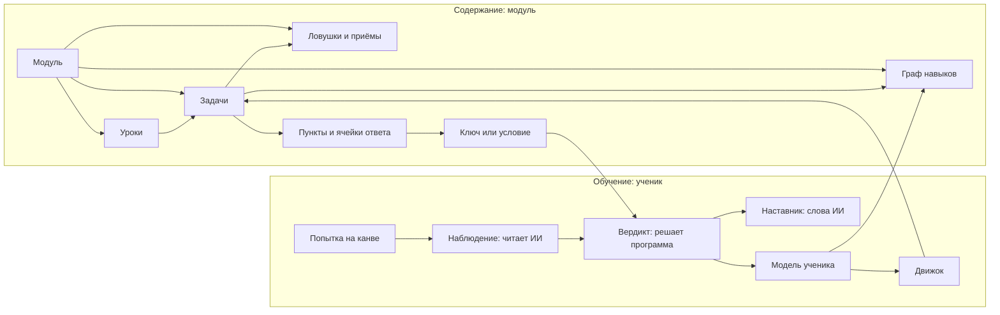
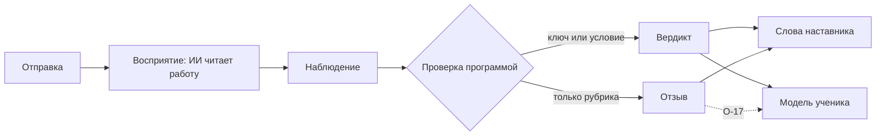

# NovaTrail — понятия платформы

> Статус: черновик для обсуждения, 2026-10-18.
>
> Общий словарь платформы: модуль, навык, урок, задача, канва, проверка, наставник, модель ученика, движок. Документ описательный. Имена полей и форматы появятся позже, в схемах `spec`, и будут сверяться с ним.
>
> Зачем всё это — в [product.md](product.md), приватность и возраст — в [privacy.md](privacy.md), компоненты — в [architecture.md](architecture.md), репозитории — в [repositories.md](repositories.md), решения — в [decisions.md](decisions.md). Открытые вопросы, на которые здесь ссылки, живут там: О-… — в product 13, П-… — в privacy 9, Т-… — в repositories 8.

## 1. Зачем этот документ

- Платформа нарезана на репозитории (R10). Движок, сервис, приложение и авторы модулей должны понимать друг друга, поэтому словарь у них один.
- Понятия здесь не зависят от предмета. Каждое проверено на четырёх непохожих случаях:
  - олимпиадная математика ребёнка, решение от руки;
  - испанский A1 взрослого;
  - физика на интерактивном стенде;
  - рисование, где верного ответа нет.

  Понятие, которое работает только для одного из них, живёт в модуле, а не здесь.
- В коде и схемах термины — на английском (R14), соответствие — в словаре (раздел 15). В схемах формата имена полей и значения перечней — эти термины в snake_case: `answer_slot` (R45).
- Примеры в разделе 16 — иллюстрации, а не формат.

## 2. Карта понятий



Модуль приносит содержание: граф навыков, уроки, задачи, каталоги ловушек и приёмов. Движок по модели ученика выбирает задачу. Ученик работает на канве, ИИ превращает его работу в наблюдение, а программа сверяет наблюдение с ключом и выносит вердикт. Вердикт уходит в модель ученика, а наставник подбирает слова.

## 3. Модуль

**Модуль** — версионируемый набор содержания одного автора: всё, что нужно платформе, чтобы учить предмету или его части. Примеры: «Олимпиадная математика 1–6», «Испанский A1», «Оптика, 8 класс».

- **Идентификатор и пространство имён.** У каждого издателя своё пространство имён. Официальные модули издаёт проект, сторонние — их авторы. Идентификатор модуля и ID его навыков лежат в пространстве имён издателя, поэтому два автора не столкнутся именами.
  - ID модуля — `<издатель>/<имя>`: `novatrail/olympiad-math`.
  - Навык, задача, ловушка, приём и урок называются ID в модуле — `counting-gaps`. Он единственный в своём роде внутри модуля, и им модуль ссылается на свои части.
  - Вне модуля часть называет полный ID — модуль, род и ID в модуле: `novatrail/olympiad-math/skill/counting-gaps`. По нему её знают модель ученика, движок и прогресс (R46).
  - Навык-опора общей таксономии — не часть модуля и не в пространстве имён издателя: ID у него свой, `core.<имя>`, один и тот же в модуле и вне его (раздел 4; R50).
- **Версия** — semver `X.Y.Z`, без пред-релизов (R46).
  - Несовместимое изменение поднимает мажорную версию: удаление навыка или изменение его смысла, изменение ключа опубликованной задачи.
  - Такое изменение несёт таблицу соответствия старых ID новым, чтобы прогресс ученика не ломался: упразднённые навыки графа навыков, `retired_skills`, и навыки, которые их заменили (R49).
  - Опубликованный ID навыка никогда не переиспользуется для другого навыка.
  - Переход модуля на новую версию формата — тоже новая версия модуля: его паспорт изменился (R44).
- **Паспорт:**
  - идентификатор, версия, название, предмет;
  - аудитория: для каких возрастных категорий годится модуль (раздел 13), а у модуля для школьных классов — ещё и его классы, `audience.grades` (R49). Стиль подачи паспорт v0 не называет: он идёт по возрасту ученика, и его можно выбрать отдельно (R41; privacy 3.3). Что модуль может сказать о нём, — О-23;
  - языки: на каком языке объяснения — он у модуля один (R46) — и, у языковых модулей, какой язык изучается;
  - авторы и лицензия содержания — идентификатор SPDX: у официальных модулей — `Apache-2.0` (R20), у сторонних — О-10;
  - версия формата модуля — MAJOR.MINOR. По ней модуль проверяется, собирается и исполняется, и новая версия формата его не меняет, пока автор не переведёт модуль на неё (R44). В паспорте это поле `module_format_version` (R46);
  - зависимости — навыки-опоры общей таксономии, на которые опираются навыки модуля, `dependencies`: ровно те, что его граф навыков называет пререквизитами (раздел 4; R50);
  - полосы сложности — шкала сложности модуля, по порядку, у модуля с классами — с классами каждой полосы (раздел 6; R51);
  - высота цифры на вырезке — настройка канвы модуля (раздел 8; R51);
  - шаблоны ступеней — два запасных текста лестницы подсказок на языке объяснений модуля; без них не обойтись модулю, где есть пункт с вердиктом (раздел 10; R57).
- **Состав:** граф навыков, уроки, задачи, каталоги ловушек и приёмов, шаги решения, настройки канвы, медиафайлы (картинки, звук), необязательные виджеты и eval-набор.
- **Раскладка.** Модуль — папка: паспорт `manifest.yaml`, файлы частей, медиафайлы в `media/`, eval-набор в `eval/`, текст лицензии в `LICENSE` и уведомления лицензий в `NOTICE`. Часть, которая у модуля одна, — файл в корне, названный её термином: граф навыков `skill-graph.yaml`, каталоги ловушек и приёмов `traps.yaml` и `techniques.yaml`, шаги решения `solving-steps.yaml`. Частей одного рода, которых много, — задач и уроков — по файлу на каждую, названному её ID: задачи — `tasks/<id>.yaml`, уроки — `lessons/<id>.yaml` ([текст формата](../format/README.md), раздел 10; R46, R51, R57, R58). `LICENSE` есть у каждого модуля (R62).
- **Пакет.** На релизе `module-kit` собирает модуль в пакет модуля. Часть для сервера — канонический вид: модуль одним JSON-объектом, с ярусом каждого навыка и числами каждого экземпляра шаблона. Часть для устройства — `LICENSE`, `NOTICE` и медиафайлы. Опись пакета называет обе части по дайджестам, а дайджест пакета — дайджест описи: его хранит попытка. Пакет зависит только от файлов модуля и версии формата его паспорта ([текст формата](../format/README.md), раздел 25; R62).
- **Eval-набор модуля** — образцы работ, на которых проверяется, что ИИ верно читает работу в этом модуле. Это синтетические образцы или образцы, которые для eval сделали взрослые добровольцы и авторы. Работы учеников — детей и взрослых — в модуль не входят: модуль публикуется под открытой лицензией, и отозвать его нельзя. Работы учеников, если их берут в eval, хранятся вне репозиториев и только с отдельного согласия (П-10; R15). В пакет модуля eval-набор не входит (R62).
- **Модуль даёт данные, а не инструкции модели (R02):**
  - поля модуля типизированы и проверяются схемой;
  - промпты принадлежат платформе: по одному на возможность ИИ, у каждого свой eval-набор (раздел 10);
  - свободный текст модуля — условие, совет ловушки, решение — попадает к модели только отдельным помеченным блоком данных, который не может изменить её задачу. Так в standalone передавались заметки о ребёнке (R16 standalone).

  Отсюда отличие от навыков Claude. Навык Claude — инструкции, которые модель исполняет так, как их поняла. Модуль NovaTrail платформа исполняет одинаково при одинаковом входе (R03).
- **Официальные и сторонние модули.** Кто и как публикует сторонние модули — О-9.

## 4. Навык и граф навыков

**Навык** — то, чему учит модуль и что можно оценить у ученика. Примеры: «промежутки и столбы», «ser и estar», «закон преломления», «штриховка».

- **У навыка:** ID, название, описание, ярус, пререквизиты, оцениваемость и навыки-опоры, которым он учит. Граф навыков модуля — файл `skill-graph.yaml`, и навыки в нём названы ID в модуле (R49).
- **Граф навыков** — направленный граф без циклов: «чтобы браться за B, нужен A». Платформа проверяет его на циклы при публикации, как standalone проверял связи `builds_on` при старте, — это правило формата `skill-graph.acyclic` (R49).
- **Ярус** — группа навыков одной сложности в модуле.
  - В MathTrail ярусов три: «основы», «правила» и «сложные задачи»; в прототипе они называются Basics, Rules и Hard tasks.
  - Ярус темы там не задавал автор: его вычисляли по самой длинной цепочке тем-основ под ней (SPEC 8.12.2 standalone).
  - В NovaTrail ярус тоже вычисляется: ярус навыка — 1 плюс самая длинная цепочка пререквизитов модуля под ним, и предела числа ярусов нет. Имена ярусам даёт автор, а ярус без имени показывается номером. Вычисляет ярусы `module-kit`, когда собирает пакет, и кладёт их в его канонический вид, а до карты навыков их доносит `api` (R49; R62; О-18 решён).
- **Ссылки между модулями.**
  - Модулю физики могут понадобиться линейные уравнения, но на внутренние ID чужого модуля он не ссылается.
  - Ссылаться можно только на навыки **общей таксономии** — курируемого платформой словаря навыков-опор (R50). Тогда переименование навыка в чужом модуле ничего не сломает.
  - Навык-опора — навык вне модулей, с ID `core.<имя>`: `core.linear-equations`. Навык модуля опирается на него пререквизитом и учит ему полем `teaches`, а паспорт перечисляет навыки-опоры, на которые опираются навыки модуля. Словарь — схема формата, и меняется он по версиям формата (R44).
  - Владеет ли ученик навыком-опорой, модель ученика решает по навыкам, которые ему учат, в модулях ученика (раздел 11).
  - Если у ученика нет модуля, который учит нужному навыку, движок не блокирует урок. Навык считается неизвестным, и движок может предложить короткую проверку или модуль. Какие модули учат навыку-опоре, говорит индекс модулей (R63).
  - Формат проверяет каждый модуль отдельно, поэтому цикла пререквизитов между модулями через навыки-опоры он не видит.
- **Оцениваемость** решает, как платформа учит навыку:

  | Оцениваемость | Что это | Пример |
  |---|---|---|
  | вердикт | задачи навыка проверяет программа: по ключу — у ответа одно верное значение — или по условию — верных ответов много, и программа проверяет условие | 21 столб; «любое число, которое делится на 3 и на 4» |
  | рубрика | оценка по критериям автора — только отзыв, не вердикт (R04) | перспектива на рисунке, произношение |
  | никак | навык тренируется, но не оценивается | свободное рисование |

  В формате это значения `verdict`, `rubric` и `none` (R49). Для навыков с рубрикой и без оценки движок не подстраивается под ученика: порядок задаёт автор — графом навыков и порядком звеньев урока, а где граф порядка не даёт, правило движка выбирает без модели ученика (раздел 5; R58). Оцениваемость совпадает с тем, как проверяются пункты навыка: основной навык пункта с ключом или условием — `verdict`, пункта с рубрикой — `rubric`, а навык `none` бывает только вспомогательным (правило формата `task.assessability`; R56).
- **Открытие навыка и доступ к содержанию.**
  - Навык открывается по пререквизитам, а не по классу или возрасту. Класс или возраст задаёт только отправную точку, как в standalone: «The grade decides one thing: where the child starts» (О-56 standalone).
  - Отдельно от этого модуль может пометить содержание как неподходящее для возрастной категории. Это доступ к содержанию, а не порядок обучения. В формате — возрастные категории задачи, `age_categories`: их меньше, чем у модуля, и задачу получают только ученики этих категорий (R51).

## 5. Урок

**Урок** — последовательность, которую составил автор: объяснение, пример с разбором, задачи и иногда проверка в конце. Обещание «интерактивных уроков» — об этом. В модуле урок — файл `lessons/<id>.yaml` ([текст формата](../format/README.md), раздел 21; R58).

- **Навыки урока** — навыки модуля, которым он учит. Они закрыты, как навыки задачи (раздел 6): приложению хватает названия урока, а навыки читает движок. Каждая задача урока тренирует хотя бы один из них как основной.
- **Звенья урока** идут в порядке автора, и движок их не переставляет. Звено — одно из трёх:
  - объяснение — абзацы и картинки;
  - пример с разбором — условие, лист для рукописи и показ автора: части решения примера, которые ученик открывает по одной (раздел 8). Пример открыт: это не задача модуля, и ключа у него нет;
  - задача модуля по её ID. Следующее звено идёт, когда задача кончилась.

  Особого звена проверки в конце нет: проверка — последние задачи урока.
- **Порядок уроков** задаёт граф навыков, и автор не пишет его отдельно (О-19 решён: R58). Урок идёт после уроков, которые учат пререквизитам его навыков. У последовательного модуля граф — цепочка, и пометку «последовательный», как *Sequential* в прототипе, приложение выводит из графа. Где граф порядка не даёт — два урока одного навыка, навыки без связи, — выбирает правило движка.
- **Адаптация.** Какой урок или задачу дать дальше, решает движок по модели ученика (раздел 12). В уроке, чьи навыки не все с вердиктом, движок ничего не добавляет и не пропускает: урок идёт в порядке автора, без адаптации. Добавит ли движок закрепление в урок с вердиктом и кончит ли его раньше — решает его детализация (architecture 3.8).
- **Возраст.** Урок получает только ученик, которому подходят и урок, и каждая его задача (раздел 13). Урок, которого не получит ни один ученик, — ошибка модуля.
- Задачи живут и вне уроков: движок может дать задачу на закрепление без объяснения.
- Проверка утечки ищет ответ каждой задачи урока во всех его текстах, и после задачи тоже: открытый вид урока уходит в приложение целиком (раздел 10; R05).

## 6. Задача

**Задача** — то, что ученик решает и что платформа может проверить или прокомментировать.

- **Условие задачи** — что ученик видит: текст и картинки. У картинки — описание для программы чтения с экрана и размер. Условие — часть шаблона автора, которого ученик не стирает (раздел 8), а над канвой оно или на ней, решает вид канвы: лист для рукописи показывает его над листом. Звука и формул в условии формата v0 нет (R51).
- **Пункты.** Задача — один пункт или набор.
  - Лист с десятью примерами на дроби — одна задача из десяти пунктов.
  - У каждого пункта своя область на канве, свои ячейки ответа, свои навыки и своё состояние: не начат, начат, проверен.
  - Вердикт пункта складывается из вердиктов его ячеек, а итог задачи — из пунктов (раздел 9.1; R56).
  - Пункт называет его место в задаче, с 1. На листе для рукописи у пункта — ячейки ответа, а на рабочей тетради пункт — строка: куски текста и окошки по порядку, «7 × [ ] = 56» (R51).
- **Ячейка ответа и её привязка** — где ученик даёт ответ:
  - в зоне — отведённом месте на листе;
  - где угодно на листе: итог находит ИИ, как в canvas-api (R61 canvas-api), а если итогов несколько, ученика просят обвести свой;
  - в состоянии виджета — например, положение линзы или показание амперметра;
  - правками в тексте условия — на текстовой канве: зачеркнуть, вставить, переставить;
  - вводом с клавиатуры или выбором варианта;
  - весь лист — работа целиком, как сочинение.

  Привязку задаёт модуль на каждую ячейку. Так снимается спор «поле Answer или свободный лист» между прототипом и MathTrail Canvas. В формате v0 — где угодно на листе, весь лист, зона, окошко рабочей тетради и выбор варианта; зона — прямоугольник в единицах листа. Ячейка «где угодно» или «весь лист» — единственная в задаче. Ввод с клавиатуры, правка и состояние виджета придут потом (R51).
- **Проверка ячейки** — у каждой ячейки ответа своя: **вид проверки** и его параметры — ключ, условие или критерии рубрики (раздел 9.2). Приложение до решения задачи её не получает (R05; R56).
- **Навыки задачи** бывают двух видов:
  - основные — задача их тренирует, и ошибка в ней — свидетельство против них;
  - вспомогательные — нужны для решения, но ошибка их не роняет: неверный ответ по оптике не снижает оценку алгебры. Вспомогательный навык бывает и навыком-опорой: линейные уравнения у задачи по оптике (раздел 4; R51).

  Свои навыки бывают и у пункта: они заменяют для него навыки задачи.
- **Ловушки** — какие типичные ошибки ловит задача и по какому признаку. Обе — из каталога ловушек модуля (раздел 7):
  - по неверному значению — такую ловушку определяет программа. Значение ловушки стоит в проверке своей ячейки и сравнивается ею, как ключ; оно может нести текст ловушки — что ученик прочтёт при этой ошибке (R57);
  - по виду ошибки в решении ученика — такую ловушку предполагает ИИ, и её происхождение — «выведено ИИ» (раздел 9.4). Какие ловушки ИИ может предположить, задача перечисляет сама (R57).
- **Приёмы** — какой приём здесь помогает, из каталога приёмов модуля. Приёмы задачи закрыты: название приёма подсказывает способ решения. Приложение получает приём от `api` на шаге, который его даёт, или по просьбе ученика (раздел 10; R57).
- **Что известно и что найти** — заготовки для шага «понять»; в прототипе это фишки «We know» и «We need to find». Они открыты: они пересказывают условие, а способа не подсказывают (R57).
- **Подсказки:**
  - лестница от общего вопроса к конкретному и к похожему случаю попроще;
  - запасные тексты автора — на случай, когда вопрос модели не пришёл или не прошёл проверки (раздел 10): текст ловушки у значения ловушки и похожий случай попроще у пункта (R57);
  - фразы-утечки — по ним проверка утечки узнаёт ответ в тексте, который увидит ученик (раздел 10; R57).
- **Решение** — показывается после верного ответа. Показ по просьбе ученика — О-7. В задаче оно — тексты и картинки, как условие; оно закрыто и обязательно у задачи, где есть пункт с вердиктом (R57).
- **Сложность** — по шкале модуля: задача называет полосу сложности и сложность от 1 до 5 внутри неё, как в standalone (R51).
- **Шаги решения** и условие выхода из каждого шага — у модуля, раздел 7.
- **Происхождение** ключа, тегов навыков и ловушек — раздел 9.4. В модуле всё — от автора.
- **Файл.** Задача — файл `tasks/<id>.yaml` модуля, названный её ID ([текст формата](../format/README.md), раздел 14; R51).
- **Шаблон.** Задача может быть шаблоном с параметрами: тогда каждая попытка получает один её экземпляр, с числами от зерна попытки (раздел 9.3; R60).

Задача без детерминированной проверки — рисунок, произношение, сочинение — получает отзыв, а не вердикт (R04).

## 7. Ловушка, приём, шаги решения

- **Ловушка** — именованная типичная ошибка, общая для многих задач модуля. Примеры: «посчитал промежутки вместо столбов», «перепутал ser и estar», «забыл перевести сантиметры в метры».
  - У ловушки: ID, описание, навыки, к которым она относится, и совет для взрослого или ученика. В модуле — каталог ловушек `traps.yaml`, ловушки по ID в модуле; он закрыт целиком (R05; R57).
  - Каталог ловушек модуля закрыт: неверный ответ становится диагнозом, только если ловушки можно посчитать, а свободные названия ошибок посчитать нельзя (SPEC 1.3 standalone).
  - Повторяющиеся ловушки видны в прогрессе — в прототипе это блок «Mistakes that repeat».
- **Приём** — стратегия решения, которую можно назвать и которой можно научить. Примеры: «начни с маленьких чисел», «найди глагол», «нарисуй силы».
  - Каталог приёмов — у модуля, файл `techniques.yaml`: название и описание каждого приёма. Он открыт, как навыки в карте навыков, а какие приёмы помогают в задаче — закрыто (R57). В математике MathTrail их 11, с номерами; номеров в каталоге формата v0 нет.
  - После верного ответа наставник может спросить, какой приём помог.
- **Шаги решения** — рамка, по которой наставник ведёт ученика внутри одной задачи. Их задаёт модуль:

  | Предмет | Шаги |
  |---|---|
  | олимпиадная математика | понять → составить план → решить → проверить (Пойа) |
  | физика | гипотеза → опыт → расчёт → вывод |
  | язык | прочитать → найти ошибки → исправить → произнести |

  - Шаг «произнести» требует голосового ввода и появится вместе с ним (О-6).
  - В модуле — файл `solving-steps.yaml`: шаги по порядку, у каждого — название, что он даёт и условие выхода. Шаги открыты: приложение ведёт их само (R57).
  - Шаг может давать заготовки задачи: `givens` — «что известно и что найти», `techniques` — её приём, который `api` отдаёт, когда шаг начался (R57).
  - У каждого шага есть условие выхода: событие («отмечены все известные»), состояние виджета, заполненная ячейка или ничего. В формате v0 — `givens_ticked`, ученик отметил всё, что известно и что найти; `answer_slots_filled`, в каждой ячейке ответа что-то есть; `none`, когда ученик идёт дальше сам. Состояние виджета придёт с этапом 4 (R57).
  - Режим «сам» (в прототипе — Free solve) пропускает шаги: наставник отвечает, только когда его позовут.

## 8. Канва

**Канва** — рабочее место задачи: что ученик видит и где он пишет, рисует, вводит, двигает и говорит. Вид канвы на каждую задачу задаёт модуль.

**Слои**, снизу вверх:

1. **Шаблон автора** — условие задачи, сетка, картинки, предложения, пункты. Ученик его не стирает и не меняет. Условие задачи вид канвы может показать и над ней: так делают лист для рукописи и рабочая тетрадь (R51; R34 canvas).
2. **Виджет модуля** — интерактивный стенд: оптическая скамья, электрическая цепь, числовая прямая.
3. **Показ автора** — пример или демонстрация, которые автор приготовил для урока. В формате v0 это показ примера с разбором: ученик открывает его части по одной и может спрятать весь показ, а картинка на участке листа стоит на этом слое, в размер участка (раздел 5; R58). На листе примера ученик не пишет.
4. **Работа ученика** — штрихи, текст, перетаскивания, ответы голосом, изменения виджета.
5. **Слой наставника** — пометки наставника: рамки, номера и короткие надписи, — и пунктирный набросок «как начать».
   - Набросок рисуется под записью ученика, пометки — над ней.
   - Ни то, ни другое не меняет и не закрывает работу ученика (R05).

**Виды канвы.** Каждый — код платформы, общий для всех модулей:

| Вид | Что это | Пример |
|---|---|---|
| лист для рукописи | свободный лист в клетку, линейку или точку | олимпиадная задача, черновик |
| рабочая тетрадь | нестираемые пункты и ячейки на одной странице | десять примеров на дроби |
| текстовая | предложения и слова: зачеркнуть, вставить, переставить, выделить, прослушать | поиск ошибок по-испански |
| песочница | виджет модуля и место для расчётов | опыт с преломлением света |
| творческая | кисти, палитра, слои, нажим | рисунок с натуры |

В формате v0 виды канвы — лист для рукописи, `handwriting_sheet`, и рабочая тетрадь, `workbook` (R51). Канва кода и проверка запуском программы ученика — О-20.

**Инструменты** разрешает задача: перо, ластик, линейка, транспортир, калькулятор, клавиатура, микрофон. Ластик удаляет штрих целиком: пометки наставника привязаны к штрихам ученика, и стёртая половина штриха их бы сломала (canvas-api: R42, R43). В формате v0 у каждой задачи — перо и ластик, а поле инструментов придёт с первым модулем, которому оно понадобится (R51).

**Высота цифры** — высота цифры или буквы ученика на вырезке для проверки, в px. Это настройка канвы модуля в его паспорте, без неё — 32 (R51; R08 tutor).

**Контракт виджета:**
- виджет объявляет схему своего состояния и события;
- проверка может ссылаться на состояние виджета (раздел 9);
- версия виджета закрепляется за попыткой, а случайность в нём — только от зерна (seed), чтобы попытку можно было повторить. Это своё зерно виджета, а не зерно попытки: зерно попытки на устройство не уходит, и как виджет получает своё, решает протокол виджета (R59; Т-24);
- где и как исполняется код чужого виджета — R16 (architecture 3.4).

**Работа ученика — его артефакт.** Рисунок, сочинение или запись принадлежит ученику, их можно выгрузить и удалить (privacy 4). Это не «картинка для проверки».

## 9. Проверка

### 9.1. Цикл



- **Отправка** — по кнопке. Что наставнику можно делать на паузе — О-8.
- **Восприятие** — ИИ превращает работу ученика в наблюдение. Это единственное место, где ИИ участвует в проверке (R03). Ответ вводом или выбором ИИ не читает: его сразу проверяет программа.
- **Наблюдение.** На каждую ячейку:
  - запись и её значение; значение принимается, только если оно видно в самой записи (R62 canvas-api);
  - другие возможные прочтения, разборчиво ли и однозначно ли;
  - привязка к штрихам или к месту на канве;
  - ловушка-кандидат — одна из тех, что задача называет для ИИ (раздел 6; R57).

  На работу целиком — место первой ошибки в рассуждении. Ученик видит, что прочитано: «Я прочитал 6».
- **Проверка** — программа сравнивает прочитанное значение каждой ячейки с её проверкой: ключом или условием. Модель не решает, верно ли (R03). Значение читатель отдаёт так, как оно записано, а приводит его к записи вида — нормализует — `module-kit` (раздел 9.2; R56). Значение, которое получило «пока нет», программа сравнивает тем же способом со значениями ловушек ячейки, и совпавшее называет ловушку (раздел 6; R57).
- **Вердикты** — как в R38 canvas-api:

  | Вердикт | Когда | Что видит ученик |
  |---|---|---|
  | верно, `correct` | значение совпало с ключом или выполнило условие | «Верно» и что прочитано |
  | пока нет, `not_yet` | прочитано уверенно, по форме, и не совпало | что прочитано, место ошибки и вопрос наставника |
  | не прочитать, `unreadable` | неразборчиво, неоднозначно, не по форме; итогов несколько или нет; ячейка пуста | просьба переписать или обвести — это не ошибка |
  | без проверки, `unchecked` | сбой ИИ, исчерпан лимит; условие не досчиталось | нейтральная фраза — это не ошибка |

  При любом сомнении — «не прочитать», а не «пока нет» (R04). Почему «не прочитать», говорит причина: пусто, `blank`, или значение не в записи вида, `notation`; неразборчивость и неоднозначность — из наблюдения (R56).
- **Вердикт пункта** — из вердиктов его ячеек: все верны — «верно»; хоть одна «пока нет» — «пока нет»; иначе — «не прочитать», а если и такой нет — «без проверки». Ячейка, прочитанная уверенно и неверно, — уже не сомнение, и пункт верным не станет, что бы ни было в остальных (R56).
- **Отзыв** — там, где детерминированной проверки нет. ИИ оценивает работу по критериям автора, и ученик видит это как отзыв, а не как оценку. Влияет ли отзыв на модель ученика — О-17.

### 9.2. Виды проверки

| Вид | Пример | Что задаёт модуль |
|---|---|---|
| число | 21 столб | значение |
| дробь и форма | 3/6 и 1/2 равны, но задание «сократи» требует 1/2 | значение и правило формы отдельно; как записываются числа — десятичная запятая, смешанные числа |
| величина | 2,0·10⁸ м/с | размерность, допустимые единицы и их перевод, допуск (абсолютный или относительный), значащие цифры, знак |
| выбор | вариант C | варианты |
| текст | «está» | допустимые варианты; нормализация: регистр, пробелы, пунктуация, значимы ли ударения |
| правка | исправить ошибки в предложении | обязательные правки по местам, частичный зачёт, что считать новой ошибкой |
| порядок и множество | расставить события по порядку; назвать все варианты | важен ли порядок, нужна ли полнота |
| условие | «любое число, которое делится на 3 и на 4» | условие, которое считает программа |
| состояние виджета | луч после линзы проходит через фокус | условие на состояние виджета |
| рубрика | рисунок, произношение, сочинение | критерии; итог — отзыв, а не вердикт |

- Новый вид проверки — код платформы, общий для всех модулей: модуль выбирает вид и задаёт параметры (R02). Этот код живёт в `module-kit` (R17).
- **Проверка ячейки** — у каждой ячейки ответа своя: вид и его параметры. Она закрыта целиком, вместе с видом: приложение до решения задачи её не получает (R05). Критерии рубрики или знаки, которые ждёт окошко, автор может назвать в условии задачи (R56).
- **В формате v0** виды проверки — те, что нужны трём модулям первого среза, и условие (R56; [текст формата](../format/README.md), раздел 15):
  - `number`, число — целое, десятичная дробь с точкой или простая дробь; сравнивается по значению, точно. Слова единиц после числа, `units`, проверка отбрасывает;
  - `fraction`, дробь и форма — простая дробь; правило формы `form` — любая дробь того же значения или только несократимая;
  - `choice`, выбор — касанием из вариантов ячейки с привязкой `choice`, или от руки: тогда варианты — у самой проверки, как знаки <, > и = в окошке тетради;
  - `predicate`, условие — выражение Starlark от прочитанного целого `value`, с лимитом шагов в формате. Решатели-программы для ключей шаблонов — раздел 9.3;
  - `rubric`, рубрика — критерии `criteria`, только на весь лист.

  Текста, правки, величины, порядка и множества, состояния виджета и «шагов» — проверки каждой строки хода решения (В10 `tutor`) — в v0 нет. «Текст» и «правка» первым срезом не проверены (R41), остальных модули среза не берут, а виджетов в нём нет.
- **Нормализация** — часть вида проверки: прочитанное значение приводится к записи вида — NFKC, минусы и тире, пробелы, а у выбора и регистр, — и только потом сравнивается. Что из неё задаёт модуль, — параметры вида: единицы у числа, правило формы у дроби. В MathTrail Canvas нормализация знала только числа и выбор: NFKC, знак «−» превращался в «-», слово единицы измерения отбрасывалось (spec 5.2 canvas-api).

### 9.3. Шаблоны и генерация

- Задача может быть **шаблоном** с параметрами — полем `template` ([текст формата](../format/README.md), раздел 23; R60). У каждого параметра — область, целые от `from` до `to`. Производные числа шаблон считает из параметров, а ограничение отбирает их сочетания; и то и другое — выражения узкого подмножества Starlark, которые считает и сам `spec`. Сочетание, которое проходит ограничение, даёт **экземпляр** — задачу, где на месте подстановок `{имя}` стоят числа.
- Шаблон перебирается целиком: сочетаний не больше 10 000, и `module-kit` строит каждый экземпляр и проверяет его всеми правилами задачи ещё при проверке модуля — ключ, значения ловушек, утечку. Попытка получает один экземпляр: его номер выбирает генератор платформы из зерна (seed) попытки, из места случайности `template`, ID задачи, `instance` ([текст формата](../format/README.md), раздел 22; R59). На попытке Starlark не запускается, а зерно и числа, которых нет в открытых полях экземпляра, на устройство не уходят.
- Ключ шаблона — подстановка параметра, производного числа или результата решателя. **Решатель** — программа на Starlark в поле `template.solver`, которая перебором считает ключ, когда формулы нет, как решатели standalone ([текст формата](../format/README.md), раздел 24; R61). Его функция `solve` получает только числа открытых полей экземпляра — решает ту задачу, что видит ученик, — и возвращает свои результаты. Результаты стоят только в ключе, значениях ловушек, решении и фразах-утечках, а всё, что ученик видит до решения, `spec` строит без решателя. Бюджет — 100 000 000 шагов на все экземпляры шаблона, и запускает решатель только `module-kit`, при проверке модуля. Условие проверки — не он, а выражение в самой проверке ячейки (раздел 9.2; R56).
- Шаблон — одна задача: урок называет его как задачу, а модель ученика и движок видят одну задачу, какой бы экземпляр ни выпал. Страницу тетради из независимых строк шаблоном v0 не описать — у неё слишком много сочетаний; параметры у пункта придут потом (RUN.md, T38).
- Задачи с помощью ИИ генерируются только при подготовке модуля, и автор их проверяет. Генерации на лету, как в standalone, нет: О-12 решён (R60).

### 9.4. Происхождение

У задачи, ключа, тегов навыков и ловушек есть **происхождение**:

| Происхождение | Пример |
|---|---|
| от автора | ключ задачи в модуле |
| проверено решателем | ключ экземпляра шаблона посчитан программой: выражением шаблона (R60) или решателем шаблона (R61) |
| введено взрослым | ключ из ответов в конце учебника для задачи с бумаги |
| выведено ИИ | ИИ сам разметил навыки задачи с бумаги, сам решил её или сам предположил ловушку по ходу решения ученика |
| нет | ключа нет вовсе |

От происхождения зависит:
- **возможен ли вердикт.** И «верно», и «пока нет» выносятся только при ключе или условии от автора, решателя или взрослого. При ключе, выведенном ИИ, вердикта нет и ответ не оценивается: иначе это был бы вердикт модели, который R04 отвергает. Можно лишь показать решение, помеченное «выведено ИИ», и то не ребёнку (О-11);
- **вес свидетельства** для модели ученика. Задача с бумаги, которую ИИ сам разметил и решил, рейтинг не двигает (О-11). Ловушку по неверному значению находит программа, и она весит как вердикт. Ловушка, которую ИИ предположил по ходу решения ученика, нужна наставнику для слов; в модель ученика и в выбор задачи она идёт со сниженным весом;
- **что показывается.** Решение, выведенное ИИ, так и помечено.

Только так детерминированное ядро (R03) выдерживает фото с бумаги, рубрики и виджеты.

В модуле всё — от автора, и поля происхождения у задачи нет: ключ шаблона считает программа, и это видно по самому шаблону (раздел 9.3; R60), а «введено взрослым» и «выведено ИИ» бывают только у задач с бумаги (R51).

## 10. Наставник

- **У ИИ две роли:**
  - восприятие — читает работу (раздел 9);
  - слова — подсказки, объяснения, похвала, вопрос.

  Решений наставник не принимает: вердикт выносит программа, следующую задачу выбирает движок (R03).
- **Правила подсказки** — из product 5.4 canvas-api:
  - не называть ответ;
  - один вопрос, не больше двух коротких предложений, слова по возрасту;
  - указывать на место в работе ученика;
  - начинать с того, что уже получилось;
  - говорить только о задаче.
- **Лестница подсказок** — по числу неверных ответов на задаче:
  1. общий вопрос о месте ошибки;
  2. вопрос о правиле или ловушке;
  3. похожий случай попроще.

  Ступень выбирает программа по числу неверных ответов, а наставник только подбирает слова для неё (R03). После третьей ступени программа предлагает позвать взрослого (ребёнку) или показать решение (О-7). Что даёт подсказка по просьбе ученика — до первой отправки и между отправками, — О-21. В части формата он решён: до первой отправки просьба даёт «что известно и что найти» и приём задачи, без ИИ и без чтения работы. Наброска «как начать» в формате v0 нет (R57).
- **Запасные тексты.** Если вопрос модели не пришёл или не прошёл проверки, ученик получает запасной текст (R24 canvas-api; R57):
  - на ступенях 1–2 — текст ловушки, который автор написал для этого неверного значения; без него — совет ловушки из каталога, а без совета — шаблон ступени;
  - на третьей ступени — похожий случай попроще от автора, а без него — то же, что на второй.

  Шаблоны ступеней — у модуля, в его паспорте и на его языке объяснений: платформе не нужно переводить их на язык каждого модуля (R57).
- **Проверка утечки.** Программа ищет в тексте модели ключи и фразы-утечки, которые указал автор (R24 canvas-api). Это страховка, а не доказательство. Тексты автора, которые ученик видит до решения, проходят ту же проверку, когда проверяется модуль (R17). Как она ищет, нормативно говорит [текст формата](../format/README.md), раздел 20 (R57):
  - ключ ищется отдельным токеном, а число — по значению: `7` не найдётся в `17`, а `0.5` найдётся в `1/2`;
  - ключ, который уже стоит в условии или в тексте, строке и вариантах своего пункта, — «2 ноги» в задаче о кроликах — не ищется: там ответ держат фразы-утечки автора. В этом формат отходит от R24 canvas-api, где ключ запрещён всегда;
  - числа словами и записи, которых проверка не читает числом, ловят только фразы-утечки.
- **Промпты — у платформы.** Свой промпт у каждой возможности ИИ: чтение рукописи, чтение текста, разбор хода решения, оценка по рубрике, подсказка, голос. У каждого — eval-набор. Модуль даёт данные — ловушки, приёмы, решение, критерии рубрики — отдельным помеченным блоком (R02).
- **Персонаж** — друг в прототипе: лис, робот, сова, кошка, динозавр или тот, кого нарисовал ребёнок. Он меняет тон и голос, но не содержание. Персонаж для взрослых — О-13.
- **Голос** — озвучка наставника и голосовой ввод ученика. Голосовой ввод — О-6 и П-5.
- **Режимы:**
  - «по шагам» — приложение ведёт по шагам решения модуля, а наставник говорит на каждом шаге;
  - «сам» — наставник ждёт, когда его позовут; что он тогда отвечает — О-21.
- **Что получает модель:**
  - работу — картинку, вырезку, текст или звук;
  - данные задачи и наблюдения, нужные для слов;
  - стиль подачи — чтобы говорить по возрасту.

  Чего платформа ей не передаёт никогда: идентификаторов, псевдонима, имени ученика и данных взрослого. Но на картинке может оказаться всё, что ученик написал сам, в том числе имя (privacy 1).

## 11. Модель ученика

**Модель ученика** — что платформа знает о том, как ученик владеет навыками во всех подключённых модулях. Модель у ученика одна. Её видимая часть — **карта навыков**.

- **Состояние навыка:** оценка владения, неуверенность этой оценки, число свидетельств, время последней практики, частые ловушки, «освоено» или нет.
- **Свидетельство** — исход попытки, а не только «верно» и «неверно»:
  - с первой отправки;
  - после подсказки номер k;
  - с наброском-подсказкой;
  - решение показано;
  - без проверки.

  Вес свидетельства зависит от исхода и от происхождения ключа (раздел 9.4). Серия однотипных пунктов на одном листе весит меньше суммы: десять дробей за пять минут — это не десять независимых свидетельств. Отзыв по рубрике — О-17.
- **Уровень — на модуль или предметную область, а не на всю модель.** Математика и испанский не складываются. Связи между модулями несут только пререквизиты, а не уровень.
- **Навык-опора** общей таксономии модель знает по его ID — `core.multiplication-table`, — а не по полному: он не принадлежит ни одному модулю. Владеет ли им ученик, она решает по навыкам, которые ему учат, в модулях ученика (раздел 4; R50).
- **Основные и вспомогательные навыки** задачи — раздел 6.
- **Отправная точка:**
  - пробная серия — в standalone это первые пять ответов;
  - исходная оценка — по классу: ученик начинает в полосе сложности, к которой паспорт относит его класс (R51); по возрасту, по самооценке — например, уровню CEFR у языкового модуля — или по короткой проверке.
- **«Освоено»** — осторожная оценка с учётом неуверенности. Она ставится после верного ответа без подсказки, в навыке, где ответов уже не меньше пяти, и теряется после двух неверных ответов подряд (R187 standalone).
- **Забывание и повторение.** Без практики оценка со временем тает, и движок возвращает навык на повторение. Для слов и грамматики это обязательно; в standalone забывания не было.
- **Угадывание** зависит от вида ответа: 1/k при выборе из k вариантов — касанием или от руки, — около нуля при свободном ответе. В standalone оно было зашито как 0,2 на пять вариантов.
- **Отправная модель** — модель Раша с полом угадывания и обновлением по Elo из standalone: общий уровень плюс поправка на тему, пробная серия, осторожное «освоено». Отличия — уровень на модуль и забывание. Коридор успеха из того же standalone — правило движка, а не модели: модель отдаёт вероятность верного ответа (раздел 12; R23).
  - Алгоритмы — дело библиотеки learner-model (repositories 2).
  - Модель меняют, только если новый вариант прошёл стенд виртуальных учеников по критерию, записанному до первого прогона (R163 standalone).
- **Отображение** — карта навыков, рейтинги, ранги, «сильные стороны», «что развивать» — выводится из модели. Обратно на модель оно не влияет.

## 12. Движок

**Движок** выбирает, что дальше: урок, задачу, пункт, повторение. Он работает по правилу, без ИИ; случайность — только от зерна (seed) (R03). Если движку она нужна, у него своё зерно выбора и свои места случайности, а генератор — общий (R27; R59).

- **Входы:**
  - модель ученика и графы навыков подключённых модулей;
  - уроки и пул задач: навыки урока и его звенья, а порядок уроков — по графу навыков (раздел 5; R58);
  - последняя попытка и её ловушка;
  - интересы ученика — для оформления задачи;
  - ограничения: возрастная категория, дневная цель;
  - время и зерно: они приходят снаружи, сам движок их не берёт (architecture 3.8);
  - режим:
    - ведёт движок — «Мои предметы» в прототипе;
    - ученик выбрал навык на карте навыков;
    - задача с бумаги.
- **Выход:** что дать и **код причины**. Примеры кодов: «закрепление после ошибки», «новый навык: пререквизиты освоены», «повторение: давно не было», «проба отложенного». Причину видит взрослый; ребёнку её не называют (как в standalone). Список кодов — контракт в `spec` (R29).
- **Правила верхнего уровня.**
  - Из правила standalone (SPEC 3 standalone):
    - коридор успеха: ученик решает задачу с вероятностью от 0,70 до 0,85, целясь в 0,775;
    - закрепление: после ошибки — ещё задача на тот же навык, если он в досягаемости;
    - пробы: отложенный навык изредка возвращается проверкой;
    - очередь: из досягаемых неосвоенных навыков первым идёт тот, который дольше всего не выдавался;
    - частые ловушки ученика: задача, которая их ловит;
    - интересы: оформление задачи под интересы ученика, если модуль даёт такие варианты. В формате v0 их нет: они придут минорной версией (R51).
  - Новое в NovaTrail:
    - пререквизиты: навык предлагается, когда его пререквизиты освоены. Правило standalone связей между темами не читало;
    - повторение освоенного: навык возвращается, когда его оценка тает от забывания (раздел 11). В standalone забывания не было: ища новое, правило пропускало освоенную тему, пока не освоены все досягаемые. В ротацию она возвращалась и раньше — когда её рекомендуемая точка поднималась выше уровня, на котором тема освоена, или когда две ошибки подряд снимали с неё «освоено» (SPEC 2.5, 3.2 standalone).
- **Объяснимость и воспроизводимость.** Тот же вход даёт тот же выход, и у каждого выбора есть причина. Это проверяет стенд виртуальных учеников.

## 13. Ученик, взрослые, возраст, языки

- **Ученик** — тот, кто учится.
- **Владелец аккаунта** — тот, кто управляет аккаунтом и данными:
  - у взрослого ученика — он сам;
  - у ребёнка — родитель или опекун (R06).

  Один аккаунт может держать и профиль самого владельца как ученика, и профили его детей (R26).

  Аккаунт подростка — П-13.
- **Возраст — два разных понятия:**
  - **возрастная категория** — от неё зависят аккаунт, согласие, пути к ИИ и голос (privacy 3). В скобках — её код в паспорте модуля и в схемах формата (R46):
    - младше 13 (`under_13`);
    - от 13 до возраста цифрового согласия страны (`from_13_to_consent`);
    - от возраста цифрового согласия до 18 (`from_consent_to_18`);
    - 18 и старше (`adult`).

    Возраст цифрового согласия по GDPR страна выбирает от 13 до 16, поэтому без страны категорию не определить. Вне ЕС и Великобритании берём 13, если закон страны не говорит иного (privacy 3);
  - **стиль подачи** — как платформа говорит и показывает: длина фраз, озвучка, персонаж, ранги. Паспорт модуля v0 его не называет (О-23).
- **Как указывается возраст.**
  - Владелец аккаунта указывает возраст ученика и страну.
  - Платформа вычисляет возрастную категорию и хранит её, страну и дату, когда возраст указан. Ни даты рождения, ни возраста в годах она не хранит.
  - Раз в год категория уточняется. До уточнения действует прежняя: она строже, потому что ученик с тех пор только повзрослел (privacy 3).
  - При смене страны возраст указывается заново: возраст в годах не хранится, и пересчитать категорию не из чего.
- **Языки:**
  - интерфейса;
  - объяснений — на котором модуль объясняет, а наставник говорит с учеником; у модуля он один (R46);
  - изучаемый — у языковых модулей.

  Например, русскоязычный взрослый учит испанский: интерфейс — русский, объяснения — русские, предмет — испанский. Ловушки языкового модуля могут зависеть от родного языка ученика.
- **Класс** (школьный) — метка модуля, а не свойство ученика вообще: в паспорте — `audience.grades`, классы от 1 до 12, как их считает автор модуля (R49). Модуль с классами спрашивает класс ученика, и класс хранится в профиле ученика (privacy 4). Класс ничего не закрывает, а по нему модуль даёт отправную точку — полосу сложности, к которой паспорт относит класс (R51).

## 14. Путь к ИИ

- **Путь к ИИ** — через кого идёт вызов (R07):
  - **ИИ платформы** — по договорам платформы с поставщиками;
  - **свой ключ** — ключ ученика или владельца аккаунта у OpenAI, Anthropic или другого поставщика.
- **Допуск по возрастной категории.** Путь и поставщик доступны ученику, только если их условия разрешают его возраст (privacy 5). Для кого свой ключ — О-4.
- **Допущенные модели.** На каждую возможность ИИ — свой список точных ID моделей, прошедших её eval. Модель без eval не допускается, даже со своим ключом (R07; как R22 canvas-api).
- **Кто держит ключ** — Т-9.
- **Лимит трат.** У ИИ платформы это дневная квота помощи наставника, как в прототипе. На своём ключе лимит задаёт владелец ключа.

## 15. Словарь

| Термин | В коде и схемах | Что это |
|---|---|---|
| модуль | module | версионируемый набор содержания одного автора (раздел 3) |
| паспорт модуля | manifest | файл `manifest.yaml` модуля: версия формата, ID, версия, название, предмет, аудитория, языки, авторы и лицензия (R46); у модуля для школьных классов — его классы (R49), а у модуля, чьи навыки опираются на навыки-опоры, — его зависимости (R50). У модуля с задачами — полосы сложности, а высоту цифры на вырезке паспорт может назвать сам (R51). У модуля, где есть пункт с вердиктом, — шаблоны ступеней (R57) |
| зависимости модуля | dependencies | навыки-опоры общей таксономии, на которые опираются навыки модуля: ровно те, что его граф навыков называет пререквизитами. В паспорте — `dependencies` (раздел 3; R50) |
| раскладка модуля | module layout | из каких файлов состоит папка модуля и где какой лежит: паспорт, файлы частей — граф навыков, каталоги ловушек и приёмов, шаги решения, задачи и уроки, — `media/`, `eval/`, `LICENSE` и `NOTICE` (R46; R57; R58; R62) |
| предмет | subject | чему учит модуль; в паспорте — код: `mathematics`, `physics`, `writing` (R46) |
| аудитория | audience | для каких возрастных категорий годится модуль: платформа предлагает его только ученикам этих категорий (R46). У модуля для школьных классов — ещё и для каких классов (R49) |
| класс | grade | школьный класс — метка модуля, а не свойство ученика вообще: в паспорте — `audience.grades`, целые от 1 до 12, как их считает автор модуля. Модуль с классами спрашивает класс ученика, а доступа к модулю и навыкам класс не закрывает (раздел 13; R49) |
| язык объяснений | explanation language | язык, на котором модуль объясняет, а наставник говорит с учеником; у модуля он один (раздел 13; R46) |
| изучаемый язык | target language | язык, которому учит языковой модуль; у других модулей его нет (раздел 13) |
| текст лицензии | license text | файл `LICENSE` модуля: текст лицензии, которую называет паспорт. Он есть у каждого модуля и идёт в часть пакета для устройства (R62) |
| уведомления лицензий | license notices | файл `NOTICE` модуля: уведомления, которые лицензии его содержания велят хранить вместе с ним (R46). Идёт в часть пакета для устройства, а комментарии файлов модуля в пакет не попадают, поэтому уведомление стоит только здесь (R62) |
| формат модуля | module format | что модуль может и должен содержать и как платформа его проверяет: схемы, текст формата и тест-векторы в папке `format/` `spec`. Нормативен и написан на английском (R42) |
| текст формата | format text | правила формата модуля, которые схема выразить не может: граф без циклов, ссылки, ключи, смысл видов проверки, открытые поля, версии (R42) |
| версия формата модуля | module format version | MAJOR.MINOR формата модуля, которую называет паспорт: по ней модуль проверяется, собирается и исполняется. Не версия модуля и не тег `spec` (R44). В паспорте — поле `module_format_version`, строкой: `"0.1"` (R46) |
| правило формата | format rule | правило текста формата, которого схема не выражает, с ID вида `skill-graph.acyclic`: его проверяет `module-kit` и называет в отказе (R45) |
| пример формата | format example | фрагмент модуля в `format/examples/`: верный проходит свою схему, неверный называет ошибку, которую должен дать. Правил не добавляет (R42; R45) |
| тест-вектор | test vector | нормативный случай формата: вход и точный итог — вердикт и ловушка, открытый вид, найденное проверкой утечки, числа, экземпляры шаблона, ярусы, пакет модуля, индекс модулей или отказ по правилу. Реализация, которая его не проходит, формату не отвечает (R42; R57; R60) |
| вектор вердикта | verdict vector | тест-вектор вида проверки, `format/vectors/verdicts/<вид>/`: пункт с проверками его ячеек и его прочтения с тем, что они дают, — вердиктом каждой ячейки и пункта, а у неверного значения ещё и ловушкой. Схема — `verdict-vector.schema.json` (раздел 9.1; R56; R57) |
| вектор утечки | leak vector | тест-вектор проверки утечки, `format/vectors/leaks/`: задача и тексты, каждый — с ключами и фразами-утечками, которые в нём найдутся. Схема — `leak-vector.schema.json` (раздел 10; R57) |
| вектор ярусов | tier vector | тест-вектор ярусов, `format/vectors/tiers/`: граф навыков и ярус каждого его навыка. Схема — `tier-vector.schema.json` (раздел 4; R62) |
| вектор пакета | package vector | тест-вектор пакета модуля, `format/vectors/packages/<случай>/`: модуль и его пакет — канонический вид, список части для устройства, опись и дайджест пакета. Схема — `package-vector.schema.json` (раздел 3; R62) |
| вектор индекса | index vector | тест-вектор индекса модулей, `format/vectors/indexes/<случай>/`: модули релиза, прошлый индекс, тег и снятия, а итог — индекс, который собирает релиз, или отказ по правилу индекса. Схема — `index-vector.schema.json` (раздел 3; R63) |
| вектор шаблона | template vector | тест-вектор шаблона задачи, `format/vectors/templates/`: шаблон, число его экземпляров и попытки — каждая со своим зерном, числами экземпляра и самим экземпляром, который оно даёт. У шаблона с решателем — ещё имена чисел, которые получает решатель, а результаты решателя — среди чисел попытки. Схема — `template-vector.schema.json` (раздел 9.3; R60; R61) |
| прочтение пункта | reading | в векторе вердикта — прочитанные значения всех ячеек пункта, по порядку, с вердиктом каждой ячейки и пункта (R56). Не чтение работы ИИ |
| издатель | publisher | владелец пространства имён модулей |
| ID модуля | module ID | `<издатель>/<имя>`, каждое — в kebab-case: `novatrail/olympiad-math` (R46) |
| ID в модуле | local ID | ID навыка, задачи, ловушки, приёма или урока: kebab-case с буквы, единственный в своём роде внутри модуля, — `counting-gaps`. Им модуль ссылается на свои части (R46) |
| полный ID | full ID | ID модуля, род и ID в модуле: `novatrail/olympiad-math/skill/counting-gaps`. По нему часть модуля знают модель ученика, движок и прогресс, а в файлах модуля его нет (R46) |
| медиафайлы | media | картинки и звук модуля: PNG, JPEG, WebP и MP3 в папке `media/` (R46) |
| пакет модуля | module package | подписанная версия модуля, адресуемая по содержимому; её читает платформа. Две части — для сервера и для устройства, — а опись пакета называет обе по дайджестам (раздел 3; R17; R62) |
| канонический вид | canonical view | модуль одним JSON-объектом: каждая часть модуля, задачи и уроки — по ID в модуле, ярус каждого навыка и числа каждого экземпляра шаблона. Строится только из файлов модуля и версии формата его паспорта; это часть пакета для сервера. Схема — `canonical-view.schema.json` (R62) |
| канонический текст | canonical text | JSON-значение, записанное по RFC 8785: ключи по порядку кодовых единиц, без пробелов, UTF-8. От него берутся дайджесты пакета (R62) |
| часть пакета для сервера | server part | канонический вид модуля в пакете, `server.json`: всё содержание, и ключи, решения и ловушки тоже. Читает её только сервер (R62) |
| часть пакета для устройства | device part | файлы пакета, которые может грузить устройство ученика: `LICENSE`, `NOTICE` и медиафайлы, а когда в формате будут виджеты, — их бандлы. Её называет список файлов с дайджестами и размерами, `device.json` (R62) |
| опись пакета | inventory | часть пакета, которая называет модуль — версию формата, ID и версию — и обе части пакета по дайджестам и размерам, `inventory.json`. Схема — `inventory.schema.json`. Не паспорт модуля (R62) |
| дайджест пакета | package digest | SHA-256 канонического текста описи пакета: `sha256:` и 64 строчные шестнадцатеричные цифры. По нему попытка закреплена за пакетом. В индексе модулей — `package_digest`. Не дайджест отправки (R36; R62; R63) |
| индекс модулей | module index | файл `module-index.json` каждого релиза `modules`: подписанный накопительный список всех опубликованных версий модулей — каждая по дайджесту пакета, с тегом релиза, навыками-опорами, которым учит, и отметкой о снятии. Релиз собирает его из индекса прошлого релиза. Схема — `module-index.schema.json` (R17; R63) |
| реестр модулей | module registry | каталог опубликованных модулей: на этапах 1–3 — подписанный индекс, с этапа 4 — сервис (R17) |
| снятие с публикации | withdrawal | отметка `withdrawn` у версии модуля в индексе модулей, которую ставит следующий релиз: снятая версия остаётся только для повтора вердикта, новые попытки её не берут (R63; Т-30 закрыт). Не отзыв согласия |
| причина снятия | withdrawal reason | почему версию сняли с публикации, значение `withdrawn`: неверный ключ, утечка ответа или неподходящее содержание (R63). Не причина вердикта |
| неверный ключ | wrong key | причина снятия `wrong_key`: ключ или условие версии дают неверные вердикты, и свидетельства её завершённых попыток в модель ученика больше не идут (R63) |
| утечка ответа | answer leak | причина снятия `answer_leak`: текст, который видит ученик, выдаёт ответ (R63) |
| неподходящее содержание | unsuitable content | причина снятия `unsuitable_content`: в версии есть содержание, которое не годится ученикам, до которых она может дойти (R63) |
| конвейер | pipeline | помощь автору до публикации: разметка, варианты задач, проверки |
| навык | skill | чему учит модуль и что оценивается у ученика (раздел 4) |
| граф навыков | skill graph | навыки модуля и их пререквизиты, без циклов: файл `skill-graph.yaml` (раздел 4; R49) |
| пререквизит | prerequisite | навык, нужный до другого навыка: навык того же модуля или навык-опора общей таксономии (раздел 4; R50) |
| общая таксономия | shared taxonomy | словарь навыков-опор для ссылок между модулями: схема формата `shared-taxonomy.schema.json`, и меняется он по версиям формата (раздел 4; R50) |
| навык-опора | anchor skill | навык общей таксономии: он не принадлежит ни одному модулю, и ID у него свой — `core.<имя>`, `core.multiplication-table`. Навык модуля опирается на него пререквизитом и учит ему полем `teaches`, а друг на друга модули не ссылаются (раздел 4; R50) |
| ярус | tier | группа навыков одной сложности в модуле. Ярус вычисляется по самой длинной цепочке пререквизитов модуля под навыком, а имена ярусам — «основы», «правила», «сложные задачи» — даёт автор (раздел 4; R49). В каноническом виде — `skill_tiers` (R62) |
| оцениваемость | assessability | как платформа узнаёт, владеет ли ученик навыком: у навыка — `verdict`, по вердикту, когда задачи навыка проверяют ключ или условие, `rubric` — по рубрике или `none` — никак (раздел 4; R49) |
| упразднённый навык | retired skill | навык прежней версии модуля, которого в нём больше нет. Его ID не называет другого навыка, а таблица соответствия — `retired_skills` графа навыков — называет навыки, которые его заменили: на них переносится прогресс (раздел 3; R49) |
| урок | lesson | звенья в порядке автора — объяснения, примеры с разбором и задачи — и навыки, которым он учит. В модуле — файл `lessons/<id>.yaml` (раздел 5; R58) |
| звено урока | segment | одно из звеньев урока по порядку: объяснение, пример с разбором или задача модуля по её ID (раздел 5; R58) |
| объяснение | explanation | звено урока: абзацы и картинки, которые ученик читает. Не язык объяснений (раздел 5; R58) |
| пример с разбором | worked example | звено урока: условие примера, лист для рукописи и показ автора — как пример решается. Он открыт: это не задача модуля (раздел 5; R58) |
| показ автора | demo | части примера с разбором, которые ученик открывает по одной и может спрятать: абзацы и картинки рядом с листом и картинки на участках листа — на слое показа автора (разделы 5 и 8; R58) |
| задача | task | то, что ученик решает (раздел 6). В модуле — файл `tasks/<id>.yaml` (R51) |
| условие задачи | statement | что ученик видит в задаче: текст и картинки с описанием. Часть шаблона автора, а над листом оно или на нём, решает вид канвы (раздел 6; R51). Условие есть и у примера с разбором (R58). Не то же, что условие проверки |
| шаблон задачи | task template | задача с параметрами — полем `template`: каждая попытка получает один её экземпляр, выбранный по зерну попытки. Не шаблон ступени и не шаблон автора на канве ([текст формата](../format/README.md), раздел 23; R60) |
| параметр | parameter | имя в шаблоне задачи с областью — целыми от `from` до `to`, обе границы включены. В тексте задачи стоит подстановкой (R60) |
| производное число | derived number | число шаблона задачи, которое выражение шаблона считает из параметров: `legs` — это `2 * chickens + 4 * rabbits` (R60) |
| ограничение | constraint | выражение шаблона задачи, которое отбирает сочетания параметров: сочетание, на котором оно верно, даёт экземпляр. Не условие задачи и не условие проверки (R60) |
| выражение шаблона | template expression | выражение узкого подмножества Starlark — целые, `+`, `-`, `*`, `//`, `%`, сравнения, `and`, `or` и `not`, — которое считает производное число или ограничение. Его считает и `spec` (R60) |
| экземпляр | instance | задача, которую шаблон даёт на одном сочетании параметров: числа подставлены, а поля `template` нет. Попытка получает один экземпляр, а `module-kit` проверяет каждый ещё при проверке модуля (R60). Пакет несёт числа каждого экземпляра, `instances` канонического вида, и сервер подставляет их, не исполняя выражений (R62) |
| подстановка | placeholder | `{имя}` в тексте шаблона задачи: на её место встаёт число параметра, производное число или результат решателя экземпляра (R60; R61) |
| решатель | solver | программа на Starlark в шаблоне задачи, поле `template.solver`: её `solve` получает числа открытых полей экземпляра и перебором считает его результаты — числа, которых не дают выражения шаблона, например ключ. Результат стоит подстановкой только в ключе, значениях ловушек, решении и фразах-утечках. Запускает его только `module-kit` (раздел 9.3; R61) |
| полоса сложности | band | ступень шкалы сложности модуля. Паспорт перечисляет полосы по порядку, у модуля с классами — с классами каждой, а задача называет свою полосу и сложность внутри неё. У олимпиадной математики полосы — классы 1–2, 3–4 и 5–6, как в standalone, а отправная точка ученика — полоса его класса (разделы 6, 11; R51) |
| сложность | difficulty | место задачи внутри её полосы сложности, от 1 до 5 (раздел 6; R51) |
| открытый вид | open view | часть модуля без закрытых полей — то, что получает приложение ученика; у задачи — без ключа, решения и ловушек (R05; R45), а ещё без навыков, полосы и сложности и возрастных категорий (R51). Проверки ячеек, с ключами, условиями и критериями рубрики, в него не входят (R56), как и приёмы задачи, её ловушки, случаи попроще, фразы-утечки и решение, а у каталога ловушек открытый вид пуст (R57). У урока — без навыков и возрастных категорий (R58). Шаблон задачи до приложения не доходит: оно получает открытый вид его экземпляра (R60). Открытые виды строит `module-kit` на сервере из части пакета для сервера, а в пакет они не входят (R62) |
| открытое поле | open field | поле, которое входит в открытый вид: в схеме его помечает `x-open`, а поле без пометки закрыто (architecture 1; R45) |
| пункт | item | часть задачи со своими ячейками ответа. На листе для рукописи — ячейки ответа, на рабочей тетради — строка пункта. Пункт называет его место в задаче, с 1 (раздел 6; R51), а его вердикт складывается из вердиктов его ячеек (раздел 9.1; R56) |
| ячейка ответа | answer slot | место, где дан ответ на пункт; ячейку называет её место среди ячеек пункта (R51). У каждой — своя проверка (R56) |
| привязка ячейки | slot binding | где и как ученик даёт ответ. В формате v0 — `anywhere`, где угодно на листе, `zone` — в зоне, `box` — в окошке тетради, `sheet` — весь лист, работа целиком, и `choice` — выбор варианта (раздел 6; R51). Состояние виджета, правка и ввод с клавиатуры придут потом |
| зона | zone | прямоугольник листа для рукописи в его единицах, где ученик пишет ответ (раздел 6; R51) |
| участок листа | area | прямоугольник листа для рукописи в его единицах, где стоит картинка показа автора, в размер участка (раздел 8; R58) |
| строка пункта | line | пункт рабочей тетради: куски текста и окошки по порядку, «7 × [ ] = 56» (раздел 6; R51) |
| окошко | box | ячейка ответа в строке пункта рабочей тетради (раздел 6; R51) |
| варианты | options | тексты, из которых ученик выбирает ответ: касанием — у ячейки с привязкой `choice`, или от руки — у проверки выбора, как знаки <, > и = в окошке тетради (раздел 6; R51; R56) |
| выбор | choice | привязка ячейки: ученик касанием выбирает один из её вариантов; и вид проверки: ответ — один из вариантов, выбранный касанием или написанный от руки (разделы 6, 9.2; R51; R56) |
| проверка ячейки | check | что верно в ячейке ответа и как программа это узнаёт: вид проверки и его параметры — ключ, единицы, правило формы, варианты выбора от руки, условие или критерии рубрики. Закрыта целиком, вместе с видом (раздел 9.2; R56) |
| основной навык | primary skill | навык, который тренирует задача или пункт: ошибка в нём — свидетельство против навыка (раздел 6) |
| вспомогательный навык | supporting skill | навык, нужный для решения: ошибка его не роняет. Бывает навыком модуля или навыком-опорой (раздел 6; R51) |
| ключ | key | верное значение ячейки ответа, строкой: `"7"`, `"3/4"` или вариант выбора (раздел 9.2; R56). В шаблоне задачи в нём стоят подстановки: `"{second}"`, `"{part}/{whole}"` (R60) |
| единицы | units | слова, которые могут стоять после числа в ответе, как rungs в «7 rungs»: проверка числа их отбрасывает (раздел 9.2; R56) |
| правило формы | form | какой должна быть дробь сверх её значения: любой, `any`, или несократимой, `reduced` (раздел 9.2; R56) |
| условие | predicate | проверка, которую считает программа, когда верных ответов много: в формате v0 — выражение Starlark от прочитанного целого `value` (раздел 9.2; R56) |
| рубрика | rubric | критерии автора, по которым ИИ оценивает работу там, где ключа нет; итог — отзыв, а не вердикт (раздел 9.2; R04). В формате — вид проверки `rubric` (R56) |
| критерий | criterion | то, по чему рубрика оценивает работу; у вида `rubric` — его `criteria` (раздел 9.2; R56) |
| решение | solution | у слова два смысла, и где из контекста не видно чьё, пишут полностью (R55). Решение задачи — её ход решения: в модуле — от автора, а у задачи с бумаги бывает и выведенное ИИ, с пометкой (раздел 9.4); показывается после верного ответа, а до него в открытый вид не входит (раздел 6; R05). Решение ученика — то, как ученик решает задачу на канве, часть его работы: его читает чтение, а первую ошибку в нём ищет разбор хода решения (разделы 9, 10). Ход решения — шаги решения, задачи или ученика. В коде и схемах `solution` — только решение задачи: в задаче это тексты и картинки, как в условии, и его требует каждая задача, где есть пункт с вердиктом (R57) |
| вид проверки | check kind | как проверяется ответ ячейки: число, дробь, выбор, условие, рубрика, текст, величина, правка и другие (раздел 9.2). В формате v0 — `number`, `fraction`, `choice`, `predicate` и `rubric` (R56) |
| число | number | вид проверки: ответ — число, целое, десятичная дробь с точкой или простая дробь, и сравнивается он по значению (раздел 9.2; R56) |
| дробь | fraction | вид проверки: ответ — простая дробь, сравнивается по значению, а правило формы может требовать несократимую (раздел 9.2; R56) |
| нормализация | normalization | приведение прочитанного значения к допустимой записи вида проверки перед сравнением: NFKC, минусы и тире, пробелы, у выбора — регистр. Её делает вид проверки в `module-kit`, а не чтение (раздел 9.2; R56). Не то же, что чтение файлов модуля: их Unicode не нормализуется (R45) |
| допустимая запись | notation | в какой записи вид проверки принимает значение: у числа — целое, десятичная дробь с точкой или простая дробь, у выбора — один из вариантов. Значение не в ней — «не прочитать» (раздел 9.1; R56) |
| ловушка | trap | именованная типичная ошибка из каталога ловушек модуля (раздел 7). Задача ловит её по неверному значению ячейки — тогда её находит программа — или по виду ошибки в решении ученика, и тогда её предполагает ИИ (разделы 6, 9.4; R57) |
| каталог ловушек | trap catalog | ловушки модуля по ID в модуле — описание, навыки и совет: часть `traps`, файл `traps.yaml`, названный, как каталог, по своим записям. Закрыт целиком (раздел 7; R57) |
| совет ловушки | trap advice | что подсказать взрослому или ученику при этой ошибке: `trap_advice` ловушки в каталоге. Им же наставник выручает на ступенях 1–2, когда у значения ловушки нет своего текста (раздел 10; R57) |
| значение ловушки | trap value | неверное значение ячейки, по которому программа узнаёт ловушку: в проверке ячейки — `trap_values`, со своей ловушкой и, если автор его написал, текстом ловушки. Проверка сравнивает его так же, как ключ (разделы 6, 9.2; R57) |
| текст ловушки | trap text | что ученик читает при этом неверном значении: называет ошибку, не пересказывая решения, — `text` значения ловушки (раздел 10; R57) |
| приём | technique | стратегия решения, которую можно назвать (раздел 7). Приёмы задачи закрыты: они подсказывают способ решения (R57) |
| каталог приёмов | technique catalog | приёмы модуля по ID в модуле — название и описание: часть `techniques`, файл `techniques.yaml`. Открыт, как навыки в карте навыков (раздел 7; R57) |
| шаги решения | solving steps | рамка наставника внутри задачи: файл `solving-steps.yaml` модуля, шаги по порядку (раздел 7; R57) |
| шаг решения | step | один из шагов решения модуля: название, что шаг даёт — `givens`, «что известно и что найти», или `techniques`, приём задачи, — и условие выхода. Шаг называет его место среди шагов, с 1 (раздел 7; R57) |
| условие выхода | exit condition | когда кончается шаг решения — по событию на устройстве, без ключа: `givens_ticked` — ученик отметил всё, что известно и что найти, `answer_slots_filled` — в каждой ячейке ответа что-то есть, `none` — когда ученик идёт дальше сам (раздел 7; R57) |
| что известно | givens | данные условия своими словами — тексты `givens` задачи, которые ученик отмечает на шаге «понять». Открыты (раздел 6; R57) |
| что найти | unknown | о чём спрашивает задача, своими словами — текст `unknown` задачи. Открыт (раздел 6; R57) |
| канва | canvas | рабочее место задачи (раздел 8) |
| слой канвы | canvas layer | шаблон, виджет, показ автора, работа ученика, слой наставника (раздел 8) |
| вид канвы | canvas kind | лист для рукописи, рабочая тетрадь, текстовая, песочница, творческая (раздел 8). В формате v0 — `handwriting_sheet` и `workbook` (R51) |
| лист для рукописи | handwriting sheet | вид канвы: свободный лист 1000 × 1400 единиц в клетку, линейку или точку (раздел 8; R06 canvas) |
| рабочая тетрадь | workbook | вид канвы: строки пунктов с окошками на одной странице, которых ученик не стирает (раздел 8; R51). Страница — 1000 × 1400 единиц, как лист, без сетки, а строки на ней раскладывает канва (R34 и R35 canvas). Письмо вне окошек — черновик: оно на странице и в истории письма, но на проверку не уходит (R53) |
| сетка | grid | клетка, линейка или точка листа для рукописи — `squares`, `lines`, `dots` (раздел 8) |
| шаг сетки | grid step | расстояние между линиями сетки в единицах листа, от 20 до 500, без поля — 50 (раздел 8; R51) |
| высота цифры | digit height | высота цифры или буквы ученика на вырезке в px, по которой рисуется вырезка листа и окошка тетради; её задаёт паспорт, без поля — 32 (раздел 8; R51) |
| виджет | widget | интерактивный компонент модуля на канве |
| вырезка | crop | часть картинки работы, которая уходит на проверку: на листе для рукописи — видимые штрихи, без сетки, условия и слоя наставника (R06 canvas), на рабочей тетради — штрихи одного заполненного окошка, по вырезке на окошко (R53; R38 canvas), на фото с бумаги — сама задача (privacy 4). Сервер её не хранит (R09) |
| история письма | writing history | штрихи с временем и нажимом и события стирания, очистки и отмены со временем, в том порядке, в каком они легли. Стирание и очистка называют ID стёртых штрихов, а отмена — ID, которые она убрала и вернула (RUN.md, эпик E3). У ученика она остаётся на устройстве и на проверку не уходит (R09). Из файлов образцов она есть только в образцах замера от взрослых — они уходят организатору замера и поставщикам ИИ (П-18) — и в синтетике. Порядок письма, паузы и стирания, которые она несёт сверх итоговой картинки, — ход письма: к ИИ на проверку он не уходит (R52; R55) |
| итоговая геометрия | final geometry | видимые штрихи листа без времени, нажима, порядка написания и стёртого |
| группа штрихов | stroke group | штрихи, которые устройство объединяет по месту и времени письма (R06 canvas) |
| связка штрихов | stroke bundle | штрихи, чьи рамки касаются или перекрываются, по цепочке и без времени; черта ниже 15 единиц листа — точка, минус, черта дроби — в связку не входит. По нижней медиане высот связок выбирается масштаб вырезки — у устройства и у раннера eval одинаково (R25 canvas; RUN.md, эпик E3). Не группа штрихов |
| рамка группы | group box | общий прямоугольник штрихов группы, в долях вырезки |
| метка группы | group label | буква — A, B, C… — которой устройство называет группу штрихов на одной отправке. Не пометка слоя наставника (раздел 8) |
| пометка наставника | mark | то, что наставник ставит на своём слое канвы поверх работы ученика: рамка, номер или короткая надпись (раздел 8), а пока есть только рамка (R26 canvas). У пометки вид, место и имя, которое читает программа чтения с экрана: место — метка группы, ячейка ответа или рамка в долях вырезки (R53), а имя `app` пишет своими словами. На листе пометка держится за штрихи ученика (R26 canvas), на тетради — за штрихи окошка своей ячейки (R39 canvas), а приходит от `api` в контракте `app` ↔ `api` (RUN.md, эпик E3). Не пометка `x-open` в схеме формата (R45) |
| пакет интерфейса | UI package | часть интерфейса в своём репозитории, которую приложение собирает по точной версии (R16) |
| зерно | seed | число, от которого зависит случайность, чтобы её можно было повторить: целое без знака в 64 бита. Своё зерно у попытки, у виджета, у выбора движка и у прогона стенда виртуальных учеников, и из зерна выводятся места случайности ([текст формата](../format/README.md), раздел 22; R59) |
| генератор | generator | алгоритм, который даёт числа из зерна, — один на всю платформу: PCG, как в `math/rand/v2` Go, с функциями поверх него (R27; R59) |
| место случайности | place of randomness | зерно и список имён, из которых выводится свой поток чисел, — так новое место не сдвигает чисел прежних. Не место на канве (R53) и не поток слов наставника (R54) (R59) |
| попытка | attempt | работа ученика над одной задачей: от выдачи до итога; в ней одна или несколько отправок |
| отправка | submission | одна передача работы на проверку внутри попытки (раздел 9.1) |
| наблюдение | observation | что ИИ прочитал в работе (раздел 9.1) |
| прочитанное значение | value | что прочитано в ячейке ответа: запись, как её прочёл ИИ, или текст варианта, который ученик выбрал касанием. С проверкой ячейки его сравнивает программа (раздел 9.1; R56) |
| вердикт | verdict | верно, пока нет, не прочитать, без проверки: `correct`, `not_yet`, `unreadable`, `unchecked` (раздел 9.1; R56) |
| причина вердикта | reason | почему вердикт ячейки — «не прочитать»: пусто, `blank`, или значение не в допустимой записи, `notation` (раздел 9.1; R56). Не код причины движка |
| отзыв | feedback | итог оценки по рубрике — то, что ученик видит там, где вердикта нет; не вердикт (раздел 9.1). Об отказе от согласия — только «отзыв согласия» |
| происхождение | provenance | откуда задача, ключ, теги и ловушки (раздел 9.4) |
| наставник | tutor | ИИ, который читает работу и подбирает слова (раздел 10) |
| персонаж | persona | образ наставника: тон и голос |
| лестница подсказок | hint ladder | подсказки по числу неверных ответов; ступень выбирает программа, а не наставник (раздел 10) |
| ступень | rung | номер подсказки на лестнице, от 1 до 3, по числу неверных ответов на задаче (раздел 10) |
| шаблон ступени | rung template | запасной текст ступени 1 или 2, когда для неверного значения нет ни текста, ни совета ловушки: два текста `rung_templates` в паспорте модуля, на его языке объяснений (раздел 10; R57) |
| похожий случай попроще | simpler case | запасной текст третьей ступени: похожая задача попроще от автора, `simpler_case` пункта (раздел 10; R57) |
| проверка утечки | leak check | поиск ключей и фраз-утечек задачи в тексте, который увидит ученик: в словах модели — перед показом, в текстах автора — при проверке модуля, и в текстах урока, который называет задачу. Числа сравниваются по значению, а ключ, который уже стоит в тексте своего пункта, не ищется (раздел 10; R57; R58) |
| фраза-утечка | leak phrase | фраза, которую указал автор задачи, `leak_phrases`: по ней проверка утечки узнаёт ответ в тексте, который увидит ученик, — и там, где ключ не ищется, и где он записан словами (раздел 10; R57) |
| запасной текст | fallback text | что ученик получает, когда вопрос модели не пришёл или не прошёл проверки: на ступенях 1–2 — текст ловушки для этого неверного значения, без него — совет ловушки, а без совета — шаблон ступени; на третьей ступени — похожий случай попроще, а без него — то же, что на второй (раздел 10; R57) |
| возможность ИИ | capability | чтение рукописи, чтение текста, разбор хода решения, оценка по рубрике, подсказка, голос (раздел 10) |
| модель ученика | learner model | оценки владения навыками во всех модулях (раздел 11) |
| карта навыков | skill map | как модель ученика видна ученику и взрослому |
| ранг | rank | ступень, которой отображение называет владение; выводится из модели ученика и обратно на неё не влияет (раздел 11). У чего ранг, как он выглядит и кому виден — О-13 и детализация `skill-map` |
| свидетельство | evidence | исход попытки для модели ученика |
| движок | engine | выбирает следующий урок или задачу (раздел 12) |
| код причины | reason code | почему движок выбрал именно это |
| повторение | repetition | возврат освоенного навыка, когда его оценка тает от забывания — без практики, со временем (разделы 11, 12) |
| стенд виртуальных учеников | learner simulator | виртуальные ученики, на которых проверяют модель ученика и движок (repositories 4) |
| владелец аккаунта | account owner | кто управляет аккаунтом и данными |
| возрастная категория | age category | младше 13; от 13 до возраста цифрового согласия; от него до 18; 18 и старше. Коды — `under_13`, `from_13_to_consent`, `from_consent_to_18` и `adult` (раздел 13; R46) |
| стиль подачи | presentation style | как платформа говорит и показывает |
| доступность интерфейса | accessibility | интерфейсом может пользоваться каждый, в том числе с нарушениями зрения, слуха или моторики. Не то же, что открытие навыка и доступ к содержанию (раздел 4) |
| путь к ИИ | AI route | ИИ платформы или свой ключ (раздел 14) |
| ИИ платформы | platform AI | вызовы ИИ по договорам платформы |
| свой ключ | own key (BYOK) | ключ ученика или владельца аккаунта у поставщика ИИ |
| eval-набор | eval set | образцы, на которых проверяется работа ИИ; у модуля — в папке `eval/` (R46) |
| страница образцов | samples page | отдельная сборка `canvas`, на которой делают образцы для eval; без хостинга и без сети (R25) |
| файл образца | sample file | файл, который страница образцов сохраняет на устройстве: штрихи, вырезки, группы, разметка, ссылка на задачу без ключа. Формат — протокол eval (R15), а до него — R09 canvas |
| образец замера | measurement sample | образец для замера чтения `tutor`. От взрослого — с историей письма и кодом писавшего, уходит организатору замера, вне git; от ребёнка — это образец ребёнка |
| образец eval-набора | eval-set sample | образец взрослого добровольца для eval-набора модуля: итоговая геометрия, без кода писавшего; уходит pull request в `modules` и не отзывается (concepts 3; П-16) |
| образец ребёнка | child sample | образец, который пишет ребёнок в сеансе образца ребёнка: итоговая геометрия и код писавшего, с отдельным согласием и вне репозиториев (П-10) |
| синтетический образец | synthetic sample | образец, нарисованный кодом из зерна: одно зерно — тот же файл (R38) |
| код писавшего | writer code | случайный код, который страница образцов даёт человеку и не помнит; по нему отзывают согласие и удаляют образцы по сроку. Псевдоним, а не анонимность |
| уведомление страницы образцов | samples page notice | что страница образцов показывает до письма: что лежит в файле, кто его увидит, срок и как отозвать согласие (R11 canvas) |
| набор текстов | text set | уведомление страницы образцов и форма согласия одной версией; версия пишется в файл образца (R11 canvas; RUN.md, эпик E4) |
| сеанс образца ребёнка | child sample session | сеанс на странице образцов, который проводит взрослый, а пишет ребёнок; только по подписанной форме родителя или опекуна (П-10) |
| отзыв согласия | consent withdrawal | отказ от согласия, данного на образцы или данные. Не «отзыв» — оценка по рубрике |

## 16. Приложение: три иллюстрации

Это не формат: имена полей и запись условные, их задаст схема модуля. Задача иллюстраций — показать, что одни и те же понятия описывают три непохожих предмета. Задача 16.1 в формате записана примером `format/examples/task/valid/ladder.yaml`, а 16.2 в формате v0 не записать: текстовой канвы в нём нет (R51).

### 16.1. Олимпиадная математика: ребёнок, рукопись

```yaml
# Иллюстрация, не формат.
module: novatrail/olympiad-math@0.1.0
task:
  id: gaps-ladder-1
  statement: >
    The rungs of a ladder are 30 cm apart. From the lowest rung to the highest
    it is 180 cm. How many rungs are there?
  canvas: { kind: handwriting-sheet, grid: squares, tools: [pen, eraser] }
  items:
    - slot: { binding: anywhere }        # итог ищет ИИ; несколько итогов — «обведи ответ»
      check: { kind: number, key: 7 }
      provenance: author
  skills:
    primary: [novatrail.math.counting.gaps]
  traps:
    - { id: novatrail.math.trap.counted-gaps, when_answer: 6 }   # «посчитал промежутки»
  techniques: [novatrail.math.technique.small-numbers]
  givens: ["Rungs are 30 cm apart", "180 cm from the lowest rung to the highest"]
  unknown: "How many rungs"
  solving_steps: polya
```

### 16.2. Испанский A1: взрослый, текстовая канва

```yaml
# Иллюстрация, не формат.
module: novatrail/spanish-a1@0.1.0
languages: { instruction: ru, target: es }
task:
  id: ser-estar-edit-3
  statement: "Найди и исправь ошибки: «Mi hermana es cansada hoy, pero está una buena estudiante.»"
  canvas: { kind: text, tools: [cross-out, insert, keyboard] }
  items:
    - slot: { binding: edit }            # правками в тексте условия
      check:
        kind: edit
        required_edits:
          - { at: "es cansada", to: "está cansada" }
          - { at: "está una", to: "es una" }
        normalize: { case: ignore, punctuation: ignore, accents: significant }
        partial_credit: true
      provenance: author
  skills:
    primary: [novatrail.es.grammar.ser-estar]
  traps:
    - { id: novatrail.es.trap.ser-for-state, when: "осталось «es cansada»" }
  solving_steps: [read, find-mistakes, fix]   # «произнести» — когда появится голосовой ввод
```

### 16.3. Физика: подросток, песочница со стендом

```yaml
# Иллюстрация, не формат. Модуль стороннего автора.
module: acme/optics-8@1.2.0
skills:                                   # навыки модуля
  - id: acme.optics.refraction-law
    prerequisites: [core.linear-equations]   # ссылка на общую таксономию, а не на чужой модуль
task:
  id: refraction-1
  statement: "Луч падает на стекло под углом 45°. Найди угол преломления на стенде, затем скорость света в стекле."
  canvas:
    kind: sandbox
    widget: { id: acme.optics-bench, version: 2.1.0 }   # версия закрепляется за попыткой
    tools: [pen, ruler, protractor, calculator]
  items:
    - slot: { binding: widget-state }
      check: { kind: widget-state, condition: "28.0 <= beam.refraction_angle <= 28.5" }
      provenance: author
    - slot: { binding: zone }
      check: { kind: quantity, key: 2.0e8, unit: "m/s", accept_units: ["m/s", "km/s"], tolerance: "2%" }
      provenance: author
  skills:
    primary: [acme.optics.refraction-law]
    supporting: [core.linear-equations]   # ошибка здесь не снижает оценку алгебры
  solving_steps: [hypothesis, experiment, calculation, conclusion]
```
