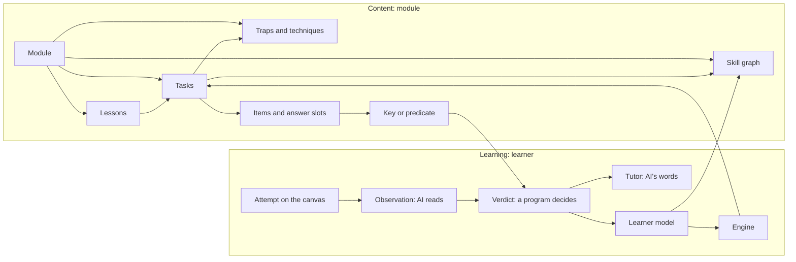
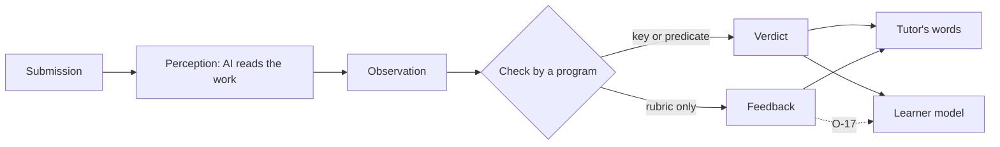

# NovaTrail — the platform's concepts

> Status: a draft for discussion, 2026-10-18.
>
> The platform's shared vocabulary: module, skill, lesson, task, canvas, check, tutor, learner model, engine. The document is descriptive. Field names and formats will appear later, in the schemas of `spec`, and will be checked against it.
>
> The reasons for all this are in [product.md](product.md), privacy and age in [privacy.md](privacy.md), the components in [architecture.md](architecture.md), the repositories in [repositories.md](repositories.md), the decisions in [decisions.md](decisions.md). The open questions referred to here live there: О-… in product 13, П-… in privacy 9, Т-… in repositories 8.

## 1. Why this document

- The platform is cut into repositories (R10). The engine, the service, the app and the module authors must understand one another, so they have one vocabulary.
- The concepts here do not depend on the subject. Each is tested on four dissimilar cases:
  - a child's olympiad maths, solved by hand;
  - an adult's Spanish A1;
  - physics on an interactive bench;
  - drawing, where there is no correct answer.

  A concept that works for only one of them lives in a module, not here.
- In code and schemas the terms are in English (R14); the correspondence is in the glossary (section 15). In the schemas of the format, field names and the values of enumerations are these terms in snake_case: `answer_slot` (R45). In the API contracts, too, and in their JSON (R83).
- The examples in section 16 are illustrations, not the format.

## 2. The map of concepts



A module brings the content: the skill graph, lessons, tasks, the trap and technique catalogs. The engine chooses a task by the learner model. The learner works on the canvas, the AI turns their work into an observation, and a program checks the observation against the key and gives a verdict. The verdict goes into the learner model, and the tutor finds the words.

## 3. Module

A **module** is a versioned set of content by one author: everything the platform needs to teach a subject or a part of it. Examples: "Olympiad Maths 1–6", "Spanish A1", "Optics, Grade 8".

- **Identifier and namespace.** Each publisher has its own namespace. The official modules are published by the project, third-party ones by their authors. A module's identifier and the IDs of its skills lie in the publisher's namespace, so two authors will not collide by names.
  - The module ID is `<publisher>/<name>`: `novatrail/olympiad-math`.
  - A skill, a task, a trap, a technique and a lesson are named by a local ID — `counting-gaps`. It is unique among its kind within the module, and the module refers to its parts by it.
  - Outside the module, a part is named by its full ID — the module, the kind and the local ID: `novatrail/olympiad-math/skill/counting-gaps`. By it the learner model, the engine and the progress know it (R46).
  - An anchor skill of the shared taxonomy is not a part of a module and not in a publisher's namespace: it has its own ID, `core.<name>`, the same in a module and outside it (section 4; R50).
- **Version** — semver `X.Y.Z`, without pre-releases (R46). The version part is found by comparing the new version with each published one below it, withdrawn ones too, and the author may raise it higher, but not lower (R89). The rules of the comparison are the [format text](../format/README.md), section 27, since format version 0.3 (R101):
  - major — something of what the learner of the previous version had is gone or means something else: a record with a full ID is deleted — a skill, a task, a lesson, a trap or a technique —, the audience is narrowed, a skill no longer teaches an anchor skill, the check of a task that stayed has changed, for example its key. A module's move to a new format version is also a new version of the module: its module manifest has changed (R44), and while the format is v0, this version is major;
  - minor — everything earlier is in place and means the same, and the module gives more or leads differently; patch — the same records, checks and path, other words or pictures;
  - in 0.y.z, y plays the major part, and z the minor and the patch, as in Cargo; in 0.0.z each version is a major of its own;
  - retiring a skill carries a table of correspondence of old IDs to new ones, so that the learner's progress does not break: the retired skills of the skill graph, `retired_skills`, and the skills that replaced them (R49);
  - a published ID of a skill, a task, a lesson, a trap or a technique never names another record of its kind: a new meaning is a new ID;
  - a band of a published version stands in the new one at the same place and with the same ID, and a new band only after the last; a band's grades may change, and a band's ID names no other band. Otherwise the learner's earlier evidence would fall on another scale (the 2026-11-02 amendment to R89).
- **Manifest:**
  - the identifier, the version, the title, the subject;
  - the audience: which age categories the module suits (section 13), and for a module for school grades also its grades, `audience.grades` (R49). The module manifest v0 names no presentation style: it follows the learner's age, and it can be chosen separately (R41; privacy 3.3). What a module may say about it is О-23;
  - the languages: the explanation language — a module has one (R46) — and, for language modules, the target language;
  - the authors and the license of the content — an SPDX identifier: for official modules `Apache-2.0` (R20), for third-party ones О-10;
  - the module format version — MAJOR.MINOR. By it the module is checked, built and run, and a new format version does not change it until the author moves the module to it (R44). In the module manifest this is the field `module_format_version` (R46);
  - the dependencies — the anchor skills of the shared taxonomy that the module's skills rest on, `dependencies`: exactly those that its skill graph names as prerequisites (section 4; R50);
  - the difficulty bands — the module's scale of difficulty, in order, for a module with grades with the grades of each band (section 6; R51);
  - the digit height on a crop — a setting of the module's canvas (section 8; R51);
  - the rung templates — two fallback texts of the hint ladder in the module's explanation language; a module that has an item with a verdict cannot do without them (section 10; R57).
- **Contents:** the skill graph, lessons, tasks, the trap and technique catalogs, the solving steps, the canvas settings, media files (pictures, sound), optional widgets and an eval set.
- **Layout.** A module is a folder: the module manifest `manifest.yaml`, the files of the parts, media files in `media/`, the eval set in `eval/`, the license text in `LICENSE` and the license notices in `NOTICE`. A part that a module has one of is a file at the root, named by its term: the skill graph `skill-graph.yaml`, the trap and technique catalogs `traps.yaml` and `techniques.yaml`, the solving steps `solving-steps.yaml`. Parts of one kind, of which there are many — tasks and lessons —, have a file each, named by its ID: tasks `tasks/<id>.yaml`, lessons `lessons/<id>.yaml` ([format text](../format/README.md), section 10; R46, R51, R57, R58). Every module has `LICENSE` (R62).
- **Package.** At a release `module-kit` builds the module into a module package. The server part is the canonical view: the module as one JSON object, with the tier of each skill and the numbers of each instance of a template. The device part is `LICENSE`, `NOTICE` and the media files. The package inventory names both parts by their digests, and the package digest is the digest of the inventory: an attempt keeps it. The package depends only on the module's files and the format version of its module manifest ([format text](../format/README.md), section 25; R62).
- **A module's eval set** — samples of work on which it is checked that the AI reads work in this module correctly. These are synthetic samples or samples that adult volunteers and authors made for eval. Learners' work — children's and adults' — does not go into a module: a module is published under an open license, and it cannot be recalled. Learners' work from `app` is not taken into eval: child samples are made only by a session of the samples page, by a separate form of the parent, and are kept outside the repositories, in the operator's bucket, 2 years from the session (R125; R15). The eval set does not go into the module package (R62). A sample of the set is each file of `eval/` whose name ends in `.json`, with markup, on a task of its own module; which file is a sample and what is in it is said by the eval protocol, not by the format (R95; [contracts text](../contracts/README.md), section 13).
- **A module gives data, not instructions to a model (R02):**
  - a module's fields are typed and checked by a schema;
  - the prompts belong to the platform: one per AI capability, each with its own eval set, and the analysis of the course of solution and the hint have one prompt for both (section 10);
  - a module's free text — a task statement, a trap advice, a solution — reaches the model only as a separate marked block of data, which cannot change its task. That is how notes about the child were passed in standalone (R16 standalone).

  Hence the difference from Claude's skills. A Claude skill is instructions that the model carries out as it understood them. The platform runs a NovaTrail module the same way on the same input (R03).
- **Official and third-party modules.** Who publishes third-party modules and how is О-9.

## 4. Skill and skill graph

A **skill** is what a module teaches and what can be assessed in a learner. Examples: "gaps and posts", "ser and estar", "the law of refraction", "hatching".

- **A skill has:** an ID, a title, a description, a tier, prerequisites, an assessability and the anchor skills it teaches. A module's skill graph is the file `skill-graph.yaml`, and the skills in it are named by local IDs (R49).
- **The skill graph** is a directed graph without cycles: "to take on B, you need A". The platform checks it for cycles at publication, as standalone checked the links `builds_on` at start, — this is the format rule `skill-graph.acyclic` (R49).
- **A tier** is a group of skills of one difficulty in a module.
  - In MathTrail there are three tiers: «основы», «правила» and «сложные задачи»; in the prototype they are called Basics, Rules and Hard tasks.
  - A topic's tier there was not set by the author: it was computed by the longest chain of base topics under it (SPEC 8.12.2 standalone).
  - In NovaTrail a tier is computed too: a skill's tier is 1 plus the longest chain of the module's prerequisites under it, and there is no limit to the number of tiers. The author gives the tiers their names, and a tier without a name is shown by its number. `module-kit` computes the tiers when it builds the package and puts them into its canonical view, and `api` carries them to the skill map (R49; R62; О-18 resolved).
- **References between modules.**
  - A physics module may need linear equations, but it does not refer to the internal IDs of another's module.
  - Only the skills of the **shared taxonomy** may be referred to — the platform-curated vocabulary of anchor skills (R50). Then renaming a skill in another's module breaks nothing.
  - An anchor skill is a skill outside modules, with the ID `core.<name>`: `core.linear-equations`. A module's skill rests on it as a prerequisite and teaches it by the field `teaches`, and the module manifest lists the anchor skills that the module's skills rest on. The vocabulary is a schema of the format, and it changes by format versions (R44).
  - Whether the learner knows an anchor skill, the learner model decides by the skills that teach it, in the learner's modules (section 11), and gives one of three states — with the cause and the skills that teach it (R07 learner-model):
    - "knows" — "mastered" stands at least at one such skill, at any band and in any module where the learner has evidence or which is connected;
    - "does not know" — in the modules the engine gets — connected and suitable for the learner —, the skills with a verdict that teach it are not mastered or have no evidence yet;
    - "unknown" — there is nobody to teach it: no module that the engine gets teaches it, — or only skills without a verdict teach it.
  - "Unknown" does not block a lesson, and there is no separate check of an anchor skill: the anchor is checked by the learner's answers on the very skill that needs it (the 2026-11-11 amendment to R04 engine). A module that teaches an anchor skill is offered to the learner by `api`, not by the engine choice: from the modules of its index whose current version names the anchor in `teaches` and suits the learner by audience, except the connected ones (R63), — and it gives them on the skill map (R99). Whether to hold a lesson at "does not know" when there is no evidence yet, what happens to open skills when the knowing goes away, and how to break a cycle of prerequisites between modules where both sides are at "does not know" is a rule of the engine (R07 learner-model).
  - The format checks each module separately, so it does not see a cycle of prerequisites between modules through anchor skills.
- **Assessability** decides how the platform teaches a skill:

  | Assessability | What it is | Example |
  |---|---|---|
  | verdict | a program checks the skill's tasks: by a key — the answer has one correct value — or by a predicate — there are many correct answers, and the program checks the predicate | 21 posts; "any number that is divisible by 3 and by 4" |
  | rubric | an assessment by the author's criteria — only feedback, not a verdict (R04) | perspective in a drawing, pronunciation |
  | none | the skill is practised but not assessed | free drawing |

  In the format these are the values `verdict`, `rubric` and `none` (R49). For skills with a rubric and without assessment the engine does not adapt to the learner: the order is set by the author — by the skill graph and the order of a lesson's segments, and where the graph gives no order, a rule of the engine chooses without the learner model (section 5; R58). Assessability matches how the skill's items are checked: the primary skill of an item with a key or a predicate is `verdict`, of an item with a rubric `rubric`, and a skill `none` is only ever supporting (the format rule `task.assessability`; R56).
- **Opening a skill and access to content.**
  - A skill opens by its prerequisites, not by grade or age. Grade or age sets only the starting point, as in standalone: «The grade decides one thing: where the child starts» (О-56 standalone).
  - Separately from this, a module may mark content as unsuitable for an age category. This is access to content, not the order of learning. In the format, the task's age categories, `age_categories`: there are fewer of them than the module's, and only learners of those categories get the task (R51).

## 5. Lesson

A **lesson** is a sequence that the author composed: an explanation, a worked example, tasks and sometimes a check at the end. The promise of "interactive lessons" is about this. In a module a lesson is the file `lessons/<id>.yaml` ([format text](../format/README.md), section 21; R58).

- **A lesson's skills** are the skills of the module that it teaches. They are closed, like a task's skills (section 6): the app needs only the lesson's title, and the engine reads the skills. Each task of the lesson practises at least one of them as primary.
- **A lesson's segments** go in the author's order, and the engine does not reorder them. A segment is one of three:
  - an explanation — paragraphs and pictures, and from format 0.4 also numbered lists, `numbered_list`: texts in order, whose numbers the app draws (R111);
  - a worked example — a statement, a handwriting sheet and a demo: the parts of the example's solution that the learner opens one at a time (section 8). From format 0.4 an example may also stand on a workbook: lines with boxes, which the demo fills one by one (R111). An example is open: it is not a task of the module, and it has no key;
  - a task of the module by its ID. The next segment comes when the task has ended.

  There is no special segment of a check at the end: the check is the lesson's last tasks.
- **A lesson run** is a lesson of one learner on the package on which the lesson began. It is begun by the app's request for a lesson that the engine chose, and leaving for another task does not end it. An open run is one per learner and lesson, on all devices, and each run has its own ID: a new run of the same lesson on the same package is another one. A task's segment has ended when its attempt is closed by a correct answer or by the solution shown, and for a task with a rubric by the learner's "Done"; leaving and a time limit do not end it. A run ends "passed" — by the app's "lesson passed", when all task segments have ended —, "unchecked", "not suitable" and "abandoned" — 30 days without actions —, and "early" — if the detailing of the engine introduces it. The place among the explanations and examples and the state of the demo are held by the app, and the server does not know them (R13 api; R06 app).
- **The order of lessons** is set by the skill graph, and the author does not write it separately (О-19 resolved: R58). A lesson comes after the lessons that teach the prerequisites of its skills. In a sequential module the graph is a chain: the module has at least two skills, and each stands in a tier of its own, so that one chain of prerequisites passes through all of them (the 2026-11-02 amendment to R58). The label "sequential", like *Sequential* in the prototype, the app derives from the tiers, `skill_tiers`. Where the graph gives no order — two lessons of one skill, skills without a link —, a rule of the engine chooses.
- **Adaptation.** Which lesson or task to give next the engine decides by the learner model (section 12). In a lesson whose skills are not all with a verdict, the engine adds nothing and skips nothing: the lesson goes in the author's order, without adaptation. Whether the engine adds practice to a lesson with a verdict and ends it earlier is decided by its detailing (architecture 3.8).
- **Age.** A lesson is given only to a learner whom both the lesson and each of its tasks suit (section 13). A lesson that no learner will get is an error of the module.
- Tasks live outside lessons too: the engine may give a task for practice without an explanation.
- The leak check looks for the answer of each task of the lesson in all its texts, after the task too: the lesson's open view goes to the app whole (section 10; R05).

## 6. Task

A **task** is what the learner solves and what the platform can check or comment on.

- **The task statement** is what the learner sees: text and pictures. A picture has a description for a screen reader and a size. The statement is a part of the author's template, which the learner does not erase (section 8), and whether it is above the canvas or on it is decided by the canvas kind: a handwriting sheet shows it above the sheet. There is no sound and no formulas in a statement of format v0 (R51).
- **Items.** A task is one item or a set.
  - A sheet with ten examples on fractions is one task of ten items.
  - Each item has its own area on the canvas, its own answer slots, its own skills and its own state: not begun, begun, checked.
  - An item's verdict is made up of the verdicts of its answer slots, and the task's outcome of the items (section 9.1; R56).
  - An item is named by its place in the task, from 1. On a handwriting sheet an item has answer slots, and on a workbook an item is a line: pieces of text and boxes in order, "7 × [ ] = 56" (R51).
- **An answer slot and its slot binding** — where the learner gives the answer:
  - in a zone — a set-aside place on the sheet;
  - anywhere on the sheet: the AI finds the final answer, as in canvas-api (R61 canvas-api), and if there are several final answers, the learner is asked to circle theirs;
  - in the state of a widget — for example, the position of a lens or the reading of an ammeter;
  - by edits in the text of the statement — on a text canvas: cross out, insert, rearrange;
  - by keyboard input or by the choice of an option;
  - the whole sheet — the work as a whole, like an essay.

  The module sets the slot binding for each answer slot. This removes the dispute "an Answer field or a free sheet" between the prototype and MathTrail Canvas. In format v0: anywhere on the sheet, the whole sheet, a zone, a box of a workbook and the choice of an option; a zone is a rectangle in units of the sheet. An answer slot "anywhere" or "the whole sheet" is the only one in its task. Keyboard input, editing and the state of a widget will come later (R51).
- **The slot check** — each answer slot has its own: a **check kind** and its parameters — a key, a predicate or the criteria of a rubric (section 9.2). The app does not get it before the task is solved (R05; R56).
- **A task's skills** are of two kinds:
  - primary — the task practises them, and an error in it is evidence against them;
  - supporting — needed for the solution, but an error does not lower them: a wrong answer in optics does not lower the assessment of algebra. A supporting skill may also be an anchor skill: linear equations in a task on optics (section 4; R51).

  An item may have skills of its own too: they replace the task's skills for it.
- **Traps** — which typical errors the task catches and by what sign. Both come from the module's trap catalog (section 7):
  - by a wrong value — such a trap is determined by a program. The trap value stands in the slot check of its answer slot and is compared by it, like a key; it may carry a trap text — what the learner will read at this error (R57);
  - by the kind of error in the learner's solution — such a trap is suggested by the AI, and its provenance is "derived by AI" (section 9.4). Which traps the AI may suggest the task lists itself (R57).
- **Techniques** — which technique helps here, from the module's technique catalog. A task's techniques are closed: the title of a technique hints at the way of solving. The app gets a technique from `api` at the step that gives it, or at the learner's request (section 10; R57).
- **Givens and unknown** — blanks for the step "understand"; in the prototype these are the chips «We know» and «We need to find». They are open: they retell the statement and do not hint at the way (R57).
- **Hints:**
  - a ladder from a general question to a specific one and to a simpler case;
  - the author's fallback texts — for when the model's question did not come or did not pass the checks (section 10): the trap text at a trap value and the simpler case at an item (R57);
  - leak phrases — by them the leak check recognizes the answer in a text that the learner will see (section 10; R57).
- **The solution** is shown after a correct answer or on request, by the solution shown, which closes the attempt: to a child from the fourth wrong answer, to a learner of the category `adult` from the start of the attempt (section 10; R82). Before that neither the solution nor the key goes to the device (R05). In a task it is texts and pictures, like the statement; it is closed and required in a task that has an item with a verdict (R57). In a task with a rubric, the solution, if there is one, and the criteria come after the learner's "Done" (the second 2026-11-02 amendment to R05).
- **Difficulty** — on the module's scale: a task names a difficulty band and a difficulty from 1 to 5 within it, as in standalone (R51).
- **The solving steps** and the exit condition of each step are the module's, section 7.
- **The provenance** of the key, the skill tags and the traps is section 9.4. In a module everything is from the author.
- **File.** A task is the module's file `tasks/<id>.yaml`, named by its ID ([format text](../format/README.md), section 14; R51).
- **Template.** A task may be a template with parameters: then each attempt gets one of its instances, with numbers from the attempt's seed (section 9.3; R60).

A task without a deterministic check — a drawing, pronunciation, an essay — gets feedback, not a verdict (R04).

## 7. Trap, technique, solving steps

- **A trap** is a named typical error, shared by many tasks of a module. Examples: "counted the gaps instead of the posts", "mixed up ser and estar", "forgot to convert centimetres to metres".
  - A trap has: an ID, a description, the skills it belongs to, and an advice for the adult or the learner. In a module, the trap catalog `traps.yaml`, traps by local ID; it is closed as a whole (R05; R57).
  - A module's trap catalog is closed: a wrong answer becomes a diagnosis only if the traps can be counted, and free names of errors cannot be counted (SPEC 1.3 standalone).
  - Repeating traps are seen in the progress — in the prototype this is the block «Mistakes that repeat». A trap repeats when a program has found it in two closed attempts of the profile or more, by full ID; an attempt on a version withdrawn because of a wrong key counts no traps. The progress takes the trap's description and advice from the catalog of the version of the last of them (R99).
- **A technique** is a strategy of solving that can be named and that can be taught. Examples: "start with small numbers", "find the verb", "draw the forces".
  - The technique catalog is the module's, the file `techniques.yaml`: the title and description of each technique. It is open, like the skills in the skill map, and which techniques help in a task is closed (R57). In MathTrail's maths there are 11 of them, with numbers; there are no numbers in the catalog of format v0.
  - After a correct answer the tutor may ask which technique helped.
- **The solving steps** are the frame by which the tutor leads the learner within one task. The module sets them:

  | Subject | Steps |
  |---|---|
  | olympiad maths | understand → make a plan → solve → check (Pólya) |
  | physics | hypothesis → experiment → calculation → conclusion |
  | language | read → find the errors → correct → pronounce |

  - The step "pronounce" requires voice input and will appear together with it (О-6).
  - In a module, the file `solving-steps.yaml`: the steps in order, each with a title, from format 0.4 a description of how to go by it, what it gives and an exit condition (R108). The steps are open: the app leads them itself (R57).
  - A step may give blanks of the task: `givens` — "givens and unknown", `techniques` — its technique, which `api` gives when the step has begun (R57).
  - Each step has an exit condition: an event ("all the givens are ticked"), the state of a widget, a filled answer slot or nothing. In format v0, `givens_ticked`, the learner has ticked all the givens and the unknown; `answer_slots_filled`, there is something in each answer slot; `none`, when the learner goes on by themselves. The state of a widget will come with stage 4 (R57).
  - The exit condition opens the button "Step done", and it leads to the next step. In format v0 "Step done" does not read the work: the work is read by "Check" (the 2026-11-02 amendment to R69).
  - The solving mode "self" (in the prototype, Free solve) skips the steps: the tutor answers only when called.

## 8. Canvas

The **canvas** is the workplace of a task: what the learner sees and where they write, draw, type, move and speak. The module sets the canvas kind for each task.

**The layers**, from the bottom up:

1. **The author's template** — the task statement, the grid, pictures, sentences, items. The learner does not erase or change it. The canvas kind may also show the task statement above the canvas: so do the handwriting sheet and the workbook (R51; R34 canvas).
2. **The module's widget** — an interactive bench: an optical bench, an electric circuit, a number line.
3. **The demo** — an example or a demonstration that the author prepared for a lesson. In format v0 this is the demo of a worked example — on a sheet, and from format 0.4 also on a workbook, where it fills the boxes of the example's lines one by one (R111): the learner opens its parts one at a time and may hide the whole demo, and a picture in a sheet area stands on this layer, at the size of the area (section 5; R58). The learner does not write on an example's sheet.
4. **The learner's work** — strokes, text, drags, voice answers, changes of a widget.
5. **The tutor's layer** — the tutor's marks: boxes, numbers and short captions, — and a dotted sketch "how to begin".
   - The sketch is drawn under the learner's writing, the marks above it.
   - Neither changes or covers the learner's work (R05).
   - A mark is placed by a program (R03): from `api` it comes as a kind and a place together with the tutor's words it belongs to, and `app` writes its name for a screen reader (R97).

**Canvas kinds.** Each is code of the platform, shared by all modules:

| Kind | What it is | Example |
|---|---|---|
| handwriting sheet | a free sheet with squares, lines or dots | an olympiad task, a draft |
| workbook | items and answer slots that cannot be erased, on one page | ten examples on fractions |
| text | sentences and words: cross out, insert, rearrange, highlight, listen | finding errors in Spanish |
| sandbox | the module's widget and a place for calculations | an experiment with the refraction of light |
| creative | brushes, a palette, layers, pressure | a drawing from life |

In format v0 the canvas kinds are the handwriting sheet, `handwriting_sheet`, and the workbook, `workbook` (R51). A code canvas and a check by running the learner's program are О-20.

**The tools** are allowed by the task: a pen, an eraser, a ruler, a protractor, a calculator, a keyboard, a microphone. The eraser deletes a whole stroke: the tutor's marks are bound to the learner's strokes, and an erased half of a stroke would break them (canvas-api: R42, R43). In format v0 each task has a pen and an eraser, and the field of tools will come with the first module that needs it (R51).

**The digit height** is the height of the learner's digit or letter on the crop for checking, in px. It is a setting of the module's canvas in its module manifest; without it, 24 (the 2026-10-28 amendment to R51). So it is from format version 0.2, and in 0.1 without it it was 32 (R51; R08 tutor).

**The widget contract:**
- a widget declares the schema of its state and its events;
- a check may refer to the state of a widget (section 9);
- the version of a widget is fixed to an attempt, and randomness in it comes only from a seed, so that the attempt can be repeated. This is the widget's own seed, not the attempt's seed: the attempt's seed does not go to the device, and how the widget gets its own is decided by the widget protocol (R59; Т-24);
- where and how the code of another's widget runs is R16 (architecture 3.4).

**The learner's artifact** is work that is itself a result: a drawing, an essay or a recording. It belongs to the learner, it can be exported and deleted (privacy 4), and it is not "a picture for checking". Work on a task with a key — strokes, answers, the context of a submission — is not an artifact: it only needs to be checked, and the device erases it with the end of the attempt (П-9; R04 app).

**A stored work** is a work of a profile that the server keeps while the storage of the profile's works is on: any work, the handwriting on a task with a key as well as an essay or a drawing, as the device holds it — its writing history, the context of each submission and its picture, at most 4 MiB. `app` puts it by `PutWork`, and it is read back, erased one at a time and exported ([the contracts text](../contracts/README.md), section 15; R113, the 2026-11-13 amendment). Switching storage off erases every stored work; the work on the device stays as long as the device keeps it.

## 9. Checking

### 9.1. The cycle



- **Submission** — by a button. The work is read only by an action of the learner — by "Check". "Step done" in the solving mode "by steps" leads to the next step and in format v0 does not read the work (the 2026-11-02 amendment to R69). On a pause the tutor does not read it — only the button blinks (R69).
- **Perception** — the AI turns the learner's work into an observation. This is the only place where the AI takes part in checking (R03). Handwriting is read by two readers of one AI provider, without the key, and an answer slot that they read differently is ambiguous (R68). So it is for answer slots whose check gives a verdict, and a sheet under a rubric is read by one reader: a rubric has no verdict (the second 2026-11-01 amendment to R68; R75). A typed or chosen answer is not read by the AI: a program checks it at once.
- **The observation** is what the AI read in the work, answer slot by answer slot, before the check (R86). For each answer slot whose answer the AI reads:
  - the value, as it is written, — only if it is visible in the writing itself (R62 canvas-api), — or why there is no value: the answer slot is empty, the writing is illegible or ambiguous — so too with a digit written mirrored (R56), — and an answer slot "anywhere" has no final answer or has several;
  - the place: for an answer slot "anywhere", the box of the final answer in fractions of the crop, if the reader named it, and for a zone and a box of the workbook, the answer slot itself (R53).

  The writing parts, other readings and mirroring are the reader's affair: by them it decides what to give, and they are not in the observation. The observations of the two readers are joined into one by `module-kit`, by the slot check: an answer slot that they read differently is ambiguous (R68). A tapped choice is not read by the AI, and it is not in the observation: `api` gives the check the option the learner chose alongside. The learner sees what was read: "Read: 6".
- **The check** — a program compares the read value of each answer slot with its slot check: a key or a predicate. The model does not decide whether it is correct (R03). The reader gives the value as it is written, and `module-kit` brings it to the notation of the kind — normalizes it (section 9.2; R56). A value that got "not yet" the program compares in the same way with the trap values of the answer slot, and the one that matched names the trap (section 6; R57).
- **Verdicts** — as in R38 canvas-api:

  | Verdict | When | What the learner sees |
  |---|---|---|
  | correct, `correct` | the value matched the key or met the predicate | "Correct" and what was read |
  | not yet, `not_yet` | read confidently, by the form, and did not match | what was read, the place of the error and the tutor's question |
  | unreadable, `unreadable` | illegible, ambiguous — two readers read differently (R68), a digit written mirrored (R56), — not in notation; several final answers or none; the answer slot is empty | a request to rewrite or to circle — this is not an error |
  | unchecked, `unchecked` | an AI failure, the limit reached, the AI not admitted (Т-20); the predicate could not be computed | a neutral phrase — this is not an error |

  At any doubt, "unreadable", not "not yet" (R04). Why "unreadable" is said by the cause. For a value the format gives the cause: empty, `blank`, or the value is not in the notation of the kind, `notation` (R56). An observation without a value gives its own: empty, `blank`, illegible, `illegible`, ambiguous, `ambiguous`, no final answer, `no_final_answer`, or several final answers, `several_final_answers` (R86).
- **An item's verdict** comes from the verdicts of its answer slots: all correct — "correct"; at least one "not yet" — "not yet"; otherwise "unreadable", and if there is no such either, "unchecked". An answer slot read confidently and wrong is no longer a doubt, and the item will not become correct, whatever is in the others (R56).
- **The analysis of the course of solution** — after "not yet", by a separate call that sees the key and the task's solution (R67): the place of the first error in the learner's solution — a box in fractions of the crop — and a candidate trap, one of those that the task names for the AI (section 6; R57). This is an answer of `tutor` for the tutor's words, not an observation (R86).
- **Feedback** — where there is no deterministic check. The AI assesses the work by the author's criteria, and the learner sees it as feedback, not as a grade. Whether feedback affects the learner model is О-17. A submission with a rubric ends with feedback, "unreadable" — the sheet is empty or the essay cannot be read as a whole, and it does not reach the assessment, — or "unchecked". This is not a verdict: an item with a rubric has none, though "unreadable" and "unchecked" mean here the same as the verdicts of the same name. Feedback that did not pass the leak check or the rule of feedback is replaced by the app's phrase "no feedback this time", without a new call. The attempt is open for rewriting, and the learner's "Done" ends it (R87).

### 9.2. Check kinds

| Kind | Example | What the module sets |
|---|---|---|
| number | 21 posts | the value |
| fraction and form | 3/6 and 1/2 are equal, but the instruction "simplify" requires 1/2 | the value and the form rule separately; how numbers are written — the decimal comma, mixed numbers |
| quantity | 2.0·10⁸ m/s | the dimension, the allowed units and their conversion, the tolerance (absolute or relative), the significant figures, the sign |
| choice | option C | the options |
| text | "está" | the allowed variants; normalization: case, spaces, punctuation, whether accents matter |
| edit | correct the errors in a sentence | the required edits by place, partial credit, what counts as a new error |
| order and set | put events in order; name all the variants | whether order matters, whether completeness is needed |
| predicate | "any number that is divisible by 3 and by 4" | a predicate that a program computes |
| widget state | the ray after the lens passes through the focus | a predicate on the state of the widget |
| rubric | a drawing, pronunciation, an essay | the criteria; the outcome is feedback, not a verdict |

- A new check kind is code of the platform, shared by all modules: a module chooses the kind and sets its parameters (R02). This code lives in `module-kit` (R17).
- **The slot check** — each answer slot has its own: a kind and its parameters. It is closed as a whole, together with the kind: the app does not get it before the task is solved, and for a task with a rubric before "Done" (R05 and the second 2026-11-02 amendment to it). The criteria of a rubric or the signs that a box expects the author may name in the task statement (R56).
- **In format v0** the check kinds are those that the three modules of the first slice need, and the predicate (R56; [format text](../format/README.md), section 15):
  - `number`, number — an integer, a decimal fraction with a point or a common fraction; compared by value, exactly. Words of units after the number, `units`, the check drops;
  - `fraction`, fraction and form — a common fraction; the form rule `form` — any fraction of the same value or only an irreducible one;
  - `choice`, choice — by a tap from the options of an answer slot with the slot binding `choice`, or by hand: then the options are in the check itself, like the signs <, > and = in a box of the workbook;
  - `time`, time of day — the key `H:MM`, hours 0–23; correct when the hours and the minutes as numbers equal the key, so `07:30` is correct at `7:30`, and a time from 60 minutes, like `5:60`, is a wrong time, which may show a trap. A day has 24 hours: `19:30` is not `7:30` (R111);
  - `predicate`, predicate — a Starlark expression of the read integer `value`, with a limit of steps in the format. Solver programs for the keys of templates are section 9.3;
  - `rubric`, rubric — the criteria `criteria`, only on the whole sheet.

  Text, edit, quantity, order and set, widget state and "steps" — a check of each line of the course of solution (В10 `tutor`) — are not in v0. "Text" and "edit" are not checked by the first slice (R41), the modules of the slice take none of the others, and there are no widgets in it.
- **Normalization** is a part of a check kind: the read value is brought to the notation of the kind — NFKC, minuses and dashes, spaces, and for a choice also case, — and only then compared. What of it the module sets are the parameters of the kind: the units of a number, the form rule of a fraction. In MathTrail Canvas normalization knew only numbers and choice: NFKC, the sign "−" turned into "-", a word of a unit of measurement was dropped (spec 5.2 canvas-api).

### 9.3. Templates and generation

- A task may be a **template** with parameters — the field `template` ([format text](../format/README.md), section 23; R60). Each parameter has a domain, the integers from `from` to `to`. The template computes derived numbers from the parameters, and a constraint selects their combinations; both are expressions of a narrow subset of Starlark, which `spec` itself computes too. A combination that passes the constraint gives an **instance** — a task where numbers stand in place of the placeholders `{name}`.
- A template is enumerated whole: there are no more than 10,000 combinations, and `module-kit` builds each instance and checks it by all the rules of a task already when checking the module — the key, the trap values, the leak. An attempt gets one instance: its number is chosen by the platform's generator from the attempt's seed, from the place of randomness `template`, the task's ID, `instance` ([format text](../format/README.md), section 22; R59). On an attempt Starlark does not run, and the seed and the numbers that are not in the open fields of the instance do not go to the device.
- A template's key is a placeholder of a parameter, of a derived number or of a solver's result. A **solver** is a program in Starlark in the field `template.solver`, which computes the key by enumeration when there is no formula, like the solvers of standalone ([format text](../format/README.md), section 24; R61). Its function `solve` gets only the numbers of the open fields of the instance — it solves the task that the learner sees — and returns its results. The results stand only in the key, the trap values, the solution and the leak phrases, and everything that the learner sees before the solution `spec` builds without the solver. The budget is 100,000,000 steps for all the instances of a template, and only `module-kit` runs the solver, when checking the module. The predicate of a check is not a solver but an expression in the slot check itself (section 9.2; R56).
- A template is one task: a lesson names it as a task, and the learner model and the engine see one task, whichever instance falls. A page of a workbook of independent lines cannot be described by a template v0 — it has too many combinations; parameters of an item will come later (RUN.md, T38).
- Tasks are generated with the help of AI only when a module is prepared, and the author checks them. There is no generation on the fly, as there was in standalone. О-12 is resolved (R60).

### 9.4. Provenance

A task, a key, skill tags and traps have a **provenance**:

| Provenance | Example |
|---|---|
| from the author | the key of a task in a module |
| checked by a solver | the key of an instance of a template is computed by a program: by a template expression (R60) or by the template's solver (R61) |
| entered by an adult | a key from the answers at the end of a textbook for a task from paper |
| derived by AI | the AI itself tagged the skills of a task from paper, solved it itself or itself suggested a trap by the learner's course of solution |
| none | there is no key at all |

The provenance decides:
- **whether a verdict is possible.** Both "correct" and "not yet" are given only with a key or a predicate from the author, a solver or an adult. With a key derived by AI there is no verdict and the answer is not assessed: otherwise it would be a verdict of the model, which R04 rejects. One can only show the solution, marked "derived by AI", and not to a child (О-11);
- **the weight of the evidence** for the learner model. A task from paper that the AI itself tagged and solved does not move the rating, and with an adult's key it moves it only when it has a band and a difficulty on the module's scale and skills not from the AI (О-11; R06 learner-model). A trap by a wrong value is found by a program, and it weighs as a verdict. A trap that the AI suggested by the learner's course of solution — a candidate trap of the analysis — is needed by the tutor for words, and it does not go into the learner model: evidence carries only the traps that a program found (R82; R06 learner-model). Whether the choice of a task needs it together with the last attempt (section 12) is decided by the detailing of `engine`;
- **what is shown.** A solution derived by AI is marked so.

Only so does the deterministic core (R03) withstand photos from paper, rubrics and widgets.

In a module everything is from the author, and a task has no field of provenance: a template's key is computed by a program, and this is seen from the template itself (section 9.3; R60), and "entered by an adult" and "derived by AI" occur only in tasks from paper (R51).

## 10. Tutor

- **The AI has two roles:**
  - perception — it reads the work (section 9);
  - words — hints, explanations, praise, a question.

  The tutor makes no decisions: a program gives the verdict, the engine chooses the next task (R03).
- **The rules of a hint** — from product 5.4 canvas-api:
  - do not name the answer;
  - one question, no more than two short sentences, words by age;
  - point to a place in the learner's work;
  - begin with what has already worked out;
  - talk only about the task.

  A program checks the form of a hint — "Form check" below (R70).
- **The learner's gender** is not given away by the tutor's words — neither a hint, nor praise, nor an explanation, nor feedback. The model does not know it, and in languages where the form of a word gives away gender, the words are in forms without gender: «здесь всё верно», not «ты верно нашёл». A program does not check this: an item on gender in the eval set of each AI capability that writes words to the learner checks it (R70).
- **The hint ladder** — by the number of wrong answers on a task:
  1. a general question about the place of the error;
  2. a question about the rule or the trap;
  3. a simpler case.

  A program chooses the rung by the number of wrong answers, and the tutor only finds the words for it (R03). A wrong answer is a submission where at least one answer slot got "not yet"; "unreadable" and "unchecked" give no rung (R04). The rung, its words and the fallback text speak of one answer slot — the first answer slot "not yet" in order in the submission that gave the rung: items by place, answer slots by order in the item (R82). The ladder is per task, not per item: on a page of a workbook four submissions with an error offer to show the solution of the whole page.
- **After the third rung** there is no new one. From the fourth wrong answer the program offers a child to call an adult or to show the solution, and an adult learner to show the solution. A learner of the category `adult` may show the solution from the start of the attempt too. For a child, with the adult's setting "ask before showing", on by default, the adult shows the solution. Showing closes the attempt with the outcome "solution shown" (section 11; R82).
- **A hint on request** sends no work for reading (R69) and raises no rung (R82):
  - before the first wrong answer — "givens and unknown" and the task's technique, without AI, and from format 0.4 also the task's leading question, when it has one: the author's question that breaks the task down. It is closed, like a technique, and whether the learner got it the evidence carries in a field of its own, separately from the technique on request (R108; the 2026-11-08 and 2026-11-09 amendments to R82). There is no sketch "how to begin" in format v0 (R57);
  - after a wrong answer — the words of the current rung once more, without AI;
  - "explain differently" — the same rung in other words: one AI call per rung, without the work, with the previous questions of the same task (privacy 4). In the mode without AI there is none.
- **The correct answer words** are the praise of a step and the question which technique helped. This is a call of `tutor` of its own — with the work, the key and the task's solution and its techniques — and a form rule of its own beside the rule of a hint, not a rung of the ladder: these words have a form of their own (RUN.md, Д188). Their AI capability is their own, `correct_answer_words`, with its own eval set, and it is open, like the hint, to all age categories (the 2026-11-11 amendment to R96). `app` asks `api` for them after the verdict "correct" (R97).
- **Fallback texts.** If the model's question did not come or did not pass the checks — of a leak or of the form —, the learner gets a fallback text (R24 canvas-api; R57; R70):
  - on rungs 1–2 — the trap text that the author wrote for this wrong value; without it, the trap advice from the catalog, and without an advice, the rung template;
  - on the third rung — the simpler case from the author, and without it, the same as on the second.

  The rung templates are the module's, in its module manifest and in its explanation language: the platform need not translate them into the language of each module (R57).
- **The leak check.** A program looks in the model's text for the keys and the leak phrases that the author named (R24 canvas-api). This is a safeguard, not a proof. The author's texts that the learner sees before the solution pass the same check when the module is checked (R17). How it searches is said normatively by the [format text](../format/README.md), section 20 (R57):
  - a key is searched for as a separate token, and a number by its value: `7` will not be found in `17`, and `0.5` will be found in `1/2`;
  - a key that already stands in the statement or in the text, the line and the options of its item — "2 legs" in a task about rabbits — is not searched for: there the author's leak phrases hold the answer. In this the format departs from R24 canvas-api, where the key is always forbidden;
  - numbers in words and notations that the check does not read as a number are caught only by leak phrases.

  False leaks — a question that repeats a correct line of the learner or takes the number of the key in a simpler case — are held by the prompt and the fallback text, and the check stays strict (the 2026-10-28 amendment to R57).
- **The form check.** A hint is exactly one question, no more than two sentences, the letters of the explanation language and a limit of words by language: 30 in Russian, 35 in English, and in a language that the measurement did not measure, no limit. Feedback by a rubric is no more than three sentences and 80 words in English, and a stretch in quotation marks of four words or more is only the learner's words: feedback does not write the work for them (R05). `api` checks it together with the leak, by the code of `tutor` (R70).
- **The prompts are the platform's.** Each AI capability has its own prompt: handwriting reading, text reading, the analysis of the course of solution, assessment by a rubric, the hint, the correct answer words, voice. Each has an eval set. The analysis of the course of solution and the hint are two AI capabilities, each with its own eval set, but they have one call (architecture 4.1), and they also have one prompt, which both eval sets measure (R59 tutor). The module gives data — traps, techniques, the solution, the criteria of a rubric — as a separate marked block (R02).
- **The persona** is a friend in the prototype: a fox, a robot, an owl, a cat, a dinosaur or someone the child drew. It changes the tone and the voice, but not the content. A persona for adults is О-13.
- **Voice** — the tutor's voicing and the learner's voice input. Voice input is О-6 and П-5. The AI capability "voice" is so far one, and both sides are in it: the input, which depends on the age category (privacy 3.2), and the voicing, which is output, not data collection, as long as the text does not leave the device (privacy 6). While the AI capability is one, the admission function has nothing to tell them apart by. Whether to split it is at stage 3, by the eval sets of voice (R56 tutor; Т-13).
- **The solving modes:**
  - "by steps" — the app leads by the module's solving steps, and the tutor speaks at each step: before the submission, by the step's title, by what the step gives and by a line of the app, without AI (R05 app);
  - "self" — the tutor waits until called, and answers a request as in "A hint on request" above (R82).

  The default solving mode is set by the adult on the learner's profile, for a new profile "by steps", and it is kept on the server (privacy 4). The learner switches the solving mode on the task screen: the choice holds to the end of the attempt, on the device, and does not change the default (R05 app). The solving mode is not a part of the presentation style: the style follows age, and the solving mode does not depend on age. The solving mode does not go to the AI (О-23).
- **What the model gets:**
  - the work — a picture, a crop, a text or a sound;
  - the data of the task and of the observation needed for the words;
  - of the presentation style, only what changes the words, so as to speak by age. Voicing does not change the words and does not go to the model (section 13; privacy 4).

  What the platform never passes to it: identifiers, the pseudonym, the learner's name and the adult's data. But the picture may hold anything the learner wrote themselves, the name included (privacy 1).

## 11. Learner model

The **learner model** is what the platform knows about how the learner masters the skills in all connected modules. A learner has one model. Its visible part is the **skill map**.

- **The state of a skill:** the estimate of mastery, the uncertainty of this estimate, the number of pieces of evidence, the time of the last practice, the stability — how long the skill holds without practice, — the traps that the program found, with the number of pieces of evidence and the time of the last — which of them are frequent the reader decides, — "mastered" — with the mastery band — or not (R06 learner-model).
- **Evidence** is the outcome of an attempt, not only "correct" and "wrong":
  - from the first submission;
  - after hint number k;
  - with a sketch hint;
  - solution shown;
  - left unfinished — the learner left the task by beginning another, or abandoned it, and there were wrong answers in it (R82), — and likewise an attempt of a lesson that the run end "not suitable" closed (the third 2026-11-02 amendment to R80);
  - unchecked.

  An attempt that was left, that was abandoned or that the lesson end "not suitable" closed gives no evidence without wrong answers, nor does an attempt of a task with a rubric, however it was closed, "Done" too (О-17; the 2026-11-02 amendments to R80). A request for a hint and "explain differently" do not change the outcome. Beyond the outcome, evidence carries the traps that the program found, for each item — whether it was submitted, the first verdict and the number of wrong answers before it and the verdict at the end, — the items correct to the end too, the task's technique — at a step or on request — and, from format 0.4, the leading question on request (the 2026-11-08 amendment to R82), how many times the learner asked "explain differently" and whether the solution of this task — not of the template — went to their device earlier, after a correct answer or the solution shown. That the learner saw "givens and unknown" is not recorded: they are open, because they do not hint at the way (R57). Evidence carries no segment of a lesson. The weights of the outcome and of each fact are `learner-model`'s (R82 and the 2026-11-02 amendment to it; R08 learner-model).

  The weight of evidence depends on the outcome and on the provenance of the key (section 9.4). The items of one attempt weigh less than their sum: ten fractions in five minutes are not ten independent pieces of evidence (R06 learner-model). Feedback by a rubric is О-17.
- **The level is per module, not per subject and not for the whole model.** Each of the learner's modules has its own level, on the scale of the bands of that module: each module has its own scale (R51), and neither maths and Spanish nor the two maths modules of the first slice add up (R41). Links between modules are carried only by prerequisites through anchor skills, not by the level (section 4; R03 learner-model).
- **An anchor skill** of the shared taxonomy the model knows by its ID — `core.multiplication-table`, — not by a full one: it belongs to no module. Whether the learner knows it the model decides by the skills that teach it, in the learner's modules, and gives "knows", "does not know" or "unknown", with the cause and the skills that teach it; forgetting does not take the knowing away (section 4; R50; R07 learner-model).
- **The primary and supporting skills** of a task are section 6.
- **The starting point:**
  - a trial series — in standalone these are the first five answers;
  - an initial estimate — by grade: the learner starts in the difficulty band to which the module manifest assigns their grade (R51); by age, by self-assessment — for example, a CEFR level in a language module — or by a short check.
- **"Mastered"** is a cautious estimate that takes the uncertainty into account. It is set by evidence without a failure where the skill has a correct answer without help — without a rung of the ladder before the item's first verdict, without a technique on request and not in a task whose solution has already gone to the device, — and the sum of the weights of its answers is no less than five, and it is lost after two failures in a row — pieces of evidence where fewer than half of the skill's answers are correct (R187 standalone; R06 learner-model). It is set at the mastery band — the highest of the bands where the skill is taught at which the cautious estimate holds the threshold "mastered" on an average task of the band, — and it does not move down. The threshold is a constant of `learner-model`, tied to the target of the engine's corridor (the 2026-11-02 amendment to R23; R03 learner-model). Time does not take "mastered" away (R04 learner-model).
- **Forgetting and repetition.** Without practice it is not the estimate itself that fades but the skill's retention, and with it the probability of a correct answer and the cautious probability of a mastered skill. Spaced practice grows the skill's stability, and forgetting slows down, while practice in a row hardly grows it. The module's level forgets after a pause: when evidence comes at least 14 days after the last practice of any of the module's skills, the weight of the module's answers, if above 20, falls to 20 before the step, so the answers after the break move the level more and every skill of the module is less certain; without evidence nothing changes (the 2026-11-13 amendments to R04 learner-model). Time does not take "mastered" away: the model gives a review date — the moment when the cautious probability with retention falls below the threshold "mastered", — and by it the engine brings the skill back for repetition (section 12; R04 learner-model). For words and grammar this is a must; in standalone there was no forgetting.
- **Guessing** depends on the kind of answer: 1/k at a choice from k options — by a tap or by hand, — about zero at a free answer. It is computed for an item, by its answer slots: an item is correct only when each answer slot is correct (section 6; R56), and to guess it is to guess each one. In standalone it was hard-coded as 0.2 for five options; the numbers are `learner-model`'s (R03 learner-model).
- **The starting model** is the Rasch model with a guessing floor and an Elo update from standalone: a general level plus a correction for the topic, a trial series, a cautious "mastered". The differences are the level per module and forgetting. The success corridor from the same standalone is a rule of the engine, not of the model: the model gives the probability of a correct answer (section 12; R23).
  - The algorithms are the business of the library learner-model (repositories 2).
  - The model is changed only if a new variant has passed the learner simulator by a criterion recorded before the first run (R163 standalone).
- **The display** — the skill map, ratings, ranks, "strengths", "what to develop" — is derived from the model. A task with a rubric does not go into the model (О-17): the adult's progress reads "what to develop" for it from the marks of the criteria of its closed attempts (R87; П-19). Neither affects the model back.

## 12. Engine

The **engine** chooses what comes next: a lesson or a task — for a new skill, consolidation, repetition, a probe, — and when there is nothing to give, it says that too (R99). It does not choose an item within a task: the items are a part of the task, and the check, the evidence and the solution belong to the task as a whole (R104). It works by a rule, without AI; randomness comes only from a seed (R03). The rule of `engine` does not need it: it breaks every tie by the order of the graph or by ID, and it has no seed of choice (R107). Should a new version of the engine need it, it will have its own seed of choice and its own places of randomness, and the generator is shared (R27; R59).

- **Inputs:**
  - the learner model and the skill graphs of the connected modules;
  - the lessons and the pool of tasks: the lesson's skills and its segments, and the order of lessons by the skill graph (section 5; R58). `api` sets the pool and the lessons. When the AI that the check needs is closed to the learner — by a quota, by admission or by the AI provider's refusal by a limit —, the pool holds only tasks that are checked without AI: each of their answer slots is chosen by a tap ([format text](../format/README.md), section 14; architecture 4.2). The lessons are then only of such tasks, and the pool may be empty. The engine does not know the cause, and the choice keeps whether the pool was so limited (architecture 1; В14 `api`; R11 api). Also the lesson runs of the profile: the lesson, its skills, the run end reason — an open run has none — and the time of the end; the rule does not read the places of ended segments (section 5; R13 api; R09 engine). The engine is not called within a lesson: it is called when the run has ended and when the learner asks for something else. And the attempts of tasks with a rubric closed by "Done" — the task and the time of closing, without the marks: feedback does not go into the model (О-17), but the engine has to keep the author's order for skills with a rubric, and the rule does not read other close reasons (section 4; В15 and В18 `api`; R09 engine);
  - the last attempt and its trap;
  - a summary of issues from `api` — from the records of choices and attempts that it keeps anyway: for a skill, the time of the last issue, and the issue of a lesson is the issue of each of its skills, and, if the last closed attempt of the skill was a probe or a repetition, its result on the skill — as facts: how many items where the skill is primary got a first verdict, at how many of them it is "correct" and whether the solution was shown; for a module, the number of choices, of a task and of a lesson one each; for a task, when its solution last went to the device (R82). By it the rule keeps the queue "not issued for the longest", the turn of the probe and of repetition, the return of a skill from a pause by a correct answer of a probe or a repetition, and the pause before a task with a seen solution: the time of practice from the learner model is not the time of issue (R104). "Failure" and "correct" by these facts are computed by the engine, by its own rule, not by `api` (R107);
  - the learner's interests — for the setting of a task;
  - the time: it comes from outside, the engine does not take it itself, and the choice itself keeps the time of the choice, so as to be repeated by the log (architecture 1, 3.8). The engine needs no seed (R107);
  - the mode:
    - the engine leads — "My subjects" in the prototype;
    - the learner chose a skill on the skill map. The choice holds until the learner asks for something else: the record of the choice keeps the skill and carries it into the next one, and `api` calls the engine with it both for `next` and at the end of a lesson run (R107);
    - a task from paper.

  The age category is not an input of the engine but a filter of `api`: `api` has already selected the modules, the lessons and the pool of tasks by `age_categories`, and the engine gets only what suits the learner, like the lessons and tasks that `api` begins ([contracts text](../contracts/README.md), section 15; R07 api). There is no daily goal among the inputs: it is neither in the profile nor in the contract, only in the prototype, and the input will come when the product says what it means and where it is kept (R107).
- **Output:** what to give and the **reason code** — why it is given. The list of codes is a contract in `spec` (R29), closed and without parameters (R100):
  - consolidation: after an error, another task on the same skill, while it is within reach;
  - a new skill: it has not been issued yet, and its prerequisites are counted by the rule of the engine or it has none;
  - the queue: of the reachable unmastered skills that have already been issued, the one that has not been issued for the longest in its module;
  - repetition: a mastered skill's review date has come;
  - a probe: a deferred skill has come back as a check;
  - the learner chose the skill on the skill map, and the engine the lesson or task on it;
  - the author's order: a skill with a rubric or without assessment comes next by the skill graph, without the learner model (section 4);
  - the lesson of an open run: the learner continues it;
  - in rotation: a skill already issued earlier comes again in rotation — first the one not issued for the longest, — though it does not fit the queue: it is mastered or no skill is reachable (R107).

  A choice has one code — of the branch of the rule that made it, for a lesson as for a task. A skill chosen by the learner on the map is always "the learner chose the skill", and the lesson of an open run is always "the lesson of an open run", whatever else fits them. An adult sees the cause — in progress, at the attempt, — and a child is not told it (as in standalone): the code does not go in the answer to the learner. The words for the adult are `app`'s. A branch of the rule that is not in the list comes as a new code, and the meaning of the earlier ones does not change ([contracts text](../contracts/README.md), section 15). The choice comes to the app with its own ID, by which it opens the lesson or begins an attempt, — the choice itself begins nothing, — and when there is nothing to give, "nothing to give" comes, without a code (R99).
- **The top-level rules.**
  - From the rule of standalone (SPEC 3 standalone):
    - the success corridor: the learner solves the task with a probability from 0.70 to 0.85, aiming at 0.775;
    - consolidation: after an error, another task on the same skill, if it is within reach;
    - probes: a deferred skill now and then comes back as a check;
    - the queue: of the reachable unmastered skills, the one that has not been issued for the longest comes first;
    - the learner's frequent traps: a task that catches them;
    - interests: the setting of a task to the learner's interests, if the module gives such variants. They are not in format v0: they will come with a minor version (R51).
  - New in NovaTrail:
    - prerequisites: a skill is offered when its prerequisites are mastered. The rule of standalone did not read the links between topics;
    - repetition of the mastered: a skill comes back when its review date comes: without practice the skill's retention fades, and the cautious probability of solving a task of its mastery band falls below the threshold "mastered" (section 11). The model gives the date, and when to give a skill whose review date has come, how many repetitions a day and how they share the queue the engine decides (R04 learner-model). R06 engine decided: repetition is a task on a mastered skill whose review date has come, on the module's turn of repetition, once in three of its choices, and when the other branches have nothing to give, also outside the turn (R107). In standalone there was no forgetting: looking for something new, the rule skipped a mastered topic until all the reachable ones were mastered. It came back into the rotation earlier too — when its recommended point rose above the level at which the topic was mastered, or when two errors in a row took "mastered" off it (SPEC 2.5, 3.2 standalone). Whether to bring back a mastered skill when its recommended point has gone above the mastery band is also a rule of the engine, and the model's "mastered" stays meanwhile (the 2026-11-02 amendment to R23). The engine brings it back, with the code "in rotation" (R03 engine; R107).
- **Explainability and reproducibility.** The same input gives the same output, and each choice has a cause. The learner simulator checks this.

## 13. Learner, adults, age, languages

- **A learner** is the one who learns.
- **The account owner** is the one who manages the account and the data:
  - for an adult learner, they themselves;
  - for a child, a parent or guardian (R06).

  One account may hold both the owner's own profile as a learner and the profiles of their children (R26).

  A teenager's account is П-13.
- **Age is two different concepts:**
  - **the age category** — the account, consent, the AI routes and voice depend on it (privacy 3). In brackets, its code in the module manifest and in the schemas of the format (R46):
    - under 13 (`under_13`);
    - from 13 to the country's age of digital consent (`from_13_to_consent`);
    - from the age of digital consent to 18 (`from_consent_to_18`);
    - 18 and over (`adult`).

    Under the GDPR a country chooses the age of digital consent from 13 to 16, so the category cannot be determined without the country. By country it is in the table of the age of digital consent, [the part `consent-age/`](../consent-age/README.md), and a country outside the table has 18: consent for a learner under 18 is given there by the parent (privacy 3; R134);
  - **the presentation style** — how the platform speaks and shows: the length of phrases, voicing, the persona, ranks. The module manifest v0 does not name it (О-23).
    - The style follows the learner's age, and it can be chosen separately (privacy 3.3). Voicing in it is whether it is on and its speed, "normal" or "slow". For a new profile of the category `under_13` it is on, for older ones off, and both the learner and the adult change it; the voice is chosen on the device (R07 app).
    - Of the presentation style, only what changes the words goes to the AI — for example, the length of phrases. Voicing does not change the words and does not go to the AI (section 10; privacy 4).
- **How age is given.**
  - The account owner gives the learner's age and country.
  - The platform computes the age category and keeps it, the country, the date when the age was given, and the country's age of digital consent by which it was given (R134). It keeps neither the date of birth nor the age in years.
  - Once a year the category is refined. Until it is refined, the earlier one applies: it is stricter, because the learner has since only grown older (privacy 3).
  - When the country changes, the age is given anew: the age in years is not kept, and there is nothing to recompute the category from. Likewise when the country's age of digital consent has become higher than the one by which the category was given, for a learner who gave consent themselves (R134).
  - The owner names the child's age in years in the consent application, and the child's profile is created when consent is confirmed. The owner profile's category is `adult` by the owner's statement, without an age (R98).
- **Languages:**
  - the interface language — in which the screen talks: `en` or `ru`. The learner's interface language is a field of their profile, which the adult sets, and the screens before a learner is chosen and the section for adults are in the device's language. It does not go to the AI (R92);
  - the explanation language — in which the module explains and the tutor talks with the learner; a module has one (R46);
  - the target language — in language modules.

  For example, a Russian-speaking adult learns Spanish: the interface is Russian, the explanations are Russian, the subject is Spanish. The traps of a language module may depend on the learner's native language.
- **Grade** (school) — a label of a module, not a property of a learner in general: in the module manifest, `audience.grades`, grades from 1 to 12, as the module's author counts them (R49). A module with grades asks for the learner's grade, and the grade is kept in the learner's profile (privacy 4). The grade closes nothing, and by it the module gives the starting point — the difficulty band to which the module manifest assigns the grade (R51).

## 14. AI route

- **The AI route** — through whom the call goes (R07):
  - **platform AI** — by the platform's agreements with AI providers;
  - **own key** — a key of an account owner who learns themselves, at OpenAI, Anthropic or another AI provider — for their profile of the category `adult` (R84; R08 app).
- **Admission by age category.** A route and an AI provider are available to a learner only if their terms allow the learner's age (privacy 5). The rules are the admission table of `spec` (R96): the rule of each AI capability for each age category and the cell of each AI provider, route and category — closed, open or open given deployment facts. The admission function of `tutor` reads it, and the operator of the deployment declares the facts. What the table does not name is closed. Whom an own key is for is О-4.
- **Admitted models.** Each AI capability has its own list of exact IDs of models that have passed its eval. A model without eval is not admitted, even with an own key (R07; like R22 canvas-api).
- **Where the key lies** — on the device, only if the key's owner decided so on this device, otherwise in the tab's memory; on the server, only in the request's memory. Only a profile of the category `adult` ever has one (R84; architecture 4.3).
- **The spending limit.** For platform AI this is a daily quota of the tutor's help, as in the prototype: dollars by the estimate of `tutor` in the message about spending (architecture 3.6), per family day, with a cap per profile and per account. The caps are set by the account's tariff, and the learner and the adult see the share of the quota, not the sum: the learner the share of their own profile, and the adult also the account's, so that a child never sees what the family spends (R11 api; R98). On an own key the limit is set by the key's owner: it is a monthly limit at the AI provider — on an Anthropic workspace, an OpenAI project or the whole organization, — and the platform keeps no limit of its own and does not accumulate the spending of an own key. When the limit is exhausted, the AI call outcome is "limit reached" with a cause (R55 tutor).

## 15. Glossary

| Term | In code and schemas | What it is |
|---|---|---|
| module («модуль») | module | a versioned set of content by one author (section 3) |
| module manifest («паспорт модуля») | manifest | a module's file `manifest.yaml`: the format version, ID, version, title, subject, audience, languages, authors and license (R46); for a module for school grades, its grades (R49), and for a module whose skills rest on anchor skills, its module dependencies (R50). For a module with tasks, its difficulty bands, and the module manifest may name the digit height on a crop itself (R51). For a module that has an item with a verdict, its rung templates (R57) |
| module dependencies («зависимости модуля») | dependencies | the anchor skills of the shared taxonomy that a module's skills rest on: exactly those that its skill graph names as prerequisites. In the module manifest, `dependencies` (section 3; R50) |
| module layout («раскладка модуля») | module layout | which files a module's folder consists of and where each lies: the module manifest, the files of the parts — the skill graph, the trap and technique catalogs, the solving steps, the tasks and the lessons —, `media/`, `eval/`, `LICENSE` and `NOTICE` (R46; R57; R58; R62) |
| subject («предмет») | subject | what a module teaches; in the module manifest, a code: `mathematics`, `physics`, `writing` (R46) |
| audience («аудитория») | audience | which age categories a module suits: the platform offers it only to learners of those categories (R46). For a module for school grades, also which grades (R49) |
| grade («класс») | grade | a school grade — a label of a module, not a property of a learner in general: in the module manifest, `audience.grades`, integers from 1 to 12, as the module's author counts them. A module with grades asks for the learner's grade, and the grade closes no access to the module or its skills (section 13; R49) |
| explanation language («язык объяснений») | explanation language | the language in which a module explains and the tutor talks with the learner; a module has one (section 13; R46) |
| target language («изучаемый язык») | target language | the language that a language module teaches; other modules have none (section 13) |
| license text («текст лицензии») | license text | a module's file `LICENSE`: the text of the license that the module manifest names. Every module has it, and it goes into the device part (R62) |
| license notices («уведомления лицензий») | license notices | a module's file `NOTICE`: the notices that the licenses of its content require to be kept with it (R46). It goes into the device part, and the comments of a module's files do not get into the package, so a notice stands only here (R62) |
| module format («формат модуля») | module format | what a module may and must contain and how the platform checks it: the schemas, the format text and the test vectors in the folder `format/` of `spec`. It is normative and written in English (R42) |
| format text («текст формата») | format text | the rules of the module format that a schema cannot express: a graph without cycles, references, keys, the meaning of the check kinds, open fields, versions (R42) |
| module format version («версия формата модуля») | module format version | the MAJOR.MINOR of the module format that the module manifest names: by it a module is checked, built and run. Not the module's version and not a tag of `spec` (R44). In the module manifest, the field `module_format_version`, as a string: `"0.4"` (R46) |
| version part («часть версии») | version part | the major, minor or patch part of a module's version X.Y.Z that a new version raises: major — something of what the learner had is gone or means something else, minor — the module gives more or leads differently, patch — other words or pictures. In 0.y.z, y plays the major part (section 3; R89). In a comparison vector, the field `version_part`, and `none` there means nothing but the version has changed. Not a part of a module |
| format rule («правило формата») | format rule | a rule of the format text that a schema does not express, with an ID such as `skill-graph.acyclic`: `module-kit` checks it and names it in a refusal (R45) |
| format example («пример формата») | format example | a fragment of a module in `format/examples/`: a valid one passes its schema, an invalid one names the error it must give. It adds no rules (R42; R45) |
| test vector («тест-вектор») | test vector | a normative case of the format or of an API contract: an input and its exact result — the verdict and the trap, the open view, what the leak check found, numbers, a template's instances, tiers, a module package, a module index, a refusal by a rule, a joined observation, stroke groups, the numbers of a crop, the strokes taken by a box of the model or a stroke's box. An implementation that does not pass it does not conform to the format or the contract (R42; R57; R60; R86; R94) |
| verdict vector («вектор вердикта») | verdict vector | a test vector of a check kind, `format/vectors/verdicts/<kind>/`: an item with the slot checks of its answer slots and its item readings with what they give — the verdict of each answer slot and of the item, and for a wrong value also the trap. The schema is `verdict-vector.schema.json` (section 9.1; R56; R57) |
| leak vector («вектор утечки») | leak vector | a test vector of the leak check, `format/vectors/leaks/`: a task and texts, each with the keys and leak phrases that will be found in it. The schema is `leak-vector.schema.json` (section 10; R57) |
| tier vector («вектор ярусов») | tier vector | a test vector of tiers, `format/vectors/tiers/`: a skill graph and the tier of each of its skills. The schema is `tier-vector.schema.json` (section 4; R62) |
| package vector («вектор пакета») | package vector | a test vector of a module package, `format/vectors/packages/<case>/`: a module and its package — the canonical view, the list of the device part, the package inventory and the package digest. The schema is `package-vector.schema.json` (section 3; R62) |
| index vector («вектор индекса») | index vector | a test vector of the module index, `format/vectors/indexes/<case>/`: the modules of a release, the previous index, the tag and the withdrawals, and the result is the index that the release builds, or a refusal by a rule of the index. The schema is `index-vector.schema.json` (section 3; R63) |
| template vector («вектор шаблона») | template vector | a test vector of a task template, `format/vectors/templates/`: the template, the number of its instances and attempts — each with its seed, the numbers of its instance and the instance itself that it gives. For a template with a solver, also the names of the numbers that the solver receives, and the solver's results are among the numbers of the attempt. The schema is `template-vector.schema.json` (section 9.3; R60; R61) |
| observation vector («вектор наблюдения») | observation vector | a test vector of the observation contract, `contracts/vectors/observation/v1/`: the items of a task with their slot checks, the readers' observations and whether each is valid, a tapped choice, and the result is the joined observation and the verdicts of the answer slots and items, and for an essay how the submission ends. No schema: the observation in it is JSON of proto3 (section 9.1; R86) |
| reading vector («вектор чтения») | reading vector | a test vector of the deployment configuration, `deployment/vectors/reading/`: files, each with the origin where `app` is opened and with what the reading gives: the file is accepted, or the step that refused it and the paths of the fields. The schema is `reading-vector.schema.json` (R85). The legal texts and the table of the age of digital consent have such vectors too, each by its own schema (R130, R134) |
| category vector («вектор категории») | category vector | a test vector of the table of the age of digital consent, `consent-age/vectors/category/`: the table and cases — a learner's age category by age, country and day, or whether the profile must give its age again. The schema is `category-vector.schema.json` (R134) |
| item reading («прочтение пункта») | reading | in a verdict vector, the read values of all the answer slots of an item, in order, with the verdict of each answer slot and of the item (R56). Not the reading of work by AI |
| publisher («издатель») | publisher | the owner of a namespace of modules |
| module ID («ID модуля») | module ID | `<publisher>/<name>`, each in kebab-case: `novatrail/olympiad-math` (R46) |
| local ID («ID в модуле») | local ID | the ID of a skill, task, trap, technique or lesson: kebab-case starting with a letter, unique among its kind within the module, — `counting-gaps`. By it a module refers to its parts (R46) |
| full ID («полный ID») | full ID | the module ID, the kind and the local ID: `novatrail/olympiad-math/skill/counting-gaps`. By it the learner model, the engine and progress know a part of a module, and a module's files do not hold it (R46) |
| media files («медиафайлы») | media | a module's pictures and sound: PNG, JPEG, WebP and MP3 in the folder `media/` (R46) |
| module package («пакет модуля») | module package | a signed, content-addressed version of a module; the platform reads it. Two parts — for the server and for the device —, and the package inventory names both by their digests (section 3; R17; R62) |
| canonical view («канонический вид») | canonical view | a module as one JSON object: each part of the module, the tasks and the lessons by local ID, the tier of each skill and the numbers of each instance of a template. It is built only from the module's files and the format version of its module manifest; it is the server part. The schema is `canonical-view.schema.json` (R62) |
| canonical text («канонический текст») | canonical text | a JSON value written by RFC 8785: keys in the order of code units, no whitespace, UTF-8. The package's digests are taken of it (R62) |
| server part («часть пакета для сервера») | server part | the module's canonical view in the package, `server.json`: all the content, the keys, solutions and traps too. Only the server reads it (R62) |
| device part («часть пакета для устройства») | device part | the files of the package that a learner's device may load: `LICENSE`, `NOTICE` and the media files, and, once the format has widgets, their bundles. A list of files with digests and sizes names it, `device.json` (R62) |
| package inventory («опись пакета») | inventory | the part of the package that names the module — the format version, the ID and the version — and both parts of the package by digests and sizes, `inventory.json`. The schema is `inventory.schema.json`. Not the module manifest (R62) |
| package digest («дайджест пакета») | package digest | the SHA-256 of the canonical text of the package inventory: `sha256:` and 64 lowercase hexadecimal digits. By it an attempt is pinned to a package. In the module index, `package_digest`. Not the digest of a submission (R36; R62; R63) |
| module index («индекс модулей») | module index | the file `module-index.json` of each release of `modules`: a signed cumulative list of all the published versions of modules — each by its package digest, with the tag of the release, the anchor skills it teaches and the withdrawal mark. A release builds it from the index of the previous release. The schema is `module-index.schema.json` (R17; R63) |
| module registry («реестр модулей») | module registry | the catalog of published modules: at stages 1–3, a signed index, from stage 4, a service (R17) |
| withdrawal («снятие с публикации») | withdrawal | the mark `withdrawn` on a version of a module in the module index, which the next release sets: a withdrawn version stays only for repeating a verdict, and new attempts do not take it (R63; Т-30 closed). Not a consent withdrawal |
| withdrawal reason («причина снятия») | withdrawal reason | why a version was withdrawn, the value of `withdrawn`: a wrong key, an answer leak or unsuitable content (R63). Not a verdict reason |
| current version («текущая версия модуля») | current version | the newest by semver version of a module in the index pinned by `api` that the index has not marked withdrawn and whose format version is in the window of `api` — one for all learners. New attempts outside a lesson and new lesson runs go on it (R07 api; R99) |
| version comparison («сравнение версий модуля») | version comparison | the comparison of a module's new version with each published one — by packages, not by the author's YAML: it finds the version part and checks the rules `module-version.*`. The command `diff` of `module-kit` does it in CI of `modules` ([format text](../format/README.md), section 27; R89; R101) |
| no current version («нет текущей версии») | no current version | the mark of a connected module that has no current version for the learner — none at all, or none whose audience includes the learner: the module is visible and can be disconnected, but it has no attempts and no lessons (R07 api; R99) |
| connected module («подключённый модуль») | connected module | a module connected to a profile, without a version: the engine takes lessons and tasks from the current versions of the connected modules that suit the learner (R07 api; R99) |
| module catalog («каталог модулей») | module catalog | the modules of the index pinned by `api` whose current version suits the profile by audience — what the profile may connect. The catalog does not select by explanation language (the 2026-11-04 amendment to R63; R99) |
| wrong key («неверный ключ») | wrong key | the withdrawal reason `wrong_key`: the version's key or predicate gives wrong verdicts, and the evidence of its finished attempts no longer goes into the learner model (R63) |
| answer leak («утечка ответа») | answer leak | the withdrawal reason `answer_leak`: a text the learner sees gives away the answer (R63) |
| unsuitable content («неподходящее содержание») | unsuitable content | the withdrawal reason `unsuitable_content`: the version has content that does not suit the learners it may reach (R63) |
| pipeline («конвейер») | pipeline | help to the author before publication: markup, task variants, checks |
| skill («навык») | skill | what a module teaches and what is assessed in a learner (section 4) |
| skill graph («граф навыков») | skill graph | a module's skills and their prerequisites, without cycles: the file `skill-graph.yaml` (section 4; R49) |
| prerequisite («пререквизит») | prerequisite | a skill needed before another skill: a skill of the same module or an anchor skill of the shared taxonomy (section 4; R50) |
| shared taxonomy («общая таксономия») | shared taxonomy | the vocabulary of anchor skills for references between modules: the format's schema `shared-taxonomy.schema.json`, and it changes by versions of the format (section 4; R50) |
| anchor skill («навык-опора») | anchor skill | a skill of the shared taxonomy: it belongs to no module, and it has an ID of its own — `core.<name>`, `core.multiplication-table`. A module's skill rests on it as a prerequisite and teaches it by the field `teaches`, and modules do not refer to one another (section 4; R50) |
| tier («ярус») | tier | a group of skills of one difficulty in a module. A tier is computed by the longest chain of the module's prerequisites under a skill, and the author gives the tiers their names — "basics", "rules", "hard problems" (section 4; R49). In the canonical view, `skill_tiers` (R62) |
| sequential module («последовательный модуль») | sequential module | a module whose skill graph is a chain: the module has at least two skills, and each stands in a tier of its own. An extra link does not break the chain, and an anchor skill gives no tier. The app derives the label "sequential" from `skill_tiers` (section 5; the 2026-11-02 amendment to R58) |
| assessability («оцениваемость») | assessability | how the platform learns whether a learner masters a skill: for a skill, `verdict` — by verdict, when the skill's tasks check a key or a predicate, `rubric` — by rubric, or `none` — in no way (section 4; R49) |
| retired skill («упразднённый навык») | retired skill | a skill of a previous version of a module that it no longer has. Its ID names no other skill, and a mapping table — `retired_skills` of the skill graph — names the skills that replaced it: progress is carried over to them (section 3; R49) |
| lesson («урок») | lesson | segments in the author's order — explanations, worked examples and tasks — and the skills it teaches. In a module, the file `lessons/<id>.yaml` (section 5; R58) |
| segment («звено урока») | segment | one of a lesson's segments in order: an explanation, a worked example or a task of the module by its ID (section 5; R58) |
| lesson run («прохождение урока») | lesson run | a lesson of one learner on the package the lesson began on: from the app's request for a lesson that the engine chose, to the run end reason. An open one is one per learner and lesson, on all devices, and each has its own ID. The place in the lesson and the state of the display are the app's (section 5; R13 api; R06 app) |
| run end reason («причина конца прохождения») | run end reason | how a lesson run ended: "passed", "unchecked", "not suitable", "abandoned" — 30 days without actions —, and "early", if the detailing of the engine introduces it (section 5; R13 api). Not a close reason and not a reason code of the engine. In the contract, `RunEndReason`: `RUN_END_REASON_PASSED`, `RUN_END_REASON_UNCHECKED`, `RUN_END_REASON_NOT_SUITABLE` and `RUN_END_REASON_ABANDONED` (R99) |
| segment place («место звена») | segment place | the number of a segment in a lesson in order, from 1: a segment has no ID, and the contract names a segment's attempt, "what next" and the ended segments by the place (section 5; R13 api; R99) |
| explanation («объяснение») | explanation | a segment of a lesson: paragraphs, pictures and, from format 0.4, numbered lists that the learner reads. Not the explanation language (section 5; R58; R111) |
| numbered list («нумерованный список») | numbered list | a part of a lesson's explanation, `numbered_list`, from format 0.4: texts in order, for example the steps of a method, and the app draws the numbers, and the search for leaks does not read them (section 5; R111) |
| worked example («пример с разбором») | worked example | a segment of a lesson: the example's statement, a handwriting sheet or, from format 0.4, a workbook, and the demo — how the example is solved; on a workbook the demo fills the boxes of the example's item lines one by one. It is open: it is not a task of the module (section 5; R58; R111) |
| demo («показ автора») | demo | the parts of a worked example that the learner opens one at a time and may hide: paragraphs and pictures beside the sheet and pictures in sheet areas — on the layer of the demo, and on a workbook, from format 0.4, the filling of the boxes of the example's item lines one by one (sections 5 and 8; R58) |
| task («задача») | task | what the learner solves (section 6). In a module, the file `tasks/<id>.yaml` (R51) |
| task statement («условие задачи») | statement | what the learner sees in a task: text and pictures with a description. A part of the author's template, and whether it is above the sheet or on it is decided by the canvas kind (section 6; R51). A worked example has a statement too (R58). Not the same as the predicate of a check |
| task template («шаблон задачи») | task template | a task with parameters — the field `template`: each attempt receives one of its instances, chosen by the attempt's seed. Not a rung template and not the author's template on the canvas ([format text](../format/README.md), section 23; R60) |
| parameter («параметр») | parameter | a name in a task template with a domain — the integers from `from` to `to`, both bounds included. In the task's text it stands as a placeholder (R60) |
| derived number («производное число») | derived number | a number of a task template that a template expression computes from the parameters: `legs` is `2 * chickens + 4 * rabbits` (R60) |
| constraint («ограничение») | constraint | a template expression of a task template that selects combinations of parameters: a combination on which it is true gives an instance. Not a task statement and not the predicate of a check (R60) |
| template expression («выражение шаблона») | template expression | an expression of a narrow subset of Starlark — integers, `+`, `-`, `*`, `//`, `%`, comparisons, `and`, `or` and `not` — that computes a derived number or a constraint. `spec` computes it too (R60) |
| instance («экземпляр») | instance | the task that a template gives on one combination of parameters: the numbers are substituted, and the field `template` is absent. An attempt receives one instance, and `module-kit` checks each one already when it checks the module (R60). The package carries the numbers of each instance, `instances` of the canonical view, and the server substitutes them without running expressions (R62) |
| placeholder («подстановка») | placeholder | `{name}` in the text of a task template: its place is taken by the number of a parameter, a derived number or a result of the instance's solver (R60; R61) |
| solver («решатель») | solver | a program in Starlark in a task template, the field `template.solver`: its `solve` receives the numbers of the instance's open fields and computes its results by search — numbers that the template expressions do not give, for example the key. A result stands as a placeholder only in the key, the trap values, the solution and the leak phrases. Only `module-kit` runs it (section 9.3; R61) |
| difficulty band («полоса сложности») | band | a step of a module's difficulty scale. The module manifest lists the bands in order, for a module with grades with the grades of each, and a task names its band and its difficulty within it. In olympiad maths the bands are grades 1–2, 3–4 and 5–6, as in standalone, and a learner's starting point is the band of the learner's grade (sections 6, 11; R51) |
| difficulty («сложность») | difficulty | a task's place within its difficulty band, from 1 to 5 (section 6; R51) |
| open view («открытый вид») | open view | a part of a module without its closed fields — what the learner's app receives; for a task, without the key, the solution and the traps (R05; R45), and also without the skills, the difficulty band, the difficulty and the age categories (R51). The slot checks, with keys, predicates and the criteria of a rubric, are not part of it (R56), nor are the task's techniques, its traps, simpler cases, leak phrases and solution, and the open view of a trap catalog is empty (R57). For a lesson, without the skills and the age categories (R58). A task template does not reach the app: it receives the open view of the template's instance (R60). `module-kit` builds the open views on the server from the server part, and they are not part of the package (R62) |
| open field («открытое поле») | open field | a field that is part of the open view: in a schema `x-open` marks it, and a field without the mark is closed (architecture 1; R45) |
| item («пункт») | item | a part of a task with its own answer slots. On a handwriting sheet, answer slots; on a workbook, an item line. An item is named by its place in the task, from 1 (section 6; R51), and its verdict is made up of the verdicts of its answer slots (section 9.1; R56) |
| answer slot («ячейка ответа») | answer slot | a place where the answer to an item is given; an answer slot is named by its place among the item's answer slots (R51). Each has its own slot check (R56) |
| slot binding («привязка ячейки») | slot binding | where and how the learner gives the answer. In format v0, `anywhere` — anywhere on the sheet, `zone` — in a zone, `box` — in a box of the workbook, `sheet` — the whole sheet, the work as a whole, and `choice` — the choice of an option (section 6; R51). The state of a widget, editing and keyboard input will come later |
| zone («зона») | zone | a rectangle of a handwriting sheet, in its units, where the learner writes the answer (section 6; R51) |
| sheet area («участок листа») | area | a rectangle of a handwriting sheet, in its units, where a picture of the demo stands, at the size of the area (section 8; R58) |
| item line («строка пункта») | line | an item of a workbook: pieces of text and boxes in order, "7 × [ ] = 56" (section 6; R51) |
| box («окошко») | box | an answer slot in an item line of a workbook (section 6; R51); in a line of a worked example on a workbook, a box without a check, which the demo fills with its value, from format 0.4 (section 5; R111) |
| options («варианты») | options | the texts from which the learner chooses the answer: by tapping, for an answer slot with the slot binding `choice`, or by hand, for the check kind choice, like the signs <, > and = in a box of the workbook (section 6; R51; R56) |
| choice («выбор») | choice | a slot binding: the learner chooses one of its options by tapping; and a check kind: the answer is one of the options, chosen by tapping or written by hand (sections 6, 9.2; R51; R56) |
| tapped choice («выбор касанием») | tapped choice | the option that the learner chose by tapping in an answer slot with the slot binding `choice`: in the submission, the text of the option as the task's open view writes it. AI does not read it (R86; R97) |
| slot check («проверка ячейки») | check | what is correct in an answer slot and how the program learns it: the check kind and its parameters — the key, units, the form rule, the options of a choice by hand, the predicate or the criteria of a rubric. Closed as a whole, together with the kind (section 9.2; R56) |
| primary skill («основной навык») | primary skill | the skill that a task or an item trains: an error in it is evidence against the skill (section 6) |
| supporting skill («вспомогательный навык») | supporting skill | a skill needed for solving: an error does not lower it. It is a skill of the module or an anchor skill (section 6; R51) |
| key («ключ») | key | the correct value of an answer slot, as a string: `"7"`, `"3/4"` or an option of a choice (section 9.2; R56). In a task template it holds placeholders: `"{second}"`, `"{part}/{whole}"` (R60) |
| units («единицы») | units | the words that may stand after a number in an answer, like rungs in "7 rungs": the check of a number drops them (section 9.2; R56) |
| form rule («правило формы») | form | what a fraction must be beyond its value: any, `any`, or irreducible, `reduced` (section 9.2; R56) |
| predicate («условие») | predicate | a check that the program computes when there are many correct answers: in format v0, an expression of Starlark of the read integer `value` (section 9.2; R56) |
| rubric («рубрика») | rubric | the author's criteria by which AI assesses work where there is no key; the result is feedback, not a verdict (section 9.2; R04). In the format, the check kind `rubric` (R56) |
| criterion («критерий») | criterion | what a rubric assesses work by; for the kind `rubric`, its `criteria` (section 9.2; R56) |
| solution («решение») | solution | the word has two meanings, and where the context does not show whose, it is written in full (R55). The task's solution is its course of solution: in a module, from the author, and for a task from paper there may also be one derived by AI, with a mark (section 9.4); it is shown after a correct answer or by showing the solution, which closes the attempt (R82), and before that it is not part of the open view (section 6; R05). The learner's solution is how the learner solves the task on the canvas, a part of the learner's work: reading reads it, and the analysis of the course of solution looks for the first error in it (sections 9, 10). The course of solution is the steps of solving, of the task or of the learner. In code and schemas `solution` is only the task's solution: in a task it is texts and pictures, as in the statement, and every task that has an item with a verdict requires it (R57) |
| check kind («вид проверки») | check kind | how the answer of an answer slot is checked: number, fraction, choice, predicate, rubric, text, quantity, edit and others (section 9.2). In format v0, `number`, `fraction`, `choice`, `predicate` and `rubric` (R56), and from 0.4 also `time` (R111) |
| number («число») | number | a check kind: the answer is a number — an integer, a decimal fraction with a point or a common fraction — and it is compared by value (section 9.2; R56) |
| fraction («дробь») | fraction | a check kind: the answer is a common fraction, compared by value, and the form rule may require an irreducible one (section 9.2; R56) |
| time of day («время суток») | time | a check kind from format 0.4: the answer is a time `H:MM`, correct when the hours and minutes as numbers equal the key; a day has 24 hours, and a time from 60 minutes on is an invalid time, which may show a trap (section 9.2; R111) |
| normalization («нормализация») | normalization | bringing a read value to the notation of the check kind before comparing: NFKC, minus signs and dashes, spaces, for a choice the letter case. The check kind in `module-kit` does it, not reading (section 9.2; R56). Not the same as reading a module's files: their Unicode is not normalized (R45) |
| notation («допустимая запись») | notation | in which notation a check kind accepts a value: for a number, an integer, a decimal fraction with a point or a common fraction; for a choice, one of the options. A value not in it is "unreadable" (section 9.1; R56) |
| trap («ловушка») | trap | a named typical error from a module's trap catalog (section 7). A task catches it by a wrong value of an answer slot — then the program finds it — or by the kind of error in the learner's solution, and then AI supposes it (sections 6, 9.4; R57) |
| trap catalog («каталог ловушек») | trap catalog | a module's traps by local ID — description, skills and advice: the part `traps`, the file `traps.yaml`, named, like the catalog, by its entries. Closed as a whole (section 7; R57) |
| trap advice («совет ловушки») | trap advice | what to suggest to an adult or a learner at this error: `trap_advice` of a trap in the catalog. The tutor also falls back on it at rungs 1–2, when the trap value has no text of its own (section 10; R57) |
| trap value («значение ловушки») | trap value | a wrong value of an answer slot by which the program recognizes a trap: in a slot check, `trap_values`, with its trap and, if the author wrote it, a trap text. The check compares it the same way as the key (sections 6, 9.2; R57) |
| trap text («текст ловушки») | trap text | what the learner reads at this wrong value: it names the error without retelling the solution — `text` of a trap value (section 10; R57) |
| technique («приём») | technique | a solving strategy that can be named (section 7). A task's techniques are closed: they hint at a way of solving (R57) |
| technique catalog («каталог приёмов») | technique catalog | a module's techniques by local ID — name and description: the part `techniques`, the file `techniques.yaml`. Open, like the skills in the skill map (section 7; R57) |
| solving steps («шаги решения») | solving steps | the tutor's frame within a task: a module's file `solving-steps.yaml`, the steps in order (section 7; R57) |
| solving step («шаг решения») | step | one of a module's solving steps: a name, a description `description` — how to go by it, from format 0.4 —, what the step gives — `givens`, "what is known and what to find", or `techniques`, the task's technique —, and an exit condition. A step is named by its place among the steps, from 1 (section 7; R57) |
| exit condition («условие выхода») | exit condition | when a solving step ends — by an event on the device, without the key: `givens_ticked` — the learner has ticked everything in what is known and what to find, `answer_slots_filled` — every answer slot has something in it, `none` — when the learner goes on by themselves (section 7; R57) |
| "Step done" («шаг готов») | step done | the button of a solving step in the mode "by steps": the exit condition opens it, and it leads to the next step. In format v0 it does not read the work (section 7; the 2026-11-02 amendment to R69) |
| "Done" («Готово») | done | the button of a task with a rubric: the learner ends the attempt after at least one submission, however it ended. The task is then solved: its criteria and its solution, if it has one, are open, and the segment of the lesson has ended (section 9.1; R87) |
| givens («что известно») | givens | the data of the statement in one's own words — the texts `givens` of a task, which the learner ticks at the step "understand". Open (section 6; R57) |
| unknown («что найти») | unknown | what the task asks about, in one's own words — the text `unknown` of a task. Open (section 6; R57) |
| canvas («канва») | canvas | the workplace of a task (section 8) |
| canvas layer («слой канвы») | canvas layer | the template, a widget, the demo, the learner's work, the tutor's layer (section 8) |
| canvas kind («вид канвы») | canvas kind | handwriting sheet, workbook, text, sandbox, creative (section 8). In format v0, `handwriting_sheet` and `workbook` (R51) |
| handwriting sheet («лист для рукописи») | handwriting sheet | a canvas kind: a free sheet of 1000 × 1400 units, in squares, lines or dots (section 8; R06 canvas) |
| workbook («рабочая тетрадь») | workbook | a canvas kind: item lines with boxes on one page, which the learner does not erase (section 8; R51). The page is 1000 × 1400 units, like the sheet, without a grid, and the canvas lays out the lines on it (R34 and R35 canvas). Writing outside the boxes is a draft: it is on the page and in the writing history, but it does not go to checking (R53) |
| grid («сетка») | grid | the squares, lines or dots of a handwriting sheet — `squares`, `lines`, `dots` (section 8) |
| grid step («шаг сетки») | grid step | the distance between the lines of the grid in the sheet's units, from 20 to 500, and 50 without the field (section 8; R51) |
| digit height («высота цифры») | digit height | the height of a learner's digit or letter on a crop, in px, by which the crop of a sheet and of a box of the workbook is drawn; the module manifest sets it, without the field it is 24, and in format version 0.1 it was 32 (section 8; R51) |
| widget («виджет») | widget | an interactive component of a module on the canvas |
| crop («вырезка») | crop | the part of the picture of the work that goes to checking: on a handwriting sheet, the visible strokes, without the grid, the statement and the tutor's layer (R06 canvas); on a workbook, the strokes of one filled box, one crop per box (R53; R38 canvas); on a photo from paper, the task itself (privacy 4). The server does not store it (R09) |
| writing history («история письма») | writing history | strokes with time and pressure, and events of erasing, clearing and undo with their time, in the order in which they happened. Erasing and clearing name the IDs of the erased strokes, and undo the IDs that it removed and returned, and the history is reduced only by adding and removing IDs ([contracts text](../contracts/README.md), section 12; R94). A learner's stays on the device and does not go to checking (R09); to the server it goes only within a stored work, while the storage of works is on (R113). The element `<novatrail-canvas>` keeps the pressure to draw the thickness of the pen's line, and in sample files the history is without it (R93; R94). Of the sample files, only measurement samples from adults hold it — they go to the measurement organizer and to the AI providers (П-18) — and synthetic ones. It is treated as biometric data: only adults have it, with explicit consent, and for no one does it serve identification (R124). The order of writing, the pauses and the erasures that it carries beyond the final picture are the course of writing: it does not go to AI for checking (R52; R55) |
| final geometry («итоговая геометрия») | final geometry | the visible strokes of a sheet without time, pressure, the order of writing and what was erased, numbered by place (R93) |
| stroke group («группа штрихов») | stroke group | strokes that the device groups by the place and time of writing (R06 canvas): neighbours are no further apart than 2 s and 50 units of the sheet, and a chain of neighbours binds a group. The rule is one for the device and the eval runner ([contracts text](../contracts/README.md), section 12; R94) |
| stroke bundle («связка штрихов») | stroke bundle | strokes whose boxes touch or overlap, by a chain and without time; a mark below 15 units of the sheet — a dot, a minus, a fraction bar — does not enter a bundle. By the lower median of the bundles' heights the scale of a crop is chosen — the same at the device and at the eval runner (R25 canvas; RUN.md, epic E3). Not a stroke group |
| group box («рамка группы») | group box | the common rectangle of a group's strokes, in fractions of the crop |
| group label («метка группы») | group label | a letter — A, B, C… — by which the device names a stroke group on one submission. Not a tutor's mark on the tutor's layer (section 8) |
| tutor's mark («пометка наставника») | mark | what the tutor puts on its layer of the canvas over the learner's work: a box, a number or a short caption (section 8), and for now there is only the box (R26 canvas). A tutor's mark has a kind, a place and a name that a screen reader reads: the place is a group label, an answer slot or a box in fractions of the crop (R53), and `app` writes the name in its own words. On a sheet a tutor's mark holds to the learner's strokes (R26 canvas), on a workbook to the strokes of the box of its answer slot, and it circles an empty box itself (R39 canvas; R97). From `api` it comes as a kind and a place, the message `Mark` of the contract `novatrail.api.v1`, and it belongs to the words it came with: the place is an answer slot or a crop box, and a group label only by Т-31 (R97). Not the mark `x-open` in a schema of the format (R45) |
| snapping («притяжка») | snapping | how a box of the model on a crop takes the learner's strokes: the box is widened by a quarter of the digit height, and a stroke is taken if at least two thirds of its points are in it. The margin and the threshold are parameters of eval, and the rule is one for the device and the runner ([contracts text](../contracts/README.md), section 12; R26 canvas; R94) |
| artifact («артефакт») | artifact | a learner's work that is itself the result — an essay, a drawing, a recording — and not work on a task with a key (section 8). It is kept until an adult erases it, and on the server as a stored work while storage is on, but for a recording, which is no stored work (R113) |
| stored work («хранимая работа») | stored work | a work of a profile — handwriting on a task with a key, an essay or a drawing — that the server keeps while the storage of the profile's works is on: its writing history, the context of each submission and its picture, at most 4 MiB (section 8; R113, the 2026-11-13 amendment). Not the read text and not the feedback (R87) |
| API contract («контракт API») | API contract | a protobuf package by which the parts of the platform exchange messages and call one another's services: the observation, the contract `app` ↔ `api`. The `.proto` files are in `contracts/` of `spec`, and the code from them is the nested Go module `github.com/altnovatrail/spec/contracts` and the npm package `@altnovatrail/contracts` (R83). The agreement of the element `<novatrail-canvas>` with `app` is not an API contract: it is TypeScript types written by hand (R36, R74) |
| contract package («пакет контракта») | contract package | the name of the protobuf package of an API contract, `novatrail.<part>.v1`: its last part is the contract's major version, and a breaking change is a new package, `v2`, beside the old one (R83) |
| UI package («пакет интерфейса») | UI package | a part of the interface in a repository of its own, which the app builds at an exact version (R16) |
| icon («иконка») | icon | a picture on a button of a UI package, from the icon set. A button's name is its caption, not the icon (R78). Not a badge of a README (R48) |
| icon set («набор иконок») | icon set | a set of the Iconify catalog under one license. The UI packages have one — Material Symbols (R78) |
| seed («зерно») | seed | a number on which randomness depends, so that it can be repeated: an unsigned 64-bit integer. An attempt, a widget, an engine choice and a run of the learner simulator each have their own seed, and places of randomness are derived from a seed ([format text](../format/README.md), section 22; R59) |
| generator («генератор») | generator | the algorithm that gives numbers from a seed — one for the whole platform: PCG, as in Go's `math/rand/v2`, with functions on top of it (R27; R59) |
| place of randomness («место случайности») | place of randomness | a seed and a list of names from which a stream of numbers of its own is derived — so a new place does not shift the numbers of the earlier ones. Not a place on the canvas (R53) and not a stream of the tutor's words (R54) (R59) |
| attempt («попытка») | attempt | a learner's work on one task: from issue to result; it holds one or more submissions |
| open attempt («открытая попытка») | open attempt | an attempt that is not closed yet. A profile has one: a new one closes the previous one "left", and the learner continues the open one on another device too, with a clean sheet (R10 api; R99) |
| submission («отправка») | submission | one handing over of work for checking within an attempt (section 9.1) |
| submitted work («работа на проверку») | work | what goes from the device to checking: from a handwriting sheet, one crop without `sheet_box`; from a workbook, the crops of the filled boxes with their places. Without the writing history, the context of the submission, the stroke groups and the item's text (R52; R53; R97) |
| submission end («конец отправки») | submission end | how a submission with a rubric ended: with feedback, "unreadable" or "unchecked" — `SUBMISSION_END_FEEDBACK`, `SUBMISSION_END_UNREADABLE`, `SUBMISSION_END_UNCHECKED`. It is not a verdict (R87; R97) |
| close reason («причина закрытия попытки») | close reason | why an attempt was closed: "correct", "solution shown", "left", "abandoned" — 7 days without actions —, "unchecked" — its version of the module is gone —, "not suitable" and "done" (architecture 3.5 api; R97). An attempt that is not closed waits, however its submissions ended |
| solved task («решённая задача») | solved task | what goes to the device when an attempt is closed by a correct answer, by showing the solution or by "Done": the key of each answer slot that has one, the task's solution — as bytes of the format's JSON with its version —, and for a task with a rubric the texts of the criteria without marks (R05; R97) |
| refusal («отказ») | refusal | the answer of `api` when a request did not go through: a Connect error with a standard code and the message `Refusal` — the cause with its data (R97; R17 api) |
| AI call outcome («исход вызова ИИ») | outcome | how a call of AI ended that gave neither a reading nor words: an AI failure, the quota, the platform limit, "not admitted", for an own key "limit reached" or "key refused", for "explain differently" "no other words". A field of a successful answer, `Outcome`, not a refusal. Only "explain differently" makes no call without a reserve of the quota: for it the quota, the platform limit and "not admitted" are a refusal, and the right to "differently" remains (R84; R97; R11 api) |
| cause («причина отказа и исхода») | cause | one enumeration of the contract `app` ↔ `api` for refusals and for AI call outcomes, `Cause`. Not a verdict reason (R97; R17 api) |
| idempotency key («ключ идемпотентности») | idempotency key | a field of a request that must not be done twice: `app` creates it per action and sends it with each repeat, and a repeat gets what is recorded, without AI. Not a task's key and not an own key (R97; R17 api) |
| observation («наблюдение») | observation | what AI read in the work, answer slot by answer slot, before checking: the value as written, or the reason "unreadable", and for an answer slot `anywhere` also the box of the final answer. Two readers read handwriting, and `module-kit` joins their observations into one. The message `Observation` of the contract package `novatrail.observation.v1` (section 9.1; R68; R86) |
| reader («читатель») | reader | a call of a model that reads the work without the key and returns an observation. Two readers of one provider read handwriting, and one reads an essay (R68; R86) |
| reading join («сведение чтений») | join | how `module-kit` joins the observations of two readers into one: two values agree when the slot check compares them as equal and gives them one verdict, and otherwise the answer slot is ambiguous (section 9.1; R68; R86) |
| answer slot place («место ячейки») | answer slot place | an answer slot by place: the place of the item in the task and the place of the answer slot in the item, both from 1. By it the observation names each answer slot that AI reads, and on a workbook it is the place of the box — by it a tutor's mark names the box too (R53; R86) |
| crop box («рамка на вырезке») | crop box | a rectangle on the crop that the device sent, in whole thousandths of its height and width: `[ymin, xmin, ymax, xmax]`, from 0 to 1000, min < max. In an observation, the box of the final answer of an answer slot `anywhere` (R53; R86). Not a group box |
| read value («прочитанное значение») | value | what was read in an answer slot: what is written, as AI read it — for two readers, the joined value (R86) — or the text of the option that the learner chose by tapping. The program compares it with the slot check (section 9.1; R56) |
| verdict («вердикт») | verdict | correct, not yet, unreadable, unchecked: `correct`, `not_yet`, `unreadable`, `unchecked` (section 9.1; R56) |
| verdict reason («причина вердикта») | reason | why the verdict of an answer slot is "unreadable". For a value: empty, `blank`, or the value is not in the notation, `notation` (R56); for an observation without a value: empty, `blank`, illegible, `illegible`, ambiguous, `ambiguous`, no final answer, `no_final_answer`, or several final answers, `several_final_answers` (section 9.1; R86). Not a reason code of the engine |
| feedback («отзыв») | feedback | the result of assessment by a rubric — what the learner sees where there is no verdict; not a verdict (section 9.1). A submission with a rubric ends with feedback, "unreadable" or "unchecked" (R87). For giving up consent, only "consent withdrawal" |
| provenance («происхождение») | provenance | where a task, its key, tags and traps come from (section 9.4) |
| tutor («наставник») | tutor | the AI that reads the work and chooses the words (section 10) |
| tutor's words («слова наставника») | tutor's words | what the tutor says to the learner: the question of a rung, the correct answer words, the words of "explain differently", feedback. They come to the device whole, after the leak check and the form check, or as a fallback text (R54; R70; R97) |
| hint («подсказка») | hint | the tutor's question about a place in the learner's work (R05): the words of a rung after a wrong answer, and by the button "Hint" before the first wrong answer, the task's techniques and its leading question (section 10; R82; R97). Not to be confused with the leading question: that one is written by the module's author |
| correct answer words («слова после верного ответа») | correct answer words | the tutor's words after the verdict "correct": praise of the step and a question about which technique helped. A call of `tutor` of its own and an AI capability of its own, `correct_answer_words` (section 10; R96; R97) |
| leading question («наводящий вопрос») | leading question | a question of the module's author that breaks the task down: an optional closed field of a task, `leading_question`, from format 0.4. "Hint" gives it before the first wrong answer, together with the techniques, and it does not change the rungs or the fallback texts; it is not a hint — a hint is the tutor's words (section 10; R108) |
| persona («персонаж») | persona | the tutor's character: tone and voice |
| hint ladder («лестница подсказок») | hint ladder | hints by the number of wrong answers; the program chooses the rung, not the tutor (section 10) |
| rung («ступень») | rung | the number of a hint on the ladder, from 1 to 3, by the number of wrong answers on the task (section 10) |
| rung template («шаблон ступени») | rung template | the fallback text of rung 1 or 2 when a wrong value has neither a text nor a trap advice: two texts `rung_templates` in the module manifest, in its explanation language (section 10; R57) |
| simpler case («похожий случай попроще») | simpler case | the fallback text of the third rung: a similar simpler task from the author, `simpler_case` of an item (section 10; R57) |
| leak check («проверка утечки») | leak check | the search for a task's keys and leak phrases in a text that the learner will see: in the model's words, before showing; in the author's texts, when the module is checked; and in the texts of a lesson that names the task. Numbers are compared by value, and a key that already stands in the text of its own item is not searched for (section 10; R57; R58) |
| form check («проверка формы») | form check | the check of the model's words before showing, other than for leaks: for a hint, one question, the number of sentences and words, and the letters of the language; for feedback by a rubric, the number of sentences and words, and quotes only from the learner's work (section 10; R70) |
| leak phrase («фраза-утечка») | leak phrase | a phrase that the task's author gave, `leak_phrases`: by it the leak check recognizes the answer in a text that the learner will see — both where the key is not searched for and where it is written in words (section 10; R57) |
| fallback text («запасной текст») | fallback text | what the learner receives when the model's question did not come or did not pass the checks: at rungs 1–2, the trap text for this wrong value, without it the trap advice, and without the advice the rung template; at the third rung, the simpler case, and without it the same as at the second (section 10; R57) |
| AI capability («возможность ИИ») | capability | handwriting reading, `handwriting_reading`; text reading, `text_reading`; analysis of the course of solution, `solution_analysis`; assessment by a rubric, `rubric_assessment`; hint, `hint`; correct answer words, `correct_answer_words`; voice, `voice` (section 10; R96) |
| learner model («модель ученика») | learner model | the estimates of mastery of skills in all modules (section 11) |
| level («уровень») | level | a learner's estimate in a module, on the scale of that module's difficulty bands: each of the learner's modules has its own. The estimate of mastery of a skill is the module's level plus the skill's correction. Not a difficulty band (section 11; R51; R03 learner-model) |
| mastery band («полоса освоения») | mastery band | the difficulty band at which a skill is mastered: the highest of the bands where the skill is taught at which the cautious estimate holds the threshold "mastered". It does not move down (section 11; the 2026-11-02 amendment to R23; R03 learner-model) |
| retention («удержание») | retention | how well a skill holds at a given moment: full right after practice, and without practice it falls with time — the slower, the higher the skill's stability. With it the probability of a correct answer falls (section 11; R04 learner-model) |
| review date («срок повторения») | review date | the moment when the cautious probability of a mastered skill with retention falls below the threshold "mastered", but not earlier than the model's smallest pause after the last practice; "already" if the threshold does not hold even without forgetting. By it the engine brings the skill back for repetition (sections 11, 12; R04 learner-model) |
| skill map («карта навыков») | skill map | how the learner model is seen by the learner and an adult |
| progress («прогресс») | progress | what an adult sees about a profile: its attempts with close reasons and time, the marks of the criteria of tasks with a rubric, and the repeating traps (product 3; R87; R99) |
| repeating trap («повторяющаяся ловушка») | repeating trap | a trap that the program found in two closed attempts of a profile or more, by full ID. Its description and advice go to the device only into an adult's progress and only for closed attempts (section 7; [format text](../format/README.md), section 16; R99) |
| rank («ранг») | rank | a step by which the display names mastery; it is derived from the learner model and does not affect it back (section 11). What has a rank, how it looks and who sees it is О-13 and the detailing of `skill-map` |
| evidence («свидетельство») | evidence | the outcome of an attempt for the learner model, and what the model reads about an attempt beyond the outcome: the traps that the program found, the first verdict and the verdict at the end of each item, the items correct to the end, a technique — at a step or on request —, the number of "explain differently", and whether the task's solution went to the device earlier (section 11; R82 and the 2026-11-02 amendment to it) |
| left unfinished («оставлена») | left unfinished | the outcome of an attempt that the learner left by beginning another one, or abandoned, when it had wrong answers, — and of an attempt of a lesson that the run end "not suitable" closed (the third 2026-11-02 amendment to R80). Not "solution shown": without wrong answers such an attempt gives no evidence (section 11; R82) |
| engine («движок») | engine | chooses the next lesson or task (section 12) |
| reason code («код причины») | reason code | why the engine chose exactly this: a closed list without parameters, and only an adult sees the code, in progress (section 12; R29; R100). In the contract, `ReasonCode`: `REASON_CODE_CONSOLIDATION` — consolidation, `REASON_CODE_NEW_SKILL` — a new skill, `REASON_CODE_QUEUE` — the queue, `REASON_CODE_REPETITION` — repetition, `REASON_CODE_PROBE` — a probe, `REASON_CODE_SKILL_CHOSEN` — the learner chose the skill, `REASON_CODE_AUTHOR_ORDER` — the author's order, `REASON_CODE_OPEN_RUN` — the lesson of an open run, and `REASON_CODE_ROTATION` — in rotation (R107) |
| engine choice («выбор движка») | engine choice | what the engine gave next — a lesson or a task outside a lesson — or "nothing to give", with its own ID, by which the app opens the lesson or begins an attempt. The choice itself begins nothing (section 12; R13 api; R99) |
| nothing to give («нечего дать») | nothing to give | the engine choice when there is nothing to give. If the AI that checks tasks is closed to the learner, and no tasks checked by tapping are left, it comes with an outcome: the quota, the platform limit or "not admitted" (R11 api; R99) |
| repetition («повторение») | repetition | the return of a mastered skill when its review date has come: without practice, with time, the skill's retention fades (sections 11, 12) |
| learner simulator («стенд виртуальных учеников») | learner simulator | virtual learners on which the learner model and the engine are tested (repositories 4) |
| virtual learner («виртуальный ученик») | virtual learner | a learner of the simulator `sim` who does not exist: the simulator's law, distinct from the model's law, gives its answers, by a seed. Like a live learner, it has a profile too — modules and lesson runs, the engine's inputs —, but the simulator has no data of live learners (architecture 3.9; R103) |
| population («популяция») | population | a set of virtual learners of one law of the simulator — how they learn, make errors, study by a calendar and forget — on which `sim` measures the learner model and the engine; a word of standalone, "base population". Not a profile: a profile is a learner in an account (section 13; R103) |
| account owner («владелец аккаунта») | account owner | who manages the account and the data |
| profile («профиль») | profile | a learner in an account (section 13; R26). A learning request and an adult action name it by ID, and `api` reads an attempt by the pair "profile ID, its ID" (R04 api; R97) |
| account («аккаунт») | account | a record in `api` that the account owner manages and that holds the profiles. Its ID is the account's ID in `api`, not the user's ID at the sign-in service (section 13; R98) |
| invite code («инвайт-код») | invite code | a code by which a user of the sign-in service creates an account; with it the account gets a tariff (R11 api; R98) |
| owner profile («профиль владельца») | owner profile | the profile of the account owner themselves as a learner, of the category `adult` by their own statement; on a shared device it is behind the PIN if the account has a profile of another category (R84; R98) |
| child consent («согласие за ребёнка») | child consent | a record of `api` before a child's profile: the age category and the country, without a pseudonym. A parent gives it by a signed form, and a learner from the age of digital consent of their country gives it themselves, in their own profile. While a parent's consent is "waiting", there is no profile, and the profile is created when the consent is confirmed; the profile of a learner who consents themselves is created at once and waits for their consent (R98; R116; R136) |
| consent request code («код запроса согласия») | request code | 10 characters of Crockford base32 in two groups, `ABCDE-FGHJK`, which `api` gives to a parent's consent and the parent writes on the signed form: by it the operator matches the scan (R136) |
| pseudonym («псевдоним») | pseudonym | the name of a profile that the account owner made up — not a real name (privacy 7; R98) |
| avatar («аватар») | avatar | a picture of a profile from the set of `app`, by its code; nobody uploads a picture (R98) |
| interface language («язык интерфейса») | interface language | the language in which the screen talks to the learner: a field of the profile, a BCP 47 tag (section 13; R92) |
| section for adults («раздел для взрослых») | section for adults | the part of `app` behind the PIN: profiles, own key, settings, export and deletion (architecture 3.1) |
| PIN («PIN») | PIN | 4 to 6 digits of the section for adults, one per account: a barrier of the interface, not of the server. `api` keeps the hash, the counter of failed attempts and the lock (R04 api; R84; R98) |
| ID token («токен входа») | ID token | the token of the sign-in service that a request to `api` carries in the header `Authorization` (R03 api; R98) |
| fresh sign-in («свежий вход») | fresh sign-in | a sign-in no older than `api` allows — 5 minutes. Deleting a profile and an account and changing a forgotten PIN require it, not the PIN (R20 api; R98) |
| "account gone" («аккаунта больше нет») | account gone | the refusal of a request with a token when the account is being deleted or is deleted: `app` erases everything of the account on the device and signs out (architecture 4.5; R98) |
| "no access" («нет допуска») | no access | the refusal to a user of the sign-in service without an account: they can only create an account (R98) |
| export («выгрузка») | export | the data of a learner and of an account in one file: `app` builds it, and `api` gives its own part; the format is open, [the part `export/`](../export/README.md): a ZIP of JSON files, one form for the export of a profile and of an account (R09, R135; architecture 4.5) |
| own key check («проверка своего ключа») | own key check | a request when an own key is connected, without the learner's content: the key is accepted, it is invalid, the key has no rights, or the provider is closed to the profile (R84; R98) |
| learning action («учебное действие») | learning action | a request from the learner's session, `ACTION_LEARNING`, with the right `can_learn` (R04 api; R97) |
| adult action («действие взрослого») | adult action | a request from the section for adults, behind the PIN, `ACTION_ADULT`, with the right `can_manage`, and an adult views the skill map and progress with the right `can_view`. The server distinguishes kinds of actions, not people (R04 api; R97; R99) |
| age category («возрастная категория») | age category | under 13; from 13 to the age of digital consent; from it to 18; 18 and over. The codes are `under_13`, `from_13_to_consent`, `from_consent_to_18` and `adult` (section 13; R46) |
| age of digital consent («возраст цифрового согласия») | age of digital consent | the age from which a learner gives consent to the processing of their data themselves, and below which a parent gives it: under the GDPR, 16, if the country has not lowered it to 13–15; in the United Kingdom, 13. By country, in [the part `consent-age/`](../consent-age/README.md), with the law and the day from which it applies; for a country outside the table, 18 (section 13; R134) |
| presentation style («стиль подачи») | presentation style | how the platform speaks and shows; it follows the learner's age, and of it only what changes the words goes to AI (section 13) |
| voicing («озвучка») | voicing | the tutor's words and a module's open texts read aloud. For now it is the device's speech synthesis, with a voice by the rule of Т-13, and voicing by an AI provider is stage 3 (Т-13). Whether it is on, and its speed, are part of the presentation style, and the voice is chosen on the device (section 13; R07 app). Not voice input; "listen" is an action of the text canvas, which `app` voices with the same synthesis (section 8; R36) |
| solving mode («режим») | mode | "by steps", where the app leads by the module's solving steps, or "self". The default solving mode is a field of the learner's profile: an adult sets it, for a new profile it is "by steps", and the learner switches the mode on a task until the end of the attempt. Not part of the presentation style — it does not depend on age — and it does not go to AI (section 10) |
| accessibility («доступность интерфейса») | accessibility | everyone can use the interface, including with impairments of sight, hearing or motor skills. Not the same as the opening of a skill and access to content (section 4) |
| AI route («путь к ИИ») | AI route | platform AI or own key (section 14) |
| platform AI («ИИ платформы») | platform AI | calls of AI under the platform's agreements; in the admission table, `platform_ai` |
| own key («свой ключ») | own key (BYOK) | the key, at an AI provider, of an account owner who learns themselves — for their profile of the category `adult` (section 14; R84); in the admission table, `own_key` |
| own key limit («лимит своего ключа») | own key limit | the spending limit of an own key at the AI provider. When it is reached, the outcome of the call is "limit reached" with a cause — the owner's limit, the provider's tier limit, the balance or the payment — and with when access returns, if the provider names it (section 14; R55 tutor; R97) |
| AI provider («поставщик ИИ») | AI provider | a company whose models `tutor` calls: OpenAI, Anthropic; in the admission table, by code, `openai`, `anthropic` (section 14; R96) |
| admission table («таблица допуска») | admission table | a normative part of `spec`, `admission/`: the rule of each AI capability for each age category, and the cell of each AI provider, AI route and category — closed, open, or open given deployment facts —, with the line of privacy 5.3 and the date it was read; a version of its own (R96) |
| admission function («функция допуска») | admission function | a pure function of `tutor` that, by the admission table, the deployment facts and the list of admitted models, admits a call of AI or refuses it with a reason (R57 tutor; R96) |
| deployment fact («факт развёртывания») | deployment fact | what the deployment's operator states about its agreements with an AI provider, for which age categories: a DPA, minimal retention, zero data retention, measures for minors. The vocabulary is in the admission table, and the configuration file of `api` states them (R96) |
| deployment configuration («конфигурация развёртывания») | deployment configuration | the file `/deployment.json`, which `app` reads at each start from the root of its origin, beside the signed build: the origin of `api` and the project of the sign-in service. The rollout of `infra` or a self-hosting operator writes it; the format is a normative part of `spec`, `deployment/`, with a version of its own — an integer in the field `format` (R85; R09 app) |
| platform AI quota («квота ИИ платформы») | platform AI quota | the spending limit of platform AI: dollars by the estimate of `tutor`, per family day, with caps per profile and per account, which the account's tariff sets. The quota does not concern an own key (section 14; R11 api) |
| quota share («доля квоты») | quota share | what the settled spending of the family day takes of a cap of the platform AI quota, the profile's or the account's, in whole percent: what a learner and an adult see in place of the sum. A learner sees the share of their own profile, and the adult also the account's (section 14; R98; R11 api) |
| family day («сутки семьи») | family day | a day of the platform AI quota: from midnight to midnight by the clock of the family's device. A new clock offset applies from the next day, and the first day by it is no shorter than 20 hours (section 14; R11 api; П-23) |
| clock offset («смещение часов») | clock offset | the offset of the device's clock from UTC, in minutes. It goes only with requests to platform AI, for the family day, and not with an own key (privacy 9, П-23; R97) |
| tariff («тариф») | plan | what an account gets from platform AI: the caps of the quota, and from stage 3 also the price (О-14). An account gets a tariff with an invite code, in the closed slice it is "closed slice" (R11 api). Not a tier |
| eval set («eval-набор») | eval set | samples with markup on which the eval runner measures how AI reads work; for a module, each `.json` in the folder `eval/` (R46; R95), for an AI capability, at `tutor` ([contracts text](../contracts/README.md), section 13) |
| capability eval set («eval-набор возможности») | capability eval set | the eval set of an AI capability, which `tutor` keeps: samples of any purpose, and measurement samples and child samples outside git; for a capability whose input is not a sample, a set of its own form (R15; R95) |
| samples page («страница образцов») | samples page | a separate build of `canvas` on which samples for eval are made; without hosting and without the network (R25) |
| sample file («файл образца») | sample file | the file that the samples page saves on the device: strokes, crops, groups, the markup — the field `markup` —, a reference to the task without the key. The format is the eval protocol (R15): the message `Sample` of the package `novatrail.eval.v1`, one JSON per sample, which a reader reads strictly ([contracts text](../contracts/README.md), section 11; R93) |
| writing part («часть записи») | writing part | the unit of markup of a solution on a sheet: what the writer meant as one thing — writing or a drawing, `PART_KIND_TEXT` or `PART_KIND_DRAWING`. The markup is parts in reading order, each with its strokes, and for a drawing the text is a description in words with all the numbers and captions. A drawing with captions is one part, though it may hold several stroke groups (RUN.md, epic E3; R95). Not a part of a module and not a part of a package |
| markup («разметка») | markup | what a sample must say — the truth with which the runner compares the reading of AI: the slot truth, the marks of answer slots, and on a sheet the writing parts with the first error and the final answer, or the marks of people for an essay. The field `markup` of a sample file; every writer writes it, and the runner does not measure a sample without it ([contracts text](../contracts/README.md), section 11; R95) |
| slot truth («истина ячеек») | truth | the observation that a correct reader would give: each answer slot that AI reads, with the value as written or the reason "unreadable", without a box. The runner derives the outcome and the trap from it by the verdict of `module-kit` (R95) |
| eval runner («eval-раннер») | eval runner | a CLI of `tutor` on the tutor's code: it reads an eval set, sends the samples to models and measures their reading, the verdict through `module-kit` (R15; architecture 3.6) |
| runner's report («отчёт раннера») | runner's report | what the eval runner measured in one run of an eval set for one AI capability: for each sample, a refusal with a reason, or the verdict by the truth and by the reading of each repeat, for an essay the marks of people and of AI; without values, text and strokes. The message `Report` of the package `novatrail.eval.v1` ([contracts text](../contracts/README.md), section 14; R95) |
| false alarm («ложная тревога») | false alarm | "not yet" where the correct verdict is not "not yet": on an answer slot where by the truth it is "correct" or "unreadable" — the main measure of eval (R04); for a rubric, "not met" by AI on a criterion that people called met (R71) ([contracts text](../contracts/README.md), section 14) |
| measurement sample («образец замера») | measurement sample | a sample for measuring the reading of `tutor`. From an adult, with the writing history and the writer code, it goes to the measurement organizer, outside git; from a child, it is a child sample |
| eval-set sample («образец eval-набора») | eval-set sample | a sample of an adult volunteer for a module's eval set: the final geometry, without a writer code, with the Apache-2.0 license in the file; it goes to the eval-set organizer, and the organizer brings it into `modules`, by a pull request; it is not withdrawn (concepts 3; П-16; R04 modules; R93) |
| eval-set organizer («организатор eval-набора») | eval-set organizer | a maintainer of `modules`: accepts the volunteer's signed form, receives the sample file outside the platform's server and GitHub, checks it by hand before the first push, and brings a pull request into `modules`, signing off the commit under clause (c) of the DCO (R04 modules; the 2026-11-02 amendment to R25) |
| child sample («образец ребёнка») | child sample | a sample that a child writes in a child sample session: the final geometry and the writer code, with a separate consent and outside the repositories (П-10) |
| synthetic sample («синтетический образец») | synthetic sample | a sample drawn by code from a seed: one seed, the same file (R38) |
| writer code («код писавшего») | writer code | a random code that the samples page gives to a person and does not remember; by it consent is withdrawn and samples are deleted at the end of their term. A pseudonym, not anonymity |
| samples page notice («уведомление страницы образцов») | samples page notice | what the samples page shows before writing: what lies in the file, who will see it, the term and how to withdraw consent (R11 canvas) |
| text set («набор текстов») | text set | the samples page notice and the consent form in one version of a set; each purpose has its own set: `measure`, `eval-set` and `child-sample`. The sets lie in the part `legal/`, and the sample file records the set's ID and its version joined by a hyphen, `child-sample-1` (R130; R11 canvas; the 2026-11-09 amendment to R93) |
| legal text («юридический текст») | legal text | a policy, terms, a consent, a notice or a form of the platform — a text in English in the part `legal/` of `spec`, with versions and a status; `app` gets the texts from `api`, and the samples page and the organizer from a file of the release of `spec` (R130) |
| text version («версия текста») | text version | the number of an edition of a legal text or of a text set, 1, 2, 3…; each is a file of its own, and it never leaves the part, so that a consent and a sample find exactly that text (R130) |
| version in force («действующая версия») | version in force | a version of a text or of a set with the status `in_force` and the date when the author approved it; it does not change by a single byte, and the current one is the version in force with the highest number. A draft, `draft`, is shown to no one (R130) |
| child sample session («сеанс образца ребёнка») | child sample session | a session on the samples page that an adult leads and a child writes in; only under a signed form of a parent or guardian (П-10) |
| consent withdrawal («отзыв согласия») | consent withdrawal | giving up a consent given to samples or data; a consent withdrawal for a learner deletes the learner's profile (R132). Not "feedback" — an assessment by a rubric |
| problem report («сообщение о проблеме») | problem report | what an adult sends about the tutor's words in an attempt: which answer, the words themselves, a word of a closed set and their own text; the operator reviews it within 3 days, and `api` keeps it for a year after the review (R123; R136) |

## 16. Appendix: illustrations

The task of the section is to show that the same concepts describe dissimilar subjects.

- The three modules of the first slice are written down by format v0, and they are shown by its examples — the files of `format/`, which its CI checks, not a write-up from memory (R41). Olympiad maths is 16.1, school maths of grade 3 is 16.4, short essays in English are 16.5. An example changes together with the format, and a reference to it does not go stale.
- 16.2 and 16.3 are illustrations of what v0 does not write down: a text canvas with editing in the text and a widget of a third-party author (R41, R51). This is not the format: the field names and the notation in them are notional.

The numbers of the subsections do not change: the decision log refers to them.

### 16.1. Olympiad maths: a child, handwriting

The example is the task about a ladder, [`ladder.yaml`](../format/examples/task/valid/ladder.yaml):
- the canvas is a handwriting sheet with squares. The learner writes the final answer anywhere on the sheet, and the AI finds it: the slot binding `anywhere` (section 8);
- the answer is a number, and the author gave the key. With the key, the units "rung" and "rungs" and two wrong values with a trap: 6 — the gaps were counted, not the rungs, with its own text, and 8 — one rung too many (sections 7 and 9.2);
- the givens and unknown, the simpler case, the solution, the techniques and a trap that the AI may suggest by the work (sections 6 and 7);
- the leak phrase "seven rungs" — the answer in words (section 10);
- a skill of the module, the band `grades-3-4` and the difficulty 2 (sections 4 and 6).

### 16.2. Spanish A1: an adult, a text canvas

```yaml
# An illustration, not the format.
module: novatrail/spanish-a1@0.1.0
languages: { instruction: ru, target: es }
task:
  id: ser-estar-edit-3
  statement: "Найди и исправь ошибки: «Mi hermana es cansada hoy, pero está una buena estudiante.»"
  canvas: { kind: text, tools: [cross-out, insert, keyboard] }
  items:
    - slot: { binding: edit }            # by edits in the text of the statement
      check:
        kind: edit
        required_edits:
          - { at: "es cansada", to: "está cansada" }
          - { at: "está una", to: "es una" }
        normalize: { case: ignore, punctuation: ignore, accents: significant }
        partial_credit: true
      provenance: author
  skills:
    primary: [novatrail.es.grammar.ser-estar]
  traps:
    - { id: novatrail.es.trap.ser-for-state, when: "осталось «es cansada»" }
  solving_steps: [read, find-mistakes, fix]   # "pronounce" — when voice input appears
```

### 16.3. Physics: a teenager, a sandbox with a bench

```yaml
# An illustration, not the format. A module of a third-party author.
module: acme/optics-8@1.2.0
skills:                                   # the module's skills
  - id: acme.optics.refraction-law
    prerequisites: [core.linear-equations]   # a reference to the shared taxonomy, not to another's module
task:
  id: refraction-1
  statement: "Луч падает на стекло под углом 45°. Найди угол преломления на стенде, затем скорость света в стекле."
  canvas:
    kind: sandbox
    widget: { id: acme.optics-bench, version: 2.1.0 }   # the version is pinned to the attempt
    tools: [pen, ruler, protractor, calculator]
  items:
    - slot: { binding: widget-state }
      check: { kind: widget-state, condition: "28.0 <= beam.refraction_angle <= 28.5" }
      provenance: author
    - slot: { binding: zone }
      check: { kind: quantity, key: 2.0e8, unit: "m/s", accept_units: ["m/s", "km/s"], tolerance: "2%" }
      provenance: author
  skills:
    primary: [acme.optics.refraction-law]
    supporting: [core.linear-equations]   # an error here does not lower the assessment of algebra
  solving_steps: [hypothesis, experiment, calculation, conclusion]
```

### 16.4. School maths of grade 3: a child, a workbook

The example is a page of a workbook, [`workbook-page.yaml`](../format/examples/task/valid/workbook-page.yaml):
- the canvas is a workbook. An item is a line of pieces of text and boxes in order, and a box stands at any place of it: "7 × [ ] = 56", "[ ] ÷ 8 = 4", "56 [ ] 65", "Tom has 3 bags of 4 apples. He has [ ] apples." (sections 6 and 8);
- each box has its own slot check, and the item's verdict is made up of the verdicts of its boxes. The learner writes the sign of comparison by hand, and the options are held by the check `choice`, not by the slot binding. Division with a remainder "47 ÷ 6 = [ ] r [ ]" is two boxes and a skill of the item's own (section 9.2);
- the boxes have wrong values with traps, and there are no numbers in the trap texts: the keys of all the lines are searched for in them (sections 7 and 10).

### 16.5. Short essays in English: any age, a handwriting sheet

Examples:
- [`essay.yaml`](../format/examples/task/valid/essay.yaml) — an essay on a made-up topic. The answer is the whole lined sheet, the slot binding `sheet`, and for it the learner gets feedback by a rubric: the author's criteria, not a verdict (sections 4 and 9.2; R04);
- [`best-first-sentence.yaml`](../format/examples/task/valid/best-first-sentence.yaml) — a task with a key. Of three first sentences, the learner chooses by a tap the one after which one wants to read on, — the slot binding `choice`. Each wrong option has its own trap, and the learner sees the key among the options: the leak check does not search for it, and the leak phrase holds it (sections 9.2 and 10);
- [`essay-about-yourself.yaml`](../format/examples/task/valid/essay-about-yourself.yaml) — an essay about one's own life, which the module gives only to adults: `age_categories: [adult]` (section 13; privacy 9, П-20).
