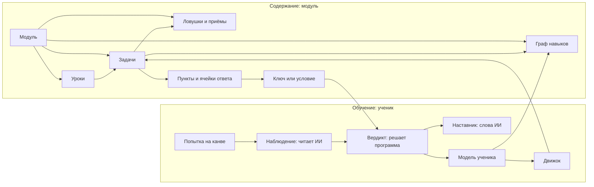
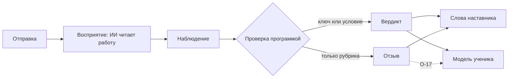

# NovaTrail — понятия платформы

> Статус: черновик для обсуждения, 2026-10-18.
>
> Общий словарь платформы: модуль, навык, урок, задача, канва, проверка, наставник, модель ученика, движок. Документ описательный. Имена полей и форматы появятся позже, в схемах `spec`, и будут сверяться с ним.
>
> Зачем всё это — в [product.md](product.md), приватность и возраст — в [privacy.md](privacy.md), компоненты — в [architecture.md](architecture.md), репозитории — в [repositories.md](repositories.md), решения — в [decisions.md](decisions.md). Открытые вопросы, на которые здесь ссылки, живут там: О-… — в product 13, П-… — в privacy 9, Т-… — в repositories 8.

## 1. Зачем этот документ

- Платформа нарезана на репозитории (R10). Движок, сервис, приложение и авторы модулей должны понимать друг друга, поэтому словарь у них один.
- Понятия здесь не зависят от предмета. Каждое проверено на четырёх непохожих случаях:
  - олимпиадная математика ребёнка, решение от руки;
  - испанский A1 взрослого;
  - физика на интерактивном стенде;
  - рисование, где верного ответа нет.

  Понятие, которое работает только для одного из них, живёт в модуле, а не здесь.
- В коде и схемах термины — на английском (R14), соответствие — в словаре (раздел 15).
- Примеры в разделе 16 — иллюстрации, а не формат.

## 2. Карта понятий



Модуль приносит содержание: граф навыков, уроки, задачи, каталоги ловушек и приёмов. Движок по модели ученика выбирает задачу. Ученик работает на канве, ИИ превращает его работу в наблюдение, а программа сверяет наблюдение с ключом и выносит вердикт. Вердикт уходит в модель ученика, а наставник подбирает слова.

## 3. Модуль

**Модуль** — версионируемый набор содержания одного автора: всё, что нужно платформе, чтобы учить предмету или его части. Примеры: «Олимпиадная математика 1–6», «Испанский A1», «Оптика, 8 класс».

- **Идентификатор и пространство имён.** У каждого издателя своё пространство имён. Официальные модули издаёт проект, сторонние — их авторы. Идентификатор модуля и ID его навыков лежат в пространстве имён издателя, поэтому два автора не столкнутся именами.
- **Версия** — semver.
  - Несовместимое изменение поднимает мажорную версию: удаление навыка или изменение его смысла, изменение ключа опубликованной задачи.
  - Такое изменение несёт таблицу соответствия старых ID новым, чтобы прогресс ученика не ломался.
  - Опубликованный ID навыка никогда не переиспользуется для другого навыка.
- **Паспорт:**
  - идентификатор, версия, название, предмет;
  - аудитория: для каких возрастных категорий годится модуль и какой стиль подачи он предлагает (раздел 13);
  - языки: на каком языке объяснения и, у языковых модулей, какой язык изучается;
  - авторы и лицензия содержания — идентификатор SPDX: у официальных модулей — `Apache-2.0` (R20), у сторонних — О-10;
  - версия формата модуля;
  - зависимости — на какие навыки общей таксономии модуль опирается (раздел 4).
- **Состав:** граф навыков, уроки, задачи, каталоги ловушек и приёмов, шаги решения, настройки канвы, медиафайлы (картинки, звук), необязательные виджеты и eval-набор.
- **Eval-набор модуля** — образцы работ, на которых проверяется, что ИИ верно читает работу в этом модуле. Это синтетические образцы или образцы, которые для eval сделали взрослые добровольцы и авторы. Работы учеников — детей и взрослых — в модуль не входят: модуль публикуется под открытой лицензией, и отозвать его нельзя. Работы учеников, если их берут в eval, хранятся вне репозиториев и только с отдельного согласия (П-10; R15).
- **Модуль даёт данные, а не инструкции модели (R02):**
  - поля модуля типизированы и проверяются схемой;
  - промпты принадлежат платформе: по одному на возможность ИИ, у каждого свой eval-набор (раздел 10);
  - свободный текст модуля — условие, совет ловушки, решение — попадает к модели только отдельным помеченным блоком данных, который не может изменить её задачу. Так в standalone передавались заметки о ребёнке (R16 standalone).

  Отсюда отличие от навыков Claude. Навык Claude — инструкции, которые модель исполняет так, как их поняла. Модуль NovaTrail платформа исполняет одинаково при одинаковом входе (R03).
- **Официальные и сторонние модули.** Кто и как публикует сторонние модули — О-9.

## 4. Навык и граф навыков

**Навык** — то, чему учит модуль и что можно оценить у ученика. Примеры: «промежутки и столбы», «ser и estar», «закон преломления», «штриховка».

- **У навыка:** ID, название, описание, ярус, пререквизиты и оцениваемость.
- **Граф навыков** — направленный граф без циклов: «чтобы браться за B, нужен A». Платформа проверяет его на циклы при публикации, как standalone проверял связи `builds_on` при старте.
- **Ярус** — группа навыков одной сложности в модуле.
  - В MathTrail ярусов три: «основы», «правила» и «сложные задачи»; в прототипе они называются Basics, Rules и Hard tasks.
  - Ярус темы там не задавал автор: его вычисляли по самой длинной цепочке тем-основ под ней (SPEC 8.12.2 standalone).
  - Задаёт ли ярус автор модуля или он вычисляется по графу — О-18.
- **Ссылки между модулями.**
  - Модулю физики могут понадобиться линейные уравнения, но на внутренние ID чужого модуля он не ссылается.
  - Ссылаться можно только на навыки **общей таксономии** — курируемого платформой словаря навыков-опор (Т-14). Тогда переименование навыка в чужом модуле ничего не сломает.
  - Если у ученика нет модуля, который учит нужному навыку, движок не блокирует урок. Навык считается неизвестным, и движок может предложить короткую проверку или модуль.
- **Оцениваемость** решает, как платформа учит навыку:

  | Оцениваемость | Что это | Пример |
  |---|---|---|
  | ключ | у ответа одно верное значение | 21 столб |
  | условие | верных ответов много, программа проверяет условие | «любое число, которое делится на 3 и на 4» |
  | рубрика | оценка по критериям автора — только отзыв, не вердикт (R04) | перспектива на рисунке, произношение |
  | никак | навык тренируется, но не оценивается | свободное рисование |

  Для навыков с рубрикой и без оценки движок не подстраивается под ученика: порядок задаёт автор.
- **Открытие навыка и доступ к содержанию.**
  - Навык открывается по пререквизитам, а не по классу или возрасту. Класс или возраст задаёт только отправную точку, как в standalone: «The grade decides one thing: where the child starts» (О-56 standalone).
  - Отдельно от этого модуль может пометить содержание как неподходящее для возрастной категории. Это доступ к содержанию, а не порядок обучения.

## 5. Урок

**Урок** — последовательность, которую составил автор: объяснение, пример с разбором, задачи и иногда проверка в конце. Обещание «интерактивных уроков» — об этом.

- Урок привязан к навыкам.
  - Порядок внутри урока задаёт автор.
  - Какой урок или задачу дать дальше, решает движок по модели ученика (раздел 12).
  - Может ли автор задать порядок уроков всего модуля — О-19.
- Задачи живут и вне уроков: движок может дать задачу на закрепление без объяснения.
- Для навыков без детерминированной проверки урок идёт в порядке автора, без адаптации.

## 6. Задача

**Задача** — то, что ученик решает и что платформа может проверить или прокомментировать.

- **Условие** — что ученик видит: текст, картинка, звук. Оно лежит на нестираемом слое шаблона (раздел 8).
- **Пункты.** Задача — один пункт или набор.
  - Лист с десятью примерами на дроби — одна задача из десяти пунктов.
  - У каждого пункта своя область на канве, свой ключ, свои навыки и своё состояние: не начат, начат, проверен.
  - Итог задачи складывается из пунктов.
- **Ячейка ответа и её привязка** — где ученик даёт ответ:
  - в зоне — отведённом месте на листе;
  - где угодно на листе: итог находит ИИ, как в canvas-api (R61 canvas-api), а если итогов несколько, ученика просят обвести свой;
  - в состоянии виджета — например, положение линзы или показание амперметра;
  - правками в тексте условия — на текстовой канве: зачеркнуть, вставить, переставить;
  - вводом с клавиатуры или выбором варианта.

  Привязку задаёт модуль на каждую ячейку. Так снимается спор «поле Answer или свободный лист» между прототипом и MathTrail Canvas.
- **Ключ или условие** на каждый пункт, **вид проверки** и его параметры — раздел 9.
- **Навыки задачи** бывают двух видов:
  - основные — задача их тренирует, и ошибка в ней — свидетельство против них;
  - вспомогательные — нужны для решения, но ошибка их не роняет: неверный ответ по оптике не снижает оценку алгебры.
- **Ловушки** — какие типичные ошибки ловит задача и по какому признаку:
  - по неверному значению — такую ловушку определяет программа;
  - по виду ошибки в ходе решения — такую ловушку предполагает ИИ, и её происхождение — «выведено ИИ» (раздел 9.4).
- **Приёмы** — какой приём здесь помогает.
- **Что известно и что найти** — заготовки для шага «понять»; в прототипе это фишки «We know» и «We need to find».
- **Подсказки:**
  - лестница от общего вопроса к конкретному и к похожему случаю попроще;
  - запасные тексты автора — на случай, когда вопрос модели не пришёл или не прошёл проверки (раздел 10).
- **Решение** — показывается после верного ответа. Показ по просьбе ученика — О-7.
- **Сложность** — по шкале модуля.
- **Шаги решения** и условие выхода из каждого шага — раздел 7.
- **Происхождение** ключа, тегов навыков и ловушек — раздел 9.4.

Задача без детерминированной проверки — рисунок, произношение, сочинение — получает отзыв, а не вердикт (R04).

## 7. Ловушка, приём, шаги решения

- **Ловушка** — именованная типичная ошибка, общая для многих задач модуля. Примеры: «посчитал промежутки вместо столбов», «перепутал ser и estar», «забыл перевести сантиметры в метры».
  - У ловушки: ID, описание, навыки, к которым она относится, и совет для взрослого или ученика.
  - Каталог ловушек модуля закрыт: неверный ответ становится диагнозом, только если ловушки можно посчитать, а свободные названия ошибок посчитать нельзя (SPEC 1.3 standalone).
  - Повторяющиеся ловушки видны в прогрессе — в прототипе это блок «Mistakes that repeat».
- **Приём** — стратегия решения, которую можно назвать и которой можно научить. Примеры: «начни с маленьких чисел», «найди глагол», «нарисуй силы».
  - Каталог приёмов — у модуля; в математике MathTrail их 11, с номерами.
  - После верного ответа наставник может спросить, какой приём помог.
- **Шаги решения** — рамка, по которой наставник ведёт ученика внутри одной задачи. Их задаёт модуль:

  | Предмет | Шаги |
  |---|---|
  | олимпиадная математика | понять → составить план → решить → проверить (Пойа) |
  | физика | гипотеза → опыт → расчёт → вывод |
  | язык | прочитать → найти ошибки → исправить → произнести |

  - Шаг «произнести» требует голосового ввода и появится вместе с ним (О-6).
  - У каждого шага есть условие выхода: событие («отмечены все известные»), состояние виджета, заполненная ячейка или ничего.
  - Режим «сам» (в прототипе — Free solve) пропускает шаги: наставник отвечает, только когда его позовут.

## 8. Канва

**Канва** — рабочее место задачи: что ученик видит и где он пишет, рисует, вводит, двигает и говорит. Вид канвы на каждую задачу задаёт модуль.

**Слои**, снизу вверх:

1. **Шаблон автора** — условие, сетка, картинки, предложения, пункты. Ученик его не стирает и не меняет.
2. **Виджет модуля** — интерактивный стенд: оптическая скамья, электрическая цепь, числовая прямая.
3. **Показ автора** — пример или демонстрация, которые автор открывает и прячет по ходу урока.
4. **Работа ученика** — штрихи, текст, перетаскивания, ответы голосом, изменения виджета.
5. **Слой наставника** — рамки, пометки, номера, короткие надписи и пунктирный набросок «как начать».
   - Набросок рисуется под записью ученика, рамки и пометки — над ней.
   - Ни то, ни другое не меняет и не закрывает работу ученика (R05).

**Виды канвы.** Каждый — код платформы, общий для всех модулей:

| Вид | Что это | Пример |
|---|---|---|
| лист для рукописи | свободный лист в клетку, линейку или точку | олимпиадная задача, черновик |
| рабочая тетрадь | нестираемые пункты и ячейки на одной странице | десять примеров на дроби |
| текстовая | предложения и слова: зачеркнуть, вставить, переставить, выделить, прослушать | поиск ошибок по-испански |
| песочница | виджет модуля и место для расчётов | опыт с преломлением света |
| творческая | кисти, палитра, слои, нажим | рисунок с натуры |

Канва кода и проверка запуском программы ученика — О-20.

**Инструменты** разрешает задача: перо, ластик, линейка, транспортир, калькулятор, клавиатура, микрофон. Ластик удаляет штрих целиком: пометки наставника привязаны к штрихам ученика, и стёртая половина штриха их бы сломала (canvas-api: R42, R43).

**Контракт виджета:**
- виджет объявляет схему своего состояния и события;
- проверка может ссылаться на состояние виджета (раздел 9);
- версия виджета закрепляется за попыткой, а случайность в нём — только от зерна (seed), чтобы попытку можно было повторить;
- где и как исполняется код чужого виджета — R16 (architecture 3.4).

**Работа ученика — его артефакт.** Рисунок, сочинение или запись принадлежит ученику, их можно выгрузить и удалить (privacy 4). Это не «картинка для проверки».

## 9. Проверка

### 9.1. Цикл



- **Отправка** — по кнопке. Что наставнику можно делать на паузе — О-8.
- **Восприятие** — ИИ превращает работу ученика в наблюдение. Это единственное место, где ИИ участвует в проверке (R03). Ответ вводом или выбором ИИ не читает: его сразу проверяет программа.
- **Наблюдение.** На каждую ячейку:
  - запись и её значение; значение принимается, только если оно видно в самой записи (R62 canvas-api);
  - другие возможные прочтения, разборчиво ли и однозначно ли;
  - привязка к штрихам или к месту на канве;
  - ловушка-кандидат.

  На работу целиком — место первой ошибки в рассуждении. Ученик видит, что прочитано: «Я прочитал 6».
- **Проверка** — программа сравнивает наблюдение с ключом или условием. Модель не решает, верно ли (R03).
- **Вердикты** — как в R38 canvas-api:

  | Вердикт | Когда | Что видит ученик |
  |---|---|---|
  | верно | значение совпало с ключом или выполнило условие | «Верно» и что прочитано |
  | пока нет | прочитано уверенно, по форме, и не совпало | что прочитано, место ошибки и вопрос наставника |
  | не прочитать | неразборчиво, неоднозначно, не по форме; итогов несколько или нет | просьба переписать или обвести — это не ошибка |
  | без проверки | сбой ИИ, исчерпан лимит | нейтральная фраза — это не ошибка |

  При любом сомнении — «не прочитать», а не «пока нет» (R04).
- **Отзыв** — там, где детерминированной проверки нет. ИИ оценивает работу по критериям автора, и ученик видит это как отзыв, а не как оценку. Влияет ли отзыв на модель ученика — О-17.

### 9.2. Виды проверки

| Вид | Пример | Что задаёт модуль |
|---|---|---|
| число | 21 столб | значение |
| дробь и форма | 3/6 и 1/2 равны, но задание «сократи» требует 1/2 | значение и правило формы отдельно; как записываются числа — десятичная запятая, смешанные числа |
| величина | 2,0·10⁸ м/с | размерность, допустимые единицы и их перевод, допуск (абсолютный или относительный), значащие цифры, знак |
| выбор | вариант C | варианты |
| текст | «está» | допустимые варианты; нормализация: регистр, пробелы, пунктуация, значимы ли ударения |
| правка | исправить ошибки в предложении | обязательные правки по местам, частичный зачёт, что считать новой ошибкой |
| порядок и множество | расставить события по порядку; назвать все варианты | важен ли порядок, нужна ли полнота |
| условие | «любое число, которое делится на 3 и на 4» | условие, которое считает программа |
| состояние виджета | луч после линзы проходит через фокус | условие на состояние виджета |
| рубрика | рисунок, произношение, сочинение | критерии; итог — отзыв, а не вердикт |

- Новый вид проверки — код платформы, общий для всех модулей: модуль выбирает вид и задаёт параметры (R02). Этот код живёт в `module-kit` (R17).
- Нормализация в MathTrail Canvas знала только числа и выбор: NFKC, знак «−» превращался в «-», слово единицы измерения отбрасывалось (spec 5.2 canvas-api). Здесь нормализация — параметр вида проверки.

### 9.3. Шаблоны и генерация

- Задача может быть шаблоном с параметрами. Числа подставляются от зерна (seed), а ключ считает решатель — как решатели на Starlark в standalone, которые перебором проверяют ответ задачи.
- Задачи с помощью ИИ генерируются только при подготовке модуля, и автор их проверяет. Генерация на лету, как в standalone, — О-12.

### 9.4. Происхождение

У задачи, ключа, тегов навыков и ловушек есть **происхождение**:

| Происхождение | Пример |
|---|---|
| от автора | ключ задачи в модуле |
| проверено решателем | ключ шаблонной задачи посчитан программой |
| введено взрослым | ключ из ответов в конце учебника для задачи с бумаги |
| выведено ИИ | ИИ сам разметил навыки задачи с бумаги, сам решил её или сам предположил ловушку по ходу решения |
| нет | ключа нет вовсе |

От происхождения зависит:
- **возможен ли вердикт.** И «верно», и «пока нет» выносятся только при ключе или условии от автора, решателя или взрослого. При ключе, выведенном ИИ, вердикта нет и ответ не оценивается: иначе это был бы вердикт модели, который R04 отвергает. Можно лишь показать решение, помеченное «выведено ИИ», и то не ребёнку (О-11);
- **вес свидетельства** для модели ученика. Задача с бумаги, которую ИИ сам разметил и решил, рейтинг не двигает (О-11). Ловушку по неверному значению находит программа, и она весит как вердикт. Ловушка, которую ИИ предположил по ходу решения, нужна наставнику для слов; в модель ученика и в выбор задачи она идёт со сниженным весом;
- **что показывается.** Решение, выведенное ИИ, так и помечено.

Только так детерминированное ядро (R03) выдерживает фото с бумаги, рубрики и виджеты.

## 10. Наставник

- **У ИИ две роли:**
  - восприятие — читает работу (раздел 9);
  - слова — подсказки, объяснения, похвала, вопрос.

  Решений наставник не принимает: вердикт выносит программа, следующую задачу выбирает движок (R03).
- **Правила подсказки** — из product 5.4 canvas-api:
  - не называть ответ;
  - один вопрос, не больше двух коротких предложений, слова по возрасту;
  - указывать на место в работе ученика;
  - начинать с того, что уже получилось;
  - говорить только о задаче.
- **Лестница подсказок** — по числу неверных ответов на задаче:
  1. общий вопрос о месте ошибки;
  2. вопрос о правиле или ловушке;
  3. похожий случай попроще.

  Ступень выбирает программа по числу неверных ответов, а наставник только подбирает слова для неё (R03). После третьей ступени программа предлагает позвать взрослого (ребёнку) или показать решение (О-7). Что даёт подсказка по просьбе ученика — до первой отправки и между отправками, — О-21.
- **Запасные тексты.** Если вопрос модели не пришёл или не прошёл проверки, ученик получает запасной текст: на ступенях 1–2 — совет ловушки, который автор написал для этого неверного ответа, а если его нет — шаблон ступени; на третьей ступени — похожий случай попроще от автора (R24 canvas-api).
- **Проверка утечки.** Программа ищет в тексте модели ключ и фразы-утечки, которые указал автор (R24 canvas-api). Это страховка, а не доказательство. Запасные тексты автора проходят ту же проверку, когда проверяется модуль (R17).
- **Промпты — у платформы.** Свой промпт у каждой возможности ИИ: чтение рукописи, чтение текста, разбор хода решения, оценка по рубрике, подсказка, голос. У каждого — eval-набор. Модуль даёт данные — ловушки, приёмы, решение, критерии рубрики — отдельным помеченным блоком (R02).
- **Персонаж** — друг в прототипе: лис, робот, сова, кошка, динозавр или тот, кого нарисовал ребёнок. Он меняет тон и голос, но не содержание. Персонаж для взрослых — О-13.
- **Голос** — озвучка наставника и голосовой ввод ученика. Голосовой ввод — О-6 и П-5.
- **Режимы:**
  - «по шагам» — приложение ведёт по шагам решения модуля, а наставник говорит на каждом шаге;
  - «сам» — наставник ждёт, когда его позовут; что он тогда отвечает — О-21.
- **Что получает модель:**
  - работу — картинку, вырезку, текст или звук;
  - данные задачи и наблюдения, нужные для слов;
  - стиль подачи — чтобы говорить по возрасту.

  Чего платформа ей не передаёт никогда: идентификаторов, псевдонима, имени ученика и данных взрослого. Но на картинке может оказаться всё, что ученик написал сам, в том числе имя (privacy 1).

## 11. Модель ученика

**Модель ученика** — что платформа знает о том, как ученик владеет навыками во всех подключённых модулях. Модель у ученика одна. Её видимая часть — **карта навыков**.

- **Состояние навыка:** оценка владения, неуверенность этой оценки, число свидетельств, время последней практики, частые ловушки, «освоено» или нет.
- **Свидетельство** — исход попытки, а не только «верно» и «неверно»:
  - с первой отправки;
  - после подсказки номер k;
  - с наброском-подсказкой;
  - решение показано;
  - без проверки.

  Вес свидетельства зависит от исхода и от происхождения ключа (раздел 9.4). Серия однотипных пунктов на одном листе весит меньше суммы: десять дробей за пять минут — это не десять независимых свидетельств. Отзыв по рубрике — О-17.
- **Уровень — на модуль или предметную область, а не на всю модель.** Математика и испанский не складываются. Связи между модулями несут только пререквизиты, а не уровень.
- **Основные и вспомогательные навыки** задачи — раздел 6.
- **Отправная точка:**
  - пробная серия — в standalone это первые пять ответов;
  - исходная оценка — по классу или возрасту, по уровню на шкале модуля (например, CEFR), по самооценке или по короткой проверке.
- **«Освоено»** — осторожная оценка с учётом неуверенности. Она ставится после верного ответа без подсказки, в навыке, где ответов уже не меньше пяти, и теряется после двух неверных ответов подряд (R187 standalone).
- **Забывание и повторение.** Без практики оценка со временем тает, и движок возвращает навык на повторение. Для слов и грамматики это обязательно; в standalone забывания не было.
- **Угадывание** зависит от вида ответа: 1/k при выборе из k вариантов, около нуля при свободном ответе. В standalone оно было зашито как 0,2 на пять вариантов.
- **Отправная модель** — модель Раша с полом угадывания и обновлением по Elo из standalone: общий уровень плюс поправка на тему, пробная серия, осторожное «освоено». Отличия — уровень на модуль и забывание. Коридор успеха из того же standalone — правило движка, а не модели: модель отдаёт вероятность верного ответа (раздел 12; R23).
  - Алгоритмы — дело библиотеки learner-model (repositories 2).
  - Модель меняют, только если новый вариант прошёл стенд виртуальных учеников по критерию, записанному до первого прогона (R163 standalone).
- **Отображение** — карта навыков, рейтинги, ранги, «сильные стороны», «что развивать» — выводится из модели. Обратно на модель оно не влияет.

## 12. Движок

**Движок** выбирает, что дальше: урок, задачу, пункт, повторение. Он работает по правилу, без ИИ; случайность — только от зерна (seed) (R03).

- **Входы:**
  - модель ученика и графы навыков подключённых модулей;
  - уроки и пул задач;
  - последняя попытка и её ловушка;
  - интересы ученика — для оформления задачи;
  - ограничения: возрастная категория, дневная цель;
  - время и зерно: они приходят снаружи, сам движок их не берёт (architecture 3.8);
  - режим:
    - ведёт движок — «Мои предметы» в прототипе;
    - ученик выбрал навык на карте навыков;
    - задача с бумаги.
- **Выход:** что дать и **код причины**. Примеры кодов: «закрепление после ошибки», «новый навык: пререквизиты освоены», «повторение: давно не было», «проба отложенного». Причину видит взрослый; ребёнку её не называют (как в standalone). Список кодов — контракт в `spec` (R29).
- **Правила верхнего уровня.**
  - Из правила standalone (SPEC 3 standalone):
    - коридор успеха: ученик решает задачу с вероятностью от 0,70 до 0,85, целясь в 0,775;
    - закрепление: после ошибки — ещё задача на тот же навык, если он в досягаемости;
    - пробы: отложенный навык изредка возвращается проверкой;
    - очередь: из досягаемых неосвоенных навыков первым идёт тот, который дольше всего не выдавался;
    - частые ловушки ученика: задача, которая их ловит;
    - интересы: оформление задачи под интересы ученика, если модуль даёт такие варианты.
  - Новое в NovaTrail:
    - пререквизиты: навык предлагается, когда его пререквизиты освоены. Правило standalone связей между темами не читало;
    - повторение освоенного: навык возвращается, когда его оценка тает от забывания (раздел 11). В standalone забывания не было: ища новое, правило пропускало освоенную тему, пока не освоены все досягаемые. В ротацию она возвращалась и раньше — когда её рекомендуемая точка поднималась выше уровня, на котором тема освоена, или когда две ошибки подряд снимали с неё «освоено» (SPEC 2.5, 3.2 standalone).
- **Объяснимость и воспроизводимость.** Тот же вход даёт тот же выход, и у каждого выбора есть причина. Это проверяет стенд виртуальных учеников.

## 13. Ученик, взрослые, возраст, языки

- **Ученик** — тот, кто учится.
- **Владелец аккаунта** — тот, кто управляет аккаунтом и данными:
  - у взрослого ученика — он сам;
  - у ребёнка — родитель или опекун (R06).

  Один аккаунт может держать и профиль самого владельца как ученика, и профили его детей (R26).

  Аккаунт подростка — П-13.
- **Возраст — два разных понятия:**
  - **возрастная категория** — от неё зависят аккаунт, согласие, пути к ИИ и голос (privacy 3):
    - младше 13;
    - от 13 до возраста цифрового согласия страны;
    - от возраста цифрового согласия до 18;
    - 18 и старше.

    Возраст цифрового согласия по GDPR страна выбирает от 13 до 16, поэтому без страны категорию не определить. Вне ЕС и Великобритании берём 13, если закон страны не говорит иного (privacy 3);
  - **стиль подачи** — как платформа говорит и показывает: длина фраз, озвучка, персонаж, ранги.
- **Как указывается возраст.**
  - Владелец аккаунта указывает возраст ученика и страну.
  - Платформа вычисляет возрастную категорию и хранит её, страну и дату, когда возраст указан. Ни даты рождения, ни возраста в годах она не хранит.
  - Раз в год категория уточняется. До уточнения действует прежняя: она строже, потому что ученик с тех пор только повзрослел (privacy 3).
  - При смене страны возраст указывается заново: возраст в годах не хранится, и пересчитать категорию не из чего.
- **Языки:**
  - интерфейса;
  - объяснений — на котором наставник говорит с учеником;
  - изучаемый — у языковых модулей.

  Например, русскоязычный взрослый учит испанский: интерфейс — русский, объяснения — русские, предмет — испанский. Ловушки языкового модуля могут зависеть от родного языка ученика.
- **Класс** (школьный) — метка модуля, а не свойство ученика вообще. По классу модуль может предложить отправную точку; если модуль спрашивает класс, он хранится в профиле ученика (privacy 4).

## 14. Путь к ИИ

- **Путь к ИИ** — через кого идёт вызов (R07):
  - **ИИ платформы** — по договорам платформы с поставщиками;
  - **свой ключ** — ключ ученика или владельца аккаунта у OpenAI, Anthropic или другого поставщика.
- **Допуск по возрастной категории.** Путь и поставщик доступны ученику, только если их условия разрешают его возраст (privacy 5). Для кого свой ключ — О-4.
- **Допущенные модели.** На каждую возможность ИИ — свой список точных ID моделей, прошедших её eval. Модель без eval не допускается, даже со своим ключом (R07; как R22 canvas-api).
- **Кто держит ключ** — Т-9.
- **Лимит трат.** У ИИ платформы это дневная квота помощи наставника, как в прототипе. На своём ключе лимит задаёт владелец ключа.

## 15. Словарь

| Термин | В коде и схемах | Что это |
|---|---|---|
| модуль | module | версионируемый набор содержания одного автора (раздел 3) |
| паспорт модуля | manifest | идентификатор, версия, аудитория, языки, лицензия, зависимости |
| издатель | publisher | владелец пространства имён модулей |
| медиафайлы | media | картинки и звук модуля |
| пакет модуля | module package | подписанная версия модуля, адресуемая по содержимому; её читает платформа |
| индекс модулей | module index | подписанный список пакетов модулей |
| реестр модулей | module registry | каталог опубликованных модулей: на этапах 1–3 — подписанный индекс, с этапа 4 — сервис (R17) |
| конвейер | pipeline | помощь автору до публикации: разметка, варианты задач, проверки |
| навык | skill | чему учит модуль и что оценивается у ученика (раздел 4) |
| граф навыков | skill graph | пререквизиты навыков, без циклов |
| пререквизит | prerequisite | навык, нужный до другого навыка |
| общая таксономия | shared taxonomy | словарь навыков-опор для ссылок между модулями |
| ярус | tier | группа навыков одной сложности в модуле: основы, правила, сложные задачи |
| оцениваемость | assessability | ключ, условие, рубрика или никак |
| урок | lesson | объяснения, примеры и задачи в порядке автора (раздел 5) |
| задача | task | то, что ученик решает (раздел 6) |
| открытый вид | open view | задача без ключа, решения и ловушек — то, что получает приложение ученика (R05) |
| пункт | item | часть задачи со своим ключом и своей областью |
| ячейка ответа | answer slot | место, где дан ответ на пункт |
| привязка ячейки | slot binding | зона, где угодно на листе, состояние виджета, правка, ввод или выбор |
| ключ | key | верное значение пункта |
| условие | predicate | проверка, которую считает программа, когда верных ответов много |
| вид проверки | check kind | число, текст, величина, правка и другие (раздел 9.2) |
| ловушка | trap | именованная типичная ошибка (раздел 7) |
| совет ловушки | trap advice | что подсказать взрослому или ученику при этой ошибке |
| приём | technique | стратегия решения, которую можно назвать |
| шаги решения | solving steps | рамка наставника внутри задачи |
| канва | canvas | рабочее место задачи (раздел 8) |
| слой канвы | canvas layer | шаблон, виджет, показ автора, работа ученика, слой наставника |
| вид канвы | canvas kind | лист для рукописи, рабочая тетрадь, текстовая, песочница, творческая (раздел 8) |
| виджет | widget | интерактивный компонент модуля на канве |
| вырезка | crop | часть картинки работы, которая уходит на проверку: на листе для рукописи — видимые штрихи, без сетки, условия и слоя наставника (R06 canvas), на фото с бумаги — сама задача (privacy 4). Сервер её не хранит (R09) |
| история письма | writing history | штрихи с временем и нажимом в порядке написания, стирания и отмены со временем. У ученика она остаётся на устройстве и на проверку не уходит (R09). Из файлов образцов она есть только в образцах замера от взрослых — они уходят организатору замера и поставщикам ИИ (П-18) — и в синтетике |
| итоговая геометрия | final geometry | видимые штрихи листа без времени, нажима, порядка написания и стёртого |
| группа штрихов | stroke group | штрихи, которые устройство объединяет по месту и времени письма (R06 canvas) |
| рамка группы | group box | общий прямоугольник штрихов группы, в долях вырезки |
| метка группы | group label | буква — A, B, C… — которой устройство называет группу штрихов на одной отправке. Не пометка слоя наставника (раздел 8) |
| пакет интерфейса | UI package | часть интерфейса в своём репозитории, которую приложение собирает по точной версии (R16) |
| зерно | seed | число, от которого зависит случайность, чтобы её можно было повторить |
| попытка | attempt | работа ученика над одной задачей: от выдачи до итога; в ней одна или несколько отправок |
| отправка | submission | одна передача работы на проверку внутри попытки (раздел 9.1) |
| наблюдение | observation | что ИИ прочитал в работе (раздел 9.1) |
| вердикт | verdict | верно, пока нет, не прочитать, без проверки |
| отзыв | feedback | оценка по рубрике; не вердикт. Об отказе от согласия — только «отзыв согласия» |
| происхождение | provenance | откуда задача, ключ, теги и ловушки (раздел 9.4) |
| наставник | tutor | ИИ, который читает работу и подбирает слова (раздел 10) |
| персонаж | persona | образ наставника: тон и голос |
| лестница подсказок | hint ladder | подсказки по числу неверных ответов; ступень выбирает программа, а не наставник (раздел 10) |
| проверка утечки | leak check | поиск ключа и фраз-утечек в тексте, который увидит ученик: в словах модели — перед показом, в запасных текстах автора — при проверке модуля (раздел 10) |
| запасной текст | fallback text | что ученик получает, когда вопрос модели не пришёл или не прошёл проверки: совет ловушки или шаблон ступени, а на третьей ступени — похожий случай попроще от автора (раздел 10) |
| возможность ИИ | capability | чтение рукописи, чтение текста, разбор хода решения, оценка по рубрике, подсказка, голос (раздел 10) |
| модель ученика | learner model | оценки владения навыками во всех модулях (раздел 11) |
| карта навыков | skill map | как модель ученика видна ученику и взрослому |
| ранг | rank | ступень, которой отображение называет владение; выводится из модели ученика и обратно на неё не влияет (раздел 11). У чего ранг, как он выглядит и кому виден — О-13 и детализация `skill-map` |
| свидетельство | evidence | исход попытки для модели ученика |
| движок | engine | выбирает следующий урок или задачу (раздел 12) |
| код причины | reason code | почему движок выбрал именно это |
| повторение | repetition | возврат освоенного навыка, когда его оценка тает от забывания — без практики, со временем (разделы 11, 12) |
| стенд виртуальных учеников | learner simulator | виртуальные ученики, на которых проверяют модель ученика и движок (repositories 4) |
| владелец аккаунта | account owner | кто управляет аккаунтом и данными |
| возрастная категория | age category | младше 13; от 13 до возраста цифрового согласия; от него до 18; 18 и старше |
| стиль подачи | presentation style | как платформа говорит и показывает |
| доступность интерфейса | accessibility | интерфейсом может пользоваться каждый, в том числе с нарушениями зрения, слуха или моторики. Не то же, что открытие навыка и доступ к содержанию (раздел 4) |
| путь к ИИ | AI route | ИИ платформы или свой ключ (раздел 14) |
| ИИ платформы | platform AI | вызовы ИИ по договорам платформы |
| свой ключ | own key (BYOK) | ключ ученика или владельца аккаунта у поставщика ИИ |
| eval-набор | eval set | образцы, на которых проверяется работа ИИ |
| страница образцов | samples page | отдельная сборка `canvas`, на которой делают образцы для eval; без хостинга и без сети (R25) |
| файл образца | sample file | файл, который страница образцов сохраняет на устройстве: штрихи, вырезки, группы, разметка, ссылка на задачу без ключа. Формат — протокол eval (R15), а до него — R09 canvas |
| образец замера | measurement sample | образец для замера чтения `tutor`. От взрослого — с историей письма и кодом писавшего, уходит организатору замера, вне git; от ребёнка — это образец ребёнка |
| образец eval-набора | eval-set sample | образец взрослого добровольца для eval-набора модуля: итоговая геометрия, без кода писавшего; уходит pull request в `modules` и не отзывается (concepts 3; П-16) |
| образец ребёнка | child sample | образец, который пишет ребёнок в сеансе образца ребёнка: итоговая геометрия и код писавшего, с отдельным согласием и вне репозиториев (П-10) |
| синтетический образец | synthetic sample | образец, нарисованный кодом из зерна: одно зерно — тот же файл (R38) |
| код писавшего | writer code | случайный код, который страница образцов даёт человеку и не помнит; по нему отзывают согласие и удаляют образцы по сроку. Псевдоним, а не анонимность |
| уведомление страницы образцов | samples page notice | что страница образцов показывает до письма: что лежит в файле, кто его увидит, срок и как отозвать согласие (R11 canvas) |
| набор текстов | text set | уведомление страницы образцов и форма согласия одной версией; версия пишется в файл образца (R11 canvas; RUN.md, эпик E4) |
| сеанс образца ребёнка | child sample session | сеанс на странице образцов, который проводит взрослый, а пишет ребёнок; только по подписанной форме родителя или опекуна (П-10) |
| отзыв согласия | consent withdrawal | отказ от согласия, данного на образцы или данные. Не «отзыв» — оценка по рубрике |

## 16. Приложение: три иллюстрации

Это не формат: имена полей и запись условные, их задаст схема модуля. Задача иллюстраций — показать, что одни и те же понятия описывают три непохожих предмета.

### 16.1. Олимпиадная математика: ребёнок, рукопись

```yaml
# Иллюстрация, не формат.
module: novatrail/math-olympiad@0.1.0
task:
  id: gaps-ladder-1
  statement: >
    The rungs of a ladder are 30 cm apart. From the lowest rung to the highest
    it is 180 cm. How many rungs are there?
  canvas: { kind: handwriting-sheet, grid: squares, tools: [pen, eraser] }
  items:
    - slot: { binding: anywhere }        # итог ищет ИИ; несколько итогов — «обведи ответ»
      check: { kind: number, key: 7 }
      provenance: author
  skills:
    primary: [novatrail.math.counting.gaps]
  traps:
    - { id: novatrail.math.trap.counted-gaps, when_answer: 6 }   # «посчитал промежутки»
  techniques: [novatrail.math.technique.small-numbers]
  givens: ["Rungs are 30 cm apart", "180 cm from the lowest rung to the highest"]
  unknown: "How many rungs"
  solving_steps: polya
```

### 16.2. Испанский A1: взрослый, текстовая канва

```yaml
# Иллюстрация, не формат.
module: novatrail/spanish-a1@0.1.0
languages: { instruction: ru, target: es }
task:
  id: ser-estar-edit-3
  statement: "Найди и исправь ошибки: «Mi hermana es cansada hoy, pero está una buena estudiante.»"
  canvas: { kind: text, tools: [cross-out, insert, keyboard] }
  items:
    - slot: { binding: edit }            # правками в тексте условия
      check:
        kind: edit
        required_edits:
          - { at: "es cansada", to: "está cansada" }
          - { at: "está una", to: "es una" }
        normalize: { case: ignore, punctuation: ignore, accents: significant }
        partial_credit: true
      provenance: author
  skills:
    primary: [novatrail.es.grammar.ser-estar]
  traps:
    - { id: novatrail.es.trap.ser-for-state, when: "осталось «es cansada»" }
  solving_steps: [read, find-mistakes, fix]   # «произнести» — когда появится голосовой ввод
```

### 16.3. Физика: подросток, песочница со стендом

```yaml
# Иллюстрация, не формат. Модуль стороннего автора.
module: acme/optics-8@1.2.0
skills:                                   # навыки модуля
  - id: acme.optics.refraction-law
    prerequisites: [core.math.linear-equations]   # ссылка на общую таксономию, а не на чужой модуль
task:
  id: refraction-1
  statement: "Луч падает на стекло под углом 45°. Найди угол преломления на стенде, затем скорость света в стекле."
  canvas:
    kind: sandbox
    widget: { id: acme.optics-bench, version: 2.1.0 }   # версия закрепляется за попыткой
    tools: [pen, ruler, protractor, calculator]
  items:
    - slot: { binding: widget-state }
      check: { kind: widget-state, condition: "28.0 <= beam.refraction_angle <= 28.5" }
      provenance: author
    - slot: { binding: zone }
      check: { kind: quantity, key: 2.0e8, unit: "m/s", accept_units: ["m/s", "km/s"], tolerance: "2%" }
      provenance: author
  skills:
    primary: [acme.optics.refraction-law]
    supporting: [core.math.linear-equations]   # ошибка здесь не снижает оценку алгебры
  solving_steps: [hypothesis, experiment, calculation, conclusion]
```
