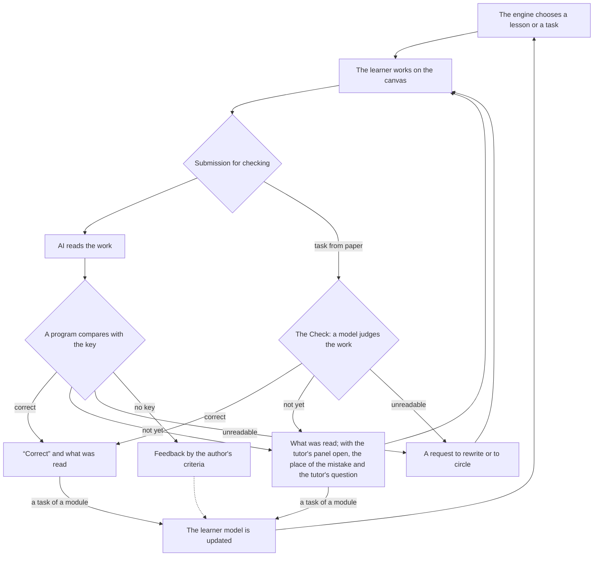
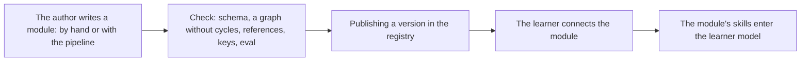

# NovaTrail — the product document

> Status: a draft for discussion.
>
> The platform's first document: what we build, for whom and why, what goes into the first slice and what is not decided yet. The concepts are in [concepts.md](concepts.md), privacy and age in [privacy.md](privacy.md), the architecture in [architecture.md](architecture.md), the repositories in [repositories.md](repositories.md), the decisions in [decisions.md](decisions.md). The open questions О-… are in this document's section Open questions.
>
> Technologies are not described here: the repositories decide them.

## 1. The gist

**What it is.** NovaTrail is an open platform on which any subject becomes an interactive lesson with an AI tutor: maths, Spanish, physics, drawing — for children and for adults.

- A subject comes as a **module**: a skill graph, lessons, tasks, typical mistakes, techniques and a canvas kind. Any author can write a module.
- The learner works on a **canvas**: writes by hand, draws, types text, moves objects, speaks.
- The **AI tutor** reads the learner's work and talks with them in text and voice. Whether an answer is correct is decided by a program by the task's key, not by the model; only on a task from the learner's own paper, which no module holds, a model judges the work, and that verdict moves no rating.
- The **learner model** brings the skills of all modules together, and the **engine** chooses the next lesson or task.

**The main idea: a module is data for the engine, not an instruction to a model.**
- A Claude skill is instructions that a model carries out as it understood them.
- A NovaTrail module is data checked by a schema, which the platform carries out the same way every time. The same module of the same version and the same learner state give the same choice of task and the same verdict on the same reading of the work.
- AI works only at the input, where it reads the work, and at the output, where it chooses the words.

**How it differs:**
- **from a chat with AI:** a chat has no key, no learner model and no path through skills; it may give away the answer and get the check wrong;
- **from drill apps with tests:** the learner solves freely — by hand, in words, on a stand — and the tutor looks at the course of solution, not only at the answer;
- **from courses:** the path is adaptive — by the skill graph and the learner model, not by a common plan;
- **from a private tutor:** available every day and cheaper. A private tutor, moreover, can become a module author or guide a learner together with the platform.

## 2. Where we came from

**MathTrail** is a family of products for olympiad maths for grades 1–6 (the organization `mathtrail` on GitHub):
- **mathtrail-standalone** — a free open app for Claude and ChatGPT. The chat's model writes the tasks, and a program checks them with a solver. Here live the learner model (the Rasch model with an Elo update) and the trap catalog, and the child's profile is kept as a file in the family's Google Drive.
- **MathTrail Canvas** (`canvas-api`) — a tutor where the child solves by hand on a sheet. AI reads the answer, a program compares it with the key, and the tutor circles the place of the mistake and asks a leading question.

**What MathTrail gave:**
- **the mechanism** "AI reads, a program decides, the tutor asks", conceived as independent of the subject. The main hypothesis — that AI understands the learner's free solution and reads the answer correctly — MathTrail did not manage to test ([canvas-api@0901af0](https://github.com/mathtrail/canvas-api/tree/0901af0)). NovaTrail's first slice will test it;
- **the learner model and the rule for choosing a task**, which work without AI and are tested on the learner simulator (standalone);
- **a closed catalog of typical mistakes**, which turns an incorrect answer into a diagnosis ([standalone@42b4408](https://github.com/mathtrail/mathtrail-standalone/tree/42b4408)).

**Why a platform now.** MathTrail was tailored to olympiad maths for grades 1–6 and closed off everything else. NovaTrail is the same project, but the subject, the age and the canvas are moved out into modules.

**What we take:**
- the principles of checking and of hints;
- the learner model and the simulator;
- the catalogs of topics, traps and techniques;
- 753 reference tasks with traps and 39 templates with solvers of standalone ([standalone@42b4408](https://github.com/mathtrail/mathtrail-standalone/tree/42b4408));
- the framework of the services, the development environment and the delivery.

What is carried over from where is in [repositories.md](repositories.md).

**What we do not take as it is:**
- the canvas-api monolith — NovaTrail is cut into repositories from the first day;
- "children only";
- "English only";
- a single AI provider.

MathTrail is frozen.

## 3. For whom and why

| Who | What they get |
|---|---|
| A child (6–12) | solves the way they are used to: by hand, with a drawing, in words; gets a question instead of the "red pen"; learns to find the mistake themselves |
| A teenager | the same for school subjects and beyond them; more independence. Whether they have an account of their own, П-13 will decide |
| An adult learner | a language, physics, drawing — at their own pace, with a tutor that looks at the course of solution; with their own AI key — free (О-4) |
| An adult beside a child: a parent, a guardian, a private tutor | sees the progress and the repeating mistakes; sets up the tutor; can run a session together with the child. Only the account owner — a parent or a guardian — manages the data |
| A module author: a methodologist, a teacher, an enthusiast, an organization | a ready lesson environment, tutor, learner model and engine — writes only the content; gets tools for checking and publishing |
| Teachers and schools — later | groups and a summary of frequent mistakes |
| An operator, self-hosting | open code: one can deploy one's own copy of the platform oneself |

## 4. How learning goes

A typed answer or a choice is not read by AI: a program checks it at once. A task from paper has no key: one call of AI, the Check, judges its work, an option circled there as its label, and its verdict moves no learner model.

- **Three entries** — from the prototype:
  - **«Мои предметы»** ("My subjects") — the engine leads through the connected modules;
  - **«Карта навыков»** ("Skill map") — the learner chooses a skill on the map and sees what is mastered, what opens up and what it rests on;
  - **«Задача с моей бумаги»** ("A task from my paper"), the app's main feature, for every profile — the learner photographs a page of their own book or worksheet; AI finds the tasks on it, each found one picked, and the learner frames by hand one it missed. Each picked task is solved on a dotted sheet of its own under the task's crop as tracing paper. Check is one call of AI, in which a model judges the work by the task's crop as printed, the work and the instruction above the frame: "Correct" or "Not yet" for each task of the frame, with no mark that a model gave it, and with it the place of the first mistake and a ladder of hints; Hint before the first Check gives the ladder's first rung by the same call. A page may hold a task of any form, which no program knows all, so the verdict is the model's: a mistake of the model now and then is better than "Couldn't check this one" on many tasks, which is left for a Check that read nothing of a solution. The solution is never shown, and the attempts are the profile's history on the device, not evidence.
- **One sheet of solving.** Every task, of a module or from paper, is solved on one screen and sheet: the statement on the tracing paper, the tools, the row Ask, Hint and Check, and the tutor's one panel. A task of a module has its statement from the module, as a picture `app` draws of its text and media, and the options of a choice as buttons on the tracing paper; an essay is written on a lined sheet and ends with Done. The tutor speaks of the work only while its panel is open: with the panel closed, "Check" gives the reading and the program's verdict, and the tutor's words about the last submission come when the learner opens the panel. No task shows its solution: a grown-up gets it in grown-up mode, behind the PIN, and on a task of a module that attempt is then no evidence.
- **The screens** are described in the prototype's README ([draft/README.md](../draft/README.md)): subjects and modules, the friend persona, canvases with tools, the steps panel, hints, the check, progress, the section for adults. Their look is the interface mockup in `draft/mockup/` — sign-in, "Who's learning?", the home screen, the lesson and the task, the tutor's panel at the side —, and where it differs from the documents, the documents win.

## 5. Modules and authors

A module is a package of one author. A module's path from the author to the learner:

- The **pipeline** helps the author: it marks up skills and traps and proposes variants of tasks. The author checks everything AI did before publishing. A published module is already unchanging data.
- **Official modules** are written and maintained by the project; **third-party** ones by any author. Who publishes and how is О-9.
- **An update of a module does not break progress:** skill IDs are stable, and incompatible changes carry a table that maps the old IDs to the new ones.
- **A module is checked for reading quality.** Before publishing, the platform makes sure that AI reliably reads the work in this module's canvas kinds and answer kinds. The check runs on samples from the module's eval set: synthetic ones or ones made for eval by adult volunteers and authors, but not on learners' work.

## 6. AI on the platform

**What AI does:**
- reads the learner's work — handwriting, speech, a photo, a drawing — and turns it into an observation;
- chooses the words — a hint, an explanation, praise — by rules and with checks;
- helps the author prepare a module — before publishing, under the author's check.

**What AI never does:** it does not decide whether an answer to a task of a module is correct, and it does not choose the next task. On a task from the learner's paper it finds the tasks on the page and judges the work in one call, the Check, and that verdict moves no rating. The platform does not pass it a name, identifiers or an adult's data.

**Two AI routes**:
- **platform AI** — by subscription, through the platform's agreements with providers;
- **own key** — an account owner who learns themselves connects their own key of OpenAI, Anthropic or another provider to their own profile of the category `adult` and uses the platform for free.

**Models are admitted by eval.** Each AI capability has its own list of exact IDs of the models that passed that capability's eval. An own key does not open a model that did not pass eval. Until 2027-01-17, while only the author learns on the deployment, the author's word admits a model at the rung "author" instead of an eval, on both routes; the rung "full" stays by eval.

**Age.** Providers have their own rules on minors, and the platform follows them:
- The Gemini API may not be used in a service that people under 18 are likely to use (sources 2.1). Since the platform is open to children, this route is closed for all its learners, adults too, — both through platform AI and with an own key. Google Cloud's generative AI, Vertex AI too, has the same ban: Google's models are closed on the whole platform, for all learners, until a lawyer answers otherwise.
- OpenAI requires zero data retention for the personal data of children under 13 or under the age of digital consent of their country (sources 2.2). OpenAI turns this mode on only by prior approval, and a family's ordinary key does not have it.
- Anthropic puts the safeguards on the organization that serves minors (sources 2.4). What this means for a family's key the author decides by an analysis (П-4).

Hence the recommendation: an own key is for adults, children learn through platform AI (О-4, О-5).

## 7. Principles

1. **A module is data.** The core knows no subject; a module gives a model no instructions.
2. **A program gives the verdict.** AI reads the work and chooses the words; correctness is decided by a key or a predicate. A task from the learner's paper, which no module holds, is the one exception: a model judges it.
3. **A false alarm is worse than no check.** Doubt is a request to rewrite, a failure is a neutral phrase, but never a "mistake".
4. **No deterministic check — no verdict.** An assessment by a rubric is feedback. A task from paper gets the model's verdict, plain "Correct" or "Not yet", a doubt still a request to rewrite and an unsure "Not yet" said more softly, and it never moves the rating.
5. **The tutor does not name the answer itself, and the app does nothing for the learner.** The tutor asks one short question and points to the place in the learner's work; a task from the learner's paper shows no solution. The one exception is grown-up mode on a task from paper: behind the grown-ups' PIN, a grown-up asks the tutor, which has none of its limits then, up to the whole solution.
6. **The key does not go to the learner's device** until the task is solved, and the model's hidden solution and answer of a task from paper never.
7. **The learner's work is untouchable.** The tutor writes only on its own layer — but in grown-up mode, where it acts on the sheet as the grown-up asks, writing, striking out, hatching or erasing, each act one that one undo takes back.
8. **We show what we read.** "Read: 6" — and the learner sees at once if AI read the wrong thing.
9. **Without the "red pen" and pressure.** "Not yet" instead of "incorrect"; for children — without timers and competitions; without advertising and dark patterns. A line struck out in red in grown-up mode is the grown-up's request, not the platform's mark.
10. **Progress survives a module update.**
11. **Any AI model — only after eval.**
12. **Data — a minimum, and it is with the learner or the family.** Export and delete — in one step.
13. **Openness.** The code, the documents and the content of the official modules are under Apache-2.0, and the module format is an open standard.

## 8. Age and data

- The platform is for any age. A child learns under an adult's account, an adult under their own.
- The learner's age and country are given by the account owner. The platform keeps the age category, not the date of birth.
- A minimum is kept about a child: the pseudonym, the avatar, the age category, the country, the interface language and the presentation style, and interests — once the format gives tasks a dressing for them.
- Strokes stay on the device, and on the server only within a stored work, while the storage of the profile's works is on. AI gets a picture of the work without a name or identifiers.

In detail — in [privacy.md](privacy.md).

## 9. Distribution and money

- **Open code** (Apache-2.0): anyone can deploy their own copy with their own keys.
- **Platform AI — by subscription.**
  - In the prototype this is a free daily quota of the tutor's help and the tariff Plus for $10 a month with a quota five times larger.
  - Prices and quotas are О-14. We first estimate the unit economics and then refine them with measurements, as in MathTrail Canvas ([canvas-api@0901af0](https://github.com/mathtrail/canvas-api/tree/0901af0)).
- **An own key — free**, but not for everyone (О-4).
- **The mode without AI.** A typed answer or a choice, a check by a program, the author's hints — without calls to AI and at almost no cost. It is the free path, open to children too (О-5).
- **Grants** for open and free education. Open code, an own key and the mode without AI meet the requirement "open and free". MathTrail's package for grants — a logic model and a data register — is a sample for later.

## 10. The first slice

**The goal** is to prove universality: two modules of two unlike subjects — maths and writing — go through one platform, and the core holds no code of any subject.

**Module 1 — olympiad maths 1–6** from MathTrail:
- the learner is a child, the work is handwriting on a sheet. The manifest names adults too in the audience, `adult`: adults learn on the first slice;
- one task at a time, chosen by the engine in the module's task skill, on the sheet of a task from paper; its verdict the program's by its key, and its attempt evidence;
- the answer is a number by hand; a choice of an option, tapped on the tracing paper, is for tasks whose answer is not a number or whose question points to options;
- techniques and traps; Pólya's steps stay the module's solving steps, data that the platform does not run;
- the explanations are in English, as the standalone tasks and the format examples are; the same module in Russian is another module, with its own name;
- 753 reference tasks of standalone: the first batch at commit [89986bc](https://github.com/mathtrail/mathtrail-standalone/tree/89986bc), the other 726 at [42b4408](https://github.com/mathtrail/mathtrail-standalone/tree/42b4408).

**Module 2 — short essays in English**:
- the learner is of any age, a child or an adult, and the presentation style is by age; the canvas is a handwriting sheet, lined, of the sheet of a task from paper;
- an essay by hand in a free form, ended by Done, gets feedback by a rubric, its marks by the criteria to an adult — an assessment by the author's criteria, not a verdict, since without a deterministic check there is no verdict. Assignments with a key — for example, choose the best first sentence — get a verdict;
- this is writing, not a language module: the explanations are in English, and there is no target language.

Beside them stands the module of the check board, «Ознакомительный блок»: a page of tasks on the same sheet, which a model judges, with no evidence.

**In** (preliminarily):
- module format v0 and the two modules;
- a signed module index and the author's CLI, which checks modules (`module-kit`);
- the learner model, the engine and the learner simulator;
- a measurement of AI reading — on samples that adult volunteers make for eval, among them imitating children's handwriting. Child samples — only with a separate consent (П-10) and before the beta: a goal for children's handwriting has to be checked on that handwriting itself. First comes the review board of `tutor`: the author solves tasks themselves and marks whether the model is right; the course of writing on Claude models is measured on the author's sheet and 39 sheets that code drew, and the other measurements of reading are epic E4 of `tutor`;
- one canvas kind, the handwriting sheet, with no workbook: every task is solved on the sheet of a task from paper, whose grid the learner turns, dots as it comes;
- tasks from the learner's paper, for every profile;
- a check with a verdict and a tutor with a question; feedback by a rubric;
- the tutor's panel, one on every screen: on a task from paper the learner asks the tutor in their own words, by text and, an adult, by voice, which the browser recognises into the field, to read before Send; the tutor answers with a question that leads on, never with the answer, and the server keeps no question; in grown-up mode, behind the grown-ups' PIN, on a task from paper and on a task of a module alike, it has none of its limits and acts on the sheet as the grown-up asks, the server keeping nothing of it;
- voicing of the tutor's words and of the module's open texts by the device's speech synthesis — only with voices by the rule of voicing of [privacy.md](privacy.md), so that the text does not leave the device, without a server and without new data other than a setting in the presentation style (О-23). Its code — before the first child;
- a skill map for the modules;
- each module started from its own card on Home: the tile of its lesson, shut while the lessons are remade — they hold only their explanations and worked examples, and their practice goes into them —, and the tile of its tasks, on the skill the tutor picks or the learner chose for it;
- an adult learner's account and the account of an adult with a child — this may be one account;
- verifiable parental consent and agreements with AI providers — before the first child (П-1, П-3);
- platform AI — without payment, within a quota, for the participants of the closed slice (О-14); an own key — for adults (О-4);
- a web app for a phone, a tablet and a computer.

**Out:**
- third-party authors and widgets;
- the text canvas and language modules;
- the registry service and the pipeline;
- voice input of children (П-5), and voice as an answer;
- the learner's own text to the tutor on a task of a module, but a grown-up's request in grown-up mode: there the conversation line is buttons of requests, a hint and "explain differently", since a module's words are admitted by eval, which a question has not had;
- a paid subscription;
- schools and teachers;
- the MCP channel;
- an offline mode and native apps.

**Success criteria:**
- the second module needed no subject code in the core — only shared canvas kinds and checks;
- AI reads the work in both modules with the target quality: the answer on a sheet and the essay. This is a measurement on samples before the beta, like E2 in MathTrail Canvas; the main metric where there is a verdict is false alarms, and in canvas-api its goal is no more than 1 % ([canvas-api@0901af0](https://github.com/mathtrail/canvas-api/tree/0901af0)). The mirror figure is "unreadable", and the learner rewrites it, while a false alarm on it does count toward this goal. On the synthetic workbook pages of `tutor` the false alarms on them were 31–41 %, and on crossed-out figures about 16 %;
- the assessment by a rubric passes the eval of its AI capability by two measures, the main one false alarms on met criteria. At the rung "author" the goal is set on `tutor`'s synthetic essays: the upper 95 % bound by essay at most 1 %; at the rung "full" it is set by the measurement of `tutor` on adult volunteers' essays (П-16);
- on the learner simulator the engine behaves sensibly on both graphs: it holds the success corridor where there is a verdict, goes in the author's order where there is none, does not loop and does not declare "mastered" too early;
- a child and an adult go through the lessons of their modules from beginning to end.

Module format v1 is fixed only after this.

## 11. Roadmap

| Stage | What | Repositories |
|---|---|---|
| 0. Foundation | documents, decisions, vocabulary, architecture | spec, .github |
| 1. Format and core | module schemas v0; two modules and the check board; the module index and the author's CLI; the learner model, the engine and the simulator | spec, modules, module-kit, learner-model, engine, sim |
| 2. The first slice with a learner | a measurement of AI reading; canvases, the check, the tutor, the skill map; tasks from paper; accounts; parental consent, the DPIA before the first child (AADC std 2, sources 3.3; [DPIA](dpia.md)) and agreements with AI providers before the first child; platform AI and own key | tutor, canvas, api, app, skill-map, infra |
| 3. Beta and public launch | subscription; voice; more AI providers; site | site; api, tutor, app |
| 4. Authors | the registry service, publishing third-party modules, the pipeline, a widget sample, others' widgets in an iframe sandbox | module-registry, module-pipeline, widget-template |
| 5. Further | schools and teachers; the MCP channel; offline; new interface languages | — |

In what order the repositories appear is set in [repositories.md](repositories.md).

## 12. Risks and hypotheses

| Risk or hypothesis | Why it matters | What we do |
|---|---|---|
| AI reads the work badly in some subject | false alarms, the learner stops trusting the tutor | a measurement before the beta for each canvas kind and answer kind; in doubt — a request to rewrite |
| The model gives a wrong verdict on a task from paper | a false "Not yet" or "Correct" on the learner's own homework; the answer leaks in a hint or the tutor's words | the eval set of verdicts measures the Check, the share of false "Not yet" apart; an unsure "Not yet" is said more softly; the leak check of the tutor's words and every rung against the model's hidden answer; the attempts move no rating |
| Universality turns out to be an illusion | the module format bends to maths | modules of two subjects in the first slice, and essays have no key; format v1 — after both modules. The first slice does not test the text canvas and a language module |
| Others' widget code in an app where children learn | access to the page, the tokens and the network | the first slice has no others' widgets; later — an iframe sandbox |
| Own key | a weak model breaks the check; the key leaks; the provider's terms are broken | only models after eval; the key is not kept on the server, and on the device only by the key owner's choice; own key — by age category (О-4) |
| Providers' terms on minors | children are left without AI, or the platform breaks the terms | a check of the terms with a date; platform AI under agreements that admit children; the mode without AI |
| Voice | a child's voice is personal data, a voiceprint is biometrics (COPPA) | voicing — for everyone; an adult's voice input by the browser's recognition, which may send the audio to the browser's maker, named in the privacy policy (П-35); children's voice input — after the author's decision by an analysis (П-5) |
| The price of platform AI | the subscription does not pay for a subscriber's worst month | quotas; unit economics — an estimate, then measurements (О-14) |
| The quality of third-party modules | errors in keys; content that is not fit for children | a check at publishing; at first only official modules (О-9) |
| More than ten repositories for a small team | overhead on CI, versions and releases | the repositories are set up at once, and code, CI and releases appear in the order that [repositories.md](repositories.md) sets; one repository template |
| The learner model does not carry over between subjects | the engine chooses tasks off the mark in a language and in drawing | a level per module, forgetting; a simulator with a criterion written down before the first run |

## 13. Open questions

Each open question: the gist, the options, a recommendation and what it blocks. The numbers do not change: a solved question moves to the table of solved questions and keeps its row, its question in a clause and the mark "solved"; the decision that solved it, with what it decided, rejected and why, is in the decision log. Next number — О-28.

### 13.1. Solved

A solved row keeps its number, its question in a clause, the mark "solved" and at most a clause of the answer — the decision itself is in the decision log —, and then only what a decision cites the row for and has no other home — the quotes of its sources, with their source and date read; its other cells are "—".

| № | Question | Options | Recommendation | Blocks |
|---|---|---|---|---|
| О-1 | The second module of the first slice — **solved**: short essays in English | — | — | — |
| О-3 | The language of the normative texts for authors — **solved**: English, and the module format in `format/` | — | — | — |
| О-7 | Showing the solution at the learner's request — **solved**: no task shows it; a grown-up gets it in grown-up mode, behind the PIN | — | — | — |
| О-8 | What the tutor does when the learner has gone quiet — **solved**: the work is read only on the learner's action. Sources: in the measurement E4 of `tutor` a reading after a line gave "correct" or "not yet" before the answer was written in 94 calls out of 196, and a pause policy from 0.4 s gave 15.6 readings per sheet of synthetic data and 54 on live writing. Pauses in children's writing are short and frequent, and the threshold of 2 s is weakly grounded: "The average duration of handwriting pauses was around 400ms", in grade 3 about 1.8 pauses per letter, in grade 5 1.42, and "A two-second threshold has been typically used when analyzing the writing processes. However, there is only a weak empirical basis to claim that specific average numbers and durations of pauses may be associated with specific writing processes" ([Pascual, Soler & Salas 2023](https://www.frontiersin.org/journals/psychology/articles/10.3389/fpsyg.2022.1052264/full), read 2026-10-22). A check on a pause gives a false mistake: canvas-api took a line as finished after 6 s without a touch ([canvas-api@0901af0](https://github.com/mathtrail/canvas-api/tree/0901af0)), and its first version «показывала ложную ошибку на недописанной строке» ("showed a false mistake on an unfinished line") | — | — | — |
| О-11 | Tasks from my paper — **solved**: the model's verdict by one call, the Check, with the place of the mistake and the hints, the solution never shown, the attempts history only | — | — | — |
| О-12 | Generating tasks on the fly — **solved**: a published pool and templates with parameters | — | — | — |
| О-18 | A skill's tier: set by the author or computed — **solved**: computed by the longest chain of prerequisites, and the author names the tiers | — | — | — |
| О-19 | Can the author set the order of the lessons of the whole module — **solved**: through the skill graph, without a new field | — | — | — |
| О-21 | A hint at the learner's request — **solved**: before the first incorrect answer the "givens and unknown" and the technique, after it the current rung | — | — | — |
| О-22 | What to measure the assessment by a rubric with — **solved**: the share of false alarms on met criteria | — | — | — |
| О-24 | The accessibility level of the interface and scrolling the sheet with a single pointer — **solved**: WCAG 2.2 level AA for the UI packages, and the sheet is moved by dragging. Sources: a finger cannot have the native scrolling while a pen writes, since `touch-action` acts on a pen too — "it does in fact apply to all forms of pointer inputs that allow direct manipulation for panning and zooming" ([Pointer Events Level 3](https://www.w3.org/TR/2026/REC-pointerevents3-20260630/), W3C Recommendation 30 June 2026), and the W3C's open [issue #203](https://github.com/w3c/pointerevents/issues/203): "you might want the pen to draw by default, while still allowing a finger to scroll. That's not possible to express with `touch-action` today". The sheet's own scrolling falls under the criteria of [WCAG 2.2](https://www.w3.org/TR/WCAG22/), W3C Recommendation 12 December 2024: 2.5.1 Pointer Gestures, level A, — "All functionality that uses multipoint or path-based gestures for operation can be operated with a single pointer without a path-based gesture, unless a multipoint or path-based gesture is essential"; 2.5.7 Dragging Movements, level AA, — "All functionality that uses a dragging movement for operation can be achieved by a single pointer without dragging, unless dragging is essential or the functionality is determined by the user agent and not modified by the author". By [Understanding 2.5.7](https://www.w3.org/WAI/WCAG22/Understanding/dragging-movements.html) "This criterion does not apply to scrolling and dragging gestures enabled by the user agent", but "does apply if content actively suppresses the user agent's own scrolling functionality and/or implements its own scrolling mechanism", and "achieving keyboard equivalence for a dragging operation does not automatically meet this success criterion". By [Understanding 2.5.1](https://www.w3.org/WAI/WCAG22/Understanding/pointer-gestures.html) scrolling with two fingers is a multipoint gesture, "a two- or three-finger tap or swipe", and "This success criterion applies to gestures in the author-provided content", and it "does not apply to gestures that involve dragging in any direction". All read 2026-10-26. In Safari a scroll container without focusable content cannot be scrolled from the keyboard, the scrolling of `app` too: WebKit bug [277290](https://bugs.webkit.org/show_bug.cgi?id=277290) "AX: Scrolling containers inoperable with keyboard" — "For containers that allow scrolling, a keyboard-only user cannot scroll the container", — filed 2024-07-29, status NEW. The printed text of the workbook's lines does not grow with the page's zoom beyond fitting to the width, and 1.4.4 Resize Text requires: "Except for captions and images of text, text can be resized without assistive technology up to 200 percent without loss of content or functionality"; the workbook page falls under the exception of 1.4.10 Reflow — "Except for parts of the content which require two-dimensional layout for usage or meaning". The WebKit bug and WCAG 2.2 were read 2026-10-27 | — | — | — |
| О-27 | A look at the engine's next choice that records nothing, for a module's card — **solved**: no look; the card names its task skill, or that the tutor picks it, and Solve chooses within its module | — | — | — |

### 13.2. Open

| № | Question | Options | Recommendation | Blocks |
|---|---|---|---|---|
| О-2 | The explanation languages of the modules, and the decimal comma. The interface languages are `en` and `ru`, one for the whole device, which the adult chooses in Settings. The explanations of both modules of the first slice are in English, so a Russian interface serves an adult but not a Russian-speaking child. The format reads `1,5` as two numbers: its notation of a number and its leak check take no decimal comma ([format text](../format/README.md)) | English; English and Russian; more | English and Russian; the module sets the target language. The same module in Russian is another module, since a module has one explanation language and the format has no translations ([format text](../format/README.md)), and it, for example `olympiad-math-ru`, can be added after the slice without touching the slice's modules. `modules` and product decide the decimal comma. Decide before the beta with children, when it becomes clear who needs Russian | app, the texts of modules |
| О-4 | For whom an own key is | for everyone; only 18+; by age category and provider | in the first slice — only 18+; children learn through platform AI, under agreements that admit children. Revisit when a lawyer answers for each provider (П-4) | the AI routes, privacy |
| О-5 | A free path for children | a free quota of platform AI; the mode without AI; a quota paid by grants | the mode without AI — always; a small quota of platform AI — if the economics allow | tariffs; modules — tasks with typing or choice |
| О-6 | Voice input | for everyone; only for adults; for no one | the tutor's voicing — for everyone; voice input — for adults, from the first slice in the tutor's field by the browser's recognition (П-35); for children — after the decision on П-5 | the tutor, privacy |
| О-9 | Who publishes modules | anyone; verified authors; only official ones | at stages 1–3 — only official ones; from stage 4 — any author, with an automatic check and a review for modules open to children. From stage 4 the Starlark of a third-party module — the predicates of the check in `api` and the template solvers at the check in `module-registry` — runs in a separate process with a memory limit; how is decided by the tasks of `api` and `module-registry`. go.starlark.net does not count memory and itself advises such a process: "There is no way to bound the memory used by a Starlark thread" and "the only reliable approach is to let the operating system help you: evaluate Starlark in a separate process with a tight limit on memory" (README of google/starlark-go, commit 4f4267fb140d, lines 152 and 162–164, read 2026-11-02). A repetition of a list takes up to 2^30 elements in one step (`starlark/eval.go`, line 1158, ibid.), and Go's `recover` does not catch running out of memory or a stack overflow: it is a `throw`, "a fatal error that dumps a stack trace and exits" (`runtime/panic.go`, Go 1.27.3). Before stage 4 the modules are only official, Starlark runs in the process, and the predicates and solvers go through the review of `modules` (Д10 module-kit) | module-registry |
| О-10 | The license of the modules' content. Official modules are Apache-2.0; open are third-party modules and others' sets of tasks | any; only open ones; open ones in the public registry and any in one's own copy | an SPDX license in the module manifest; in the public registry — open licenses from a list; "ideas — yes, wordings — our own", as in standalone; DCO for contributions — decided. Check the license of others' sets of tasks, MathNet among them, before using them. For the olympiad maths module others' sets were compared by the records of [standalone at commit 89986bc](https://github.com/mathtrail/mathtrail-standalone/tree/89986bc) and of [its prototype at commit 0263835](https://github.com/MathTrail/llm-taskgen-prototype/tree/0263835). The wordings of all 705 tasks are our own, by the rule of standalone "Nobody else's wording, anywhere" ([standalone@42b4408](https://github.com/mathtrail/mathtrail-standalone/tree/42b4408)); 442 tasks of grades 1–4 are from the prototype under Apache-2.0, Claude wrote them and the author checked them ([llm-taskgen-prototype@0263835](https://github.com/MathTrail/llm-taskgen-prototype/tree/0263835)). The 48 tasks that standalone added by 42b4408 are written by the same rule, which is in place at [42b4408](https://github.com/mathtrail/mathtrail-standalone/tree/42b4408) (В24 `modules`). The ideas and kinds of tasks are from books in the public domain, from MathNet under CC BY 4.0, but for the tasks of countries that kept their rights (sources 7.2), from GSM8K under MIT and from the collections of problems.ru, whose texts are protected: from there — only the idea or the kind of task. Neither standalone nor the port compared the wordings with the sources' texts, and a task has no source of the idea either in standalone or in the format, so the author of the idea of a single task cannot be named. For a lawyer — two questions: whether an idea or a kind of task from material under CC BY 4.0 or MIT obliges to attribution — CC BY 4.0 sets no conditions on what may be done without permission (its clause 8(a), sources 7.3), and TRIPS does not protect ideas (Art. 9(2), sources 7.4), — and whether the rule and the author's check suffice for wordings that a model that had read the sources wrote. The module and its releases do not wait for the answer: if attribution is needed, its line enters `NOTICE` with a new version of the module. The sources can be named voluntarily only outside the module: `NOTICE` holds only what the licenses require, by the format's rule for a module's files ([format text](../format/README.md)). The `LICENSE` and `NOTICE` of a module are not texts of the module in the language of its explanations — their language is the license's; until a third-party module comes, every module's license is in English, and `app` marks them `en` (В56 `app`). A field for the language of the license, BCP 47 with `en` by default, comes with the answer to this question. | the registry |
| О-13 | Ranks by presentation style. The persona is decided: to an adult the tutor is neutral, without a name and without the fox of the mockup, and Pip, the friend persona, is the children's and comes with epic E4 of `app`; a persona of the adult's choice was rejected: it would be a field of the presentation style, О-23 | as in the prototype — for everyone; by presentation style | ranks — by numbers: the ranks' names were removed when parents found them meaningless in standalone. A learner's overall rank, as in MathTrail, cannot be: the level is per module, and the modules' scales do not add up. A module's rank is the number of the band in which the module's level stands, "rank k of N", as a number without a name, as in standalone; the module's level is not in `GetSkillMap` — it is only inside `learner-model`, — so it needs a field of the contract and a rule of `learner-model` by which the level falls into a band. A skill's rank is the number of its mastery band on the module's scale, without new fields, but a skill's mastery band is the highest of the bands where it is taught, so for a skill of the lowest band the rank will not rise above the first. The recommendation is the module's rank, if this question decides that ranks are visible, and until then there are no ranks: in the first slice the map does not show them. When they come, they will be turned on by an attribute of the map's element that `app` sets by the learner's presentation style, on both kinds of the map; how the presentation style holds ranks is decided by this question and О-23 together with `app` | app |
| О-14 | Tariffs | a quota and Plus for $10 (the prototype); three tariffs (MathTrail Canvas, [canvas-api@0901af0](https://github.com/mathtrail/canvas-api/tree/0901af0)); something else | decide by the unit economics: a subscriber's worst month must pay for itself. Before the beta platform AI is without payment, within a quota, for the participants of the closed slice. Reading handwriting is two calls for each check, two readers of one provider, and the unit economics counts both. `api`'s quota rule of stage 2, on which the tariffs of stage 3 lie without rework, is an input for this question. The quota is dollars by the estimate of `tutor` from the message about the spending, per family day, with caps of the profile and of the account. The caps are set by the account's tariff, and the account gets its tariff with the invite code. The tariff "closed slice" caps a profile at $1.00 and an account at $3.00. The estimate of `api` is by the measurements of `tutor` and Anthropic's prices, for Opus 5.5 "$4 / MTok" of input and "$20 / MTok" of output ([Pricing](https://platform.claude.com/docs/en/about-claude/pricing), no date on the page, read 2026-11-02): 20 tasks a day, with 30 % of tasks with one mistake, are 26 checks and 26 calls for words — the correct answer words, by the assumption of `api`, cost as the rung's words do —, ≈ 26 × ($0.0086 + $0.0152) ≈ $0.62 in any solving mode, where $0.0086 is reading by two readers and $0.0152 the rung's words for Opus 5.5 · `high`. "Step done" in format v0 does not read the work, so "by steps" costs as "self" does. A profile cap of $1.00 suffices for about 32 tasks. An account's worst month is no more than $108: a family day is no shorter than 20 hours, and in 30 days there are no more than 36 of them. The caps of stage 2 are not a pattern for stage 3. If Plus for $10 a month with a quota five times larger than the free one pays for the worst month, a free day is no more than $10 / (5 × 36) ≈ $0.056, about two tasks: the check has to become cheaper by about an order of magnitude, or the prices will be different. A free quota for children and grants are still О-5 | the subscription (stage 3) |
| О-15 | The MCP channel — apps for Claude and ChatGPT | no; after the first slice | after the first slice: the module format does not depend on the channel, and the experience of standalone exists | stage 5 |
| О-16 | The trademark "NovaTrail" | check now; before the public launch | check before the public launch and before registering a domain. The first slice needs no domain of its own — `app` lives on `<project>.web.app`, and `api` on `*.run.app`. The main domain and the widgets' domain are bought together after the check, before the public launch. With the domain comes the Google Cloud organization too — only it sets the location of `_Required` of new projects (Д3 infra) | the name |
| О-17 | Does feedback by a rubric affect the learner model | no; weakly; as a verdict | in the first slice — no: the feedback is shown but does not go into the model. A weight — after measurements on modules with a rubric. The engine gets the closed attempts of tasks with a rubric — the task, the close reason and the time of closing, without the marks: by them it keeps the author's order, and AI's opinion of an essay does not move the choice (В18 `api`). The adult sees the marks in the progress | the learner model, creative modules; the essays module of the first slice |
| О-20 | Programming modules: a code canvas and a check by running the program | do not support: the answer — only by typing or choice; the code canvas is a canvas kind of the platform, and a sandbox on the server runs the learner's program for the verdict; the learner's device runs the program — in an iframe sandbox, as a widget; the verdict — by the output of one run or by the author's tests | the code canvas is a canvas kind of the platform: files, an editor, a run, an output; the module sets the language and its version. The verdict is by the module author's tests, not by the output of one run: Go does not wait for goroutines after leaving `main` ([The Go Programming Language Specification](https://go.dev/ref/spec#Program_execution), go1.27), so in the prototype a broken program prints different things from run to run and once may print everything needed — a false "correct". For the verdict the program runs on the server, in a sandbox without a network and with limits of time and memory: the verdict does not depend on code on the device, as in the recommendation of Т-24. The learner's code, like the picture of the work, lives only in the request's memory and is not written to logs. AI does not check the code but only chooses the words. Not in the first slice; which component runs the code and which languages to support — decide when detailed | programming modules, canvas kinds and checks |
| О-23 | What a module says about the presentation style. The presentation style is how the platform speaks and shows: the length of phrases, voicing, the persona, ranks. It goes by the learner's age, and it can be chosen separately, and the module manifest v0 does not name it. There is no list of styles either in the documents or in the components; ranks by style are О-13, and the persona is decided: neutral to an adult, Pip for children | nothing: the platform chooses the style — by the learner's age or by their choice; the manifest names the styles the module supports; the module gives its own texts for each style | nothing in format v0. A field without a list of styles would fix only a name, and an optional field later is a minor version of the format. Return when `app` and `tutor` decide what the style consists of: then it is seen whether a module needs to say something about it. The solving mode "by steps" or "self" is not a part of the presentation style but a field of the profile of its own, the "default solving mode": it does not depend on age, for a new profile it is "by steps", and it does not go to AI. Voicing — whether it is on and its speed, "normal" or "slow", — is a part of the presentation style in the learner's profile on the server. For a new profile of the category `under_13` it is on, for older ones off, and both the learner and the adult change it. It goes by age but does not change the words: of the presentation style only what changes the words goes to AI, and voicing is not among it. The voice is chosen on the device, and `spec` does not know it. The rest of what the style consists of still waits for `tutor`. In the content of `modules`, `english-essays` is for all four age categories, and one text of the statements, lessons and criteria serves both a child under 13 and an adult: short simple phrases. The essay for adults is set apart only by the `age_categories` of the task and the lesson. For `olympiad-math` with `under_13` and `adult` in the audience it is the same: the texts of standalone were written for children, and an adult reads the lesson too. One text for all ages works when the phrases are simple, and where the topic differs, not only the tone, the `age_categories` of the task and the lesson suffice: the module does not ask for texts of its own by style yet | the module format after v0; `app` and `tutor` — the presentation style |
| О-25 | A second way to answer in a slot with a number (В31 `app`). An answer by handwriting does not pass WCAG 2.2, 2.1.1 Keyboard, of level A: "if using handwriting to enter text, the input technique (handwriting) requires path-dependent input but the underlying function (text input) does not" ([Understanding 2.1.1](https://www.w3.org/WAI/WCAG22/Understanding/keyboard.html), read by `app` 2026-11-02). In format v0 only handwriting fills a slot with a number, and an answer from the keyboard will come in one of the next versions of the format, as a minor change: so the format's text on the task says of an answer given by keyboard ([format text](../format/README.md)). `app` declares this a nonconformance to the platform's accessibility standard on the page "Accessibility", and with it 3.3.4: the test's answer on "Check" gets a verdict at once and goes into the evidence, without a confirmation or a cancel, though an incorrect answer does not end the attempt. A task from paper is handwriting alone too — its work and its circled option, with no slot and no option buttons —, and `app` declares 2.1.1 of it with no term (В80, its option (a)): the second way is designed for both | the second way — the keyboard or digit buttons on the screen, by a tap, without a path; the adult turns it on for the profile, and the check is without AI, as for a choice of an option; only the keyboard, without digit buttons; do not do it: the slice tests the reading of handwriting | the first, the recommendation of `app`: a learner for whom a pen is too much answers tasks with a number, and the standard holds without a reservation, and digit buttons are needed by a tablet without a keyboard. The adult turns them on: the slice measures the reading of handwriting, and without need the answer goes by handwriting. An answer by the second way is evidence with the weight of an answer by handwriting: the input method does not change what the learner knows, and the check is the same, without AI; a smaller weight would give "mastered" later to a learner for whom a pen is too much. A submission whose verdict the learner saw the model always counts: a cancel after the verdict would let one try values one by one until "correct" comes out, and would take away the first verdict's meaning. Only a submission cancelled before the verdict may be left uncounted — that is an edit of the answer in `app`, and it does not reach the evidence. Whether it needs a confirmation before the check and whether that removes 3.3.4 from the nonconformances is decided by `app`. This needs no fields of the evidence. Not required before the first child: the nonconformance is declared | the format after v0 — an answer from the keyboard in a slot with a number; the contract `app` ↔ `api`; privacy — the adult's setting in the profile among the kinds of data |
| О-26 | Whether a child who solves with the tutor's panel closed has passed the hint ladder. With the panel closed, "Check" gives the verdict without the tutor's words, and the rungs still grow with the wrong answers. So a child can come to the fourth wrong answer, from which an adult is offered, having read no rung's words. An adult chose this for themselves; a child has not been asked | the ladder by the wrong answers, as now; for a child, from the fourth wrong answer the offer comes in the panel, which opens with the words of the last rung; for a child, the panel stays open while a task is solved | the second: the program keeps the ladder, and the child reads at least the third rung, the simpler case, before the offer of an adult. Decide with the children's screens of epic E4 of `app` — until then only adults learn | the children's screens of E4 `app` (COORDINATION.md, row 6.18) |

## 14. Sources

The records of the sources are in [sources.md](sources.md). What stood here is sources 7 and 8; the AI providers' terms and COPPA are sources 2 and 3. The section stays because the decision log and the archives refer to it.
