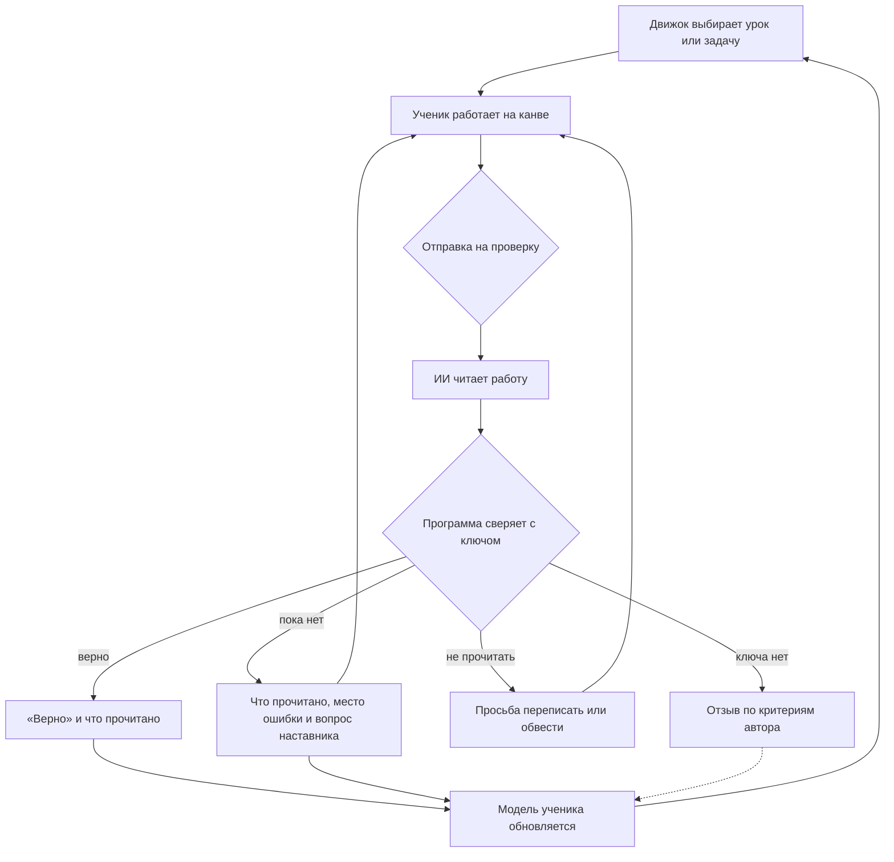
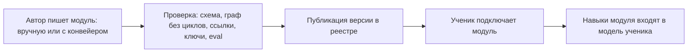

# NovaTrail — продуктовый документ

> Статус: черновик для обсуждения, 2026-10-18.
>
> Первый документ платформы: что строим, для кого и зачем, что войдёт в первый срез и что ещё не решено. Понятия — в [concepts.md](concepts.md), приватность и возраст — в [privacy.md](privacy.md), архитектура — в [architecture.md](architecture.md), репозитории — в [repositories.md](repositories.md), решения — в [decisions.md](decisions.md). Открытые вопросы О-… — в разделе 13.
>
> Технологии здесь не описаны: их решают репозитории (R11).

## 1. Суть

**Что это.** NovaTrail — открытая платформа, на которой любой предмет становится интерактивным уроком с ИИ-наставником: математика, испанский, физика, рисование — для детей и для взрослых.

- Предмет приходит **модулем**: граф навыков, уроки, задачи, типичные ошибки, приёмы и вид канвы. Модуль может написать любой автор (R02).
- Ученик работает на **канве**: пишет от руки, рисует, вводит текст, двигает предметы, говорит.
- **ИИ-наставник** читает работу ученика и говорит с ним текстом и голосом. Верен ли ответ, решает программа по ключу задачи, а не модель (R03).
- **Модель ученика** сводит навыки всех модулей воедино, а **движок** выбирает следующий урок или задачу.

**Главная идея: модуль — это данные для движка, а не инструкция для модели.**
- Навык Claude — инструкции, которые модель исполняет так, как их поняла.
- Модуль NovaTrail — проверенные схемой данные, которые платформа исполняет одинаково. Тот же модуль той же версии и то же состояние ученика дают тот же выбор задачи и тот же вердикт на то же прочтение работы.
- ИИ работает только на входе, где читает работу, и на выходе, где подбирает слова (R03).

**Чем отличается:**
- **от чата с ИИ:** у чата нет ключа, модели ученика и пути по навыкам; он может выдать ответ и ошибиться в проверке;
- **от тренажёров с тестами:** ученик решает свободно — от руки, словами, на стенде, — и наставник смотрит ход решения, а не только ответ;
- **от курсов:** путь адаптивный — по графу навыков и модели ученика, а не по общему плану;
- **от репетитора:** доступен каждый день и дешевле. Репетитор при этом может стать автором модуля или вести ученика вместе с платформой.

## 2. Откуда мы пришли

**MathTrail** — семейство продуктов по олимпиадной математике для 1–6 класса (организация `mathtrail` на GitHub):
- **mathtrail-standalone** — бесплатное открытое приложение для Claude и ChatGPT. Задачи пишет модель чата, а программа проверяет их решателем. Здесь живут модель ученика (модель Раша с обновлением по Elo) и каталог ловушек, а профиль ребёнка хранится файлом в Google Drive семьи.
- **MathTrail Canvas** (`canvas-api`) — репетитор, где ребёнок решает от руки на листе. ИИ читает ответ, программа сверяет его с ключом, а наставник обводит место ошибки и задаёт наводящий вопрос.

**Что дал MathTrail:**
- **механику** «ИИ читает, программа решает, наставник спрашивает», задуманную независимой от предмета (R37 canvas-api). Главную гипотезу — что ИИ понимает свободное решение ученика и верно читает ответ — MathTrail проверить не успел (R60 canvas-api). Её проверит первый срез NovaTrail (R08);
- **модель ученика и правило выбора задачи**, которые работают без ИИ и проверены на стенде виртуальных учеников (standalone);
- **закрытый каталог типичных ошибок**, который превращает неверный ответ в диагноз (SPEC 1.3 standalone).

**Почему теперь платформа.** MathTrail был заточен под олимпиадную математику 1–6 класса и закрывал всё остальное. NovaTrail — тот же проект, но предмет, возраст и канва вынесены в модули (R01).

**Что берём:**
- принципы проверки и подсказки;
- модель ученика и стенд;
- каталоги тем, ловушек и приёмов;
- 705 эталонных задач с ловушками и 33 шаблона с решателями — standalone на коммите 89986bc (R05 modules);
- каркас сервисов, среду разработки и поставку.

Что откуда переносится — repositories 7.

**Чего не берём как есть:**
- монолит canvas-api — NovaTrail нарезан на репозитории с первого дня (R10);
- «только дети»;
- «только английский»;
- одного поставщика ИИ.

MathTrail заморожен (R01).

## 3. Для кого и зачем

| Кто | Что получает |
|---|---|
| Ребёнок (6–12) | решает так, как привык: от руки, рисунком, словами; получает вопрос вместо «красной ручки»; учится находить ошибку сам |
| Подросток | то же для школьных предметов и за их пределами; больше самостоятельности. Свой ли у него аккаунт, решит П-13 |
| Взрослый ученик | язык, физика, рисование — в своём темпе, с наставником, который смотрит ход решения; со своим ключом ИИ — бесплатно (R07, О-4) |
| Взрослый рядом с ребёнком: родитель, опекун, репетитор | видит прогресс и повторяющиеся ошибки; настраивает наставника; может вести занятие вместе с ребёнком. Данными управляет только владелец аккаунта — родитель или опекун (R06) |
| Автор модуля: методист, учитель, энтузиаст, организация | готовая среда урока, наставник, модель ученика и движок — пишет только содержание; получает инструменты проверки и публикации |
| Учителя и школы — позже | группы и сводка частых ошибок |
| Оператор, self-hosting | открытый код: свою копию платформы можно развернуть самому (R12) |

## 4. Как проходит обучение

Ответ вводом или выбором ИИ не читает: его сразу проверяет программа.

- **Три входа** — из прототипа:
  - **«Мои предметы»** — движок ведёт по подключённым модулям;
  - **«Карта навыков»** — ученик выбирает навык на карте и видит, что освоено, что открывается и на что опирается;
  - **«Задача с моей бумаги»** — ученик фотографирует домашний лист и отмечает на снимке нужные задачи, а к ИИ уходят только их вырезки (О-11).
- **Два режима — «по шагам» и «сам».**
  - По шагам — приложение ведёт по шагам решения модуля, а наставник говорит на каждом: в олимпиадной математике это шаги Пойа.
  - Сам — ученик решает сам, а наставник отвечает, только когда его позвали.

  Режим по умолчанию выбирает взрослый, у нового профиля это «по шагам», а ученик переключает его на задаче (concepts 10).
- **Экраны** описаны в README прототипа ([draft/README.md](../draft/README.md)): предметы и модули, персонаж-друг, канвы с инструментами, панель шагов, подсказки, проверка, прогресс, раздел для взрослых.

## 5. Модули и авторы

Модуль — пакет одного автора (concepts 3). Путь модуля от автора к ученику:

- **Конвейер** помогает автору: размечает навыки и ловушки, предлагает варианты задач. Всё, что сделал ИИ, автор проверяет до публикации. Опубликованный модуль — это уже неизменные данные (R03).
- **Официальные модули** пишет и поддерживает проект; **сторонние** — любой автор. Кто и как публикует — О-9.
- **Обновление модуля не ломает прогресс:** ID навыков стабильны, а несовместимые изменения несут таблицу соответствия старых ID новым (concepts 3).
- **Модуль проверяется на качество чтения.** Перед публикацией платформа убеждается, что ИИ надёжно читает работу в видах канвы и ответа этого модуля. Проверка идёт на образцах из eval-набора модуля: синтетических или сделанных для eval взрослыми добровольцами и авторами, но не на работах учеников (R02, concepts 3).

## 6. ИИ на платформе

**Что ИИ делает:**
- читает работу ученика — рукопись, речь, фото, рисунок — и превращает её в наблюдение (concepts 9);
- подбирает слова — подсказку, объяснение, похвалу — по правилам и с проверками (concepts 10);
- помогает автору готовить модуль — до публикации, под его проверкой.

**Чего ИИ не делает никогда:** не решает, верен ли ответ, и не выбирает следующую задачу (R03). Платформа не передаёт ему имени, идентификаторов и данных взрослого (privacy 5).

**Два пути к ИИ** (R07):
- **ИИ платформы** — по подписке, через договоры платформы с поставщиками;
- **свой ключ** — владелец аккаунта, который учится сам, подключает к своему профилю категории `adult` свой ключ OpenAI, Anthropic или другого поставщика и пользуется платформой бесплатно (R84; поправка 2026-11-02 к R07).

**Модели допускаются по eval.** На каждую возможность ИИ — свой список точных ID моделей, прошедших eval этой возможности. Свой ключ не открывает модель, которая eval не прошла (concepts 14).

**Возраст.** У поставщиков свои правила о несовершеннолетних, и платформа их соблюдает (privacy 5.3). Сверка 2026-10-18:
- Gemini API нельзя использовать в сервисе, которым вероятно пользуются люди младше 18. Раз платформа открыта детям, этот путь закрыт для всех её учеников, взрослых тоже, — и через ИИ платформы, и со своим ключом. Сверка 2026-10-22 нашла тот же запрет и для генеративного ИИ Google Cloud, Vertex AI тоже: модели Google закрыты на всей платформе, для всех учеников, а можно ли их в отдельном развёртывании только для взрослых, — вопрос к юристу (R47; П-3).
- OpenAI требует zero data retention для персональных данных детей младше 13 или младше возраста цифрового согласия их страны. Этот режим OpenAI включает только по предварительному одобрению, и у обычного ключа семьи его нет.
- Anthropic возлагает меры защиты на организацию, которая обслуживает несовершеннолетних. Что это значит для ключа семьи — вопрос к юристу (П-4).

Отсюда рекомендация: свой ключ — для взрослых, дети учатся через ИИ платформы (О-4, О-5).

## 7. Принципы

1. **Модуль — данные.** Ядро не знает ни одного предмета; модуль не даёт модели инструкций (R02).
2. **Вердикт выносит программа.** ИИ читает работу и подбирает слова; верность решает ключ или условие (R03).
3. **Ложная тревога хуже отсутствия проверки.** Сомнение — просьба переписать, сбой — нейтральная фраза, но никогда не «ошибка» (R04).
4. **Нет детерминированной проверки — нет вердикта.** Оценка по рубрике — это отзыв. Задача с бумаги без проверенного ключа не получает вердикта и не двигает рейтинг (R04, concepts 9.4).
5. **Наставник сам ответ не называет.** Он задаёт один короткий вопрос и указывает место в работе ученика (R05).
6. **Ключ не уходит на устройство ученика**, пока задача не решена (R05).
7. **Работа ученика неприкосновенна.** Наставник пишет только на своём слое (R05).
8. **Показываем, что прочитали.** «Прочитано: 6» — и ученик сразу видит, если ИИ прочитал не то (R05).
9. **Без «красной ручки» и давления.** «Пока нет» вместо «неверно»; для детей — без таймеров и соревнований; без рекламы и тёмных паттернов.
10. **Прогресс переживает обновление модуля** (concepts 3).
11. **Любая модель ИИ — только после eval** (R07).
12. **Данных — минимум, и они у ученика или семьи.** Выгрузить и удалить — в один шаг (R09).
13. **Открытость.** Код, документы и содержание официальных модулей — под Apache-2.0 (R12, R20), формат модуля — открытый стандарт.

## 8. Возраст и данные

- Платформа — для любого возраста (R06). Ребёнок учится под аккаунтом взрослого, взрослый — под своим.
- Возраст ученика и страну указывает владелец аккаунта. Платформа хранит возрастную категорию, а не дату рождения (concepts 13).
- О ребёнке хранится минимум: псевдоним, аватар, возрастная категория, страна, язык интерфейса и стиль подачи, а интересы — когда формат даст оформление задачи под них (privacy 4).
- Штрихи остаются на устройстве. ИИ получает картинку работы без имени и идентификаторов (privacy 1).

Подробно — в [privacy.md](privacy.md).

## 9. Распространение и деньги

- **Открытый код** (Apache-2.0): любой может развернуть свою копию со своими ключами.
- **ИИ платформы — по подписке.**
  - В прототипе это бесплатная дневная квота помощи наставника и тариф Plus за $10 в месяц с квотой в пять раз больше.
  - Цены и квоты — О-14. Юнит-экономику сначала оценим, а потом уточним замерами, как в MathTrail Canvas (product 9 canvas-api).
- **Свой ключ — бесплатно**, но не для всех (О-4).
- **Режим без ИИ.** Ответ вводом или выбором, проверка программой, подсказки автора — без вызовов ИИ и почти без затрат. Это бесплатный путь, открытый и детям (О-5).
- **Гранты** на открытое и бесплатное образование. Открытый код, свой ключ и режим без ИИ отвечают требованию «открыто и бесплатно». Пакет MathTrail для грантов — логическая модель и реестр данных — образец на потом.

## 10. Первый срез

**Цель** — доказать универсальность: три модуля двух непохожих предметов — математики и письма — проходят через одну платформу, и в ядре нет кода ни одного предмета (R08, R41).

**Модуль 1 — олимпиадная математика 1–6** из MathTrail:
- ученик — ребёнок, работа — рукопись на листе. Паспорт называет в аудитории и взрослых, `adult`: первое приложение тестирует взрослый (R76);
- ответ — число от руки; выбор варианта — у задач, чей ответ не число или чей вопрос указывает на варианты (R05 modules);
- шаги Пойа, приёмы и ловушки;
- объяснения — на английском, как задачи standalone и примеры формата; тот же модуль на русском — другой модуль, со своим именем (R07 modules);
- 705 эталонных задач standalone на коммите 89986bc (R05 modules).

**Модуль 2 — школьная математика 3 класса** (R41):
- ученик — ребёнок, канва — рабочая тетрадь: пункты задачи стоят на нестираемом слое шаблона;
- задача — страница из многих однотипных пунктов (concepts 6);
- ответ — число или дробь от руки в ячейке ответа рядом с пунктом, и вердикт — на каждый пункт.

**Модуль 3 — короткие сочинения на английском** (R41):
- ученик — любого возраста, ребёнок или взрослый, а стиль подачи — по возрасту; канва — лист для рукописи;
- сочинение от руки в произвольной форме получает отзыв по рубрике — оценку по критериям автора, а не вердикт (R04). Задания с ключом — например, выбрать лучшее первое предложение — получают вердикт;
- это письмо, а не языковой модуль: объяснения — на английском, изучаемого языка нет.

**Входит** (предварительно):
- формат модуля v0 и три модуля;
- подписанный индекс модулей и CLI автора, который проверяет модули (`module-kit`, R17);
- модель ученика, движок и стенд виртуальных учеников;
- замер чтения ИИ — на образцах, которые для eval делают взрослые добровольцы, в том числе подражая детскому почерку. Образцы детей — только с отдельным согласием (П-10) и до беты: цель по детскому почерку надо проверить на нём самом. Первой идёт доска проверки `tutor`: автор сам решает задачи и отмечает, права ли модель (R43). За ней шёл замер хода письма на моделях Claude — на листе автора и 39 листах, которые нарисовал код: он сделан 2026-10-26 (R52), а остальные замеры чтения — эпик E4 `tutor` (поправка 2026-10-26 к R43);
- два вида канвы — лист для рукописи и рабочая тетрадь;
- проверка с вердиктом и наставник с вопросом; отзыв по рубрике (R04);
- озвучка слов наставника и открытых текстов модуля синтезом речи устройства — только голосами по правилу Т-13, без сервера и без новых данных, кроме настройки в стиле подачи (О-23). Её код — после первого приложения и до первого ребёнка (R76; В19 `app`; R07 app);
- карта навыков на три модуля;
- аккаунт взрослого ученика и аккаунт взрослого с ребёнком — это может быть один аккаунт (R26);
- проверяемое согласие родителя и договоры с поставщиками ИИ — до первого ребёнка (П-1, П-3);
- ИИ платформы — без оплаты, в пределах квоты, для участников закрытого среза (О-14); свой ключ — для взрослых (О-4);
- веб-приложение для планшета и компьютера.

**Не входит:**
- сторонние авторы и виджеты;
- текстовая канва и языковые модули (R41);
- сервис реестра и конвейер;
- задачи с бумаги;
- голосовой ввод;
- свой текст ученика наставнику: строка разговора первого среза — кнопки просьб, подсказка и «объясни иначе» (R82; architecture 3.1). Свой текст — позже, своей возможностью `tutor`, с её eval, проверкой утечки в ответе и строкой в privacy 4;
- подписка с оплатой;
- школы и учителя;
- канал MCP;
- офлайн-режим и нативные приложения.

**Критерии успеха:**
- второй и третий модули не потребовали кода предмета в ядре — только общих видов канвы и проверки;
- ИИ читает работу во всех трёх модулях с целевым качеством: ответ на листе, ячейки ответа в тетради и сочинение. Это замер на образцах до беты, как E2 в MathTrail Canvas; главная метрика там, где есть вердикт, — ложные тревоги, в canvas-api её цель — не больше 1 % (product 12 canvas-api). Зеркальная цифра — «не прочитать», и ученик её переписывает, а ложная тревога на ней в эту цель входит. eval-набор тетради меряет такие цифры отдельной строкой: на синтетике `tutor` ложных тревог на них — 31–41 %, а на зачёркнутых — около 16 % (поправка 2026-10-29 к R56);
- оценка по рубрике проходит eval своей возможности ИИ по мере R71: главная — ложные тревоги на выполненных критериях, а цель задаёт замер `tutor` на сочинениях взрослых добровольцев (П-16);
- на стенде виртуальных учеников движок ведёт себя разумно на всех трёх графах: держит коридор успеха там, где есть вердикт, идёт порядком автора там, где его нет (concepts 4), не зацикливается и не объявляет «освоено» раньше времени;
- ребёнок и взрослый проходят уроки своих модулей от начала до конца.

Формат модуля v1 фиксируется только после этого (R08).

## 11. Дорожная карта

| Этап | Что | Репозитории |
|---|---|---|
| 0. Основание | документы, решения, словарь, архитектура | spec, .github |
| 1. Формат и ядро | схемы модуля v0; три модуля; индекс модулей и CLI автора; модель ученика, движок и стенд | spec, modules, module-kit, learner-model, engine, sim |
| 2. Первый срез с учеником | замер чтения ИИ; канвы, проверка, наставник, карта навыков; аккаунты; согласие родителя и договоры с поставщиками ИИ до первого ребёнка; ИИ платформы и свой ключ | tutor, canvas, api, app, skill-map, infra |
| 3. Бета и публичный запуск | DPIA и проверка юристом; подписка; голос; ещё поставщики ИИ; сайт | site; api, tutor, app |
| 4. Авторы | сервис реестра, публикация сторонних модулей, конвейер, образец виджета, чужие виджеты в iframe-песочнице | module-registry, module-pipeline, widget-template |
| 5. Дальше | школы и учителя; канал MCP; задачи с бумаги; офлайн; новые языки интерфейса | — |

В каком порядке появляются репозитории — repositories 6.

## 12. Риски и гипотезы

| Риск или гипотеза | Почему важно | Что делаем |
|---|---|---|
| ИИ плохо читает работу в каком-то предмете | ложные тревоги, ученик перестаёт верить наставнику | замер до беты по каждому виду канвы и ответа; при сомнении — просьба переписать (R04) |
| Универсальность окажется иллюзией | формат модуля прогнётся под математику | модули двух предметов в первом срезе, и у сочинений нет ключа; формат v1 — после всех трёх модулей (R08, R41). Текстовую канву и языковой модуль первый срез не проверяет (R41) |
| Чужой код виджетов в приложении, где учатся дети | доступ к странице, токенам и сети | в первом срезе чужих виджетов нет; дальше — iframe-песочница (R16) |
| Свой ключ | слабая модель ломает проверку; ключ утекает; нарушаются условия поставщика | только модели после eval; ключ не хранится на сервере, а на устройстве — только по выбору владельца ключа (R84); свой ключ — по возрастной категории (О-4) |
| Условия поставщиков о несовершеннолетних | дети остаются без ИИ, или платформа нарушает условия | сверка условий с датой; ИИ платформы по договорам, которые допускают детей; режим без ИИ (privacy 5) |
| Голос | голос ребёнка — персональные данные, голосовой отпечаток — биометрия (COPPA) | озвучка — всем; голосовой ввод детей — после юриста (П-5) |
| Цена ИИ платформы | подписка не окупает худший месяц подписчика | квоты; юнит-экономика — оценка, потом замеры (О-14) |
| Качество сторонних модулей | ошибки в ключах; содержание, которое не годится детям | проверка при публикации; сначала только официальные модули (О-9) |
| Больше десяти репозиториев на маленькую команду | накладные расходы на CI, версии и релизы | репозитории заводятся сразу (R18), а код, CI и релизы появляются по порядку repositories 6; один образец репозитория |
| Модель ученика не переносится между предметами | движок выбирает задачи невпопад в языке и рисовании | уровень на модуль, забывание; стенд с критерием, записанным до первого прогона (concepts 11) |

## 13. Открытые вопросы

Каждый вопрос: суть, варианты, рекомендация и что он блокирует. Номера не меняются: решённые вопросы переезжают в 13.1. Новые вопросы получают следующий номер — О-26.

### 13.1. Решено

Строка решённого вопроса переезжает сюда как была, а в графе вопроса — пометка «решён», номер решения и короткий ответ.

| № | Вопрос | Варианты | Рекомендация | Блокирует |
|---|---|---|---|---|
| О-1 | Второй модуль первого среза — **решён: R41**: вместо одного второго модуля — два, школьная математика 3 класса на рабочей тетради и короткие сочинения на английском для любого возраста | испанский A1 для взрослых; физика со стендом; школьная математика — лист с дробями | испанский A1: он не похож на математику ни предметом, ни возрастом ученика, ни канвой, ни видом ответа, ни языком | первый срез, формат v0 |
| О-3 | Язык нормативных текстов для авторов: формат модуля, протокол виджета, руководства — **решён: R42**: английский и вне `docs/`, а формат модуля — в папке `format/` | русский, как документы (R14); английский | английский: стандарт, по которому пишет «любой автор», не может быть только русским. Описательные документы остаются на русском | этап 4 |
| О-7 | Показ решения по просьбе ученика — **решён: R82**: по кнопке, и показ закрывает попытку исходом «решение показано», без своей ловушки. Ребёнку — с четвёртого неверного ответа, когда лестница подсказок пройдена, а при настройке взрослого «спросить перед показом», по умолчанию включённой, — действием взрослого; ученику категории `adult` — с начала попытки. Ключ и решение уходят на устройство, только когда попытка закрыта верным ответом или показом (В10 `api`; R09 api) | никогда (R39 canvas-api); по кнопке, задача «пропущена» и рейтинг не меняется (прототип); по кнопке, задача «не решена» | по кнопке; исход «решение показано» — свидетельство «не решено», без ловушки. Ребёнку — после лестницы подсказок и с настройкой взрослого «спросить перед показом»; взрослому — свободно | наставник, модель ученика |
| О-8 | Что наставник делает, когда ученик замолчал (дополнено 2026-10-21: вариант «живого» режима из анализа автора — раздел 14 — и решение по данным замера `tutor`; дополнено 2026-10-22: замер отложен до решения автора по данным доски проверки, R43, и решение ждёт вместе с ним) — **решён: R69**: работу читают только по действию ученика — по «Проверить», а в режиме «по шагам» ещё и по «шаг готов». На паузе — только мигание кнопки, без вызова ИИ, и пауза к ИИ не уходит (R52). Замер E4 `tutor`: чтение после строки дало «верно» или «пока нет» до того, как написан ответ, в 94 вызовах из 196, а политика пауз от 0,4 с — 15,6 чтения на лист синтетики и 54 на живом письме | ничего, проверка только по кнопке (R61 canvas-api); читает работу на паузе (прототип); «живой» режим: наставник сам читает работу по событиям канвы и говорит голосом (анализ автора) | проверка — только по кнопке. На паузе наставник может напомнить про кнопку, но работу не читает и вердикта не выносит. Ученик, который пишет «12», делает паузу после «1»: «прочитал 1» сбило бы его, а при ключе 1 «верно» было бы ложным. К тому же каждое чтение — вызов ИИ: неотправленная работа ушла бы поставщику, и это стоило бы денег. Решить по данным замера `tutor`: как часто чтение на паузе даёт «пока нет» или «верно» не к месту и сколько чтений на лист даёт каждая политика паузы (architecture 3.1 tutor). Уточнено 2026-10-22 (В17 `tutor`): читать — только по действию ученика: по «Проверить», а в режиме «по шагам» ещё и по «шаг готов». На паузе — мигание кнопки, без вызова ИИ. Пауза — только отметка в ходе решения для разбора (R11 tutor), а не повод читать. Замер читает и состояния на паузе внутри строки — без ученика, на своих образцах — и считает, сколько чтений на лист дала бы каждая политика паузы, 0,4, 2 и 6 с: так он и покажет, держится ли эта рекомендация (R10 tutor). Паузы в детском письме короткие и частые: «The average duration of handwriting pauses was around 400ms», в 3 классе — около 1,8 паузы на букву, в 5-м — 1,42, а порог в 2 с, которым обычно делят паузы, обоснован слабо: «A two-second threshold has been typically used when analyzing the writing processes. However, there is only a weak empirical basis to claim that specific average numbers and durations of pauses may be associated with specific writing processes» ([Pascual, Soler & Salas 2023](https://www.frontiersin.org/journals/psychology/articles/10.3389/fpsyg.2022.1052264/full), прочитано 2026-10-22). canvas-api считал строку законченной после 6 с без касания (R16 canvas-api), и его первая версия «показывала ложную ошибку на недописанной строке»; проверку каждого шага по паузе он потом отверг (R37 canvas-api). Решить — по выводам замера, когда он вернётся (R43). Дополнено 2026-10-26 (В20 `tutor`): вернувшийся замер мерил только пользу хода письма на дописанных листах: долгие паузы были в журнале действий, а чтения на паузе и состояний внутри строки он не мерил (R24 tutor). Решение ждёт замера эпика E4 `tutor` | канва, цена, privacy 1 |
| О-12 | Генерация задач на лету — **решён: R60**: опубликованный пул и шаблоны с параметрами. Числа — от зерна попытки, ключ каждого экземпляра считает программа ещё при проверке модуля, а задачи с помощью ИИ — только при подготовке модуля, и автор их проверяет | опубликованный пул; шаблоны с параметрами; генерация ИИ с проверкой решателем, как в standalone | пул и шаблоны с параметрами: числа — от зерна (seed), ключ — от решателя. Генерация ИИ — только при подготовке модуля | engine, формат модуля |
| О-18 | Ярус навыка: задаёт автор или он вычисляется — **решён: R49**: вычисляется по самой длинной цепочке пререквизитов модуля под навыком, а имена ярусам даёт автор | задаёт автор; вычисляется по графу; вычисляется, а автор даёт ярусам имена | вычисляется по графу — по самой длинной цепочке пререквизитов, как в standalone: ярус тогда не может разойтись с графом. Автор даёт ярусам имена | формат v0, карта навыков |
| О-19 | Может ли автор задать порядок уроков всего модуля — **решён: R58**: через граф навыков, без нового поля. Урок идёт после уроков, которые учат пререквизитам его навыков, а где граф порядка не даёт, выбирает правило движка; у навыков без вердикта — без адаптации | нет: следующий урок всегда выбирает движок, а порядок задаёт только граф навыков (concepts 12); пометка в паспорте модуля: уроки идут в порядке автора, а движок только добавляет закрепление и повторение — как Sequential и Adaptive в прототипе; порядок автора — путь по умолчанию, с которого движок уходит по модели ученика | порядок — через граф навыков. У последовательного модуля граф — цепочка, и движок идёт по ней, как по любому графу: с закреплением после ошибки, с повторением и с пропуском того, что ученик уже знает. Новое поле формата не нужно, и следующий урок по-прежнему выбирает движок (R03). Пометку «последовательный» приложение выводит из графа | формат v0, engine |
| О-21 | Подсказка по просьбе ученика — **решён: R82**: до первого неверного ответа просьба даёт «что известно и что найти» и приём задачи, после — слова текущей ступени ещё раз, без ИИ, а «объясни иначе» — ту же ступень другими словами, один вызов ИИ на ступень, без работы. Ячейка ступени — первая «пока нет» по порядку. Исхода свидетельства просьба не меняет: свидетельство несёт приём — на шаге или по просьбе — и сколько раз ученик просил «иначе», а что он видел «что известно и что найти», не записывается: они открыты и способа не подсказывают (R57) (В10 и В11 `api`; R10 api). | только лестница: до первого неверного ответа подсказки нет, и просьба зовёт отправить работу; до отправки — то, что модуль даёт шагам решения: что известно и что найти, приём, набросок «как начать», если модуль его даёт, — без ИИ и без чтения работы, а после неверного ответа — текущая ступень; просьба отправляет работу на чтение без вердикта, и вопрос задаётся по месту в ней; каждая просьба поднимает ступень | второй вариант. Неотправленная работа не уходит поставщику — доводы те же, что у О-8. Ступень растёт только с неверными ответами (R03): если бы её поднимала просьба, ученик доходил бы до похожего случая попроще и до решения, не пробуя сам. «Объясни иначе» — та же ступень другими словами: вызов ИИ в пределах квоты, с прошлыми вопросами той же задачи (privacy 4), а без ответа модели — запасной текст (concepts 10). Как подсказка по просьбе входит в свидетельство, решить вместе с весами `learner-model`: у наброска свой исход — «с наброском-подсказкой», а «после подсказки номер k» до первого неверного ответа не подходит — ступени ещё нет (concepts 11). Чтение по просьбе пересмотреть по данным замера `tutor` о чтении недописанной работы (О-8) | формат v0 — подсказки (RUN.md, T30); `api` — лестница подсказок; `app`; вес свидетельства в `learner-model` |
| О-22 | Чем мерить оценку по рубрике. Ложные тревоги считаются по вердикту (architecture 4.6; repositories 4), а у отзыва по рубрике вердикта нет: выполнен ли критерий автора, решает ИИ. В первом срезе такой отзыв даёт модуль сочинений (R41) — **решён: R71**: главная мера — доля ложных тревог на выполненных критериях, вторая — согласие с оценкой людей и каппа Коэна по критерию. Цель и eval-набор задаёт замер `tutor` на сочинениях взрослых добровольцев (П-16): синтетика E4 для цели слишком ровная | доля критериев, которые ИИ назвал невыполненными, когда они выполнены; согласие с оценкой взрослых по каждому критерию; в первом срезе — без цели, а отзыв помечен как мнение ИИ | первое — главной метрикой: отзыв, который не видит сделанного, сбивает ученика так же, как «пока нет» на верном ответе (R04). Согласие со взрослыми — второй метрикой. Цель и eval-набор возможности задаёт замер `tutor` — на сочинениях, которые пишут взрослые добровольцы (repositories 6) | оценка по рубрике в `tutor`; критерии успеха первого среза (раздел 10); допуск моделей (architecture 4.6) |
| О-24 | Уровень доступности интерфейса и прокрутка листа одним указателем (В41 `canvas`, 2026-10-26) — **решён: R90**: у всех пакетов интерфейса — `app`, `canvas` и `skill-map` — WCAG 2.2 уровня AA и сверх него 2.5.5 и 2.3.3; чему пакет пока не отвечает, он объявляет сам, а `app` называет это на странице «Доступность»; лист одним указателем прокручивают кнопки «Выше» и «Ниже» строки `canvas` (R33 canvas). Стандарт пришёл из R11 app строкой В30 `app`. Какой уровень WCAG обязателен `app` и пакетам интерфейса, `spec` не решил: общий для пакетов стандарт доступности передаст строкой «в реестр spec» T07 `app` — в карточке `app` это «доступность интерфейса» (architecture 3.1), — и он дополнит этот вопрос. От уровня зависит прокрутка листа `canvas`. Холст закрывает видимую часть листа, а на холсте — `touch-action: none`. С T35 `canvas` (R29 canvas) лист на холсте прокручивают два пальца, своим кодом: пустить пальцу родную прокрутку, а перу — письмо нельзя, ведь `touch-action` действует и на перо — «it does in fact apply to all forms of pointer inputs that allow direct manipulation for panning and zooming» ([Pointer Events Level 3](https://www.w3.org/TR/2026/REC-pointerevents3-20260630/), W3C Recommendation 30 June 2026). Об этом открыта [issue #203](https://github.com/w3c/pointerevents/issues/203) W3C: «you might want the pen to draw by default, while still allowing a finger to scroll. That's not possible to express with `touch-action` today». На планшете, где экран не шире 1000 CSS px, у элемента с высотой лист одним пальцем не прокрутить: холст закрывает всю ширину листа, а строка кнопок прокручивает страницу, а не контейнер. У элемента без высоты лист прокручивается со страницей, родной прокруткой. Критерии [WCAG 2.2](https://www.w3.org/TR/WCAG22/), W3C Recommendation 12 December 2024: 2.5.1 Pointer Gestures, уровень A, — «All functionality that uses multipoint or path-based gestures for operation can be operated with a single pointer without a path-based gesture, unless a multipoint or path-based gesture is essential»; 2.5.7 Dragging Movements, уровень AA, — «All functionality that uses a dragging movement for operation can be achieved by a single pointer without dragging, unless dragging is essential or the functionality is determined by the user agent and not modified by the author». По [Understanding 2.5.7](https://www.w3.org/WAI/WCAG22/Understanding/dragging-movements.html) к родной прокрутке критерий не относится — «This criterion does not apply to scrolling and dragging gestures enabled by the user agent», — но «does apply if content actively suppresses the user agent's own scrolling functionality and/or implements its own scrolling mechanism», а «achieving keyboard equivalence for a dragging operation does not automatically meet this success criterion». Цель кнопок строки `canvas` — 44 × 44 CSS px, как в 2.5.5 уровня AAA (R36), а уровень AA требует 24 × 24 — 2.5.8. Всё прочитано 2026-10-26. Дополнено 2026-10-27 (В44 `canvas`): прокрутку одним указателем `canvas` решил первым вариантом — кнопками «Выше» и «Ниже» в строке элемента, на любом устройстве (R33 canvas). Нажатие прокручивает то же, что два пальца, на ⅘ видимой части, так что элемент с высотой отвечает 2.5.1 и 2.5.7 и на узком планшете, и `app` может давать ему высоту: вариант «`app` не даёт элементу высоты на устройствах с касанием» больше не нужен. Открытым остаётся уровень доступности: его задаёт стандарт T07 `app`. К этому стандарту — ещё две находки `canvas`. В Safari контейнер прокрутки без фокусируемого содержимого с клавиатуры не прокрутить, и это касается и прокрутки самого `app`: ошибка WebKit [277290](https://bugs.webkit.org/show_bug.cgi?id=277290) «AX: Scrolling containers inoperable with keyboard» — «For containers that allow scrolling, a keyboard-only user cannot scroll the container», — заведена 2024-07-29, статус NEW. Печатный текст строк рабочей тетради, как и лист, не растёт с масштабом страницы сверх вписывания по ширине (R23 и R34 canvas), а 1.4.4 Resize Text требует: «Except for captions and images of text, text can be resized without assistive technology up to 200 percent without loss of content or functionality». Перекладки строк, по оценке `canvas`, не нужно: страница тетради подпадает под исключение 1.4.10 Reflow — «Except for parts of the content which require two-dimensional layout for usage or meaning». Ошибка WebKit и WCAG 2.2 прочитаны 2026-10-27 | кнопки «Выше» и «Ниже» в строке элемента: они прокручивают лист на видимую часть той же прокруткой, что и два пальца; `app` не даёт элементу высоты на устройствах с касанием, и лист прокручивается со страницей, родной прокруткой; исключение для листа в стандарте доступности | кнопки «Выше» и «Ниже», если стандарт потребует уровня AA, — рекомендация `canvas`: это две кнопки и две подписи, а сама прокрутка уже есть. Элемент без высоты связывает раскладку `app`, а исключение оставляет без замены ученика, которому два пальца не под силу. Решать вместе со стандартом T07 `app`; у `canvas` вопрос — в architecture 2.6 canvas, с его T35 и R29 canvas (коммит a89ea3a). Дополнение исполнителя: по [Understanding 2.5.1](https://www.w3.org/WAI/WCAG22/Understanding/pointer-gestures.html) своя прокрутка двумя пальцами — жест нескольких точек, «a two- or three-finger tap or swipe», и критерий уровня A касается её: «This success criterion applies to gestures in the author-provided content». На уровне A заменой годится и перетаскивание одним пальцем — 2.5.1 «does not apply to gestures that involve dragging in any direction», — а на уровне AA уже нет (2.5.7). У элемента с высотой на узком планшете нет и перетаскивания, так что без одного из трёх вариантов лист не отвечает уже уровню A; прочитано 2026-10-26 | стандарт доступности пакетов интерфейса — T07 `app`; строка кнопок `canvas`; раскладка экрана задачи в `app` |

### 13.2. Открыто

| № | Вопрос | Варианты | Рекомендация | Блокирует |
|---|---|---|---|---|
| О-2 | Языки интерфейса и объяснений в первом срезе | английский; английский и русский; больше | английский и русский; изучаемый язык задаёт модуль. Дополнено 2026-11-02 (В33 `app`; R92): язык интерфейса решён — `en` и `ru`, поле профиля ученика, которое задаёт взрослый, а экраны до выбора ученика и раздел для взрослых — на языке устройства. Открыты языки объяснений модулей среза — с одними английскими модулями русский интерфейс служит взрослым, но не русскоязычному ребёнку, — и десятичная запятая: формат читает `1,5` как два числа ([текст формата](../format/README.md), разделы 15 и 20). Их решают `modules` и product. Дополнено 2026-11-02 (В13 `modules`; R07 modules): объяснения модуля олимпиадной математики — на английском, и это входит в любой вариант. Так английские объяснения у двух модулей среза из трёх (раздел 10), а О-2 остаётся о языках объяснений других модулей и о десятичной запятой. Дополнено 2026-11-07 (В17 `modules`; R15 modules): объяснения набора школьной математики 3 класса — тоже на английском, а модуль сочинений — на английском по R41. Так объяснения всех трёх модулей среза — на английском, и русский интерфейс служит взрослому, но не русскоязычному ребёнку. О-2 остаётся о десятичной запятой и о модулях после среза: тот же модуль на русском — другой модуль ([текст формата](../format/README.md), раздел 10), и его, например `grade-3-math-ru`, можно добавить после среза, не трогая этих. Решить до беты с детьми, когда станет ясно, кому нужен русский | app, тексты модулей |
| О-4 | Для кого свой ключ | для всех; только 18+; по возрастной категории и поставщику | в первом срезе — только 18+; дети учатся через ИИ платформы, по договорам, которые допускают детей. Пересмотреть, когда юрист ответит по каждому поставщику (П-4) | R07, privacy 5 |
| О-5 | Бесплатный путь для детей | бесплатная квота ИИ платформы; режим без ИИ; квота за счёт грантов | режим без ИИ — всегда; небольшая квота ИИ платформы — если позволит экономика | тарифы; модули — задачи с вводом или выбором |
| О-6 | Голосовой ввод | всем; только взрослым; никому | озвучка наставника — всем; голосовой ввод — взрослым с беты; детям — после ответа юриста (П-5) | наставник, privacy |
| О-9 | Кто публикует модули | любой; проверенные авторы; только официальные | на этапах 1–3 — только официальные; с этапа 4 — любой автор, с автоматической проверкой и ревью для модулей, открытых детям. Дополнено 2026-11-02 (В12 `module-kit`; R11 module-kit): с этапа 4 Starlark стороннего модуля — условия проверки в `api` и решатели шаблонов при проверке в `module-registry` — исполняется в отдельном процессе с пределом памяти; как — решают их задачи (architecture 3.5 и 3.13). go.starlark.net памяти не считает и сам советует такой процесс: «There is no way to bound the memory used by a Starlark thread» и «the only reliable approach is to let the operating system help you: evaluate Starlark in a separate process with a tight limit on memory» (README google/starlark-go, коммит 4f4267fb140d, строки 152 и 162–164, прочитано 2026-11-02). Повтор списка берёт за один шаг до 2^30 элементов (`starlark/eval.go`, строка 1158, там же), а нехватку памяти и переполнение стека Go `recover` не ловит: это `throw`, «a fatal error that dumps a stack trace and exits» (`runtime/panic.go`, Go 1.27.3). До этапа 4 модули только официальные, Starlark идёт в процессе, а условия и решатели проходят ревью `modules` (Д10 module-kit) | module-registry |
| О-10 | Лицензия содержания модулей. Официальные модули — Apache-2.0 (R20); открыто — сторонние модули и чужие наборы задач | любая; только открытые; открытые в публичном реестре и любые — в своей копии | лицензия SPDX в паспорте модуля; в публичном реестре — открытые лицензии из списка; «идеи — да, формулировки — свои», как в standalone; DCO для вкладов — решено: R22. Лицензию чужих наборов задач, в том числе MathNet, проверить до использования. Дополнено 2026-11-02 (В11 `modules`; R05 modules): для модуля олимпиадной математики чужие наборы сверены по записям standalone на коммите 89986bc и его прототипа на коммите 0263835 (раздел 14). Формулировки всех 705 задач — свои, по правилу standalone «Nobody else's wording, anywhere» (SPEC 1.5 standalone); 442 задачи 1–4 классов — из прототипа под Apache-2.0, их писал Claude, а проверял автор (D23 прототипа). Идеи и виды задач — из книг в общественном достоянии, из MathNet под CC BY 4.0, кроме задач стран, сохранивших свои права, из GSM8K под MIT и из сборников problems.ru, чьи тексты охраняются: оттуда — только идея или вид задачи. Сличения формулировок с текстами источников не делали ни standalone, ни порт, а источника идеи у задачи нет ни в standalone, ни в формате (R51), так что автора идеи отдельной задачи не назвать. Юристу — два вопроса: обязывает ли к атрибуции идея или вид задачи из материала под CC BY 4.0 или MIT — CC BY 4.0 не ставит условий тому, что можно делать без разрешения (её п. 8(a)), а TRIPS не охраняет идей (ст. 9(2)), — и хватает ли правила и проверки автором для формулировок, которые писала модель, читавшая источники. Порт и первый релиз модуля ответа не ждут: если атрибуция нужна, её строка войдёт в `NOTICE` новой версией модуля. Назвать источники добровольно можно только вне модуля: `NOTICE` держит лишь то, что требуют лицензии ([текст формата](../format/README.md), раздел 10) | реестр; модуль олимпиадной математики его больше не ждёт — дополнено 2026-11-02 (В11 `modules`) |
| О-11 | Задачи с моей бумаги | ИИ решает сам; ключ вводит взрослый; задача найдена в каталоге; без вердикта | вердикт — только при ключе от взрослого, от решателя или из каталога. Иначе вердикта нет, ответ не оценивается и рейтинг не меняется; решение, которое вывел ИИ, можно показать взрослому с пометкой «выведено ИИ», а ребёнку — нет: домашнюю работу за него не делаем. Задачу на снимке отмечает ученик или взрослый, снимок обрезается до неё на устройстве, до вызова ИИ, и задача остаётся на устройстве. Этап 5. Дополнено 2026-11-02 (В11 `learner-model`; R06 learner-model): вердикт по ключу взрослого двигает модель ученика, только когда у задачи есть полоса и сложность на шкале модуля и навыки не от ИИ — например, задача найдена в каталоге или их выбрал взрослый; иначе вердикт показывается, а модель не движется. Свидетельство такой задачи несёт полосу, сложность, навыки и вердикты, но не текст задачи: она остаётся на устройстве. Происхождение полосы и сложности свидетельство получит новым видом, с этапом 5: вид только прирастает (R08 learner-model) | privacy 6, канва |
| О-13 | Ранги и персонаж для взрослых | как в прототипе — всем; по стилю подачи | ранги — номерами: имена рангов убрали, когда родители сочли их бессмысленными (R213 standalone). Персонаж-друг — детям, взрослым по умолчанию — нейтральный наставник. Дополнено 2026-11-07 (В4 `skill-map`; R07 skill-map): что такое ранг, нашла детализация карты навыков. Общего ранга ученика, как в MathTrail, быть не может: уровень — на модуль, и шкалы модулей не складываются (concepts 11). Ранг модуля — номер полосы, в которой стоит уровень модуля, «ранг k из N», номером без имени (R213 standalone); уровня модуля в `GetSkillMap` нет — он только внутри `learner-model`, — так что ему нужны поле контракта и правило `learner-model`, по которому уровень попадает в полосу. Ранг навыка — номер его полосы освоения на шкале модуля, без новых полей, но полоса освоения навыка — высшая из полос, где ему учат, так что у навыка нижней полосы ранг выше первого не поднимется. Рекомендация — ранг модуля, если этот вопрос решит, что ранги видны, а до того — рангов нет: в первом срезе карта их не показывает. Когда они придут, их включит атрибут элемента карты, который ставит `app` по стилю подачи ученика, на обоих видах карты; как стиль подачи держит ранги, решают этот вопрос и О-23 вместе с `app` | app |
| О-14 | Тарифы | квота и Plus за $10 (прототип); три тарифа (R36 canvas-api); другое | решить по юнит-экономике: худший месяц подписчика должен окупаться. До беты ИИ платформы — без оплаты, в пределах квоты, для участников закрытого среза. Дополнено 2026-10-28 (R68): чтение рукописи — два вызова на каждую проверку, два читателя одного поставщика, и юнит-экономика считает оба. Дополнено 2026-11-02 (В12 `api`; R11 и R12 api; architecture 3.6 api) — правило квоты этапа 2, на которое тарифы этапа 3 ложатся без переделки, и вход для этого вопроса. Квота — доллары по оценке `tutor` из сообщения о расходе, на сутки семьи (concepts 14), с потолками профиля и аккаунта. Потолки задаёт тариф аккаунта, а тариф аккаунт получает с инвайт-кодом. Первые значения тарифа «закрытый срез» — $0,50 на профиль и $1,50 на аккаунт. Оценка `api` — по замерам `tutor` и ценам Anthropic, у Opus 5.5 «$4 / MTok» входа и «$20 / MTok» выхода ([Pricing](https://platform.claude.com/docs/en/about-claude/pricing), даты на странице нет, прочитано 2026-11-02): 20 задач за день — ≈ $0,62 в любом режиме. Исправлено 2026-11-02 (В23 и В28 `api`): «шаг готов» в формате v0 работу не читает (поправка 2026-11-02 к R69), и «по шагам» стоит, как «сам»; а слова ступени — вызов, который мерила T76 `tutor`, у Opus 5.5 · `high` — $0,0152 (architecture 3.4 tutor), а не $0,0098 серии T40 — ответа судьи с разбором. При 30 % задач с одной ошибкой это 26 проверок и 26 вызовов слов — похвала после верного ответа, по допущению `api`, стоит, как слова ступени: ≈ 26 × ($0,0086 + $0,0152), где $0,0086 — чтение двумя читателями (architecture 3.6 api). Потолку профиля в $0,50 хватает примерно на 16 задач. Худший месяц аккаунта — не больше $54: сутки семьи не короче 20 часов, и в 30 днях их не больше 36. Потолки этапа 2 — не образец для этапа 3. Если Plus за $10 в месяц с квотой в пять раз больше бесплатной окупает худший месяц, бесплатный день — не больше $10 / (5 × 36) ≈ $0,056, около двух задач: проверка должна подешеветь примерно на порядок, или цены будут другими. Бесплатная квота детям и гранты — по-прежнему О-5 | подписка (этап 3) |
| О-15 | Канал MCP — приложения для Claude и ChatGPT | нет; после первого среза | после первого среза: формат модуля от канала не зависит, а опыт standalone есть | этап 5 |
| О-16 | Товарный знак «NovaTrail» | проверить сейчас; перед публичным запуском | проверить до публичного запуска и до регистрации домена | R13 |
| О-17 | Влияет ли отзыв по рубрике на модель ученика | нет; слабо; как вердикт | в первом срезе — нет: отзыв показывается, но в модель не идёт. Вес — после замеров на модулях с рубрикой. Дополнено 2026-11-02 (В18 `api`): движку идут закрытые попытки задач с рубрикой — задача, причина и время закрытия, без отметок: по ним он держит порядок автора, а мнение ИИ о сочинении выбор не двигает (architecture 3.8). Отметки видит взрослый в прогрессе (R87) | модель ученика, творческие модули; модуль сочинений первого среза (дополнено 2026-10-22, R41) |
| О-20 | Модули программирования: канва кода и проверка запуском программы | не поддерживать: ответ — только вводом или выбором; канва кода — вид канвы платформы, а программу ученика для вердикта запускает песочница на сервере; программу запускает устройство ученика — в iframe-песочнице, как виджет (R16); вердикт — по выводу одного запуска или по тестам автора | канва кода — вид канвы платформы: файлы, редактор, запуск, вывод; язык и его версию задаёт модуль. Вердикт — по тестам автора модуля, а не по выводу одного запуска: Go не ждёт горутин после выхода из `main` (раздел 14), поэтому в прототипе сломанная программа печатает от запуска к запуску разное и однажды может напечатать всё, что нужно, — ложное «верно». Для вердикта программа запускается на сервере, в песочнице без сети и с лимитами времени и памяти: вердикт не зависит от кода на устройстве, как в рекомендации Т-24. Код ученика, как картинка работы, живёт только в памяти запроса и не пишется в журналы (privacy 4, R09). ИИ код не проверяет, а только подбирает слова (R03). Не в первом срезе (раздел 10); какой компонент запускает код и какие языки поддерживать — решить при детализации | модули программирования, виды канвы и проверки |
| О-23 | Что модуль говорит о стиле подачи. Стиль подачи — как платформа говорит и показывает: длина фраз, озвучка, персонаж, ранги (concepts 13). Он идёт по возрасту ученика (R41), и его можно выбрать отдельно (privacy 3.3), а паспорт модуля v0 его не называет (R46). Списка стилей нет ни в документах, ни у компонентов, а персонаж и ранги по стилю — О-13 | ничего: стиль выбирает платформа — по возрасту ученика или по его выбору; паспорт называет стили, которые модуль поддерживает; модуль даёт свои тексты на каждый стиль | ничего в формате v0. Поле без списка стилей закрепило бы только имя, а необязательное поле потом — минорная версия формата (R44). Вернуться, когда `app` и `tutor` решат, из чего стиль состоит: тогда видно, нужно ли модулю что-то о нём сказать. Дополнено 2026-11-02 (В14 `app`; R05 app): режим «по шагам» или «сам» — не часть стиля подачи, а своё поле профиля, «режим по умолчанию» (privacy 4; concepts 10): от возраста он не зависит, у нового профиля это «по шагам», и к ИИ он не уходит. Дополнено 2026-11-02 (В18 `app`; R07 app): озвучка — включена ли она и её скорость, «обычная» или «медленная», — часть стиля подачи в профиле ученика на сервере. У нового профиля категории `under_13` она включена, у старших — выключена, а меняют её и ученик, и взрослый. Она идёт по возрасту, но слов не меняет: к ИИ из стиля подачи уходит только то, что меняет слова, и озвучки среди этого нет (privacy 4; concepts 10). Голос выбирается на устройстве, и `spec` его не знает. Остальное, из чего стиль состоит, ещё ждёт `tutor`, а персонаж и ранги — О-13. Дополнено 2026-11-07 (В22 `modules`; R14 и R16 modules): первые данные с содержания. `english-essays` — для всех четырёх возрастных категорий, и один текст условий, уроков и критериев служит и ребёнку младше 13, и взрослому: короткие простые фразы. Сочинение для взрослых отделено только `age_categories` задачи и урока. У `olympiad-math` в аудитории `under_13` и `adult` — то же: тексты standalone писались для детей, а урок читает и взрослый. Один текст на все возрасты работает, когда фразы простые, а где тема другая, а не только тон, хватает `age_categories` задачи и урока: своих текстов по стилю модуль пока не просит | формат модуля после v0; `app` и `tutor` — стиль подачи |
| О-25 | Второй способ ответа в ячейке с числом (В31 `app`, 2026-11-02). Ответ рукописью не проходит WCAG 2.2, 2.1.1 Keyboard, уровня A: «if using handwriting to enter text, the input technique (handwriting) requires path-dependent input but the underlying function (text input) does not» ([Understanding 2.1.1](https://www.w3.org/WAI/WCAG22/Understanding/keyboard.html), прочитано `app` 2026-11-02; architecture 4 app). В формате v0 ячейку с числом заполняет только рукопись, а ответ с клавиатуры придёт в одной из следующих версий формата, минорной правкой ([текст формата](../format/README.md), раздел 14). R11 app объявил это несоответствием стандарту R90 на странице «Доступность», а с ним — 3.3.4: ответ теста по «Проверить» сразу получает вердикт и идёт в свидетельство, без подтверждения и отмены, хотя неверный ответ попытку не кончает | второй способ — клавиатура или кнопки цифр на экране, касанием, без пути; его включает взрослый у профиля, а проверка — без ИИ, как у выбора варианта (architecture 4.2); только клавиатура, без кнопок цифр; не делать: срез проверяет чтение рукописи (R41) | первое, рекомендация `app`: ученик, которому перо не под силу, отвечает на задачи с числом, и стандарт держится без оговорки, а кнопки цифр нужны планшету без клавиатуры. Включает их взрослый: срез меряет чтение рукописи, и без нужды ответ идёт рукописью. Свидетельство ли такой ответ и с каким весом, решает `learner-model`, а заодно — как считать отправку, которую ученик тут же исправил: если её можно не считать, она обратима, и 3.3.4 уходит из несоответствий. До первого ребёнка не требуется: несоответствие объявлено (R11 app). Дополнено 2026-11-07 (В23 `learner-model`): ответ вторым способом — свидетельство с весом ответа рукописью: способ ввода не меняет того, что ученик знает, а проверка та же, без ИИ. Отправку, чей вердикт ученик видел, модель считает всегда: отмена после вердикта давала бы пробовать значения по одному, пока не выйдет «верно», и снимала бы с первого вердикта его смысл (R06 learner-model). Не считать можно только отправку, отменённую до вердикта, — это правка ответа в `app`, и до свидетельства она не доходит. Нужно ли для неё подтверждение перед проверкой и снимает ли оно 3.3.4, решает `app`. Меньший вес отвергнут: ученик, которому перо не под силу, получал бы «освоено» позже за то же умение. Полей свидетельства это не требует | формат после v0 — ответ с клавиатуры в ячейке с числом; контракт `app` ↔ `api`; вес свидетельства в `learner-model`; privacy 4 — настройка взрослого в профиле |

## 14. Источники

- Внутренние: [decisions.md](decisions.md), [concepts.md](concepts.md), [privacy.md](privacy.md), [architecture.md](architecture.md), [repositories.md](repositories.md); прототип — [draft/README.md](../draft/README.md).
- MathTrail:
  - [mathtrail/canvas-api](https://github.com/mathtrail/canvas-api), документы `docs/` — product, spec, decisions, privacy; коммит 0901af0 от 2026-10-18;
  - [mathtrail/mathtrail-standalone](https://github.com/mathtrail/mathtrail-standalone) — SPEC, `docs/learners.md`, `docs/grants/`; коммит c6cbeb2 от 2026-10-14;
  - [mathtrail/mathtrail-standalone на коммите 89986bc](https://github.com/mathtrail/mathtrail-standalone/tree/89986bc) от 2026-11-01, прочитано 2026-11-02, — к числам разделов 2 и 10 и к О-10:
    - SPEC 1.5: «Nobody else's wording, anywhere. The ideas come from open sources; the text is ours». SPEC 1.6: «Grades 1–4 — 450 tasks, 442 of them the prototype's» и «Grades 5–6 — 153 new tasks», а ещё 102 добавил R309 standalone;
    - `site/content/en/research.yaml`, раздел «Where the ideas of the tasks came from»: книги Перельмана, Игнатьева, Дьюдени, Лойда и Кэрролла — «In the public domain»; MathNet — «Some countries keep the rights to their problems, so from it, too, only an idea is taken, never a text»; GSM8K — «the kind of problem behind some reference tasks comes from it, and the texts of those tasks are written anew»; problems.ru — «their texts are protected, so from them, too, only an idea or a kind of problem is taken, never a text. A reference task has no field for its source, so the author of a task's idea cannot be named»;
  - прототип standalone — [MathTrail/llm-taskgen-prototype](https://github.com/MathTrail/llm-taskgen-prototype/tree/0263835), коммит 0263835, прочитано 2026-11-02: `LICENSE` — Apache-2.0, файла `NOTICE` нет; D23 в `docs/decisions.md` — «450 tasks written by Claude, reviewed by the author… Problem wording is never copied». К О-10.
- Диалог автора с Gemini о платформе, 2026-10-18 — вне репозитория.
- Анализ «Базовая канва и контракт „канва ↔ агент“», который автор прислал 2026-10-21, — вне репозитория. Его писала модель, которая не видела ни кода, ни принятых решений NovaTrail, поэтому из него взяты вопросы, а не факты: О-21 и вариант О-8.
- Условия поставщиков ИИ и COPPA — [privacy.md](privacy.md), раздел 10.
- Go — [The Go Programming Language Specification](https://go.dev/ref/spec), раздел Program execution: «When that function invocation returns, the program exits. It does not wait for other (non-main) goroutines to complete.» Language version go1.27 (May 26, 2026); прочитано 2026-10-19. К О-20.
- MathNet — карточка набора [ShadenA/MathNet](https://huggingface.co/datasets/ShadenA/MathNet) на Hugging Face, на которую ссылается mathnet.mit.edu, коммит 33e6b3b, «License», прочитано 2026-11-02: «Where a country or contest organization asserts its own copyright, that copyright is retained and takes precedence… For all remaining problems where no explicit copyright was asserted, the dataset is released under Creative Commons Attribution 4.0 International (CC BY 4.0)» и «In short: use freely, cite the paper, and respect any explicit rights claimed by the original national team». К О-10.
- CC BY 4.0 — [Legal Code](https://creativecommons.org/licenses/by/4.0/legalcode.en), пункт 8(a), прочитано 2026-11-02: «For the avoidance of doubt, this Public License does not, and shall not be interpreted to, reduce, limit, restrict, or impose conditions on any use of the Licensed Material that could lawfully be made without permission under this Public License.» К О-10.
- TRIPS — [Agreement on Trade-Related Aspects of Intellectual Property Rights](https://www.wto.org/english/docs_e/legal_e/27-trips_04_e.htm), статья 9, пункт 2, прочитано 2026-11-02: «Copyright protection shall extend to expressions and not to ideas, procedures, methods of operation or mathematical concepts as such.» К О-10.
- ASF — [Assembling LICENSE and NOTICE files](https://infra.apache.org/licensing-howto.html), «Modifications to NOTICE», прочитано 2026-11-02: «Do not add anything to NOTICE which is not legally required.» Каждый, кто распространяет производную работу, несёт `NOTICE` дальше — Apache-2.0, пункт 4(d) ([LICENSE](../LICENSE)): «any Derivative Works that You distribute must include a readable copy of the attribution notices contained within such NOTICE file». К О-10.
