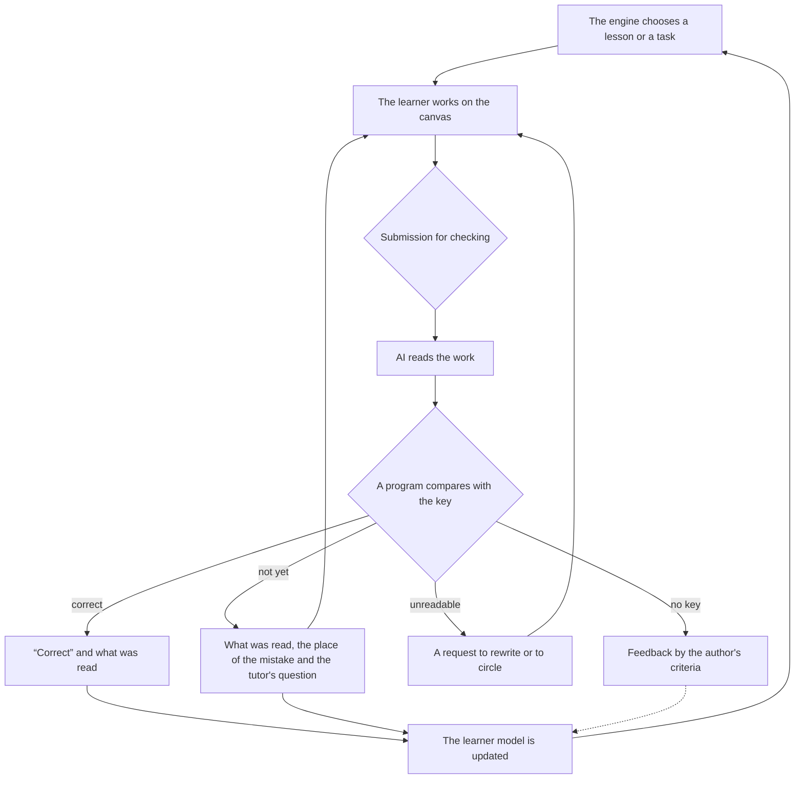
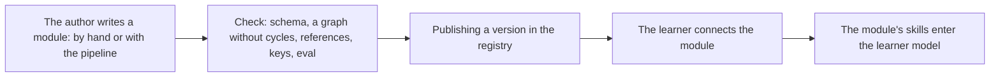

# NovaTrail — the product document

> Status: a draft for discussion, 2026-10-18.
>
> The platform's first document: what we build, for whom and why, what goes into the first slice and what is not decided yet. The concepts are in [concepts.md](concepts.md), privacy and age in [privacy.md](privacy.md), the architecture in [architecture.md](architecture.md), the repositories in [repositories.md](repositories.md), the decisions in [decisions.md](decisions.md). The open questions О-… are in section 13.
>
> Technologies are not described here: the repositories decide them (R11).

## 1. The gist

**What it is.** NovaTrail is an open platform on which any subject becomes an interactive lesson with an AI tutor: maths, Spanish, physics, drawing — for children and for adults.

- A subject comes as a **module**: a skill graph, lessons, tasks, typical mistakes, techniques and a canvas kind. Any author can write a module (R02).
- The learner works on a **canvas**: writes by hand, draws, types text, moves objects, speaks.
- The **AI tutor** reads the learner's work and talks with them in text and voice. Whether an answer is correct is decided by a program by the task's key, not by the model (R03).
- The **learner model** brings the skills of all modules together, and the **engine** chooses the next lesson or task.

**The main idea: a module is data for the engine, not an instruction to a model.**
- A Claude skill is instructions that a model carries out as it understood them.
- A NovaTrail module is data checked by a schema, which the platform carries out the same way every time. The same module of the same version and the same learner state give the same choice of task and the same verdict on the same reading of the work.
- AI works only at the input, where it reads the work, and at the output, where it chooses the words (R03).

**How it differs:**
- **from a chat with AI:** a chat has no key, no learner model and no path through skills; it may give away the answer and get the check wrong;
- **from drill apps with tests:** the learner solves freely — by hand, in words, on a stand — and the tutor looks at the course of solution, not only at the answer;
- **from courses:** the path is adaptive — by the skill graph and the learner model, not by a common plan;
- **from a private tutor:** available every day and cheaper. A private tutor, moreover, can become a module author or guide a learner together with the platform.

## 2. Where we came from

**MathTrail** is a family of products for olympiad maths for grades 1–6 (the organization `mathtrail` on GitHub):
- **mathtrail-standalone** — a free open app for Claude and ChatGPT. The chat's model writes the tasks, and a program checks them with a solver. Here live the learner model (the Rasch model with an Elo update) and the trap catalog, and the child's profile is kept as a file in the family's Google Drive.
- **MathTrail Canvas** (`canvas-api`) — a tutor where the child solves by hand on a sheet. AI reads the answer, a program compares it with the key, and the tutor circles the place of the mistake and asks a leading question.

**What MathTrail gave:**
- **the mechanism** "AI reads, a program decides, the tutor asks", conceived as independent of the subject (R37 canvas-api). The main hypothesis — that AI understands the learner's free solution and reads the answer correctly — MathTrail did not manage to test (R60 canvas-api). NovaTrail's first slice will test it (R08);
- **the learner model and the rule for choosing a task**, which work without AI and are tested on the learner simulator (standalone);
- **a closed catalog of typical mistakes**, which turns an incorrect answer into a diagnosis (SPEC 1.3 standalone).

**Why a platform now.** MathTrail was tailored to olympiad maths for grades 1–6 and closed off everything else. NovaTrail is the same project, but the subject, the age and the canvas are moved out into modules (R01).

**What we take:**
- the principles of checking and of hints;
- the learner model and the simulator;
- the catalogs of topics, traps and techniques;
- 753 reference tasks with traps and 39 templates with solvers — standalone at commit 42b4408, and the first batch at 89986bc (R05 modules with the 2026-11-08 amendment);
- the framework of the services, the development environment and the delivery.

What is carried over from where is repositories 7.

**What we do not take as it is:**
- the canvas-api monolith — NovaTrail is cut into repositories from the first day (R10);
- "children only";
- "English only";
- a single AI provider.

MathTrail is frozen (R01).

## 3. For whom and why

| Who | What they get |
|---|---|
| A child (6–12) | solves the way they are used to: by hand, with a drawing, in words; gets a question instead of the "red pen"; learns to find the mistake themselves |
| A teenager | the same for school subjects and beyond them; more independence. Whether they have an account of their own, П-13 will decide |
| An adult learner | a language, physics, drawing — at their own pace, with a tutor that looks at the course of solution; with their own AI key — free (R07, О-4) |
| An adult beside a child: a parent, a guardian, a private tutor | sees the progress and the repeating mistakes; sets up the tutor; can run a session together with the child. Only the account owner — a parent or a guardian — manages the data (R06) |
| A module author: a methodologist, a teacher, an enthusiast, an organization | a ready lesson environment, tutor, learner model and engine — writes only the content; gets tools for checking and publishing |
| Teachers and schools — later | groups and a summary of frequent mistakes |
| An operator, self-hosting | open code: one can deploy one's own copy of the platform oneself (R12) |

## 4. How learning goes

A typed answer or a choice is not read by AI: a program checks it at once.

- **Three entries** — from the prototype:
  - **«Мои предметы»** ("My subjects") — the engine leads through the connected modules;
  - **«Карта навыков»** ("Skill map") — the learner chooses a skill on the map and sees what is mastered, what opens up and what it rests on;
  - **«Задача с моей бумаги»** ("A task from my paper") — the learner photographs a homework sheet and marks the tasks needed on the photo, and only their crops go to AI (О-11).
- **Two solving modes — "by steps" and "self".**
  - Step by step — the app leads through the module's solving steps, and the tutor speaks at each: in olympiad maths these are Pólya's steps.
  - On my own — the learner solves alone, and the tutor answers only when called.

  The default solving mode is chosen by an adult, for a new profile it is "by steps", and the learner switches it on a task (concepts 10).
- **The screens** are described in the prototype's README ([draft/README.md](../draft/README.md)): subjects and modules, the friend persona, canvases with tools, the steps panel, hints, the check, progress, the section for adults.

## 5. Modules and authors

A module is a package of one author (concepts 3). A module's path from the author to the learner:

- The **pipeline** helps the author: it marks up skills and traps and proposes variants of tasks. The author checks everything AI did before publishing. A published module is already unchanging data (R03).
- **Official modules** are written and maintained by the project; **third-party** ones by any author. Who publishes and how is О-9.
- **An update of a module does not break progress:** skill IDs are stable, and incompatible changes carry a table that maps the old IDs to the new ones (concepts 3).
- **A module is checked for reading quality.** Before publishing, the platform makes sure that AI reliably reads the work in this module's canvas kinds and answer kinds. The check runs on samples from the module's eval set: synthetic ones or ones made for eval by adult volunteers and authors, but not on learners' work (R02, concepts 3).

## 6. AI on the platform

**What AI does:**
- reads the learner's work — handwriting, speech, a photo, a drawing — and turns it into an observation (concepts 9);
- chooses the words — a hint, an explanation, praise — by rules and with checks (concepts 10);
- helps the author prepare a module — before publishing, under the author's check.

**What AI never does:** it does not decide whether an answer is correct, and it does not choose the next task (R03). The platform does not pass it a name, identifiers or an adult's data (privacy 5).

**Two AI routes** (R07):
- **platform AI** — by subscription, through the platform's agreements with providers;
- **own key** — an account owner who learns themselves connects their own key of OpenAI, Anthropic or another provider to their own profile of the category `adult` and uses the platform for free (R84; the 2026-11-02 amendment to R07).

**Models are admitted by eval.** Each AI capability has its own list of exact IDs of the models that passed that capability's eval. An own key does not open a model that did not pass eval (concepts 14).

**Age.** Providers have their own rules on minors, and the platform follows them (privacy 5.3). The check of 2026-10-18:
- The Gemini API may not be used in a service that people under 18 are likely to use. Since the platform is open to children, this route is closed for all its learners, adults too, — both through platform AI and with an own key. The check of 2026-10-22 found the same ban for Google Cloud's generative AI, Vertex AI too: Google's models are closed on the whole platform, for all learners, and whether they may be used in a separate deployment for adults only is a question for a lawyer (R47; П-3).
- OpenAI requires zero data retention for the personal data of children under 13 or under the age of digital consent of their country. OpenAI turns this mode on only by prior approval, and a family's ordinary key does not have it.
- Anthropic puts the safeguards on the organization that serves minors. What this means for a family's key the author decides by an analysis (R112; П-4).

Hence the recommendation: an own key is for adults, children learn through platform AI (О-4, О-5).

## 7. Principles

1. **A module is data.** The core knows no subject; a module gives a model no instructions (R02).
2. **A program gives the verdict.** AI reads the work and chooses the words; correctness is decided by a key or a predicate (R03).
3. **A false alarm is worse than no check.** Doubt is a request to rewrite, a failure is a neutral phrase, but never a "mistake" (R04).
4. **No deterministic check — no verdict.** An assessment by a rubric is feedback. A task from paper without a checked key gets no verdict and does not move the rating (R04, concepts 9.4).
5. **The tutor does not name the answer itself.** It asks one short question and points to the place in the learner's work (R05).
6. **The key does not go to the learner's device** until the task is solved (R05).
7. **The learner's work is untouchable.** The tutor writes only on its own layer (R05).
8. **We show what we read.** "Read: 6" — and the learner sees at once if AI read the wrong thing (R05).
9. **Without the "red pen" and pressure.** "Not yet" instead of "incorrect"; for children — without timers and competitions; without advertising and dark patterns.
10. **Progress survives a module update** (concepts 3).
11. **Any AI model — only after eval** (R07).
12. **Data — a minimum, and it is with the learner or the family.** Export and delete — in one step (R09).
13. **Openness.** The code, the documents and the content of the official modules are under Apache-2.0 (R12, R20), and the module format is an open standard.

## 8. Age and data

- The platform is for any age (R06). A child learns under an adult's account, an adult under their own.
- The learner's age and country are given by the account owner. The platform keeps the age category, not the date of birth (concepts 13).
- A minimum is kept about a child: the pseudonym, the avatar, the age category, the country, the interface language and the presentation style, and interests — once the format gives tasks a dressing for them (privacy 4).
- Strokes stay on the device. AI gets a picture of the work without a name or identifiers (privacy 1).

In detail — in [privacy.md](privacy.md).

## 9. Distribution and money

- **Open code** (Apache-2.0): anyone can deploy their own copy with their own keys.
- **Platform AI — by subscription.**
  - In the prototype this is a free daily quota of the tutor's help and the tariff Plus for $10 a month with a quota five times larger.
  - Prices and quotas are О-14. We first estimate the unit economics and then refine them with measurements, as in MathTrail Canvas (product 9 canvas-api).
- **An own key — free**, but not for everyone (О-4).
- **The mode without AI.** A typed answer or a choice, a check by a program, the author's hints — without calls to AI and at almost no cost. It is the free path, open to children too (О-5).
- **Grants** for open and free education. Open code, an own key and the mode without AI meet the requirement "open and free". MathTrail's package for grants — a logic model and a data register — is a sample for later.

## 10. The first slice

**The goal** is to prove universality: three modules of two unlike subjects — maths and writing — go through one platform, and the core holds no code of any subject (R08, R41).

**Module 1 — olympiad maths 1–6** from MathTrail:
- the learner is a child, the work is handwriting on a sheet. The manifest names adults too in the audience, `adult`: an adult tests the first app (R76);
- the answer is a number by hand; a choice of an option is for tasks whose answer is not a number or whose question points to options (R05 modules);
- Pólya's steps, techniques and traps;
- the explanations are in English, as the standalone tasks and the format examples are; the same module in Russian is another module, with its own name (R07 modules);
- 753 reference tasks of standalone: the first batch at commit 89986bc, the other 726 at 42b4408 (R05 modules with the 2026-11-08 amendment).

**Module 2 — school maths of grade 3** (R41):
- the learner is a child, the canvas is a workbook: the task's items stand on the template's unerasable layer;
- a task is a page of many items of one type (concepts 6);
- the answer is a number or a fraction by hand in an answer slot beside the item, and the verdict is for each item.

**Module 3 — short essays in English** (R41):
- the learner is of any age, a child or an adult, and the presentation style is by age; the canvas is a handwriting sheet;
- an essay by hand in a free form gets feedback by a rubric — an assessment by the author's criteria, not a verdict (R04). Assignments with a key — for example, choose the best first sentence — get a verdict;
- this is writing, not a language module: the explanations are in English, and there is no target language.

**In** (preliminarily):
- module format v0 and the three modules;
- a signed module index and the author's CLI, which checks modules (`module-kit`, R17);
- the learner model, the engine and the learner simulator;
- a measurement of AI reading — on samples that adult volunteers make for eval, among them imitating children's handwriting. Child samples — only with a separate consent (П-10) and before the beta: a goal for children's handwriting has to be checked on that handwriting itself. First comes the review board of `tutor`: the author solves tasks themselves and marks whether the model is right (R43). After it came a measurement of the course of writing on Claude models — on the author's sheet and 39 sheets that code drew: it was done on 2026-10-26 (R52), and the other measurements of reading are epic E4 of `tutor` (the 2026-10-26 amendment to R43);
- two canvas kinds — the handwriting sheet and the workbook;
- a check with a verdict and a tutor with a question; feedback by a rubric (R04);
- voicing of the tutor's words and of the module's open texts by the device's speech synthesis — only with voices by the rule of Т-13, without a server and without new data other than a setting in the presentation style (О-23). Its code — after the first app and before the first child (R76; В19 `app`; R07 app);
- a skill map for the three modules;
- an adult learner's account and the account of an adult with a child — this may be one account (R26);
- verifiable parental consent and agreements with AI providers — before the first child (П-1, П-3);
- platform AI — without payment, within a quota, for the participants of the closed slice (О-14); an own key — for adults (О-4);
- a web app for a tablet and a computer.

**Out:**
- third-party authors and widgets;
- the text canvas and language modules (R41);
- the registry service and the pipeline;
- tasks from paper;
- voice input;
- the learner's own text to the tutor: the conversation line of the first slice is buttons of requests, a hint and "explain differently" (R82; architecture 3.1). Own text — later, as an AI capability of its own of `tutor`, with its eval, a leak check in the reply and a row in privacy 4;
- a paid subscription;
- schools and teachers;
- the MCP channel;
- an offline mode and native apps.

**Success criteria:**
- the second and third modules needed no subject code in the core — only shared canvas kinds and checks;
- AI reads the work in all three modules with the target quality: the answer on a sheet, the answer slots in a workbook and the essay. This is a measurement on samples before the beta, like E2 in MathTrail Canvas; the main metric where there is a verdict is false alarms, and in canvas-api its goal is no more than 1 % (product 12 canvas-api). The mirror figure is "unreadable", and the learner rewrites it, while a false alarm on it does count toward this goal. The workbook's eval set measures such figures as a separate row: on the synthetic data of `tutor` the false alarms on them are 31–41 %, and on crossed-out ones about 16 % (the 2026-10-29 amendment to R56);
- the assessment by a rubric passes the eval of its AI capability by the measure of R71: the main one is false alarms on met criteria, and the goal is set by the measurement of `tutor` on adult volunteers' essays (П-16);
- on the learner simulator the engine behaves sensibly on all three graphs: it holds the success corridor where there is a verdict, goes in the author's order where there is none (concepts 4), does not loop and does not declare "mastered" too early;
- a child and an adult go through the lessons of their modules from beginning to end.

Module format v1 is fixed only after this (R08).

## 11. Roadmap

| Stage | What | Repositories |
|---|---|---|
| 0. Foundation | documents, decisions, vocabulary, architecture | spec, .github |
| 1. Format and core | module schemas v0; three modules; the module index and the author's CLI; the learner model, the engine and the simulator | spec, modules, module-kit, learner-model, engine, sim |
| 2. The first slice with a learner | a measurement of AI reading; canvases, the check, the tutor, the skill map; accounts; parental consent, the DPIA before the first child (AADC std 2; [DPIA](dpia.md), section 8; R129) and agreements with AI providers before the first child; platform AI and own key | tutor, canvas, api, app, skill-map, infra |
| 3. Beta and public launch | subscription; voice; more AI providers; site | site; api, tutor, app |
| 4. Authors | the registry service, publishing third-party modules, the pipeline, a widget sample, others' widgets in an iframe sandbox | module-registry, module-pipeline, widget-template |
| 5. Further | schools and teachers; the MCP channel; tasks from paper; offline; new interface languages | — |

In what order the repositories appear is repositories 6.

## 12. Risks and hypotheses

| Risk or hypothesis | Why it matters | What we do |
|---|---|---|
| AI reads the work badly in some subject | false alarms, the learner stops trusting the tutor | a measurement before the beta for each canvas kind and answer kind; in doubt — a request to rewrite (R04) |
| Universality turns out to be an illusion | the module format bends to maths | modules of two subjects in the first slice, and essays have no key; format v1 — after all three modules (R08, R41). The first slice does not test the text canvas and a language module (R41) |
| Others' widget code in an app where children learn | access to the page, the tokens and the network | the first slice has no others' widgets; later — an iframe sandbox (R16) |
| Own key | a weak model breaks the check; the key leaks; the provider's terms are broken | only models after eval; the key is not kept on the server, and on the device only by the key owner's choice (R84); own key — by age category (О-4) |
| Providers' terms on minors | children are left without AI, or the platform breaks the terms | a check of the terms with a date; platform AI under agreements that admit children; the mode without AI (privacy 5) |
| Voice | a child's voice is personal data, a voiceprint is biometrics (COPPA) | voicing — for everyone; children's voice input — after the author's decision by an analysis (R112; П-5) |
| The price of platform AI | the subscription does not pay for a subscriber's worst month | quotas; unit economics — an estimate, then measurements (О-14) |
| The quality of third-party modules | errors in keys; content that is not fit for children | a check at publishing; at first only official modules (О-9) |
| More than ten repositories for a small team | overhead on CI, versions and releases | the repositories are set up at once (R18), and code, CI and releases appear in the order of repositories 6; one repository template |
| The learner model does not carry over between subjects | the engine chooses tasks off the mark in a language and in drawing | a level per module, forgetting; a simulator with a criterion written down before the first run (concepts 11) |

## 13. Open questions

Each question: the gist, the options, a recommendation and what it blocks. The numbers do not change: solved questions move to 13.1. Next number — О-26.

### 13.1. Solved

The row of a solved question moves here as it was, and the question's cell gets the mark "solved", the number of the decision and a short answer.

| № | Question | Options | Recommendation | Blocks |
|---|---|---|---|---|
| О-1 | The second module of the first slice — **solved: R41**: instead of one second module, two: school maths of grade 3 on a workbook and short essays in English for any age | Spanish A1 for adults; physics with a stand; school maths — a sheet with fractions | Spanish A1: it is unlike maths in the subject, in the learner's age, in the canvas, in the answer kind and in the language | the first slice, format v0 |
| О-3 | The language of the normative texts for authors: the module format, the widget protocol, the guides — **solved: R42**: English, outside `docs/` too, and the module format in the folder `format/` | Russian, as the documents (R14); English | English: a standard that "any author" writes by cannot be in Russian only. The descriptive documents stay in Russian | stage 4 |
| О-7 | Showing the solution at the learner's request — **solved: R82**: by a button, and the showing closes the attempt with the outcome "solution shown", without a trap of its own. For a child — from the fourth incorrect answer, when the hint ladder is passed, and with the adult's setting "ask before showing", on by default, — as an adult action; for a learner of the category `adult` — from the start of the attempt. The key and the solution go to the device only when the attempt is closed by a correct answer or by the showing (В10 `api`; R09 api) | never (R39 canvas-api); by a button, the task is "skipped" and the rating does not change (the prototype); by a button, the task is "not solved" | by a button; the outcome "solution shown" is the evidence "not solved", without a trap. For a child — after the hint ladder and with the adult's setting "ask before showing"; for an adult — freely | the tutor, the learner model |
| О-8 | What the tutor does when the learner has gone quiet (added 2026-10-21: the option of a "live" mode from the author's analysis — sources 8.4 — and a decision by the data of the measurement of `tutor`; added 2026-10-22: the measurement is put off until the author's decision by the data of the review board, R43, and the decision waits together with it) — **solved: R69**: the work is read only on the learner's action — on "Check", and in the solving mode "by steps" also on "Step done". On a pause — only a blinking of the button, without a call to AI, and the pause does not go to AI (R52). The measurement E4 of `tutor`: a reading after a line gave "correct" or "not yet" before the answer was written in 94 calls out of 196, and a pause policy from 0.4 s gave 15.6 readings per sheet of synthetic data and 54 on live writing | nothing, a check only by the button (R61 canvas-api); it reads the work on a pause (the prototype); a "live" mode: the tutor reads the work itself on the canvas's events and speaks in voice (the author's analysis) | a check — only by the button. On a pause the tutor may remind about the button, but it does not read the work and gives no verdict. A learner who writes "12" pauses after "1": "read 1" would throw them off, and with the key 1 "correct" would be false. Besides, each reading is a call to AI: work not submitted would go to the provider, and it would cost money. Decide by the data of the measurement of `tutor`: how often a reading on a pause gives "not yet" or "correct" out of place, and how many readings per sheet each pause policy gives (architecture 3.1 tutor). Refined 2026-10-22 (В17 `tutor`): read — only on the learner's action: on "Check", and in the solving mode "by steps" also on "Step done". On a pause — a blinking of the button, without a call to AI. A pause is only a mark in the course of solution for review (R11 tutor), not a reason to read. The measurement reads the states on a pause inside a line too — without a learner, on its own samples — and counts how many readings per sheet each pause policy, 0.4, 2 and 6 s, would give: that way it will also show whether this recommendation holds (R10 tutor). Pauses in children's writing are short and frequent: "The average duration of handwriting pauses was around 400ms", in grade 3 about 1.8 pauses per letter, in grade 5 1.42, and the threshold of 2 s by which pauses are usually divided is weakly grounded: "A two-second threshold has been typically used when analyzing the writing processes. However, there is only a weak empirical basis to claim that specific average numbers and durations of pauses may be associated with specific writing processes" ([Pascual, Soler & Salas 2023](https://www.frontiersin.org/journals/psychology/articles/10.3389/fpsyg.2022.1052264/full), read 2026-10-22). canvas-api took a line as finished after 6 s without a touch (R16 canvas-api), and its first version «показывала ложную ошибку на недописанной строке» ("showed a false mistake on an unfinished line"); it later rejected checking each step on a pause (R37 canvas-api). Decide — by the findings of the measurement, when it comes back (R43). Added 2026-10-26 (В20 `tutor`): the measurement that came back measured only the use of the course of writing on finished sheets: long pauses were in the action log, but it did not measure readings on a pause or states inside a line (R24 tutor). The decision waits for the measurement of epic E4 of `tutor` | the canvas, the price, privacy 1 |
| О-12 | Generating tasks on the fly — **solved: R60**: a published pool and templates with parameters. The numbers come from the attempt's seed, a program computes the key of each instance already at the module's check, and tasks with the help of AI only when the module is prepared, and the author checks them | a published pool; templates with parameters; generation by AI with a check by a solver, as in standalone | a pool and templates with parameters: the numbers from a seed, the key from a solver. Generation by AI — only when the module is prepared | engine, the module format |
| О-18 | A skill's tier: set by the author or computed — **solved: R49**: computed by the longest chain of the module's prerequisites under the skill, and the author gives the tiers names | set by the author; computed by the graph; computed, and the author gives the tiers names | computed by the graph — by the longest chain of prerequisites, as in standalone: the tier then cannot diverge from the graph. The author gives the tiers names | format v0, the skill map |
| О-19 | Can the author set the order of the lessons of the whole module — **solved: R58**: through the skill graph, without a new field. A lesson goes after the lessons that teach the prerequisites of its skills, and where the graph gives no order, the engine's rule chooses; for skills without a verdict — without adaptation | no: the next lesson is always chosen by the engine, and only the skill graph sets the order (concepts 12); a mark in the module manifest: the lessons go in the author's order, and the engine only adds reinforcement and repetition — as Sequential and Adaptive in the prototype; the author's order is the default path, from which the engine departs by the learner model | the order — through the skill graph. A sequential module's graph is a chain, and the engine goes along it as along any graph: with reinforcement after a mistake, with repetition and with skipping what the learner already knows. A new field of the format is not needed, and the next lesson is still chosen by the engine (R03). The app derives the mark "sequential" from the graph | format v0, engine |
| О-21 | A hint at the learner's request — **solved: R82**: before the first incorrect answer the request gives the "givens and unknown" and the task's technique, after it the words of the current rung once more, without AI, and "explain differently" gives the same rung in other words, one call to AI per rung, without the work. The rung's slot is the first "not yet" in order. The request does not change the evidence's outcome: the evidence carries the technique — on a step or at a request — and how many times the learner asked "differently", and that they saw the "givens and unknown" is not recorded: those are open and do not hint at the method (R57) (В10 and В11 `api`; R10 api). | only the ladder: before the first incorrect answer there is no hint, and the request calls to submit the work; before submission — what the module gives the solving steps: the givens and the unknown, the technique, a sketch "how to start", if the module gives one, — without AI and without reading the work, and after an incorrect answer — the current rung; the request sends the work for reading without a verdict, and the question is asked at the place in it; each request raises the rung | the second option. Work not submitted does not go to the provider — the arguments are the same as in О-8. The rung rises only with incorrect answers (R03): if a request raised it, the learner would get to the simpler case and to the solution without trying themselves. "Explain differently" is the same rung in other words: a call to AI within the quota, with the past questions of the same task (privacy 4), and without the model's reply — the fallback text (concepts 10). How a hint at a request enters the evidence, decide together with the weights of `learner-model`: the sketch has its own outcome — "with a sketch hint", and "after hint number k" does not fit before the first incorrect answer — there is no rung yet (concepts 11). Revisit the reading at a request by the data of the measurement of `tutor` on reading unfinished work (О-8) | format v0 — hints (RUN.md, T30); `api` — the hint ladder; `app`; the weight of the evidence in `learner-model` |
| О-22 | What to measure the assessment by a rubric with. False alarms are counted by the verdict (architecture 4.6; repositories 4), but feedback by a rubric has no verdict: AI decides whether the author's criterion is met. In the first slice such feedback is given by the essays module (R41) — **solved: R71**: the main measure is the share of false alarms on met criteria, the second is agreement with people's assessment and Cohen's kappa per criterion. The goal and the eval set are set by the measurement of `tutor` on adult volunteers' essays (П-16): the synthetic data of E4 is too even for the goal | the share of criteria that AI called unmet when they are met; agreement with adults' assessment on each criterion; in the first slice — without a goal, and the feedback marked as AI's opinion | the first — as the main metric: feedback that does not see what was done throws the learner off just as "not yet" on a correct answer does (R04). Agreement with adults — as the second metric. The goal and the capability eval set are set by the measurement of `tutor` — on essays that adult volunteers write (repositories 6) | the assessment by a rubric in `tutor`; the success criteria of the first slice (section 10); the admission of models (architecture 4.6) |
| О-24 | The accessibility level of the interface and scrolling the sheet with a single pointer (В41 `canvas`, 2026-10-26) — **solved: R90**: for all UI packages — `app`, `canvas` and `skill-map` — WCAG 2.2 level AA and beyond it 2.5.5 and 2.3.3; what a package does not meet yet, it declares itself, and `app` names it on the page "Accessibility"; the sheet is scrolled with a single pointer by the buttons "Up" and "Down" of the row of `canvas` (R33 canvas). The standard came from R11 app as the row В30 `app`. Which WCAG level is required of `app` and the UI packages `spec` has not decided: a standard of accessibility shared by the packages will be passed by T07 `app` as a row «в реестр spec» — in the card of `app` it is "accessibility" (architecture 3.1), — and it will add to this question. Scrolling the sheet of `canvas` depends on the level. The drawing surface covers the visible part of the sheet, and on the drawing surface there is `touch-action: none`. Since T35 `canvas` (R29 canvas) the sheet on the drawing surface is scrolled by two fingers, by its own code: letting a finger have the native scrolling and a pen the writing is impossible, since `touch-action` acts on a pen too — "it does in fact apply to all forms of pointer inputs that allow direct manipulation for panning and zooming" ([Pointer Events Level 3](https://www.w3.org/TR/2026/REC-pointerevents3-20260630/), W3C Recommendation 30 June 2026). About this the W3C has open [issue #203](https://github.com/w3c/pointerevents/issues/203): "you might want the pen to draw by default, while still allowing a finger to scroll. That's not possible to express with `touch-action` today". On a tablet whose screen is no wider than 1000 CSS px, in an element with a height the sheet cannot be scrolled with one finger: the drawing surface covers the whole width of the sheet, and the row of buttons scrolls the page, not the container. In an element without a height the sheet scrolls with the page, by the native scrolling. The criteria of [WCAG 2.2](https://www.w3.org/TR/WCAG22/), W3C Recommendation 12 December 2024: 2.5.1 Pointer Gestures, level A, — "All functionality that uses multipoint or path-based gestures for operation can be operated with a single pointer without a path-based gesture, unless a multipoint or path-based gesture is essential"; 2.5.7 Dragging Movements, level AA, — "All functionality that uses a dragging movement for operation can be achieved by a single pointer without dragging, unless dragging is essential or the functionality is determined by the user agent and not modified by the author". By [Understanding 2.5.7](https://www.w3.org/WAI/WCAG22/Understanding/dragging-movements.html) the criterion does not concern the native scrolling — "This criterion does not apply to scrolling and dragging gestures enabled by the user agent", — but "does apply if content actively suppresses the user agent's own scrolling functionality and/or implements its own scrolling mechanism", and "achieving keyboard equivalence for a dragging operation does not automatically meet this success criterion". The target of the buttons of the row of `canvas` is 44 × 44 CSS px, as in 2.5.5 of level AAA (R36), and level AA requires 24 × 24 — 2.5.8. All read 2026-10-26. Added 2026-10-27 (В44 `canvas`): `canvas` decided scrolling with a single pointer by the first option — by the buttons "Up" and "Down" in the element's row, on any device (R33 canvas). A press scrolls the same as two fingers, by ⅘ of the visible part, so an element with a height meets 2.5.1 and 2.5.7 on a narrow tablet too, and `app` may give it a height: the option "`app` gives the element no height on devices with touch" is no longer needed. What stays open is the accessibility level: the standard of T07 `app` sets it. For this standard — two more findings of `canvas`. In Safari a scroll container without focusable content cannot be scrolled from the keyboard, and this concerns the scrolling of `app` itself too: WebKit bug [277290](https://bugs.webkit.org/show_bug.cgi?id=277290) "AX: Scrolling containers inoperable with keyboard" — "For containers that allow scrolling, a keyboard-only user cannot scroll the container", — filed 2024-07-29, status NEW. The printed text of the workbook's lines, like the sheet, does not grow with the page's zoom beyond fitting to the width (R23 and R34 canvas), and 1.4.4 Resize Text requires: "Except for captions and images of text, text can be resized without assistive technology up to 200 percent without loss of content or functionality". Reflowing the lines, by the estimate of `canvas`, is not needed: the workbook page falls under the exception of 1.4.10 Reflow — "Except for parts of the content which require two-dimensional layout for usage or meaning". The WebKit bug and WCAG 2.2 were read 2026-10-27 | the buttons "Up" and "Down" in the element's row: they scroll the sheet by the visible part with the same scrolling as two fingers; `app` gives the element no height on devices with touch, and the sheet scrolls with the page, by the native scrolling; an exception for the sheet in the accessibility standard | the buttons "Up" and "Down", if the standard requires level AA, — the recommendation of `canvas`: these are two buttons and two captions, and the scrolling itself already exists. An element without a height ties the layout of `app`, and an exception leaves without a substitute a learner for whom two fingers are too much. Decide together with the standard of T07 `app`; for `canvas` the question is in architecture 2.6 canvas, with its T35 and R29 canvas (commit a89ea3a). The executor's addition: by [Understanding 2.5.1](https://www.w3.org/WAI/WCAG22/Understanding/pointer-gestures.html) its own scrolling with two fingers is a multipoint gesture, "a two- or three-finger tap or swipe", and the criterion of level A concerns it: "This success criterion applies to gestures in the author-provided content". At level A dragging with one finger would also do as a substitute — 2.5.1 "does not apply to gestures that involve dragging in any direction", — but at level AA no longer (2.5.7). An element with a height on a narrow tablet has no dragging either, so without one of the three options the sheet fails level A already; read 2026-10-26 | the accessibility standard of the UI packages — T07 `app`; the row of buttons of `canvas`; the layout of the task screen in `app` |

### 13.2. Open

| № | Question | Options | Recommendation | Blocks |
|---|---|---|---|---|
| О-2 | The interface languages and the explanation languages in the first slice | English; English and Russian; more | English and Russian; the module sets the target language. Added 2026-11-02 (В33 `app`; R92): the interface language is decided — `en` and `ru`, a field of the learner's profile that the adult sets, and the screens before a learner is chosen and the section for adults are in the device's language. Open are the explanation languages of the slice's modules — with English modules only, a Russian interface serves adults but not a Russian-speaking child, — and the decimal comma: the format reads `1,5` as two numbers ([format text](../format/README.md), sections 15 and 20). `modules` and product decide them. Added 2026-11-02 (В13 `modules`; R07 modules): the explanations of the olympiad maths module are in English, and this is part of any option. So two modules of the slice's three have English explanations (section 10), and О-2 stays about the explanation languages of other modules and about the decimal comma. Added 2026-11-07 (В17 `modules`; R15 modules): the explanations of the set of school maths of grade 3 are in English too, and the essays module is in English by R41. So the explanations of all three modules of the slice are in English, and a Russian interface serves an adult but not a Russian-speaking child. О-2 stays about the decimal comma and about the modules after the slice: the same module in Russian is another module ([format text](../format/README.md), section 10), and it, for example `grade-3-math-ru`, can be added after the slice without touching these. Decide before the beta with children, when it becomes clear who needs Russian | app, the texts of modules |
| О-4 | For whom an own key is | for everyone; only 18+; by age category and provider | in the first slice — only 18+; children learn through platform AI, under agreements that admit children. Revisit when a lawyer answers for each provider (П-4) | R07, privacy 5 |
| О-5 | A free path for children | a free quota of platform AI; the mode without AI; a quota paid by grants | the mode without AI — always; a small quota of platform AI — if the economics allow | tariffs; modules — tasks with typing or choice |
| О-6 | Voice input | for everyone; only for adults; for no one | the tutor's voicing — for everyone; voice input — for adults from the beta; for children — after the decision on П-5 (R112) | the tutor, privacy |
| О-9 | Who publishes modules | anyone; verified authors; only official ones | at stages 1–3 — only official ones; from stage 4 — any author, with an automatic check and a review for modules open to children. Added 2026-11-02 (В12 `module-kit`; R11 module-kit): from stage 4 the Starlark of a third-party module — the predicates of the check in `api` and the template solvers at the check in `module-registry` — runs in a separate process with a memory limit; how is decided by their tasks (architecture 3.5 and 3.13). go.starlark.net does not count memory and itself advises such a process: "There is no way to bound the memory used by a Starlark thread" and "the only reliable approach is to let the operating system help you: evaluate Starlark in a separate process with a tight limit on memory" (README of google/starlark-go, commit 4f4267fb140d, lines 152 and 162–164, read 2026-11-02). A repetition of a list takes up to 2^30 elements in one step (`starlark/eval.go`, line 1158, ibid.), and Go's `recover` does not catch running out of memory or a stack overflow: it is a `throw`, "a fatal error that dumps a stack trace and exits" (`runtime/panic.go`, Go 1.27.3). Before stage 4 the modules are only official, Starlark runs in the process, and the predicates and solvers go through the review of `modules` (Д10 module-kit) | module-registry |
| О-10 | The license of the modules' content. Official modules are Apache-2.0 (R20); open are third-party modules and others' sets of tasks | any; only open ones; open ones in the public registry and any in one's own copy | an SPDX license in the module manifest; in the public registry — open licenses from a list; "ideas — yes, wordings — our own", as in standalone; DCO for contributions — decided: R22. Check the license of others' sets of tasks, MathNet among them, before using them. Added 2026-11-02 (В11 `modules`; R05 modules): for the olympiad maths module others' sets were compared by the records of standalone at commit 89986bc and of its prototype at commit 0263835 (sources 8.2, 8.3). The wordings of all 705 tasks are our own, by the rule of standalone "Nobody else's wording, anywhere" (SPEC 1.5 standalone); 442 tasks of grades 1–4 are from the prototype under Apache-2.0, Claude wrote them and the author checked them (D23 of the prototype). Added 2026-11-08 (В24 `modules`): the 48 tasks that standalone added by 42b4408 are written by the same rule — at 42b4408 it is in place (SPEC 1.5 standalone, read 2026-11-08). The ideas and kinds of tasks are from books in the public domain, from MathNet under CC BY 4.0, but for the tasks of countries that kept their rights, from GSM8K under MIT and from the collections of problems.ru, whose texts are protected: from there — only the idea or the kind of task. Neither standalone nor the port compared the wordings with the sources' texts, and a task has no source of the idea either in standalone or in the format (R51), so the author of the idea of a single task cannot be named. For a lawyer — two questions: whether an idea or a kind of task from material under CC BY 4.0 or MIT obliges to attribution — CC BY 4.0 sets no conditions on what may be done without permission (its clause 8(a)), and TRIPS does not protect ideas (Art. 9(2)), — and whether the rule and the author's check suffice for wordings that a model that had read the sources wrote. The port and the module's first release do not wait for the answer: if attribution is needed, its line will enter `NOTICE` with a new version of the module. The sources can be named voluntarily only outside the module: `NOTICE` holds only what the licenses require ([format text](../format/README.md), section 10). Added 2026-11-12 (В56 `app`; RUN.md, T147): the `LICENSE` and `NOTICE` of a module are not texts of the module in the language of its explanations — their language is the license's; until a third-party module comes, every module's license is in English, and `app` marks them `en`. A field for the language of the license, BCP 47 with `en` by default, comes with the answer to this question. | the registry; the olympiad maths module no longer waits for it — added 2026-11-02 (В11 `modules`) |
| О-11 | Tasks from my paper | AI solves itself; an adult enters the key; the task is found in a catalog; without a verdict | a verdict — only with a key from an adult, from a solver or from a catalog. Otherwise there is no verdict, the answer is not assessed and the rating does not change; a solution that AI derived may be shown to an adult with the mark "derived by AI", but not to a child: we do not do the homework for them. The task on the photo is marked by the learner or the adult, the photo is cropped to it on the device, before the call to AI, and the task stays on the device. Stage 5. Added 2026-11-02 (В11 `learner-model`; R06 learner-model): a verdict by an adult's key moves the learner model only when the task has a band and a difficulty on the module's scale and the skills are not from AI — for example, the task is found in a catalog or an adult chose them; otherwise the verdict is shown, and the model does not move. The evidence of such a task carries the band, the difficulty, the skills and the verdicts, but not the task's text: it stays on the device. The evidence will get the provenance of the band and the difficulty as a new kind, with stage 5: the kind only grows (R08 learner-model) | privacy 6, the canvas |
| О-13 | Ranks and the persona for adults | as in the prototype — for everyone; by presentation style | ranks — by numbers: the ranks' names were removed when parents found them meaningless (R213 standalone). The friend persona is for children; for adults, by default, a neutral tutor. Added 2026-11-07 (В4 `skill-map`; R07 skill-map): what a rank is, the detailing of the skill map found. A learner's overall rank, as in MathTrail, cannot be: the level is per module, and the modules' scales do not add up (concepts 11). A module's rank is the number of the band in which the module's level stands, "rank k of N", as a number without a name (R213 standalone); the module's level is not in `GetSkillMap` — it is only inside `learner-model`, — so it needs a field of the contract and a rule of `learner-model` by which the level falls into a band. A skill's rank is the number of its mastery band on the module's scale, without new fields, but a skill's mastery band is the highest of the bands where it is taught, so for a skill of the lowest band the rank will not rise above the first. The recommendation is the module's rank, if this question decides that ranks are visible, and until then there are no ranks: in the first slice the map does not show them. When they come, they will be turned on by an attribute of the map's element that `app` sets by the learner's presentation style, on both kinds of the map; how the presentation style holds ranks is decided by this question and О-23 together with `app` | app |
| О-14 | Tariffs | a quota and Plus for $10 (the prototype); three tariffs (R36 canvas-api); something else | decide by the unit economics: a subscriber's worst month must pay for itself. Before the beta platform AI is without payment, within a quota, for the participants of the closed slice. Added 2026-10-28 (R68): reading handwriting is two calls for each check, two readers of one provider, and the unit economics counts both. Added 2026-11-02 (В12 `api`; R11 and R12 api; architecture 3.6 api) — the quota rule of stage 2, on which the tariffs of stage 3 lie without rework, and an input for this question. The quota is dollars by the estimate of `tutor` from the message about the spending, per family day (concepts 14), with caps of the profile and of the account. The caps are set by the account's tariff, and the account gets its tariff with the invite code. The first values of the tariff "closed slice" are $0.50 per profile and $1.50 per account. The estimate of `api` is by the measurements of `tutor` and Anthropic's prices, for Opus 5.5 "$4 / MTok" of input and "$20 / MTok" of output ([Pricing](https://platform.claude.com/docs/en/about-claude/pricing), no date on the page, read 2026-11-02): 20 tasks a day — ≈ $0.62 in any solving mode. Corrected 2026-11-02 (В23 and В28 `api`): "Step done" in format v0 does not read the work (the 2026-11-02 amendment to R69), and "by steps" costs as "self" does; and the rung's words are a call that T76 `tutor` measured, for Opus 5.5 · `high` — $0.0152 (architecture 3.4 tutor), not the $0.0098 of the series T40 — a judge's reply with a review. With 30 % of tasks with one mistake this is 26 checks and 26 calls for words — the correct answer words, by the assumption of `api`, cost as the rung's words do: ≈ 26 × ($0.0086 + $0.0152), where $0.0086 is reading by two readers (architecture 3.6 api). A profile cap of $0.50 suffices for about 16 tasks. An account's worst month is no more than $54: a family day is no shorter than 20 hours, and in 30 days there are no more than 36 of them. The caps of stage 2 are not a pattern for stage 3. If Plus for $10 a month with a quota five times larger than the free one pays for the worst month, a free day is no more than $10 / (5 × 36) ≈ $0.056, about two tasks: the check has to become cheaper by about an order of magnitude, or the prices will be different. A free quota for children and grants are still О-5 | the subscription (stage 3) |
| О-15 | The MCP channel — apps for Claude and ChatGPT | no; after the first slice | after the first slice: the module format does not depend on the channel, and the experience of standalone exists | stage 5 |
| О-16 | The trademark "NovaTrail" | check now; before the public launch | check before the public launch and before registering a domain. Added 2026-11-08 (В6 `infra`; R06 infra): the first slice needs no domain of its own — `app` lives on `<project>.web.app`, and `api` on `*.run.app`. The main domain and the widgets' domain (R16) are bought together after the check, before the public launch. With the domain comes the Google Cloud organization too — only it sets the location of `_Required` of new projects (R109; Д3 infra) | R13 |
| О-17 | Does feedback by a rubric affect the learner model | no; weakly; as a verdict | in the first slice — no: the feedback is shown but does not go into the model. A weight — after measurements on modules with a rubric. Added 2026-11-02 (В18 `api`): the engine gets the closed attempts of tasks with a rubric — the task, the close reason and the time of closing, without the marks: by them it keeps the author's order, and AI's opinion of an essay does not move the choice (architecture 3.8). The adult sees the marks in the progress (R87) | the learner model, creative modules; the essays module of the first slice (added 2026-10-22, R41) |
| О-20 | Programming modules: a code canvas and a check by running the program | do not support: the answer — only by typing or choice; the code canvas is a canvas kind of the platform, and a sandbox on the server runs the learner's program for the verdict; the learner's device runs the program — in an iframe sandbox, as a widget (R16); the verdict — by the output of one run or by the author's tests | the code canvas is a canvas kind of the platform: files, an editor, a run, an output; the module sets the language and its version. The verdict is by the module author's tests, not by the output of one run: Go does not wait for goroutines after leaving `main` (sources 7.1), so in the prototype a broken program prints different things from run to run and once may print everything needed — a false "correct". For the verdict the program runs on the server, in a sandbox without a network and with limits of time and memory: the verdict does not depend on code on the device, as in the recommendation of Т-24. The learner's code, like the picture of the work, lives only in the request's memory and is not written to logs (privacy 4, R09). AI does not check the code but only chooses the words (R03). Not in the first slice (section 10); which component runs the code and which languages to support — decide when detailed | programming modules, canvas kinds and checks |
| О-23 | What a module says about the presentation style. The presentation style is how the platform speaks and shows: the length of phrases, voicing, the persona, ranks (concepts 13). It goes by the learner's age (R41), and it can be chosen separately (privacy 3.3), and the module manifest v0 does not name it (R46). There is no list of styles either in the documents or in the components, and the persona and ranks by style are О-13 | nothing: the platform chooses the style — by the learner's age or by their choice; the manifest names the styles the module supports; the module gives its own texts for each style | nothing in format v0. A field without a list of styles would fix only a name, and an optional field later is a minor version of the format (R44). Return when `app` and `tutor` decide what the style consists of: then it is seen whether a module needs to say something about it. Added 2026-11-02 (В14 `app`; R05 app): the solving mode "by steps" or "self" is not a part of the presentation style but a field of the profile of its own, the "default solving mode" (privacy 4; concepts 10): it does not depend on age, for a new profile it is "by steps", and it does not go to AI. Added 2026-11-02 (В18 `app`; R07 app): voicing — whether it is on and its speed, "normal" or "slow", — is a part of the presentation style in the learner's profile on the server. For a new profile of the category `under_13` it is on, for older ones off, and both the learner and the adult change it. It goes by age but does not change the words: of the presentation style only what changes the words goes to AI, and voicing is not among it (privacy 4; concepts 10). The voice is chosen on the device, and `spec` does not know it. The rest of what the style consists of still waits for `tutor`, and the persona and ranks are О-13. Added 2026-11-07 (В22 `modules`; R14 and R16 modules): the first data from the content. `english-essays` is for all four age categories, and one text of the statements, lessons and criteria serves both a child under 13 and an adult: short simple phrases. The essay for adults is set apart only by the `age_categories` of the task and the lesson. For `olympiad-math` with `under_13` and `adult` in the audience it is the same: the texts of standalone were written for children, and an adult reads the lesson too. One text for all ages works when the phrases are simple, and where the topic differs, not only the tone, the `age_categories` of the task and the lesson suffice: the module does not ask for texts of its own by style yet | the module format after v0; `app` and `tutor` — the presentation style |
| О-25 | A second way to answer in a slot with a number (В31 `app`, 2026-11-02). An answer by handwriting does not pass WCAG 2.2, 2.1.1 Keyboard, of level A: "if using handwriting to enter text, the input technique (handwriting) requires path-dependent input but the underlying function (text input) does not" ([Understanding 2.1.1](https://www.w3.org/WAI/WCAG22/Understanding/keyboard.html), read by `app` 2026-11-02; architecture 4 app). In format v0 only handwriting fills a slot with a number, and an answer from the keyboard will come in one of the next versions of the format, as a minor change ([format text](../format/README.md), section 14). R11 app declared this a nonconformance to the standard of R90 on the page "Accessibility", and with it 3.3.4: the test's answer on "Check" gets a verdict at once and goes into the evidence, without a confirmation or a cancel, though an incorrect answer does not end the attempt | the second way — the keyboard or digit buttons on the screen, by a tap, without a path; the adult turns it on for the profile, and the check is without AI, as for a choice of an option (architecture 4.2); only the keyboard, without digit buttons; do not do it: the slice tests the reading of handwriting (R41) | the first, the recommendation of `app`: a learner for whom a pen is too much answers tasks with a number, and the standard holds without a reservation, and digit buttons are needed by a tablet without a keyboard. The adult turns them on: the slice measures the reading of handwriting, and without need the answer goes by handwriting. Whether such an answer is evidence and with what weight is decided by `learner-model`, and with it how to count a submission that the learner corrected at once: if it may be left uncounted, it is reversible, and 3.3.4 leaves the nonconformances. Not required before the first child: the nonconformance is declared (R11 app). Added 2026-11-07 (В23 `learner-model`): an answer by the second way is evidence with the weight of an answer by handwriting: the input method does not change what the learner knows, and the check is the same, without AI. A submission whose verdict the learner saw the model always counts: a cancel after the verdict would let one try values one by one until "correct" comes out, and would take away the first verdict's meaning (R06 learner-model). Only a submission cancelled before the verdict may be left uncounted — that is an edit of the answer in `app`, and it does not reach the evidence. Whether it needs a confirmation before the check and whether that removes 3.3.4 is decided by `app`. A smaller weight is rejected: a learner for whom a pen is too much would get "mastered" later for the same skill. This needs no fields of the evidence | the format after v0 — an answer from the keyboard in a slot with a number; the contract `app` ↔ `api`; the weight of the evidence in `learner-model`; privacy 4 — the adult's setting in the profile |

## 14. Sources

The records of the sources are in [sources.md](sources.md). What stood here is sources 7 and 8; the AI providers' terms and COPPA are sources 2 and 3. The section stays because the decision log and the archives refer to it (R143; RUN.md, T133).
