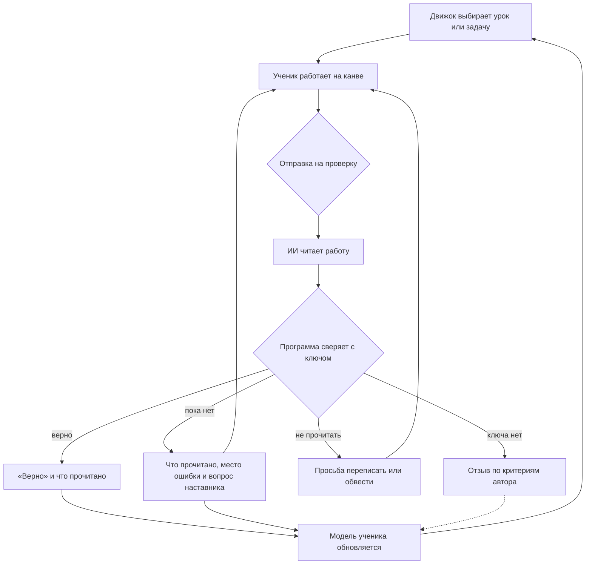
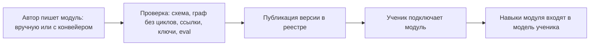

# NovaTrail — продуктовый документ

> Статус: черновик для обсуждения, 2026-10-18.
>
> Первый документ платформы: что строим, для кого и зачем, что войдёт в первый срез и что ещё не решено. Понятия — в [concepts.md](concepts.md), приватность и возраст — в [privacy.md](privacy.md), архитектура — в [architecture.md](architecture.md), репозитории — в [repositories.md](repositories.md), решения — в [decisions.md](decisions.md). Открытые вопросы О-… — в разделе 13.
>
> Технологии здесь не описаны: их решают репозитории (R11).

## 1. Суть

**Что это.** NovaTrail — открытая платформа, на которой любой предмет становится интерактивным уроком с ИИ-наставником: математика, испанский, физика, рисование — для детей и для взрослых.

- Предмет приходит **модулем**: граф навыков, уроки, задачи, типичные ошибки, приёмы и вид канвы. Модуль может написать любой автор (R02).
- Ученик работает на **канве**: пишет от руки, рисует, вводит текст, двигает предметы, говорит.
- **ИИ-наставник** читает работу ученика и говорит с ним текстом и голосом. Верен ли ответ, решает программа по ключу задачи, а не модель (R03).
- **Модель ученика** сводит навыки всех модулей воедино, а **движок** выбирает следующий урок или задачу.

**Главная идея: модуль — это данные для движка, а не инструкция для модели.**
- Навык Claude — инструкции, которые модель исполняет так, как их поняла.
- Модуль NovaTrail — проверенные схемой данные, которые платформа исполняет одинаково. Тот же модуль той же версии и то же состояние ученика дают тот же выбор задачи и тот же вердикт на то же прочтение работы.
- ИИ работает только на входе, где читает работу, и на выходе, где подбирает слова (R03).

**Чем отличается:**
- **от чата с ИИ:** у чата нет ключа, модели ученика и пути по навыкам; он может выдать ответ и ошибиться в проверке;
- **от тренажёров с тестами:** ученик решает свободно — от руки, словами, на стенде, — и наставник смотрит ход решения, а не только ответ;
- **от курсов:** путь адаптивный — по графу навыков и модели ученика, а не по общему плану;
- **от репетитора:** доступен каждый день и дешевле. Репетитор при этом может стать автором модуля или вести ученика вместе с платформой.

## 2. Откуда мы пришли

**MathTrail** — семейство продуктов по олимпиадной математике для 1–6 класса (организация `mathtrail` на GitHub):
- **mathtrail-standalone** — бесплатное открытое приложение для Claude и ChatGPT. Задачи пишет модель чата, а программа проверяет их решателем. Здесь живут модель ученика (модель Раша с обновлением по Elo) и каталог ловушек, а профиль ребёнка хранится файлом в Google Drive семьи.
- **MathTrail Canvas** (`canvas-api`) — репетитор, где ребёнок решает от руки на листе. ИИ читает ответ, программа сверяет его с ключом, а наставник обводит место ошибки и задаёт наводящий вопрос.

**Что дал MathTrail:**
- **механику** «ИИ читает, программа решает, наставник спрашивает», задуманную независимой от предмета (R37 canvas-api). Главную гипотезу — что ИИ понимает свободное решение ученика и верно читает ответ — MathTrail проверить не успел (R60 canvas-api). Её проверит первый срез NovaTrail (R08);
- **модель ученика и правило выбора задачи**, которые работают без ИИ и проверены на стенде виртуальных учеников (standalone);
- **закрытый каталог типичных ошибок**, который превращает неверный ответ в диагноз (SPEC 1.3 standalone).

**Почему теперь платформа.** MathTrail был заточен под олимпиадную математику 1–6 класса и закрывал всё остальное. NovaTrail — тот же проект, но предмет, возраст и канва вынесены в модули (R01).

**Что берём:**
- принципы проверки и подсказки;
- модель ученика и стенд;
- каталоги тем, ловушек и приёмов;
- 603 эталонные задачи с решателями и ловушками;
- каркас сервисов, среду разработки и поставку.

Что откуда переносится — repositories 7.

**Чего не берём как есть:**
- монолит canvas-api — NovaTrail нарезан на репозитории с первого дня (R10);
- «только дети»;
- «только английский»;
- одного поставщика ИИ.

MathTrail заморожен (R01).

## 3. Для кого и зачем

| Кто | Что получает |
|---|---|
| Ребёнок (6–12) | решает так, как привык: от руки, рисунком, словами; получает вопрос вместо «красной ручки»; учится находить ошибку сам |
| Подросток | то же для школьных предметов и за их пределами; больше самостоятельности. Свой ли у него аккаунт, решит П-13 |
| Взрослый ученик | язык, физика, рисование — в своём темпе, с наставником, который смотрит ход решения; со своим ключом ИИ — бесплатно (R07, О-4) |
| Взрослый рядом с ребёнком: родитель, опекун, репетитор | видит прогресс и повторяющиеся ошибки; настраивает наставника; может вести занятие вместе с ребёнком. Данными управляет только владелец аккаунта — родитель или опекун (R06) |
| Автор модуля: методист, учитель, энтузиаст, организация | готовая среда урока, наставник, модель ученика и движок — пишет только содержание; получает инструменты проверки и публикации |
| Учителя и школы — позже | группы и сводка частых ошибок |
| Оператор, self-hosting | открытый код: свою копию платформы можно развернуть самому (R12) |

## 4. Как проходит обучение

Ответ вводом или выбором ИИ не читает: его сразу проверяет программа.

- **Три входа** — из прототипа:
  - **«Мои предметы»** — движок ведёт по подключённым модулям;
  - **«Карта навыков»** — ученик выбирает навык на карте и видит, что освоено, что открывается и на что опирается;
  - **«Задача с моей бумаги»** — ученик фотографирует домашний лист и отмечает на снимке нужные задачи, а к ИИ уходят только их вырезки (О-11).
- **Два режима — «по шагам» и «сам».**
  - По шагам — приложение ведёт по шагам решения модуля, а наставник говорит на каждом: в олимпиадной математике это шаги Пойа.
  - Сам — ученик решает сам, а наставник отвечает, только когда его позвали.

  Режим выбирает взрослый или сам ученик.
- **Экраны** описаны в README прототипа ([draft/README.md](../draft/README.md)): предметы и модули, персонаж-друг, канвы с инструментами, панель шагов, подсказки, проверка, прогресс, раздел для взрослых.

## 5. Модули и авторы

Модуль — пакет одного автора (concepts 3). Путь модуля от автора к ученику:

- **Конвейер** помогает автору: размечает навыки и ловушки, предлагает варианты задач. Всё, что сделал ИИ, автор проверяет до публикации. Опубликованный модуль — это уже неизменные данные (R03).
- **Официальные модули** пишет и поддерживает проект; **сторонние** — любой автор. Кто и как публикует — О-9.
- **Обновление модуля не ломает прогресс:** ID навыков стабильны, а несовместимые изменения несут таблицу соответствия старых ID новым (concepts 3).
- **Модуль проверяется на качество чтения.** Перед публикацией платформа убеждается, что ИИ надёжно читает работу в видах канвы и ответа этого модуля. Проверка идёт на образцах из eval-набора модуля: синтетических или сделанных для eval взрослыми добровольцами и авторами, но не на работах учеников (R02, concepts 3).

## 6. ИИ на платформе

**Что ИИ делает:**
- читает работу ученика — рукопись, речь, фото, рисунок — и превращает её в наблюдение (concepts 9);
- подбирает слова — подсказку, объяснение, похвалу — по правилам и с проверками (concepts 10);
- помогает автору готовить модуль — до публикации, под его проверкой.

**Чего ИИ не делает никогда:** не решает, верен ли ответ, и не выбирает следующую задачу (R03). Платформа не передаёт ему имени, идентификаторов и данных взрослого (privacy 5).

**Два пути к ИИ** (R07):
- **ИИ платформы** — по подписке, через договоры платформы с поставщиками;
- **свой ключ** — ученик или владелец аккаунта подключает свой ключ OpenAI, Anthropic или другого поставщика и пользуется платформой бесплатно.

**Модели допускаются по eval.** На каждую возможность ИИ — свой список точных ID моделей, прошедших eval этой возможности. Свой ключ не открывает модель, которая eval не прошла (concepts 14).

**Возраст.** У поставщиков свои правила о несовершеннолетних, и платформа их соблюдает (privacy 5.3). Сверка 2026-10-18:
- Gemini API нельзя использовать в сервисе, которым вероятно пользуются люди младше 18. Раз платформа открыта детям, этот путь закрыт для всех её учеников, взрослых тоже, — и через ИИ платформы, и со своим ключом. Сверка 2026-10-22 нашла тот же запрет и для генеративного ИИ Google Cloud, Vertex AI тоже: модели Google закрыты на всей платформе, для всех учеников, а можно ли их в отдельном развёртывании только для взрослых, — вопрос к юристу (R47; П-3).
- OpenAI требует zero data retention для персональных данных детей младше 13 или младше возраста цифрового согласия их страны. Этот режим OpenAI включает только по предварительному одобрению, и у обычного ключа семьи его нет.
- Anthropic возлагает меры защиты на организацию, которая обслуживает несовершеннолетних. Что это значит для ключа семьи — вопрос к юристу (П-4).

Отсюда рекомендация: свой ключ — для взрослых, дети учатся через ИИ платформы (О-4, О-5).

## 7. Принципы

1. **Модуль — данные.** Ядро не знает ни одного предмета; модуль не даёт модели инструкций (R02).
2. **Вердикт выносит программа.** ИИ читает работу и подбирает слова; верность решает ключ или условие (R03).
3. **Ложная тревога хуже отсутствия проверки.** Сомнение — просьба переписать, сбой — нейтральная фраза, но никогда не «ошибка» (R04).
4. **Нет детерминированной проверки — нет вердикта.** Оценка по рубрике — это отзыв. Задача с бумаги без проверенного ключа не получает вердикта и не двигает рейтинг (R04, concepts 9.4).
5. **Наставник сам ответ не называет.** Он задаёт один короткий вопрос и указывает место в работе ученика (R05).
6. **Ключ не уходит на устройство ученика**, пока задача не решена (R05).
7. **Работа ученика неприкосновенна.** Наставник пишет только на своём слое (R05).
8. **Показываем, что прочитали.** «Я прочитал 6» — и ученик сразу видит, если ИИ прочитал не то (R05).
9. **Без «красной ручки» и давления.** «Пока нет» вместо «неверно»; для детей — без таймеров и соревнований; без рекламы и тёмных паттернов.
10. **Прогресс переживает обновление модуля** (concepts 3).
11. **Любая модель ИИ — только после eval** (R07).
12. **Данных — минимум, и они у ученика или семьи.** Выгрузить и удалить — в один шаг (R09).
13. **Открытость.** Код, документы и содержание официальных модулей — под Apache-2.0 (R12, R20), формат модуля — открытый стандарт.

## 8. Возраст и данные

- Платформа — для любого возраста (R06). Ребёнок учится под аккаунтом взрослого, взрослый — под своим.
- Возраст ученика и страну указывает владелец аккаунта. Платформа хранит возрастную категорию, а не дату рождения (concepts 13).
- О ребёнке хранится минимум: псевдоним, аватар, возрастная категория, страна, языки, стиль подачи и интересы (privacy 4).
- Штрихи остаются на устройстве. ИИ получает картинку работы без имени и идентификаторов (privacy 1).

Подробно — в [privacy.md](privacy.md).

## 9. Распространение и деньги

- **Открытый код** (Apache-2.0): любой может развернуть свою копию со своими ключами.
- **ИИ платформы — по подписке.**
  - В прототипе это бесплатная дневная квота помощи наставника и тариф Plus за $10 в месяц с квотой в пять раз больше.
  - Цены и квоты — О-14. Юнит-экономику сначала оценим, а потом уточним замерами, как в MathTrail Canvas (product 9 canvas-api).
- **Свой ключ — бесплатно**, но не для всех (О-4).
- **Режим без ИИ.** Ответ вводом или выбором, проверка программой, подсказки автора — без вызовов ИИ и почти без затрат. Это бесплатный путь, открытый и детям (О-5).
- **Гранты** на открытое и бесплатное образование. Открытый код, свой ключ и режим без ИИ отвечают требованию «открыто и бесплатно». Пакет MathTrail для грантов — логическая модель и реестр данных — образец на потом.

## 10. Первый срез

**Цель** — доказать универсальность: три модуля двух непохожих предметов — математики и письма — проходят через одну платформу, и в ядре нет кода ни одного предмета (R08, R41).

**Модуль 1 — олимпиадная математика 1–6** из MathTrail:
- ученик — ребёнок, работа — рукопись на листе;
- ответ — число или вариант;
- шаги Пойа, приёмы и ловушки;
- 603 эталонные задачи.

**Модуль 2 — школьная математика 3 класса** (R41):
- ученик — ребёнок, канва — рабочая тетрадь: пункты задачи стоят на нестираемом слое шаблона;
- задача — страница из многих однотипных пунктов (concepts 6);
- ответ — число или дробь от руки в ячейке ответа рядом с пунктом, и вердикт — на каждый пункт.

**Модуль 3 — короткие сочинения на английском** (R41):
- ученик — любого возраста, ребёнок или взрослый, а стиль подачи — по возрасту; канва — лист для рукописи;
- сочинение от руки в произвольной форме получает отзыв по рубрике — оценку по критериям автора, а не вердикт (R04). Задания с ключом — например, выбрать лучшее первое предложение — получают вердикт;
- это письмо, а не языковой модуль: объяснения — на английском, изучаемого языка нет.

**Входит** (предварительно):
- формат модуля v0 и три модуля;
- подписанный индекс модулей и CLI автора, который проверяет модули (`module-kit`, R17);
- модель ученика, движок и стенд виртуальных учеников;
- замер чтения ИИ — на образцах, которые для eval делают взрослые добровольцы, в том числе подражая детскому почерку. Образцы детей — только с отдельным согласием (П-10) и до беты: цель по детскому почерку надо проверить на нём самом. Первой идёт доска проверки `tutor`: автор сам решает задачи и отмечает, права ли модель (R43). За ней шёл замер хода письма на моделях Claude — на листе автора и 39 листах, которые нарисовал код: он сделан 2026-10-26 (R52), а остальные замеры чтения — эпик E4 `tutor` (поправка 2026-10-26 к R43);
- два вида канвы — лист для рукописи и рабочая тетрадь;
- проверка с вердиктом и наставник с вопросом; отзыв по рубрике (R04);
- карта навыков на три модуля;
- аккаунт взрослого ученика и аккаунт взрослого с ребёнком — это может быть один аккаунт (R26);
- проверяемое согласие родителя и договоры с поставщиками ИИ — до первого ребёнка (П-1, П-3);
- ИИ платформы — без оплаты, в пределах квоты, для участников закрытого среза (О-14); свой ключ — для взрослых (О-4);
- веб-приложение для планшета и компьютера.

**Не входит:**
- сторонние авторы и виджеты;
- текстовая канва и языковые модули (R41);
- сервис реестра и конвейер;
- задачи с бумаги;
- голосовой ввод;
- подписка с оплатой;
- школы и учителя;
- канал MCP;
- офлайн-режим и нативные приложения.

**Критерии успеха:**
- второй и третий модули не потребовали кода предмета в ядре — только общих видов канвы и проверки;
- ИИ читает работу во всех трёх модулях с целевым качеством: ответ на листе, ячейки ответа в тетради и сочинение. Это замер на образцах до беты, как E2 в MathTrail Canvas; главная метрика там, где есть вердикт, — ложные тревоги, в canvas-api её цель — не больше 1 % (product 12 canvas-api);
- оценка по рубрике проходит eval своей возможности ИИ; чем её мерить — О-22;
- на стенде виртуальных учеников движок ведёт себя разумно на всех трёх графах: держит коридор успеха там, где есть вердикт, идёт порядком автора там, где его нет (concepts 4), не зацикливается и не объявляет «освоено» раньше времени;
- ребёнок и взрослый проходят уроки своих модулей от начала до конца.

Формат модуля v1 фиксируется только после этого (R08).

## 11. Дорожная карта

| Этап | Что | Репозитории |
|---|---|---|
| 0. Основание | документы, решения, словарь, архитектура | spec, .github |
| 1. Формат и ядро | схемы модуля v0; три модуля; индекс модулей и CLI автора; модель ученика, движок и стенд | spec, modules, module-kit, learner-model, engine, sim |
| 2. Первый срез с учеником | замер чтения ИИ; канвы, проверка, наставник, карта навыков; аккаунты; согласие родителя и договоры с поставщиками ИИ до первого ребёнка; ИИ платформы и свой ключ | tutor, canvas, api, app, skill-map, infra |
| 3. Бета и публичный запуск | DPIA и проверка юристом; подписка; голос; ещё поставщики ИИ; сайт | site; api, tutor, app |
| 4. Авторы | сервис реестра, публикация сторонних модулей, конвейер, образец виджета, чужие виджеты в iframe-песочнице | module-registry, module-pipeline, widget-template |
| 5. Дальше | школы и учителя; канал MCP; задачи с бумаги; офлайн; новые языки интерфейса | — |

В каком порядке появляются репозитории — repositories 6.

## 12. Риски и гипотезы

| Риск или гипотеза | Почему важно | Что делаем |
|---|---|---|
| ИИ плохо читает работу в каком-то предмете | ложные тревоги, ученик перестаёт верить наставнику | замер до беты по каждому виду канвы и ответа; при сомнении — просьба переписать (R04) |
| Универсальность окажется иллюзией | формат модуля прогнётся под математику | модули двух предметов в первом срезе, и у сочинений нет ключа; формат v1 — после всех трёх модулей (R08, R41). Текстовую канву и языковой модуль первый срез не проверяет (R41) |
| Чужой код виджетов в приложении, где учатся дети | доступ к странице, токенам и сети | в первом срезе чужих виджетов нет; дальше — iframe-песочница (R16) |
| Свой ключ | слабая модель ломает проверку; ключ утекает; нарушаются условия поставщика | только модели после eval; ключ не хранится на сервере (Т-9); свой ключ — по возрастной категории (О-4) |
| Условия поставщиков о несовершеннолетних | дети остаются без ИИ, или платформа нарушает условия | сверка условий с датой; ИИ платформы по договорам, которые допускают детей; режим без ИИ (privacy 5) |
| Голос | голос ребёнка — персональные данные, голосовой отпечаток — биометрия (COPPA) | озвучка — всем; голосовой ввод детей — после юриста (П-5) |
| Цена ИИ платформы | подписка не окупает худший месяц подписчика | квоты; юнит-экономика — оценка, потом замеры (О-14) |
| Качество сторонних модулей | ошибки в ключах; содержание, которое не годится детям | проверка при публикации; сначала только официальные модули (О-9) |
| Больше десяти репозиториев на маленькую команду | накладные расходы на CI, версии и релизы | репозитории заводятся сразу (R18), а код, CI и релизы появляются по порядку repositories 6; один образец репозитория |
| Модель ученика не переносится между предметами | движок выбирает задачи невпопад в языке и рисовании | уровень на модуль, забывание; стенд с критерием, записанным до первого прогона (concepts 11) |

## 13. Открытые вопросы

Каждый вопрос: суть, варианты, рекомендация и что он блокирует. Номера не меняются: решённые вопросы переезжают в 13.1. Новые вопросы получают следующий номер — О-25.

### 13.1. Решено

Строка решённого вопроса переезжает сюда как была, а в графе вопроса — пометка «решён», номер решения и короткий ответ.

| № | Вопрос | Варианты | Рекомендация | Блокирует |
|---|---|---|---|---|
| О-1 | Второй модуль первого среза — **решён: R41**: вместо одного второго модуля — два, школьная математика 3 класса на рабочей тетради и короткие сочинения на английском для любого возраста | испанский A1 для взрослых; физика со стендом; школьная математика — лист с дробями | испанский A1: он не похож на математику ни предметом, ни возрастом ученика, ни канвой, ни видом ответа, ни языком | первый срез, формат v0 |
| О-3 | Язык нормативных текстов для авторов: формат модуля, протокол виджета, руководства — **решён: R42**: английский и вне `docs/`, а формат модуля — в папке `format/` | русский, как документы (R14); английский | английский: стандарт, по которому пишет «любой автор», не может быть только русским. Описательные документы остаются на русском | этап 4 |
| О-18 | Ярус навыка: задаёт автор или он вычисляется — **решён: R49**: вычисляется по самой длинной цепочке пререквизитов модуля под навыком, а имена ярусам даёт автор | задаёт автор; вычисляется по графу; вычисляется, а автор даёт ярусам имена | вычисляется по графу — по самой длинной цепочке пререквизитов, как в standalone: ярус тогда не может разойтись с графом. Автор даёт ярусам имена | формат v0, карта навыков |

### 13.2. Открыто

| № | Вопрос | Варианты | Рекомендация | Блокирует |
|---|---|---|---|---|
| О-2 | Языки интерфейса и объяснений в первом срезе | английский; английский и русский; больше | английский и русский; изучаемый язык задаёт модуль | app, тексты модулей |
| О-4 | Для кого свой ключ | для всех; только 18+; по возрастной категории и поставщику | в первом срезе — только 18+; дети учатся через ИИ платформы, по договорам, которые допускают детей. Пересмотреть, когда юрист ответит по каждому поставщику (П-4) | R07, privacy 5 |
| О-5 | Бесплатный путь для детей | бесплатная квота ИИ платформы; режим без ИИ; квота за счёт грантов | режим без ИИ — всегда; небольшая квота ИИ платформы — если позволит экономика | тарифы; модули — задачи с вводом или выбором |
| О-6 | Голосовой ввод | всем; только взрослым; никому | озвучка наставника — всем; голосовой ввод — взрослым с беты; детям — после ответа юриста (П-5) | наставник, privacy |
| О-7 | Показ решения по просьбе ученика | никогда (R39 canvas-api); по кнопке, задача «пропущена» и рейтинг не меняется (прототип); по кнопке, задача «не решена» | по кнопке; исход «решение показано» — свидетельство «не решено», без ловушки. Ребёнку — после лестницы подсказок и с настройкой взрослого «спросить перед показом»; взрослому — свободно | наставник, модель ученика |
| О-8 | Что наставник делает, когда ученик замолчал (дополнено 2026-10-21: вариант «живого» режима из анализа автора — раздел 14 — и решение по данным замера `tutor`; дополнено 2026-10-22: замер отложен до решения автора по данным доски проверки, R43, и решение ждёт вместе с ним) | ничего, проверка только по кнопке (R61 canvas-api); читает работу на паузе (прототип); «живой» режим: наставник сам читает работу по событиям канвы и говорит голосом (анализ автора) | проверка — только по кнопке. На паузе наставник может напомнить про кнопку, но работу не читает и вердикта не выносит. Ученик, который пишет «12», делает паузу после «1»: «прочитал 1» сбило бы его, а при ключе 1 «верно» было бы ложным. К тому же каждое чтение — вызов ИИ: неотправленная работа ушла бы поставщику, и это стоило бы денег. Решить по данным замера `tutor`: как часто чтение на паузе даёт «пока нет» или «верно» не к месту и сколько чтений на лист даёт каждая политика паузы (architecture 3.1 tutor). Уточнено 2026-10-22 (В17 `tutor`): читать — только по действию ученика: по «Проверить», а в режиме «по шагам» ещё и по «шаг готов». На паузе — мигание кнопки, без вызова ИИ. Пауза — только отметка в ходе решения для разбора (R11 tutor), а не повод читать. Замер читает и состояния на паузе внутри строки — без ученика, на своих образцах — и считает, сколько чтений на лист дала бы каждая политика паузы, 0,4, 2 и 6 с: так он и покажет, держится ли эта рекомендация (R10 tutor). Паузы в детском письме короткие и частые: «The average duration of handwriting pauses was around 400ms», в 3 классе — около 1,8 паузы на букву, в 5-м — 1,42, а порог в 2 с, которым обычно делят паузы, обоснован слабо: «A two-second threshold has been typically used when analyzing the writing processes. However, there is only a weak empirical basis to claim that specific average numbers and durations of pauses may be associated with specific writing processes» ([Pascual, Soler & Salas 2023](https://www.frontiersin.org/journals/psychology/articles/10.3389/fpsyg.2022.1052264/full), прочитано 2026-10-22). canvas-api считал строку законченной после 6 с без касания (R16 canvas-api), и его первая версия «показывала ложную ошибку на недописанной строке»; проверку каждого шага по паузе он потом отверг (R37 canvas-api). Решить — по выводам замера, когда он вернётся (R43). Дополнено 2026-10-26 (В20 `tutor`): вернувшийся замер мерил только пользу хода письма на дописанных листах: долгие паузы были в журнале действий, а чтения на паузе и состояний внутри строки он не мерил (R24 tutor). Решение ждёт замера эпика E4 `tutor` | канва, цена, privacy 1 |
| О-9 | Кто публикует модули | любой; проверенные авторы; только официальные | на этапах 1–3 — только официальные; с этапа 4 — любой автор, с автоматической проверкой и ревью для модулей, открытых детям | module-registry |
| О-10 | Лицензия содержания модулей. Официальные модули — Apache-2.0 (R20); открыто — сторонние модули и чужие наборы задач | любая; только открытые; открытые в публичном реестре и любые — в своей копии | лицензия SPDX в паспорте модуля; в публичном реестре — открытые лицензии из списка; «идеи — да, формулировки — свои», как в standalone; DCO для вкладов — решено: R22. Лицензию чужих наборов задач, в том числе MathNet, проверить до использования | реестр, модуль олимпиадной математики |
| О-11 | Задачи с моей бумаги | ИИ решает сам; ключ вводит взрослый; задача найдена в каталоге; без вердикта | вердикт — только при ключе от взрослого, от решателя или из каталога. Иначе вердикта нет, ответ не оценивается и рейтинг не меняется; решение, которое вывел ИИ, можно показать взрослому с пометкой «выведено ИИ», а ребёнку — нет: домашнюю работу за него не делаем. Задачу на снимке отмечает ученик или взрослый, снимок обрезается до неё на устройстве, до вызова ИИ, и задача остаётся на устройстве. Этап 5 | privacy 6, канва |
| О-12 | Генерация задач на лету | опубликованный пул; шаблоны с параметрами; генерация ИИ с проверкой решателем, как в standalone | пул и шаблоны с параметрами: числа — от зерна (seed), ключ — от решателя. Генерация ИИ — только при подготовке модуля | engine, формат модуля |
| О-13 | Ранги и персонаж для взрослых | как в прототипе — всем; по стилю подачи | ранги — номерами: имена рангов убрали, когда родители сочли их бессмысленными (R213 standalone). Персонаж-друг — детям, взрослым по умолчанию — нейтральный наставник | app |
| О-14 | Тарифы | квота и Plus за $10 (прототип); три тарифа (R36 canvas-api); другое | решить по юнит-экономике: худший месяц подписчика должен окупаться. До беты ИИ платформы — без оплаты, в пределах квоты, для участников закрытого среза | подписка (этап 3) |
| О-15 | Канал MCP — приложения для Claude и ChatGPT | нет; после первого среза | после первого среза: формат модуля от канала не зависит, а опыт standalone есть | этап 5 |
| О-16 | Товарный знак «NovaTrail» | проверить сейчас; перед публичным запуском | проверить до публичного запуска и до регистрации домена | R13 |
| О-17 | Влияет ли отзыв по рубрике на модель ученика | нет; слабо; как вердикт | в первом срезе — нет: отзыв показывается, но в модель не идёт. Вес — после замеров на модулях с рубрикой | модель ученика, творческие модули; модуль сочинений первого среза (дополнено 2026-10-22, R41) |
| О-19 | Может ли автор задать порядок уроков всего модуля | нет: следующий урок всегда выбирает движок, а порядок задаёт только граф навыков (concepts 12); пометка в паспорте модуля: уроки идут в порядке автора, а движок только добавляет закрепление и повторение — как Sequential и Adaptive в прототипе; порядок автора — путь по умолчанию, с которого движок уходит по модели ученика | порядок — через граф навыков. У последовательного модуля граф — цепочка, и движок идёт по ней, как по любому графу: с закреплением после ошибки, с повторением и с пропуском того, что ученик уже знает. Новое поле формата не нужно, и следующий урок по-прежнему выбирает движок (R03). Пометку «последовательный» приложение выводит из графа | формат v0, engine |
| О-20 | Модули программирования: канва кода и проверка запуском программы | не поддерживать: ответ — только вводом или выбором; канва кода — вид канвы платформы, а программу ученика для вердикта запускает песочница на сервере; программу запускает устройство ученика — в iframe-песочнице, как виджет (R16); вердикт — по выводу одного запуска или по тестам автора | канва кода — вид канвы платформы: файлы, редактор, запуск, вывод; язык и его версию задаёт модуль. Вердикт — по тестам автора модуля, а не по выводу одного запуска: Go не ждёт горутин после выхода из `main` (раздел 14), поэтому в прототипе сломанная программа печатает от запуска к запуску разное и однажды может напечатать всё, что нужно, — ложное «верно». Для вердикта программа запускается на сервере, в песочнице без сети и с лимитами времени и памяти: вердикт не зависит от кода на устройстве, как в рекомендации Т-24. Код ученика, как картинка работы, живёт только в памяти запроса и не пишется в журналы (privacy 4, R09). ИИ код не проверяет, а только подбирает слова (R03). Не в первом срезе (раздел 10); какой компонент запускает код и какие языки поддерживать — решить при детализации | модули программирования, виды канвы и проверки |
| О-21 | Подсказка по просьбе ученика. Лестница подсказок идёт по числу неверных ответов, и ступень выбирает программа (concepts 10; R03). А что даёт просьба «подскажи» до первой отправки и между отправками, не сказано — и в режиме «сам», где наставник «отвечает, только когда его позовут». В прототипе — быстрая реплика «Give me a hint» ([draft/README.md](../draft/README.md)); в анализе автора 2026-10-21 (раздел 14) — ещё «Explain it differently», и там каждая просьба поднимает ступень | только лестница: до первого неверного ответа подсказки нет, и просьба зовёт отправить работу; до отправки — то, что модуль даёт шагам решения: что известно и что найти, приём, набросок «как начать», если модуль его даёт, — без ИИ и без чтения работы, а после неверного ответа — текущая ступень; просьба отправляет работу на чтение без вердикта, и вопрос задаётся по месту в ней; каждая просьба поднимает ступень | второй вариант. Неотправленная работа не уходит поставщику — доводы те же, что у О-8. Ступень растёт только с неверными ответами (R03): если бы её поднимала просьба, ученик доходил бы до похожего случая попроще и до решения, не пробуя сам. «Объясни иначе» — та же ступень другими словами: вызов ИИ в пределах квоты, с прошлыми вопросами той же задачи (privacy 4), а без ответа модели — запасной текст (concepts 10). Как подсказка по просьбе входит в свидетельство, решить вместе с весами `learner-model`: у наброска свой исход — «с наброском-подсказкой», а «после подсказки номер k» до первого неверного ответа не подходит — ступени ещё нет (concepts 11). Чтение по просьбе пересмотреть по данным замера `tutor` о чтении недописанной работы (О-8) | формат v0 — подсказки (RUN.md, T30); `api` — лестница подсказок; `app`; вес свидетельства в `learner-model` |
| О-22 | Чем мерить оценку по рубрике. Ложные тревоги считаются по вердикту (architecture 4.6; repositories 4), а у отзыва по рубрике вердикта нет: выполнен ли критерий автора, решает ИИ. В первом срезе такой отзыв даёт модуль сочинений (R41) | доля критериев, которые ИИ назвал невыполненными, когда они выполнены; согласие с оценкой взрослых по каждому критерию; в первом срезе — без цели, а отзыв помечен как мнение ИИ | первое — главной метрикой: отзыв, который не видит сделанного, сбивает ученика так же, как «пока нет» на верном ответе (R04). Согласие со взрослыми — второй метрикой. Цель и eval-набор возможности задаёт замер `tutor` — на сочинениях, которые пишут взрослые добровольцы (repositories 6) | оценка по рубрике в `tutor`; критерии успеха первого среза (раздел 10); допуск моделей (architecture 4.6) |
| О-23 | Что модуль говорит о стиле подачи. Стиль подачи — как платформа говорит и показывает: длина фраз, озвучка, персонаж, ранги (concepts 13). Он идёт по возрасту ученика (R41), и его можно выбрать отдельно (privacy 3.3), а паспорт модуля v0 его не называет (R46). Списка стилей нет ни в документах, ни у компонентов, а персонаж и ранги по стилю — О-13 | ничего: стиль выбирает платформа — по возрасту ученика или по его выбору; паспорт называет стили, которые модуль поддерживает; модуль даёт свои тексты на каждый стиль | ничего в формате v0. Поле без списка стилей закрепило бы только имя, а необязательное поле потом — минорная версия формата (R44). Вернуться, когда `app` и `tutor` решат, из чего стиль состоит: тогда видно, нужно ли модулю что-то о нём сказать | формат модуля после v0; `app` и `tutor` — стиль подачи |
| О-24 | Уровень доступности интерфейса и прокрутка листа одним указателем (В41 `canvas`, 2026-10-26). Какой уровень WCAG обязателен `app` и пакетам интерфейса, `spec` не решил: общий для пакетов стандарт доступности передаст строкой «в реестр spec» T07 `app` — в карточке `app` это «доступность интерфейса» (architecture 3.1), — и он дополнит этот вопрос. От уровня зависит прокрутка листа `canvas`. Холст закрывает видимую часть листа, а на холсте — `touch-action: none`. С T35 `canvas` (R29 canvas) лист на холсте прокручивают два пальца, своим кодом: пустить пальцу родную прокрутку, а перу — письмо нельзя, ведь `touch-action` действует и на перо — «it does in fact apply to all forms of pointer inputs that allow direct manipulation for panning and zooming» ([Pointer Events Level 3](https://www.w3.org/TR/2026/REC-pointerevents3-20260630/), W3C Recommendation 30 June 2026). Об этом открыта [issue #203](https://github.com/w3c/pointerevents/issues/203) W3C: «you might want the pen to draw by default, while still allowing a finger to scroll. That's not possible to express with `touch-action` today». На планшете, где экран не шире 1000 CSS px, у элемента с высотой лист одним пальцем не прокрутить: холст закрывает всю ширину листа, а строка кнопок прокручивает страницу, а не контейнер. У элемента без высоты лист прокручивается со страницей, родной прокруткой. Критерии [WCAG 2.2](https://www.w3.org/TR/WCAG22/), W3C Recommendation 12 December 2024: 2.5.1 Pointer Gestures, уровень A, — «All functionality that uses multipoint or path-based gestures for operation can be operated with a single pointer without a path-based gesture, unless a multipoint or path-based gesture is essential»; 2.5.7 Dragging Movements, уровень AA, — «All functionality that uses a dragging movement for operation can be achieved by a single pointer without dragging, unless dragging is essential or the functionality is determined by the user agent and not modified by the author». По [Understanding 2.5.7](https://www.w3.org/WAI/WCAG22/Understanding/dragging-movements.html) к родной прокрутке критерий не относится — «This criterion does not apply to scrolling and dragging gestures enabled by the user agent», — но «does apply if content actively suppresses the user agent's own scrolling functionality and/or implements its own scrolling mechanism», а «achieving keyboard equivalence for a dragging operation does not automatically meet this success criterion». Цель кнопок строки `canvas` — 44 × 44 CSS px, как в 2.5.5 уровня AAA (R36), а уровень AA требует 24 × 24 — 2.5.8. Всё прочитано 2026-10-26 | кнопки «Выше» и «Ниже» в строке элемента: они прокручивают лист на видимую часть той же прокруткой, что и два пальца; `app` не даёт элементу высоты на устройствах с касанием, и лист прокручивается со страницей, родной прокруткой; исключение для листа в стандарте доступности | кнопки «Выше» и «Ниже», если стандарт потребует уровня AA, — рекомендация `canvas`: это две кнопки и две подписи, а сама прокрутка уже есть. Элемент без высоты связывает раскладку `app`, а исключение оставляет без замены ученика, которому два пальца не под силу. Решать вместе со стандартом T07 `app`; у `canvas` вопрос — в architecture 2.6 canvas, который придёт с его T35. Дополнение исполнителя: по [Understanding 2.5.1](https://www.w3.org/WAI/WCAG22/Understanding/pointer-gestures.html) своя прокрутка двумя пальцами — жест нескольких точек, «a two- or three-finger tap or swipe», и критерий уровня A касается её: «This success criterion applies to gestures in the author-provided content». На уровне A заменой годится и перетаскивание одним пальцем — 2.5.1 «does not apply to gestures that involve dragging in any direction», — а на уровне AA уже нет (2.5.7). У элемента с высотой на узком планшете нет и перетаскивания, так что без одного из трёх вариантов лист не отвечает уже уровню A; прочитано 2026-10-26 | стандарт доступности пакетов интерфейса — T07 `app`; строка кнопок `canvas`; раскладка экрана задачи в `app` |

## 14. Источники

- Внутренние: [decisions.md](decisions.md), [concepts.md](concepts.md), [privacy.md](privacy.md), [architecture.md](architecture.md), [repositories.md](repositories.md); прототип — [draft/README.md](../draft/README.md).
- MathTrail:
  - [mathtrail/canvas-api](https://github.com/mathtrail/canvas-api), документы `docs/` — product, spec, decisions, privacy; коммит 0901af0 от 2026-10-18;
  - [mathtrail/mathtrail-standalone](https://github.com/mathtrail/mathtrail-standalone) — SPEC, `docs/learners.md`, `docs/grants/`; коммит c6cbeb2 от 2026-10-14.
- Диалог автора с Gemini о платформе, 2026-10-18 — вне репозитория.
- Анализ «Базовая канва и контракт „канва ↔ агент“», который автор прислал 2026-10-21, — вне репозитория. Его писала модель, которая не видела ни кода, ни принятых решений NovaTrail, поэтому из него взяты вопросы, а не факты: О-21 и вариант О-8.
- Условия поставщиков ИИ и COPPA — [privacy.md](privacy.md), раздел 10.
- Go — [The Go Programming Language Specification](https://go.dev/ref/spec), раздел Program execution: «When that function invocation returns, the program exits. It does not wait for other (non-main) goroutines to complete.» Language version go1.27 (May 26, 2026); прочитано 2026-10-19. К О-20.
