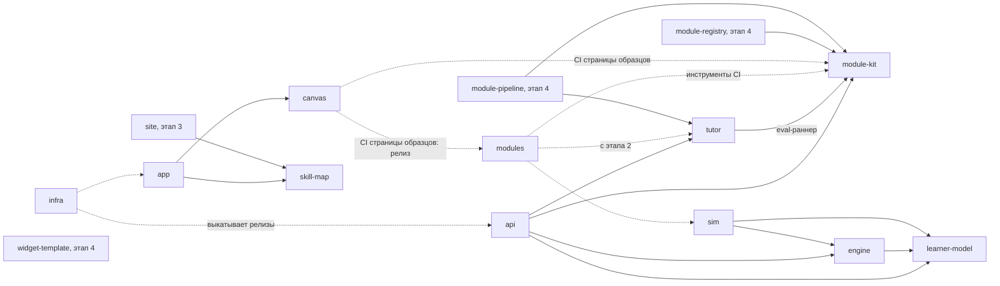

# NovaTrail — репозитории

> Статус: черновик для обсуждения, 2026-10-18.
>
> Как платформа нарезана на репозитории, что от чего зависит и в каком порядке появляется. Какие части работают во время работы платформы и как они связаны — в [architecture.md](architecture.md). Технологии каждого репозитория описывают его собственные документы (R11). Открытые вопросы Т-… — в разделе 8.
>
> Понятия — в [concepts.md](concepts.md), решения — в [decisions.md](decisions.md).

## 1. Принципы

- **`spec` — единственная общая зависимость.** В нём словарь, форматы и контракты. Остальные репозитории берут его по точной версии тега (R10): документы и правила — git-подмодулем `spec/` на теге, код — сгенерированными пакетами из релизов `spec` (R21; Т-7).
- **Без циклов** — ни при сборке, ни по сети.
- **Библиотеки не зависят от сервисов, сервисы не зависят друг от друга при сборке.** Между собой сервисы говорят по сети, по контрактам из `spec`.
- **Сервис — только там, где нужен отдельный процесс.** В первом срезе сервис один — `api`. `tutor` — библиотека в его процессе; сервисом он станет, когда у него появится второй потребитель (R15).
- **Библиотеки чистые.**
  - `learner-model`, `engine` и `module-kit` — вычисления без ввода-вывода, как `domain/` в canvas-api. Поэтому их можно гонять на стенде на тысячах виртуальных учеников, а при нужде — исполнять на устройстве.
  - CLI `module-kit` только читает и пишет файлы модуля.
  - `tutor` — библиотека с одним видом ввода-вывода: запросами к поставщикам ИИ.
- **Сборка, сеть и CI — разные связи.**
  - Зависимость при сборке — импорт кода по версии.
  - Сетевая зависимость — вызов API по контракту.
  - Инструмент CI — программа, которую CI берёт по точному тегу.

  Поэтому стенд `sim` может проверять `learner-model` и `engine`, хотя сам их импортирует: CI библиотеки берёт `sim` по тегу и подставляет код pull request через `go.work`. Цикла здесь нет (Т-16).
- **Один образец репозитория.** Новый репозиторий начинается с заготовки `spec` — devcontainer, CLAUDE.md, AGENTS.md, RUN.md и документы (раздел 2.2, R21). justfile, CI и подписанные релизы приходят с кодом, по образцу canvas-api. Отличия от образца записываются, как в R46 canvas-api.
- **Довод R13 canvas-api.** Там клиент и API жили в одном репозитории, потому что «API и клиент меняются вместе, одним pull request». Здесь этот довод снимают версионируемые контракты в `spec`: сначала новый контракт, потом сервис, потом клиент. Цена — несколько pull request вместо одного; её принимаем ради узкого контекста ИИ-агентов и независимых релизов (R10).

## 2. Список репозиториев

### 2.1. Таблица

| Репозиторий | Что это | Вид | Зависит при сборке | Обращается по сети | Этап | Создать |
|---|---|---|---|---|---|---|
| spec | словарь, форматы, контракты, документы платформы | спецификация | — | — | 0 | есть |
| .github | профиль организации; общие CONTRIBUTING, SECURITY и кодекс поведения; общие workflow CI | мета | — | — | 0 | сейчас |
| modules | официальные модули: олимпиадная математика, испанский A1 | содержание | — (в CI: module-kit и sim; с этапа 2 — tutor) | — | 1 | сейчас |
| module-kit | формат модуля в коде: проверка, пакет и индекс, шаблоны с зерном, открытый вид, виды проверки; CLI автора | библиотека, CLI | — | — | 1 | сейчас |
| learner-model | модель ученика: оценка владения навыками по свидетельствам | библиотека | — | — | 1 | сейчас |
| engine | выбор следующего урока или задачи | библиотека | learner-model | — | 1 | сейчас |
| sim | стенд виртуальных учеников: гоняет модель ученика и движок, держит критерий | инструмент, CI | learner-model, engine | — | 1 | сейчас |
| tutor | наставник: чтение работы, слова, пути к ИИ, допущенные модели, eval | библиотека | module-kit — для eval-раннера | поставщики ИИ | 2 | сейчас |
| api | сервис платформы: аккаунты, попытки, проверка, модель ученика, выбор | сервис | tutor, module-kit, learner-model, engine | сервис входа, база; поставщики ИИ — через tutor | 2 | сейчас |
| canvas | канвы: виды, слои, штрихи, картинка для проверки; страница образцов | пакет | — (в CI страницы образцов: module-kit и релиз modules, R25) | — | 2 | сейчас |
| skill-map | карта навыков | пакет | — | — | 2 | сейчас |
| app | веб-приложение ученика и взрослого | веб-приложение | canvas, skill-map | api, сервис входа | 2 | сейчас |
| infra | общая инфраструктура: Terraform, домены, журналы, выкладка, self-hosting | инфраструктура | — | — | 2 | сейчас — документы; код — после П-11 |
| site | лендинг, юридические тексты, каталог модулей, документация для авторов | статический сайт | skill-map | — | 3 | позже |
| module-registry | сервис публикации сторонних модулей | сервис | module-kit | хранилище модулей | 4 | позже |
| module-pipeline | помощь автору: разметка, варианты задач, проверки | CLI, задания | module-kit, tutor | поставщики ИИ, module-registry | 4 | позже |
| widget-template | образец виджета модуля и среда разработки виджета | шаблон | — | — | 4 | позже |

- Зависимость от `spec` не указана: от него зависят все. Общие workflow из `.github` берут все репозитории с кодом.
- `sim` читает пакеты модулей по типам из `spec`, без `module-kit` (Т-15).
- Названия — R18; прежние имена — в R10.
- Где каждая часть работает и что решить при её детализации — architecture 3.
- Официальные модули могут разойтись по репозиторию на модуль, когда формат станет v1 (R18).

### 2.2. Как заводить репозиторий

Новый репозиторий собирается из заготовки `repo-template/` в `spec` (R21).

1. Имя — из таблицы; репозиторий — публичный (R18). Лицензия — Apache-2.0, у кода и у содержания (R12, R20).
2. `just new-repo <имя> <вид> <карточка>` — например, `just new-repo learner-model go 3.8` — собирает рабочую копию в `.repos/<имя>` из файлов последнего релиза `spec`, старшего тега вида `vX.Y.Z`. Тег должен быть уже на GitHub: подмодуль берётся оттуда, и рецепт сверяет, что там это тот же коммит. Вид — `go`, `typescript` или `docs`, карточка — номер раздела architecture 3. В копии:
   - `README.md` (en) — назначение, этап и ссылка на `spec`;
   - `CLAUDE.md` (en) — роль компонента и его место в платформе, свои документы, окружение и строка `@spec/RULES.md`. Общие правила — один файл `RULES.md` в `spec`, и его импортирует CLAUDE.md каждого репозитория: только devcontainer, точные версии, языки, никаких данных учеников и секретов, Apache-2.0, ссылки и работа между репозиториями;
   - `AGENTS.md` и `LICENSE` — те же, что в `spec`;
   - `docs/architecture.md` (ru) — назначение и границы из карточки и подраздел на каждый её пункт «Решить при детализации»;
   - `docs/decisions.md` (ru) — пустой журнал со своей нумерацией: «Следующий номер — R01». Другие репозитории цитируют его записи как «R03 api»;
   - `RUN.md` (ru) — план работ по образцу RUN.md `spec` (R19). Первый эпик — «Детализация»: по задаче на пункт «Решить при детализации», пункты, которые порознь не решить, — одной задачей, последняя задача — «Итог детализации»;
   - `.devcontainer/` — тот же, что у `spec`, со своим именем контейнера и сети и с расширениями VS Code по виду репозитория (`repo-template/kinds.json`); `NOVATRAIL_DEVCONTAINER=1`. Тома входа Claude Code, Codex и gh — общие на все контейнеры NovaTrail. Инструменты кода — Go, buf и другие — добавляются по точным версиям, когда начнётся код;
   - `spec/` — git-подмодуль на том же теге; если клон пришёл без него, контейнер достаёт его при старте. Всё добавлено в индекс, коммита нет.
3. Исполнитель заполняет пометки `FILL` по карточке компонента. `just new-repo-check <имя>` проверяет, что от заготовки ничего не осталось и ссылки ведут куда надо.
4. `gh repo create altnovatrail/<имя> --public` — после подтверждения автора. Первый коммит и push — автора.
5. CI — общие workflow из `.github`, когда появится код.
6. Вопрос, который касается нескольких репозиториев, записывается в реестр `spec`: О-, П- или Т-. Сессия в другом репозитории `spec` не правит, а передаёт такой вопрос автору через таблицу 3 своего RUN.md с пометкой «в реестр spec» (RULES.md, раздел «Across repositories»).

## 3. Схема зависимостей

От `spec` зависят все, поэтому эти стрелки не нарисованы. Стрелка означает «зависит от». Сплошная — импорт при сборке, пунктир — инструмент CI по точному тегу или выкладка.

- Гейт `sim` для `learner-model` и `engine` не нарисован, хотя это тоже инструмент CI. Вместе с импортом `sim → engine` такая стрелка читалась бы как цикл, а цикла нет (раздел 1, Т-16).
- Общие workflow из `.github` берут все репозитории с кодом; эти стрелки тоже не нарисованы.
- CI `spec` проверяет примеры модулей обычным валидатором JSON Schema, а не `module-kit`: иначе `spec` зависел бы от того, кто зависит от него.
- В схеме из диалога с Gemini реестр и конвейер зависели друг от друга. Здесь цикла нет: конвейер публикует через API реестра, а реестр о конвейере не знает.
- `widget-template` ни от кого, кроме `spec`, не зависит: протокол виджета задан в `spec`, а сторона приложения — в `canvas`.

## 4. Потоки между репозиториями

Потоки во время работы платформы — в architecture 4. Здесь — как изменения проходят между репозиториями.

**От автора к ученику:**
1. Модуль лежит в `modules`: YAML, медиа, eval-набор.
2. CI проверяет его:
   - `module-kit` — схему, граф без циклов, ссылки, ключи, утечки в запасных текстах;
   - `sim` — граф, если он изменился;
   - с этапа 2 — eval-раннер `tutor` на eval-наборе модуля.
3. На релизе `module-kit` собирает пакет и индекс, а общий workflow релиза из `.github` подписывает их (R17).
4. `api` берёт пакет по дайджесту из своей конфигурации; попытка хранит дайджест своего пакета.
5. `app` получает от `api` открытый вид задачи — без ключа, решения и ловушек. Ключ остаётся на сервере, решение приходит после верного ответа (R05).

Ключи открытых модулей публичны, как и сами модули. R05 не охраняет тайну, а лишь не держит ключ в приложении ученика.

**CI алгоритмов:**
- каждое изменение `learner-model` или `engine` прогоняется на стенде `sim`, на виртуальных учениках разных профилей. CI библиотеки берёт `sim` по точному тегу и подставляет код pull request через `go.work` (Т-16);
- критерий записан до первого прогона кандидата (R163 standalone);
- изменение, которое ухудшает критерий, не сливается.

**Смена модели ИИ:**
- новую модель для возможности ИИ допускают, когда она проходит eval-набор возможности и eval-наборы всех опубликованных модулей с этой возможностью;
- ложные тревоги считаются по вердикту: наблюдение модели проходит через `module-kit`, как в работе платформы (R04).

## 5. Что лежит в `spec`

- `docs/` — описательные документы платформы на русском (R14): product, concepts, privacy, architecture, repositories, decisions.
- `draft/` — прототип приложения ученика.
- `tools/` и `justfile` — проверка документов `just docs-check`: ссылки, разделы, реестры, диаграммы (RUN.md, T01). Это инструмент самого `spec`, а не код платформы; валидатор JSON Schema встанет туда же (E2).
- `RULES.md` — общие правила всех репозиториев NovaTrail; его импортирует CLAUDE.md каждого из них (R21).
- `repo-template/` — заготовка нового репозитория, а `tools/new-repo/` — рецепты `just new-repo` и `just new-repo-check`, которые её собирают и проверяют (раздел 2.2).
- Позже — нормативные части, версионируемые тегами:
  - формат модуля — JSON Schema (Т-7); пакет модуля и индекс (Т-15);
  - контракты API — protobuf и buf (Т-7): между `app` и `api`; наблюдение — общий тип `tutor`, `module-kit` и eval;
  - протокол виджета (R16) и протокол eval (R15);
  - генератор случайности и вывод зёрен, с тест-векторами, — один на всю платформу (Т-18, R27);
  - список кодов причин движка (R29);
  - таблица допуска к ИИ: поставщик, путь к ИИ, возрастная категория — со ссылками на privacy 5.3 (Т-20);
  - возраст цифрового согласия по странам — с источниками и датой прочтения (privacy 3);
  - формат выгрузки (R09);
  - общая таксономия навыков (Т-14);
  - руководства для авторов. Язык нормативных текстов — О-3.
- Примеры — фрагменты модулей для тестов схем. CI `spec` проверяет их обычным валидатором JSON Schema (раздел 3).

Чего в `spec` нет: кода сервисов и библиотек, содержания модулей, данных учеников.

## 6. Порядок появления

1. **spec** — словарь, решения, приватность, архитектура; затем формат модуля v0, пакет, наблюдение и протокол eval.
2. **.github** — общие workflow, до первого репозитория с кодом.
3. **modules и module-kit:**
   - порт 603 эталонных задач standalone с ловушками и решателями;
   - небольшой набор испанского A1;
   - CLI `module-kit` проверяет модули и собирает пакеты и индекс, а общий workflow релиза подписывает их (R17).

   Так формат v0 сразу проверяется на двух предметах (R08).
4. **learner-model, engine и sim** — вместе: стенду нужны и модель, и правило выбора. Стенд и критерий появляются до первого кандидата. Отправная модель — модель standalone с уровнем на модуль (concepts 11).
5. **tutor и canvas** — первый код этапа 2: замер чтения ИИ по каждому виду канвы и ответа, как E2 в canvas-api.
   - Сначала узнать, хорошо ли ИИ читает работу, потом строить остальное (R60 canvas-api).
   - Образцы для замера делают взрослые добровольцы на странице образцов `canvas`, в том числе подражая детскому почерку (П-16).
   - Образцы детей — только с отдельным согласием (П-10).
6. **api, app, skill-map и infra** — первый срез с учеником. До первого ребёнка — согласие родителя и договоры с поставщиками ИИ (П-1, П-3). Регион данных — до первого развёртывания (П-11).
7. **site** — к бете, этап 3. **module-registry, module-pipeline и widget-template** — с третьим модулем и сторонними авторами, после формата v1 (этап 4; R08; product 11).

Репозиторий можно завести раньше, чем начнётся его код: детализация начинается с документов (раздел 2.2).

## 7. Что переносим из MathTrail

| Что | Откуда | Куда |
|---|---|---|
| Принципы проверки и подсказки: вердикт выносит программа, четыре вердикта, лестница подсказок, проверка утечки, запасные тексты | canvas-api: R37, R38, R39, R24; spec 5–7 canvas-api | concepts; api, tutor, module-kit |
| Модель ученика: модель Раша с полом угадывания, обновление по Elo, пробная серия, осторожное «освоено» | standalone: SPEC 2, R187 | learner-model |
| Стенд виртуальных учеников и критерий, записанный заранее | standalone: `tools/learners`, `docs/learners.md`, R163 | sim |
| Правило выбора задачи и коридор успеха (R23) | standalone: SPEC 3 | engine |
| 17 тем и связи `builds_on`, 20 ловушек, 11 приёмов, 603 эталонные задачи с решателями | standalone: `content/`, `site/` | modules — модуль математики |
| Проверка задачи решателем на Starlark | standalone: SPEC 6 | module-kit — ключи шаблонов (concepts 9.3) и вид проверки «условие» |
| Каркас сервиса: конфигурация, журналы, ошибки, версия | canvas-api: `internal/`, в свою очередь из standalone (R11 canvas-api) | api, образец репозитория |
| Devcontainer, justfile, CI, подписанные релизы, Terraform, self-hosting | canvas-api | все репозитории; общее — в .github и infra |
| Замер чтения ИИ на образцах, журнал автора, eval | canvas-api: R60–R66 | tutor — eval-раннер; canvas — страница образцов |
| Лист для рукописи: координаты, штрихи, рамка ошибки на штрихах ученика | canvas-api: spec 4, R15, R43 | canvas — вид канвы «лист для рукописи» |
| Приватность детей: минимум данных, согласие, удаление | canvas-api: `docs/privacy.md` | privacy |
| Сайт: пререндер, языки, страницы без скриптов | standalone: `site/`, `web/` | site — позже |
| Канал MCP: сервер, вход, виджет в чате | standalone: `plugin/`, `internal/transport/mcp`, `web/src/widget` | канал MCP — позже (О-15) |
| Пакет для грантов: логическая модель, реестр данных | standalone: `docs/grants/` | позже |

## 8. Открытые вопросы

Каждый вопрос: суть, варианты, рекомендация и что он блокирует. Номера не меняются; закрытый вопрос остаётся на месте с пометкой и номером решения. Новые вопросы получают следующий номер — Т-27.

| № | Вопрос | Варианты | Рекомендация | Блокирует |
|---|---|---|---|---|
| Т-1 | Где код видов проверки — **закрыт: R17**, код — в `module-kit`, а не в отдельной библиотеке `checker` | внутри canvas-api; отдельная библиотека `checker` | отдельная библиотека: виды проверки нужны canvas-api, конвейеру, стенду и CLI реестра, который проверяет ключи при публикации | формат v0, canvas-api |
| Т-2 | Официальные модули: один репозиторий или по репозиторию на модуль — **закрыт: R18** | монорепозиторий `modules`; `module-<имя>` на каждый | монорепозиторий, пока формат меняется: правка формата — одна на все модули. Разделить, когда формат станет v1 | этап 1 |
| Т-3 | Репозиторий `.github` — **закрыт: R18** | нет; да | да: профиль организации; общие CONTRIBUTING, SECURITY и кодекс поведения; общие workflow CI с actions, закреплёнными по SHA | первый публичный репозиторий кода |
| Т-4 | Реестр v0 — **закрыт: R17** | сервис с базой; подписанный статический индекс, который собирает CI; список закреплённых версий в canvas-api | подписанный статический индекс: CI собирает его из репозиториев модулей, CLI служит валидатором. Сервис — на этапе 4 | этап 1 |
| Т-5 | map-ui: пакет или микрофронтенд — **закрыт: R16**: пакет; второй потребитель получает вторую сборку того же пакета | пакет, который canvas-shell собирает к себе; веб-компонент, загружаемый на лету | сначала пакет; веб-компонент — когда появится второй потребитель, например кабинет взрослого или канал MCP | этап 2 |
| Т-6 | Названия canvas-api и canvas-shell — **закрыт: R18** | оставить; короче — например, `api` и `app`; другое | решить до первого кода: канва теперь одно понятие из многих, а сервис отвечает ещё за аккаунты, пути к ИИ и модель ученика | этап 2 |
| Т-7 | Форматы контрактов | JSON Schema для модулей и protobuf для API; один формат на всё | JSON Schema для модуля: авторы пишут YAML или JSON. protobuf и buf — для API сервисов, как R12 canvas-api. Сгенерированные пакеты выходят из релизов `spec` | формат v0 |
| Т-8 | Как исполняется код чужих виджетов — **закрыт: R16** | Web Components прямо в странице; iframe-песочница | iframe-песочница на отдельном origin; CSP без сети; обмен сообщениями по протоколу из `spec`; подписанные бандлы, закреплённые по хешу; детям — только виджеты после ревью. Shadow DOM изолирует стили, но не код | этап 4 |
| Т-9 | Где держать ключ пользователя | на сервере, зашифрованным; на устройстве, передавая с запросом; только в памяти запроса | на устройстве. Ключ приходит с запросом, а на сервере живёт только в памяти: не в базе и не в журналах, как картинки работы в canvas-api (R42 canvas-api). Ключ взрослого привязан к его профилю: для профиля ребёнка `api` его не принимает (О-4) | свой ключ, privacy 5.2 |
| Т-10 | Где считаются модель ученика и движок | только на сервере; ещё и на устройстве (WASM) | на сервере. Библиотеки чистые, поэтому расчёт на устройстве — для офлайна — остаётся возможным | этап 5 |
| Т-11 | Версии `spec` | semver тегами, поддержка версий формата | semver; паспорт модуля называет версию формата; платформа поддерживает текущую мажорную версию и предыдущую | формат v0 |
| Т-12 | Где живёт eval: протокол, раннер, образцы — **закрыт: R15** | всё в `spec`; протокол в `spec`, раннер в canvas-api, образцы вне репозиториев | протокол — в `spec`; раннер — рядом с кодом наставника; работы учеников — вне репозиториев, как `samples/` в canvas-api (R65 canvas-api). Синтетические образцы и образцы, которые для eval сделали взрослые добровольцы и авторы, могут лежать в модуле (concepts 3) | замер этапа 2 |
| Т-13 | Голос | realtime API голоса; связка синтеза и распознавания речи | решить на этапе 3, по eval и цене. Правила одинаковы для ИИ платформы и своего ключа. Довод против речи в речь: её нельзя пропустить через проверку утечки до того, как ученик её услышит (R05). Озвучку начать с синтеза речи устройства — только локальными голосами, у которых атрибут `localService` истинен (architecture 8) | этап 3 |
| Т-14 | Общая таксономия навыков | курирует платформа в `spec`; отдельный модуль; без неё — ссылки на чужие модули | в `spec`, отдельным словарём навыков-опор; модули ссылаются друг на друга только через неё (concepts 4) | ссылки между модулями |
| Т-15 | Что внутри пакета модуля | YAML автора как есть; скомпилированный канонический вид | скомпилированный: `module-kit` собирает YAML в канонический вид по схеме из `spec`, а `api`, `sim` и eval читают только его. Часть для сервера — всё содержание, в том числе ключи, решения и ловушки; часть для устройства — медиа и бандлы виджетов, без ключей; у каждой свой дайджест, а манифест пакета называет оба | формат v0 |
| Т-16 | Как стенд проверяет изменения `learner-model` и `engine` | CI библиотеки берёт `sim` по точному тегу и подставляет код pull request через `go.work`; гейт только на кандидатах релиза; три библиотеки в одном репозитории | `go.work`: репозитории остаются раздельными (R10), а каждый pull request проходит стенд. CI `modules` тоже гоняет `sim`, если меняется граф | этап 1 |
| Т-17 | Где хранить и как раздавать пакеты модулей, медиа и бандлы виджетов; на каком домене виджеты; где хостится сборка `app` (дополнено 2026-10-19: карточка 3.11 ссылается на Т-17 за её хостингом) | релизы `modules`; образ `api`; хранилище с CDN. Домен виджетов — поддомен основного или отдельный регистрируемый. Сборка `app` — Firebase Hosting, как в canvas-api (R10 canvas-api); другой хостинг статики из architecture 3.12 | этап 1 — релизы `modules`; этап 2 — пакеты в образе `api` по дайджесту из конфигурации, медиа раздаёт `api`; хранилище с CDN в `infra` — когда модулей станет больше или придут сторонние авторы. Домен виджетов — отдельный регистрируемый, купить вместе с основным после О-16. Хостинг сборки `app` выбирает T03 infra по тому, что хостинг пишет в журналы (architecture 1; П-9); туда же потом переезжает страница образцов (R25) | этап 2 |
| Т-18 | Генератор случайности и воспроизводимость между версиями | генератор языка программирования; свой алгоритм, заданный в `spec` | алгоритм и вывод зёрен задаёт `spec`, с тест-векторами: фрагмент модуля и зерно дают точный открытый вид, наблюдение и ключ — точный вердикт. `module-kit`, виджеты, `engine` и `sim` берут один генератор и одну схему зёрен и проходят тест-векторы в CI (R27); алгоритм выбирается с учётом схемы стенда standalone — FNV-64a и PCG. Изменение поведения вида проверки поднимает версию формата; попытка хранит её вместе с дайджестом пакета и зерном | формат v0 |
| Т-19 | Кто выкатывает сервисы и сборку `app` (дополнено 2026-10-19: `infra` выкатывает и `app`, раздел 3) | каждый репозиторий — по своему релизу, как canvas-api; `infra` — по списку точных версий | `infra` по списку точных версий и дайджестов — и сервисов, и сборки `app`: одно место, где видно, что работает; откат — revert; self-hosting берёт тот же список. Выкатываются только релизы с проверенной подписью, как canvas-api: R45, R58 | этап 2 |
| Т-20 | Как устроен допуск к ИИ по возрастной категории | правила в коде; таблица в `tutor`; таблица в `spec` | таблица «поставщик × путь к ИИ × возрастная категория» — в `spec`, каждая ячейка со ссылкой на privacy 5.3 и датой прочтения. Факты развёртывания — подписан ли DPA, одобрен ли zero data retention — в конфигурации. Для несовершеннолетних по умолчанию всё закрыто; self-hosting заявляет свои факты. Одна чистая функция в `tutor` вызывается до каждого запроса | этап 2 |
| Т-21 | Как пакеты интерфейса стыкуются с приложением | веб-компоненты с типами из `spec`; компоненты фреймворка `app` | веб-компоненты: у `canvas` и `skill-map` будет несколько потребителей — `app`, страница образцов, сайт, карточка канала MCP, — а фреймворк каждого решает его репозиторий | этап 2 |
| Т-22 | Что `api` хранит о модели ученика | состояние навыков; журнал свидетельств только на дозапись, а состояние — кэш по версии `learner-model` | журнал свидетельств: смена алгоритма пересчитывает состояние по журналу, а не переносит старое; тот же журнал служит выгрузке и, позже, офлайну. Связан с П-7 | этап 2 |
| Т-23 | Чтение и разбор: один вызов ИИ или два | два: чтение без ключа, разбор с ключом (R38 canvas-api); один, с ключом и сверкой `value` с `written` (R62 canvas-api) | два, пока замер этапа 2 не покажет, что ключ не сдвигает чтение. Модель, которая видит ключ, может «дочитать» ожидаемый ответ; главный риск одного вызова — ложное «верно» (R62 canvas-api) | tutor, api, privacy 5.1, замер этапа 2 |
| Т-24 | Можно ли верить состоянию, о котором сообщает виджет | верить; сервер повторяет состояние по зерну и событиям ученика | повторять на сервере: тогда вердикт воспроизводим и не зависит от кода на устройстве (R03). Виджет, состояние которого повторить нельзя, — решить отдельно, до его публикации | протокол виджета, этап 4 |
| Т-25 | Нужен ли канал реального времени | нет: вердикт и слова наставника — два запроса; да: поток событий, как Centrifugo в canvas-api | в первом срезе — нет. Вернуться к вопросу вместе с голосом (Т-13) | api, app; этап 3 |
| Т-26 | Где публиковать пакеты интерфейса | npm, область `@altnovatrail`; GitHub Packages; только релизы GitHub | решить, прочитав условия реестров: пакеты должны ставиться по точной версии и без токена, в том числе авторами виджетов | этап 2 |
