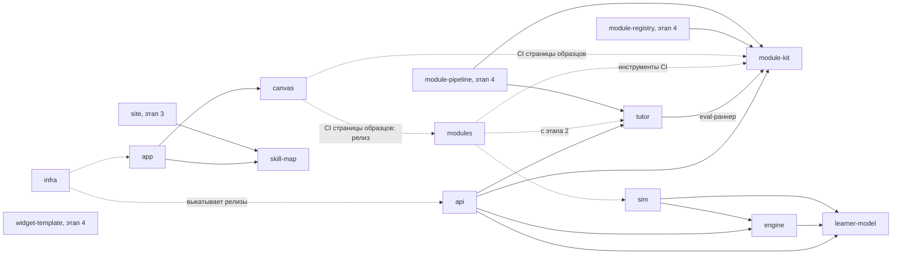

# NovaTrail — репозитории

> Статус: черновик для обсуждения, 2026-10-18.
>
> Как платформа нарезана на репозитории, что от чего зависит и в каком порядке появляется. Какие части работают во время работы платформы и как они связаны — в [architecture.md](architecture.md). Технологии каждого репозитория описывают его собственные документы (R11). Открытые вопросы Т-… — в разделе 8.
>
> Понятия — в [concepts.md](concepts.md), решения — в [decisions.md](decisions.md).

## 1. Принципы

- **`spec` — единственная общая зависимость.** В нём словарь, форматы и контракты. Остальные репозитории берут его по точной версии тега (R10): документы и правила — git-подмодулем `spec/` на теге, код — файлами релиза на том же теге (R21, R64). Код на Go берёт тег как версию модуля Go `github.com/altnovatrail/spec` — с форматом `spec.Format` и его типами, пакетами `types/formatv0` и `types/formatv0/open` (R72), а с линии 0.8 и с таблицей допуска `spec.Admission` и её типами `types/admissionv0` (R96), — любой другой код — подписанный файл релиза, `format-<версия>.tar.gz` и `admission-<версия>.tar.gz`. Код на TypeScript берёт типы формата пакетом npm `@altnovatrail/spec` той же версии, что тег, без `v`, — файлом того же релиза с линии 0.4 (R73). Код контрактов API — свой: на Go — вложенный модуль `github.com/altnovatrail/spec/contracts` по тегу `contracts/vX.Y.Z` с номером тега `spec`, на TypeScript — пакет npm `@altnovatrail/contracts` той же версии, файлом того же релиза с линии 0.7; тег `contracts/vX.Y.Z` релиз ставит сам (R83; четвёртая поправка 2026-11-02 к R83). С линии 0.5 тот же пакет несёт и типы элемента `<novatrail-canvas>`, `@altnovatrail/spec/canvas` (R74). Версии модулей в `go.mod`, пакеты npm и подмодуль двигают вместе, одним переходом на тег, и исключают из Dependabot (R64, R73).
- **Без циклов** — ни при сборке, ни по сети.
- **Библиотеки не зависят от сервисов, сервисы не зависят друг от друга при сборке.** Между собой сервисы говорят по сети, по контрактам из `spec`.
- **Сервис — только там, где нужен отдельный процесс.** В первом срезе сервис один — `api`. `tutor` — библиотека в его процессе; сервисом он станет, когда у него появится второй потребитель (R15).
- **Библиотеки чистые.**
  - `learner-model`, `engine` и `module-kit` — вычисления без ввода-вывода, как `domain/` в canvas-api. Поэтому их можно гонять на стенде на тысячах виртуальных учеников, а при нужде — исполнять на устройстве.
  - CLI `module-kit` только читает и пишет файлы модуля.
  - `tutor` — библиотека с одним видом ввода-вывода: запросами к поставщикам ИИ.
- **Сборка, сеть и CI — разные связи.**
  - Зависимость при сборке — импорт кода по версии.
  - Сетевая зависимость — вызов API по контракту.
  - Инструмент CI — программа, которую CI берёт по точному тегу.

  Поэтому стенд `sim` может проверять `learner-model` и `engine`, хотя сам их импортирует: CI библиотеки берёт `sim` по тегу и подставляет код pull request через `go.work`, а другую библиотеку — коммитом из файла гейта `sim`. Цикла здесь нет (R103).
- **Один образец репозитория.** Новый репозиторий начинается с заготовки `spec` — devcontainer, CLAUDE.md, AGENTS.md, RUN.md и документы (раздел 2.2, R21). Общие проверки CI из `.github` у него с первого дня, ещё до кода (R30); justfile, проверки языка и подписанные релизы приходят с кодом, по образцу canvas-api. Отличия от образца записываются, как в R46 canvas-api.
- **Довод R13 canvas-api.** Там клиент и API жили в одном репозитории, потому что «API и клиент меняются вместе, одним pull request». Здесь этот довод снимают версионируемые контракты в `spec`: сначала новый контракт, потом сервис, потом клиент. Цена — несколько pull request вместо одного; её принимаем ради узкого контекста ИИ-агентов и независимых релизов (R10).

## 2. Список репозиториев

### 2.1. Таблица

| Репозиторий | Что это | Вид | Зависит при сборке | Обращается по сети | Этап | Создать |
|---|---|---|---|---|---|---|
| spec | словарь, форматы, контракты, документы платформы | спецификация | — | — | 0 | есть |
| .github | профиль организации; общие CONTRIBUTING, SECURITY и кодекс поведения; общие workflow CI | мета | — | — | 0 | сейчас |
| modules | официальные модули: олимпиадная математика, школьная математика 3 класса, короткие сочинения на английском | содержание | — (в CI: module-kit и sim; с этапа 2 — tutor) | — | 1 | сейчас |
| module-kit | формат модуля в коде: проверка, пакет и индекс, шаблоны с зерном, открытый вид, виды проверки; CLI автора | библиотека, CLI | — | — | 1 | сейчас |
| learner-model | модель ученика: оценка владения навыками по свидетельствам | библиотека | — | — | 1 | сейчас |
| engine | выбор следующего урока или задачи | библиотека | learner-model | — | 1 | сейчас |
| sim | стенд виртуальных учеников: гоняет модель ученика и движок, держит критерий | инструмент, CI | learner-model, engine | — | 1 | сейчас |
| tutor | наставник: чтение работы, слова, пути к ИИ, допущенные модели, eval | библиотека | module-kit — для eval-раннера (в CI: релиз canvas — синтетические образцы, R38) | поставщики ИИ | 2 | сейчас |
| api | сервис платформы: аккаунты, попытки, проверка, модель ученика, выбор | сервис | tutor, module-kit, learner-model, engine | сервис входа, база; поставщики ИИ — через tutor | 2 | сейчас |
| canvas | канвы: виды, слои, штрихи, вырезка для проверки; страница образцов | пакет | — (в CI страницы образцов: module-kit и релиз modules, R25; до первого содержания modules — релиз tutor) | — | 2 | сейчас |
| skill-map | карта навыков | пакет | — | — | 2 | сейчас |
| app | веб-приложение ученика и взрослого | веб-приложение | canvas, skill-map | api, сервис входа | 2 | сейчас |
| infra | общая инфраструктура: OpenTofu, домены, журналы, выкладка, self-hosting | инфраструктура | — | — | 2 | код — эпик первого кода `infra` (R109; поправка 2026-11-08 к R11) |
| site | лендинг, юридические тексты, каталог модулей, документация для авторов | статический сайт | skill-map | — | 3 | позже |
| module-registry | сервис публикации сторонних модулей | сервис | module-kit | хранилище модулей | 4 | позже |
| module-pipeline | помощь автору: разметка, варианты задач, проверки | CLI, задания | module-kit, tutor | поставщики ИИ, module-registry | 4 | позже |
| widget-template | образец виджета модуля и среда разработки виджета | шаблон | — | — | 4 | позже |

- Зависимость от `spec` не указана: от него зависят все. Общие проверки CI из `.github` берут все репозитории, и `spec` тоже, ещё до кода (R30).
- `sim` читает пакеты модулей — их часть для сервера, канонический вид — по типам из `spec`, без `module-kit` (R62).
- Названия — R18; прежние имена — в R10.
- Где каждая часть работает и что решить при её детализации — architecture 3.
- Официальные модули могут разойтись по репозиторию на модуль, когда формат станет v1 (R18).

### 2.2. Как заводить репозиторий

Новый репозиторий собирается из заготовки `repo-template/` в `spec` (R21).

1. Имя — из таблицы; репозиторий — публичный (R18). Лицензия — Apache-2.0, у кода и у содержания (R12, R20).
2. `just new-repo <имя> <вид> <карточка>` — например, `just new-repo learner-model go 3.8` — собирает рабочую копию в `.repos/<имя>` из файлов последнего релиза `spec`, старшего тега вида `vX.Y.Z`. Тег должен быть уже на GitHub: подмодуль берётся оттуда, и рецепт сверяет, что там это тот же коммит. Релиз с тегом выходит сам, после зелёного CI на `main` (R31). Вид — `go`, `typescript` или `docs`, карточка — номер раздела architecture 3. В копии:
   - `README.md` (en) — значки статуса первого дня (раздел 2.3), назначение, этап и ссылка на `spec`;
   - `CLAUDE.md` (en) — роль компонента и его место в платформе, свои документы, окружение и строка `@spec/RULES.md`. Общие правила — один файл `RULES.md` в `spec`, и его импортирует CLAUDE.md каждого репозитория: только devcontainer, точные версии, языки, никаких данных учеников и секретов, Apache-2.0, ссылки и работа между репозиториями;
   - `AGENTS.md` и `LICENSE` — те же, что в `spec`;
   - `docs/architecture.md` (ru) — назначение и границы из карточки и подраздел на каждый её пункт «Решить при детализации»;
   - `docs/decisions.md` (ru) — пустой журнал со своей нумерацией: «Следующий номер — R01». Другие репозитории цитируют его записи как «R03 api»;
   - `RUN.md` (ru) — план работ по образцу RUN.md `spec` (R19). Первый эпик — «Детализация»: по задаче на пункт «Решить при детализации», пункты, которые порознь не решить, — одной задачей, последняя задача — «Итог детализации»;
   - `.devcontainer/` — тот же, что у `spec`, со своим именем контейнера и сети и с тем, что добавляет вид репозитория (`repo-template/kinds.json`): расширения и настройки VS Code, строки в конце стадии `toolchain` и, из папки вида, строки стадии `devcontainer` с файлами, которые копирует образ. Вид `go` добавляет расширение Go с настройками, которые не дают ему ставить свои инструменты, и gopls из lock-файла `repo-template/kinds/go/gopls/`, собранный в стадии `devcontainer` версией `GOPLS_VERSION` (R102); переход на тег берёт `.devcontainer/` из того, что строит рецепт, и вносит отличия репозитория заново, так что gopls приходит с ним. `.devcontainer/gopls/` — модуль Go, который не читает ни один код, и проверки Go репозитория его не перечисляют. Вид `typescript` — расширение Biome, Biome форматтером TypeScript по умолчанию и браузер для тестов — Chrome Headless Shell из образа Playwright по тегу и digest и его системные библиотеки из снимка Ubuntu (R79); `NOVATRAIL_DEVCONTAINER=1`. Решения, на которые ссылается его Dockerfile, — решения `spec`, и в копии они с суффиксом: `(R34 spec)` (В11 `canvas`). Тома входа Claude Code, Codex и gh — общие на все контейнеры NovaTrail. Go в стадии `toolchain` уже есть: `spec` проверяет им свой модуль Go (R64), а у компонента им собирают и проверяют его код на Go. Он приходит с Dockerfile в копию любого вида, а в копии без кода на Go не используется: комментарии Dockerfile написаны так, чтобы читаться верно и в `spec`, и в копии (В8 `module-kit`). buf приходит так же: в `spec` им проверяются контракты, а в копии без контрактов он не используется (R83). Другие инструменты кода добавляются по точным версиям, когда начнётся код;
   - `spec/` — git-подмодуль на том же теге; если клон пришёл без него, контейнер достаёт его при старте. Всё добавлено в индекс, коммита нет.
3. Исполнитель заполняет пометки `FILL` по карточке компонента. `just new-repo-check <имя>` проверяет, что от заготовки ничего не осталось, а документы копии проходят проверку документов репозитория (R32). В самом репозитории её запускает `just -f spec/justfile docs-check-repo`.
4. `gh repo create altnovatrail/<имя> --public` — после подтверждения автора. Сразу за ним — `gh repo edit altnovatrail/<имя> --delete-branch-on-merge`: ветка pull request удаляется после слияния. Так настроены все репозитории организации с 2026-10-19, но новый репозиторий эту настройку сам не получает. Первый коммит и push — автора. Числовой ID нового репозитория — `gh api repos/altnovatrail/<имя> --jq .id` — та же задача `spec` вносит в `tools/release/repositories.mjs`: без него `release-verify` не примет файлов его релизов, ведь подпись сверяется с ID, а не только с адресом (R77, поправка 2026-11-01).
5. CI — общие проверки из `.github` и Dependabot, ещё до кода (R30; RUN.md, T16); проверки языка — с первым кодом репозитория. Что код добавляет к вызывающим файлам — job языка, вход CodeQL, экосистему Dependabot, релиз, — пишет сессия самого репозитория по architecture 3.3 .github, а проверки в ruleset ставит автор (поправка 2026-10-21 к R30).
6. Вопрос, который касается нескольких репозиториев, записывается в реестр `spec`: О-, П- или Т-. Сессия в другом репозитории `spec` не правит, а передаёт такой вопрос автору через таблицу 3 своего RUN.md с пометкой «в реестр spec» (RULES.md, раздел «Across repositories»).

### 2.3. Значки README

README каждого репозитория начинается значками статуса, как у MathTrail (R48):
- первая строка — CI, Release, CodeQL, номер релиза, язык, покрытие, OpenSSF Best Practices, OpenSSF Scorecard и лицензия;
- вторая, после пустой строки, — пять мер SonarCloud: code smells, reliability, security, maintainability и vulnerabilities.

Значок стоит, только когда есть то, о чём он говорит: без «no releases», «not found» и «unknown».
- **С первого дня** — CI, CodeQL, Scorecard, лицензия и меры SonarCloud. Их несёт заготовка, `repo-template/files/README.md`, с именем репозитория. Отвечают они, когда репозиторий заведён до конца: с общими проверками (раздел 2.2, пункт 5), проектом SonarCloud (R30) и первым прогоном Scorecard.
- **С первым релизом** — Release и номер релиза.
- **С первым кодом** — язык: у Go — версия из `go.mod`, у TypeScript — версия `typescript` из devDependencies `package.json`. У `spec` значка языка нет: его код — инструменты проверок в `tools/` и модуль Go, обёртка над файлами формата и их типами (R64, R72), а не код платформы.
- **С первой загрузкой покрытия в Codecov** — покрытие (RUN.md, T40).
- **С уровнем passing** — OpenSSF Best Practices, по ID проекта на bestpractices.dev (RUN.md, T41). Ответы на критерии лежат в файле `.bestpractices.json` в корне репозитория, по-английски: сайт предлагает их в анкете, а сохраняет их автор (поправка 2026-10-26 к R48). Изменённый ответ сайт из файла сам не берёт. Его приносит ссылка на анкету с изменёнными полями и `overrides` по ним: её строит из файла сессия репозитория, а сохраняет автор (поправка 2026-10-27 к R48).

Значок, который встаёт позже, сессия репозитория ставит на его место в строке вместе с тем, о чём он говорит. Вот все значки, с `<имя>` вместо имени репозитория и `<ID>` вместо номера его проекта Best Practices:

```markdown
[](https://github.com/altnovatrail/<имя>/actions/workflows/ci.yml)
[](https://github.com/altnovatrail/<имя>/actions/workflows/release.yml)
[](https://github.com/altnovatrail/<имя>/actions/workflows/codeql.yml)
[](https://github.com/altnovatrail/<имя>/releases/latest)
[](go.mod)
[](package.json)
[](https://codecov.io/gh/altnovatrail/<имя>)
[](https://www.bestpractices.dev/projects/<ID>)
[](https://scorecard.dev/viewer/?uri=github.com/altnovatrail/<имя>)
[](LICENSE)

[](https://sonarcloud.io/summary/new_code?id=altnovatrail_<имя>)
[](https://sonarcloud.io/summary/new_code?id=altnovatrail_<имя>)
[](https://sonarcloud.io/summary/new_code?id=altnovatrail_<имя>)
[](https://sonarcloud.io/summary/new_code?id=altnovatrail_<имя>)
[](https://sonarcloud.io/summary/new_code?id=altnovatrail_<имя>)
```

- У `.github` workflow — `self-ci.yml`, `self-codeql.yml` и `self-release.yml`, а проект SonarCloud — `altnovatrail_.github`. Что показывает профиль организации, `profile/README.md`, решает `.github`.
- Картинку значка браузер читателя берёт не у сервиса, а у прокси GitHub — Camo (R48).

## 3. Схема зависимостей

От `spec` зависят все, поэтому эти стрелки не нарисованы. Стрелка означает «зависит от». Сплошная — импорт при сборке, пунктир — инструмент CI по точному тегу или выкладка.



- Не нарисованы и связи `canvas` и `tutor`, по той же причине, что гейт `sim` ниже: они берут релизы друг друга как инструменты CI. CI `tutor` — синтетические образцы `canvas` (R38), CI `canvas` — открытые виды задач замера `tutor`, пока у `modules` нет содержания (поправка 2026-10-21 к R25). Цикла при сборке нет: каждая сторона берёт уже вышедший релиз другой по точному тегу, а первым выходит релиз `tutor` (R38).
- Гейт `sim` для `learner-model` и `engine` не нарисован, хотя это тоже инструмент CI. Вместе с импортом `sim → engine` такая стрелка читалась бы как цикл, а цикла нет (раздел 1, Т-16).
- Общие проверки CI из `.github` берут все репозитории (R30); эти стрелки тоже не нарисованы.
- CI `spec` проверяет примеры модулей обычным валидатором JSON Schema, а не `module-kit`: иначе `spec` зависел бы от того, кто зависит от него. Вектор правила части он проверяет схемой и правилами YAML, а само правило — CI `module-kit` (R45). Правила YAML и правила всего модуля — раскладку, ID в именах файлов и сигнатуры медиафайлов — `format-check` проверяет сам и сам строит открытый вид, с T29 — и вердикты векторов вердикта, кроме тех, что условию даёт Starlark, с T30 — ловушки, которые в них называют неверные значения, и что проверка утечки находит в текстах векторов утечки, с T31 — и правило `lesson.no-leaks` на уроках, а с T34 — ярусы и пакет модуля, его канонический вид и дайджесты: это вторая реализация рядом с `module-kit`, и векторы сверяют обе (R46, R51, R56, R57, R58, R62).
- В схеме из диалога с Gemini реестр и конвейер зависели друг от друга. Здесь цикла нет: конвейер публикует через API реестра, а реестр о конвейере не знает.
- `widget-template` ни от кого, кроме `spec`, не зависит: протокол виджета задан в `spec`, а сторона приложения — в `canvas`.

## 4. Потоки между репозиториями

Потоки во время работы платформы — в architecture 4. Здесь — как изменения проходят между репозиториями.

**От автора к ученику:**
1. Модуль лежит в `modules`: YAML, медиа, eval-набор.
2. CI проверяет его:
   - `module-kit` — схему, граф без циклов, ссылки, медиафайлы, ключи, утечки в текстах автора, которые ученик видит до решения, — и в текстах урока, который называет задачу (R57; R58);
   - `sim` — если изменилось то, что стенд читает из пакета, — на пакете pull request, с инвариантами и абсолютными порогами, без полос; с первого тега `sim`: до него гейта нет (R76; R103). Pull request, который меняет тег `sim`, гоняет все графы;
   - с этапа 2 — eval-раннер `tutor` на eval-наборе модуля.
3. На релизе `module-kit` собирает пакет — канонический вид для сервера, часть для устройства и опись с их дайджестами, без eval-набора (R62), — и индекс модулей: из индекса прошлого релиза, с записью каждой опубликованной версии и отметками о снятии (R63). Общий workflow релиза из `.github` подписывает их (R17).
4. `api` берёт пакеты по индексу релиза `modules`, который закрепляет его конфигурация — тег релиза и дайджест индекса, а дайджесты пакетов называет индекс (R63; R07 api); попытка хранит дайджест своего пакета — дайджест его описи (R62).
5. `app` получает от `api` открытый вид задачи — без ключа, решения и ловушек, без навыков, полосы и сложности, без приёмов, случая попроще и фраз-утечек (R57). Ключ остаётся на сервере, решение приходит после верного ответа (R05), а навыки, полосу и сложность читает только сервер (R51). Открытый вид урока приходит без его навыков и возрастных категорий (R58). Открытые виды паспорта, графа навыков, каталога приёмов и шагов решения `app` получает по дайджесту пакета — попытки, прохождения урока или текущей версии подключённого модуля — и кеширует по нему, а медиафайлы — из части пакета для устройства, которую раздаёт `api` (R62 и поправка 2026-11-04 к нему; R99).

Ключи открытых модулей публичны, как и сами модули. R05 не охраняет тайну, а лишь не держит ключ в приложении ученика.

**CI алгоритмов:**
- каждое изменение `learner-model` или `engine` прогоняется на стенде `sim`, на виртуальных учениках разных популяций (concepts 15). CI библиотеки берёт `sim` по точному тегу и SHA его коммита, своим job, и пишет `go.work` на лету, не коммитя его: `sim`, код pull request и другую библиотеку — коммитом из файла гейта `sim`. Гейт идёт на каждом pull request и каждом коммите `main` и держит мерж (R103);
- первая версия каждой библиотеки — до гейта: её проверяют свои тесты, а `sim` ставит на ней стенд и пишет критерий до первого кандидата — первого изменения после неё (R103);
- критерий записан до первого прогона кандидата (R163 standalone);
- изменение, которое ухудшает критерий, не сливается;
- порядок релизов (R103): изменение, которое ломает API стенда или двигает числа, сначала записывается в `sim` на коммите своего pull request, выходит тег `sim`, pull request библиотеки поднимает тег и сливается, а после релиза библиотеки `sim` поднимает `go.mod`. Пара «порог „освоено“ и цель коридора» и изменение `learner-model`, которое ломает API `engine`, идут одним тегом `sim`: файл гейта называет оба коммита, `learner-model` сливается, когда pull request `engine` прошёл ревью, а `api` переходит на обе версии вместе. Релиз `sim` выходит сам после зелёного CI на `main`, а тег у вызывающих поднимает их сессия.

**Смена модели ИИ:**
- новую модель для возможности ИИ допускают, когда она проходит eval-набор возможности и eval-наборы всех опубликованных модулей с этой возможностью;
- порядок (В9 `modules`; R04 modules): `tutor` выпускает тег, где модель в списке допущенных, когда она прошла eval-набор возможности в CI `tutor`; pull request `modules` переходит на этот тег, и eval-раннер гоняет eval-наборы всех модулей — они лежат в git `modules`, вне пакета и файлов релиза (R62); `api` переходит на такой тег `tutor` только после мержа этого pull request. Если он красный, `tutor` выпускает следующий тег без модели, а `api` остаётся на прежнем: откат — только вперёд (Т-19). Что `api` ждёт `modules`, держит ревью pull request `api`;
- ложные тревоги считаются по вердикту: наблюдение модели проходит через `module-kit`, как в работе платформы (R04). У оценки по рубрике вердикта нет, и её мерят ложные тревоги на выполненных критериях и согласие с людьми (R71). Что раннер отдаёт — отчёт без содержания работ, по которому считаются меры, — и что лежит в eval-наборе модуля, пишет протокол eval, а для допуска годится только отчёт с вердиктами `module-kit` ([текст контрактов](../contracts/README.md), разделы 13 и 14; R95).

**Новая версия формата модуля** (R44). Зависимости при сборке и инструменты CI каждый берёт по точной версии, поэтому шаг не ломает тех, кто ещё не перешёл. А `api` и `app` говорят по сети и, пока формат — v0, выходят вместе:
1. `spec` — новая версия формата и тем же pull request новая линия; иначе `release-version` его не пропустит. Первый релиз линии выпускает версию формата файлом релиза и версией модуля Go (R64).
2. То, что читает модули в CI `modules`, переходит на новый тег — подмодулем и модулем Go `spec` вместе: `module-kit` и, с этапа 2, eval-раннер `tutor`. Если изменился открытый вид, `canvas` выпускает пакет с новыми типами (R36).
3. `modules` — одним pull request: новые теги `module-kit` и `tutor` в CI, паспорта и содержание всех модулей. `sim` в нём не гоняется: пакета новой версии он на прежнем теге не прочтёт. В переходе не меняют ничего из того, что стенд читает из пакета, — ни граф, ни привязки задач, — кроме самой записи в новой версии формата: это держит ревью `modules` (R03 modules; поправка 2026-11-07 к R103), а меняют это отдельным pull request после шага 4.
4. `sim` переходит на новый тег и на пакеты из нового релиза `modules`, а `modules` берёт в CI новый тег `sim`. `learner-model` и `engine` берут новый `sim` своим переходом: свой гейт они держат на прежнем теге.
5. `api` берёт новый `module-kit` и новые пакеты, а если изменился открытый вид, вместе с ним выходит `app` с новым `canvas` — одним списком точных версий (Т-19). CI `canvas` берёт новый релиз `modules` и новый тег `module-kit`.

Пока формат — v0, читается только текущая версия, и модули переходят все сразу; так же — на v1, ведь v0 с выходом v1 из окна уходит. С v2 окно — текущая мажорная версия и предыдущая — даёт модулям переходить по одному, а `api` и `app` — порознь.

**Новая версия таблицы допуска** (R96) — короче: таблицу читает одна функция допуска `tutor`, а зовёт её `api` в своём процессе.
1. `spec` — новая версия таблицы и тем же pull request новая линия, а её строка поставщика в privacy 5.3 сверена заново. Первый релиз линии выпускает таблицу файлом релиза и версией модуля Go (R64).
2. `tutor` переходит на новый тег — подмодулем и модулем Go `spec` вместе — и выпускает релиз: его функция читает таблицу из `spec.Admission`, а тесты гоняют её векторы.
3. `api` берёт новый релиз `tutor` и выкатывается. Если новая версия добавила факт развёртывания, оператор заявляет его в файле фактов `api` — только когда факт держится. Пока шаг 3 не прошёл, работает прежняя таблица: срочно закрыть ИИ платформы оператор может сам, сняв факт.

**Новая версия конфигурации развёртывания** (R85) — `app` и выкатка `infra` переходят на неё вместе: `app` отвергает незнакомое поле, а выкатка — сборку другой версии.
1. `spec` — новая версия части `deployment/` и тем же pull request новая линия. Первый релиз линии выпускает часть файлом релиза и версией модуля Go (R64).
2. `app` переходит на новый тег и выпускает сборку: она несёт копию новой схемы, а тесты гоняют векторы чтения.
3. `infra` переходит на тот же тег, пишет файл новой версии и выкатывает новую сборку вместе с ним, одним списком выкатки (R106). Пока шаг 3 не прошёл, выкатывается прежняя сборка с прежним файлом.

**Новая версия юридического текста** (R130) — не новая версия части: её несёт следующий тег `spec`. `api` переходит на него и выкатывается — тогда `app` получает новый текст, — сборка страницы образцов `canvas` кладёт новый набор из файла релиза, а организатор берёт новую форму. Новая версия самой части `legal/` идёт, как у конфигурации развёртывания: новая линия, и читатели переходят на неё своими задачами.

**Новая запись таблицы возраста цифрового согласия** (R134) — не новая версия части: её несёт следующий тег `spec`, и `api`, переходя на него, вычисляет категорию по новой записи. Возраст и день записи, которая вышла, не меняются: новый возраст страны — новая запись. Новая версия самой части `consent-age/` — новый код ISO 3166-1 или новое правило — идёт, как у юридических текстов: новая линия, и читатели переходят на неё своими задачами.

## 5. Что лежит в `spec`

- `docs/` — описательные документы платформы на русском (R14): product, concepts, privacy, architecture, repositories, decisions.
- `draft/` — прототип приложения ученика.
- `tools/` и `justfile` — проверка документов `just docs-check`: ссылки, разделы, реестры, диаграммы (RUN.md, T01). Это инструмент самого `spec`, а не код платформы; там же проверка формата модуля `just format-check` — схемы, примеры и тест-векторы `format/` (RUN.md, T25). Там же проверка лицензий его пакетов `just licenses-check` (R12), номер следующего релиза `just release-version` — `tools/release/` (R31) — и проверка документов репозитория компонента `just -f spec/justfile docs-check-repo` (R32). Строки «в реестр spec» других репозиториев сессия `spec` находит рецептом `just inbox`: он читает на GitHub таблицы 3 их RUN.md и сверяет с таблицей 5 RUN.md `spec` (R81). Релиз другого репозитория зовёт те же рецепты: `release-version <коммит> <workflow>` — с его линией из названного workflow — и `release-refusal`, правило отказа Releases API (поправка к R31). На раннере их запускает скрипт `tools/toolchain/toolchain.sh` из подмодуля `spec/`: он собирает стадию `toolchain` и запускает команды в ней, как CI и релиз самого `spec` (поправка 2026-10-21 к R31). Проверка лицензий другого репозитория — тоже рецептами `spec`: список категории A печатает `licenses-allowed`, а lock-файл npm с исключениями репозитория проверяет `licenses-check-repo` (R39).
- папка `.github/` — CI самого `spec`, Dependabot (R30) и релиз `release.yml`: после зелёного CI на `main` он выпускает следующий патч линии, тег — вместе с релизом (R31). С линии 0.3 релиз несёт файлы: `format-<версия>.tar.gz` с бандлом cosign `<файл>.sigstore.json`, под аттестацией неизменяемого релиза, а с линии 0.4 — ещё пакет npm типов TypeScript, `altnovatrail-spec-<версия>.tgz`, так же подписанный, с линии 0.5 — и с типами элемента `canvas`, с линии 0.7 — пакет npm кода контрактов, `altnovatrail-contracts-<версия>.tgz`, а с линии 0.8 — таблица допуска к ИИ, `admission-<версия>.tar.gz`, и её типы в пакете типов, с линии 0.11 — конфигурация развёртывания, `deployment-<версия>.tar.gz`, и её типы, а с линии 0.13 — юридические тексты, `legal-<версия>.tar.gz`, и типы их паспорта; их собирает рецепт `just release-files` (R64, R73, R74, R83, R85, R96, R130). Файлы обоих пакетов релиз сам публикует в npm, через trusted publishing и без токена (вторая поправка 2026-10-29 и поправка 2026-11-03 к R37). С линии 0.7 релиз ставит и тег `contracts/<тег>` модуля Go контрактов (поправка 2026-11-02 к R31). Рядом с ними — общие проверки всех репозиториев из `.github`: секреты, DCO, CodeQL и Scorecard (R03 .github; RUN.md, T17), а с T50 — и общая обёртка Go `go.yml` над рецептами `ci-lint`, `ci-test`, `ci-vuln` и `ci-licenses` (поправка 2026-11-01 к R30).
- `format/` — формат модуля, нормативный и на английском (R42): текст формата `format/README.md` с соглашениями R45 и номер версии `format/VERSION` (R44). Схемы — JSON Schema 2020-12 (R45). Векторы правил YAML лежат в `format/vectors/rules/` с RUN.md, T25. С T26 там же первые схемы — паспорт и общие определения, — примеры паспорта и целого модуля и векторы правил всего модуля (R46), с T27 — граф навыков, его примеры и векторы его правил (R49), с T42 — словарь общей таксономии `shared-taxonomy.schema.json` (R50), с T28 — задача, её примеры и векторы её правил, векторы правил `module.file-ids` и `module.media`, а также векторы открытого вида в `format/vectors/open-view/` (R51), с T29 — проверки ячеек, их правила и векторы вердикта в `format/vectors/verdicts/` со схемой `verdict-vector.schema.json` (R56), с T30 — каталоги ловушек и приёмов, шаги решения, их примеры и векторы, подсказки задачи и векторы проверки утечки в `format/vectors/leaks/` со схемой `leak-vector.schema.json` (R57), с T31 — урок, его примеры и векторы его правил (R58), с T32 — генератор случайности и вывод зёрен, один на всю платформу, с векторами в `format/vectors/random/` и схемой `random-vector.schema.json` (R27, R59), с T33 — шаблоны задач, их примеры, векторы их правил и векторы шаблонов в `format/vectors/templates/` со схемой `template-vector.schema.json` (R60), а с T34 — пакет модуля: схемы канонического вида и описи, примеры описи, векторы ярусов в `format/vectors/tiers/` и пакетов в `format/vectors/packages/` и `LICENSE` в раскладке модуля (R62). Остальные части приходят следующими задачами. Всё это проверяет `just format-check` (поправка 2026-10-22 к R45), а что вектор правила части нарушает само правило — CI `module-kit` (раздел 3).
- `admission/` — таблица допуска к ИИ, нормативная и на английском (R42; R96): текст `admission/README.md`, номер версии `admission/VERSION`, сама таблица `admission/admission-table.json` — правило каждой возможности ИИ для каждой возрастной категории и ячейка каждого поставщика, пути к ИИ и категории, у ячейки — строка privacy 5.3 и дата прочтения, — её схемы в `admission/schemas/`, примеры и тест-векторы: векторы правил таблицы и векторы ответов функции допуска `tutor`. Всё это проверяет `just admission-check` (`tools/admission/`): он считает ответ каждого вектора второй реализацией и сверяет строки privacy 5.3 и ссылки таблицы с документами `spec`.
- `deployment/` — формат конфигурации развёртывания `app`, файла `/deployment.json`, нормативный и на английском (R42; R85): текст `deployment/README.md`, номер версии `deployment/VERSION` — целое число, — схема файла `deployment/schemas/deployment.schema.json` по постоянному пути, примеры и векторы чтения. Всё это проверяет `just deployment-check` (`tools/deployment/`): он читает каждый файл векторов второй реализацией правил чтения, `tools/deployment/reading.mjs`, и сверяет итог.
- `legal/` — юридические тексты платформы, нормативная часть на английском (R42; R130): текст `legal/README.md`, номер версии части `legal/VERSION` — целое число, — паспорт `legal/legal.yaml` с версиями, статусами, датами и сутью на языках экрана, версии текстов `legal/texts/<id>/<n>.md`, схемы, примеры и векторы чтения. Всё это проверяет `just legal-check` (`tools/legal/`), а папку текстов копии self-hosting — `just -f spec/justfile legal-check-dir <папка>`.
- `consent-age/` — таблица возраста цифрового согласия, нормативная часть на английском (R42; R134): текст `consent-age/README.md`, номер версии части `consent-age/VERSION` — целое число, — таблица `consent-age/consent-age.yaml`, по стране — возраст с днём, с которого он действует, закон, положение, цитата, первоисточник и дата прочтения, — схемы, примеры, векторы чтения и категории. Всё это проверяет `just consent-age-check` (`tools/consent-age/`).
- `export/` — формат выгрузки, нормативная часть на английском (R42; R135): текст `export/README.md`, номер версии части `export/VERSION` — целое число, — схемы файлов выгрузки — манифеста, аккаунта, профиля и устройства, — примеры и векторы чтения. Всё это проверяет `just export-check` (`tools/export/`).
- `go.mod` и `spec.go` в корне — модуль Go `github.com/altnovatrail/spec`, который код на Go берёт по тегу релиза: пакет `spec` встраивает `format/` как `spec.Format`, `admission/` как `spec.Admission` (R96), `deployment/` как `spec.Deployment` (R85), `legal/` как `spec.Legal` (R130), `consent-age/` как `spec.ConsentAge` (R134) и `export/` как `spec.Export` (R135). Каждая часть — свой `embed.FS`, и бинарник несёт только те части, которые читает (поправка 2026-11-10 к R64). Зависимостей у модуля нет. Его zip, каким его соберёт прокси Go, проверяет вложенный модуль `tools/gomod`, а то, что модуль ничего не требует, и его zip — рецепт `just go-check` (R64). Vet, тесты с покрытием, уязвимости и лицензии этого модуля и модулей `tools/` — рецепты `ci-lint`, `ci-test`, `ci-vuln` и `ci-licenses`, которые зовёт общий `go.yml` (поправка 2026-11-01 к R30).
- `types/` — типы формата модуля в том же модуле Go: пакеты `types/formatv0` — части, общие определения, канонический вид, опись, список части для устройства, индекс и векторы — и `types/formatv0/open` — открытый вид каждой части (R72), а рядом `types/admissionv0` — типы таблицы допуска и её векторов (R96) `types/deploymentv1` — типы конфигурации развёртывания и её векторов (R85), `types/legalv2` — типы паспорта юридических текстов и его векторов, версии 2 части (R130, R141) `types/consentagev1` — типы таблицы возраста цифрового согласия и её векторов (R134) и `types/exportv1` — типы файлов выгрузки и её векторов (R135). Рядом с Go каждого пакета — его типы TypeScript, `index.d.ts`, которые несёт пакет npm `@altnovatrail/spec` (R73). Их пишет генератор `tools/types` по схемам `format/`, `admission/`, `deployment/`, `legal/`, `consent-age/` и `export/`, рецептом `just types`, а `just types-check` сверяет их с ним и читает ими каждое значение этих частей, которое проходит схему: типами Go и компилятором TypeScript. Рядом — `types/canvas/index.d.ts`, типы элемента `<novatrail-canvas>`: их `spec` пишет руками, генератор их не трогает, а `just types-check` проверяет их компилятором TypeScript по `tools/types/canvas.check.ts` (R74).
- `contracts/` — контракты API, нормативные и на английском (R42): текст `contracts/README.md` с правилами R83 — раскладка, правила buf, поля и имена в JSON, версии, сгенерированный код и транспорт Connect, — а наблюдение: что даёт читатель, как `module-kit` сводит два чтения и какой вердикт даёт наблюдение (R86). Файлы `.proto` пишут задачи эпика E3, и первый — наблюдение, `contracts/novatrail/observation/v1/observation.proto`, пакет `novatrail.observation.v1`. Рядом — `buf.yaml` и `buf.gen.yaml` в корне и модуль Go `contracts/go.mod`: код, который buf генерирует, лежит рядом с файлами, а его генераторы на Go — инструменты этого модуля. Рядом с ними — тест-векторы наблюдения, `contracts/vectors/observation/v1/`, JSON по [тексту контрактов](../contracts/README.md), раздел 10; модуль Go несёт их как `contracts.Vectors` пакета `contracts`, `contracts/vectors.go` (поправка 2026-11-03 к R86). Второй пакет — протокол eval, `novatrail.eval.v1`: файл образца с разметкой, `contracts/novatrail/eval/v1/sample.proto`, по [тексту контрактов](../contracts/README.md), раздел 11 (R93; R95), и отчёт раннера, `report.proto`, по [тексту контрактов](../contracts/README.md), раздел 14, а что лежит в eval-наборе — [текст контрактов](../contracts/README.md), раздел 13 (R95). Их синтетические примеры — `contracts/examples/eval/v1/`, и пример отчёта называется `report-<случай>.json`. Правила, которые одни у устройства и раннера, — свёртка истории письма, группы штрихов, вырезка, притяжка и окошки тетради — [текст контрактов](../contracts/README.md), раздел 12, а их тест-векторы — `contracts/vectors/eval/v1/`, сообщениями пакета; модуль Go несёт их в `contracts.Vectors`, а пакет npm `@altnovatrail/contracts` — по пути, `vectors/eval/v1/` (R94). Проверку — правила buf, правила R83, которых buf не держит, совместимость с прошлым релизом по его тегу, сверку кода, векторы, которые она считает второй реализацией, и примеры файла образца и отчёта по правилам, которые дают [текст контрактов](../contracts/README.md), разделы 11, 12 и 14, — делает рецепт `just contracts-check` (`tools/contracts/`), а код пишет `just contracts`. Zip модуля `contracts` проверяет `just go-check`, а новый мажорный пакет без новой линии `release-version` не пропускает (RUN.md, T55).
- `RULES.md` — общие правила всех репозиториев NovaTrail; его импортирует CLAUDE.md каждого из них (R21).
- `repo-template/` — заготовка нового репозитория, а `tools/new-repo/` — рецепты `just new-repo` и `just new-repo-check`, которые её собирают и проверяют (раздел 2.2).
- Позже — нормативные части; они выходят тегами `spec`, а часть со своей версией — ещё и файлом его релиза, `<часть>-<версия>.tar.gz`, и в модуле Go (R64):
  - схемы формата модуля в папке `format/` — JSON Schema 2020-12 (R45), — его примеры и тест-векторы (R42); пакет модуля (R62) и индекс модулей (R63);
  - контракты API — protobuf и buf (R11) в `contracts/` (R83): между `app` и `api` — и в нём список кодов причин движка, `ReasonCode` (R29; R100); наблюдение — общий тип `tutor`, `module-kit` и eval, пакет `novatrail.observation.v1` (R86); файл образца протокола eval с разметкой, правила, которые одни у устройства и раннера, с их тест-векторами, eval-наборы и отчёт раннера — пакет `novatrail.eval.v1` (R93; R94; R95);
  - протокол виджета (R16) и протокол eval (R15);
  - возраст цифрового согласия по странам — с источниками и датой прочтения (privacy 3);
  - формат выгрузки (R09);
  - руководства для авторов.

  Нормативные тексты для авторов — формат модуля, протокол виджета и руководства — на английском и вне `docs/` (R42). У формата модуля своя версия, MAJOR.MINOR, а не тег `spec`: новая версия формата открывает новую линию `spec` (R44), и так же — новая версия таблицы допуска (R96).
- Примеры — фрагменты модулей для тестов схем, в `format/examples/`: верный проходит свою схему, а неверный первой строкой называет ошибку, которую должен дать (R45). Пример целого модуля — папка, разложенная как модуль (R46). CI `spec` проверяет их обычным валидатором JSON Schema, `ajv`, рецептом `just format-check` (раздел 3).

Чего в `spec` нет: кода сервисов и библиотек платформы, содержания модулей, данных учеников. Пакет Go `spec` — не библиотека платформы: он только встраивает файлы формата, чтобы код взял их по тегу (R64), а пакеты `types/` несут только типы и константы, без кода (R72), и пакет npm `@altnovatrail/spec` — одни объявления (R73). Код, который buf генерирует по контрактам API, — тоже не библиотека платформы: сообщения и заглушки сервисов Connect, без логики, во вложенном модуле Go `contracts` и в пакете npm `@altnovatrail/contracts` (R83).

## 6. Порядок появления

1. **spec** — словарь, решения, приватность, архитектура; затем формат модуля v0, пакет, наблюдение и протокол eval.
2. **.github** — общие проверки, до первого репозитория с кодом. Общие workflow для кода приходят с кодом, на котором проверяются (R03 .github): обёртка Go и релиз — с первым кодом `module-kit`, обёртка TypeScript — с первым кодом на TypeScript, у `canvas`.
3. **modules и module-kit:**
   - порт эталонных задач standalone с ловушками — 753: первая пачка на коммите 89986bc, остальные 726 на 42b4408 — и шаблоны с решателями: из 39 шаблонов standalone перенесено 19, а остальные названы с причиной (R05 с поправкой 2026-11-08 и R22 modules); шесть, чей решатель читает картинку, ждут картинок экземпляров формата 0.4 (R108). Сначала — первая пачка олимпиадной математики: 20–30 задач на три полосы, без шаблонов и решателей, уроками; паспорт называет в аудитории и `adult`. Остальной порт — после неё (R76): его сделал эпик E3 `modules`, 2026-11-08 (закрытая строка 3.7 [COORDINATION.md](../COORDINATION.md));
   - небольшие наборы школьной математики 3 класса и коротких сочинений на английском (R41);
   - CLI `module-kit` проверяет модули и собирает пакеты и индекс, а общий workflow релиза подписывает их (R17).

   Так формат v0 сразу проверяется на двух предметах (R08).
4. **learner-model, engine и sim** — вместе: стенду нужны и модель, и правило выбора. Стенд и критерий появляются до первого кандидата. Отправная модель — модель standalone с уровнем на модуль (concepts 11).
5. **tutor и canvas** — первый код этапа 2. У `tutor` это доска проверки: автор решает задачи доски, модели Claude, которые он выбирает, читают и оценивают его работу, а автор отмечает, права ли каждая (R43). Какие это задачи и сколько их, говорит architecture 3.3 tutor. За доской шёл замер хода письма, только на моделях Claude: он сделан 2026-10-26 и пользы хода письма не показал (R52). Остальные замеры чтения ИИ — по видам канвы и ответа, для Т-23 и О-8 — эпик E4 `tutor` (поправка 2026-10-26 к R43). Он сделан 2026-10-28 на синтетике и трёх листах автора: по его выводам решены Т-23, Т-33, О-8 и О-22 и высота цифры по умолчанию (R67–R69, R71; поправка 2026-10-28 к R51), а пороги и цели повторяются на образцах взрослых добровольцев (П-16).
   - Сначала узнать, хорошо ли ИИ читает работу, потом строить остальное (R60 canvas-api).
   - Листы для замера хода письма дал `tutor`: лист 1 автор написал на доске, а 39 нарисовал код (R26 tutor). Образцы взрослых добровольцев, в том числе подражающих детскому почерку, делаются на странице образцов `canvas` (П-16; поправка 2026-10-26 к R25).
   - Образцы детей — только с отдельным согласием (П-10).
   - Замер `tutor` автор начал раньше этого пункта, 2026-10-20, параллельно пунктам 3 и 4 (R01 tutor). 2026-10-22 автор отложил его ради доски (R19 tutor), 2026-10-23 вернул — только на моделях Claude (R21 tutor), — а 2026-10-26 он сделан (R27 tutor).
   - Код `canvas` тоже идёт раньше пунктов 3 и 4, эпиком E2 рядом с детализацией (R02 canvas). Первым идёт лист для рукописи — элемент `<novatrail-canvas>` (R17 canvas), — а страница образцов, синтетические образцы и сборка, которая открывается из файла, ждут, пока замеру не понадобятся образцы добровольцев или детей: это эпик E5 `canvas` (поправки 2026-10-22 и 2026-10-26 к R43). Задачи замера, пока у `modules` и `module-kit` нет кода, сборка страницы берёт из релиза `tutor` (поправка 2026-10-21 к R25), а он ждёт в отложенном эпике E3 `tutor`.
6. **api, app, skill-map и infra** — первый срез с учеником. До первого ребёнка — согласие родителя и договоры с поставщиками ИИ (П-1, П-3). Регион данных — до первого развёртывания (П-11).
   - Первое приложение — первая сборка `app` с `api`, на которой автор сам решает задачи в браузере, локально: с рукописью, уроками и движком, со входом, без детей и без развёртывания (R76).
7. **site** — к бете, этап 3. **module-registry, module-pipeline и widget-template** — с третьим модулем и сторонними авторами, после формата v1 (этап 4; R08; product 11).

Репозиторий можно завести раньше, чем начнётся его код: детализация начинается с документов (раздел 2.2).

По этому порядку работу других репозиториев ведёт сквозной план [COORDINATION.md](../COORDINATION.md): какая задача какого репозитория какую ждёт, со ссылками на их RUN.md (R76).

## 7. Что переносим из MathTrail

| Что | Откуда | Куда |
|---|---|---|
| Принципы проверки и подсказки: вердикт выносит программа, четыре вердикта, лестница подсказок, проверка утечки, запасные тексты | canvas-api: R37, R38, R39, R24; spec 5–7 canvas-api | concepts; api, tutor, module-kit; формат v0 — ловушка по значению, шаблоны ступеней у модуля, проверка утечки в тексте формата (R57) |
| Модель ученика: модель Раша с полом угадывания, обновление по Elo, пробная серия, осторожное «освоено» | standalone: SPEC 2, R187 | learner-model |
| Стенд виртуальных учеников и критерий, записанный заранее | standalone: `tools/learners`, `docs/learners.md`, R163 | sim |
| Вывод зёрен стенда: FNV-1a 64 от «главное зерно, эксперимент, единица, назначение» и PCG из `math/rand/v2` Go — функция `seeded` | standalone: `tools/learners/child.go`, `docs/learners.md` | spec — генератор и места случайности всей платформы, где `seeded` — частный случай ([текст формата](../format/README.md), раздел 22; R59); sim |
| Правило выбора задачи и коридор успеха (R23) | standalone: SPEC 3 | engine |
| 19 тем и связи `builds_on`, 20 ловушек, 11 приёмов, 753 эталонные задачи и 39 шаблонов с решателями | standalone на коммите 42b4408, первая пачка — на 89986bc: `content/`, `site/` | modules — модуль олимпиадной математики, по таблице architecture 3.5 modules (R05 modules): ответ-число — от руки, а решатели задач сверяют ключи при порте и в модуль не идут; ловушки и приёмы — уже примерами формата, `traps.yaml` и `techniques.yaml` (R57) |
| Страницы тем сайта: суть темы, шаги приёма и примеры, разобранные до ответа, — ответ каждого доказывает решатель | standalone: `site/content/en/topics/`, `site/solvers/`, SPEC 8.12.2, R172 | modules — объяснения и примеры с разбором уроков модуля олимпиадной математики (R58) |
| Проверка задачи решателем на Starlark | standalone: SPEC 6 | module-kit — решатель шаблона, который перебором считает ключ: диалект и бюджет шагов решателей standalone — в формате, а пример формата `number-thought-of-template` — решатель `content/solvers/arithmetic.tricks/number-thought-of.star` (concepts 9.3; R61). И вид проверки «условие»: выражение Starlark от целого `value` в самой проверке ячейки, с лимитом шагов в формате (R56) |
| Каркас сервиса: конфигурация, журналы, ошибки, версия | canvas-api: `internal/`, в свою очередь из standalone (R11 canvas-api) | api, образец репозитория |
| Devcontainer, justfile, CI, подписанные релизы, код инфраструктуры на HCL — инструментом OpenTofu (поправка 2026-11-08 к R11), self-hosting | canvas-api | все репозитории; общее — в .github и infra |
| Замер чтения ИИ на образцах, журнал автора, eval | canvas-api: R60–R66 | tutor — eval-раннер; canvas — страница образцов |
| Лист для рукописи: координаты, штрихи, рамка ошибки на штрихах ученика | canvas-api: spec 4, R15, R43 | canvas — вид канвы «лист для рукописи» |
| Приватность детей: минимум данных, согласие, удаление | canvas-api: `docs/privacy.md` | privacy |
| Сайт: пререндер, языки, страницы без скриптов | standalone: `site/`, `web/` | site — позже |
| Канал MCP: сервер, вход, виджет в чате | standalone: `plugin/`, `internal/transport/mcp`, `web/src/widget` | канал MCP — позже (О-15) |
| Пакет для грантов: логическая модель, реестр данных | standalone: `docs/grants/` | позже |

## 8. Открытые вопросы

Каждый вопрос: суть, варианты, рекомендация и что он блокирует. Номера не меняются; закрытый вопрос остаётся на месте с пометкой и номером решения. Новые вопросы получают следующий номер — Т-40.

| № | Вопрос | Варианты | Рекомендация | Блокирует |
|---|---|---|---|---|
| Т-1 | Где код видов проверки — **закрыт: R17**, код — в `module-kit`, а не в отдельной библиотеке `checker` | внутри canvas-api; отдельная библиотека `checker` | отдельная библиотека: виды проверки нужны canvas-api, конвейеру, стенду и CLI реестра, который проверяет ключи при публикации | формат v0, canvas-api |
| Т-2 | Официальные модули: один репозиторий или по репозиторию на модуль — **закрыт: R18** | монорепозиторий `modules`; `module-<имя>` на каждый | монорепозиторий, пока формат меняется: правка формата — одна на все модули. Разделить, когда формат станет v1 | этап 1 |
| Т-3 | Репозиторий `.github` — **закрыт: R18** | нет; да | да: профиль организации; общие CONTRIBUTING, SECURITY и кодекс поведения; общие workflow CI с actions, закреплёнными по SHA | первый публичный репозиторий кода |
| Т-4 | Реестр v0 — **закрыт: R17** | сервис с базой; подписанный статический индекс, который собирает CI; список закреплённых версий в canvas-api | подписанный статический индекс: CI собирает его из репозиториев модулей, CLI служит валидатором. Сервис — на этапе 4 | этап 1 |
| Т-5 | map-ui: пакет или микрофронтенд — **закрыт: R16**: пакет; второй потребитель получает вторую сборку того же пакета | пакет, который canvas-shell собирает к себе; веб-компонент, загружаемый на лету | сначала пакет; веб-компонент — когда появится второй потребитель, например кабинет взрослого или канал MCP | этап 2 |
| Т-6 | Названия canvas-api и canvas-shell — **закрыт: R18** | оставить; короче — например, `api` и `app`; другое | решить до первого кода: канва теперь одно понятие из многих, а сервис отвечает ещё за аккаунты, пути к ИИ и модель ученика | этап 2 |
| Т-7 | Форматы контрактов (дополнено 2026-10-19: контракты API — protobuf и buf — уже решил R11; открыт формат модуля — JSON Schema или тот же protobuf) — **закрыт: R45**: формат модуля — JSON Schema 2020-12, а модуль автор пишет на YAML 1.2.2 с ограничениями | JSON Schema для модулей и protobuf для API; один формат на всё | JSON Schema для модуля: авторы пишут YAML или JSON. protobuf и buf — для API сервисов, как R12 canvas-api. Сгенерированные пакеты выходят из релизов `spec` | формат v0 |
| Т-8 | Как исполняется код чужих виджетов — **закрыт: R16** | Web Components прямо в странице; iframe-песочница | iframe-песочница на отдельном origin; CSP без сети; обмен сообщениями по протоколу из `spec`; подписанные бандлы, закреплённые по хешу; детям — только виджеты после ревью. Shadow DOM изолирует стили, но не код | этап 4 |
| Т-9 | Где держать ключ пользователя — **закрыт: R84**, на устройстве — только по выбору владельца ключа на этом устройстве, а иначе в памяти вкладки; на сервере — только в памяти запроса (В20 `app`; R08 app) | на сервере, зашифрованным; на устройстве, передавая с запросом; только в памяти запроса | на устройстве. Ключ приходит с запросом, а на сервере живёт только в памяти: не в базе и не в журналах, как картинки работы в canvas-api (R42 canvas-api). Ключ взрослого привязан к его профилю: для профиля ребёнка `api` его не принимает (О-4) | свой ключ, privacy 5.2 |
| Т-10 | Где считаются модель ученика и движок | только на сервере; ещё и на устройстве (WASM) | на сервере. Библиотеки чистые, поэтому расчёт на устройстве — для офлайна — остаётся возможным. Дополнено 2026-11-02 (В20 `learner-model`; R09 learner-model): `learner-model` уже держит сборку для устройства — одни биты на любой сборке одной версии, WebAssembly тоже, только стандартная библиотека Go — и проверяет их в CI с первого кода: без этого на выкладке `api` под одной пометкой кэша дописанное разошлось бы с пересчитанным. Как работает офлайн — расчёт на устройстве или очередь, которую сервер выбрал заранее, а устройство только пишет свидетельства, — решает этап 5. Сборка `engine` для устройства — его T05. Дополнено 2026-11-07 (В13 `engine`; R10 engine; R107): `engine`, как и `learner-model`, даёт тот же выбор и тот же код на любой сборке одной своей версии и версии `learner-model`, WebAssembly тоже, собирается для устройства как есть — только стандартная библиотека Go и `learner-model` — и проверяет это в CI с первого кода. Рекомендация прежняя — считать на сервере, — а вопрос открыт до этапа 5: у офлайна есть путь и без расчёта на устройстве | этап 5 |
| Т-11 | Версии `spec` — **закрыт: R44**: у формата модуля своя версия, MAJOR.MINOR, и её новая версия открывает новую линию `spec`; модуль исполняется по версии своего паспорта; пока формат — v0, платформа читает только текущую его версию, с v1 — текущую мажорную и предыдущую, а v0 уходит из окна с выходом v1 | semver тегами, поддержка версий формата | semver; паспорт модуля называет версию формата; платформа поддерживает текущую мажорную версию и предыдущую | формат v0 |
| Т-12 | Где живёт eval: протокол, раннер, образцы — **закрыт: R15** | всё в `spec`; протокол в `spec`, раннер в canvas-api, образцы вне репозиториев | протокол — в `spec`; раннер — рядом с кодом наставника; работы учеников — вне репозиториев, как `samples/` в canvas-api (R65 canvas-api). Синтетические образцы и образцы, которые для eval сделали взрослые добровольцы и авторы, могут лежать в модуле (concepts 3) | замер этапа 2 |
| Т-13 | Голос | realtime API голоса; связка синтеза и распознавания речи | решить на этапе 3, по eval и цене. Правила одинаковы для ИИ платформы и своего ключа. Довод против речи в речь: её нельзя пропустить через проверку утечки до того, как ученик её услышит (R05). Озвучку начать с синтеза речи устройства — только локальными голосами, у которых атрибут `localService` истинен (architecture 8). Дополнено 2026-11-02 (В63 `tutor`; R56 tutor): граница голоса решена, а путь — на этапе 3. Слова наставника доходят до ученика только текстом, который прошёл проверки `api`. Речь в речь для них закрыта: ей противоречат R54 и R70, а не только довод R05. Поток R54 разрешает только вызову чтения, а распознаванию он можно по тому же доводу — его ответ тоже читает программа; это вывод `tutor`. Путь ввода — API распознавания, распознавание потоком или на устройстве — и озвучку поставщиком решать на этапе 3, по eval и цене. Озвучивается тот же текст, что прошёл проверки, а обозначения словами, если синтезу это нужно, пишет код `app`, а не модель. Распознавание средствами браузера или системы не годится: его модель не из релиза `tutor` и допуска не прошла (R66). С этапа 3 `app` шлёт в `api` записанный звук, `api` отдаёт его `tutor` на распознавание, а озвучка поставщиком — свой вызов `tutor`, уже после проверок. Правило отзыва R70 сделано по сочинениям: подходит ли оно отзыву о произношении, решить на этапе 3, с eval-набором голоса. Дополнено 2026-11-02 (В17 `app`; R07 app): довод за голоса устройства — удалённый синтез получает слова наставника с устройства ученика мимо `api`, без договора с платформой, а `app` говорит только с `api` и сервисом входа (architecture 3.1). Отзыв по рубрике к тому же цитирует слова ученика (R70). По коду Chromium сетевые голоса Google в Chrome — «Google US English», «Google русский» — шлют текст на `www.google.com/speech-api`, а голос, которого фраза не называет, Chrome подбирает по языку, а не по тому, локальный ли он. Microsoft пишет о «Read aloud» Edge, что голоса с «Online» в имени синтезирует Azure и текст уходит в Microsoft; о Web Speech API Edge она этого не пишет. `localService` знает браузер, а не система: по коду WebKit он истинен у каждого голоса системы Apple, а у Chrome на Android — у каждого голоса, хотя голос Android может требовать сеть. На Linux speech-dispatcher синтезирует и онлайн-сервисом Edge, через `edge-tts` (architecture 8). Поэтому правило озвучки синтезом речи устройства такое: голос называет приложение, кандидаты — голоса, у которых `localService` истинен, а в имени нет «Online», а на Android и Linux озвучку на устройстве включает взрослый, прочитав почему. Раскрытие ли это, если движок системы шлёт текст в сеть, — П-22 | этап 3 |
| Т-14 | Общая таксономия навыков — **закрыт: R50**: словарь навыков-опор — схема формата `shared-taxonomy.schema.json`, в версии формата, с ID `core.<имя>`; навык модуля опирается на навык-опору пререквизитом и учит ему полем `teaches`, а паспорт называет навыки-опоры, на которые опираются навыки модуля, в `dependencies` | курирует платформа в `spec`; отдельный модуль; без неё — ссылки на чужие модули | в `spec`, отдельным словарём навыков-опор; модули ссылаются друг на друга только через неё (concepts 4) | ссылки между модулями |
| Т-15 | Что внутри пакета модуля (дополнено 2026-10-19: «манифест пакета» в рекомендации — не паспорт модуля `manifest` из concepts 15, а часть пакета, которая называет дайджесты обеих частей. Свой термин, без слова «манифест», она получит со схемой пакета в E2) — **закрыт: R62**: часть для сервера — канонический вид, модуль одним JSON-объектом с ярусами и числами экземпляров; часть для устройства — `LICENSE`, `NOTICE` и медиафайлы; опись пакета называет обе по дайджестам SHA-256 канонического текста RFC 8785, а дайджест пакета — дайджест описи; eval-набор в пакет не входит, а индекс — RUN.md, T44 | YAML автора как есть; скомпилированный канонический вид | скомпилированный: `module-kit` собирает YAML в канонический вид по схеме из `spec`, а `api`, `sim` и eval читают только его. Часть для сервера — всё содержание, в том числе ключи, решения и ловушки; часть для устройства — медиа и бандлы виджетов, без ключей; у каждой свой дайджест, а манифест пакета называет оба | формат v0 |
| Т-16 | Как стенд проверяет изменения `learner-model` и `engine` — **закрыт: R103**, ответом `sim` (В3 `sim`): `go.work`, который CI библиотеки пишет на лету, с другой библиотекой коммитом из файла гейта `sim`; гейт CI `modules` — всё, что стенд читает из пакета, без полос; порядок релизов; первая версия каждой библиотеки — до первого тега `sim` | CI библиотеки берёт `sim` по точному тегу и подставляет код pull request через `go.work`; гейт только на кандидатах релиза; три библиотеки в одном репозитории | `go.work`: репозитории остаются раздельными (R10), а каждый pull request проходит стенд. CI `modules` тоже гоняет `sim`, если меняется граф. Дополнено 2026-11-01: до первого тега `sim` гейта графа в CI `modules` нет, а первый тег прогоняет уже опубликованные графы (R76). Дополнено 2026-11-02 (В5 `modules`): «граф изменился» в CI `modules` — канонический текст члена `skill_graph` части для сервера отличается от того же члена новейшей опубликованной версии той же версии формата, а переход формата идёт без стенда (R03 modules; раздел 4). Но стенд читает из пакета больше графа: модель и движок берут ещё навыки, полосу и сложность задач, число вариантов, уроки и полосы паспорта (architecture 3.8), — и pull request, который перевешивает задачи, не трогая граф, стенд не прогонит. Что включает гейт, решает T03 `sim`: рекомендация `modules` — всё, что стенд читает из пакета. До его ответа — граф. Дополнено 2026-11-02 (В4 `learner-model`): новая цель коридора меняет и `engine`, и константу порога «освоено» `learner-model`, и оба изменения проходят стенд одним прогоном (поправка 2026-11-02 к R23), а pull request подменяет одну библиотеку. Как гейт прогоняет такое изменение, решает тоже T03 `sim` | этап 1 |
| Т-17 | Где хранить и как раздавать пакеты модулей, медиа и бандлы виджетов; где хостится сборка `app` (дополнено 2026-10-19: карточка 3.11 ссылается на Т-17 за её хостингом; дополнено 2026-10-19: на каком домене виджеты, решил R16 — на отдельном регистрируемом, и вариант «поддомен основного» снят) | релизы `modules`; образ `api`; хранилище с CDN. Сборка `app` — Firebase Hosting, как в canvas-api (R10 canvas-api); другой хостинг статики из architecture 3.12 | этап 1 — релизы `modules`; этап 2 — пакеты в образе `api` по дайджесту из конфигурации, медиа раздаёт `api`; хранилище с CDN в `infra` — когда модулей станет больше или придут сторонние авторы. Домен виджетов — отдельный регистрируемый (R16): купить его вместе с основным после О-16. Хостинг сборки `app` выбирает T03 infra по тому, что хостинг пишет в журналы (architecture 1; П-9); туда же потом переезжает страница образцов (R25). Дополнено 2026-11-02 (В25 `app`; R09 app; architecture 3.7 app) — что хостинг сборки `app` должен уметь: отдавать `/deployment.json` вне архива сборки; `index.html` и `deployment.json` — с `Cache-Control: no-cache`, а `/assets/**` — immutable; держать файлы прошлого релиза и не отдавать `index.html` на запросы к ним и к `/deployment.json`; слать свои заголовки ответа — CSP по `csp.json` сборки с `frame-ancestors 'none'`, `X-Content-Type-Options: nosniff` и HSTS — и не слать `Cross-Origin-Opener-Policy: same-origin`: по коду SDK Firebase он рвёт окно входа (вывод `app` не проверен, Д8 app). `app` — в корне своего origin, а `api` — на том же origin или на своём. Платформе годится только хостинг, который шлёт свои заголовки: без них у копии нет `frame-ancestors`, а `connect-src` пускает к любым `https:`. Self-hosting на хостинге без своих заголовков `infra` описывает как более слабую защиту — только нижний слой CSP и проверка `window.top`. Решение автора 2026-11-02, по рекомендации `app`. Дополнено 2026-11-02 (В33 `api`; R07 api): этап 2 — пакеты в образе `api` по индексу закреплённого релиза `modules`. Конфигурация `api`, `modules.json`, держит тег релиза и дайджест индекса, а дайджестов пакетов не держит: их называет индекс (R63), так что «по дайджесту из конфигурации» выше — по дайджесту из индекса, который она закрепляет. Дополнено 2026-11-08 (В6 `infra`; R06 infra): хостинг сборки `app` выбран — Firebase Hosting, сайт проекта по умолчанию, план Blaze. Своего домена у первого развёртывания нет: `app` — на `<проект>.web.app`, `api` — на своём адресе Cloud Run `*.run.app`, с CORS точному origin `app`; `firebaseapp.com` проекта — только `authDomain` Firebase Auth (R09 app). Основной домен и домен виджетов покупаются вместе после О-16, до публичного запуска. Страница образцов, когда переедет, — отдельный сайт того же проекта Firebase со своим origin: выход `app` стирает всё хранилище своего origin (architecture 3.7 app). Когда ей переезжать — вторая поправка 2026-11-08 к R25, а что Hosting хранит сам, — П-9. Открытым остаётся, где хранить и как раздавать пакеты модулей, медиа и бандлы виджетов | этап 2 |
| Т-18 | Генератор случайности и воспроизводимость между версиями — **закрыт: R59**: PCG, как в `math/rand/v2` Go, места случайности, как у стенда standalone, и функции поверх них, нормативно в [тексте формата](../format/README.md), раздел 22, с векторами, которые считает `spec` | генератор языка программирования; свой алгоритм, заданный в `spec` | алгоритм и вывод зёрен задаёт `spec`, с тест-векторами: фрагмент модуля и зерно дают точный открытый вид, наблюдение и ключ — точный вердикт. Векторы вердикта уже записаны (R56): их вход — проверки ячеек пункта и прочитанное значение каждой, а остальное в наблюдении — дело его типа (эпик E3). `module-kit`, виджеты, `engine` и `sim` берут один генератор и одну схему зёрен и проходят тест-векторы в CI (R27); алгоритм выбирается с учётом схемы стенда standalone — FNV-64a и PCG. Изменение поведения вида проверки поднимает версию формата; попытка хранит её вместе с дайджестом пакета и зерном | формат v0 |
| Т-19 | Кто выкатывает сервисы и сборку `app` (дополнено 2026-10-19: `infra` выкатывает и `app`, раздел 3) — **закрыт: R106**, по рекомендации: `infra` по одному списку точных версий и дайджестов, а образ сервиса собирает выкладка `infra` из бинарника и `Dockerfile` его релиза (R105). Формат списка, проверки до выкладки и отказ релизу `api` ниже выкаченного — T02 `infra` | каждый репозиторий — по своему релизу, как canvas-api; `infra` — по списку точных версий | `infra` по списку точных версий и дайджестов — и сервисов, и сборки `app`: одно место, где видно, что работает; откат — revert, а у `api` — только вперёд; self-hosting берёт тот же список. Выкатываются только релизы с проверенной подписью, как canvas-api: R45, R58. Дополнено 2026-11-02 (В7 `api`; R07 api): revert списка вернул бы образ `api` со старым релизом `modules` в его конфигурации, а снятие отмечает только индекс следующих релизов (R63), так что снятая с тех пор версия снова стала бы текущей и пошла бы в новые попытки. Поэтому `api` откатывается только вперёд — pull request с прежним кодом и текущим `modules.json`, новым релизом, — и это держит CI `api`, который откат конфигурации на старый релиз не пропускает. Откат других сервисов и сборки `app` это не меняет. Отклонять ли в списке выкатки релиз `api` ниже выкаченного, решает `infra` с этим вопросом. Дополнено 2026-11-02 (В24, В25 и В27 `app`; R09 app; R85): список выкатки называет рядом с дайджестом сборки `app` дайджест её `/deployment.json`. Выкатка проверяет файл по `deployment.schema.json` той же сборки и выпускает сборку, файл и заголовок CSP одним выпуском хостинга: строгая проверка `app` не примет файл чужого формата, а между двумя шагами каждое открытие показывало бы «не настроено». Каждое развёртывание ставит домен `app` в разрешённые домены своего проекта Firebase. Self-hosting пишет свой файл по той же схеме. Пока формат модуля — v0, сборка `app`, которая перешла на новую версию формата, откатывается только вперёд, как `api`: прежняя сборка не читает открытых видов новой версии (R44), а `api` назад не откатывается. Внутри версии формата откат сборки — revert: прежний `app` в своём мажорном пакете контракта работает с новым `api` (R83) | этап 2 |
| Т-20 | Как устроен допуск к ИИ по возрастной категории — **закрыт: R96**, таблица допуска в `spec`, `admission/`, со своей версией, которая открывает линию; минимальное хранение — факт у всех ячеек ИИ платформы, у несовершеннолетних ещё факт мер, а региона и страны функция не получает | правила в коде; таблица в `tutor`; таблица в `spec` | таблица «поставщик × путь к ИИ × возрастная категория» — в `spec`, каждая ячейка со ссылкой на privacy 5.3 и датой прочтения. Факты развёртывания — подписан ли DPA, одобрен ли zero data retention — в конфигурации. Для несовершеннолетних по умолчанию всё закрыто; self-hosting заявляет свои факты. Одна чистая функция в `tutor` вызывается до каждого запроса. Дополнено 2026-10-22: у Google — и Gemini API, и Vertex AI — ячейки закрыты для всех возрастных категорий, взрослых тоже, на обоих путях (R47). Дополнено 2026-11-02 (В64 `tutor`; R57 tutor; architecture 3.9 tutor) — что требует от таблицы функция допуска `tutor`; решает таблицу эпик E3 (RUN.md). Частей у таблицы две: «поставщик × путь к ИИ × возрастная категория» и «возможность ИИ × возрастная категория». Во второй пока одна строка: голосовой ввод — только `adult` (privacy 6; О-6). Пока «голос» — одна возможность (concepts 10), строка закрывает несовершеннолетним и озвучку поставщиком. У ячейки — поставщик, путь (`platform` или `own_key`), категория кодом R46 и исход: закрыто, открыто или открыто при фактах. К исходу — список фактов, источник — строка privacy 5.3 — и дата прочтения. Словарь фактов развёртывания: DPA, zero data retention с категориями, меры для несовершеннолетних, позже — zero data retention для звука, а по рекомендации П-3 — ещё исключение из журналов злоупотреблений. Тогда этот факт нужен во всех ячейках ИИ платформы. Открыто для E3: факты ли допуска минимальное хранение и регион данных, которые privacy 5.1 называет требованиями; регион при варианте П-11 «по ученику»; страна там, где закон требует подтверждения возраста (П-6), — её функция не получает. У таблицы — своя версия, схема JSON Schema, файл релиза и своё `fs.FS` в модуле Go рядом с `spec.Format` (R64), и тест-векторы, как у формата. Функцию зовут до каждого запроса с работой ученика, а eval-раннер и доска её не зовут (R24). Ячейки, которые следуют из privacy 5.1 и 5.3, лежат в architecture 3.9 tutor как вход, а не норма; ячейки несовершеннолетних там открывает факт «меры выполнены» — вариант П-15, а не его рекомендация. Таблица нужна и первому приложению (R76): без неё функция закрывает всё, а по ячейкам `tutor` ИИ платформы для `adult` требует DPA, и путь «свой ключ» взрослого открыт без фактов. Что функция требует от `api`, — RUN.md, Д66 | этап 2 |
| Т-21 | Как пакеты интерфейса стыкуются с приложением — **закрыт: R36**, веб-компоненты с типами данных из релизов `spec`; у `canvas` — `<novatrail-canvas>` (В15 `canvas`) | веб-компоненты с типами из `spec`; компоненты фреймворка `app` | веб-компоненты: у `canvas` и `skill-map` будет несколько потребителей — `app`, страница образцов, сайт, карточка канала MCP, — а фреймворк каждого решает его репозиторий | этап 2 |
| Т-22 | Что `api` хранит о модели ученика — **закрыт: R80**: журнал свидетельств только на дозапись, а состояние — кэш по версии `learner-model` и релизу `modules` (В4 `api`) | состояние навыков; журнал свидетельств только на дозапись, а состояние — кэш по версии `learner-model` | журнал свидетельств: смена алгоритма пересчитывает состояние по журналу, а не переносит старое; тот же журнал служит выгрузке и, позже, офлайну. Связан с П-7 | этап 2 |
| Т-23 | Чтение и разбор: один вызов ИИ или два (дополнено 2026-10-22: большой замер отложен, R43. На доске проверки модель читает и судит одним вызовом, уже зная ключ, и отметки автора — ранний сигнал о том, как часто она «дочитывает» ожидаемое. Чтения без ключа на доске нет, так что это не сравнение замера) — **закрыт: R67**: два вызова — чтение без ключа, разбор с ключом. Замер E4 `tutor` прошёл порог у всех трёх конфигураций, но силы теста не показал: ни у одного листа чтение с ключом не разошлось с чтением без него. Один вызов — только модели, которая пройдёт порог на почерке взрослых добровольцев (П-16), новым решением с правкой privacy 5.1 | два: чтение без ключа, разбор с ключом (R38 canvas-api); один, с ключом и сверкой `value` с `written` (R62 canvas-api) | два, пока замер этапа 2 не покажет, что ключ не сдвигает чтение. Модель, которая видит ключ, может «дочитать» ожидаемый ответ; главный риск одного вызова — ложное «верно» (R62 canvas-api). Дополнено 2026-10-22 (В6 `tutor`): план ответа — R03 tutor. Замер читает одни и те же строки без ключа, с верным ключом и с ложным ключом на верных листах. Один вызов допускается только модели, которая прошла порог: с верным ключом ложных «верно» и ложных тревог не больше, чем без ключа, — парный тест по листам, ухудшение при p < 0,05 — провал; ни одна неверная строка не прочитана под верный ключ, и ни одна верная — под ложный. Довод за два вызова есть и вне замера: на 61 экзамене, когда промпт давал эталонное решение, «wrong answer scored as correct» стало больше у всех пяти моделей — у GPT-5.2 с 5 до 80, у Grok-4.3 с 1 до 193 ([arXiv 2606.11477](https://arxiv.org/html/2606.11477v1), таблица 2, прочитано 2026-10-22). Ответ — по выводам замера, когда он вернётся (R43). Дополнено 2026-10-26 (В20 `tutor`): вернувшийся замер мерил только пользу хода письма, одним вызовом с ключом (R52), — чтения без ключа и с ложным ключом в нём не было. Ответ на Т-23 ждёт своего замера: это эпик E4 `tutor` | tutor, api, privacy 5.1, замер этапа 2 |
| Т-24 | Можно ли верить состоянию, о котором сообщает виджет | верить; сервер повторяет состояние по зерну и событиям ученика | повторять на сервере: тогда вердикт воспроизводим и не зависит от кода на устройстве (R03). Виджет, состояние которого повторить нельзя, — решить отдельно, до его публикации | протокол виджета, этап 4 |
| Т-25 | Нужен ли канал реального времени | нет: вердикт и слова наставника — два запроса; да: поток событий, как Centrifugo в canvas-api | в первом срезе — нет. Вернуться к вопросу вместе с голосом (Т-13). Дополнено 2026-11-02 (В63 `tutor`): тогда же решить, нужен ли канал, если голосовой ввод пойдёт потоком. Дополнено 2026-11-02 (В26 `api`; R19 api): для первого среза решено — канала нет. Проверка рукописи — два запроса, отправка с вердиктом и затем слова наставника, а сочинение — один. По оценке `api` на замерах `tutor` — это не замер — вердикт приходит за ≈ 3–4 с, а вопрос — ещё через ≈ 5 с; одним ответом вердикт ждал бы ≈ 8–9 с, а канал принёс бы его так же, как два запроса (architecture 3.9 api). Вопрос открыт до голоса (Т-13). Оценка — для читателей пары, которые идут параллельно: друг за другом они прибавили бы ≈ 2–3 с к каждому вердикту, а времени вызова чтения `tutor` ещё не мерил | api, app; этап 3 |
| Т-26 | Где публиковать пакеты интерфейса — **закрыт: R37**, npm, область `@altnovatrail`; в npm уходит файл подписанного релиза GitHub шагом общего `release.yml` `.github` (В17 и В18 `canvas`) | npm, область `@altnovatrail`; GitHub Packages; только релизы GitHub | решить, прочитав условия реестров: пакеты должны ставиться по точной версии и без токена, в том числе авторами виджетов | этап 2 |
| Т-27 | Что проверяет подпись пакета или сборки, которую ставит общий workflow релиза `.github` (architecture 2.3 .github) — **закрыт: R77**, то и другое, а проверяет один рецепт `spec`, `release-verify` (RUN.md, T52). Условие выполнено: неизменяемые релизы и ruleset тегов `v*` у `.github`, `spec` и `module-kit` (API GitHub, прочитано 2026-11-01). | только SAN — путь общего `release.yml` `.github`; только репозиторий и workflow вызывающего; то и другое | то и другое. Подпись из общего workflow называет в SAN его самого: «GitHub Actions uses the `job_workflow_ref` as its SAN» ([Fulcio, OIDC usage](https://github.com/sigstore/fulcio/blob/a699382/docs/oidc.md)). А workflow вызывающего она несёт в Build Config URI — «A reference to the initiating build instructions» ([Fulcio, OID information](https://github.com/sigstore/fulcio/blob/a699382/docs/oid-info.md)); оба места прочитаны 2026-10-20. Общий workflow публичный, и вызвать его может любой репозиторий: одно SAN пропустило бы чужую подпись, а одни сведения о вызывающем — подпись, которую поставил не общий workflow. Вызывающий закрепляет общий workflow по SHA (R04 .github), поэтому SAN кончается на `@<sha>`, а не на теге: проверка сверяет этот SHA со списком релизов `.github`. Любой SHA не годится — он пропустил бы коммит `.github`, который не вышел релизом. Условие проверки — неизменяемые релизы `.github` и ruleset его тегов `v*` (R04 .github): их включает эпик E2 `.github`, а до тех пор тег можно перенести на другой коммит. Решить с первым релизом `module-kit`, в эпиках E3 `.github` и E2 RUN.md, — и там же, откуда проверяющий берёт список релизов. Дополнено 2026-10-21 (В19 `canvas`): файлы общего релиза проверяют не только `module-kit` и `infra`. CI `tutor` берёт архив синтетики `canvas` (R38), `app` — пакет `canvas` из npm (R37), а CI `canvas` — CLI `module-kit` и релиз `modules` (R25). `npm audit signatures` проверяет подпись реестра и provenance, но не workflow, который собрал пакет (architecture 4 canvas). Пакету из npm то же правило даёт подписанный `SHA256SUMS` его релиза GitHub: у архива той же версии из реестра та же сумма. Это отдельный шаг — архив скачать и сверить: lock-файл хранит sha512, а `SHA256SUMS` — sha256. Рекомендация `canvas` — одно правило Т-27 и одна его реализация на всех, кто берёт файлы общего релиза: рецепт `spec`, как `release-version`, или команда CLI `module-kit`, по точной версии. Свои проверки у `tutor`, `app` и `canvas` разошлись бы. Дополнено 2026-10-22 (В23 `.github`): SHA релиза `.github` в SAN закрепляет не весь код, который шёл с правом подписи. С задачи T25 `.github` его общий релиз запускает скрипт `spec/tools/toolchain/toolchain.sh` из подмодуля вызывающего на самом раннере. У шагов номера и публикации там `GH_TOKEN` с `contents: write`, а у job — переменные OIDC, по которым cosign получает сертификат (поправка к R18 .github). Скрипт — из того коммита `spec`, на котором стоит подмодуль вызывающего, а этот коммит виден только через коммит вызывающего — Source Repository Digest сертификата. Общий релиз требует, чтобы это был тег `altnovatrail/spec`, и сверяет сумму скрипта перед каждым вызовом после контейнера; автор принял это для T25 (там же). Своей сверки подмодуля проверяющему тогда не нужно: её делает общий релиз той версии, которую называет SAN. Но, веря SHA релиза `.github`, проверка верит и тегам `spec`, и условие проверки — ещё и неизменяемые релизы `spec` с ruleset его тегов `v*`. Оно выполнено с T20 (R31). Создания тегов ruleset не ограничивает: то, что тег `spec` ставит только его релиз, держит R31, а не настройка. Рекомендация `.github` — принять это и назвать прямо: скрипт — код NovaTrail на неизменяемом теге, его закрепляет коммит вызывающего, как action по SHA, а сторонние инструменты сборки по-прежнему идут в контейнере без токенов. Отвергнуты автором для T25: скрипт из checkout самого `.github` по `job.workflow_sha` — тогда и рецепты номера шли бы из `spec` тега `.github`, а не вызывающего, против поправки 2026-10-21 к R31, — и своя копия скрипта в общем релизе, от которой уходил В18 `.github`. Дополнено 2026-10-22 (В7 `module-kit`): CI `modules` и `canvas` берут CLI `module-kit` по точному тегу бинарником его релиза, а подпись сверяют по этому правилу — `cosign verify-blob` или `gh release verify-asset`, как решит T37. `go install …/cmd/module-kit@<тег>` годится автору модуля, у которого есть Go: за исходники тогда ручается база контрольных сумм Go, а подпись релиза не проверяется вовсе. Рекомендация `module-kit` — бинарник релиза: подпись для того и ставится | первый релиз `module-kit` (R17); выкатка `infra` по проверенной подписи (Т-19); CI `tutor`, `canvas` и `modules`, `app` — файлы общего релиза |
| Т-28 | Где лежит ключ для eval и как eval идёт по pull request Dependabot (дополнение к R24) — **закрыт: R120**, ключи — в Secret Manager `infra`, по секрету на поставщика, через Workload Identity Federation, своим пулом `github-eval`, из окружения GitHub `eval`; Dependabot — eval после переноса правки в свою ветку; ответ автора 2026-11-09 | ключ — секрет окружения eval в каждом репозитории, где идёт eval (`modules`, `tutor`); Secret Manager `infra` через Workload Identity Federation — один ключ на все. Pull request Dependabot — секрет Dependabot с тем же ключом; eval только после переноса правки в ветку репозитория | Secret Manager `infra` через Workload Identity Federation: ключ один, и долгоживущей копии в GitHub нет (R05 .github). Пока кода `infra` нет (П-11), eval идёт из devcontainer, с ключом в переменной окружения, а не в CI. Pull request Dependabot — eval после переноса правки в ветку: секрет Dependabot был бы ещё одной копией ключа. Правило для pull request с форка уже записано — поправка к R24 | eval в CI `modules` и `tutor`, этап 2 |
| Т-29 | Чем `infra` описывает инфраструктуру: Terraform, который R11 называет базой, вышел из открытых лицензий (В2 `infra`) — **закрыт: поправка 2026-11-08 к R11**, по рекомендации: OpenTofu по точной версии, названным исключением лицензии в решении `infra` (В10 `infra`) | Terraform по точной версии — названным исключением в решении `infra`, которое вводит его в devcontainer; OpenTofu по точной версии, тоже названным исключением, и поправка к R11 с правкой architecture 3.11 и разделов 2.1 и 7, где назван Terraform; Terraform 1.5.7, последний под MPL 2.0 | OpenTofu — предварительно, а решить в эпике первого кода `infra`, до того как инструмент встанет в devcontainer. Terraform с версии 1.6.0 выходит под Business Source License 1.1 — «Licensed Work: Terraform Version 1.6.0 or later», — и разрешает работу в production, пока её не предлагают третьим лицам «in order to compete with IBM Corp.'s paid version(s) of the Licensed Work» ([hashicorp/terraform, `LICENSE`](https://github.com/hashicorp/terraform/blob/79307e8/LICENSE)); у [v1.5.7](https://github.com/hashicorp/terraform/blob/v1.5.7/LICENSE) — Mozilla Public License 2.0. OpenTofu — под Mozilla Public License 2.0 ([opentofu/opentofu, `LICENSE`](https://github.com/opentofu/opentofu/blob/545c995/LICENSE)). В [списке OSI](https://opensource.org/licenses) MPL 2.0 есть, а BUSL нет; всё прочитано 2026-10-20. Инструмент, который никуда не поставляется, может быть под другой лицензией OSI или под бесплатными условиями для открытого кода, и только названным исключением (поправка к R12). MPL 2.0 проходит это правило прямо, а грант BUSL — не об открытом коде, а о конкуренции, и его условия принимал бы и self-hosting, который берёт код `infra`. Цена OpenTofu — правка этих мест и проверка, что код по образцу canvas-api идёт под OpenTofu. Terraform 1.5.7 — нет: точная версия застыла бы, а последний релиз Terraform — [v1.16.6](https://github.com/hashicorp/terraform/releases/tag/v1.16.6), от 2026-10-14. Дополнено 2026-10-22 (В27 `canvas`): поправка того же дня к R12 принимает и условия, бесплатные для всех, но только у инструмента, который NovaTrail не распространяет и без которого платформу можно собрать, запустить и развернуть. Terraform нужен, чтобы её развернуть, и рекомендация прежняя | первый код `infra` (раздел 6, пункт 6) |
| Т-30 | Снятие версии модуля или виджета с публикации. Опубликованная версия может оказаться вредной: неверный ключ, утечка ответа, содержание, которое не годится детям, опасный бандл виджета. А попытка закреплена за дайджестом своего пакета, и образ `api` держит все версии, за которыми закреплены незавершённые попытки (architecture 1, 3.10). Как снять такую версию и что тогда с попытками на ней — начатыми и завершёнными, — нигде не сказано. Вопрос нашёл анализ автора 2026-10-21 (product 14): там приложение грузит только подписанные бандлы, которые не сняты — **закрыт: R63**: снятие отмечает индекс модулей уже в v0. Индекс накопительный, у каждой опубликованной версии в нём запись, и снятая помечена причиной — `wrong_key`, `answer_leak` или `unsuitable_content`. Снятая версия остаётся только для повтора вердикта, как во втором варианте, `api` получает отметку с pull request, который переводит его на новый релиз `modules`, а CI `canvas` сверяется с индексом новейшего релиза `modules` | снятия нет: исправляет только новая версия, а начатые попытки доживают на старой; снятая версия остаётся только для повтора вердикта: новые попытки её не берут, устройство не грузит её часть для устройства и бандлы виджетов, а начатые попытки закрываются «без проверки»; снятая версия удаляется отовсюду | второй вариант. Вредное больше не доходит до ученика, а вердикт по-прежнему повторяется по сохранённому наблюдению (R03); удалить версию отовсюду нельзя — пропал бы повтор вердикта. Начатая попытка на снятой версии — не ошибка ученика: «без проверки» и нейтральная фраза (R04). Завершённые попытки остаются в истории, а если версию сняли из-за ключа, их свидетельства в модель ученика больше не идут: она пересчитывается по журналу свидетельств (Т-22). До этапа 4 версию снимает pull request в конфигурацию `api` — так же, как закрепляет (architecture 3.10). С этапа 4, когда индекс пишет сервис реестра, — подписанная отметка в индексе (R17): снять или подделать её может только тот, кто подписывает индекс. Дополнено 2026-10-21 (В23 `canvas`): задачи модуля в сборке страницы образцов. Их кладёт в сборку CI `canvas` из релиза `modules` по точному тегу (R25), а сборка — файл неизменяемого релиза `canvas` (R08 canvas): по сети страница не ходит и о снятии не узнает, а из релиза файл не удалить. К странице относятся причины, что живут в открытом виде задачи, — утечка ответа и содержание, которое не годится детям: образцы детей пишутся той же страницей (R25). Неверный ключ и опасный бандл — нет: в сборке только открытый вид (R05), а виджетов на странице нет. Варианты: ничего — сборку с новым тегом `modules` выпускает новый релиз `canvas`, а старая остаётся; CI `canvas` не собирает страницу из снятой версии, а сеанс образца ребёнка ведётся сборкой последнего релиза `canvas` — об этом страница говорит взрослому в шагах сеанса; перед сеансом взрослый сам сверяет версию модуля в сборке со списком снятых. Рекомендация `canvas` — второй, решить вместе с этим вопросом и индексом модулей: где CI `canvas` прочтёт, что версия снята, зависит от того, где будет отметка, а до этапа 4 версию снимает pull request в конфигурацию `api`, которого `canvas` не знает (architecture 3.2). Третий кладёт проверку на человека, и её легко пропустить | индекс модулей (RUN.md, T44); `api` — попытки на снятой версии; `learner-model` — свидетельства; `app`; CI `canvas` — сборка страницы образцов; виджеты — этап 4 |
| Т-31 | Несёт ли отправка на проверку рамки групп штрихов (В8 `canvas`). Исследование «Рукопись ребёнка на канве и ИИ-наставник» (architecture 4 canvas) советует уточнить R09: кроме вырезки, запрос проверки может нести рамки групп штрихов итогового листа — без времени и нажима, — а сервер в памяти запроса рисует по ним метки групп на полях копии для разбора хода решения. Сейчас на проверку уходит одна вырезка (R09), а рамки остаются на устройстве, у `app` (R36). Группы строятся по пространству и времени (R06 canvas): меток времени в рамках нет, но разбиение от времени зависит. Тогда рамки — уже не только картинка, а грубый признак процесса, и довод исследования, что рамки «выводимы из самой картинки», к ним больше не подходит. Масштаб вырезки от групп не зависит: его задают связки штрихов, а они строятся без времени (дополнено 2026-10-26 ответом автора на В36 `canvas`; RUN.md, эпик E3) | R09 как есть: рамки остаются на устройстве, а место ошибки даёт рамка модели, притянутая к штрихам на устройстве; поправка к R09 сейчас, как советует исследование; поправка — по выводам замера | по выводам замера. На рукописи метки групп не проверены, и само исследование ставит замер чтения с метками и без и сравнение меток с рамками. Выиграют метки — поправка к R09, поле в контракте `app` ↔ `api` (RUN.md, эпик E3) и строка в privacy 4. До тех пор рамки групп нужны `canvas` для образцов и для привязки пометок на устройстве. Дополнено 2026-11-03 (R97): поле контракта — рамки групп в работе на проверку и метка группы в месте пометки, `oneof place` сообщения `Mark` пакета `novatrail.api.v1`, — добавление в `v1`, а не новый пакет | контракт `app` ↔ `api` (E3); замер `tutor` |
| Т-32 | В каких единицах место на канве лежит в наблюдении и в контракте `app` ↔ `api` (В13 `canvas`) — **закрыт: R53**, первым вариантом: доли 0–1000 вырезки, `[ymin, xmin, ymax, xmax]`, целые; из единиц поставщика переводит адаптер `tutor`, в единицы листа — `canvas`, а `sheet_box` с устройства не уходит. Замер `tutor` 2026-10-26 показал, что Claude ставит рамку первой ошибки в пикселях несжатой картинки 1000 × 600 в её строку: Opus 5.5 — в 114 ответах из 114 (В31 `tutor`). Каждый поставщик называет место по-своему. Anthropic — пикселями картинки после своего сжатия: «Claude works best with absolute pixel coordinates», «Claude does not work well when you ask for normalized coordinates» ([Coordinates and bounding boxes](https://platform.claude.com/docs/en/build-with-claude/vision-coordinates)). Google — «The box_2d should be [ymin, xmin, ymax, xmax] normalized to 0-1000» ([Image understanding](https://ai.google.dev/gemini-api/docs/image-understanding)). У OpenAI формата рамки нет, а «The model struggles with tasks requiring precise spatial localization» ([Images and vision](https://developers.openai.com/api/docs/guides/images-vision)). Всё прочитано 2026-10-21 (architecture 4 canvas). Где вырезка лежит на листе, знает только `canvas` — по её `sheet_box`. Наблюдение — общий тип `tutor`, `module-kit` и eval (раздел 5), а контракт и наблюдение пишет эпик E3 RUN.md (R11) | доли 0–1000 вырезки, которую прислало устройство, `[ymin, xmin, ymax, xmax]`, целые: в доли переводит адаптер `tutor`, в единицы листа — `canvas`, а `sheet_box` с устройства не уходит; единицы листа — адаптер `tutor` получает `sheet_box` вместе с работой; доли, а в единицы листа переводит `api` по `sheet_box` от `app` | первый — так `canvas` решил за себя (R06 canvas). Наблюдение не зависит от вида канвы, сжатие у поставщика учитывает тот, кто его видит, а серверу геометрия листа не нужна (R09). В те же доли переводятся пометки наставника в ответе `api` — метка группы, ячейка ответа или рамка, — рамки групп, если их примет Т-31, и зона ячейки ответа, если её нужно показать чтению: зону переводит `canvas`, а вырезка остаётся одна. Годность рамки — целые 0–1000 и min < max — проверяет адаптер, а у негодной рамки места нет. Как наблюдение выбирает место — ячейку, метку или рамку, — решает В12 `tutor` | наблюдение и контракт `app` ↔ `api` (E3); адаптеры `tutor` |
| Т-33 | Правило двух разных читателей для «не прочитать» (В11 `tutor`). «Не прочитать» — когда два независимых чтения строки после нормализации расходятся, а читатели — модели разных поставщиков. Словесной уверенности моделей исследование «Рукопись ребёнка на канве и ИИ-наставник» верить не советует (architecture 4 tutor). Для платформы это два вызова чтения на каждую проверку: работа уходит двум поставщикам (privacy 5.1), допуск нужен обоим (Т-20), а квота тратится вдвое (О-14). Для детей пара — только Anthropic и OpenAI, а у OpenAI для данных младше 13 нужен одобренный zero data retention (privacy 5.3); Google закрыт (R47). Замер, который посчитал бы это правило, отложен (R43) — **закрыт: R68**: два читателя одного поставщика — пара Opus 5.5 · `high` и Haiku 5.5 · `low`, — а ячейка, которую они прочли по-разному, — «не прочитать». На синтетике E4 пара выпустила 61 лист из 68 без ошибок; пара разных поставщиков не мерена | один читатель и его поля «разборчиво» и «другие прочтения»; два читателя разных поставщиков; два читателя одного поставщика | решить по выводам замера `tutor`: он считает правило на тех же прогонах, без новых вызовов (R08 tutor). До них — один читатель, как в architecture 4.1. Дополнено 2026-10-26 (В20 `tutor`): вернувшийся замер шёл у одного поставщика, и правила двух читателей не считал (R24 tutor); оно ждёт замера эпика E4 `tutor` | tutor; privacy 5.1; Т-20; О-14; замер `tutor` |
| Т-34 | Значки статуса в README репозиториев — **закрыт: R48**, набор MathTrail: значок стоит, когда есть то, о чём он говорит (раздел 2.3); покрытие уходит в Codecov по OIDC, и `codecov/patch` ≥ 90 % держит мерж; OpenSSF Best Practices — сначала у `spec` (письмо `.github` 2026-10-22, его `main` 9b1ea42). Автор спросил, нести ли README каждого репозитория NovaTrail значки, как у canvas-api, и какие. У canvas-api их 14 из шести источников ([README](https://github.com/MathTrail/canvas-api/blob/0901af0/README.md), коммит 0901af0): статус workflow GitHub Actions — CI, CodeQL и «Release and deploy»; shields.io — последний релиз, версия Go и лицензия; Codecov — покрытие `main`; OpenSSF Best Practices; OpenSSF Scorecard; SonarCloud — пять мер. Что уже отвечает у NovaTrail, проверено 2026-10-22: значок workflow `https://github.com/altnovatrail/<репозиторий>/actions/workflows/<файл>/badge.svg` — у `canvas` «CI - passing» и «CodeQL - passing», у `module-kit` «Release - passing»; quality gate SonarCloud `https://sonarcloud.io/api/project_badges/measure?project=altnovatrail_<репозиторий>&metric=alert_status` — у `spec` и `canvas` «passed», а у несуществующего проекта «Project not found»; Scorecard публикует результат каждого репозитория (R09 .github) — у `spec` и `canvas` 6.8, — а его значок с `api.scorecard.dev` отвечает переадресацией 302 на `img.shields.io`. Новыми были бы три сервиса, которых нет в architecture 3.12. shields.io даёт значки релиза, лицензии и языка, а с ними и значок Scorecard; его условий и того, что несёт запрос значка, никто не читал. Codecov: покрытия не меряет ни один репозиторий — по письму `.github`, рецепты `ci-test` его обёрток отчёта о покрытии не дают (R16 и R19 .github), обёртки не берут секретов (R05 .github), а примет ли Codecov отчёт без токена от публичного репозитория, не проверено. OpenSSF Best Practices R33 оставляет автору — «если сочтёт нужным» | одна строка значков в каждом README, из заготовки, и только от сервисов, что уже есть: статус CI и CodeQL репозитория, Release — где есть релизы, и quality gate SonarCloud одним значком вместо пяти, а значки Scorecard, релиза и лицензии — когда примут shields.io; набор canvas-api как есть — все 14, с shields.io, Codecov и Best Practices; без значков: проверки видны на каждом pull request и в ruleset, а строку значков пришлось бы держать верной в README каждого репозитория | первый, решённый в `spec` и разнесённый заготовкой, `repo-template/files/README.md` (рекомендация `.github`). shields.io — в architecture 3.12, если автор захочет значки Scorecard, релиза и лицензии. Покрытие и Codecov — только своим решением: что меряет `ci-test`, куда идёт отчёт и как он туда попадает без секрета в общих обёртках. Best Practices — как говорит R33. Строку каждый репозиторий берёт своим переходом на тег, который её принесёт, — строкой таблицы 4 RUN.md, как другие ответы; у `.github` — со своими `self-ci.yml`, `self-codeql.yml` и `self-release.yml` | README заготовки и всех репозиториев; architecture 3.12; RUN.md, T39 |
| Т-35 | Как релиз `modules` получает индекс прошлого релиза — **закрыт: поправка 2026-11-02 к R63**, вариантом 1′, уточнением первого: общий релиз скачивает индекс прошлого релиза с его bundle, проверяет рецептом `release-verify` на раннере, из подмодуля `spec` вызывающего, и отдаёт рецепту `release-files` проверенный файл вместе с номером, а первому релизу говорит, что прошлого нет (В33 `.github`). Индекс накопительный: новый строится из индекса прошлого релиза, пакетов релиза, его тега и снятий (R63). А общий `release.yml` `.github` даёт рецепту `release-files` вызывающего только номер версии и дерево коммита — «The caller's release-files recipe gets the version, has no git to ask», и в контейнер не уходит ни одного токена (`main` `.github`, прочитано 2026-11-01). Дополнено 2026-11-01 (R77): прошлый индекс релиз проверяет рецептом `release-verify` до сборки нового — в том шаге, который его получает. Сведения GitHub рецепт по R77 читает через git, без токена. Годится ли он в контейнере `release-files` — его инструмент и сеть, — решают T52 и ответ на Т-35 | общий релиз передаёт рецепту ещё и тег прошлого релиза — шаг номера его уже знает, — а рецепт берёт `module-index.json` этого релиза по публичному адресу; индекс лежит в дереве `modules` коммитом, и релиз сверяет его с индексом прошлого релиза; вызывающий workflow кладёт индекс прошлого релиза в дерево до общего релиза | первый: это правка одного общего workflow, и индекс не живёт в двух местах. Второй держит в дереве копию файла релиза, а третьего общий релиз не увидит: дерево он берёт из коммита, `git archive`. Первому релизу `modules` индекс прошлого не нужен (вектор `format/vectors/indexes/first-release`) | второй релиз `modules`; `.github`, `module-kit` |
| Т-36 | Что сборщик вшивает из `devDependencies` (RUN.md, T47; R78) — **закрыт: поправка 2026-11-02 к R39**, первым вариантом: исключение под `dev` держит только пакет, у которого ничего не уходит в поставку, а приложение держит всё, что вшивает его сборщик, в `dependencies`. Так уже решила T01 `app` (R03 app, `main` 0849269). Исключение `licenses-check-repo` для лицензии не из списка держит любой пакет, который lock-файл помечает `dev`: граница `dev` переносит в проверку условие R12 «никуда не поставляется» (поправка 2026-10-22 к R39). Пакету, который собирает только `tsc`, как `canvas`, этого хватало, пока он ничего не вшивал из `devDependencies`. Но иконки набора `canvas` вшивает скриптом из пакета в `devDependencies` (R78), а у собираемого приложения сборщик вшивает всё, что код импортирует, из `dependencies` и из `devDependencies` одинаково. Там пометка `dev` уже не значит «никуда не поставляется». Для набора иконок это закрывает R78 словами: исключений для его пакета не пишут, даже под `dev`, — а проверка такое исключение пропустила бы. Общий случай касается любого пакета, чьи файлы или данные уходят в сборку из `devDependencies`: у `app` — того, что вшивает его сборщик, которого выбирает T01 `app`, у пакетов в npm — того, что вшивает их сборка | в `app` всё, что идёт в сборку, стоит в `dependencies`, а в `devDependencies` — только инструменты разработки и CI, и правило записывает T01 `app`. Пакет набора иконок `app` тогда держит в `dependencies` (R78 это допускает), а у `canvas` и `skill-map` вшитое из `devDependencies` по-прежнему держит только правило R78 и ревью; проверка сверяет исключения с манифестом сборки, который пишет сборщик, и отклоняет исключение для пакета, чьи файлы в сборке; у `app` нет исключений для лицензий не из списка | первый: граница `dev` снова значит «никуда не поставляется», и проверке не нужно нового кода. Второй — когда сборщик выбран и известно, что пишет его манифест. Третий отнял бы у `app` инструменты, которые R12 допускает | T01 `app`; исключения проверки лицензий `app` |
| Т-37 | Как читатель отдаёт в сочинении слово, которого не прочитать (R87; В17 `api`). «Не прочитать» у сочинения — только у листа целиком, а одно неразборчивое слово ячейку неразборчивой не делает ([текст контрактов](../contracts/README.md), раздел 10). Прочитанный текст идёт и в оценку по рубрике, и на устройство: ученик видит, что прочитано (R05; R14 api). Выхода «не прочитать» промпт чтения `tutor` ещё не мерил: синтетика вся разборчива (architecture 3.5 tutor) | словом-меткой внутри значения; отдельным полем наблюдения — местами таких слов, добавлением в `v1`; никак — читатель пишет слово, как прочёл | решить по замеру на сочинениях добровольцев (П-16): если такие слова есть, — отдельным полем, добавлением в `v1`, а не меткой внутри строки значения: значение читают и оценка, и `app`, а метка внутри строки меняла бы смысл поля, и это был бы `v2` (R86). «Как прочёл» — источник ложных тревог по критериям, главной меры R71 | RUN.md, T62; эпик кода `tutor`; модуль сочинений |
| Т-38 | Как `just inbox` видит строки «в реестр spec» с ветки эпика (разбор входящих 2026-11-08; R81). `modules` ведёт эпик E3 на долгой ветке `e3`: pull request задач сливаются в неё, а в `main` её сольёт только T42 (поправка 2026-11-08 к R05 modules). Строки В24–В27 его таблицы 3 лежат на `e3` (коммит ac445f4): ни на `main`, ни в открытом pull request их нет, и рецепт их не видит. Автор велел записать их по слову, как строку `canvas` В60 с ветки `plan-tutor-synthetic-first`, а до мержа `e3` рецепт будет называть их ушедшими у источника | (1) рецепт читает ещё и ветки эпиков — по имени `e<N>` или по списку веток в таблице 5 — как читает открытые pull request: строки «на подходе»; (2) строки «в реестр spec» с ветки эпика репозиторий несёт в `main` отдельным pull request, сразу, а ветка эпика — только остальное (поправка к R81, кода нет); (3) ждать мержа ветки эпика, а до него — запись по слову автора, как сейчас | (2): правило, а не код, и `main` остаётся одним местом, которое читают входящие; (1) — если ветки эпиков станут обычным путём у нескольких репозиториев | ничего сейчас: В24–В27 записаны по слову автора; следующий эпик на долгой ветке |
| Т-39 | Как расход токенов сессий Claude Code идёт в лимиты подписки (T118; раздел 9.2) — **закрыт: R142**, вариантом (а) со сверкой (б) один раз, на пробе T119. Замер E10 взвешивает вызов по ценам API (раздел 9.2), а сессии NovaTrail идут по подписке автора. Как подписка считает расход, Anthropic не публикует. Статья [«Use Claude Code with your Pro, Max, or Ultra plan»](https://support.claude.com/en/articles/11145838-using-claude-code-with-your-pro-or-max-plan), прочитано 2026-11-11: «Pro and Max plans have a five-hour session limit and a weekly limit… These limits are shared across Claude and Claude Code». Статья [«How do usage and length limits work?»](https://support.claude.com/en/articles/11647753-understanding-usage-and-length-limits), прочитано 2026-11-11: «Your usage is affected by several factors, including the length and complexity of your conversations, the features you use, which Claude model you're chatting with, and the effort level you've selected». Формулы, которая переводила бы чтение из кеша, запись и вывод в долю лимита, нет ни там, ни там | (а) мерить по ценам API как приближению: чтение из кеша у Opus 5.5 стоит 0,05 цены ввода, так что вес длинного контекста виден; (б) сверять долю лимита, которую показывает `/usage`, до и после задачи; (в) мерить только токены, без весов | (а), а (б) — один раз, на пробе T119: она покажет, идёт ли доля лимита за ценами API. Цены публикует первоисточник, и замер повторяем без автора, а `/usage` читает только сессия с входом | выводы T121 и T124 в долях лимита: числа в долларах они берут и без ответа |

## 9. Сессии Claude Code

Как меряется расход сессий Claude Code в репозиториях NovaTrail и с чем сравнивают свои числа задачи эпика E10 (RUN.md, T118–T126). Цифры здесь — только суммы. Текста расшифровок нет ни здесь, ни в выводе рецепта: в расшифровках бывает всё, что вводил автор.

### 9.1. Замер

`just tokens-report` в `spec`, а в другом репозитории `just -f spec/justfile tokens-report`, читает расшифровки Claude Code этой машины для того репозитория git, из которого его запустили, и печатает числа по сессиям и в сумме. Код — `tools/tokens/`, тесты — `just tokens-test`, на синтетических расшифровках.

- **Где расшифровки.** Сессия пишется в `<config>/projects/<папка>/<сессия>.jsonl`, её субагенты — в `<config>/projects/<папка>/<сессия>/subagents/agent-<id>.jsonl`. `<config>` — `$CLAUDE_CONFIG_DIR`, в devcontainer это `/home/vscode/.claude` на томе `novatrail-claude`, а без переменной — `~/.claude`.
  - `<папка>` — путь корня git, где каждый знак, кроме латинской буквы и цифры, заменён на «-»: `/workspaces/spec` — `-workspaces-spec`, `/workspaces/.github` — `-workspaces--github`.
  - Сессии копий в `.repos/` начинаются в `spec` и считаются за ним.
  - Облачная сессия держит расшифровку не на этой машине, и рецепт её не видит.
  - Флаг `--project <папка>` задаёт папку явно.
- **Вызов модели** — сообщение модели, один раз по его `id`: расшифровка повторяет сообщение и его `usage` в записи на каждый блок. Поля кеша у повторов совпадают, а `output_tokens` растёт, и берётся наибольший. В расшифровках `spec` до начала T118, 2026-11-11T03:59:01Z, — 74 455 записей сообщений, из них 32 465 вызовов, и у 6 330 вывод различался.
  - Ошибки API (модель `<synthetic>`) не считаются.
  - Субагенты считаются за своей сессией, но отдельной колонкой.
  - Контекст вызова — некешированный ввод, чтение из кеша и запись в кеш, на 5 минут и на час; стоимость — по ценам раздела 9.2.
  - Сверка — собственная оценка Claude Code в записях `cost-state`. За всё время `spec` до 2026-11-11T03:59:01Z это $2 860,07 против $2 841,86 по ценам раздела 9.2.
- **Что вошло между вызовами** — результаты инструментов, слова автора, напоминания, вложения — измерено, а не прикинуто по длине.
  - Прирост контекста — контекст вызова минус контекст прошлого вызова и его вывод. Он делится между вошедшим пропорционально знакам.
  - Вывод модели — своя группа.
  - Вложение считается по тому, что оно отрисовало в контекст (поле `rendered`). Снимок системного промпта — только в начале сессии, а записи без отрисовки — отложенные инструменты, сброшенное рассуждение — не считаются.
  - Начало сессии, начало субагента и то, что оставило сжатие, входят целиком — контекстом первого вызова.
  - Сессия, продолженная в новой расшифровке, копирует в неё свою историю, а её уже посчитала прежняя расшифровка. Скопированное отбрасывается, а история входит целиком, группой «history of a resumed session». В расшифровках `spec` до T118 таких нет.
- **«Несёт»** — токены вошедшего, умноженные на число вызовов той же расшифровки, в контексте которых оно лежит, до сжатия. Это то, во что вошедшее обходится через кеш: расход растёт с длиной сессии, а не с одним чтением.
  - Сумма по группам почти равна сумме контекстов всех вызовов: за всё время `spec` — 7 638 млн из 7 649 млн.
  - Недостача — там, где прирост меньше нуля, а в окне `--since` — ещё и то, что вошло до его начала.
- **Группы:**
  - по инструменту или виду;
  - по файлу:
    - у Read, Edit, Write, NotebookEdit, Grep и Glob — путь из вызова; у Read отдельно считается, сколько чтений частичных (`offset`, `limit`, `pages`);
    - у Bash — файлы, которые команда называет и которые есть на диске сейчас, не больше десяти; результат делится между ними поровну. Относительный путь читается от папки, куда перед ним перешли `cd` или `git -C` той же команды, а иначе — от корня репозитория: там начинается каждая команда сессии. Это «команда называет», а не обязательно «читает»: `git add RUN.md` тоже даёт `RUN.md`;
  - по программе Bash — первое слово после `cd`, скобки подоболочки, присвоений и `timeout` с его флагами, а у `just`, `gh`, `git`, `npm`, `npx`, `node`, `go` и `buf` — ещё и второе, после флагов, что идут до него: `git -C .repos/app log` — это `git log`.

  Путь печатается от корня репозитория или от `~`. ID сессии в пути печатается как `<session>`, имя файла с выводом, сохранённым из контекста, — как `*`.
- **Начало сессии** — медиана контекста первого вызова и его состав в среднем на сессию: системный промпт, файлы CLAUDE.md, RULES.md и MEMORY.md, список навыков, инструкции MCP и другие вложения. Их знаки переводятся в токены по отношению знаков к токенам всего, что вошло между вызовами за тот же период. «Остаток» — то, чего в расшифровке нет: описания инструментов.
- **Чего не видит** — вызовов `claude -p --no-session-persistence`: у них нет расшифровки. Так зовёт модель graphify (раздел 9.4).
- **Что печатается** — только числа, пути, имена инструментов, вложений и программ, ID сессий и первый номер задачи `T…` из первой реплики автора. Программа или второе слово, которые не похожи на имя, печатаются как `other`.
- **Флаги:**
  - `--since` и `--until` — дата или время ISO 8601. Время без пояса считается в UTC, `--until` не включается, а дата значит начало суток;
  - `--project` — папка расшифровок другого проекта: имя под `<config>/projects`, которое начинается с «-» и потому пишется через «=» (`--project=-workspaces-app`), или путь к ней. Пути печатаются от папки, где начиналось большинство её сессий;
  - `--top` — длина списков, по умолчанию 20;
  - `--json` — те же числа в JSON, для сравнения линий.

### 9.2. Веса

Цены — [страница цен Anthropic](https://platform.claude.com/docs/en/about-claude/pricing), прочитано 2026-11-11. Строки таблицы: «Claude Opus 5.5 | $4 / MTok | $5 / MTok | $8 / MTok | $0.20 / MTok | $20 / MTok» и «Claude Haiku 4.5 | $1 / MTok | $1.25 / MTok | $2 / MTok | $0.10 / MTok | $5 / MTok». Столбцы — ввод, запись в кеш на 5 минут, на час, чтение из кеша и вывод. Там же: «Cache hits and refreshes on Claude Opus 5.5 and Claude Sonnet 5.5 are priced at 0.05x the base input price».

- Длинный контекст цены не меняет: «Claude 4.6 and later models (except Claude Haiku 5.5)… include the full 1M token context window at standard pricing».
- У быстрого режима свои цены, и вызов в нём рецепт считает вызовом без цены. В расшифровках `spec` таких нет: у всех `speed` — `standard`.

Цены — в `tools/tokens/prices.mjs`; новая модель или новая цена — правка и там, и здесь. Как расход идёт в лимиты подписки, Anthropic не публикует (Т-39). Поэтому замер взвешивает вызов по этим ценам, а на пробе T119 вес один раз сверяется с долей лимита из `/usage` (R142).

### 9.3. Базовая линия `spec`

Сессии E4 и E9 — от начала 2026-11-09 до начала первой сессии T118, при нынешних правилах и нынешних размерах документов (решено автором 2026-11-11 при планировании T118):

```
just tokens-report --since 2026-11-09 --until 2026-11-11T03:59:01Z
```

| | Основные | Субагенты | Всего |
|---|---|---|---|
| Вызовы | 2 344 | 3 682 | 6 026 |
| Чтение из кеша, млн | 1 044,39 | 389,51 | 1 433,91 |
| Запись в кеш, млн — на 5 минут / на час | 0 / 6,91 | 12,55 / 0 | 12,55 / 6,91 |
| Вывод, млн | 2,34 | 0,96 | 3,30 |
| Некешированный ввод | 5 000 | 7 388 | 12 388 |
| Контекст вызова в среднем, тыс. | 448,5 | 109,2 | 241,2 |
| Стоимость по ценам API | $311,04 | $159,94 | $470,99 |

- **Сессии.** Их три, и 101 расшифровка субагентов; сжатий — 9; наибольший контекст — 966 тыс.
  - Одна сессия, `24cffd98`, вела E4 и E9 почти целиком: 5 238 вызовов из 6 026, контекст в среднем 218,8 тыс.
  - Вторая, `62500adc`, начата до окна: 738 вызовов в нём, контекст 408,9 тыс.
  - Третья, `15cc2763`, расписала E10: 50 вызовов, контекст 108,6 тыс.

  Правило «одна задача — одна сессия» в окне не держалось. Это вход T120.
- **Что несёт контекст**, доля от суммы «несёт», 1 314 млн:
  - вывод Bash — 36,7 %;
  - собственный вывод модели — 29,2 %;
  - начала субагентов — 9,6 %;
  - то, что оставили сжатия, — 6,9 %;
  - Read — 4,5 %;
  - слова автора — 1,9 %;
  - ответы на вопросы автору — 1,6 %;
  - начала сессий — 1,6 %.
- **Файлы**, по «несёт», млн, и сколько раз:
  - RUN.md через Bash — 48,4 (649);
  - вывод, сохранённый из контекста и прочитанный Read, — 29,2 (46);
  - `docs/decisions.md` через Bash — 26,0 (531);
  - `docs/privacy.md` через Bash — 17,0 (290) и через Read — 10,5 (15);
  - COORDINATION.md через Bash — 15,4 (307);
  - текст формата через Bash — 11,9 (138).

  Документы читаются в основном командами Bash, а не Read.
- **Программы Bash**, по «несёт», млн: `sed` — 154,7, `grep` — 87,1, `cat` — 49,5, `node -e` — 24,6, `awk` — 23,6.
- **Начало сессии.** В окне начались две сессии, и медиана контекста их первого вызова — 49,3 тыс. В среднем на сессию:
  - описания инструментов (остаток) — 12,6 тыс.;
  - CLAUDE.md — 10,2 тыс.;
  - список навыков — 8,4 тыс.;
  - RULES.md — 5,2 тыс.;
  - системный промпт — 4,9 тыс.;
  - инструкции MCP — 2,0 тыс.;
  - MEMORY.md — 1,6 тыс.

  На один токен того, что вошло между вызовами, приходится 2,05 знака.

**За всё время**, для масштаба, — `just tokens-report --until 2026-11-11T03:59:01Z`, с 2026-10-18:
- 81 сессия и 391 расшифровка субагентов, 32 465 вызовов: 15 033 основных и 17 432 субагентов;
- чтение из кеша — 7 526,45 млн, запись — 72,52 млн на 5 минут и 49,86 млн на час, вывод — 28,75 млн;
- контекст вызова в среднем — 235,6 тыс.: 356,4 тыс. у основных, 131,4 тыс. у субагентов;
- стоимость по ценам API — $2 841,86;
- у сессии медиана — 174 вызова, а среднего контекста — 185,8 тыс.;
- больше всего несут вывод Bash (32,7 %), вывод модели (27,5 %) и Read (14,0 %), а из файлов — RUN.md, через Bash и Read, и `docs/decisions.md`.

Задачи T124 и T126 дописывают свои замеры сюда, строкой рядом с линией, тем же рецептом.

### 9.4. Средства карты кода

Средства, которые дают агенту карту кода вместо чтения файлов, разобраны по первоисточникам и пробой на `tutor` и `spec` (RUN.md, T119). Всё прочитано 2026-11-11.

**По первоисточникам:**

- **Языковой сервер в Claude Code** — плагины `gopls-lsp` и `typescript-lsp` из `claude-plugins-official`.
  - Что даёт ([Code intelligence](https://code.claude.com/docs/en/plugins/code-intelligence.md)): «gives Claude the live diagnostics and go-to-definition that your editor has… and finds definitions and references by symbol instead of by text search». Инструмент `LSP` — «jump to definitions, find references, report type errors and warnings» ([Tools reference](https://code.claude.com/docs/en/tools-reference.md)).
  - Сервер ставится отдельно: «It doesn't include the language server. Install the language server binary first».
  - Диагностика после каждой правки сама идёт в контекст: «each time Claude edits or writes a file the server handles, Claude gets the errors and warnings the server reports».
  - В облачной сессии не работает: «In cloud sessions, Claude Code doesn't start plugin language servers».
  - Об экономии токенов страница не говорит ничего.
  - Документов не читает: только код, для которого есть сервер.
  - Содержимое никуда, кроме модели сессии, не уходит.
  - gopls — BSD-3-Clause, и он уже есть в devcontainer у репозиториев Go (R102). Для TypeScript нужен `typescript-language-server`, пакет npm.
- **Статья [arXiv 2608.13568](https://arxiv.org/abs/2608.13568)** — P. Xu, 29 июня 2026, предварительное исследование на репозиториях Python и TypeScript; Claude Opus 4.8, Sonnet 4.6 и Haiku 4.5.
  - Главное: «The answer is conditional and usually negative. On symbol-named localization the LSP costs tokens (+6% to +118%) and the agent ignores it when free. On reference-completeness it buys precision but not token savings… it saves tokens only for the weakest model».
  - На переименованиях по многим файлам: «grep solves multi-file renames perfectly, a location-only LSP fails three-quarters of them by missing a call site».
- **Serena** ([oraios/serena `v2.1.0`](https://github.com/oraios/serena/blob/v2.1.0/README.md)) — сервер MCP поверх языковых серверов: «semantic code retrieval, editing, refactoring and debugging tools… operating at the symbol level».
  - Языков больше 40, среди них Go, TypeScript и Markdown, но как языковые серверы, а не чтение текста.
  - Лицензия ([LICENSE](https://github.com/oraios/serena/blob/v2.1.0/LICENSE)): «SolidLSP under the MIT License and the Serena application under GPL-3.0-or-later», так что пакет `serena-agent` в целом — GPL-3.0-or-later. По R12 он допустим только как средство разработки, которое не поставляется, и только именованным исключением.
  - Python `>=3.11, <3.15`, ставится через `uv tool install -p 3.13 serena-agent`. Языковые серверы скачивает сама — «downloads or installs certain language server dependencies on demand», с закреплёнными версиями и сверкой хеша ([security](https://github.com/oraios/serena/blob/v2.1.0/docs/02-usage/070_security.md)).
  - Пишет `.serena/` в репозиторий (настройки проекта и «memories») и `~/.serena/`.
  - Содержимое по умолчанию остаётся на машине; токены считает локально.
  - Чисел экономии нет.
- **graphify** ([Graphify-Labs/graphify `v0.9.106`](https://github.com/Graphify-Labs/graphify/blob/v0.9.106/README.md)) — граф знаний проекта: «maps your entire project (code, docs, PDFs, images, videos) into a knowledge graph you can query instead of grepping».
  - Код разбирает локально, по tree-sitter, около 40 языков, Go и TypeScript среди них: «Code files: processed locally via tree-sitter. Nothing leaves your machine».
  - Документы читает модель: «Docs, PDFs, images: sent to your AI assistant for semantic extraction (via the `/graphify` skill, using whatever model your IDE session runs)». Без навыка — через `claude` CLI по подписке или по ключу API другого поставщика.
  - О цене документов: «semantic extraction of docs, papers and images runs the model over every file, which can cost minutes and tens of thousands of tokens» ([skill.md](https://github.com/Graphify-Labs/graphify/blob/v0.9.106/graphify/skill.md)).
  - Лицензия — Apache-2.0 ([LICENSE](https://github.com/Graphify-Labs/graphify/blob/v0.9.106/LICENSE)); Python `>=3.10,<3.15`, пакет PyPI `graphifyy`.
  - Пишет `graphify-out/` (граф, отчёт, кеш). Команда `graphify claude install` дописывает раздел в CLAUDE.md и ставит хуки PreToolUse на Bash, Grep, Read и Glob в `.claude/settings.json`. Обновление — `graphify update` (код, без модели), `watch` и git-хуки.
  - Числа самого проекта: «71.5x fewer tokens per query» на корпусе из 52 файлов и «~1x» на малой библиотеке ([how-it-works](https://github.com/Graphify-Labs/graphify/blob/v0.9.106/docs/how-it-works.md)).
- **Индекс по эмбеддингам** — [claude-context](https://github.com/zilliztech/claude-context), MIT, Node.js.
  - «Languages: TypeScript, JavaScript, Python, Java, C++, C#, Go, Rust, PHP, Ruby, Swift, Kotlin, Scala, Markdown».
  - Эмбеддинги — «OpenAI, VoyageAI, Ollama, Gemini», а индекс лежит в базе векторов Milvus или Zilliz Cloud. Значит, текст репозитория уходит поставщику эмбеддингов по своему ключу, если не поднимать Ollama локально.
  - Чисел экономии в README нет. Есть только блог Zilliz, продавца базы векторов.
  - Независимое исследование [arXiv 2608.01507](https://arxiv.org/abs/2608.01507), 2 августа 2026, о вопросах по репозиторию: «Semantic search answered 65.2% of questions correctly against 46.2% for deep agentic search, and it produced each correct answer at less than half the cost».
- **Упаковщик** — [repomix](https://github.com/yamadashy/repomix), MIT, `v1.19.0`: весь репозиторий одним файлом. Агенту, который читает по нужде, это противоположно: такой файл весь едет в контексте.
- **Структурный поиск** — [ast-grep](https://github.com/ast-grep/ast-grep), MIT, `0.51.2`, бинарник Rust: поиск по AST кода, а не по Markdown. Его сервер MCP помечен «experimental».
- **Карта в духе aider** — [aider](https://aider.chat/docs/repomap.html): «a concise map of your whole git repository that includes the most important classes and functions along with their types and call signatures», по умолчанию «1k tokens». Сервера MCP от самого aider нет, а сторонний RepoMapper без версий не читает Markdown.

В пробу пошли языковой сервер, Serena и graphify. Индекс по эмбеддингам — нет: текст уходит поставщику эмбеддингов, а это новый получатель данных, которого privacy не называет, и ключ. Упаковщик, ast-grep и карта aider тоже не пошли: они либо противоречат чтению по нужде, либо не читают документов, либо не готовы.

**Проба** — 2026-11-11, 13:48–15:07 UTC. Средства:
- без средства;
- плагин gopls, `--plugin-dir`, gopls 0.24.0 из lock-файла заготовки;
- Serena `2.1.0`, сервер MCP;
- graphify `0.9.106`: граф в клоне и его хуки.

Каждое средство — в своём клоне. `tutor` взят на `main` 34584ba с подмодулем `spec`, а `spec` — на ветке E10. По 4 вопроса на репозиторий, трижды, каждый прогон — свежая сессия `claude -p` на Opus 5.5, только для чтения. Ответы сверены с эталоном: по gopls (`references`, `call_hierarchy`, `implementation`) для `tutor` и по `git grep` для `spec`.
- Вопросы `tutor`: какие экспортированные методы доходят до `admission.Table.Admit` и через какую цепочку; кто вне тестов реализует `provider.Model`; что сломает правка сигнатуры `provider.Billed`; где определена `provider.CheckImages` и кто её зовёт.
- Вопросы `spec`: какое решение задаёт образ production; какие файлы цитируют privacy 5.3; что затронет перенумерация R81; что проверяет `legal.in-force-unchanged`.

| Средство | Прогонов | Верных ответов | Стоимость прогона в среднем | Против «без средства» | Ходов в среднем | Пользовался средством |
|---|---|---|---|---|---|---|
| `tutor`, без средства | 12 | 12 | $0,172 | — | 5,9 | — |
| `tutor`, LSP | 12 | 12 | $0,188 | +9 % | 7,3 | 9 вызовов `LSP` |
| `tutor`, Serena | 12 | 12 | $0,164 | −5 % | 5,4 | ни разу |
| `tutor`, graphify | 12 | 12 | $0,216 | +25 % | 6,5 | 14 вызовов `graphify` |
| `spec`, без средства | 12 | 9 | $0,199 | — | 5,0 | — |
| `spec`, graphify | 12 | 10 | $0,262 | +32 % | 5,3 | 5 вызовов `graphify` |

- **Стоимость** — `total_cost_usd` прогона по ценам раздела 9.2. Разброс одного вопроса между повторами — до 1,5×: у вопроса о цепочке к `Admit` без средства от $0,22 до $0,33. Разница меньше ≈ 10 % — шум.
- **Неполные ответы** на `spec` — все на первом вопросе: ответ опускал оговорку R105 «иной runtime — только поправкой».
- **Начало сессии** — 37–43 тыс. токенов в каждой ветке. Это бо́льшая часть контекста короткого вопроса, и ни одно средство её не уменьшает.
- **Serena** подключилась: её два инструмента лежали среди отложенных, за ToolSearch. Но агент ни разу их не искал и отвечал через `grep`. Её −5 % — шум ветки, которая не отличалась от «без средства».
- **graphify на `spec`.** Граф строился 69 минут: 7 696 533 токена на входе и 568 346 на выходе у Sonnet 5 через `claude -p` по подписке. Разбивки на кеш graphify не даёт, поэтому по ценам раздела 9.2 это от ≈ $7 (весь ввод из кеша) до ≈ $25 (весь ввод — запись в кеш). Граф — 38 650 узлов, его надо перестраивать с каждой правкой документов, а модель снова читает изменённые файлы. graphify зовёт `claude -p --no-session-persistence`, и расшифровок у этих вызовов нет: `just tokens-report` их не видит.
- **Хуки graphify** (`graphify claude install`) пишут раздел в CLAUDE.md и `.claude/settings.json` клона. Общие настройки Claude Code при этом не менялись: `~/.claude/settings.json` и список плагинов до и после пробы те же.

**Вывод:**
- **Код.** На вопросах «где определено», «кто зовёт», «что сломает правка» все средства ответили так же верно, как `grep` и `Read`, но не дешевле. LSP — +9 %, graphify — +25 %, а Serena агент не взял. Это совпадает со статьёй arXiv 2608.13568. Языковой сервер даёт ещё диагностику после правки, которой проба не мерила; это довод про качество правок, а не про токены.
- **Документы.** Языковой сервер и Serena не читают русского текста как текста. graphify читает, но его ветка дороже на треть, а граф стоит $7–25 и час на сборку при каждой большой правке. Ответы на вопросы по документам у агента и без графа почти все верны.
- **Где расход на самом деле.** В пробе не было того, что дорого в настоящей работе: длинной сессии, где каждое чтение несёт контекст в каждый следующий вызов (раздел 9.3). Короткий вопрос стоит $0,10–0,33, и его основа — начало сессии. Экономию надо искать в начале сессии, её длине и строении документов — T120 и T125, а не в карте кода.
- **Рекомендация для T121:** средств карты кода не брать. Плагин gopls можно включить отдельно, ради диагностики после правки, но не как экономию; решать это стоит при деле в репозитории кода, а не в E10.

**Сверка весов (R142)** — по доле лимита из `/usage` до и после всей пробы, как решил автор:
- лимит сессии на пять часов — 21 % в 13:47 и 87 % в 15:08, то есть +66 п.п.; недельный — 37 % и 48 %, +11 п.п.;
- за то же окно все сессии этой машины по ценам раздела 9.2 весят $46,48: проба — $12,71, сессии `api`, `canvas`, `learner-model`, `modules` и `spec` — $33,77. Сюда же — проход graphify, ≈ $7–25, которого расшифровки не видят. Итого ≈ $53–72;
- значит, 1 п.п. пятичасового лимита Max ≈ $0,8–1,1 по ценам API, а 1 п.п. недельного ≈ $5–6,5;
- Доля лимита считает всё, что автор делал в Claude, — «Your usage of all different Claude product surfaces (claude.ai, Claude Code, Claude Desktop) counts towards the same usage limit» (Т-39). А вес выше — только сессии этой машины, так что пересчёт — верхняя оценка цены пункта. Это одна точка, а не проверка пропорциональности. Цены API как вес R142 оставляет, а пересчёт в доли лимита — по этим числам.
- Разбор `/usage` за сутки на 2026-11-11 — для T120: «95% of your usage came from subagent-heavy sessions», «84% of your usage was at >150k context», «82% of your usage was while 4+ sessions ran in parallel», «70% of your usage came from sessions active for 8+ hours».

### 9.5. Порядок работы сессий

Какие правки самого порядка работы сокращают контекст сессий — по числам раздела 9.3, по расшифровкам всех 13 репозиториев этой машины, по документации Claude Code и двум пробам (RUN.md, T120). Документация прочитана 2026-11-11.

**Где расход.** У всех 13 репозиториев начало сессии — 41–45 тыс. токенов, а средний контекст вызова — 218–294 тыс., в 5–7 раз больше. Значит, расход задаёт то, что сессия накопила, а не то, с чем она началась. Разбор `/usage` автора за сутки говорит то же: «84% of your usage was at >150k context», «70% of your usage came from sessions active for 8+ hours» (раздел 9.4). Документация ([Manage costs](https://code.claude.com/docs/en/costs.md)): «Use `/clear` to start fresh when switching to unrelated work. Stale context wastes tokens on every subsequent message».

| Правка | Экономия | Риск — что агент перестанет видеть | Как это заметит проверка |
|---|---|---|---|
| Одна задача — одна сессия: новая сессия или `/clear` после задачи | −51 % контекста основных сессий E4 и E9 (1 051 → 513 млн), −18 % за всё время | то, что прошлая задача держала в контексте и не записала в файлы; RULES.md уже требует, чтобы контекст жил в файлах | «Сделано» и «Открыто» задачи; `just inbox` |
| Авто-сжатие раньше: `CLAUDE_CODE_AUTO_COMPACT_WINDOW` на 300–400 тыс. вместо ≈ 967 тыс. | −51 % при 400 тыс. (11 сжатий), −61 % при 300 тыс. (18), −70 % при 200 тыс. (31) — на той же выборке | подробности, которые сводка сжатия опустит; правила `paths`, загруженные до сжатия | ревью и проверки задачи; «Сделано» по файлам, а не по памяти сессии |
| Тонкий CLAUDE.md: проверки частей — в `.claude/rules/` с `paths` | −5 090 токенов на каждом вызове (44 350 → 39 264), ≈ 2 % контекста вызова линии | правило части грузится, только когда сессия читает или правит файл части; правка скриптом `node` или `sed` его не загрузит; после сжатия оно уходит | CI прогоняет все проверки, и мерж ждёт их; в CLAUDE.md — строка, где лежат правила |
| Коннекторы и навыки аккаунта вне задач NovaTrail: `ENABLE_CLAUDEAI_MCP_SERVERS=false` или `disableClaudeAiConnectors` | ≈ 10 тыс. токенов на вызов: список навыков ≈ 8 тыс. и инструкции MCP ≈ 2 тыс., ≈ 4 % контекста вызова | коннекторы claude.ai в этих репозиториях не нужны | нет |
| Субагенту — модель дешевле | нет: Opus — $0,31–0,34, Sonnet — $0,21–0,42, Haiku — $0,27–0,35 за ту же задачу | дешёвая модель ошибается: Haiku — 0 верных из 3, Sonnet — 2 из 3, Opus — 3 из 3 | нет |
| Процедуры — навыками `.claude/skills/` | входит в тонкий CLAUDE.md. Разбор входящих (правило 13) нужен каждой задаче и навыком ничего не сберегает | — | — |
| Карта репозитория в правилах | поиск «где что» — `ls` и `find` — несёт 0,65 % линии, Glob — 0 | — | — |
| Вывод проверок короче | рецепты `just` несут 0,1 % и меньше: `docs-check` уже печатает строку, а длинный вывод сессии режут `tail` и `grep` | — | — |
| MEMORY.md короче | весь индекс — 3,7 КБ, ≈ 1,6 тыс. токенов на вызов, ≈ 0,7 %. Повторы правил небольшие: «The author commits» пересказывает RULES.md и дополняет его | — | — |

**Пробы** — 2026-11-11, `claude -p` на Opus 5.5 в клоне `spec` ветки E10, только чтение.
- **Тонкий CLAUDE.md.**
  - Абзац Environment — 76 % CLAUDE.md, 18,8 из 24,9 КБ — разрезан по предложениям на 11 правил частей с `paths`. CLAUDE.md стал 9,9 КБ.
  - Пустой вопрос, ×3: контекст первого вызова — 44 350 токенов с полным CLAUDE.md и 39 264 с тонким.
  - Вопрос «какие проверки ждут правку `legal/schemas/legal.schema.json`», ×2: ответы те же — `just legal-check`, `just types`, `just types-check`. Но правило само не подгрузилось: сессия не открывала файлов `legal/`. Его нашли по строке CLAUDE.md, через Glob и Read, — на 1–2 хода больше.
  - Документация ([Memory](https://code.claude.com/docs/en/memory.md)): «A path-scoped rule loads when Claude uses the Read, Write, or Edit tool on a matching file», а сжатие такое правило убирает: «If a rule must persist across compaction, drop the `paths:` frontmatter or move it to the project-root CLAUDE.md» ([Context window](https://code.claude.com/docs/en/context-window.md)).
- **Модель субагента.**
  - Задача: найти в `docs/decisions.md` записи, где встречается Starlark. Ответ — 12 записей; сессия отдаёт поиск субагенту, у которого модель задана в `--agents`. ×3 на модель.
  - Верно: Opus — 3 из 3 за 18–24 с; Sonnet — 2 из 3 за 41–159 с; Haiku — 0 из 3 за 86–144 с.
  - Дешёвая модель читает больше и делает больше ходов, так что денег не сберегает.
  - Документация ([Subagents](https://code.claude.com/docs/en/sub-agents.md)): модель берётся из вызова, из поля `model`, из `CLAUDE_CODE_SUBAGENT_MODEL` или у основной сессии. Explore и Plan — «start without your CLAUDE.md files», а родителю возвращается только итог субагента.

**Ещё из документации:**
- Модель с окном в 1 млн «compact[s] before the window fills, at about 967K tokens by default». Порог меняют `autoCompactWindow` и `CLAUDE_CODE_AUTO_COMPACT_WINDOW`, от 100 тыс. до 1 млн ([Model configuration](https://code.claude.com/docs/en/model-config.md)).
- Вывод Bash идёт в контекст до `BASH_MAX_OUTPUT_LENGTH`, «default: 30000» знаков ([Environment variables](https://code.claude.com/docs/en/env-vars.md)). Длиннее — в файл сессии и начало до 2 000 знаков ([Tools reference](https://code.claude.com/docs/en/tools-reference.md)).
- Импорт не дешевле текста: «Imported files are expanded and loaded into context alongside the CLAUDE.md that references them» ([Memory](https://code.claude.com/docs/en/memory.md)).
- Список навыков грузит только описания, «full skill content only loads when invoked». Навыки плагинов `skillOverrides` не выключает ([Skills](https://code.claude.com/docs/en/skills.md)). Коннекторы claude.ai выключают `disableClaudeAiConnectors` и `ENABLE_CLAUDEAI_MCP_SERVERS=false` ([MCP](https://code.claude.com/docs/en/mcp.md)).

**Как считалось.** «Одна задача — одна сессия» и «раньше сжатие» — модели по расшифровкам основных сессий `spec` за линию раздела 9.3, без новых прогонов:
- граница задачи — реплика автора «Выполни задачу T…», «планируй T…» или «Разбери входящие»; после неё контекст падает до начала сессии и растёт заново;
- сжатие при пороге оставляет начало сессии и ≈ 20 тыс. токенов сводки.

Сами вызовы сжатия, по одному чтению всего контекста, не посчитаны. Две правки перекрываются, их экономия не складывается.

**Рекомендация для T121** — в порядке экономии:
1. Одна задача — одна сессия: правило RUN.md, и «Выполни задачу» — в новой сессии или после `/clear`. Планирование и выполнение одной задачи — одна сессия.
2. `CLAUDE_CODE_AUTO_COMPACT_WINDOW` около 400 тыс. — в `containerEnv` devcontainer заготовки и `spec`.
3. Тонкий CLAUDE.md с правилами частей по `paths` и строкой о том, где они.
4. `ENABLE_CLAUDEAI_MCP_SERVERS=false` в devcontainer — если автору не нужны коннекторы claude.ai в репозиториях NovaTrail.
5. Не делать: дешёвую модель субагентам, карту в правилах, правку вывода проверок.
