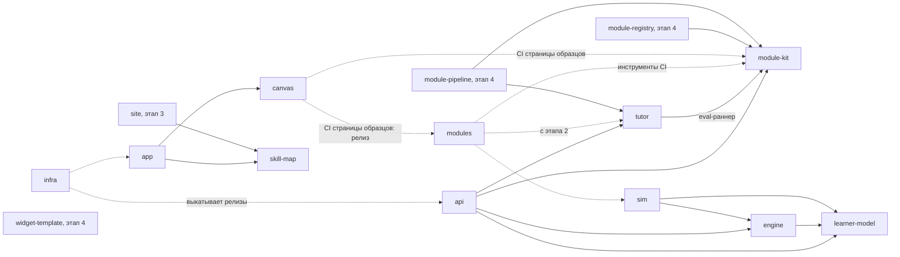

# NovaTrail — репозитории

> Статус: черновик для обсуждения, 2026-10-18.
>
> Как платформа нарезана на репозитории, что от чего зависит и в каком порядке появляется. Какие части работают во время работы платформы и как они связаны — в [architecture.md](architecture.md). Технологии каждого репозитория описывают его собственные документы (R11). Открытые вопросы Т-… — в разделе 8.
>
> Понятия — в [concepts.md](concepts.md), решения — в [decisions.md](decisions.md).

## 1. Принципы

- **`spec` — единственная общая зависимость.** В нём словарь, форматы и контракты. Остальные репозитории берут его по точной версии тега (R10): документы и правила — git-подмодулем `spec/` на теге, код — сгенерированными пакетами из релизов `spec` (R21; Т-7).
- **Без циклов** — ни при сборке, ни по сети.
- **Библиотеки не зависят от сервисов, сервисы не зависят друг от друга при сборке.** Между собой сервисы говорят по сети, по контрактам из `spec`.
- **Сервис — только там, где нужен отдельный процесс.** В первом срезе сервис один — `api`. `tutor` — библиотека в его процессе; сервисом он станет, когда у него появится второй потребитель (R15).
- **Библиотеки чистые.**
  - `learner-model`, `engine` и `module-kit` — вычисления без ввода-вывода, как `domain/` в canvas-api. Поэтому их можно гонять на стенде на тысячах виртуальных учеников, а при нужде — исполнять на устройстве.
  - CLI `module-kit` только читает и пишет файлы модуля.
  - `tutor` — библиотека с одним видом ввода-вывода: запросами к поставщикам ИИ.
- **Сборка, сеть и CI — разные связи.**
  - Зависимость при сборке — импорт кода по версии.
  - Сетевая зависимость — вызов API по контракту.
  - Инструмент CI — программа, которую CI берёт по точному тегу.

  Поэтому стенд `sim` может проверять `learner-model` и `engine`, хотя сам их импортирует: CI библиотеки берёт `sim` по тегу и подставляет код pull request через `go.work`. Цикла здесь нет (Т-16).
- **Один образец репозитория.** Новый репозиторий начинается с заготовки `spec` — devcontainer, CLAUDE.md, AGENTS.md, RUN.md и документы (раздел 2.2, R21). Общие проверки CI из `.github` у него с первого дня, ещё до кода (R30); justfile, проверки языка и подписанные релизы приходят с кодом, по образцу canvas-api. Отличия от образца записываются, как в R46 canvas-api.
- **Довод R13 canvas-api.** Там клиент и API жили в одном репозитории, потому что «API и клиент меняются вместе, одним pull request». Здесь этот довод снимают версионируемые контракты в `spec`: сначала новый контракт, потом сервис, потом клиент. Цена — несколько pull request вместо одного; её принимаем ради узкого контекста ИИ-агентов и независимых релизов (R10).

## 2. Список репозиториев

### 2.1. Таблица

| Репозиторий | Что это | Вид | Зависит при сборке | Обращается по сети | Этап | Создать |
|---|---|---|---|---|---|---|
| spec | словарь, форматы, контракты, документы платформы | спецификация | — | — | 0 | есть |
| .github | профиль организации; общие CONTRIBUTING, SECURITY и кодекс поведения; общие workflow CI | мета | — | — | 0 | сейчас |
| modules | официальные модули: олимпиадная математика, школьная математика 3 класса, короткие сочинения на английском | содержание | — (в CI: module-kit и sim; с этапа 2 — tutor) | — | 1 | сейчас |
| module-kit | формат модуля в коде: проверка, пакет и индекс, шаблоны с зерном, открытый вид, виды проверки; CLI автора | библиотека, CLI | — | — | 1 | сейчас |
| learner-model | модель ученика: оценка владения навыками по свидетельствам | библиотека | — | — | 1 | сейчас |
| engine | выбор следующего урока или задачи | библиотека | learner-model | — | 1 | сейчас |
| sim | стенд виртуальных учеников: гоняет модель ученика и движок, держит критерий | инструмент, CI | learner-model, engine | — | 1 | сейчас |
| tutor | наставник: чтение работы, слова, пути к ИИ, допущенные модели, eval | библиотека | module-kit — для eval-раннера (в CI: релиз canvas — синтетические образцы, R38) | поставщики ИИ | 2 | сейчас |
| api | сервис платформы: аккаунты, попытки, проверка, модель ученика, выбор | сервис | tutor, module-kit, learner-model, engine | сервис входа, база; поставщики ИИ — через tutor | 2 | сейчас |
| canvas | канвы: виды, слои, штрихи, вырезка для проверки; страница образцов | пакет | — (в CI страницы образцов: module-kit и релиз modules, R25; до первого содержания modules — релиз tutor) | — | 2 | сейчас |
| skill-map | карта навыков | пакет | — | — | 2 | сейчас |
| app | веб-приложение ученика и взрослого | веб-приложение | canvas, skill-map | api, сервис входа | 2 | сейчас |
| infra | общая инфраструктура: Terraform, домены, журналы, выкладка, self-hosting | инфраструктура | — | — | 2 | сейчас — документы; код — после П-11 |
| site | лендинг, юридические тексты, каталог модулей, документация для авторов | статический сайт | skill-map | — | 3 | позже |
| module-registry | сервис публикации сторонних модулей | сервис | module-kit | хранилище модулей | 4 | позже |
| module-pipeline | помощь автору: разметка, варианты задач, проверки | CLI, задания | module-kit, tutor | поставщики ИИ, module-registry | 4 | позже |
| widget-template | образец виджета модуля и среда разработки виджета | шаблон | — | — | 4 | позже |

- Зависимость от `spec` не указана: от него зависят все. Общие проверки CI из `.github` берут все репозитории, и `spec` тоже, ещё до кода (R30).
- `sim` читает пакеты модулей по типам из `spec`, без `module-kit` (Т-15).
- Названия — R18; прежние имена — в R10.
- Где каждая часть работает и что решить при её детализации — architecture 3.
- Официальные модули могут разойтись по репозиторию на модуль, когда формат станет v1 (R18).

### 2.2. Как заводить репозиторий

Новый репозиторий собирается из заготовки `repo-template/` в `spec` (R21).

1. Имя — из таблицы; репозиторий — публичный (R18). Лицензия — Apache-2.0, у кода и у содержания (R12, R20).
2. `just new-repo <имя> <вид> <карточка>` — например, `just new-repo learner-model go 3.8` — собирает рабочую копию в `.repos/<имя>` из файлов последнего релиза `spec`, старшего тега вида `vX.Y.Z`. Тег должен быть уже на GitHub: подмодуль берётся оттуда, и рецепт сверяет, что там это тот же коммит. Релиз с тегом выходит сам, после зелёного CI на `main` (R31). Вид — `go`, `typescript` или `docs`, карточка — номер раздела architecture 3. В копии:
   - `README.md` (en) — значки статуса первого дня (раздел 2.3), назначение, этап и ссылка на `spec`;
   - `CLAUDE.md` (en) — роль компонента и его место в платформе, свои документы, окружение и строка `@spec/RULES.md`. Общие правила — один файл `RULES.md` в `spec`, и его импортирует CLAUDE.md каждого репозитория: только devcontainer, точные версии, языки, никаких данных учеников и секретов, Apache-2.0, ссылки и работа между репозиториями;
   - `AGENTS.md` и `LICENSE` — те же, что в `spec`;
   - `docs/architecture.md` (ru) — назначение и границы из карточки и подраздел на каждый её пункт «Решить при детализации»;
   - `docs/decisions.md` (ru) — пустой журнал со своей нумерацией: «Следующий номер — R01». Другие репозитории цитируют его записи как «R03 api»;
   - `RUN.md` (ru) — план работ по образцу RUN.md `spec` (R19). Первый эпик — «Детализация»: по задаче на пункт «Решить при детализации», пункты, которые порознь не решить, — одной задачей, последняя задача — «Итог детализации»;
   - `.devcontainer/` — тот же, что у `spec`, со своим именем контейнера и сети и с расширениями VS Code по виду репозитория (`repo-template/kinds.json`); `NOVATRAIL_DEVCONTAINER=1`. Решения, на которые ссылается его Dockerfile, — решения `spec`, и в копии они с суффиксом: `(R34 spec)` (В11 `canvas`). Тома входа Claude Code, Codex и gh — общие на все контейнеры NovaTrail. Инструменты кода — Go, buf и другие — добавляются по точным версиям, когда начнётся код;
   - `spec/` — git-подмодуль на том же теге; если клон пришёл без него, контейнер достаёт его при старте. Всё добавлено в индекс, коммита нет.
3. Исполнитель заполняет пометки `FILL` по карточке компонента. `just new-repo-check <имя>` проверяет, что от заготовки ничего не осталось, а документы копии проходят проверку документов репозитория (R32). В самом репозитории её запускает `just -f spec/justfile docs-check-repo`.
4. `gh repo create altnovatrail/<имя> --public` — после подтверждения автора. Сразу за ним — `gh repo edit altnovatrail/<имя> --delete-branch-on-merge`: ветка pull request удаляется после слияния. Так настроены все репозитории организации с 2026-10-19, но новый репозиторий эту настройку сам не получает. Первый коммит и push — автора.
5. CI — общие проверки из `.github` и Dependabot, ещё до кода (R30; RUN.md, T16); проверки языка — с первым кодом репозитория. Что код добавляет к вызывающим файлам — job языка, вход CodeQL, экосистему Dependabot, релиз, — пишет сессия самого репозитория по architecture 3.3 .github, а проверки в ruleset ставит автор (поправка 2026-10-21 к R30).
6. Вопрос, который касается нескольких репозиториев, записывается в реестр `spec`: О-, П- или Т-. Сессия в другом репозитории `spec` не правит, а передаёт такой вопрос автору через таблицу 3 своего RUN.md с пометкой «в реестр spec» (RULES.md, раздел «Across repositories»).

### 2.3. Значки README

README каждого репозитория начинается значками статуса, как у MathTrail (R48):
- первая строка — CI, Release, CodeQL, номер релиза, язык, покрытие, OpenSSF Best Practices, OpenSSF Scorecard и лицензия;
- вторая, после пустой строки, — пять мер SonarCloud: code smells, reliability, security, maintainability и vulnerabilities.

Значок стоит, только когда есть то, о чём он говорит: без «no releases», «not found» и «unknown».
- **С первого дня** — CI, CodeQL, Scorecard, лицензия и меры SonarCloud. Их несёт заготовка, `repo-template/files/README.md`, с именем репозитория. Отвечают они, когда репозиторий заведён до конца: с общими проверками (раздел 2.2, пункт 5), проектом SonarCloud (R30) и первым прогоном Scorecard.
- **С первым релизом** — Release и номер релиза.
- **С первым кодом** — язык: у Go — версия из `go.mod`, у TypeScript — версия `typescript` из devDependencies `package.json`. У `spec` значка языка нет: его код — инструменты проверок в `tools/`.
- **С первой загрузкой покрытия в Codecov** — покрытие (RUN.md, T40).
- **С уровнем passing** — OpenSSF Best Practices, по ID проекта на bestpractices.dev (RUN.md, T41). Ответы на критерии лежат в файле `.bestpractices.json` в корне репозитория, по-английски: сайт предлагает их в анкете, а сохраняет их автор (поправка 2026-10-26 к R48). Изменённый ответ сайт из файла сам не берёт. Его приносит ссылка на анкету с изменёнными полями и `overrides` по ним: её строит из файла сессия репозитория, а сохраняет автор (поправка 2026-10-27 к R48).

Значок, который встаёт позже, сессия репозитория ставит на его место в строке вместе с тем, о чём он говорит. Вот все значки, с `<имя>` вместо имени репозитория и `<ID>` вместо номера его проекта Best Practices:

```markdown
[](https://github.com/altnovatrail/<имя>/actions/workflows/ci.yml)
[](https://github.com/altnovatrail/<имя>/actions/workflows/release.yml)
[](https://github.com/altnovatrail/<имя>/actions/workflows/codeql.yml)
[](https://github.com/altnovatrail/<имя>/releases/latest)
[](go.mod)
[](package.json)
[](https://codecov.io/gh/altnovatrail/<имя>)
[](https://www.bestpractices.dev/projects/<ID>)
[](https://scorecard.dev/viewer/?uri=github.com/altnovatrail/<имя>)
[](LICENSE)

[](https://sonarcloud.io/summary/new_code?id=altnovatrail_<имя>)
[](https://sonarcloud.io/summary/new_code?id=altnovatrail_<имя>)
[](https://sonarcloud.io/summary/new_code?id=altnovatrail_<имя>)
[](https://sonarcloud.io/summary/new_code?id=altnovatrail_<имя>)
[](https://sonarcloud.io/summary/new_code?id=altnovatrail_<имя>)
```

- У `.github` workflow — `self-ci.yml`, `self-codeql.yml` и `self-release.yml`, а проект SonarCloud — `altnovatrail_.github`. Что показывает профиль организации, `profile/README.md`, решает `.github`.
- Картинку значка браузер читателя берёт не у сервиса, а у прокси GitHub — Camo (R48).

## 3. Схема зависимостей

От `spec` зависят все, поэтому эти стрелки не нарисованы. Стрелка означает «зависит от». Сплошная — импорт при сборке, пунктир — инструмент CI по точному тегу или выкладка.



- Не нарисованы и связи `canvas` и `tutor`, по той же причине, что гейт `sim` ниже: они берут релизы друг друга как инструменты CI. CI `tutor` — синтетические образцы `canvas` (R38), CI `canvas` — открытые виды задач замера `tutor`, пока у `modules` нет содержания (поправка 2026-10-21 к R25). Цикла при сборке нет: каждая сторона берёт уже вышедший релиз другой по точному тегу, а первым выходит релиз `tutor` (R38).
- Гейт `sim` для `learner-model` и `engine` не нарисован, хотя это тоже инструмент CI. Вместе с импортом `sim → engine` такая стрелка читалась бы как цикл, а цикла нет (раздел 1, Т-16).
- Общие проверки CI из `.github` берут все репозитории (R30); эти стрелки тоже не нарисованы.
- CI `spec` проверяет примеры модулей обычным валидатором JSON Schema, а не `module-kit`: иначе `spec` зависел бы от того, кто зависит от него. Вектор правила части он проверяет схемой и правилами YAML, а само правило — CI `module-kit` (R45). Правила YAML и правила всего модуля — раскладку, ID в именах файлов и сигнатуры медиафайлов — `format-check` проверяет сам и сам строит открытый вид, с T29 — и вердикты векторов вердикта, кроме тех, что условию даёт Starlark, с T30 — ловушки, которые в них называют неверные значения, и что проверка утечки находит в текстах векторов утечки, а с T31 — и правило `lesson.no-leaks` на уроках: это вторая реализация рядом с `module-kit`, и векторы сверяют обе (R46, R51, R56, R57, R58).
- В схеме из диалога с Gemini реестр и конвейер зависели друг от друга. Здесь цикла нет: конвейер публикует через API реестра, а реестр о конвейере не знает.
- `widget-template` ни от кого, кроме `spec`, не зависит: протокол виджета задан в `spec`, а сторона приложения — в `canvas`.

## 4. Потоки между репозиториями

Потоки во время работы платформы — в architecture 4. Здесь — как изменения проходят между репозиториями.

**От автора к ученику:**
1. Модуль лежит в `modules`: YAML, медиа, eval-набор.
2. CI проверяет его:
   - `module-kit` — схему, граф без циклов, ссылки, медиафайлы, ключи, утечки в текстах автора, которые ученик видит до решения, — и в текстах урока, который называет задачу (R57; R58);
   - `sim` — граф, если он изменился;
   - с этапа 2 — eval-раннер `tutor` на eval-наборе модуля.
3. На релизе `module-kit` собирает пакет и индекс, а общий workflow релиза из `.github` подписывает их (R17).
4. `api` берёт пакет по дайджесту из своей конфигурации; попытка хранит дайджест своего пакета.
5. `app` получает от `api` открытый вид задачи — без ключа, решения и ловушек, без навыков, полосы и сложности, без приёмов, случая попроще и фраз-утечек (R57). Ключ остаётся на сервере, решение приходит после верного ответа (R05), а навыки, полосу и сложность читает только сервер (R51). Открытый вид урока приходит без его навыков и возрастных категорий (R58).

Ключи открытых модулей публичны, как и сами модули. R05 не охраняет тайну, а лишь не держит ключ в приложении ученика.

**CI алгоритмов:**
- каждое изменение `learner-model` или `engine` прогоняется на стенде `sim`, на виртуальных учениках разных профилей. CI библиотеки берёт `sim` по точному тегу и подставляет код pull request через `go.work` (Т-16);
- критерий записан до первого прогона кандидата (R163 standalone);
- изменение, которое ухудшает критерий, не сливается.

**Смена модели ИИ:**
- новую модель для возможности ИИ допускают, когда она проходит eval-набор возможности и eval-наборы всех опубликованных модулей с этой возможностью;
- ложные тревоги считаются по вердикту: наблюдение модели проходит через `module-kit`, как в работе платформы (R04). У оценки по рубрике вердикта нет — чем её мерить, О-22.

**Новая версия формата модуля** (R44). Зависимости при сборке и инструменты CI каждый берёт по точной версии, поэтому шаг не ломает тех, кто ещё не перешёл. А `api` и `app` говорят по сети и, пока формат — v0, выходят вместе:
1. `spec` — новая версия формата и тем же pull request новая линия.
2. То, что читает модули в CI `modules`, переходит на новый тег: `module-kit` и, с этапа 2, eval-раннер `tutor`. Если изменился открытый вид, `canvas` выпускает пакет с новыми типами (R36).
3. `modules` — одним pull request: новые теги `module-kit` и `tutor` в CI, паспорта и содержание всех модулей. `sim` гоняется в нём, только если изменился граф, поэтому переход, который графа не меняет, идёт без него, а граф меняют отдельным pull request после шага 4.
4. `sim` переходит на новый тег и на пакеты из нового релиза `modules`, а `modules` берёт в CI новый тег `sim`. `learner-model` и `engine` берут новый `sim` своим переходом: свой гейт они держат на прежнем теге.
5. `api` берёт новый `module-kit` и новые пакеты, а если изменился открытый вид, вместе с ним выходит `app` с новым `canvas` — одним списком точных версий (Т-19). CI `canvas` берёт новый релиз `modules` и новый тег `module-kit`.

Пока формат — v0, читается только текущая версия, и модули переходят все сразу; так же — на v1, ведь v0 с выходом v1 из окна уходит. С v2 окно — текущая мажорная версия и предыдущая — даёт модулям переходить по одному, а `api` и `app` — порознь.

## 5. Что лежит в `spec`

- `docs/` — описательные документы платформы на русском (R14): product, concepts, privacy, architecture, repositories, decisions.
- `draft/` — прототип приложения ученика.
- `tools/` и `justfile` — проверка документов `just docs-check`: ссылки, разделы, реестры, диаграммы (RUN.md, T01). Это инструмент самого `spec`, а не код платформы; там же проверка формата модуля `just format-check` — схемы, примеры и тест-векторы `format/` (RUN.md, T25). Там же проверка лицензий его пакетов `just licenses-check` (R12), номер следующего релиза `just release-version` — `tools/release/` (R31) — и проверка документов репозитория компонента `just -f spec/justfile docs-check-repo` (R32). Релиз другого репозитория зовёт те же рецепты: `release-version <коммит> <workflow>` — с его линией из названного workflow — и `release-refusal`, правило отказа Releases API (поправка к R31). На раннере их запускает скрипт `tools/toolchain/toolchain.sh` из подмодуля `spec/`: он собирает стадию `toolchain` и запускает команды в ней, как CI и релиз самого `spec` (поправка 2026-10-21 к R31). Проверка лицензий другого репозитория — тоже рецептами `spec`: список категории A печатает `licenses-allowed`, а lock-файл npm с исключениями репозитория проверяет `licenses-check-repo` (R39).
- папка `.github/` — CI самого `spec`, Dependabot (R30) и релиз `release.yml`: после зелёного CI на `main` он выпускает следующий патч линии, тег — вместе с релизом (R31). Рядом с ними — общие проверки всех репозиториев из `.github`: секреты, DCO, CodeQL и Scorecard (R03 .github; RUN.md, T17).
- `format/` — формат модуля, нормативный и на английском (R42): текст формата `format/README.md` с соглашениями R45 и номер версии `format/VERSION` (R44). Схемы — JSON Schema 2020-12 (R45). Векторы правил YAML лежат в `format/vectors/rules/` с RUN.md, T25. С T26 там же первые схемы — паспорт и общие определения, — примеры паспорта и целого модуля и векторы правил всего модуля (R46), с T27 — граф навыков, его примеры и векторы его правил (R49), с T42 — словарь общей таксономии `shared-taxonomy.schema.json` (R50), с T28 — задача, её примеры и векторы её правил, векторы правил `module.file-ids` и `module.media`, а также векторы открытого вида в `format/vectors/open-view/` (R51), с T29 — проверки ячеек, их правила и векторы вердикта в `format/vectors/verdicts/` со схемой `verdict-vector.schema.json` (R56), с T30 — каталоги ловушек и приёмов, шаги решения, их примеры и векторы, подсказки задачи и векторы проверки утечки в `format/vectors/leaks/` со схемой `leak-vector.schema.json` (R57), с T31 — урок, его примеры и векторы его правил (R58), а с T32 — генератор случайности и вывод зёрен, один на всю платформу, с векторами в `format/vectors/random/` и схемой `random-vector.schema.json` (R27, R59). Остальные части приходят следующими задачами. Всё это проверяет `just format-check` (поправка 2026-10-22 к R45), а что вектор правила части нарушает само правило — CI `module-kit` (раздел 3).
- `RULES.md` — общие правила всех репозиториев NovaTrail; его импортирует CLAUDE.md каждого из них (R21).
- `repo-template/` — заготовка нового репозитория, а `tools/new-repo/` — рецепты `just new-repo` и `just new-repo-check`, которые её собирают и проверяют (раздел 2.2).
- Позже — нормативные части; они выходят тегами `spec`:
  - схемы формата модуля в папке `format/` — JSON Schema 2020-12 (R45), — его примеры и тест-векторы (R42); пакет модуля и индекс (Т-15);
  - контракты API — protobuf и buf (R11): между `app` и `api`; наблюдение — общий тип `tutor`, `module-kit` и eval;
  - протокол виджета (R16) и протокол eval (R15);
  - список кодов причин движка (R29);
  - таблица допуска к ИИ: поставщик, путь к ИИ, возрастная категория — со ссылками на privacy 5.3 (Т-20);
  - возраст цифрового согласия по странам — с источниками и датой прочтения (privacy 3);
  - формат выгрузки (R09);
  - руководства для авторов.

  Нормативные тексты для авторов — формат модуля, протокол виджета и руководства — на английском и вне `docs/` (R42). У формата модуля своя версия, MAJOR.MINOR, а не тег `spec`: новая версия формата открывает новую линию `spec` (R44).
- Примеры — фрагменты модулей для тестов схем, в `format/examples/`: верный проходит свою схему, а неверный первой строкой называет ошибку, которую должен дать (R45). Пример целого модуля — папка, разложенная как модуль (R46). CI `spec` проверяет их обычным валидатором JSON Schema, `ajv`, рецептом `just format-check` (раздел 3).

Чего в `spec` нет: кода сервисов и библиотек, содержания модулей, данных учеников.

## 6. Порядок появления

1. **spec** — словарь, решения, приватность, архитектура; затем формат модуля v0, пакет, наблюдение и протокол eval.
2. **.github** — общие проверки, до первого репозитория с кодом. Общие workflow для кода приходят с кодом, на котором проверяются (R03 .github): обёртка Go и релиз — с первым кодом `module-kit`, обёртка TypeScript — с первым кодом на TypeScript, у `canvas`.
3. **modules и module-kit:**
   - порт 603 эталонных задач standalone с ловушками и решателями;
   - небольшие наборы школьной математики 3 класса и коротких сочинений на английском (R41);
   - CLI `module-kit` проверяет модули и собирает пакеты и индекс, а общий workflow релиза подписывает их (R17).

   Так формат v0 сразу проверяется на двух предметах (R08).
4. **learner-model, engine и sim** — вместе: стенду нужны и модель, и правило выбора. Стенд и критерий появляются до первого кандидата. Отправная модель — модель standalone с уровнем на модуль (concepts 11).
5. **tutor и canvas** — первый код этапа 2. У `tutor` это доска проверки: автор решает пять задач, модели Claude, которые он выбирает, читают и оценивают его работу, а автор отмечает, права ли каждая (R43). За доской шёл замер хода письма, только на моделях Claude: он сделан 2026-10-26 и пользы хода письма не показал (R52). Остальные замеры чтения ИИ — по видам канвы и ответа, на живом почерке, для Т-23 и О-8 — эпик E4 `tutor` (поправка 2026-10-26 к R43).
   - Сначала узнать, хорошо ли ИИ читает работу, потом строить остальное (R60 canvas-api).
   - Листы для замера хода письма дал `tutor`: лист 1 автор написал на доске, а 39 нарисовал код (R26 tutor). Образцы взрослых добровольцев, в том числе подражающих детскому почерку, делаются на странице образцов `canvas` (П-16; поправка 2026-10-26 к R25).
   - Образцы детей — только с отдельным согласием (П-10).
   - Замер `tutor` автор начал раньше этого пункта, 2026-10-20, параллельно пунктам 3 и 4 (R01 tutor). 2026-10-22 автор отложил его ради доски (R19 tutor), 2026-10-23 вернул — только на моделях Claude (R21 tutor), — а 2026-10-26 он сделан (R27 tutor).
   - Код `canvas` тоже идёт раньше пунктов 3 и 4, эпиком E2 рядом с детализацией (R02 canvas). Первым идёт лист для рукописи — элемент `<novatrail-canvas>` (R17 canvas), — а страница образцов, синтетические образцы и сборка, которая открывается из файла, ждут, пока замеру не понадобятся образцы добровольцев или детей: это эпик E5 `canvas` (поправки 2026-10-22 и 2026-10-26 к R43). Задачи замера, пока у `modules` и `module-kit` нет кода, сборка страницы берёт из релиза `tutor` (поправка 2026-10-21 к R25), а он ждёт в отложенном эпике E3 `tutor`.
6. **api, app, skill-map и infra** — первый срез с учеником. До первого ребёнка — согласие родителя и договоры с поставщиками ИИ (П-1, П-3). Регион данных — до первого развёртывания (П-11).
7. **site** — к бете, этап 3. **module-registry, module-pipeline и widget-template** — с третьим модулем и сторонними авторами, после формата v1 (этап 4; R08; product 11).

Репозиторий можно завести раньше, чем начнётся его код: детализация начинается с документов (раздел 2.2).

## 7. Что переносим из MathTrail

| Что | Откуда | Куда |
|---|---|---|
| Принципы проверки и подсказки: вердикт выносит программа, четыре вердикта, лестница подсказок, проверка утечки, запасные тексты | canvas-api: R37, R38, R39, R24; spec 5–7 canvas-api | concepts; api, tutor, module-kit; формат v0 — ловушка по значению, шаблоны ступеней у модуля, проверка утечки в тексте формата (R57) |
| Модель ученика: модель Раша с полом угадывания, обновление по Elo, пробная серия, осторожное «освоено» | standalone: SPEC 2, R187 | learner-model |
| Стенд виртуальных учеников и критерий, записанный заранее | standalone: `tools/learners`, `docs/learners.md`, R163 | sim |
| Вывод зёрен стенда: FNV-1a 64 от «главное зерно, эксперимент, единица, назначение» и PCG из `math/rand/v2` Go — функция `seeded` | standalone: `tools/learners/child.go`, `docs/learners.md` | spec — генератор и места случайности всей платформы, где `seeded` — частный случай ([текст формата](../format/README.md), раздел 22; R59); sim |
| Правило выбора задачи и коридор успеха (R23) | standalone: SPEC 3 | engine |
| 17 тем и связи `builds_on`, 20 ловушек, 11 приёмов, 603 эталонные задачи с решателями | standalone: `content/`, `site/` | modules — модуль олимпиадной математики; ловушки и приёмы — уже примерами формата, `traps.yaml` и `techniques.yaml` (R57) |
| Страницы тем сайта: суть темы, шаги приёма и примеры, разобранные до ответа, — ответ каждого доказывает решатель | standalone: `site/content/en/topics/`, `site/solvers/`, SPEC 8.12.2, R172 | modules — объяснения и примеры с разбором уроков модуля олимпиадной математики (R58) |
| Проверка задачи решателем на Starlark | standalone: SPEC 6 | module-kit — ключи шаблонов (concepts 9.3; RUN.md, T33) и вид проверки «условие»: выражение Starlark от целого `value` в самой проверке ячейки, с лимитом шагов в формате (R56) |
| Каркас сервиса: конфигурация, журналы, ошибки, версия | canvas-api: `internal/`, в свою очередь из standalone (R11 canvas-api) | api, образец репозитория |
| Devcontainer, justfile, CI, подписанные релизы, Terraform, self-hosting | canvas-api | все репозитории; общее — в .github и infra |
| Замер чтения ИИ на образцах, журнал автора, eval | canvas-api: R60–R66 | tutor — eval-раннер; canvas — страница образцов |
| Лист для рукописи: координаты, штрихи, рамка ошибки на штрихах ученика | canvas-api: spec 4, R15, R43 | canvas — вид канвы «лист для рукописи» |
| Приватность детей: минимум данных, согласие, удаление | canvas-api: `docs/privacy.md` | privacy |
| Сайт: пререндер, языки, страницы без скриптов | standalone: `site/`, `web/` | site — позже |
| Канал MCP: сервер, вход, виджет в чате | standalone: `plugin/`, `internal/transport/mcp`, `web/src/widget` | канал MCP — позже (О-15) |
| Пакет для грантов: логическая модель, реестр данных | standalone: `docs/grants/` | позже |

## 8. Открытые вопросы

Каждый вопрос: суть, варианты, рекомендация и что он блокирует. Номера не меняются; закрытый вопрос остаётся на месте с пометкой и номером решения. Новые вопросы получают следующий номер — Т-35.

| № | Вопрос | Варианты | Рекомендация | Блокирует |
|---|---|---|---|---|
| Т-1 | Где код видов проверки — **закрыт: R17**, код — в `module-kit`, а не в отдельной библиотеке `checker` | внутри canvas-api; отдельная библиотека `checker` | отдельная библиотека: виды проверки нужны canvas-api, конвейеру, стенду и CLI реестра, который проверяет ключи при публикации | формат v0, canvas-api |
| Т-2 | Официальные модули: один репозиторий или по репозиторию на модуль — **закрыт: R18** | монорепозиторий `modules`; `module-<имя>` на каждый | монорепозиторий, пока формат меняется: правка формата — одна на все модули. Разделить, когда формат станет v1 | этап 1 |
| Т-3 | Репозиторий `.github` — **закрыт: R18** | нет; да | да: профиль организации; общие CONTRIBUTING, SECURITY и кодекс поведения; общие workflow CI с actions, закреплёнными по SHA | первый публичный репозиторий кода |
| Т-4 | Реестр v0 — **закрыт: R17** | сервис с базой; подписанный статический индекс, который собирает CI; список закреплённых версий в canvas-api | подписанный статический индекс: CI собирает его из репозиториев модулей, CLI служит валидатором. Сервис — на этапе 4 | этап 1 |
| Т-5 | map-ui: пакет или микрофронтенд — **закрыт: R16**: пакет; второй потребитель получает вторую сборку того же пакета | пакет, который canvas-shell собирает к себе; веб-компонент, загружаемый на лету | сначала пакет; веб-компонент — когда появится второй потребитель, например кабинет взрослого или канал MCP | этап 2 |
| Т-6 | Названия canvas-api и canvas-shell — **закрыт: R18** | оставить; короче — например, `api` и `app`; другое | решить до первого кода: канва теперь одно понятие из многих, а сервис отвечает ещё за аккаунты, пути к ИИ и модель ученика | этап 2 |
| Т-7 | Форматы контрактов (дополнено 2026-10-19: контракты API — protobuf и buf — уже решил R11; открыт формат модуля — JSON Schema или тот же protobuf) — **закрыт: R45**: формат модуля — JSON Schema 2020-12, а модуль автор пишет на YAML 1.2.2 с ограничениями | JSON Schema для модулей и protobuf для API; один формат на всё | JSON Schema для модуля: авторы пишут YAML или JSON. protobuf и buf — для API сервисов, как R12 canvas-api. Сгенерированные пакеты выходят из релизов `spec` | формат v0 |
| Т-8 | Как исполняется код чужих виджетов — **закрыт: R16** | Web Components прямо в странице; iframe-песочница | iframe-песочница на отдельном origin; CSP без сети; обмен сообщениями по протоколу из `spec`; подписанные бандлы, закреплённые по хешу; детям — только виджеты после ревью. Shadow DOM изолирует стили, но не код | этап 4 |
| Т-9 | Где держать ключ пользователя | на сервере, зашифрованным; на устройстве, передавая с запросом; только в памяти запроса | на устройстве. Ключ приходит с запросом, а на сервере живёт только в памяти: не в базе и не в журналах, как картинки работы в canvas-api (R42 canvas-api). Ключ взрослого привязан к его профилю: для профиля ребёнка `api` его не принимает (О-4) | свой ключ, privacy 5.2 |
| Т-10 | Где считаются модель ученика и движок | только на сервере; ещё и на устройстве (WASM) | на сервере. Библиотеки чистые, поэтому расчёт на устройстве — для офлайна — остаётся возможным | этап 5 |
| Т-11 | Версии `spec` — **закрыт: R44**: у формата модуля своя версия, MAJOR.MINOR, и её новая версия открывает новую линию `spec`; модуль исполняется по версии своего паспорта; пока формат — v0, платформа читает только текущую его версию, с v1 — текущую мажорную и предыдущую, а v0 уходит из окна с выходом v1 | semver тегами, поддержка версий формата | semver; паспорт модуля называет версию формата; платформа поддерживает текущую мажорную версию и предыдущую | формат v0 |
| Т-12 | Где живёт eval: протокол, раннер, образцы — **закрыт: R15** | всё в `spec`; протокол в `spec`, раннер в canvas-api, образцы вне репозиториев | протокол — в `spec`; раннер — рядом с кодом наставника; работы учеников — вне репозиториев, как `samples/` в canvas-api (R65 canvas-api). Синтетические образцы и образцы, которые для eval сделали взрослые добровольцы и авторы, могут лежать в модуле (concepts 3) | замер этапа 2 |
| Т-13 | Голос | realtime API голоса; связка синтеза и распознавания речи | решить на этапе 3, по eval и цене. Правила одинаковы для ИИ платформы и своего ключа. Довод против речи в речь: её нельзя пропустить через проверку утечки до того, как ученик её услышит (R05). Озвучку начать с синтеза речи устройства — только локальными голосами, у которых атрибут `localService` истинен (architecture 8) | этап 3 |
| Т-14 | Общая таксономия навыков — **закрыт: R50**: словарь навыков-опор — схема формата `shared-taxonomy.schema.json`, в версии формата, с ID `core.<имя>`; навык модуля опирается на навык-опору пререквизитом и учит ему полем `teaches`, а паспорт называет навыки-опоры, на которые опираются навыки модуля, в `dependencies` | курирует платформа в `spec`; отдельный модуль; без неё — ссылки на чужие модули | в `spec`, отдельным словарём навыков-опор; модули ссылаются друг на друга только через неё (concepts 4) | ссылки между модулями |
| Т-15 | Что внутри пакета модуля (дополнено 2026-10-19: «манифест пакета» в рекомендации — не паспорт модуля `manifest` из concepts 15, а часть пакета, которая называет дайджесты обеих частей. Свой термин, без слова «манифест», она получит со схемой пакета в E2) | YAML автора как есть; скомпилированный канонический вид | скомпилированный: `module-kit` собирает YAML в канонический вид по схеме из `spec`, а `api`, `sim` и eval читают только его. Часть для сервера — всё содержание, в том числе ключи, решения и ловушки; часть для устройства — медиа и бандлы виджетов, без ключей; у каждой свой дайджест, а манифест пакета называет оба | формат v0 |
| Т-16 | Как стенд проверяет изменения `learner-model` и `engine` | CI библиотеки берёт `sim` по точному тегу и подставляет код pull request через `go.work`; гейт только на кандидатах релиза; три библиотеки в одном репозитории | `go.work`: репозитории остаются раздельными (R10), а каждый pull request проходит стенд. CI `modules` тоже гоняет `sim`, если меняется граф | этап 1 |
| Т-17 | Где хранить и как раздавать пакеты модулей, медиа и бандлы виджетов; где хостится сборка `app` (дополнено 2026-10-19: карточка 3.11 ссылается на Т-17 за её хостингом; дополнено 2026-10-19: на каком домене виджеты, решил R16 — на отдельном регистрируемом, и вариант «поддомен основного» снят) | релизы `modules`; образ `api`; хранилище с CDN. Сборка `app` — Firebase Hosting, как в canvas-api (R10 canvas-api); другой хостинг статики из architecture 3.12 | этап 1 — релизы `modules`; этап 2 — пакеты в образе `api` по дайджесту из конфигурации, медиа раздаёт `api`; хранилище с CDN в `infra` — когда модулей станет больше или придут сторонние авторы. Домен виджетов — отдельный регистрируемый (R16): купить его вместе с основным после О-16. Хостинг сборки `app` выбирает T03 infra по тому, что хостинг пишет в журналы (architecture 1; П-9); туда же потом переезжает страница образцов (R25) | этап 2 |
| Т-18 | Генератор случайности и воспроизводимость между версиями — **закрыт: R59**: PCG, как в `math/rand/v2` Go, места случайности, как у стенда standalone, и функции поверх них, нормативно в [тексте формата](../format/README.md), раздел 22, с векторами, которые считает `spec` | генератор языка программирования; свой алгоритм, заданный в `spec` | алгоритм и вывод зёрен задаёт `spec`, с тест-векторами: фрагмент модуля и зерно дают точный открытый вид, наблюдение и ключ — точный вердикт. Векторы вердикта уже записаны (R56): их вход — проверки ячеек пункта и прочитанное значение каждой, а остальное в наблюдении — дело его типа (эпик E3). `module-kit`, виджеты, `engine` и `sim` берут один генератор и одну схему зёрен и проходят тест-векторы в CI (R27); алгоритм выбирается с учётом схемы стенда standalone — FNV-64a и PCG. Изменение поведения вида проверки поднимает версию формата; попытка хранит её вместе с дайджестом пакета и зерном | формат v0 |
| Т-19 | Кто выкатывает сервисы и сборку `app` (дополнено 2026-10-19: `infra` выкатывает и `app`, раздел 3) | каждый репозиторий — по своему релизу, как canvas-api; `infra` — по списку точных версий | `infra` по списку точных версий и дайджестов — и сервисов, и сборки `app`: одно место, где видно, что работает; откат — revert; self-hosting берёт тот же список. Выкатываются только релизы с проверенной подписью, как canvas-api: R45, R58 | этап 2 |
| Т-20 | Как устроен допуск к ИИ по возрастной категории | правила в коде; таблица в `tutor`; таблица в `spec` | таблица «поставщик × путь к ИИ × возрастная категория» — в `spec`, каждая ячейка со ссылкой на privacy 5.3 и датой прочтения. Факты развёртывания — подписан ли DPA, одобрен ли zero data retention — в конфигурации. Для несовершеннолетних по умолчанию всё закрыто; self-hosting заявляет свои факты. Одна чистая функция в `tutor` вызывается до каждого запроса. Дополнено 2026-10-22: у Google — и Gemini API, и Vertex AI — ячейки закрыты для всех возрастных категорий, взрослых тоже, на обоих путях (R47) | этап 2 |
| Т-21 | Как пакеты интерфейса стыкуются с приложением — **закрыт: R36**, веб-компоненты с типами данных из релизов `spec`; у `canvas` — `<novatrail-canvas>` (В15 `canvas`) | веб-компоненты с типами из `spec`; компоненты фреймворка `app` | веб-компоненты: у `canvas` и `skill-map` будет несколько потребителей — `app`, страница образцов, сайт, карточка канала MCP, — а фреймворк каждого решает его репозиторий | этап 2 |
| Т-22 | Что `api` хранит о модели ученика | состояние навыков; журнал свидетельств только на дозапись, а состояние — кэш по версии `learner-model` | журнал свидетельств: смена алгоритма пересчитывает состояние по журналу, а не переносит старое; тот же журнал служит выгрузке и, позже, офлайну. Связан с П-7 | этап 2 |
| Т-23 | Чтение и разбор: один вызов ИИ или два (дополнено 2026-10-22: большой замер отложен, R43. На доске проверки модель читает и судит одним вызовом, уже зная ключ, и отметки автора — ранний сигнал о том, как часто она «дочитывает» ожидаемое. Чтения без ключа на доске нет, так что это не сравнение замера) | два: чтение без ключа, разбор с ключом (R38 canvas-api); один, с ключом и сверкой `value` с `written` (R62 canvas-api) | два, пока замер этапа 2 не покажет, что ключ не сдвигает чтение. Модель, которая видит ключ, может «дочитать» ожидаемый ответ; главный риск одного вызова — ложное «верно» (R62 canvas-api). Дополнено 2026-10-22 (В6 `tutor`): план ответа — R03 tutor. Замер читает одни и те же строки без ключа, с верным ключом и с ложным ключом на верных листах. Один вызов допускается только модели, которая прошла порог: с верным ключом ложных «верно» и ложных тревог не больше, чем без ключа, — парный тест по листам, ухудшение при p < 0,05 — провал; ни одна неверная строка не прочитана под верный ключ, и ни одна верная — под ложный. Довод за два вызова есть и вне замера: на 61 экзамене, когда промпт давал эталонное решение, «wrong answer scored as correct» стало больше у всех пяти моделей — у GPT-5.2 с 5 до 80, у Grok-4.3 с 1 до 193 ([arXiv 2606.11477](https://arxiv.org/html/2606.11477v1), таблица 2, прочитано 2026-10-22). Ответ — по выводам замера, когда он вернётся (R43). Дополнено 2026-10-26 (В20 `tutor`): вернувшийся замер мерил только пользу хода письма, одним вызовом с ключом (R52), — чтения без ключа и с ложным ключом в нём не было. Ответ на Т-23 ждёт своего замера: это эпик E4 `tutor` | tutor, api, privacy 5.1, замер этапа 2 |
| Т-24 | Можно ли верить состоянию, о котором сообщает виджет | верить; сервер повторяет состояние по зерну и событиям ученика | повторять на сервере: тогда вердикт воспроизводим и не зависит от кода на устройстве (R03). Виджет, состояние которого повторить нельзя, — решить отдельно, до его публикации | протокол виджета, этап 4 |
| Т-25 | Нужен ли канал реального времени | нет: вердикт и слова наставника — два запроса; да: поток событий, как Centrifugo в canvas-api | в первом срезе — нет. Вернуться к вопросу вместе с голосом (Т-13) | api, app; этап 3 |
| Т-26 | Где публиковать пакеты интерфейса — **закрыт: R37**, npm, область `@altnovatrail`; в npm уходит файл подписанного релиза GitHub шагом общего `release.yml` `.github` (В17 и В18 `canvas`) | npm, область `@altnovatrail`; GitHub Packages; только релизы GitHub | решить, прочитав условия реестров: пакеты должны ставиться по точной версии и без токена, в том числе авторами виджетов | этап 2 |
| Т-27 | Что проверяет подпись пакета или сборки, которую ставит общий workflow релиза `.github` (architecture 2.3 .github) | только SAN — путь общего `release.yml` `.github`; только репозиторий и workflow вызывающего; то и другое | то и другое. Подпись из общего workflow называет в SAN его самого: «GitHub Actions uses the `job_workflow_ref` as its SAN» ([Fulcio, OIDC usage](https://github.com/sigstore/fulcio/blob/a699382/docs/oidc.md)). А workflow вызывающего она несёт в Build Config URI — «A reference to the initiating build instructions» ([Fulcio, OID information](https://github.com/sigstore/fulcio/blob/a699382/docs/oid-info.md)); оба места прочитаны 2026-10-20. Общий workflow публичный, и вызвать его может любой репозиторий: одно SAN пропустило бы чужую подпись, а одни сведения о вызывающем — подпись, которую поставил не общий workflow. Вызывающий закрепляет общий workflow по SHA (R04 .github), поэтому SAN кончается на `@<sha>`, а не на теге: проверка сверяет этот SHA со списком релизов `.github`. Любой SHA не годится — он пропустил бы коммит `.github`, который не вышел релизом. Условие проверки — неизменяемые релизы `.github` и ruleset его тегов `v*` (R04 .github): их включает эпик E2 `.github`, а до тех пор тег можно перенести на другой коммит. Решить с первым релизом `module-kit`, в эпиках E3 `.github` и E2 RUN.md, — и там же, откуда проверяющий берёт список релизов. Дополнено 2026-10-21 (В19 `canvas`): файлы общего релиза проверяют не только `module-kit` и `infra`. CI `tutor` берёт архив синтетики `canvas` (R38), `app` — пакет `canvas` из npm (R37), а CI `canvas` — CLI `module-kit` и релиз `modules` (R25). `npm audit signatures` проверяет подпись реестра и provenance, но не workflow, который собрал пакет (architecture 4 canvas). Пакету из npm то же правило даёт подписанный `SHA256SUMS` его релиза GitHub: у архива той же версии из реестра та же сумма. Это отдельный шаг — архив скачать и сверить: lock-файл хранит sha512, а `SHA256SUMS` — sha256. Рекомендация `canvas` — одно правило Т-27 и одна его реализация на всех, кто берёт файлы общего релиза: рецепт `spec`, как `release-version`, или команда CLI `module-kit`, по точной версии. Свои проверки у `tutor`, `app` и `canvas` разошлись бы. Дополнено 2026-10-22 (В23 `.github`): SHA релиза `.github` в SAN закрепляет не весь код, который шёл с правом подписи. С задачи T25 `.github` его общий релиз запускает скрипт `spec/tools/toolchain/toolchain.sh` из подмодуля вызывающего на самом раннере. У шагов номера и публикации там `GH_TOKEN` с `contents: write`, а у job — переменные OIDC, по которым cosign получает сертификат (поправка к R18 .github). Скрипт — из того коммита `spec`, на котором стоит подмодуль вызывающего, а этот коммит виден только через коммит вызывающего — Source Repository Digest сертификата. Общий релиз требует, чтобы это был тег `altnovatrail/spec`, и сверяет сумму скрипта перед каждым вызовом после контейнера; автор принял это для T25 (там же). Своей сверки подмодуля проверяющему тогда не нужно: её делает общий релиз той версии, которую называет SAN. Но, веря SHA релиза `.github`, проверка верит и тегам `spec`, и условие проверки — ещё и неизменяемые релизы `spec` с ruleset его тегов `v*`. Оно выполнено с T20 (R31). Создания тегов ruleset не ограничивает: то, что тег `spec` ставит только его релиз, держит R31, а не настройка. Рекомендация `.github` — принять это и назвать прямо: скрипт — код NovaTrail на неизменяемом теге, его закрепляет коммит вызывающего, как action по SHA, а сторонние инструменты сборки по-прежнему идут в контейнере без токенов. Отвергнуты автором для T25: скрипт из checkout самого `.github` по `job.workflow_sha` — тогда и рецепты номера шли бы из `spec` тега `.github`, а не вызывающего, против поправки 2026-10-21 к R31, — и своя копия скрипта в общем релизе, от которой уходил В18 `.github`. Дополнено 2026-10-22 (В7 `module-kit`): CI `modules` и `canvas` берут CLI `module-kit` по точному тегу бинарником его релиза, а подпись сверяют по этому правилу — `cosign verify-blob` или `gh release verify-asset`, как решит T37. `go install …/cmd/module-kit@<тег>` годится автору модуля, у которого есть Go: за исходники тогда ручается база контрольных сумм Go, а подпись релиза не проверяется вовсе. Рекомендация `module-kit` — бинарник релиза: подпись для того и ставится | первый релиз `module-kit` (R17); выкатка `infra` по проверенной подписи (Т-19); CI `tutor`, `canvas` и `modules`, `app` — файлы общего релиза |
| Т-28 | Где лежит ключ для eval и как eval идёт по pull request Dependabot (дополнение к R24) | ключ — секрет окружения eval в каждом репозитории, где идёт eval (`modules`, `tutor`); Secret Manager `infra` через Workload Identity Federation — один ключ на все. Pull request Dependabot — секрет Dependabot с тем же ключом; eval только после переноса правки в ветку репозитория | Secret Manager `infra` через Workload Identity Federation: ключ один, и долгоживущей копии в GitHub нет (R05 .github). Пока кода `infra` нет (П-11), eval идёт из devcontainer, с ключом в переменной окружения, а не в CI. Pull request Dependabot — eval после переноса правки в ветку: секрет Dependabot был бы ещё одной копией ключа. Правило для pull request с форка уже записано — поправка к R24 | eval в CI `modules` и `tutor`, этап 2 |
| Т-29 | Чем `infra` описывает инфраструктуру: Terraform, который R11 называет базой, вышел из открытых лицензий (В2 `infra`) | Terraform по точной версии — названным исключением в решении `infra`, которое вводит его в devcontainer; OpenTofu по точной версии, тоже названным исключением, и поправка к R11 с правкой architecture 3.11 и разделов 2.1 и 7, где назван Terraform; Terraform 1.5.7, последний под MPL 2.0 | OpenTofu — предварительно, а решить в эпике первого кода `infra`, до того как инструмент встанет в devcontainer. Terraform с версии 1.6.0 выходит под Business Source License 1.1 — «Licensed Work: Terraform Version 1.6.0 or later», — и разрешает работу в production, пока её не предлагают третьим лицам «in order to compete with IBM Corp.'s paid version(s) of the Licensed Work» ([hashicorp/terraform, `LICENSE`](https://github.com/hashicorp/terraform/blob/79307e8/LICENSE)); у [v1.5.7](https://github.com/hashicorp/terraform/blob/v1.5.7/LICENSE) — Mozilla Public License 2.0. OpenTofu — под Mozilla Public License 2.0 ([opentofu/opentofu, `LICENSE`](https://github.com/opentofu/opentofu/blob/545c995/LICENSE)). В [списке OSI](https://opensource.org/licenses) MPL 2.0 есть, а BUSL нет; всё прочитано 2026-10-20. Инструмент, который никуда не поставляется, может быть под другой лицензией OSI или под бесплатными условиями для открытого кода, и только названным исключением (поправка к R12). MPL 2.0 проходит это правило прямо, а грант BUSL — не об открытом коде, а о конкуренции, и его условия принимал бы и self-hosting, который берёт код `infra`. Цена OpenTofu — правка этих мест и проверка, что код по образцу canvas-api идёт под OpenTofu. Terraform 1.5.7 — нет: точная версия застыла бы, а последний релиз Terraform — [v1.16.6](https://github.com/hashicorp/terraform/releases/tag/v1.16.6), от 2026-10-14. Дополнено 2026-10-22 (В27 `canvas`): поправка того же дня к R12 принимает и условия, бесплатные для всех, но только у инструмента, который NovaTrail не распространяет и без которого платформу можно собрать, запустить и развернуть. Terraform нужен, чтобы её развернуть, и рекомендация прежняя | первый код `infra` (раздел 6, пункт 6) |
| Т-30 | Снятие версии модуля или виджета с публикации. Опубликованная версия может оказаться вредной: неверный ключ, утечка ответа, содержание, которое не годится детям, опасный бандл виджета. А попытка закреплена за дайджестом своего пакета, и образ `api` держит все версии, за которыми закреплены незавершённые попытки (architecture 1, 3.10). Как снять такую версию и что тогда с попытками на ней — начатыми и завершёнными, — нигде не сказано. Вопрос нашёл анализ автора 2026-10-21 (product 14): там приложение грузит только подписанные бандлы, которые не сняты | снятия нет: исправляет только новая версия, а начатые попытки доживают на старой; снятая версия остаётся только для повтора вердикта: новые попытки её не берут, устройство не грузит её часть для устройства и бандлы виджетов, а начатые попытки закрываются «без проверки»; снятая версия удаляется отовсюду | второй вариант. Вредное больше не доходит до ученика, а вердикт по-прежнему повторяется по сохранённому наблюдению (R03); удалить версию отовсюду нельзя — пропал бы повтор вердикта. Начатая попытка на снятой версии — не ошибка ученика: «без проверки» и нейтральная фраза (R04). Завершённые попытки остаются в истории, а если версию сняли из-за ключа, их свидетельства в модель ученика больше не идут: она пересчитывается по журналу свидетельств (Т-22). До этапа 4 версию снимает pull request в конфигурацию `api` — так же, как закрепляет (architecture 3.10). С этапа 4, когда индекс пишет сервис реестра, — подписанная отметка в индексе (R17): снять или подделать её может только тот, кто подписывает индекс. Дополнено 2026-10-21 (В23 `canvas`): задачи модуля в сборке страницы образцов. Их кладёт в сборку CI `canvas` из релиза `modules` по точному тегу (R25), а сборка — файл неизменяемого релиза `canvas` (R08 canvas): по сети страница не ходит и о снятии не узнает, а из релиза файл не удалить. К странице относятся причины, что живут в открытом виде задачи, — утечка ответа и содержание, которое не годится детям: образцы детей пишутся той же страницей (R25). Неверный ключ и опасный бандл — нет: в сборке только открытый вид (R05), а виджетов на странице нет. Варианты: ничего — сборку с новым тегом `modules` выпускает новый релиз `canvas`, а старая остаётся; CI `canvas` не собирает страницу из снятой версии, а сеанс образца ребёнка ведётся сборкой последнего релиза `canvas` — об этом страница говорит взрослому в шагах сеанса; перед сеансом взрослый сам сверяет версию модуля в сборке со списком снятых. Рекомендация `canvas` — второй, решить вместе с этим вопросом и индексом модулей: где CI `canvas` прочтёт, что версия снята, зависит от того, где будет отметка, а до этапа 4 версию снимает pull request в конфигурацию `api`, которого `canvas` не знает (architecture 3.2). Третий кладёт проверку на человека, и её легко пропустить | индекс модулей (RUN.md, T34); `api` — попытки на снятой версии; `learner-model` — свидетельства; `app`; CI `canvas` — сборка страницы образцов; виджеты — этап 4 |
| Т-31 | Несёт ли отправка на проверку рамки групп штрихов (В8 `canvas`). Исследование «Рукопись ребёнка на канве и ИИ-наставник» (architecture 4 canvas) советует уточнить R09: кроме вырезки, запрос проверки может нести рамки групп штрихов итогового листа — без времени и нажима, — а сервер в памяти запроса рисует по ним метки групп на полях копии для разбора хода решения. Сейчас на проверку уходит одна вырезка (R09), а рамки остаются на устройстве, у `app` (R36). Группы строятся по пространству и времени (R06 canvas): меток времени в рамках нет, но разбиение от времени зависит. Тогда рамки — уже не только картинка, а грубый признак процесса, и довод исследования, что рамки «выводимы из самой картинки», к ним больше не подходит. Масштаб вырезки от групп не зависит: его задают связки штрихов, а они строятся без времени (дополнено 2026-10-26 ответом автора на В36 `canvas`; RUN.md, эпик E3) | R09 как есть: рамки остаются на устройстве, а место ошибки даёт рамка модели, притянутая к штрихам на устройстве; поправка к R09 сейчас, как советует исследование; поправка — по выводам замера | по выводам замера. На рукописи метки групп не проверены, и само исследование ставит замер чтения с метками и без и сравнение меток с рамками. Выиграют метки — поправка к R09, поле в контракте `app` ↔ `api` (RUN.md, эпик E3) и строка в privacy 4. До тех пор рамки групп нужны `canvas` для образцов и для привязки пометок на устройстве | контракт `app` ↔ `api` (E3); замер `tutor` |
| Т-32 | В каких единицах место на канве лежит в наблюдении и в контракте `app` ↔ `api` (В13 `canvas`) — **закрыт: R53**, первым вариантом: доли 0–1000 вырезки, `[ymin, xmin, ymax, xmax]`, целые; из единиц поставщика переводит адаптер `tutor`, в единицы листа — `canvas`, а `sheet_box` с устройства не уходит. Замер `tutor` 2026-10-26 показал, что Claude ставит рамку первой ошибки в пикселях несжатой картинки 1000 × 600 в её строку: Opus 5.5 — в 114 ответах из 114 (В31 `tutor`). Каждый поставщик называет место по-своему. Anthropic — пикселями картинки после своего сжатия: «Claude works best with absolute pixel coordinates», «Claude does not work well when you ask for normalized coordinates» ([Coordinates and bounding boxes](https://platform.claude.com/docs/en/build-with-claude/vision-coordinates)). Google — «The box_2d should be [ymin, xmin, ymax, xmax] normalized to 0-1000» ([Image understanding](https://ai.google.dev/gemini-api/docs/image-understanding)). У OpenAI формата рамки нет, а «The model struggles with tasks requiring precise spatial localization» ([Images and vision](https://developers.openai.com/api/docs/guides/images-vision)). Всё прочитано 2026-10-21 (architecture 4 canvas). Где вырезка лежит на листе, знает только `canvas` — по её `sheet_box`. Наблюдение — общий тип `tutor`, `module-kit` и eval (раздел 5), а контракт и наблюдение пишет эпик E3 RUN.md (R11) | доли 0–1000 вырезки, которую прислало устройство, `[ymin, xmin, ymax, xmax]`, целые: в доли переводит адаптер `tutor`, в единицы листа — `canvas`, а `sheet_box` с устройства не уходит; единицы листа — адаптер `tutor` получает `sheet_box` вместе с работой; доли, а в единицы листа переводит `api` по `sheet_box` от `app` | первый — так `canvas` решил за себя (R06 canvas). Наблюдение не зависит от вида канвы, сжатие у поставщика учитывает тот, кто его видит, а серверу геометрия листа не нужна (R09). В те же доли переводятся пометки наставника в ответе `api` — метка группы, ячейка ответа или рамка, — рамки групп, если их примет Т-31, и зона ячейки ответа, если её нужно показать чтению: зону переводит `canvas`, а вырезка остаётся одна. Годность рамки — целые 0–1000 и min < max — проверяет адаптер, а у негодной рамки места нет. Как наблюдение выбирает место — ячейку, метку или рамку, — решает В12 `tutor` | наблюдение и контракт `app` ↔ `api` (E3); адаптеры `tutor` |
| Т-33 | Правило двух разных читателей для «не прочитать» (В11 `tutor`). «Не прочитать» — когда два независимых чтения строки после нормализации расходятся, а читатели — модели разных поставщиков. Словесной уверенности моделей исследование «Рукопись ребёнка на канве и ИИ-наставник» верить не советует (architecture 4 tutor). Для платформы это два вызова чтения на каждую проверку: работа уходит двум поставщикам (privacy 5.1), допуск нужен обоим (Т-20), а квота тратится вдвое (О-14). Для детей пара — только Anthropic и OpenAI, а у OpenAI для данных младше 13 нужен одобренный zero data retention (privacy 5.3); Google закрыт (R47). Замер, который посчитал бы это правило, отложен (R43) | один читатель и его поля «разборчиво» и «другие прочтения»; два читателя разных поставщиков; два читателя одного поставщика | решить по выводам замера `tutor`: он считает правило на тех же прогонах, без новых вызовов (R08 tutor). До них — один читатель, как в architecture 4.1. Дополнено 2026-10-26 (В20 `tutor`): вернувшийся замер шёл у одного поставщика, и правила двух читателей не считал (R24 tutor); оно ждёт замера эпика E4 `tutor` | tutor; privacy 5.1; Т-20; О-14; замер `tutor` |
| Т-34 | Значки статуса в README репозиториев — **закрыт: R48**, набор MathTrail: значок стоит, когда есть то, о чём он говорит (раздел 2.3); покрытие уходит в Codecov по OIDC, и `codecov/patch` ≥ 90 % держит мерж; OpenSSF Best Practices — сначала у `spec` (письмо `.github` 2026-10-22, его `main` 9b1ea42). Автор спросил, нести ли README каждого репозитория NovaTrail значки, как у canvas-api, и какие. У canvas-api их 14 из шести источников ([README](https://github.com/MathTrail/canvas-api/blob/0901af0/README.md), коммит 0901af0): статус workflow GitHub Actions — CI, CodeQL и «Release and deploy»; shields.io — последний релиз, версия Go и лицензия; Codecov — покрытие `main`; OpenSSF Best Practices; OpenSSF Scorecard; SonarCloud — пять мер. Что уже отвечает у NovaTrail, проверено 2026-10-22: значок workflow `https://github.com/altnovatrail/<репозиторий>/actions/workflows/<файл>/badge.svg` — у `canvas` «CI - passing» и «CodeQL - passing», у `module-kit` «Release - passing»; quality gate SonarCloud `https://sonarcloud.io/api/project_badges/measure?project=altnovatrail_<репозиторий>&metric=alert_status` — у `spec` и `canvas` «passed», а у несуществующего проекта «Project not found»; Scorecard публикует результат каждого репозитория (R09 .github) — у `spec` и `canvas` 6.8, — а его значок с `api.scorecard.dev` отвечает переадресацией 302 на `img.shields.io`. Новыми были бы три сервиса, которых нет в architecture 3.12. shields.io даёт значки релиза, лицензии и языка, а с ними и значок Scorecard; его условий и того, что несёт запрос значка, никто не читал. Codecov: покрытия не меряет ни один репозиторий — по письму `.github`, рецепты `ci-test` его обёрток отчёта о покрытии не дают (R16 и R19 .github), обёртки не берут секретов (R05 .github), а примет ли Codecov отчёт без токена от публичного репозитория, не проверено. OpenSSF Best Practices R33 оставляет автору — «если сочтёт нужным» | одна строка значков в каждом README, из заготовки, и только от сервисов, что уже есть: статус CI и CodeQL репозитория, Release — где есть релизы, и quality gate SonarCloud одним значком вместо пяти, а значки Scorecard, релиза и лицензии — когда примут shields.io; набор canvas-api как есть — все 14, с shields.io, Codecov и Best Practices; без значков: проверки видны на каждом pull request и в ruleset, а строку значков пришлось бы держать верной в README каждого репозитория | первый, решённый в `spec` и разнесённый заготовкой, `repo-template/files/README.md` (рекомендация `.github`). shields.io — в architecture 3.12, если автор захочет значки Scorecard, релиза и лицензии. Покрытие и Codecov — только своим решением: что меряет `ci-test`, куда идёт отчёт и как он туда попадает без секрета в общих обёртках. Best Practices — как говорит R33. Строку каждый репозиторий берёт своим переходом на тег, который её принесёт, — строкой таблицы 4 RUN.md, как другие ответы; у `.github` — со своими `self-ci.yml`, `self-codeql.yml` и `self-release.yml` | README заготовки и всех репозиториев; architecture 3.12; RUN.md, T39 |
