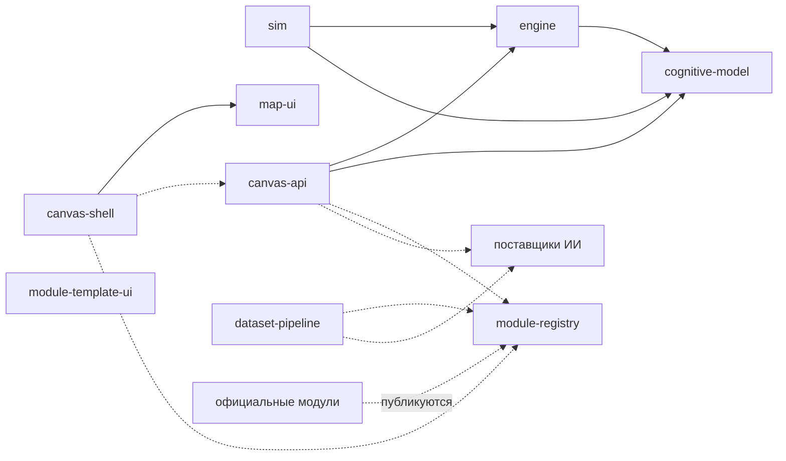

# NovaTrail — репозитории

> Статус: черновик для обсуждения, 2026-10-18.
>
> Как платформа нарезана на репозитории, что от чего зависит и в каком порядке появляется. Технологии каждого репозитория описывают его собственные документы (R11). Открытые вопросы Т-… — в разделе 8.
>
> Понятия — в [concepts.md](concepts.md), решения — в [decisions.md](decisions.md).

## 1. Принципы

- **`spec` — единственная общая зависимость.** В нём словарь, форматы и контракты. Остальные репозитории берут его по точной версии тега (R10).
- **Без циклов** — ни при сборке, ни по сети.
- **Библиотеки не зависят от сервисов, сервисы не зависят друг от друга при сборке.** Между собой сервисы говорят по сети, по контрактам из `spec`.
- **Библиотеки чистые.** cognitive-model и engine — вычисления без ввода-вывода, как `domain/` в canvas-api. Поэтому их можно гонять на стенде на тысячах виртуальных учеников, а при нужде — исполнять на устройстве.
- **Зависимость при сборке и сетевая зависимость — не одно и то же.** Первая — импорт кода по версии, вторая — вызов API по контракту.
- **Один образец репозитория.** Devcontainer, justfile, CI, подписанные релизы, CLAUDE.md и AGENTS.md — по образцу canvas-api. Отличия от образца записываются, как в R46 canvas-api.
- **Довод R13 canvas-api.** Там клиент и API жили в одном репозитории, потому что «API и клиент меняются вместе, одним pull request». Здесь этот довод снимают версионируемые контракты в `spec`: сначала новый контракт, потом сервис, потом клиент. Цена — несколько pull request вместо одного; её принимаем ради узкого контекста ИИ-агентов и независимых релизов (R10).

## 2. Список репозиториев

| Репозиторий | Что это | Вид | Зависит при сборке | Обращается по сети | Этап |
|---|---|---|---|---|---|
| spec | словарь, форматы, контракты, документы платформы | спецификация | — | — | 0 |
| cognitive-model | модель ученика: оценка владения навыками по свидетельствам | библиотека | spec | — | 1 |
| engine | выбор следующего урока или задачи | библиотека | spec, cognitive-model | — | 1 |
| sim | стенд виртуальных учеников: гоняет модель ученика и движок, держит критерий | инструмент, CI | spec, cognitive-model, engine | — | 1 |
| официальные модули | содержание: олимпиадная математика, испанский A1; потом другие (Т-2) | содержание | spec — формат | — | 1 |
| module-registry | индекс модулей и CLI-валидатор (v0), потом — сервис каталога и публикации | CLI, затем сервис | spec | хранилище модулей | 1 — v0 (Т-4); 4 — сервис |
| canvas-api | бэкенд: аккаунты, сессии, проверка, наставник, пути к ИИ, модель ученика | сервис | spec, cognitive-model, engine | поставщики ИИ, индекс модулей | 2 |
| canvas-shell | веб-приложение ученика и взрослого: канвы, виджеты, голос | веб-приложение | spec — контракты; map-ui, пока он пакет (Т-5) | canvas-api, бандлы виджетов модулей | 2 |
| map-ui | карта навыков ученика | пакет, потом, возможно, веб-компонент (Т-5) | spec | — (данные даёт canvas-shell) | 2 |
| dataset-pipeline | помощь автору: разметка, варианты задач, проверка | конвейер | spec | поставщики ИИ, module-registry | 4 |
| module-template-ui | образец виджета модуля для авторов | шаблон | spec | — | 4 |

Названия canvas-api и canvas-shell пока рабочие (Т-6).

## 3. Схема зависимостей

От `spec` зависят все, поэтому эти стрелки не нарисованы. Стрелка означает «зависит от»: сплошная — при сборке, пунктир — по сети.

- В схеме из диалога с Gemini реестр и конвейер зависели друг от друга. Здесь цикла нет: конвейер публикует через API реестра, а реестр о конвейере не знает.
- module-template-ui ни от кого, кроме `spec`, не зависит: это отправная точка для автора виджета.

## 4. Потоки

**От автора к ученику:**
1. Модуль лежит в своём репозитории.
2. CLI реестра проверяет его: схему, граф без циклов, ссылки, ключи, eval.
3. Версия публикуется, и модуль попадает в индекс.
4. canvas-api закрепляет версию модуля за попыткой ученика.
5. canvas-shell получает от canvas-api открытый вид задачи — без ключа, решения и ловушек — и загружает виджеты модуля. Ключ остаётся на сервере, решение приходит после верного ответа (R05).

Ключи открытых модулей публичны, как и сами модули. R05 не охраняет тайну, а лишь не держит ключ в приложении ученика.

**Сессия ученика:**
1. canvas-shell просит у canvas-api следующую задачу; engine выбирает её по модели ученика.
2. Ученик работает на канве и отправляет работу.
3. canvas-api вызывает ИИ — через ИИ платформы или со своим ключом — и получает наблюдение. Ответ вводом или выбором ИИ не читает.
4. Программа сверяет наблюдение с ключом и выносит вердикт; ИИ подбирает слова наставника.
5. cognitive-model обновляет модель ученика.
6. canvas-shell показывает вердикт, вопрос и карту навыков.

**CI алгоритмов:**
- каждое изменение cognitive-model или engine прогоняется на стенде sim, на виртуальных учениках разных профилей;
- критерий записан до первого прогона кандидата (R163 standalone);
- изменение, которое ухудшает критерий, не сливается.

## 5. Что лежит в `spec`

- `docs/` — описательные документы платформы на русском (R14): product, concepts, privacy, repositories, decisions.
- `draft/` — прототип приложения ученика.
- Позже — нормативные части, версионируемые тегами:
  - формат модуля — JSON Schema (Т-7);
  - контракты API — protobuf и buf (Т-7);
  - протокол виджета и протокол eval (Т-8, Т-12);
  - общая таксономия навыков (Т-14);
  - руководства для авторов. Язык нормативных текстов — О-3.
- Примеры — фрагменты модулей для тестов схем.

Чего в `spec` нет: кода сервисов и библиотек, содержания модулей, данных учеников.

## 6. Порядок появления

1. **spec** — словарь, решения, приватность; затем формат модуля v0.
2. **Официальные модули и реестр v0:**
   - порт 603 эталонных задач standalone с ловушками и решателями;
   - небольшой набор испанского A1;
   - индекс модулей и CLI-валидатор (Т-4).

   Так формат v0 сразу проверяется на двух предметах (R08), а модули — валидатором.
3. **cognitive-model, engine и sim** — вместе: стенду нужны и модель, и правило выбора. Стенд и критерий появляются до первого кандидата. Отправная модель — модель standalone с уровнем на модуль (concepts 11).
4. **canvas-api, canvas-shell и map-ui.** Начинаются с замера чтения ИИ по каждому виду канвы и ответа, как E2 в canvas-api: сначала узнать, хорошо ли ИИ читает работу, потом строить остальное (R60 canvas-api). Образцы для замера делают взрослые добровольцы, в том числе подражая детскому почерку; образцы детей — только с отдельным согласием (П-10). До первого ребёнка — согласие родителя и договоры с поставщиками ИИ (П-1, П-3).
5. **Сервис реестра, конвейер, виджеты и образец виджета** — вместе с третьим модулем и сторонними авторами (этап 4, product 11).

## 7. Что переносим из MathTrail

| Что | Откуда | Куда |
|---|---|---|
| Принципы проверки и подсказки: вердикт выносит программа, четыре вердикта, лестница подсказок, проверка утечки, запасные тексты | canvas-api: R37, R38, R39, R24; spec 5–7 canvas-api | concepts, canvas-api |
| Модель ученика: модель Раша с полом угадывания, обновление по Elo, коридор успеха, пробная серия, осторожное «освоено» | standalone: SPEC 2, R187 | cognitive-model |
| Стенд виртуальных учеников и критерий, записанный заранее | standalone: `tools/learners`, `docs/learners.md`, R163 | sim |
| Правило выбора задачи | standalone: SPEC 3 | engine |
| 17 тем и связи `builds_on`, 20 ловушек, 11 приёмов, 603 эталонные задачи с решателями | standalone: `content/`, `site/` | модуль математики |
| Проверка задачи решателем на Starlark | standalone: SPEC 6 | ключи шаблонов (concepts 9.3) и вид проверки «условие» (Т-1) |
| Каркас сервиса: конфигурация, журналы, ошибки, версия | canvas-api: `internal/`, в свою очередь из standalone (R11 canvas-api) | canvas-api, образец репозитория |
| Devcontainer, justfile, CI, подписанные релизы, Terraform, self-hosting | canvas-api | все репозитории |
| Замер чтения ИИ на образцах, журнал автора, eval | canvas-api: R60–R66 | canvas-api |
| Лист для рукописи: координаты, штрихи, рамка ошибки на штрихах ученика | canvas-api: spec 4, R15, R43 | canvas-shell — вид канвы «лист для рукописи» |
| Приватность детей: минимум данных, согласие, удаление | canvas-api: `docs/privacy.md` | privacy |
| Пакет для грантов: логическая модель, реестр данных | standalone: `docs/grants/` | позже |

## 8. Открытые вопросы

Каждый вопрос: суть, варианты, рекомендация и что он блокирует. Номера не меняются. Новые вопросы получают следующий номер — Т-15.

| № | Вопрос | Варианты | Рекомендация | Блокирует |
|---|---|---|---|---|
| Т-1 | Где код видов проверки | внутри canvas-api; отдельная библиотека `checker` | отдельная библиотека: виды проверки нужны canvas-api, конвейеру, стенду и CLI реестра, который проверяет ключи при публикации | формат v0, canvas-api |
| Т-2 | Официальные модули: один репозиторий или по репозиторию на модуль | монорепозиторий `modules`; `module-<имя>` на каждый | монорепозиторий, пока формат меняется: правка формата — одна на все модули. Разделить, когда формат станет v1 | этап 1 |
| Т-3 | Репозиторий `.github` | нет; да | да: профиль организации; общие CONTRIBUTING, SECURITY и кодекс поведения; общие workflow CI с actions, закреплёнными по SHA | первый публичный репозиторий кода |
| Т-4 | Реестр v0 | сервис с базой; подписанный статический индекс, который собирает CI; список закреплённых версий в canvas-api | подписанный статический индекс: CI собирает его из репозиториев модулей, CLI служит валидатором. Сервис — на этапе 4 | этап 1 |
| Т-5 | map-ui: пакет или микрофронтенд | пакет, который canvas-shell собирает к себе; веб-компонент, загружаемый на лету | сначала пакет; веб-компонент — когда появится второй потребитель, например кабинет взрослого или канал MCP | этап 2 |
| Т-6 | Названия canvas-api и canvas-shell | оставить; короче — например, `api` и `app`; другое | решить до первого кода: канва теперь одно понятие из многих, а сервис отвечает ещё за аккаунты, пути к ИИ и модель ученика | этап 2 |
| Т-7 | Форматы контрактов | JSON Schema для модулей и protobuf для API; один формат на всё | JSON Schema для модуля: авторы пишут YAML или JSON. protobuf и buf — для API сервисов, как R12 canvas-api. Сгенерированные пакеты выходят из релизов `spec` | формат v0 |
| Т-8 | Как исполняется код чужих виджетов | Web Components прямо в странице; iframe-песочница | iframe-песочница на отдельном origin; CSP без сети; обмен сообщениями по протоколу из `spec`; подписанные бандлы, закреплённые по хешу; детям — только виджеты после ревью. Shadow DOM изолирует стили, но не код | этап 4 |
| Т-9 | Где держать ключ пользователя | на сервере, зашифрованным; на устройстве, передавая с запросом; только в памяти запроса | на устройстве. Ключ приходит с запросом, а на сервере живёт только в памяти: не в базе и не в журналах, как картинки работы в canvas-api (R42 canvas-api) | свой ключ, privacy 5.2 |
| Т-10 | Где считаются модель ученика и движок | только на сервере; ещё и на устройстве (WASM) | на сервере. Библиотеки чистые, поэтому расчёт на устройстве — для офлайна — остаётся возможным | этап 5 |
| Т-11 | Версии `spec` | semver тегами, поддержка версий формата | semver; паспорт модуля называет версию формата; платформа поддерживает текущую мажорную версию и предыдущую | формат v0 |
| Т-12 | Где живёт eval: протокол, раннер, образцы | всё в `spec`; протокол в `spec`, раннер в canvas-api, образцы вне репозиториев | протокол — в `spec`; раннер — рядом с кодом наставника; работы учеников — вне репозиториев, как `samples/` в canvas-api (R65 canvas-api). Синтетические образцы и образцы, которые для eval сделали взрослые добровольцы и авторы, могут лежать в модуле (concepts 3) | замер этапа 2 |
| Т-13 | Голос | realtime API голоса; связка синтеза и распознавания речи | решить на этапе 3, по eval и цене. Правила одинаковы для ИИ платформы и своего ключа | этап 3 |
| Т-14 | Общая таксономия навыков | курирует платформа в `spec`; отдельный модуль; без неё — ссылки на чужие модули | в `spec`, отдельным словарём навыков-опор; модули ссылаются друг на друга только через неё (concepts 4) | ссылки между модулями |
