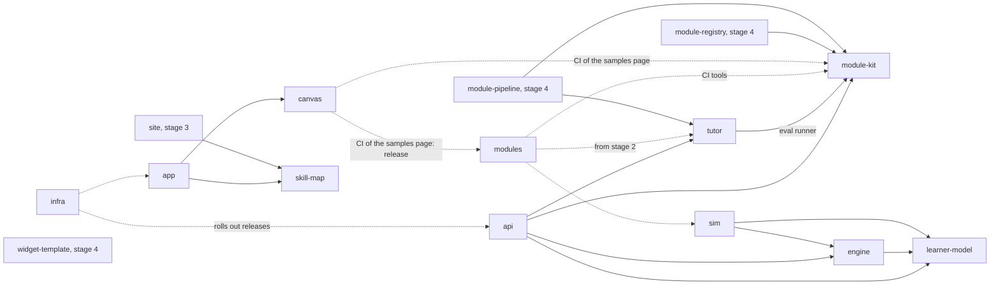

# NovaTrail — repositories

> Status: a draft for discussion, 2026-10-18.
>
> How the platform is cut into repositories, what depends on what, and in what order they appear. Which parts run while the platform works and how they connect is in [architecture.md](architecture.md). The technologies of each repository are described by its own documents (R11). The open questions Т-… are in section 8.
>
> The concepts are in [concepts.md](concepts.md), the decisions in [decisions.md](decisions.md).

## 1. Principles

- **`spec` is the only shared dependency.** It holds the vocabulary, the formats and the contracts. The other repositories take it at an exact tag version (R10): the documents and rules as the git submodule `spec/` at the tag, the code as release files of the same tag (R21, R64). Go code takes the tag as the version of the Go module `github.com/altnovatrail/spec` — with the format `spec.Format` and its types, the packages `types/formatv0` and `types/formatv0/open` (R72), and from line 0.8 also with the admission table `spec.Admission` and its types `types/admissionv0` (R96) —, any other code as a signed release file, `format-<version>.tar.gz` and `admission-<version>.tar.gz`. TypeScript code takes the format's types as the npm package `@altnovatrail/spec` of the same version as the tag, without `v`, — as a file of the same release from line 0.4 (R73). The code of the API contracts is its own: in Go, the nested module `github.com/altnovatrail/spec/contracts` at the tag `contracts/vX.Y.Z` with the number of the `spec` tag, in TypeScript, the npm package `@altnovatrail/contracts` of the same version, as a file of the same release from line 0.7; the release sets the tag `contracts/vX.Y.Z` itself (R83; the fourth 2026-11-02 amendment to R83). From line 0.5 the same package also carries the types of the element `<novatrail-canvas>`, `@altnovatrail/spec/canvas` (R74). The module versions in `go.mod`, the npm packages and the submodule are moved together, in one move to a tag, and are excluded from Dependabot (R64, R73).
- **No cycles** — neither in the build nor over the network.
- **Libraries do not depend on services, services do not depend on each other in the build.** Services talk to each other over the network, by the contracts from `spec`.
- **A service only where a separate process is needed.** In the first slice there is one service, `api`. `tutor` is a library in its process; it becomes a service when it gets a second consumer (R15).
- **Libraries are pure.**
  - `learner-model`, `engine` and `module-kit` are computations without input and output, like `domain/` in canvas-api. So they can be run on the simulator over thousands of virtual learners and, when needed, executed on the device.
  - The CLI of `module-kit` only reads and writes the files of a module.
  - `tutor` is a library with one kind of input and output: requests to AI providers.
- **Build, network and CI are different links.**
  - A build dependency is an import of code by version.
  - A network dependency is a call of an API by contract.
  - A CI tool is a program that CI takes at an exact tag.

  So the simulator `sim` can check `learner-model` and `engine`, though it imports them itself: the CI of a library takes `sim` at a tag and substitutes the pull request's code through `go.work`, and the other library by a commit from the gate file of `sim`. There is no cycle here (R103).
- **One pattern of a repository.** A new repository starts from the template of `spec` — the devcontainer, CLAUDE.md, AGENTS.md, RUN.md and the documents (section 2.2, R21). It has the shared CI checks from `.github` from day one, even before code (R30); the justfile, the language checks and the signed releases come with code, after the pattern of canvas-api. Differences from the pattern are recorded, as in R46 canvas-api.
- **The argument of R13 canvas-api.** There the client and the API lived in one repository, because «API и клиент меняются вместе, одним pull request». Here the versioned contracts in `spec` remove this argument: first the new contract, then the service, then the client. The price is several pull requests instead of one; we accept it for the narrow context of AI agents and independent releases (R10).

## 2. The list of repositories

### 2.1. The table

| Repository | What it is | Kind | Depends on in the build | Calls over the network | Stage | Create |
|---|---|---|---|---|---|---|
| spec | the vocabulary, formats, contracts, the platform's documents | specification | — | — | 0 | exists |
| .github | the organization's profile; the shared CONTRIBUTING, SECURITY and code of conduct; the shared CI workflows | meta | — | — | 0 | now |
| modules | the official modules: olympiad maths, school maths of grade 3, short essays in English | content | — (in CI: module-kit and sim; from stage 2, tutor) | — | 1 | now |
| module-kit | the module format in code: validation, package and index, templates with a seed, the open view, the check kinds; the author's CLI | library, CLI | — | — | 1 | now |
| learner-model | the learner model: an estimate of skill mastery from evidence | library | — | — | 1 | now |
| engine | the choice of the next lesson or task | library | learner-model | — | 1 | now |
| sim | the learner simulator: runs the learner model and the engine, holds the criterion | tool, CI | learner-model, engine | — | 1 | now |
| tutor | the tutor: reading the work, the words, the AI routes, the admitted models, eval | library | module-kit, for the eval runner (in CI: the release of canvas — synthetic samples, R38) | AI providers | 2 | now |
| api | the platform's service: accounts, attempts, checking, the learner model, the choice | service | tutor, module-kit, learner-model, engine | the sign-in service, the database; AI providers through tutor | 2 | now |
| canvas | canvases: kinds, layers, strokes, the crop for checking; the samples page | package | — (in the CI of the samples page: module-kit and the release of modules, R25; until the first content of modules, the release of tutor) | — | 2 | now |
| skill-map | the skill map | package | — | — | 2 | now |
| app | the web application of the learner and the adult | web application | canvas, skill-map | api, the sign-in service | 2 | now |
| infra | the shared infrastructure: OpenTofu, domains, logs, deployment, self-hosting | infrastructure | — | — | 2 | code: the epic of the first code of `infra` (R109; the 2026-11-08 amendment to R11) |
| site | the landing page, legal texts, the module catalog, documentation for authors | static site | skill-map | — | 3 | later |
| module-registry | the service that publishes third-party modules | service | module-kit | the module store | 4 | later |
| module-pipeline | help for the author: markup, task variants, checks | CLI, jobs | module-kit, tutor | AI providers, module-registry | 4 | later |
| widget-template | the pattern of a module's widget and the environment for developing a widget | template | — | — | 4 | later |

- The dependency on `spec` is not listed: everything depends on it. All repositories take the shared CI checks from `.github`, `spec` too, even before code (R30).
- `sim` reads module packages — their server part, the canonical view — by the types from `spec`, without `module-kit` (R62).
- The names are R18; the former names are in R10.
- Where each part runs and what to decide when it is detailed is architecture 3.
- The official modules may split into a repository per module when the format becomes v1 (R18).

### 2.2. How to set up a repository

A new repository is assembled from the template `repo-template/` in `spec` (R21).

1. The name comes from the table; the repository is public (R18). The license is Apache-2.0, for code and for content (R12, R20).
2. `just new-repo <name> <kind> <card>` — for example, `just new-repo learner-model go 3.8` — assembles a working copy in `.repos/<name>` from the files of the latest release of `spec`, the highest tag of the form `vX.Y.Z`. The tag must already be on GitHub: the submodule is taken from there, and the recipe checks that it is the same commit there. A release with its tag comes out by itself, after CI is green on `main` (R31). The kind is `go`, `typescript` or `docs`, the card is the number of a section of architecture 3. In the copy:
   - `README.md` (en) — the day-one status badges (section 2.3), the purpose, the stage and a link to `spec`;
   - `CLAUDE.md` (en) — the component's role and its place in the platform, its own documents, the environment and the line `@spec/RULES.md`. The shared rules are one file, `RULES.md` in `spec`, and the CLAUDE.md of every repository imports it: devcontainer only, exact versions, languages, no learners' data and no secrets, Apache-2.0, citations and work across repositories;
   - `AGENTS.md` and `LICENSE` — the same as in `spec`;
   - `docs/architecture.md` (en) — the purpose and the bounds from the card and a subsection for each of its items "To decide when detailed";
   - `docs/decisions.md` (en) — an empty log with its own numbering: "Next number — R01". Other repositories cite its entries as "R03 api";
   - `docs/sources.md` (en) — the records of external facts, empty: a provider's terms, a price, a law, a library's documentation — with the source, the date read and the quote, and a claim of `docs/architecture.md` or of the log cites the record — `sources 1.1` (RULES.md, The bar). `docs/architecture.md` has no section "Sources" of its own. The results of measurements go to `docs/measurements.md`, which the first measurement starts, not to `docs/architecture.md`; the pattern is [sources.md](sources.md) and [measurements.md](measurements.md) of `spec` (R143);
   - `RUN.md` (ru) — the work plan after the pattern of the RUN.md of `spec` (R19). The first epic is «Детализация»: a task for each item "To decide when detailed", the items that cannot be decided apart as one task, and the last task «Итог детализации». Its rule 4 lets the executor run a task's checks without the author, by R146: the path in the browser with Playwright in the devcontainer, the calls of AI on the stub of `tutor`, and a real call only where the task checks the model's words, under the provider's spending limit and the cap the task names, with «Сделано» naming what was spent. A repository made before T146 takes the rule into its own RUN.md with its move to a tag: a move to a tag does not rewrite RUN.md;
   - `DEBT.md` (ru) — table 4 of the work plan, the technical debt, empty: «следующий — Д1» (R19);
   - `docs-budgets.json` — `{}`: the repository's documents keep within the budgets of size of the block `repository` of `spec`'s `tools/docs-check/budgets.json`, and the file names what differs; without it `docs-check-repo` does not measure (R145). Its RUN.md measures the sessions' tokens at the archive of each epic (measurements 1.9);
   - `.claude/settings.json` — the Claude Code project settings: the session hook `spec/tools/session/`, compaction at 400 thousand, the claude.ai connectors off, and `claudeMdExcludes` loads neither the CLAUDE.md nor the part rules of the `spec` submodule (R143). A kind adds its own keys to them, with the key `claude` in `repo-template/kinds.json`. The kind `go` adds the marketplace `novatrail` from `spec/claude-plugins/` and the plugin `gopls-lsp`: the session gets gopls diagnostics after each edit of Go code (the 2026-11-12 amendment to R143; sources 2.7). The plugin loads from the submodule in place, without installation, when the repository's folder is trusted, and comes with a move to a tag; in a cloud session the language server does not start;
   - `.devcontainer/` — the same as that of `spec`, with its own names of the container and the network and with what the repository's kind adds (`repo-template/kinds.json`): VS Code extensions and settings, lines at the end of the `toolchain` stage and, from the kind's folder, lines of the `devcontainer` stage with the files the image copies. The kind `go` adds the Go extension with settings that keep it from installing its own tools, and gopls from the lock file `repo-template/kinds/go/gopls/`, built in the `devcontainer` stage at the version `GOPLS_VERSION` (R102); a move to a tag takes `.devcontainer/` from what the recipe builds and brings the repository's differences in again, so gopls comes with it. `.devcontainer/gopls/` is a Go module that no code reads, and the repository's Go checks do not list it. The kind `typescript` adds the Biome extension, Biome as the default TypeScript formatter and browsers for tests, one for each engine CI checks — Chrome Headless Shell, WebKit and Firefox from the Playwright image by tag and digest, and their system libraries and Playwright's fonts from the Ubuntu snapshot (R79 and its 2026-11-13 amendment; the builds' licenses — the 2026-11-13 amendment to R12); `NOVATRAIL_DEVCONTAINER=1`. The decisions its Dockerfile cites are decisions of `spec`, and in the copy they carry the suffix: `(R34 spec)` (В11 `canvas`). The sign-in volumes of Claude Code, Codex and gh are shared by all NovaTrail containers. Go is already in the `toolchain` stage: `spec` checks its Go module with it (R64), and a component builds and checks its Go code with it. It comes with the Dockerfile into a copy of any kind, and in a copy without Go code it is not used: the comments of the Dockerfile are written to read right both in `spec` and in a copy (В8 `module-kit`). buf comes the same way: in `spec` it checks the contracts, and in a copy without contracts it is not used (R83). Other code tools are added at exact versions when code begins;
   - `spec/` — the git submodule at the same tag; if a clone came without it, the container fetches it at start. Everything is added to the index, there is no commit.
3. The executor fills the `FILL` marks from the component card. `just new-repo-check <name>` checks that nothing of the template is left and that the copy's documents pass the repository's documents check (R32). In the repository itself it is run by `just -f spec/justfile docs-check-repo`.
4. `gh repo create altnovatrail/<name> --public` — after the author confirms. Right after it, `gh repo edit altnovatrail/<name> --delete-branch-on-merge`: a pull request's branch is deleted after the merge. All repositories of the organization are set so since 2026-10-19, but a new repository does not get this setting by itself. The first commit and push are the author's. The new repository's numeric ID — `gh api repos/altnovatrail/<name> --jq .id` — the same task of `spec` adds to `tools/release/repositories.mjs`: without it `release-verify` accepts no files of its releases, since the signature is checked against the ID, not only the address (R77, the 2026-11-01 amendment).
5. CI — the shared checks from `.github` and Dependabot, even before code (R30; RUN.md, T16); the language checks come with the repository's first code. What code adds to the calling files — the language job, the CodeQL input, the Dependabot ecosystem, the release — is written by the repository's own session by architecture 3.3 .github, and the author puts the checks into the ruleset (the 2026-10-21 amendment to R30).
6. A question that concerns several repositories is written into the register of `spec`: О-, П- or Т-. A session in another repository does not edit `spec`, but passes such a question to the author through table 3 of its RUN.md with the mark «в реестр spec» (RULES.md, the section "Across repositories").

### 2.3. README badges

The README of every repository starts with status badges, as MathTrail's does (R48):
- the first line: CI, Release, CodeQL, the release number, the language, coverage, OpenSSF Best Practices, OpenSSF Scorecard and the license;
- the second, after a blank line: the five SonarCloud measures, code smells, reliability, security, maintainability and vulnerabilities.

A badge stands only when what it speaks of exists: no "no releases", "not found" or "unknown".
- **From day one**: CI, CodeQL, Scorecard, the license and the SonarCloud measures. The template carries them, `repo-template/files/README.md`, with the repository's name. They answer once the repository is set up to the end: with the shared checks (section 2.2, item 5), the SonarCloud project (R30) and the first Scorecard run.
- **With the first release**: Release and the release number.
- **With the first code**: the language — for Go, the version from `go.mod`, for TypeScript, the version of `typescript` from the devDependencies of `package.json`. `spec` has no language badge: its code is the check tools in `tools/` and the Go module, a wrapper over the format's files and their types (R64, R72), not the platform's code.
- **With the first upload of coverage to Codecov**: coverage (RUN.md, T40).
- **With the passing level**: OpenSSF Best Practices, by the project ID on bestpractices.dev (RUN.md, T41). The answers to the criteria lie in the file `.bestpractices.json` at the repository's root, in English: the site proposes them in its form, and the author saves them (the 2026-10-26 amendment to R48). The site takes no changed answer from the file by itself. A link to the form with the changed fields and `overrides` for them brings it: the repository's session builds it from the file, and the author saves them (the 2026-10-27 amendment to R48).

A badge that comes later is put by the repository's session in its place in the line, together with what it speaks of. Here are all the badges, with `<name>` in place of the repository's name and `<ID>` in place of the number of its Best Practices project:

```markdown
[](https://github.com/altnovatrail/<name>/actions/workflows/ci.yml)
[](https://github.com/altnovatrail/<name>/actions/workflows/release.yml)
[](https://github.com/altnovatrail/<name>/actions/workflows/codeql.yml)
[](https://github.com/altnovatrail/<name>/releases/latest)
[](go.mod)
[](package.json)
[](https://codecov.io/gh/altnovatrail/<name>)
[](https://www.bestpractices.dev/projects/<ID>)
[](https://scorecard.dev/viewer/?uri=github.com/altnovatrail/<name>)
[](LICENSE)

[](https://sonarcloud.io/summary/new_code?id=altnovatrail_<name>)
[](https://sonarcloud.io/summary/new_code?id=altnovatrail_<name>)
[](https://sonarcloud.io/summary/new_code?id=altnovatrail_<name>)
[](https://sonarcloud.io/summary/new_code?id=altnovatrail_<name>)
[](https://sonarcloud.io/summary/new_code?id=altnovatrail_<name>)
```

- The workflows of `.github` are `self-ci.yml`, `self-codeql.yml` and `self-release.yml`, and its SonarCloud project is `altnovatrail_.github`. What the organization's profile, `profile/README.md`, shows is decided by `.github`.
- The reader's browser takes a badge's picture not from the service but from GitHub's proxy, Camo (R48).

## 3. The dependency diagram

Everything depends on `spec`, so those arrows are not drawn. An arrow means "depends on". A solid one is an import in the build, a dashed one a CI tool at an exact tag or a deployment.



- The links of `canvas` and `tutor` are not drawn either, for the same reason as the gate of `sim` below: they take each other's releases as CI tools. The CI of `tutor` takes the synthetic samples of `canvas` (R38), the CI of `canvas` the open views of the measurement tasks of `tutor`, while `modules` has no content (the 2026-10-21 amendment to R25). There is no cycle in the build: each side takes an already released release of the other at an exact tag, and the release of `tutor` comes out first (R38).
- The gate of `sim` for `learner-model` and `engine` is not drawn, though it too is a CI tool. Together with the import `sim → engine`, such an arrow would read as a cycle, and there is no cycle (section 1, Т-16).
- All repositories take the shared CI checks from `.github` (R30); those arrows are not drawn either.
- The CI of `spec` checks the module examples with an ordinary JSON Schema validator, not with `module-kit`: otherwise `spec` would depend on what depends on it. It checks a vector of a part's rule with the schema and the YAML rules, and the rule itself is checked by the CI of `module-kit` (R45). The YAML rules and the rules of the whole module — the layout, the IDs in file names and the signatures of the media files — `format-check` checks itself and builds the open view itself, from T29 also the verdicts of the verdict vectors, except those whose predicate Starlark gives, from T30 the traps that name incorrect values in them, and what the leak check finds in the texts of the leak vectors, from T31 also the rule `lesson.no-leaks` on lessons, and from T34 the tiers and the module package, its canonical view and digests: this is a second implementation beside `module-kit`, and the vectors compare the two (R46, R51, R56, R57, R58, R62).
- In the diagram from the dialogue with Gemini, the registry and the pipeline depended on each other. Here there is no cycle: the pipeline publishes through the registry's API, and the registry does not know of the pipeline.
- `widget-template` depends on nothing but `spec`: the widget protocol is set in `spec`, and the application's side in `canvas`.

## 4. Flows between repositories

The flows while the platform works are in architecture 4. Here is how changes pass between repositories.

**From the author to the learner:**
1. A module lies in `modules`: YAML, media, an eval set.
2. CI checks it:
   - `module-kit` — the schema, a graph without cycles, the references, the media files, the keys, the leaks in the author's texts that the learner sees before solving, — and in the texts of a lesson that names the task (R57; R58);
   - `sim` — if what the simulator reads from the package changed — on the pull request's package, with invariants and absolute thresholds, without bands; from the first tag of `sim`: before it there is no gate (R76; R103). A pull request that changes the tag of `sim` runs all the graphs;
   - from stage 2, the eval runner of `tutor` on the module's eval set.
3. On release, `module-kit` builds the package — the canonical view for the server, the device part and the inventory with their digests, without the eval set (R62), — and the module index: from the index of the previous release, with an entry for each published version and the marks of withdrawal (R63). The shared release workflow from `.github` signs them (R17).
4. `api` takes the packages by the index of a release of `modules` that its configuration pins — the release's tag and the index's digest, and the index names the packages' digests (R63; R07 api); an attempt stores the digest of its package, the digest of its inventory (R62).
5. `app` gets from `api` the open view of a task — without the key, the solution and the traps, without the skills, the band and the difficulty, without the techniques, the simpler case and the leak phrases (R57). The key stays on the server, the solution comes after a correct answer (R05), and the skills, the band and the difficulty only the server reads (R51). The open view of a lesson comes without its skills and age categories (R58). The open views of the manifest, the skill graph, the technique catalog and the solving steps `app` gets by the package digest — of an attempt, a lesson run or the current version of a connected module — and caches by it, and the media files from the device part of the package, which `api` serves (R62 and the 2026-11-04 amendment to it; R99).

The keys of open modules are public, as are the modules themselves. R05 guards no secret, it only keeps the key out of the learner's application.

**The CI of the algorithms:**
- every change of `learner-model` or `engine` is run on the simulator `sim`, on virtual learners of different populations (concepts 15). The CI of a library takes `sim` at an exact tag and the SHA of its commit, in a job of its own, and writes `go.work` on the fly, without committing it: `sim`, the pull request's code and the other library by a commit from the gate file of `sim`. The gate runs on every pull request and every commit of `main` and holds the merge (R103);
- the first version of each library comes before the gate: its own tests check it, and `sim` sets up the simulator on it and writes the criterion before the first candidate, the first change after it (R103);
- the criterion is written before the first run of a candidate (R163 standalone);
- a change that worsens the criterion is not merged;
- the order of releases (R103): a change that breaks the simulator's API or moves the numbers is first written into `sim` at the commit of its pull request, a tag of `sim` comes out, the library's pull request raises the tag and is merged, and after the library's release `sim` raises `go.mod`. The pair "the threshold 'mastered' and the corridor's target" and a change of `learner-model` that breaks the API of `engine` go in one tag of `sim`: the gate file names both commits, `learner-model` is merged when the pull request of `engine` has passed review, and `api` moves to both versions together. The release of `sim` comes out by itself after CI is green on `main`, and the callers' tag is raised by their session.

**A change of AI model:**
- a new model for an AI capability is admitted when it passes the capability eval set and the eval sets of all published modules with this capability;
- the order (В9 `modules`; R04 modules): `tutor` releases a tag where the model is in the list of admitted ones once it has passed the capability eval set in the CI of `tutor`; a pull request of `modules` moves to this tag, and the eval runner runs the eval sets of all modules — they lie in the git of `modules`, outside the package and the release files (R62); `api` moves to such a tag of `tutor` only after this pull request is merged. If it is red, `tutor` releases the next tag without the model, and `api` stays on the former one: rollback is only forward (Т-19). That `api` waits for `modules` is held by the review of the pull request of `api`;
- false alarms are counted by verdict: the model's observation passes through `module-kit`, as in the platform's work (R04). An assessment by rubric has no verdict, and it is measured by the false alarms on met criteria and by agreement with people (R71). What the runner gives — a report without the content of the works, by which the measures are counted — and what lies in a module's eval set is written by the eval protocol, and only a report with the verdicts of `module-kit` is fit for admission ([the contracts text](../contracts/README.md), sections 13 and 14; R95).

**A new module format version** (R44). Each takes build dependencies and CI tools at an exact version, so a step does not break those who have not moved yet. But `api` and `app` talk over the network and, while the format is v0, come out together:
1. `spec` — the new format version and, in the same pull request, a new line; otherwise `release-version` will not let it pass. The first release of the line releases the format version as a release file and a version of the Go module (R64).
2. What reads modules in the CI of `modules` moves to the new tag — the submodule and the Go module of `spec` together: `module-kit` and, from stage 2, the eval runner of `tutor`. If the open view changed, `canvas` releases a package with the new types (R36).
3. `modules` — in one pull request: the new tags of `module-kit` and `tutor` in CI, the manifests and the content of all modules. `sim` is not run in it: at its former tag it will not read a package of the new version. The move changes nothing of what the simulator reads from the package — neither the graph nor the tasks' bindings — except the very writing in the new format version: the review of `modules` holds this (R03 modules; the 2026-11-07 amendment to R103), and that is changed in a separate pull request after step 4.
4. `sim` moves to the new tag and to the packages from the new release of `modules`, and `modules` takes the new tag of `sim` in CI. `learner-model` and `engine` take the new `sim` in a move of their own: they hold their gate at the former tag.
5. `api` takes the new `module-kit` and the new packages, and if the open view changed, `app` comes out with it, with the new `canvas` — in one list of exact versions (Т-19). The CI of `canvas` takes the new release of `modules` and the new tag of `module-kit`.

While the format is v0, only the current version is read, and the modules all move at once; the same on v1, since v0 leaves the window when v1 comes out. From v2 the window — the current major version and the previous one — lets the modules move one by one, and `api` and `app` apart.

**A new version of the admission table** (R96) is shorter: one admission function of `tutor` reads the table, and `api` calls it in its process.
1. `spec` — the new version of the table and, in the same pull request, a new line, and its provider's row in privacy 5.3 checked anew. The first release of the line releases the table as a release file and a version of the Go module (R64).
2. `tutor` moves to the new tag — the submodule and the Go module of `spec` together — and makes a release: its function reads the table from `spec.Admission`, and the tests run its vectors.
3. `api` takes the new release of `tutor` and is rolled out. If the new version added a deployment fact, the operator declares it in the facts file of `api` — only when the fact holds. Until step 3 has passed, the former table works: the operator can close platform AI urgently by themselves, by removing the fact.

**A new version of the deployment configuration** (R85): `app` and the rollout of `infra` move to it together: `app` rejects an unknown field, and the rollout a build of another version.
1. `spec` — the new version of the part `deployment/` and, in the same pull request, a new line. The first release of the line releases the part as a release file and a version of the Go module (R64).
2. `app` moves to the new tag and releases a build: it carries a copy of the new schema, and the tests run the reading vectors.
3. `infra` moves to the same tag, writes the file of the new version and rolls out the new build together with it, in one rollout list (R106). Until step 3 has passed, the former build is rolled out with the former file.

**A new version of a legal text** (R130) is not a new version of the part: the next tag of `spec` carries it. `api` moves to it and is rolled out — then `app` gets the new text —, the build of the samples page of `canvas` puts in the new set from the release file, and the organizer takes the new form. A new version of the part `legal/` itself goes as the deployment configuration's does: a new line, and the readers move to it in tasks of their own.

**A new entry of the table of the age of digital consent** (R134) is not a new version of the part: the next tag of `spec` carries it, and `api`, moving to it, computes the category by the new entry. The age and the day of an entry that has come out do not change: a country's new age is a new entry. A new version of the part `consent-age/` itself — a new ISO 3166-1 code or a new rule — goes as the legal texts' does: a new line, and the readers move to it in tasks of their own.

## 5. What lies in `spec`

- `docs/` — the platform's descriptive documents, in English (R14, R143): product, concepts, privacy, architecture, repositories, decisions, sources, measurements and the DPIA; the epic archives `docs/plan/` stay in Russian.
- `draft/` — the prototype of the learner's application.
- `tools/` and `justfile` — the documents check `just docs-check`: links, sections, registers, diagrams and the rules of `.claude/rules/` (RUN.md, T01; measurements 1.8). It is a tool of `spec` itself, not the platform's code; there too is the module format check `just format-check` — the schemas, examples and test vectors of `format/` (RUN.md, T25). There too are the check of the licenses of its packages `just licenses-check` (R12), the number of the next release `just release-version` — `tools/release/` (R31) — and the documents check of a component's repository `just -f spec/justfile docs-check-repo` (R32). The rows «в реестр spec» of the other repositories the session of `spec` finds with the recipe `just inbox`: it reads on GitHub the tables 3 of their RUN.md and compares them with table 5 of the RUN.md of `spec` (R81). Another repository's release calls the same recipes: `release-version <commit> <workflow>` — with its line from the named workflow — and `release-refusal`, the rule of refusal of the Releases API (the amendment to R31). On the runner they are run by the script `tools/toolchain/toolchain.sh` from the submodule `spec/`: it builds the `toolchain` stage and runs the commands in it, as the CI and the release of `spec` itself do (the 2026-10-21 amendment to R31). The license check of another repository also goes by recipes of `spec`: `licenses-allowed` prints the list of category A, and `licenses-check-repo` checks the npm lock file with the repository's exceptions (R39).
- the folder `.github/` — the CI of `spec` itself, Dependabot (R30) and the release `release.yml`: after CI is green on `main` it releases the next patch of the line, the tag together with the release (R31). From line 0.3 the release carries files: `format-<version>.tar.gz` with the cosign bundle `<file>.sigstore.json`, under the attestation of an immutable release, and from line 0.4 also the npm package of the TypeScript types, `altnovatrail-spec-<version>.tgz`, signed the same way, from line 0.5 also with the types of the element `canvas`, from line 0.7 the npm package of the contracts code, `altnovatrail-contracts-<version>.tgz`, and from line 0.8 the table of admission to AI, `admission-<version>.tar.gz`, and its types in the types package, from line 0.11 the deployment configuration, `deployment-<version>.tar.gz`, and its types, and from line 0.13 the legal texts, `legal-<version>.tar.gz`, and the types of their passport; the recipe `just release-files` builds them (R64, R73, R74, R83, R85, R96, R130). The release publishes the files of both packages to npm itself, through trusted publishing and without a token (the second 2026-10-29 amendment and the 2026-11-03 amendment to R37). From line 0.7 the release also sets the tag `contracts/<tag>` of the contracts' Go module (the 2026-11-02 amendment to R31). Beside them are the shared checks of all repositories from `.github`: secrets, DCO, CodeQL and Scorecard (R03 .github; RUN.md, T17), and from T50 also the shared Go wrapper `go.yml` over the recipes `ci-lint`, `ci-test`, `ci-vuln` and `ci-licenses` (the 2026-11-01 amendment to R30).
- `format/` — the module format, normative and in English (R42): the format text `format/README.md` with the conventions of R45 and the version number `format/VERSION` (R44). The schemas are JSON Schema 2020-12 (R45). The vectors of the YAML rules lie in `format/vectors/rules/` since RUN.md, T25. From T26 there too are the first schemas — the manifest and the shared definitions —, the examples of the manifest and of a whole module and the vectors of the rules of the whole module (R46), from T27 the skill graph, its examples and the vectors of its rules (R49), from T42 the dictionary of the shared taxonomy `shared-taxonomy.schema.json` (R50), from T28 the task, its examples and the vectors of its rules, the vectors of the rules `module.file-ids` and `module.media`, and also the vectors of the open view in `format/vectors/open-view/` (R51), from T29 the slot checks, their rules and the verdict vectors in `format/vectors/verdicts/` with the schema `verdict-vector.schema.json` (R56), from T30 the trap and technique catalogs, the solving steps, their examples and vectors, the task's hints and the leak check vectors in `format/vectors/leaks/` with the schema `leak-vector.schema.json` (R57), from T31 the lesson, its examples and the vectors of its rules (R58), from T32 the generator of randomness and the derivation of seeds, one for the whole platform, with vectors in `format/vectors/random/` and the schema `random-vector.schema.json` (R27, R59), from T33 the task templates, their examples, the vectors of their rules and the template vectors in `format/vectors/templates/` with the schema `template-vector.schema.json` (R60), and from T34 the module package: the schemas of the canonical view and of the inventory, the inventory's examples, the tier vectors in `format/vectors/tiers/` and the package vectors in `format/vectors/packages/` and `LICENSE` in the module layout (R62). The other parts come in the next tasks. All this is checked by `just format-check` (the 2026-10-22 amendment to R45), and that a vector of a part's rule violates the rule itself, by the CI of `module-kit` (section 3).
- `admission/` — the table of admission to AI, normative and in English (R42; R96): the text `admission/README.md`, the version number `admission/VERSION`, the table itself `admission/admission-table.json` — the rule of each AI capability for each age category and the cell of each provider, AI route and category, in a cell the row of privacy 5.3 and the date read, — its schemas in `admission/schemas/`, examples and test vectors: the vectors of the table's rules and the vectors of the answers of the admission function of `tutor`. All this is checked by `just admission-check` (`tools/admission/`): it computes the answer of each vector by a second implementation and compares the rows of privacy 5.3 and the table's links with the documents of `spec`.
- `deployment/` — the format of the deployment configuration of `app`, the file `/deployment.json`, normative and in English (R42; R85): the text `deployment/README.md`, the version number `deployment/VERSION` — an integer, — the file's schema `deployment/schemas/deployment.schema.json` at a permanent path, examples and reading vectors. All this is checked by `just deployment-check` (`tools/deployment/`): it reads each vector file by a second implementation of the reading rules, `tools/deployment/reading.mjs`, and compares the outcome.
- `legal/` — the platform's legal texts, a normative part in English (R42; R130): the text `legal/README.md`, the part's version number `legal/VERSION` — an integer, — the passport `legal/legal.yaml` with the versions, statuses, dates and gist in the languages of the screen, the text versions `legal/texts/<id>/<n>.md`, schemas, examples and reading vectors. All this is checked by `just legal-check` (`tools/legal/`), and the texts folder of a self-hosting copy by `just -f spec/justfile legal-check-dir <folder>`.
- `consent-age/` — the table of the age of digital consent, a normative part in English (R42; R134): the text `consent-age/README.md`, the part's version number `consent-age/VERSION` — an integer, — the table `consent-age/consent-age.yaml`, by country the age with the day from which it applies, the law, the provision, the quote, the primary source and the date read, — schemas, examples, reading and category vectors. All this is checked by `just consent-age-check` (`tools/consent-age/`).
- `export/` — the format of the export, a normative part in English (R42; R135): the text `export/README.md`, the part's version number `export/VERSION` — an integer, — the schemas of the export's files — the manifest, the account, the profile and the device, — examples and reading vectors. All this is checked by `just export-check` (`tools/export/`).
- `go.mod` and `spec.go` at the root — the Go module `github.com/altnovatrail/spec`, which Go code takes at a release tag: the package `spec` embeds `format/` as `spec.Format`, `admission/` as `spec.Admission` (R96), `deployment/` as `spec.Deployment` (R85), `legal/` as `spec.Legal` (R130), `consent-age/` as `spec.ConsentAge` (R134) and `export/` as `spec.Export` (R135). Each part is an `embed.FS` of its own, and a binary carries only the parts it reads (the 2026-11-10 amendment to R64). The module has no dependencies. Its zip, as the Go proxy will build it, is checked by the nested module `tools/gomod`, and that the module requires nothing, and its zip, by the recipe `just go-check` (R64). Vet, the tests with coverage, the vulnerabilities and the licenses of this module and of the modules of `tools/` are the recipes `ci-lint`, `ci-test`, `ci-vuln` and `ci-licenses`, which the shared `go.yml` calls (the 2026-11-01 amendment to R30).
- `types/` — the types of the module format in the same Go module: the packages `types/formatv0` — the parts, the shared definitions, the canonical view, the inventory, the list of the device part, the index and the vectors — and `types/formatv0/open` — the open view of each part (R72), and beside them `types/admissionv0` — the types of the admission table and its vectors (R96), `types/deploymentv1` — the types of the deployment configuration and its vectors (R85), `types/legalv3` — the types of the passport of the legal texts and its vectors, of version 3 of the part (R130, R141), `types/consentagev1` — the types of the table of the age of digital consent and its vectors (R134) and `types/exportv1` — the types of the export's files and its vectors (R135). Beside the Go of each package are its TypeScript types, `index.d.ts`, which the npm package `@altnovatrail/spec` carries (R73). They are written by the generator `tools/types` from the schemas of `format/`, `admission/`, `deployment/`, `legal/`, `consent-age/` and `export/`, with the recipe `just types`, and `just types-check` compares them with it and reads with them each value of these parts that passes the schema: with the Go types and the TypeScript compiler. Beside them is `types/canvas/index.d.ts`, the types of the element `<novatrail-canvas>`: `spec` writes them by hand, the generator does not touch them, and `just types-check` checks them with the TypeScript compiler by `tools/types/canvas.check.ts` (R74).
- `contracts/` — the API contracts, normative and in English (R42): the text `contracts/README.md` with the rules of R83 — the layout, the buf rules, the fields and names in JSON, the versions, the generated code and the Connect transport, — and the observation: what a reader gives, how `module-kit` joins two readings and what verdict an observation gives (R86). The `.proto` files are written by the tasks of epic E3, and the first is the observation, `contracts/novatrail/observation/v1/observation.proto`, the package `novatrail.observation.v1`. Beside them are `buf.yaml` and `buf.gen.yaml` at the root and the Go module `contracts/go.mod`: the code buf generates lies beside the files, and its Go generators are tools of this module. Beside them are the test vectors of the observation, `contracts/vectors/observation/v1/`, JSON by [the contracts text](../contracts/README.md), section 10; the Go module carries them as `contracts.Vectors` of the package `contracts`, `contracts/vectors.go` (the 2026-11-03 amendment to R86). The second package is the eval protocol, `novatrail.eval.v1`: the sample file with markup, `contracts/novatrail/eval/v1/sample.proto`, by [the contracts text](../contracts/README.md), section 11 (R93; R95), and the runner's report, `report.proto`, by [the contracts text](../contracts/README.md), section 14, and what lies in an eval set is [the contracts text](../contracts/README.md), section 13 (R95). Their synthetic examples are `contracts/examples/eval/v1/`, and an example of a report is named `report-<case>.json`. The rules that are one for the device and the runner — the folding of the writing history, the stroke groups, the crop, the snapping and the boxes of the workbook — are [the contracts text](../contracts/README.md), section 12, and their test vectors are `contracts/vectors/eval/v1/`, as messages of the package; the Go module carries them in `contracts.Vectors`, and the npm package `@altnovatrail/contracts` at the path `vectors/eval/v1/` (R94). The check — the buf rules, the rules of R83 that buf does not hold, compatibility with the previous release by its tag, the comparison of the code, the vectors, which it computes by a second implementation, and the examples of the sample file and of the report by the rules that [the contracts text](../contracts/README.md), sections 11, 12 and 14, give — is done by the recipe `just contracts-check` (`tools/contracts/`), and the code is written by `just contracts`. The zip of the module `contracts` is checked by `just go-check`, and `release-version` does not let a new major package pass without a new line (RUN.md, T55).
- `RULES.md` — the shared rules of all NovaTrail repositories; the CLAUDE.md of each of them imports it (R21).
- `.claude/` — the Claude Code settings of `spec` (measurements 1.7) and the part rules `.claude/rules/<part>.md`: the checks of each part, with its files in `paths`. CLAUDE.md names each rule, and `docs-check` compares them (measurements 1.8; R143).
- `repo-template/` — the template of a new repository, and `tools/new-repo/` — the recipes `just new-repo` and `just new-repo-check`, which assemble it and check it (section 2.2).
- Later, the normative parts; they come out with the tags of `spec`, and a part with its own version also as a file of its release, `<part>-<version>.tar.gz`, and in the Go module (R64):
  - the schemas of the module format in the folder `format/` — JSON Schema 2020-12 (R45), — its examples and test vectors (R42); the module package (R62) and the module index (R63);
  - the API contracts — protobuf and buf (R11) in `contracts/` (R83): between `app` and `api` — and in it the list of the engine's reason codes, `ReasonCode` (R29; R100); the observation, a shared type of `tutor`, `module-kit` and eval, the package `novatrail.observation.v1` (R86); the eval protocol's sample file with markup, the rules that are one for the device and the runner, with their test vectors, the eval sets and the runner's report — the package `novatrail.eval.v1` (R93; R94; R95);
  - the widget protocol (R16) and the eval protocol (R15);
  - the age of digital consent by country, with sources and the date read (privacy 3);
  - the format of the export (R09);
  - the guides for authors.

  The normative texts for authors — the module format, the widget protocol and the guides — are in English and outside `docs/` (R42). The module format has its own version, MAJOR.MINOR, not the tag of `spec`: a new format version opens a new line of `spec` (R44), and so does a new version of the admission table (R96).
- Examples — fragments of modules for the tests of the schemas, in `format/examples/`: a valid one passes its schema, and an invalid one names in its first line the error it must give (R45). An example of a whole module is a folder laid out as a module (R46). The CI of `spec` checks them with an ordinary JSON Schema validator, `ajv`, with the recipe `just format-check` (section 3).

What is not in `spec`: the code of the platform's services and libraries, the content of modules, learners' data. The Go package `spec` is not a library of the platform: it only embeds the format's files so that code takes them at a tag (R64), the packages of `types/` carry only types and constants, without code (R72), and the npm package `@altnovatrail/spec` is declarations only (R73). The code that buf generates from the API contracts is not a library of the platform either: the messages and stubs of the Connect services, without logic, in the nested Go module `contracts` and in the npm package `@altnovatrail/contracts` (R83).

## 6. The order of appearance

1. **spec** — the vocabulary, decisions, privacy, architecture; then the module format v0, the package, the observation and the eval protocol.
2. **.github** — the shared checks, before the first repository with code. The shared workflows for code come with the code they are checked on (R03 .github): the Go wrapper and the release with the first code of `module-kit`, the TypeScript wrapper with the first TypeScript code, that of `canvas`.
3. **modules and module-kit:**
   - the port of the reference tasks of standalone with their traps — 753: the first batch at commit 89986bc, the other 726 at 42b4408 — and of the templates with solvers: of the 39 templates of standalone 19 were carried over, and the others are named with a reason (R05 with the 2026-11-08 amendment and R22 modules); six, whose solver reads a picture, wait for the pictures of instances of format 0.4 (R108). First the first batch of olympiad maths: 20–30 tasks on three bands, without templates and solvers, in lessons; the manifest also names `adult` in the audience. The rest of the port after it (R76): epic E3 of `modules` did it, 2026-11-08 (the closed row 3.7 of [COORDINATION.md](../COORDINATION.md));
   - small sets of school maths of grade 3 and of short essays in English (R41);
   - the CLI of `module-kit` checks the modules and builds the packages and the index, and the shared release workflow signs them (R17).

   So the format v0 is checked at once on two subjects (R08).
4. **learner-model, engine and sim** — together: the simulator needs both the model and the choice rule. The simulator and the criterion appear before the first candidate. The starting model is the model of standalone with a level per module (concepts 11).
5. **tutor and canvas** — the first code of stage 2. For `tutor` it is the review board: the author solves the board's tasks, the Claude models they choose read and assess their work, and the author marks whether each is right (R43). Which tasks these are and how many, architecture 3.3 tutor says. After the board came the measurement of the course of writing, on Claude models only: it was done 2026-10-26 and showed no use of the course of writing (R52). The other measurements of AI reading — by canvas kind and answer kind, for Т-23 and О-8 — are epic E4 of `tutor` (the 2026-10-26 amendment to R43). It was done 2026-10-28 on synthetic data and three sheets of the author: by its conclusions Т-23, Т-33, О-8 and О-22 and the default digit height were decided (R67–R69, R71; the 2026-10-28 amendment to R51), and the thresholds and targets are repeated on the samples of adult volunteers (П-16).
   - First learn whether AI reads the work well, then build the rest (R60 canvas-api).
   - The sheets for the measurement of the course of writing were given by `tutor`: the author wrote sheet 1 on the board, and code drew 39 (R26 tutor). The samples of adult volunteers, including those imitating a child's handwriting, are made on the samples page of `canvas` (П-16; the 2026-10-26 amendment to R25).
   - Children's samples only with a separate consent (П-10).
   - The author began the measurement of `tutor` earlier than this item, 2026-10-20, in parallel with items 3 and 4 (R01 tutor). On 2026-10-22 the author put it off for the board (R19 tutor), on 2026-10-23 brought it back — on Claude models only (R21 tutor) —, and on 2026-10-26 it was done (R27 tutor).
   - The code of `canvas` also goes earlier than items 3 and 4, as epic E2 beside the detailing (R02 canvas). First goes the handwriting sheet, the element `<novatrail-canvas>` (R17 canvas), and the samples page, the synthetic samples and the build that opens from a file wait until the measurement needs the samples of volunteers or children: that is epic E5 of `canvas` (the 2026-10-22 and 2026-10-26 amendments to R43). The measurement tasks, while `modules` and `module-kit` have no code, the page's build takes from the release of `tutor` (the 2026-10-21 amendment to R25), and that waits in the postponed epic E3 of `tutor`.
6. **api, app, skill-map and infra** — the first slice with a learner. Before the first child: parental consent and the agreements with AI providers (П-1, П-3). The data region before the first deployment (П-11).
   - The first app is the first build of `app` with `api`, on which the author personally solves tasks in the browser, locally: with handwriting, lessons and the engine, with sign-in, without children and without deployment (R76).
7. **site** — by the beta, stage 3. **module-registry, module-pipeline and widget-template** — with the third module and third-party authors, after the format v1 (stage 4; R08; product 11).

A repository can be set up before its code begins: the detailing begins with the documents (section 2.2).

By this order, the cross-repository plan [COORDINATION.md](../COORDINATION.md) leads the work of the other repositories: which task of which repository waits for which, with links to their RUN.md (R76).

## 7. What we carry over from MathTrail

| What | From where | To where |
|---|---|---|
| The principles of checking and hints: a program gives the verdict, four verdicts, the hint ladder, the leak check, fallback texts | canvas-api: R37, R38, R39, R24; spec 5–7 canvas-api | concepts; api, tutor, module-kit; format v0 — a trap by value, the module's rung templates, the leak check in the format text (R57) |
| The learner model: the Rasch model with a guessing floor, the Elo update, the trial series, a cautious "mastered" | standalone: SPEC 2, R187 | learner-model |
| The learner simulator and the criterion written in advance | standalone: `tools/learners`, `docs/learners.md`, R163 | sim |
| The derivation of the simulator's seeds: FNV-1a 64 of "main seed, experiment, unit, assignment" and PCG from Go's `math/rand/v2`, the function `seeded` | standalone: `tools/learners/child.go`, `docs/learners.md` | spec — the generator and the places of randomness of the whole platform, where `seeded` is a special case ([the format text](../format/README.md), section 22; R59); sim |
| The task choice rule and the success corridor (R23) | standalone: SPEC 3 | engine |
| 19 topics and the links `builds_on`, 20 traps, 11 techniques, 753 reference tasks and 39 templates with solvers | standalone at commit 42b4408, the first batch at 89986bc: `content/`, `site/` | modules — the module of olympiad maths, by the table of architecture 3.5 modules (R05 modules): a number answer by hand, and the tasks' solvers check the keys in the port and do not go into the module; the traps and techniques already as format examples, `traps.yaml` and `techniques.yaml` (R57) |
| The site's topic pages: the gist of a topic, the steps of a technique and examples worked through to the answer — a solver proves the answer of each | standalone: `site/content/en/topics/`, `site/solvers/`, SPEC 8.12.2, R172 | modules — the explanations and worked examples of the lessons of the olympiad maths module (R58) |
| The check of a task by a solver in Starlark | standalone: SPEC 6 | module-kit — the template's solver, which computes the key by search: the dialect and the step budget of the solvers of standalone are in the format, and the format example `number-thought-of-template` is the solver `content/solvers/arithmetic.tricks/number-thought-of.star` (concepts 9.3; R61). And the check kind "predicate": a Starlark expression of the integer `value` in the slot check itself, with a step limit in the format (R56) |
| The service skeleton: configuration, logs, errors, version | canvas-api: `internal/`, in its turn from standalone (R11 canvas-api) | api, the pattern of a repository |
| The devcontainer, justfile, CI, signed releases, infrastructure code in HCL with the tool OpenTofu (the 2026-11-08 amendment to R11), self-hosting | canvas-api | all repositories; the shared part in .github and infra |
| The measurement of AI reading on samples, the author's log, eval | canvas-api: R60–R66 | tutor — the eval runner; canvas — the samples page |
| The handwriting sheet: coordinates, strokes, the error box on the learner's strokes | canvas-api: spec 4, R15, R43 | canvas — the canvas kind "handwriting sheet" |
| Children's privacy: minimum data, consent, deletion | canvas-api: `docs/privacy.md` | privacy |
| The site: prerendering, languages, pages without scripts | standalone: `site/`, `web/` | site — later |
| The MCP channel: the server, sign-in, the widget in the chat | standalone: `plugin/`, `internal/transport/mcp`, `web/src/widget` | the MCP channel — later (О-15) |
| The package for grants: the logic model, the data register | standalone: `docs/grants/` | later |

## 8. Open questions

Each question: the gist, the options, a recommendation and what it blocks. The numbers do not change; a closed question stays in its place with a mark and the decision's number. New questions get the next number — Т-40.

| No. | Question | Options | Recommendation | Blocks |
|---|---|---|---|---|
| Т-1 | Where the code of the check kinds lives — **closed: R17**, the code is in `module-kit`, not in a separate library `checker` | inside canvas-api; a separate library `checker` | a separate library: the check kinds are needed by canvas-api, the pipeline, the simulator and the CLI of the registry, which checks the keys on publication | format v0, canvas-api |
| Т-2 | The official modules: one repository or a repository per module — **closed: R18** | a monorepository `modules`; a `module-<name>` for each | a monorepository while the format changes: an edit of the format is one for all modules. Split when the format becomes v1 | stage 1 |
| Т-3 | The repository `.github` — **closed: R18** | no; yes | yes: the organization's profile; the shared CONTRIBUTING, SECURITY and code of conduct; the shared CI workflows with actions pinned by SHA | the first public repository of code |
| Т-4 | The registry v0 — **closed: R17** | a service with a database; a signed static index that CI builds; a list of pinned versions in canvas-api | a signed static index: CI builds it from the modules' repositories, the CLI serves as the validator. A service at stage 4 | stage 1 |
| Т-5 | map-ui: a package or a micro-frontend — **closed: R16**: a package; a second consumer gets a second build of the same package | a package that canvas-shell builds into itself; a web component loaded on the fly | a package first; a web component when a second consumer appears, for example the adult's dashboard or the MCP channel | stage 2 |
| Т-6 | The names canvas-api and canvas-shell — **closed: R18** | keep them; shorter — for example, `api` and `app`; another | decide before the first code: the canvas is now one concept of many, and the service also answers for accounts, AI routes and the learner model | stage 2 |
| Т-7 | The formats of the contracts (added 2026-10-19: the API contracts — protobuf and buf — R11 already decided; the module format is open, JSON Schema or the same protobuf) — **closed: R45**: the module format is JSON Schema 2020-12, and the author writes a module in YAML 1.2.2 with restrictions | JSON Schema for modules and protobuf for the API; one format for everything | JSON Schema for the module: authors write YAML or JSON. protobuf and buf for the services' API, as R12 canvas-api. The generated packages come out of the releases of `spec` | format v0 |
| Т-8 | How the code of others' widgets runs — **closed: R16** | Web Components right in the page; an iframe sandbox | an iframe sandbox on a separate origin; a CSP without network; message exchange by the protocol from `spec`; signed bundles pinned by hash; for children, only widgets after review. Shadow DOM isolates the styles, but not the code | stage 4 |
| Т-9 | Where to hold the user's key — **closed: R84**, on the device only by the choice of the key's owner on that device, and otherwise in the tab's memory; on the server only in the request's memory (В20 `app`; R08 app) | on the server, encrypted; on the device, passing it with the request; only in the request's memory | on the device. The key comes with the request, and on the server lives only in memory: not in the database and not in the logs, like the pictures of the work in canvas-api (R42 canvas-api). An adult's key is bound to their profile: for a child's profile `api` does not accept it (О-4) | own key, privacy 5.2 |
| Т-10 | Where the learner model and the engine are computed | only on the server; also on the device (WASM) | on the server. The libraries are pure, so a computation on the device — for offline — stays possible. Added 2026-11-02 (В20 `learner-model`; R09 learner-model): `learner-model` already holds a build for the device — the same bits on any build of one version, WebAssembly too, only Go's standard library — and checks them in CI from the first code: without that, on a rollout of `api` under one cache mark what was appended would diverge from what was recomputed. How offline works — a computation on the device or a queue that the server chose in advance, while the device only writes evidence — stage 5 decides. The build of `engine` for the device is its T05. Added 2026-11-07 (В13 `engine`; R10 engine; R107): `engine`, like `learner-model`, gives the same choice and the same code on any build of one version of its own and of `learner-model`, WebAssembly too, builds for the device as it is — only Go's standard library and `learner-model` — and checks this in CI from the first code. The recommendation is the former one — compute on the server —, and the question is open until stage 5: offline has a path without a computation on the device too | stage 5 |
| Т-11 | The versions of `spec` — **closed: R44**: the module format has its own version, MAJOR.MINOR, and its new version opens a new line of `spec`; a module runs by the version of its manifest; while the format is v0, the platform reads only its current version, from v1 the current major one and the previous one, and v0 leaves the window when v1 comes out | semver by tags, support of format versions | semver; the module manifest names the format version; the platform supports the current major version and the previous one | format v0 |
| Т-12 | Where eval lives: the protocol, the runner, the samples — **closed: R15** | all in `spec`; the protocol in `spec`, the runner in canvas-api, the samples outside the repositories | the protocol in `spec`; the runner beside the tutor's code; learners' works outside the repositories, like `samples/` in canvas-api (R65 canvas-api). Synthetic samples and the samples that adult volunteers and authors made for eval may lie in the module (concepts 3) | the measurement of stage 2 |
| Т-13 | Voice | a realtime voice API; a chain of speech synthesis and speech recognition | decide at stage 3, by eval and price. The rules are the same for platform AI and an own key. The argument against speech-to-speech: it cannot be passed through the leak check before the learner hears it (R05). Start voicing with the device's speech synthesis — only with local voices whose attribute `localService` is true (sources 5.4). Added 2026-11-02 (В63 `tutor`; R56 tutor): the bound of voice is decided, and the path at stage 3. The tutor's words reach the learner only as text that has passed the checks of `api`. Speech-to-speech is closed for them: R54 and R70 contradict it, not only the argument of R05. R54 allows a stream only to a reading call, and to recognition it may be allowed by the same argument — its answer too is read by a program; this is a conclusion of `tutor`. The input path — a recognition API, streaming recognition or recognition on the device — and voicing by a provider are to be decided at stage 3, by eval and price. The same text that passed the checks is voiced, and notations in words, if the synthesis needs them, are written by the code of `app`, not by the model. Recognition by the means of the browser or the system is not fit: its model is not from a release of `tutor` and has not passed admission (R66). From stage 3, `app` sends recorded sound to `api`, `api` gives it to `tutor` for recognition, and voicing by a provider is a call of `tutor` of its own, after the checks. The feedback rule R70 was made on essays: whether it suits feedback on pronunciation is to be decided at stage 3, with a voice eval set. Added 2026-11-02 (В17 `app`; R07 app): the argument for the device's voices — a remote synthesis gets the tutor's words from the learner's device past `api`, without an agreement with the platform, and `app` talks only with `api` and the sign-in service (architecture 3.1). Feedback by rubric also quotes the learner's words (R70). By the code of Chromium, Google's network voices in Chrome — "Google US English", «Google русский» — send the text to `www.google.com/speech-api`, and a voice the phrase does not name Chrome picks by language, not by whether it is local. Microsoft writes of Edge's "Read aloud" that the voices with "Online" in the name are synthesized by Azure and the text goes to Microsoft; of Edge's Web Speech API it does not write this. `localService` is known to the browser, not to the system: by the code of WebKit it is true for every voice of Apple's system, and for Chrome on Android for every voice, though an Android voice may need the network. On Linux, speech-dispatcher also synthesizes with Edge's online service, through `edge-tts` (sources 5.4). So the rule of voicing by the device's speech synthesis is this: the application names the voice, the candidates are the voices whose `localService` is true and whose name has no "Online", and on Android and Linux the adult turns voicing on the device on, having read why. Whether it is a disclosure if the system's engine sends the text to the network is П-22 | stage 3 |
| Т-14 | The shared taxonomy of skills — **closed: R50**: the dictionary of anchor skills is the format schema `shared-taxonomy.schema.json`, in the format version, with the IDs `core.<name>`; a module's skill rests on an anchor skill by a prerequisite and teaches it by the field `teaches`, and the manifest names the anchor skills that the module's skills rest on in `dependencies` | the platform curates it in `spec`; a separate module; without it — references to others' modules | in `spec`, as a separate dictionary of anchor skills; modules reference each other only through it (concepts 4) | references between modules |
| Т-15 | What is inside the module package (added 2026-10-19: the "package manifest" in the recommendation is not the module manifest `manifest` of concepts 15, but the part of the package that names the digests of both parts. A term of its own, without the word "manifest", it will get with the package schema in E2) — **closed: R62**: the server part is the canonical view, the module as one JSON object with the tiers and the numbers of instances; the device part is `LICENSE`, `NOTICE` and the media files; the package inventory names both by the SHA-256 digests of the canonical text of RFC 8785, and the package digest is the digest of the inventory; the eval set does not enter the package, and the index is RUN.md, T44 | the author's YAML as it is; a compiled canonical view | compiled: `module-kit` builds the YAML into the canonical view by the schema from `spec`, and `api`, `sim` and eval read only it. The server part is all the content, the keys, solutions and traps among it; the device part is the media and the widgets' bundles, without keys; each has its own digest, and the package manifest names both | format v0 |
| Т-16 | How the simulator checks the changes of `learner-model` and `engine` — **closed: R103**, by the answer of `sim` (В3 `sim`): a `go.work` that the CI of a library writes on the fly, with the other library by a commit from the gate file of `sim`; the gate of the CI of `modules` is everything the simulator reads from the package, without bands; the order of releases; the first version of each library before the first tag of `sim` | the CI of a library takes `sim` at an exact tag and substitutes the pull request's code through `go.work`; a gate only on release candidates; three libraries in one repository | `go.work`: the repositories stay separate (R10), and each pull request passes the simulator. The CI of `modules` runs `sim` too if the graph changes. Added 2026-11-01: before the first tag of `sim` there is no gate of the graph in the CI of `modules`, and the first tag runs the graphs already published (R76). Added 2026-11-02 (В5 `modules`): "the graph changed" in the CI of `modules` means the canonical text of the member `skill_graph` of the server part differs from the same member of the newest published version of the same format version, and a move of the format goes without the simulator (R03 modules; section 4). But the simulator reads more than the graph from the package: the model and the engine also take the skills, the band and the difficulty of the tasks, the number of variants, the lessons and the bands of the manifest (architecture 3.8), — and a pull request that reweighs the tasks without touching the graph the simulator will not run. What the gate includes T03 of `sim` decides: the recommendation of `modules` is everything the simulator reads from the package. Until its answer, the graph. Added 2026-11-02 (В4 `learner-model`): a new target of the corridor changes both `engine` and the constant of the threshold "mastered" of `learner-model`, and both changes pass the simulator in one run (the 2026-11-02 amendment to R23), while a pull request substitutes one library. How the gate runs such a change T03 of `sim` decides too | stage 1 |
| Т-17 | Where to store and how to serve module packages, media and widget bundles; where the build of `app` is hosted (added 2026-10-19: card 3.11 refers to Т-17 for its hosting; added 2026-10-19: which domain the widgets are on, R16 decided — a separate registrable one, and the option "a subdomain of the main one" is dropped) | releases of `modules`; the image of `api`; storage with a CDN. The build of `app` — Firebase Hosting, as in canvas-api (R10 canvas-api); another static hosting from architecture 3.12 | stage 1 — releases of `modules`; stage 2 — packages in the image of `api` by the digest from the configuration, media served by `api`; storage with a CDN in `infra` — when there are more modules or third-party authors come. The widget domain — a separate registrable one (R16): buy it together with the main one after О-16. The hosting of the build of `app` is chosen by T03 infra by what the hosting writes to its logs (architecture 1; П-9); the samples page later moves there too (R25). Added 2026-11-02 (В25 `app`; R09 app; architecture 3.7 app) — what the hosting of the build of `app` must be able to do: serve `/deployment.json` outside the build archive; `index.html` and `deployment.json` — with `Cache-Control: no-cache`, and `/assets/**` — immutable; keep the files of the previous release and not serve `index.html` on requests for them and for `/deployment.json`; send its own response headers — the CSP by the build's `csp.json` with `frame-ancestors 'none'`, `X-Content-Type-Options: nosniff` and HSTS — and not send `Cross-Origin-Opener-Policy: same-origin`: by the code of the Firebase SDK it breaks the sign-in window (the finding of `app` is not verified, Д8 app). `app` — at the root of its origin, and `api` — on the same origin or on its own. Only a hosting that sends its own headers suits the platform: without them a copy has no `frame-ancestors`, and `connect-src` lets through to any `https:`. Self-hosting on a hosting without its own headers `infra` describes as weaker protection — only the lower layer of the CSP and the check of `window.top`. The author's decision 2026-11-02, on the recommendation of `app`. Added 2026-11-02 (В33 `api`; R07 api): stage 2 — packages in the image of `api` by the index of the pinned release of `modules`. The configuration of `api`, `modules.json`, holds the release tag and the digest of the index, and holds no digests of packages: the index names them (R63), so "by the digest from the configuration" above means by the digest from the index that it pins. Added 2026-11-08 (В6 `infra`; R06 infra): the hosting of the build of `app` is chosen — Firebase Hosting, the project's default site, the Blaze plan. The first deployment has no domain of its own: `app` — on `<project>.web.app`, `api` — on its own Cloud Run address `*.run.app`, with CORS for the exact origin of `app`; the project's `firebaseapp.com` — only the `authDomain` of Firebase Auth (R09 app). The main domain and the widget domain are bought together after О-16, before the public launch. The samples page, when it moves, — a separate site of the same Firebase project with its own origin: the sign-out of `app` erases all the storage of its origin (architecture 3.7 app). When it is to move — the second 2026-11-08 amendment to R25, and what Hosting stores itself — П-9. What stays open is where to store and how to serve module packages, media and widget bundles | stage 2 |
| Т-18 | The random generator and reproducibility across versions — **closed: R59**: PCG, as in Go's `math/rand/v2`, places of randomness as in standalone's simulator, and functions on top of them, normatively in the [format text](../format/README.md), section 22, with vectors that `spec` computes | the generator of a programming language; an algorithm of our own, set in `spec` | `spec` sets the algorithm and the derivation of seeds, with test vectors: a fragment of a module and a seed give an exact open view, an observation and a key — an exact verdict. The verdict vectors are already recorded (R56): their input is the slot checks of an item and the read value of each, and the rest in the observation is the business of its type (epic E3). `module-kit`, the widgets, `engine` and `sim` take one generator and one scheme of seeds and pass the test vectors in CI (R27); the algorithm is chosen with regard to the scheme of standalone's simulator — FNV-64a and PCG. A change in the behavior of a check kind raises the format version; an attempt stores it together with the package digest and the seed | format v0 |
| Т-19 | Who rolls out the services and the build of `app` (added 2026-10-19: `infra` rolls out `app` too, section 3) — **closed: R106**, by the recommendation: `infra`, by one list of exact versions and digests, and the image of a service is built by the rollout of `infra` from the binary and the `Dockerfile` of its release (R105). The format of the list, the checks before the rollout and the refusal of a release of `api` lower than the one rolled out — T02 `infra` | each repository — by its own release, like canvas-api; `infra` — by a list of exact versions | `infra` by a list of exact versions and digests — of both the services and the build of `app`: one place where what runs is visible; a rollback is a revert, and for `api` — only forward; self-hosting takes the same list. Only releases with a verified signature are rolled out, as in canvas-api: R45, R58. Added 2026-11-02 (В7 `api`; R07 api): a revert of the list would bring back the image of `api` with the old release of `modules` in its configuration, and a withdrawal is marked only by the index of the following releases (R63), so a version withdrawn since then would become current again and would go into new attempts. So `api` rolls back only forward — a pull request with the previous code and the current `modules.json`, a new release, — and this is held by the CI of `api`, which does not let through a rollback of the configuration to an old release. This does not change the rollback of other services and of the build of `app`. Whether to reject in the rollout list a release of `api` lower than the one rolled out, `infra` decides with this question. Added 2026-11-02 (В24, В25 and В27 `app`; R09 app; R85): the rollout list names, beside the digest of the build of `app`, the digest of its `/deployment.json`. The rollout checks the file by the `deployment.schema.json` of the same build and releases the build, the file and the CSP header in one release of the hosting: the strict check of `app` will not accept a file of another format, and between two steps each opening would show "not configured". Each deployment puts the domain of `app` into the authorized domains of its Firebase project. Self-hosting writes its own file by the same schema. While the module format is v0, a build of `app` that moved to a new format version rolls back only forward, like `api`: the previous build does not read the open views of the new version (R44), and `api` does not roll back. Within a format version a rollback of the build is a revert: the previous `app` in its major contract package works with the new `api` (R83) | stage 2 |
| Т-20 | How admission to AI by age category works — **closed: R96**, the admission table in `spec`, `admission/`, with its own version, which opens the line; minimal retention is a fact in all cells of platform AI, for minors also the fact of measures, and the function gets neither the region nor the country | rules in code; a table in `tutor`; a table in `spec` | the table "AI provider × AI route × age category" — in `spec`, each cell with a reference to privacy 5.3 and the date read. The deployment facts — whether a DPA is signed, whether zero data retention is approved — in the configuration. For minors everything is closed by default; self-hosting declares its own facts. One pure function in `tutor` is called before each request. Added 2026-10-22: at Google — both the Gemini API and Vertex AI — the cells are closed for all age categories, adults too, on both routes (R47). Added 2026-11-02 (В64 `tutor`; R57 tutor; architecture 3.9 tutor) — what the admission function of `tutor` requires of the table; the table is decided by epic E3 (RUN.md). The table has two parts: "AI provider × AI route × age category" and "AI capability × age category". The second so far has one row: voice input — only `adult` (privacy 6; О-6). While "voice" is one capability (concepts 10), the row closes voicing by a provider to minors too. A cell has a provider, a route (`platform` or `own_key`), a category by its code of R46 and an outcome: closed, open, or open given facts. With the outcome — a list of facts, a source — a row of privacy 5.3 — and the date read. The vocabulary of deployment facts: DPA, zero data retention with categories, measures for minors, later — zero data retention for audio, and by the recommendation of П-3 — also an exclusion from the abuse logs. Then this fact is needed in all cells of platform AI. Open for E3: whether minimal retention and the data region, which privacy 5.1 names as requirements, are facts of admission; the region under option П-11 "by learner"; the country where the law requires age verification (П-6) — the function does not get it. The table has its own version, a JSON Schema schema, a release file and its own `fs.FS` in the Go module beside `spec.Format` (R64), and test vectors, as the format has. The function is called before each request with a learner's work, and the eval runner and the board do not call it (R24). Architecture 3.9 tutor holds, as an input and not a norm, the cells that follow from privacy 5.1 and 5.3; the cells of minors there are opened by the fact "measures done" — the option of П-15, not its recommendation. The table is needed by the first app too (R76): without it the function closes everything, and by the cells of `tutor` platform AI for `adult` requires a DPA, and the route "own key" of an adult is open without facts. What the function requires of `api` — RUN.md, Д66 | stage 2 |
| Т-21 | How UI packages connect to the app — **closed: R36**, web components with data types from the releases of `spec`; for `canvas` — `<novatrail-canvas>` (В15 `canvas`) | web components with types from `spec`; components of the framework of `app` | web components: `canvas` and `skill-map` will have several consumers — `app`, the samples page, the site, the card of the MCP channel, — and the framework of each is decided by its repository | stage 2 |
| Т-22 | What `api` stores about the learner model — **closed: R80**: an append-only evidence log, and the state is a cache by the version of `learner-model` and the release of `modules` (В4 `api`) | the state of skills; an append-only evidence log, and the state is a cache by the version of `learner-model` | the evidence log: a change of the algorithm recomputes the state from the log rather than carrying the old one over; the same log serves the export and, later, offline. Linked to П-7 | stage 2 |
| Т-23 | Reading and review: one AI call or two (added 2026-10-22: the large measurement is put off, R43. On the review board the model reads and judges in one call, already knowing the key, and the author's marks are an early signal of how often it "reads in" the expected. There is no reading without the key on the board, so this is not a comparison of the measurement) — **closed: R67**: two calls — a reading without the key, a review with the key. The measurement E4 of `tutor` passed the threshold for all three configurations but showed no power of the test: on no sheet did the reading with the key differ from the reading without it. One call — only for a model that passes the threshold on the handwriting of adult volunteers (П-16), by a new decision with an edit of privacy 5.1 | two: a reading without the key, a review with the key (R38 canvas-api); one, with the key and a comparison of `value` with `written` (R62 canvas-api) | two, until the measurement of stage 2 shows that the key does not shift the reading. A model that sees the key may "read in" the expected answer; the main risk of one call is a false "correct" (R62 canvas-api). Added 2026-10-22 (В6 `tutor`): the plan of the answer — R03 tutor. The measurement reads the same lines without the key, with the correct key and with a false key on correct sheets. One call is admitted only for a model that passed the threshold: with the correct key no more false "correct" and false alarms than without the key — a paired test by sheets, a worsening at p < 0.05 is a failure; not one incorrect line read to fit the correct key, and not one correct line to fit a false one. There is an argument for two calls outside the measurement too: on 61 exams, when the prompt gave a reference solution, "wrong answer scored as correct" grew for all five models — for GPT-5.2 from 5 to 80, for Grok-4.3 from 1 to 193 ([arXiv 2606.11477](https://arxiv.org/html/2606.11477v1), table 2, read 2026-10-22). The answer — by the findings of the measurement, when it comes back (R43). Added 2026-10-26 (В20 `tutor`): the measurement that came back measured only the use of the course of writing, in one call with the key (R52), — there was no reading without the key or with a false key in it. The answer to Т-23 waits for its own measurement: that is epic E4 of `tutor` | tutor, api, privacy 5.1, the measurement of stage 2 |
| Т-24 | Whether to trust the state a widget reports | trust it; the server repeats the state by the seed and the learner's events | repeat it on the server: then the verdict is reproducible and does not depend on the code on the device (R03). A widget whose state cannot be repeated — decide separately, before its publication | the widget protocol, stage 4 |
| Т-25 | Whether a real-time channel is needed | no: the verdict and the tutor's words are two requests; yes: an event stream, like Centrifugo in canvas-api | in the first slice — no. Return to the question together with voice (Т-13). Added 2026-11-02 (В63 `tutor`): decide then too whether a channel is needed if voice input goes as a stream. Added 2026-11-02 (В26 `api`; R19 api): for the first slice it is decided — there is no channel. A check of handwriting is two requests, a submission with the verdict and then the tutor's words, and an essay is one. By the estimate of `api` on the measurements of `tutor` — this is not a measurement — the verdict comes in ≈ 3–4 s, and the question ≈ 5 s after it; in one response the verdict would wait ≈ 8–9 s, and a channel would bring it just as two requests do (architecture 3.9 api). The question is open until voice (Т-13). The estimate is for the pair's readers running in parallel: one after the other they would add ≈ 2–3 s to each verdict, and `tutor` has not yet measured the time of a reading call | api, app; stage 3 |
| Т-26 | Where to publish UI packages — **closed: R37**, npm, scope `@altnovatrail`; to npm goes the file of a signed GitHub release, by a step of the shared `release.yml` of `.github` (В17 and В18 `canvas`) | npm, scope `@altnovatrail`; GitHub Packages; only GitHub releases | decide after reading the registries' terms: packages must install by exact version and without a token, by widget authors too | stage 2 |
| Т-27 | What the signature of a package or a build that the shared release workflow of `.github` puts checks (architecture 2.3 .github) — **closed: R77**, both, and one recipe of `spec` checks it, `release-verify` (RUN.md, T52). The condition is met: immutable releases and a ruleset of the tags `v*` at `.github`, `spec` and `module-kit` (GitHub API, read 2026-11-01). | only the SAN — the path of the shared `release.yml` of `.github`; only the caller's repository and workflow; both | both. A signature from a shared workflow names the workflow itself in the SAN: "GitHub Actions uses the `job_workflow_ref` as its SAN" ([Fulcio, OIDC usage](https://github.com/sigstore/fulcio/blob/a699382/docs/oidc.md)). And the caller's workflow it carries in the Build Config URI — "A reference to the initiating build instructions" ([Fulcio, OID information](https://github.com/sigstore/fulcio/blob/a699382/docs/oid-info.md)); both places read 2026-10-20. The shared workflow is public, and any repository can call it: the SAN alone would let through someone else's signature, and the caller's details alone — a signature that the shared workflow did not put. The caller pins the shared workflow by SHA (R04 .github), so the SAN ends with `@<sha>`, not with a tag: the check compares this SHA with the list of releases of `.github`. Not any SHA will do — it would let through a commit of `.github` that did not come out as a release. The condition of the check — immutable releases of `.github` and the ruleset of its tags `v*` (R04 .github): epic E2 `.github` turns them on, and until then a tag can be moved to another commit. Decide with the first release of `module-kit`, in the epics E3 `.github` and E2 of RUN.md, — and there too where the checker takes the list of releases from. Added 2026-10-21 (В19 `canvas`): the files of a shared release are checked not only by `module-kit` and `infra`. The CI of `tutor` takes the synthetic data archive of `canvas` (R38), `app` — the package of `canvas` from npm (R37), and the CI of `canvas` — the CLI of `module-kit` and a release of `modules` (R25). `npm audit signatures` checks the registry's signature and the provenance, but not the workflow that built the package (architecture 4 canvas). For a package from npm the same rule is given by the signed `SHA256SUMS` of its GitHub release: the archive of the same version from the registry has the same sum. This is a separate step — download the archive and compare: the lock file holds sha512, and `SHA256SUMS` sha256. The recommendation of `canvas` — one rule of Т-27 and one implementation of it for all who take the files of a shared release: a recipe of `spec`, like `release-version`, or a command of the CLI of `module-kit`, by exact version. Checks of their own at `tutor`, `app` and `canvas` would diverge. Added 2026-10-22 (В23 `.github`): the SHA of the release of `.github` in the SAN does not pin all the code that ran with the right to sign. Since the task T25 `.github` its shared release runs the script `spec/tools/toolchain/toolchain.sh` from the caller's submodule on the runner itself. The steps of the number and of the publication there have `GH_TOKEN` with `contents: write`, and the job has the OIDC variables by which cosign gets the certificate (the amendment to R18 .github). The script is from the commit of `spec` at which the caller's submodule stands, and this commit is visible only through the caller's commit — the Source Repository Digest of the certificate. The shared release requires that it be a tag of `altnovatrail/spec`, and compares the script's sum before each call after the container; the author accepted this for T25 (ibid.). The checker then needs no comparison of the submodule of its own: the shared release of the version that the SAN names does it. But, trusting the SHA of the release of `.github`, the check trusts the tags of `spec` too, and the condition of the check is also immutable releases of `spec` with a ruleset of its tags `v*`. It is met since T20 (R31). The ruleset does not restrict the creation of tags: that a tag of `spec` is put only by its release is held by R31, not by a setting. The recommendation of `.github` — accept this and name it plainly: the script is NovaTrail's code on an immutable tag, the caller's commit pins it, like an action by SHA, and third-party build tools still run in the container without tokens. Rejected by the author for T25: the script from the checkout of `.github` itself by `job.workflow_sha` — then the number recipes too would come from the `spec` of the tag of `.github`, not of the caller, against the 2026-10-21 amendment to R31, — and a copy of the script of its own in the shared release, which В18 `.github` moved away from. Added 2026-10-22 (В7 `module-kit`): the CI of `modules` and of `canvas` takes the CLI of `module-kit` by exact tag as the binary of its release, and checks the signature by this rule — `cosign verify-blob` or `gh release verify-asset`, as T37 decides. `go install …/cmd/module-kit@<tag>` suits a module author who has Go: the Go checksum database then vouches for the sources, and the release signature is not checked at all. The recommendation of `module-kit` — the release binary: that is what the signature is put for | the first release of `module-kit` (R17); the rollout of `infra` by a verified signature (Т-19); the CI of `tutor`, `canvas` and `modules`, `app` — the files of a shared release |
| Т-28 | Where the key for eval lies and how eval runs on a Dependabot pull request (an addition to R24) — **closed: R120**, the keys — in the Secret Manager of `infra`, a secret per provider, through Workload Identity Federation, with a pool of their own, `github-eval`, from the GitHub environment `eval`; Dependabot — eval after the change is carried to a branch of its own; the author's answer 2026-11-09 | the key is a secret of the eval environment in each repository where eval runs (`modules`, `tutor`); the Secret Manager of `infra` through Workload Identity Federation — one key for all. A Dependabot pull request — a Dependabot secret with the same key; eval only after the change is carried to a branch of the repository | the Secret Manager of `infra` through Workload Identity Federation: the key is one, and there is no long-lived copy in GitHub (R05 .github). While there is no code of `infra` (П-11), eval runs from the devcontainer, with the key in an environment variable, not in CI. A Dependabot pull request — eval after the change is carried to a branch: a Dependabot secret would be one more copy of the key. The rule for a pull request from a fork is already recorded — the amendment to R24 | eval in the CI of `modules` and `tutor`, stage 2 |
| Т-29 | What `infra` describes the infrastructure with: Terraform, which R11 names as the base, has left the open licenses (В2 `infra`) — **closed: the 2026-11-08 amendment to R11**, by the recommendation: OpenTofu by exact version, as a named license exception in a decision of `infra` (В10 `infra`) | Terraform by exact version — as a named exception in the decision of `infra` that brings it into the devcontainer; OpenTofu by exact version, also as a named exception, and an amendment to R11 with an edit of architecture 3.11 and of sections 2.1 and 7, where Terraform is named; Terraform 1.5.7, the last under MPL 2.0 | OpenTofu — provisionally, and decide in the epic of the first code of `infra`, before the tool enters the devcontainer. Terraform since version 1.6.0 comes out under the Business Source License 1.1 — "Licensed Work: Terraform Version 1.6.0 or later", — and allows use in production as long as it is not offered to third parties "in order to compete with IBM Corp.'s paid version(s) of the Licensed Work" ([hashicorp/terraform, `LICENSE`](https://github.com/hashicorp/terraform/blob/79307e8/LICENSE)); [v1.5.7](https://github.com/hashicorp/terraform/blob/v1.5.7/LICENSE) has the Mozilla Public License 2.0. OpenTofu is under the Mozilla Public License 2.0 ([opentofu/opentofu, `LICENSE`](https://github.com/opentofu/opentofu/blob/545c995/LICENSE)). The [OSI list](https://opensource.org/licenses) has MPL 2.0, and not BUSL; all read 2026-10-20. A tool that is not shipped anywhere may be under another OSI license or under terms free for open source, and only as a named exception (the amendment to R12). MPL 2.0 passes this rule directly, while the grant of BUSL is not about open source but about competition, and its terms would be accepted also by self-hosting, which takes the code of `infra`. The price of OpenTofu — an edit of these places and a check that code after the example of canvas-api runs under OpenTofu. Terraform 1.5.7 — no: the exact version would freeze, and the latest release of Terraform is [v1.16.6](https://github.com/hashicorp/terraform/releases/tag/v1.16.6), of 2026-10-14. Added 2026-10-22 (В27 `canvas`): the amendment of the same day to R12 accepts terms free for everyone too, but only for a tool that NovaTrail does not distribute and without which the platform can be built, run and deployed. Terraform is needed to deploy it, and the recommendation stays as it was | the first code of `infra` (section 6, item 6) |
| Т-30 | The withdrawal of a version of a module or a widget. A published version may turn out harmful: a wrong key, an answer leak, content unsuitable for children, a dangerous widget bundle. And an attempt is pinned to the digest of its package, and the image of `api` holds all the versions to which unfinished attempts are pinned (architecture 1, 3.10). How to withdraw such a version and what then happens to the attempts on it — started and finished — is said nowhere. The question was found by the author's analysis 2026-10-21 (sources 8.4): there the app loads only signed bundles that are not withdrawn — **closed: R63**: the withdrawal is marked by the module index already in v0. The index is cumulative, each published version has a record in it, and a withdrawn one is marked with a reason — `wrong_key`, `answer_leak` or `unsuitable_content`. A withdrawn version remains only for repeating a verdict, as in the second option, `api` gets the mark with the pull request that moves it to a new release of `modules`, and the CI of `canvas` checks against the index of the newest release of `modules` | no withdrawal: only a new version fixes, and started attempts live out on the old one; a withdrawn version remains only for repeating a verdict: new attempts do not take it, the device does not load its device part and widget bundles, and started attempts are closed "unchecked"; a withdrawn version is deleted everywhere | the second option. What is harmful no longer reaches the learner, and the verdict is still repeated by the stored observation (R03); deleting the version everywhere is impossible — the repetition of the verdict would be lost. A started attempt on a withdrawn version is not the learner's mistake: "unchecked" and a neutral phrase (R04). Finished attempts remain in the history, and if the version was withdrawn because of the key, their evidence no longer goes into the learner model: it is recomputed from the evidence log (Т-22). Before stage 4 a version is withdrawn by a pull request to the configuration of `api` — the same way it is pinned (architecture 3.10). From stage 4, when the registry service writes the index, — by a signed mark in the index (R17): only whoever signs the index can remove or forge it. Added 2026-10-21 (В23 `canvas`): the module's tasks in the build of the samples page. The CI of `canvas` puts them into the build from a release of `modules` by exact tag (R25), and the build is a file of an immutable release of `canvas` (R08 canvas): the page does not go to the network and will not learn of a withdrawal, and the file cannot be deleted from the release. The reasons that concern the page are those that live in the task's open view — an answer leak and content unsuitable for children: children's samples are written by the same page (R25). A wrong key and a dangerous bundle — no: the build has only the open view (R05), and there are no widgets on the page. Options: nothing — a new release of `canvas` puts out a build with a new tag of `modules`, and the old one remains; the CI of `canvas` does not build the page from a withdrawn version, and a child sample session is run with the build of the latest release of `canvas` — the page tells the adult this in the steps of the session; before the session the adult themselves compares the module version in the build with the list of withdrawn ones. The recommendation of `canvas` — the second, decided together with this question and the module index: where the CI of `canvas` will read that a version is withdrawn depends on where the mark will be, and before stage 4 a version is withdrawn by a pull request to the configuration of `api`, which `canvas` does not know (architecture 3.2). The third lays the check on a person, and it is easy to miss | the module index (RUN.md, T44); `api` — attempts on a withdrawn version; `learner-model` — evidence; `app`; the CI of `canvas` — the build of the samples page; widgets — stage 4 |
| Т-31 | Whether a submission carries the group boxes of strokes (В8 `canvas`). The research "A child's handwriting on the canvas and the AI tutor" («Рукопись ребёнка на канве и ИИ-наставник») (architecture 4 canvas) advises refining R09: besides the crop, a check request may carry the group boxes of strokes of the final sheet — without time and pressure, — and the server, in the memory of the request, draws group labels by them on the margins of a copy for the review of the course of solution. Now only the crop goes to the check (R09), and the boxes remain on the device, at `app` (R36). Groups are built by space and time (R06 canvas): there are no time stamps in the boxes, but the partition depends on time. Then the boxes are no longer only a picture but a rough sign of the process, and the research's argument that the boxes are «выводимы из самой картинки» ("derivable from the picture itself") no longer applies to them. The scale of the crop does not depend on the groups: it is set by the stroke bundles, and they are built without time (added 2026-10-26 by the author's answer to В36 `canvas`; RUN.md, epic E3) | R09 as it is: the boxes remain on the device, and the place of the mistake is given by the model's box snapped to the strokes on the device; an amendment to R09 now, as the research advises; an amendment — by the findings of a measurement | by the findings of a measurement. Group labels are not tested on handwriting, and the research itself sets a measurement of reading with labels and without them and a comparison of labels with boxes. If the labels win — an amendment to R09, a field in the contract `app` ↔ `api` (RUN.md, epic E3) and a row in privacy 4. Until then the group boxes are needed by `canvas` for samples and for binding marks on the device. Added 2026-11-03 (R97): the field of the contract — the group boxes in the submitted work and the group label in the place of a mark, `oneof place` of the message `Mark` of the package `novatrail.api.v1`, — an addition to `v1`, not a new package | the contract `app` ↔ `api` (E3); the measurement of `tutor` |
| Т-32 | In what units a place on the canvas lies in the observation and in the contract `app` ↔ `api` (В13 `canvas`) — **closed: R53**, by the first option: fractions 0–1000 of the crop, `[ymin, xmin, ymax, xmax]`, integers; the adapter of `tutor` converts from the provider's units, `canvas` into the sheet's units, and `sheet_box` does not leave the device. The measurement of `tutor` 2026-10-26 showed that Claude puts the box of the first mistake, in pixels of the uncompressed picture 1000 × 600, onto its line: Opus 5.5 — in 114 answers out of 114 (В31 `tutor`). Each provider names a place in its own way. Anthropic — in pixels of the picture after its own compression: "Claude works best with absolute pixel coordinates", "Claude does not work well when you ask for normalized coordinates" ([Coordinates and bounding boxes](https://platform.claude.com/docs/en/build-with-claude/vision-coordinates)). Google — "The box_2d should be [ymin, xmin, ymax, xmax] normalized to 0-1000" ([Image understanding](https://ai.google.dev/gemini-api/docs/image-understanding)). OpenAI has no box format, and "The model struggles with tasks requiring precise spatial localization" ([Images and vision](https://developers.openai.com/api/docs/guides/images-vision)). All read 2026-10-21 (architecture 4 canvas). Where the crop lies on the sheet only `canvas` knows — by its `sheet_box`. The observation is a shared type of `tutor`, `module-kit` and eval (section 5), and the contract and the observation are written by epic E3 of RUN.md (R11) | fractions 0–1000 of the crop that the device sent, `[ymin, xmin, ymax, xmax]`, integers: the adapter of `tutor` converts into fractions, `canvas` into the sheet's units, and `sheet_box` does not leave the device; the sheet's units — the adapter of `tutor` gets `sheet_box` together with the work; fractions, and `api` converts into the sheet's units by the `sheet_box` from `app` | the first — that is how `canvas` decided for itself (R06 canvas). The observation does not depend on the canvas kind, the compression at the provider is accounted for by whoever sees it, and the server does not need the sheet's geometry (R09). Into the same fractions are converted the tutor's marks in the response of `api` — a group label, an answer slot or a box, — the group boxes, if Т-31 accepts them, and the zone of an answer slot, if it has to be shown to the reading: the zone is converted by `canvas`, and the crop stays one. The validity of a box — integers 0–1000 and min < max — is checked by the adapter, and an invalid box gives no place. How the observation chooses a place — a slot, a label or a box, — В12 `tutor` decides | the observation and the contract `app` ↔ `api` (E3); the adapters of `tutor` |
| Т-33 | The rule of two different readers for "unreadable" (В11 `tutor`). "Unreadable" — when two independent readings of a line after normalization diverge, and the readers are models of different providers. The research "A child's handwriting on the canvas and the AI tutor" («Рукопись ребёнка на канве и ИИ-наставник») advises not to trust the models' verbal confidence (architecture 4 tutor). For the platform this is two reading calls for each check: the work goes to two providers (privacy 5.1), admission is needed for both (Т-20), and the quota is spent twice as fast (О-14). For children the pair is only Anthropic and OpenAI, and OpenAI needs an approved zero data retention for the data of those under 13 (privacy 5.3); Google is closed (R47). The measurement that would count this rule is put off (R43) — **closed: R68**: two readers of one provider — the pair Opus 5.5 · `high` and Haiku 5.5 · `low`, — and a slot that they read differently is "unreadable". On the synthetic data of E4 the pair let out 61 sheets of 68 without errors; a pair of different providers is not measured | one reader and its fields "legible" and "other readings"; two readers of different providers; two readers of one provider | decide by the findings of the measurement of `tutor`: it counts the rule on the same runs, without new calls (R08 tutor). Until them — one reader, as in architecture 4.1. Added 2026-10-26 (В20 `tutor`): the measurement that came back ran at one provider and did not count the rule of two readers (R24 tutor); the rule waits for the measurement of epic E4 of `tutor` | tutor; privacy 5.1; Т-20; О-14; the measurement of `tutor` |
| Т-34 | Status badges in the README of the repositories — **closed: R48**, the set of MathTrail: a badge stands when there is what it speaks of (section 2.3); coverage goes to Codecov by OIDC, and `codecov/patch` ≥ 90 % holds the merge; OpenSSF Best Practices — first at `spec` (the letter of `.github` 2026-10-22, its `main` 9b1ea42). The author asked whether the README of every NovaTrail repository should carry badges, as canvas-api's does, and which. canvas-api has 14 of them from six sources ([README](https://github.com/MathTrail/canvas-api/blob/0901af0/README.md), commit 0901af0): the status of GitHub Actions workflows — CI, CodeQL and "Release and deploy"; shields.io — the latest release, the Go version and the license; Codecov — the coverage of `main`; OpenSSF Best Practices; OpenSSF Scorecard; SonarCloud — five measures. What already answers at NovaTrail, checked 2026-10-22: the workflow badge `https://github.com/altnovatrail/<repository>/actions/workflows/<file>/badge.svg` — at `canvas` "CI - passing" and "CodeQL - passing", at `module-kit` "Release - passing"; the SonarCloud quality gate `https://sonarcloud.io/api/project_badges/measure?project=altnovatrail_<repository>&metric=alert_status` — at `spec` and `canvas` "passed", and for a nonexistent project "Project not found"; Scorecard publishes the result of each repository (R09 .github) — at `spec` and `canvas` 6.8, — and its badge from `api.scorecard.dev` answers with a redirect 302 to `img.shields.io`. New would be three services that are not in architecture 3.12. shields.io gives the badges of the release, the license and the language, and with them the Scorecard badge; nobody has read its terms and what a badge request carries. Codecov: no repository measures coverage — by the letter of `.github`, the `ci-test` recipes of its wrappers give no coverage report (R16 and R19 .github), the wrappers take no secrets (R05 .github), and whether Codecov will accept a report without a token from a public repository is not checked. OpenSSF Best Practices R33 leaves to the author — «если сочтёт нужным» ("if they see fit") | one row of badges in each README, from the template, and only from services that already exist: the status of CI and CodeQL of the repository, Release — where there are releases, and the SonarCloud quality gate as one badge instead of five, and the badges of Scorecard, the release and the license — when shields.io is accepted; the set of canvas-api as it is — all 14, with shields.io, Codecov and Best Practices; no badges: the checks are visible on each pull request and in the ruleset, and the row of badges would have to be kept right in the README of each repository | the first, decided in `spec` and spread by the template, `repo-template/files/README.md` (the recommendation of `.github`). shields.io — into architecture 3.12, if the author wants the badges of Scorecard, the release and the license. Coverage and Codecov — only by a decision of their own: what `ci-test` measures, where the report goes and how it gets there without a secret in the shared wrappers. Best Practices — as R33 says. Each repository takes the row by its own move to the tag that brings it — as a row of table 4 of RUN.md, like other answers; `.github` — with its own `self-ci.yml`, `self-codeql.yml` and `self-release.yml` | the README of the template and of all repositories; architecture 3.12; RUN.md, T39 |
| Т-35 | How a release of `modules` gets the index of the previous release — **closed: the 2026-11-02 amendment to R63**, by option 1′, a refinement of the first: the shared release downloads the index of the previous release with its bundle, checks it with the recipe `release-verify` on the runner, from the caller's `spec` submodule, and gives the recipe `release-files` the checked file together with the number, and tells the first release that there is no previous one (В33 `.github`). The index is cumulative: the new one is built from the index of the previous release, the release's packages, its tag and the withdrawals (R63). And the shared `release.yml` of `.github` gives the caller's recipe `release-files` only the version number and the commit's tree — "The caller's release-files recipe gets the version, has no git to ask", and not a single token goes into the container (`main` of `.github`, read 2026-11-01). Added 2026-11-01 (R77): the release checks the previous index with the recipe `release-verify` before building the new one — in the step that gets it. By R77 the recipe reads GitHub's details through git, without a token. Whether it suits the container of `release-files` — its tool and its network — is decided by T52 and the answer to Т-35 | the shared release also passes the recipe the tag of the previous release — the number step already knows it, — and the recipe takes `module-index.json` of that release by its public address; the index lies in the tree of `modules` as a commit, and the release compares it with the index of the previous release; the calling workflow puts the index of the previous release into the tree before the shared release | the first: it is an edit of one shared workflow, and the index does not live in two places. The second keeps a copy of a release file in the tree, and the third the shared release will not see: it takes the tree from the commit, `git archive`. The first release of `modules` does not need the previous index (the vector `format/vectors/indexes/first-release`) | the second release of `modules`; `.github`, `module-kit` |
| Т-36 | What the bundler bakes in from `devDependencies` (RUN.md, T47; R78) — **closed: the 2026-11-02 amendment to R39**, by the first option: an exception under `dev` is held only by a package of which nothing goes into what ships, and an app holds everything its bundler bakes in in `dependencies`. T01 `app` already decided so (R03 app, `main` 0849269). The exception of `licenses-check-repo` for a license not on the list holds for any package that the lock file marks `dev`: the boundary `dev` carries into the check the condition of R12 "never ships" (the 2026-10-22 amendment to R39). For a package that only `tsc` builds, like `canvas`, this was enough as long as it baked in nothing from `devDependencies`. But the icons of the set `canvas` bakes in with a script from a package in `devDependencies` (R78), and in an app being built the bundler bakes in everything the code imports, from `dependencies` and from `devDependencies` alike. There the mark `dev` no longer means "never ships". For the icon set R78 closes this in words: no exceptions are written for its package, even under `dev`, — but the check would let such an exception through. The general case concerns any package whose files or data go into the build from `devDependencies`: at `app` — what its bundler bakes in, which T01 `app` chooses, at packages in npm — what their build bakes in | in `app` everything that goes into the build stands in `dependencies`, and in `devDependencies` — only development and CI tools, and T01 `app` writes the rule down. `app` then holds the icon set's package in `dependencies` (R78 allows this), and at `canvas` and `skill-map` what is baked in from `devDependencies` is still held only by the rule of R78 and by review; the check compares the exceptions with the build manifest that the bundler writes, and rejects an exception for a package whose files are in the build; `app` has no exceptions for licenses not on the list | the first: the boundary `dev` again means "never ships", and the check needs no new code. The second — when the bundler is chosen and it is known what its manifest writes. The third would take from `app` tools that R12 allows | T01 `app`; the exceptions of the license check of `app` |
| Т-37 | How a reader gives, in an essay, a word that cannot be read (R87; В17 `api`). "Unreadable" for an essay is only for the sheet as a whole, and one illegible word does not make the slot unreadable ([contracts text](../contracts/README.md), section 10). The read text goes both into the assessment by the rubric and to the device: the learner sees what was read (R05; R14 api). The reading prompt of `tutor` has not yet measured the output "unreadable": the synthetic data is all legible (architecture 3.5 tutor) | by a marker word inside the value; by a separate field of the observation — the places of such words, as an addition to `v1`; in no way — the reader writes the word as it read it | decide by a measurement on volunteers' essays (П-16): if there are such words, — by a separate field, as an addition to `v1`, and not by a marker inside the value string: the value is read both by the assessment and by `app`, and a marker inside the string would change the meaning of the field, and that would be `v2` (R86). "As it read it" is a source of false alarms by criteria, the main measure of R71 | RUN.md, T62; the epic of the code of `tutor`; the essays module |
| Т-38 | How `just inbox` sees rows «в реестр spec» from an epic branch (the inbox triage 2026-11-08; R81). `modules` runs epic E3 on a long branch `e3`: the tasks' pull requests merge into it, and only T42 will merge it into `main` (the 2026-11-08 amendment to R05 modules). The rows В24–В27 of its table 3 lie on `e3` (commit ac445f4): they are neither on `main` nor in an open pull request, and the recipe does not see them. The author told to record them by word, like the row `canvas` В60 from the branch `plan-tutor-synthetic-first`, and until the merge of `e3` the recipe will name them as gone at the source | (1) the recipe reads the epic branches too — by the name `e<N>` or by a list of branches in table 5 — as it reads open pull requests: rows "on the way"; (2) the rows «в реестр spec» from an epic branch the repository carries to `main` by a separate pull request, at once, and the epic branch — only the rest (an amendment to R81, no code); (3) wait for the merge of the epic branch, and until then — recording by the author's word, as now | (2): a rule, not code, and `main` remains the one place that the inbox reads; (1) — if epic branches become the usual way at several repositories | nothing now: В24–В27 are recorded by the author's word; the next epic on a long branch |
| Т-39 | How the token use of Claude Code sessions counts toward the subscription's limits (T118; measurements 1.2) — **closed: R142**, by option (a) with the check (b) once, on the trial T119. The measurement of E10 weighs a call by API prices (measurements 1.2), while NovaTrail's sessions run on the author's subscription. How the subscription counts use, Anthropic does not publish. The article ["Use Claude Code with your Pro, Max, or Ultra plan"](https://support.claude.com/en/articles/11145838-using-claude-code-with-your-pro-or-max-plan), read 2026-11-11: "Pro and Max plans have a five-hour session limit and a weekly limit… These limits are shared across Claude and Claude Code". The article ["How do usage and length limits work?"](https://support.claude.com/en/articles/11647753-understanding-usage-and-length-limits), read 2026-11-11: "Your usage is affected by several factors, including the length and complexity of your conversations, the features you use, which Claude model you're chatting with, and the effort level you've selected". A formula that would convert cache reads, writes and output into a share of the limit is in neither of them | (a) measure by API prices as an approximation: a cache read at Opus 5.5 costs 0.05 of the input price, so the weight of a long context is visible; (b) compare the share of the limit that `/usage` shows before and after a task; (c) measure only tokens, without weights | (a), and (b) — once, on the trial T119: it will show whether the share of the limit follows API prices. The primary source publishes the prices, and the measurement can be repeated without the author, while `/usage` is read only by a session that is signed in | the findings of T121 and T124 in shares of the limit: the numbers in dollars they take without the answer |

## 9. Claude Code sessions

The measurements and analyses of Claude Code sessions are in [measurements.md](measurements.md), section 1: subsection 9.N here is subsection 1.N there. The subsections below remain so that the links of the decision log and of the archives to them lead there (R143; RUN.md, T133).

### 9.1. The measurement

[measurements.md](measurements.md), section 1.1.

### 9.2. The weights

[measurements.md](measurements.md), section 1.2.

### 9.3. `spec`'s baseline

[measurements.md](measurements.md), section 1.3.

### 9.4. Code map tools

[measurements.md](measurements.md), section 1.4.

### 9.5. How sessions work

[measurements.md](measurements.md), section 1.5.

### 9.6. The structure of the documents

[measurements.md](measurements.md), section 1.6.

### 9.7. One task is one session: the hook and the settings

[measurements.md](measurements.md), section 1.7.

### 9.8. A thin CLAUDE.md: the rules of the parts

[measurements.md](measurements.md), section 1.8.
