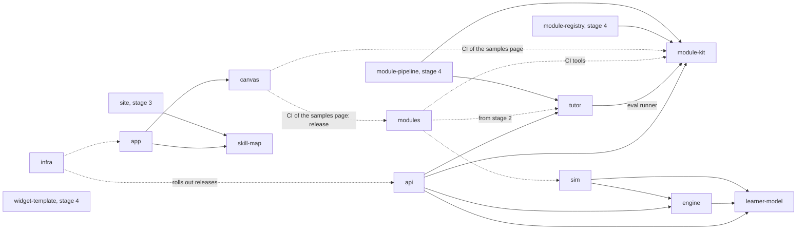

# NovaTrail — repositories

> Status: a draft for discussion.
>
> How the platform is cut into repositories, what depends on what, and in what order they appear. Which parts run while the platform works and how they connect is in [architecture.md](architecture.md). The technologies of each repository are described by its own documents (R11). The open questions Т-… are in section 8.
>
> The concepts are in [concepts.md](concepts.md), the decisions in [decisions.md](decisions.md).

## 1. Principles

- **`spec` is the only shared dependency.** It holds the vocabulary, the formats and the contracts. The other repositories take it at an exact tag version (R10): the documents and rules as the git submodule `spec/` at the tag, the code as release files of the same tag (R21, R64). Go code takes the tag as the version of the Go module `github.com/altnovatrail/spec` — with the parts, such as the format `spec.Format`, and their types, such as `types/formatv0` (R72) —, any other code as a signed release file of a part, `<part>-<version>.tar.gz` (section 5). TypeScript code takes the format's types as the npm package `@altnovatrail/spec` of the same version as the tag, without `v`, as a file of the same release (R73). The code of the API contracts is its own: in Go, the nested module `github.com/altnovatrail/spec/contracts` at the tag `contracts/vX.Y.Z` with the number of the `spec` tag, in TypeScript, the npm package `@altnovatrail/contracts` of the same version, as a file of the same release (R83). The package `@altnovatrail/spec` also carries the types of the element `<novatrail-canvas>`, `@altnovatrail/spec/canvas` (R74). The module versions in `go.mod`, the npm packages and the submodule are moved together, in one move to a tag, and are excluded from Dependabot (R64, R73).
- **No cycles** — neither in the build nor over the network.
- **Libraries do not depend on services, services do not depend on each other in the build.** Services talk to each other over the network, by the contracts from `spec`.
- **A service only where a separate process is needed.** In the first slice there is one service, `api`. `tutor` is a library in its process; it becomes a service when it gets a second consumer (R15).
- **Libraries are pure.**
  - `learner-model`, `engine` and `module-kit` are computations without input and output, like `domain/` in canvas-api. So they can be run on the simulator over thousands of virtual learners and, when needed, executed on the device.
  - The CLI of `module-kit` only reads and writes the files of a module.
  - `tutor` is a library with one kind of input and output: requests to AI providers.
- **Build, network and CI are different links.**
  - A build dependency is an import of code by version.
  - A network dependency is a call of an API by contract.
  - A CI tool is a program that CI takes at an exact tag.

  So the simulator `sim` can check `learner-model` and `engine`, though it imports them itself: the CI of a library takes `sim` at a tag and substitutes the pull request's code through `go.work`, and the other library by a commit from the gate file of `sim`. There is no cycle here (R103).
- **One pattern of a repository.** A new repository starts from the template of `spec` — the devcontainer, CLAUDE.md, AGENTS.md, RUN.md and the documents (section 2.2, R21). It has the shared CI checks from `.github` from day one, even before code (R30); the justfile, the language checks and the signed releases come with code, after the pattern of canvas-api. Differences from the pattern are recorded, as in R46 canvas-api.
- **The argument of R13 canvas-api.** There the client and the API lived in one repository, because «API и клиент меняются вместе, одним pull request». Here the versioned contracts in `spec` remove this argument: first the new contract, then the service, then the client. The price is several pull requests instead of one; we accept it for the narrow context of AI agents and independent releases (R10).

## 2. The list of repositories

### 2.1. The table

| Repository | What it is | Kind | Depends on in the build | Calls over the network | Stage | Create |
|---|---|---|---|---|---|---|
| spec | the vocabulary, formats, contracts, the platform's documents | specification | — | — | 0 | exists |
| .github | the organization's profile; the shared CONTRIBUTING, SECURITY and code of conduct; the shared CI workflows | meta | — | — | 0 | now |
| modules | the official modules: olympiad maths, school maths of grade 3, short essays in English | content | — (in CI: module-kit and sim; from stage 2, tutor) | — | 1 | now |
| module-kit | the module format in code: validation, package and index, templates with a seed, the open view, the check kinds; the author's CLI | library, CLI | — | — | 1 | now |
| learner-model | the learner model: an estimate of skill mastery from evidence | library | — | — | 1 | now |
| engine | the choice of the next lesson or task | library | learner-model | — | 1 | now |
| sim | the learner simulator: runs the learner model and the engine, holds the criterion | tool, CI | learner-model, engine | — | 1 | now |
| tutor | the tutor: reading the work, the words, the AI routes, the admitted models, eval | library | module-kit, for the eval runner (in CI: the release of canvas — synthetic samples, R38) | AI providers | 2 | now |
| api | the platform's service: accounts, attempts, checking, the learner model, the choice | service | tutor, module-kit, learner-model, engine | the sign-in service, the database; AI providers through tutor | 2 | now |
| canvas | canvases: kinds, layers, strokes, the crop for checking; the samples page | package | — (in the CI of the samples page: module-kit and the release of modules, R25; until the first content of modules, the release of tutor) | — | 2 | now |
| skill-map | the skill map | package | — | — | 2 | now |
| app | the web application of the learner and the adult | web application | canvas, skill-map | api, the sign-in service | 2 | now |
| infra | the shared infrastructure: OpenTofu, domains, logs, deployment, self-hosting | infrastructure | — | — | 2 | code: the epic of the first code of `infra` (R109, R11) |
| site | the landing page, legal texts, the module catalog, documentation for authors | static site | skill-map | — | 3 | later |
| module-registry | the service that publishes third-party modules | service | module-kit | the module store | 4 | later |
| module-pipeline | help for the author: markup, task variants, checks | CLI, jobs | module-kit, tutor | AI providers, module-registry | 4 | later |
| widget-template | the pattern of a module's widget and the environment for developing a widget | template | — | — | 4 | later |

- The dependency on `spec` is not listed: everything depends on it. All repositories take the shared CI checks from `.github`, `spec` too, even before code (R30).
- `sim` reads module packages — their server part, the canonical view — by the types from `spec`, without `module-kit` (R62).
- The names are R18; the former names are in R10.
- Where each part runs and what to decide when it is detailed is architecture 3.
- The official modules may split into a repository per module when the format becomes v1 (R18).

### 2.2. How to set up a repository

A new repository is assembled from the template `repo-template/` in `spec` (R21).

1. The name comes from the table; the repository is public (R18). The license is Apache-2.0, for code and for content (R12, R20).
2. `just new-repo <name> <kind> <card>` — for example, `just new-repo learner-model go 3.8` — assembles a working copy in `.repos/<name>` from the files of the latest release of `spec`, the highest tag of the form `vX.Y.Z`. The tag must already be on GitHub: the submodule is taken from there, and the recipe checks that it is the same commit there. A release with its tag comes out by itself, after CI is green on `main` (R31). The kind is `go`, `typescript` or `docs`, the card is the number of a section of architecture 3. In the copy:
   - `README.md` (en) — the title, the day-one status badges (section 2.3), and a description alone: what the component is and why, its place in the architecture — the components it is linked with and how —, its card in architecture 3 and a link to `docs/`; no other section, no command or code block, no status, version, date, number or language, and a link to `spec` that names no version of it (R21);
   - `docs/README.md` (en) — the index of `docs/`, the plan and the working rules, how to clone, and, as they come, how to build and run, how to release and how to contribute (R21);
   - `CLAUDE.md` (en) — the component's role and its place in the platform, its own documents, the environment and the line `@spec/RULES.md`. The shared rules are one file, `RULES.md` in `spec`, and the CLAUDE.md of every repository imports it: devcontainer only, exact versions, languages, no learners' data and no secrets, Apache-2.0, citations and work across repositories;
   - `AGENTS.md` and `LICENSE` — the same as in `spec`;
   - `docs/architecture.md` (en) — the purpose and the bounds from the card and a subsection for each of its items "To decide when detailed";
   - `docs/decisions.md` (en) — an empty log with its own numbering: "Next number — R01". Other repositories cite its entries as "R03 api";
   - `docs/sources.md` (en) — the records of external facts, empty: a provider's terms, a price, a law, a library's documentation — with the source, the date read and the quote, and a claim of `docs/architecture.md` or of the log cites the record — `sources 1.1` (RULES.md, The bar). `docs/architecture.md` has no section "Sources" of its own. The results of measurements go to `docs/measurements.md`, which the first measurement starts, not to `docs/architecture.md`; the pattern is [sources.md](sources.md) and [measurements.md](measurements.md) of `spec` (R143);
   - `RUN.md` (en, the bodies of tasks ru; R154) — the work plan after the pattern of the RUN.md of `spec` (R19). The first epic is «Детализация»: a task for each item "To decide when detailed", the items that cannot be decided apart as one task, and the last task «Итог детализации». Its rule 4 lets the executor run a task's checks without the author, by R146: the path in the browser with Playwright in the devcontainer, the calls of AI on the stub of `tutor`, and a real call only where the task checks the model's words, under the provider's spending limit and the cap the task names, with «Сделано» naming what was spent. A move to a tag does not rewrite RUN.md: a repository whose RUN.md lacks the rule takes it in by hand;
   - `run/` (en, the bodies of tasks ru; R154) — the plan's other tables, each a file opening with its rules (R153): `run/EPICS.md`, table 2, the epics for later; `run/QUESTIONS.md`, table 3, the questions to the author, empty: «next — В1»; `run/DEBT.md`, table 4, the technical debt, empty: «next — Д1»; `run/TASKS.md`, the tasks outside an epic, empty (R155). The RUN.md holds its rules and epic E1, and a done task's body and gist sentence go to the archive. The checks read the tables there alone, under their English headings;
   - `docs-budgets.json` — what differs from the block `repository` of `spec`'s `tools/docs-check/budgets.json`, `{ "citations": true }` in the template, which turns on the check of the rule of citations (R171); the block holds `entry` 12 and the switch `"comments": true`, by which `docs-check-repo` checks the numbers of decisions in comments of code (R32), and no `citations`, which each repository turns on by its own task; without the file `docs-check-repo` does not measure (R145). Its RUN.md measures the sessions' tokens at the archive of each epic (measurements 1.9);
   - `.claude/settings.json` — the Claude Code project settings: the session hook `spec/tools/session/`, compaction at 400 thousand, the claude.ai connectors off, and `claudeMdExcludes` loads neither the CLAUDE.md nor the part rules of the `spec` submodule (R143). A kind may add its own keys to them, with the key `claude` in `repo-template/kinds.json`; no kind adds any now;
   - `.devcontainer/` — the same as that of `spec`, with its own names of the container and the network, and its name in that network, `--network-alias=<repository>`, by which a container that joins the network reaches it (architecture 3.11), and with what the repository's kind adds (`repo-template/kinds.json`): VS Code extensions and settings, lines at the end of the `toolchain` stage and, from the kind's folder, lines of the `devcontainer` stage with the files the image copies. The kind `go` adds the Go extension with settings that keep it from installing its own tools, and gopls from the lock file `repo-template/kinds/go/gopls/`, built in the `devcontainer` stage at the version `GOPLS_VERSION` (R102), and Claude Code's plugin `gopls-lsp` by the key `claudePlugins`: `containerEnv` names `${containerWorkspaceFolder}/spec/claude-plugins/gopls-lsp` in `CLAUDE_CODE_PLUGIN_DIRS`, so every session in the container loads it from the submodule, without installation and whether the folder is trusted or not, and gets gopls diagnostics after each edit of Go code. A marketplace is not used: Claude Code records it in `~/.claude`, which the containers share, by the path of one of them (R143; sources 2.10). In a cloud session the language server does not start (sources 2.7); a move to a tag takes `.devcontainer/` from what the recipe builds and brings the repository's differences in again, so gopls comes with it. `.devcontainer/gopls/` is a Go module that no code reads, and the repository's Go checks do not list it. The kind `typescript` adds the Biome extension, Biome as the default TypeScript formatter and browsers for tests, one for each engine CI checks — Chrome Headless Shell, WebKit and Firefox from the Playwright image by tag and digest, and their system libraries and Playwright's fonts from the Ubuntu snapshot (R79; the builds' licenses, R12); `NOVATRAIL_DEVCONTAINER=1`. The decisions its Dockerfile cites are decisions of `spec`, and in the copy they carry the suffix: `(R34 spec)`. spec's orchestrator — its configuration `.devcontainer/orchestrator/` and the stage `orchestrator`, the last of its Dockerfile — stays out of the copy (R156). The sign-in volumes of Claude Code, Codex and gh are shared by all NovaTrail containers. Go is already in the `toolchain` stage: `spec` checks its Go module with it (R64), and a component builds and checks its Go code with it. It comes with the Dockerfile into a copy of any kind, and in a copy without Go code it is not used: the comments of the Dockerfile are written to read right both in `spec` and in a copy. buf comes the same way: in `spec` it checks the contracts, and in a copy without contracts it is not used (R83). Other code tools are added at exact versions when code begins;
   - `spec/` — the git submodule at the same tag; if a clone came without it, the container fetches it at start. Everything is added to the index, there is no commit.
3. The executor fills the `FILL` marks from the component card. `just new-repo-check <name>` checks that nothing of the template is left and that the copy's documents pass the repository's documents check (R32). In the repository itself it is run by `just -f spec/justfile docs-check-repo`.
4. `gh repo create altnovatrail/<name> --public` — after the author confirms. Right after it, `gh repo edit altnovatrail/<name> --delete-branch-on-merge`: a pull request's branch is deleted after the merge. All repositories of the organization are set so, but a new repository does not get this setting by itself. The first commit and push are the author's. The new repository's numeric ID — `gh api repos/altnovatrail/<name> --jq .id` — the same task of `spec` adds to `tools/release/repositories.mjs`: without it `release-verify` accepts no files of its releases, since the signature is checked against the ID, not only the address (R77).
5. CI — the shared checks from `.github` and Dependabot, even before code (R30); the language checks come with the repository's first code. What code adds to the calling files — the language job, the CodeQL input, the Dependabot ecosystem, the release — is written by the repository's own session by architecture 3.3 .github, and the author puts the checks into the ruleset (R30).
6. A question that concerns several repositories is written into the register of `spec`: О-, П- or Т-. A session in another repository does not edit `spec`, but passes such a question to the author through table 3 of its plan — `run/QUESTIONS.md` (R153) — with the mark «в реестр spec» (RULES.md, the section "Across repositories").

### 2.3. README badges

The README of every repository starts with status badges, as MathTrail's does (R48):
- the first line: CI, Release, CodeQL, the release number, the language, coverage, OpenSSF Best Practices, OpenSSF Scorecard and the license;
- the second, after a blank line: the five SonarCloud measures, code smells, reliability, security, maintainability and vulnerabilities.

A badge stands only when what it speaks of exists: no "no releases", "not found" or "unknown".
- **From day one**: CI, CodeQL, Scorecard, the license and the SonarCloud measures. The template carries them, `repo-template/files/README.md`, with the repository's name. They answer once the repository is set up to the end: with the shared checks (section 2.2, item 5), the SonarCloud project (R30) and the first Scorecard run.
- **With the first release**: Release and the release number.
- **With the first code**: the language — for Go, the version from `go.mod`, for TypeScript, the version of `typescript` from the devDependencies of `package.json`. `spec` has no language badge: its code is the check tools in `tools/` and the Go module, a wrapper over the format's files and their types (R64, R72), not the platform's code.
- **With the first upload of coverage to Codecov**: coverage.
- **With the passing level**: OpenSSF Best Practices, by the project ID on bestpractices.dev. The answers to the criteria lie in the file `.bestpractices.json` at the repository's root, in English: the site proposes them in its form, and the author saves them. The site takes no changed answer from the file by itself. A link to the form with the changed fields and `overrides` for them brings it: the repository's session builds it from the file, and the author saves them (R48).

A badge that comes later is put by the repository's session in its place in the line, together with what it speaks of. Here are all the badges, with `<name>` in place of the repository's name and `<ID>` in place of the number of its Best Practices project:

```markdown
[](https://github.com/altnovatrail/<name>/actions/workflows/ci.yml)
[](https://github.com/altnovatrail/<name>/actions/workflows/release.yml)
[](https://github.com/altnovatrail/<name>/actions/workflows/codeql.yml)
[](https://github.com/altnovatrail/<name>/releases/latest)
[](go.mod)
[](package.json)
[](https://codecov.io/gh/altnovatrail/<name>)
[](https://www.bestpractices.dev/projects/<ID>)
[](https://scorecard.dev/viewer/?uri=github.com/altnovatrail/<name>)
[](LICENSE)

[](https://sonarcloud.io/summary/new_code?id=altnovatrail_<name>)
[](https://sonarcloud.io/summary/new_code?id=altnovatrail_<name>)
[](https://sonarcloud.io/summary/new_code?id=altnovatrail_<name>)
[](https://sonarcloud.io/summary/new_code?id=altnovatrail_<name>)
[](https://sonarcloud.io/summary/new_code?id=altnovatrail_<name>)
```

- The workflows of `.github` are `self-ci.yml`, `self-codeql.yml` and `self-release.yml`, and its SonarCloud project is `altnovatrail_.github`. What the organization's profile, `profile/README.md`, shows is decided by `.github`.
- The reader's browser takes a badge's picture not from the service but from GitHub's proxy, Camo (R48).

## 3. The dependency diagram

Everything depends on `spec`, so those arrows are not drawn. An arrow means "depends on". A solid one is an import in the build, a dashed one a CI tool at an exact tag or a deployment.



- The links of `canvas` and `tutor` are not drawn either, for the same reason as the gate of `sim` below: they take each other's releases as CI tools. The CI of `tutor` takes the synthetic samples of `canvas` (R38), the CI of `canvas` the open views of the measurement tasks of `tutor`, while `modules` has no content (R25). There is no cycle in the build: each side takes an already released release of the other at an exact tag, and the release of `tutor` comes out first (R38).
- The gate of `sim` for `learner-model` and `engine` is not drawn, though it too is a CI tool. Together with the import `sim → engine`, such an arrow would read as a cycle, and there is no cycle (section 1, Т-16).
- All repositories take the shared CI checks from `.github` (R30); those arrows are not drawn either.
- The CI of `spec` checks the module examples with an ordinary JSON Schema validator, not with `module-kit`: otherwise `spec` would depend on what depends on it. It checks a vector of a part's rule with the schema and the YAML rules, and the rule itself is checked by the CI of `module-kit` (R45). The YAML rules and the rules of the whole module — the layout, the IDs in file names and the signatures of the media files — `format-check` checks itself and builds the open view itself, and so it checks the verdicts of the verdict vectors, except those whose predicate Starlark gives, the traps that name incorrect values in them, what the leak check finds in the texts of the leak vectors, the rule `lesson.no-leaks` on lessons, and the tiers and the module package, its canonical view and digests: this is a second implementation beside `module-kit`, and the vectors compare the two (R46, R51, R56, R57, R58, R62).
- In the diagram from the dialogue with Gemini, the registry and the pipeline depended on each other. Here there is no cycle: the pipeline publishes through the registry's API, and the registry does not know of the pipeline.
- `widget-template` depends on nothing but `spec`: the widget protocol is set in `spec`, and the application's side in `canvas`.

## 4. Flows between repositories

The flows while the platform works are in architecture 4. Here is how changes pass between repositories.

**From the author to the learner:**
1. A module lies in `modules`: YAML, media, an eval set.
2. CI checks it:
   - `module-kit` — the schema, a graph without cycles, the references, the media files, the keys, the leaks in the author's texts that the learner sees before solving, — and in the texts of a lesson that names the task (R57; R58);
   - `sim` — if what the simulator reads from the package changed — on the pull request's package, with invariants and absolute thresholds, without bands; from the first tag of `sim`: before it there is no gate (R103). A pull request that changes the tag of `sim` runs all the graphs;
   - from stage 2, the eval runner of `tutor` on the module's eval set.
3. On release, `module-kit` builds the package — the canonical view for the server, the device part and the inventory with their digests, without the eval set (R62), — and the module index: from the index of the previous release, with an entry for each published version and the marks of withdrawal (R63). The shared release workflow from `.github` signs them (R17).
4. `api` takes the packages by the index of a release of `modules` that its configuration pins — the release's tag and the index's digest, and the index names the packages' digests (R63; R07 api); an attempt stores the digest of its package, the digest of its inventory (R62).
5. `app` gets from `api` the open view of a task — without the key, the solution and the traps, without the skills, the band and the difficulty, without the techniques, the simpler case and the leak phrases (R57). The key stays on the server, the solution comes after a correct answer (R05), and the skills, the band and the difficulty only the server reads (R51). The open view of a lesson comes without its skills and age categories (R58). The open views of the manifest, the skill graph, the technique catalog and the solving steps `app` gets by the package digest — of an attempt, a lesson run or the current version of a connected module — and caches by it, and the media files from the device part of the package, which `api` serves (R62, R99).

The keys of open modules are public, as are the modules themselves. R05 guards no secret, it only keeps the key out of the learner's application.

**The CI of the algorithms:**
- every change of `learner-model` or `engine` is run on the simulator `sim`, on virtual learners of different populations (concepts 15). The CI of a library takes `sim` at an exact tag and the SHA of its commit, in a job of its own, and writes `go.work` on the fly, without committing it: `sim`, the pull request's code and the other library by a commit from the gate file of `sim`. The gate runs on every pull request and every commit of `main` and holds the merge (R103);
- the first version of each library comes before the gate: its own tests check it, and `sim` sets up the simulator on it and writes the criterion before the first candidate, the first change after it (R103);
- the criterion is written before the first run of a candidate (R163 standalone);
- a change that worsens the criterion is not merged;
- the order of releases (R103): a change that breaks the simulator's API or moves the numbers is first written into `sim` at the commit of its pull request, a tag of `sim` comes out, the library's pull request raises the tag and is merged, and after the library's release `sim` raises `go.mod`. The pair "the threshold 'mastered' and the corridor's target" and a change of `learner-model` that breaks the API of `engine` go in one tag of `sim`: the gate file names both commits, `learner-model` is merged when the pull request of `engine` has passed review, and `api` moves to both versions together. The release of `sim` comes out by itself after CI is green on `main`, and the callers' tag is raised by their session.

**A change of AI model:**
- a new model for an AI capability is admitted when it passes the capability eval set and the eval sets of all published modules with this capability;
- the order (R04 modules): `tutor` releases a tag where the model is in the list of admitted ones once it has passed the capability eval set in the CI of `tutor`; a pull request of `modules` moves to this tag, and the eval runner runs the eval sets of all modules — they lie in the git of `modules`, outside the package and the release files (R62); `api` moves to such a tag of `tutor` only after this pull request is merged. If it is red, `tutor` releases the next tag without the model, and `api` stays on the former one: rollback is only forward (Т-19). That `api` waits for `modules` is held by the review of the pull request of `api`;
- false alarms are counted by verdict: the model's observation passes through `module-kit`, as in the platform's work (R04). An assessment by rubric has no verdict, and it is measured by the false alarms on met criteria and by agreement with people (R71). What the runner gives — a report without the content of the works, by which the measures are counted — and what lies in a module's eval set is written by the eval protocol, and only a report with the verdicts of `module-kit` is fit for admission ([the contracts text](../contracts/README.md), sections 13 and 14; R95).

**A new module format version** (R44). Each takes build dependencies and CI tools at an exact version, so a step does not break those who have not moved yet. But `api` and `app` talk over the network and, while the format is v0, come out together:
1. `spec` — the new format version and, in the same pull request, a new line; otherwise `release-version` will not let it pass. The first release of the line releases the format version as a release file and a version of the Go module (R64).
2. What reads modules in the CI of `modules` moves to the new tag — the submodule and the Go module of `spec` together: `module-kit` and, from stage 2, the eval runner of `tutor`. If the open view changed, `canvas` releases a package with the new types (R36).
3. `modules` — in one pull request: the new tags of `module-kit` and `tutor` in CI, the manifests and the content of all modules. `sim` is not run in it: at its former tag it will not read a package of the new version. The move changes nothing of what the simulator reads from the package — neither the graph nor the tasks' bindings — except the very writing in the new format version: the review of `modules` holds this (R03 modules; R103), and that is changed in a separate pull request after step 4.
4. `sim` moves to the new tag and to the packages from the new release of `modules`, and `modules` takes the new tag of `sim` in CI. `learner-model` and `engine` take the new `sim` in a move of their own: they hold their gate at the former tag.
5. `api` takes the new `module-kit` and the new packages, and if the open view changed, `app` comes out with it, with the new `canvas` — in one list of exact versions (Т-19). The CI of `canvas` takes the new release of `modules` and the new tag of `module-kit`.

While the format is v0, only the current version is read, and the modules all move at once; the same on v1, since v0 leaves the window when v1 comes out. From v2 the window — the current major version and the previous one — lets the modules move one by one, and `api` and `app` apart.

**A new version of the admission table** (R96) is shorter: one admission function of `tutor` reads the table, and `api` calls it in its process.
1. `spec` — the new version of the table and, in the same pull request, a new line, and its provider's row in privacy 5.3 checked anew. The first release of the line releases the table as a release file and a version of the Go module (R64).
2. `tutor` moves to the new tag — the submodule and the Go module of `spec` together — and makes a release: its function reads the table from `spec.Admission`, and the tests run its vectors.
3. `api` takes the new release of `tutor` and is rolled out. If the new version added a deployment fact, the operator declares it in the facts file of `api` — only when the fact holds. Until step 3 has passed, the former table works: the operator can close platform AI urgently by themselves, by removing the fact.

**A new version of the deployment configuration** (R85): `app` and the rollout of `infra` move to it together: `app` rejects an unknown field, and the rollout a build of another version.
1. `spec` — the new version of the part `deployment/` and, in the same pull request, a new line. The first release of the line releases the part as a release file and a version of the Go module (R64).
2. `app` moves to the new tag and releases a build: it carries a copy of the new schema, and the tests run the reading vectors.
3. `infra` moves to the same tag, writes the file of the new version and rolls out the new build together with it, in one rollout list (R106). Until step 3 has passed, the former build is rolled out with the former file.

**A new version of a legal text** (R130) is not a new version of the part: the next tag of `spec` carries it. `api` moves to it and is rolled out — then `app` gets the new text —, the build of the samples page of `canvas` puts in the new set from the release file, and the organizer takes the new form. A new version of the part `legal/` itself goes as the deployment configuration's does: a new line, and the readers move to it in tasks of their own.

**A new entry of the table of the age of digital consent** (R134) is not a new version of the part: the next tag of `spec` carries it, and `api`, moving to it, computes the category by the new entry. The age and the day of an entry that has come out do not change: a country's new age is a new entry. A new version of the part `consent-age/` itself — a new ISO 3166-1 code or a new rule — goes as the legal texts' does: a new line, and the readers move to it in tasks of their own.

## 5. What lies in `spec`

- `docs/` — the platform's descriptive documents, in English (R14, R143): product, concepts, privacy, architecture, repositories, decisions, sources, measurements and the DPIA; the epic archives `docs/plan/` stay in Russian.
- `draft/` — the prototype of the learner's application.
- `tools/` and `justfile` — the documents check `just docs-check`: links, sections, registers, diagrams and the rules of `.claude/rules/` (measurements 1.8). It is a tool of `spec` itself, not the platform's code; there too is the module format check `just format-check` — the schemas, examples and test vectors of `format/`. There too are the check of the licenses of its packages `just licenses-check` (R12), the number of the next release `just release-version` — `tools/release/` (R31) — and the documents check of a component's repository `just -f spec/justfile docs-check-repo` (R32). The rows «в реестр spec» of the other repositories the session of `spec` finds with the recipe `just inbox`: it reads on GitHub table 3 of each, its `run/QUESTIONS.md`, and compares them with table 5 of `spec`, `run/INBOX.md` (R81). Another repository's release calls the same recipes: `release-version <commit> <workflow>` — with its line from the named workflow — and `release-refusal`, the rule of refusal of the Releases API (R31). On the runner they are run by the script `tools/toolchain/toolchain.sh` from the submodule `spec/`: it builds the `toolchain` stage and runs the commands in it, as the CI and the release of `spec` itself do (R31). The license check of another repository also goes by recipes of `spec`: `licenses-allowed` prints the list of category A, and `licenses-check-repo` checks the npm lock file with the repository's exceptions (R39).
- the folder `.github/` — the CI of `spec` itself, Dependabot (R30) and the release `release.yml`: after CI is green on `main` it releases the next patch of the line, the tag together with the release (R31). The release carries files, each with the cosign bundle `<file>.sigstore.json`, under the attestation of an immutable release: a file of each part with a version of its own, `<part>-<version>.tar.gz` — `format/`, `admission/`, `deployment/`, `legal/`, `consent-age/` and `export/` —, the npm package of the TypeScript types of the parts and of the element `canvas`, `altnovatrail-spec-<version>.tgz`, and the npm package of the contracts code, `altnovatrail-contracts-<version>.tgz`; the recipe `just release-files` builds them, by `tools/release/files.mjs` (R64, R73, R74, R83, R85, R96, R130, R134, R135). The release publishes the files of both packages to npm itself, through trusted publishing and without a token (R37), and sets the tag `contracts/<tag>` of the contracts' Go module (R31). Beside them are the shared checks of all repositories from `.github`: secrets, DCO, CodeQL and Scorecard (R03 .github), and the shared Go wrapper `go.yml` over the recipes `ci-lint`, `ci-test`, `ci-vuln` and `ci-licenses` (R30).
- `format/` — the module format, normative and in English (R42): the format text `format/README.md` with the conventions of R45 and the version number `format/VERSION` (R44). The schemas of the parts are JSON Schema 2020-12 in `format/schemas/` (R45), with their examples in `format/examples/` and the test vectors in `format/vectors/`, laid out by [the format text](../format/README.md), section 3. The parts are the module and the manifest (R46), the skill graph (R49), the shared taxonomy (R50), the task and its open view (R51), the checks (R56), the trap and technique catalogs, the solving steps, the hints and the leak check (R57), the lesson (R58), the randomness, one for the whole platform (R27, R59), the templates (R60), the package (R62) and the module index (R63). All this is checked by `just format-check` (R45), and that a vector of a part's rule violates the rule itself, by the CI of `module-kit` (section 3).
- `admission/` — the table of admission to AI, normative and in English (R42; R96): the text `admission/README.md`, the version number `admission/VERSION`, the table itself `admission/admission-table.json` — the rule of each AI capability for each age category and the cell of each provider, AI route and category, in a cell the row of privacy 5.3 and the date read, — its schemas in `admission/schemas/`, examples and test vectors: the vectors of the table's rules and the vectors of the answers of the admission function of `tutor`. All this is checked by `just admission-check` (`tools/admission/`): it computes the answer of each vector by a second implementation and compares the rows of privacy 5.3 and the table's links with the documents of `spec`.
- `deployment/` — the format of the deployment configuration of `app`, the file `/deployment.json`, normative and in English (R42; R85): the text `deployment/README.md`, the version number `deployment/VERSION` — an integer, — the file's schema `deployment/schemas/deployment.schema.json` at a permanent path, examples and reading vectors. All this is checked by `just deployment-check` (`tools/deployment/`): it reads each vector file by a second implementation of the reading rules, `tools/deployment/reading.mjs`, and compares the outcome.
- `legal/` — the platform's legal texts, a normative part in English (R42; R130): the text `legal/README.md`, the part's version number `legal/VERSION` — an integer, — the passport `legal/legal.yaml` with the versions, statuses, dates and gist in the languages of the screen, the text versions `legal/texts/<id>/<n>.md`, schemas, examples and reading vectors. All this is checked by `just legal-check` (`tools/legal/`), and the texts folder of a self-hosting copy by `just -f spec/justfile legal-check-dir <folder>`.
- `consent-age/` — the table of the age of digital consent, a normative part in English (R42; R134): the text `consent-age/README.md`, the part's version number `consent-age/VERSION` — an integer, — the table `consent-age/consent-age.yaml`, by country the age with the day from which it applies, the law, the provision, the quote, the primary source and the date read, — schemas, examples, reading and category vectors. All this is checked by `just consent-age-check` (`tools/consent-age/`).
- `export/` — the format of the export, a normative part in English (R42; R135): the text `export/README.md`, the part's version number `export/VERSION` — an integer, — the schemas of the export's files — the manifest, the account, the profile, the device, the stored work and the page from paper, — examples and reading vectors. All this is checked by `just export-check` (`tools/export/`).
- `go.mod` and `spec.go` at the root — the Go module `github.com/altnovatrail/spec`, which Go code takes at a release tag: the package `spec` embeds `format/` as `spec.Format`, `admission/` as `spec.Admission` (R96), `deployment/` as `spec.Deployment` (R85), `legal/` as `spec.Legal` (R130), `consent-age/` as `spec.ConsentAge` (R134) and `export/` as `spec.Export` (R135). Each part is an `embed.FS` of its own, and a binary carries only the parts it reads (R64). The module has no dependencies. Its zip, as the Go proxy will build it, is checked by the nested module `tools/gomod`, and that the module requires nothing, and its zip, by the recipe `just go-check` (R64). Vet, the tests with coverage, the vulnerabilities and the licenses of this module and of the modules of `tools/` are the recipes `ci-lint`, `ci-test`, `ci-vuln` and `ci-licenses`, which the shared `go.yml` calls (R30).
- `types/` — the types of the module format in the same Go module: the packages `types/formatv0` — the parts, the shared definitions, the canonical view, the inventory, the list of the device part, the index and the vectors — and `types/formatv0/open` — the open view of each part (R72), and beside them `types/admissionv0` — the types of the admission table and its vectors (R96), `types/deploymentv1` — the types of the deployment configuration and its vectors (R85), `types/legalv3` — the types of the passport of the legal texts and its vectors, of version 3 of the part (R130, R141), `types/consentagev1` — the types of the table of the age of digital consent and its vectors (R134) and `types/exportv4` — the types of the export's files and its vectors, of version 4 of the part (R135, R151, R162). Beside the Go of each package are its TypeScript types, `index.d.ts`, which the npm package `@altnovatrail/spec` carries (R73). They are written by the generator `tools/types` from the schemas of `format/`, `admission/`, `deployment/`, `legal/`, `consent-age/` and `export/`, with the recipe `just types`, and `just types-check` compares them with it and reads with them each value of these parts that passes the schema: with the Go types and the TypeScript compiler. Beside them is `types/canvas/index.d.ts`, the types of the element `<novatrail-canvas>`: `spec` writes them by hand, the generator does not touch them, and `just types-check` checks them with the TypeScript compiler by `tools/types/canvas.check.ts` (R74).
- `contracts/` — the API contracts, normative and in English (R42): the text `contracts/README.md` with the rules of R83 — the layout, the buf rules, the fields and names in JSON, the versions, the generated code and the Connect transport, — and the observation: what a reader gives, how `module-kit` joins two readings and what verdict an observation gives (R86). The `.proto` files are three packages. The first is the observation, `contracts/novatrail/observation/v1/observation.proto`, the package `novatrail.observation.v1`. Beside them are `buf.yaml` and `buf.gen.yaml` at the root and the Go module `contracts/go.mod`: the code buf generates lies beside the files, and its Go generators are tools of this module. Beside them are the test vectors of the observation, `contracts/vectors/observation/v1/`, JSON by [the contracts text](../contracts/README.md), section 10; the Go module carries them as `contracts.Vectors` of the package `contracts`, `contracts/vectors.go` (R86). The second package is the eval protocol, `novatrail.eval.v1`: the sample file with markup, `contracts/novatrail/eval/v1/sample.proto`, by [the contracts text](../contracts/README.md), section 11 (R93; R95), and the runner's report, `report.proto`, by [the contracts text](../contracts/README.md), section 14, and what lies in an eval set is [the contracts text](../contracts/README.md), section 13 (R95). Their synthetic examples are `contracts/examples/eval/v1/`, and an example of a report is named `report-<case>.json`. The rules that are one for the device and the runner — the folding of the writing history, the stroke groups, the crop, the snapping and the boxes of the workbook — are [the contracts text](../contracts/README.md), section 12, and their test vectors are `contracts/vectors/eval/v1/`, as messages of the package; the Go module carries them in `contracts.Vectors`, and the npm package `@altnovatrail/contracts` at the path `vectors/eval/v1/` (R94). The third package is the contract between `app` and `api`, `novatrail.api.v1`, in `contracts/novatrail/api/v1/`, by [the contracts text](../contracts/README.md), section 15 (R97), and in it the list of the engine's reason codes, `ReasonCode` (R29; R100). The check — the buf rules, the rules of R83 that buf does not hold, compatibility with the previous release by its tag, the comparison of the code, the vectors, which it computes by a second implementation, and the examples of the sample file and of the report by the rules that [the contracts text](../contracts/README.md), sections 11, 12 and 14, give — is done by the recipe `just contracts-check` (`tools/contracts/`), and the code is written by `just contracts`. The zip of the module `contracts` is checked by `just go-check`, and `release-version` does not let a new major package pass without a new line.
- `RULES.md` — the shared rules of all NovaTrail repositories; the CLAUDE.md of each of them imports it (R21).
- `.claude/` — the Claude Code settings of `spec` (measurements 1.7) and the part rules `.claude/rules/<part>.md`: the checks of each part, with its files in `paths`. CLAUDE.md names each rule, and `docs-check` compares them (measurements 1.8; R143).
- `repo-template/` — the template of a new repository, and `tools/new-repo/` — the recipes `just new-repo` and `just new-repo-check`, which assemble it and check it (section 2.2).
- The normative parts come out with the tags of `spec`, and a part with its own version also as a file of its release, `<part>-<version>.tar.gz`, and in the Go module (R64). Still to come are the widget protocol (R16) and the guides for authors.

  The normative texts for authors — the module format, the widget protocol and the guides — are in English and outside `docs/` (R42). The module format has its own version, MAJOR.MINOR, not the tag of `spec`: a new format version opens a new line of `spec` (R44), and so does a new version of each other part with a version of its own (section 4).
- Examples — fragments of modules for the tests of the schemas, in `format/examples/`: a valid one passes its schema, and an invalid one names in its first line the error it must give (R45). An example of a whole module is a folder laid out as a module (R46). The CI of `spec` checks them with an ordinary JSON Schema validator, `ajv`, with the recipe `just format-check` (section 3).

What is not in `spec`: the code of the platform's services and libraries, the content of modules, learners' data. The Go package `spec` is not a library of the platform: it only embeds the format's files so that code takes them at a tag (R64), the packages of `types/` carry only types and constants, without code (R72), and the npm package `@altnovatrail/spec` is declarations only (R73). The code that buf generates from the API contracts is not a library of the platform either: the messages and stubs of the Connect services, without logic, in the nested Go module `contracts` and in the npm package `@altnovatrail/contracts` (R83).

## 6. The order of appearance

1. **spec** — the vocabulary, decisions, privacy, architecture; then the module format v0, the package, the observation and the eval protocol.
2. **.github** — the shared checks, before the first repository with code. The shared workflows for code come with the code they are checked on (R03 .github): the Go wrapper and the release with the first code of `module-kit`, the TypeScript wrapper with the first TypeScript code, that of `canvas`.
3. **modules and module-kit:**
   - the port of the reference tasks of standalone with their traps and of the templates with solvers (section 7): 19 of the templates are carried over, and the others are named with a reason (R05 and R22 modules); six, whose solver reads a picture, wait for the pictures of instances of format 0.4 (R108). First the first batch of olympiad maths: 20–30 tasks on three bands, without templates and solvers, in lessons; the manifest also names `adult` in the audience. The rest of the port after it (R05 modules);
   - small sets of school maths of grade 3 and of short essays in English (R41);
   - the CLI of `module-kit` checks the modules and builds the packages and the index, and the shared release workflow signs them (R17).

   So the format v0 is checked at once on two subjects (R08).
4. **learner-model, engine and sim** — together: the simulator needs both the model and the choice rule. The simulator and the criterion appear before the first candidate. The starting model is the model of standalone with a level per module (concepts 11).
5. **tutor and canvas** — the first code of stage 2. For `tutor` it is the review board: the author solves the board's tasks, the Claude models they choose read and assess their work, and the author marks whether each is right (R43). Which tasks these are and how many, architecture 3.3 tutor says. After the board come the measurements of AI reading: of the course of writing, on Claude models only (R52), and by canvas kind and answer kind, whose results are R67–R69, R71 and R51 — Т-23, Т-33, О-8 and О-22 closed and the default digit height; the thresholds and targets are repeated on the samples of adult volunteers (П-16).
   - First learn whether AI reads the work well, then build the rest (R60 canvas-api).
   - The samples of adult volunteers, including those imitating a child's handwriting, are made on the samples page of `canvas` (П-16; R25).
   - Children's samples only with a separate consent (П-10).
   - The measurements of `tutor` do not wait for items 3 and 4 (R01 tutor).
   - The code of `canvas` also goes earlier than items 3 and 4, beside the detailing (R02 canvas). First goes the handwriting sheet, the element `<novatrail-canvas>` (R17 canvas); the samples page, the synthetic samples and the build that opens from a file wait until the measurement needs the samples of volunteers or children (R43). While `modules` and `module-kit` have no code, the page's build takes the measurement tasks from the release of `tutor` (R25).
6. **api, app, skill-map and infra** — the first slice with a learner. Before the first child: parental consent and the agreements with AI providers (П-1, П-3). The data region before the first deployment (П-11).
   - The goal of the order is «Первый срез со взрослыми» of `COORDINATION.md` (R76).
7. **site** — by the beta, stage 3. **module-registry, module-pipeline and widget-template** — with the third module and third-party authors, after the format v1 (stage 4; R08; product 11).

A repository can be set up before its code begins: the detailing begins with the documents (section 2.2).

By this order, the cross-repository plan [COORDINATION.md](../COORDINATION.md) leads the work of the other repositories: which task of which repository waits for which, with links to their RUN.md (R76).

## 7. What we carry over from MathTrail

| What | From where | To where |
|---|---|---|
| The principles of checking and hints: a program gives the verdict, four verdicts, the hint ladder, the leak check, fallback texts | canvas-api: R37, R38, R39, R24; spec 5–7 canvas-api | concepts; api, tutor, module-kit; format v0 — a trap by value, the module's rung templates, the leak check in the format text (R57) |
| The learner model: the Rasch model with a guessing floor, the Elo update, the trial series, a cautious "mastered" | standalone: SPEC 2, R187 | learner-model |
| The learner simulator and the criterion written in advance | standalone: `tools/learners`, `docs/learners.md`, R163 | sim |
| The derivation of the simulator's seeds: FNV-1a 64 of "main seed, experiment, unit, assignment" and PCG from Go's `math/rand/v2`, the function `seeded` | standalone: `tools/learners/child.go`, `docs/learners.md` | spec — the generator and the places of randomness of the whole platform, where `seeded` is a special case ([the format text](../format/README.md), section 22; R59); sim |
| The task choice rule and the success corridor (R23) | standalone: SPEC 3 | engine |
| 19 topics and the links `builds_on`, 20 traps, 11 techniques, 753 reference tasks and 39 templates with solvers | standalone at commit 42b4408, the first batch at 89986bc: `content/`, `site/` | modules — the module of olympiad maths, by the table of architecture 3.5 modules (R05 modules): a number answer by hand, and the tasks' solvers check the keys in the port and do not go into the module; the traps and techniques already as format examples, `traps.yaml` and `techniques.yaml` (R57) |
| The site's topic pages: the gist of a topic, the steps of a technique and examples worked through to the answer — a solver proves the answer of each | standalone: `site/content/en/topics/`, `site/solvers/`, SPEC 8.12.2, R172 | modules — the explanations and worked examples of the lessons of the olympiad maths module (R58) |
| The check of a task by a solver in Starlark | standalone: SPEC 6 | module-kit — the template's solver, which computes the key by search: the dialect and the step budget of the solvers of standalone are in the format, and the format example `number-thought-of-template` is the solver `content/solvers/arithmetic.tricks/number-thought-of.star` (concepts 9.3; R61). And the check kind "predicate": a Starlark expression of the integer `value` in the slot check itself, with a step limit in the format (R56) |
| The service skeleton: configuration, logs, errors, version | canvas-api: `internal/`, in its turn from standalone (R11 canvas-api) | api, the pattern of a repository |
| The devcontainer, justfile, CI, signed releases, infrastructure code in HCL with the tool OpenTofu (R11), self-hosting | canvas-api | all repositories; the shared part in .github and infra |
| The measurement of AI reading on samples, the author's log, eval | canvas-api: R60–R66 | tutor — the eval runner; canvas — the samples page |
| The handwriting sheet: coordinates, strokes, the error box on the learner's strokes | canvas-api: spec 4, R15, R43 | canvas — the canvas kind "handwriting sheet" |
| Children's privacy: minimum data, consent, deletion | canvas-api: `docs/privacy.md` | privacy |
| The site: prerendering, languages, pages without scripts | standalone: `site/`, `web/` | site — later |
| The MCP channel: the server, sign-in, the widget in the chat | standalone: `plugin/`, `internal/transport/mcp`, `web/src/widget` | the MCP channel — later (О-15) |
| The package for grants: the logic model, the data register | standalone: `docs/grants/` | later |

## 8. Open questions

Each open question: the gist, the options, a recommendation and what it blocks. The numbers do not change: a closed question keeps its row, its question in a clause and the decision that closed it, which holds what it decided, rejected and why; the row keeps only what a decision cites it for and has no other home, such as the quotes of its sources, with their source and date read. New questions get the next number — Т-42.

| No. | Question | Options | Recommendation | Blocks |
|---|---|---|---|---|
| Т-1 | Where the code of the check kinds lives — **closed: R17**: in `module-kit` | — | — | — |
| Т-2 | The official modules: one repository or a repository per module — **closed: R18** | — | — | — |
| Т-3 | The repository `.github` — **closed: R18** | — | — | — |
| Т-4 | The registry v0 — **closed: R17** | — | — | — |
| Т-5 | map-ui: a package or a micro-frontend — **closed: R16**: a package | — | — | — |
| Т-6 | The names canvas-api and canvas-shell — **closed: R18** | — | — | — |
| Т-7 | The formats of the contracts — **closed: R11 and R45**: protobuf and buf for the API, JSON Schema 2020-12 for the module format | — | — | — |
| Т-8 | How the code of others' widgets runs — **closed: R16** | — | — | — |
| Т-9 | Where to hold the user's key — **closed: R84**: on the device by its owner's choice, otherwise in the tab's memory; on the server only in the request's memory | — | — | — |
| Т-10 | Where the learner model and the engine are computed | only on the server; also on the device (WASM) | on the server. A computation on the device stays possible for offline: `learner-model` and `engine` give the same bits on any build of one version, WebAssembly too, with only Go's standard library and, for `engine`, `learner-model`, and check this in CI (R09 learner-model; R10 engine; architecture 3.8). How offline works — a computation on the device, or a queue that the server chose in advance while the device only writes evidence — stage 5 decides (R107) | stage 5 |
| Т-11 | The versions of `spec` — **closed: R44**: the module format has its own version, MAJOR.MINOR, which the module's manifest names | — | — | — |
| Т-12 | Where eval lives: the protocol, the runner, the samples — **closed: R15** | — | — | — |
| Т-13 | Voice | a realtime voice API; a chain of speech recognition and speech synthesis | decide at stage 3, by eval and price; the rules are the same for platform AI and an own key. The bound is decided (R56 tutor): the tutor's words reach the learner only as text that has passed the checks of `api`, so speech-to-speech is closed (R05, R54, R70). Open are the input path — a recognition API, streaming recognition or recognition on the device — and voicing by a provider. R54 allows a stream only to a reading call; recognition may be allowed by the same argument, as its answer too is read by a program — a conclusion of `tutor`. Recognition by the means of the browser or the system does not fit: its model is not from a release of `tutor` and has not passed admission (R66). From stage 3, `app` sends recorded sound to `api`, `api` gives it to `tutor` for recognition, and voicing by a provider is a call of `tutor` of its own, after the checks: the same text that passed the checks is voiced, and notations in words, if the synthesis needs them, are written by the code of `app`, not by the model. Whether the feedback rule R70, made on essays, suits feedback on pronunciation is decided at stage 3, with a voice eval set. Until then the tutor is voiced by the device's speech synthesis, by the rule of privacy 6 (R07 app; sources 5.4) | stage 3 |
| Т-14 | The shared taxonomy of skills — **closed: R50**: the dictionary of anchor skills `shared-taxonomy.schema.json`, in the format version | — | — | — |
| Т-15 | What is inside the module package — **closed: R62**: the server part, the canonical view, and the device part, named by the package inventory | — | — | — |
| Т-16 | How the simulator checks the changes of `learner-model` and `engine` — **closed: R103**: a `go.work` that the CI of a library writes on the fly | — | — | — |
| Т-17 | Where to store and how to serve module packages, media and widget bundles. The hosting of the build of `app` is decided: Firebase Hosting, the project's default site (R06 infra; architecture 3.11) | releases of `modules`; the image of `api`; storage with a CDN | stage 1 — releases of `modules`; stage 2 — packages in the image of `api` by the index of the pinned release of `modules`, media served by `api`: the configuration of `api`, `modules.json`, holds the release tag and the digest of the index, and the index names the packages' digests (R07 api; R63); storage with a CDN in `infra` — when there are more modules or third-party authors come. The widgets are on a separate registrable domain (R16), bought together with the main one after О-16, before the public launch. What the hosting of `app` does is R09 app and architecture 3.7 app: `/deployment.json` outside the build archive; `index.html` and `deployment.json` with `Cache-Control: no-cache`, `/assets/**` immutable; `app` at the root of its origin, and `api` on the same origin or on its own; the files of the previous release kept, and `index.html` not served on requests for them and for `/deployment.json`; its own response headers — the CSP by the build's `csp.json` with `frame-ancestors 'none'`, `X-Content-Type-Options: nosniff` and HSTS —, and no `Cross-Origin-Opener-Policy: same-origin`, which by the code of the Firebase SDK breaks the sign-in window (not verified, Д8 app). Self-hosting on a hosting without its own headers `infra` describes as weaker protection — only the lower layer of the CSP and the check of `window.top`. The samples page, when it moves (R25), is a separate site of the same Firebase project with its own origin: "Erase everything on this device" in `app` erases all the storage of its origin; what Hosting stores itself is П-9 | stage 2 |
| Т-18 | The random generator and reproducibility across versions — **closed: R59**: PCG and the derivation of seeds, in the [format text](../format/README.md), section 22 | — | — | — |
| Т-19 | Who rolls out the services and the build of `app` — **closed: R106**: `infra`, by one list of exact versions and digests. The rollback R106 cites here: a revert of the list would bring back the image of `api` with the old release of `modules` in its configuration, and a withdrawal is marked only by the index of the following releases (R63), so a version withdrawn since would become current again and go into new attempts; so `api` rolls back only forward — a pull request with the previous code and the current `modules.json`, a new release —, and the CI of `api` refuses a rollback of the configuration to an old release (R07 api). While the module format is v0, a build of `app` that moved to a new format version rolls back only forward too: the previous build does not read the open views of the new version (R44). Within a format version a rollback of the build is a revert: the previous `app` in its major contract package works with the new `api` (R83) | — | — | — |
| Т-20 | How admission to AI by age category works — **closed: R96**: the admission table in `spec`, `admission/` | — | — | — |
| Т-21 | How UI packages connect to the app — **closed: R36**: web components with data types from the releases of `spec` | — | — | — |
| Т-22 | What `api` stores about the learner model — **closed: R80**: an append-only evidence log, and the state is a cache | — | — | — |
| Т-23 | Reading and review: one AI call or two — **closed: R67**: two, a reading without the key and a review with the key. Sources: the key in the prompt makes a model score wrong answers as correct — on 61 exams, when the prompt gave a reference solution, "wrong answer scored as correct" grew for all five models, for GPT-5.2 from 5 to 80, for Grok-4.3 from 1 to 193 ([arXiv 2606.11477](https://arxiv.org/html/2606.11477v1), table 2, read 2026-10-22). | — | — | — |
| Т-24 | Whether to trust the state a widget reports | trust it; the server repeats the state by the seed and the learner's events | repeat it on the server: then the verdict is reproducible and does not depend on the code on the device (R03). A widget whose state cannot be repeated — decide separately, before its publication | the widget protocol, stage 4 |
| Т-25 | Whether a real-time channel is needed | no: the verdict and the tutor's words are two requests; yes: an event stream, like Centrifugo in canvas-api | the first slice has none (R19 api; architecture 3.5): a check of handwriting is two requests, the submission with the verdict and then the tutor's words, and an essay is one. Return to the question with voice (Т-13), and decide then too whether a channel is needed if voice input goes as a stream | api, app; stage 3 |
| Т-26 | Where to publish UI packages — **closed: R37**: npm, scope `@altnovatrail` | — | — | — |
| Т-27 | What the signature of a package or a build that the shared release workflow of `.github` puts checks — **closed: R77**: both the SAN and the caller's repository and workflow, by the recipe `release-verify`. Sources: a signature from a shared workflow names the workflow itself in the SAN — "GitHub Actions uses the `job_workflow_ref` as its SAN" ([Fulcio, OIDC usage](https://github.com/sigstore/fulcio/blob/a699382/docs/oidc.md)) —, and the caller's workflow in the Build Config URI — "A reference to the initiating build instructions" ([Fulcio, OID information](https://github.com/sigstore/fulcio/blob/a699382/docs/oid-info.md)); both read 2026-10-20. Immutable releases and a ruleset of the tags `v*` are on at `.github`, `spec` and `module-kit` (GitHub API, read 2026-11-01). | — | — | — |
| Т-28 | Where the key for eval lies and how eval runs on a Dependabot pull request — **closed: R120**: in the Secret Manager of `infra`, through Workload Identity Federation | — | — | — |
| Т-29 | What `infra` describes the infrastructure with — **closed: R11**: OpenTofu by exact version, as a named license exception. Sources: Terraform since version 1.6.0 comes out under the Business Source License 1.1 — "Licensed Work: Terraform Version 1.6.0 or later" —, which allows use in production as long as it is not offered to third parties "in order to compete with IBM Corp.'s paid version(s) of the Licensed Work" ([hashicorp/terraform, `LICENSE`](https://github.com/hashicorp/terraform/blob/79307e8/LICENSE)); [v1.5.7](https://github.com/hashicorp/terraform/blob/v1.5.7/LICENSE) has the Mozilla Public License 2.0; OpenTofu is under the Mozilla Public License 2.0 ([opentofu/opentofu, `LICENSE`](https://github.com/opentofu/opentofu/blob/545c995/LICENSE)); the [OSI list](https://opensource.org/licenses) has MPL 2.0, and not BUSL; all read 2026-10-20. The latest release of Terraform then was [v1.16.6](https://github.com/hashicorp/terraform/releases/tag/v1.16.6), of 2026-10-14, so 1.5.7 would freeze the version. | — | — | — |
| Т-30 | The withdrawal of a version of a module or a widget — **closed: R63**: a mark with a reason in the cumulative module index | — | — | — |
| Т-31 | Whether a submission carries the group boxes of strokes. The research "A child's handwriting on the canvas and the AI tutor" («Рукопись ребёнка на канве и ИИ-наставник») (architecture 4 canvas) advises refining R09: besides the crop, a check request may carry the group boxes of strokes of the final sheet — without time and pressure —, and the server, in the memory of the request, draws group labels by them on the margins of a copy for the review of the course of solution. Only the crop goes to the check (R09), and the boxes remain on the device, at `app` (R36). Groups are built by space and time (R06 canvas): there are no time stamps in the boxes, but the partition depends on time, so the boxes are not only a picture but a rough sign of the process, and the research's argument that the boxes are «выводимы из самой картинки» ("derivable from the picture itself") does not apply to them. The scale of the crop does not depend on the groups: it is set by the stroke bundles, which are built without time | R09 as it is: the boxes remain on the device, and the place of the mistake is given by the model's box snapped to the strokes on the device; R09 rewritten now, as the research advises; R09 rewritten by the findings of a measurement | by the findings of a measurement. Group labels are not tested on handwriting, and the research itself sets a measurement of reading with labels and without them and a comparison of labels with boxes. If the labels win — a change of R09, a row in privacy 4 and a field of the contract `app` ↔ `api`: the group boxes in the submitted work and the group label in the place of a mark, `oneof place` of the message `Mark` of the package `novatrail.api.v1`, an addition to `v1`, not a new package (R97). Until then the group boxes are needed by `canvas` for samples and for binding marks on the device | the contract `app` ↔ `api`; the measurement of `tutor` |
| Т-32 | In what units a place on the canvas lies in the observation and in the contract `app` ↔ `api` — **closed: R53**: fractions 0–1000 of the crop, `[ymin, xmin, ymax, xmax]`, integers. Sources: each provider names a place in its own way. Anthropic — in pixels of the picture after its own compression: "Claude works best with absolute pixel coordinates", "Claude does not work well when you ask for normalized coordinates" ([Coordinates and bounding boxes](https://platform.claude.com/docs/en/build-with-claude/vision-coordinates)). Google — "The box_2d should be [ymin, xmin, ymax, xmax] normalized to 0-1000" ([Image understanding](https://ai.google.dev/gemini-api/docs/image-understanding)). OpenAI has no box format, and "The model struggles with tasks requiring precise spatial localization" ([Images and vision](https://developers.openai.com/api/docs/guides/images-vision)). All read 2026-10-21. | — | — | — |
| Т-33 | The rule of two different readers for "unreadable" — **closed: R68**: two readers of one provider, and a slot that they read differently is "unreadable" | — | — | — |
| Т-34 | Status badges in the README of the repositories — **closed: R48**: a badge stands when there is what it speaks of (section 2.3). Sources: canvas-api's README has 14 badges from six sources ([README](https://github.com/MathTrail/canvas-api/blob/0901af0/README.md), commit 0901af0). Checked 2026-10-22: the workflow badge `https://github.com/altnovatrail/<repository>/actions/workflows/<file>/badge.svg` answers "CI - passing" and "CodeQL - passing" at `canvas` and "Release - passing" at `module-kit`; the SonarCloud quality gate `https://sonarcloud.io/api/project_badges/measure?project=altnovatrail_<repository>&metric=alert_status` answers "passed" at `spec` and `canvas` and "Project not found" for a nonexistent project; the Scorecard badge from `api.scorecard.dev` answers with a redirect 302 to `img.shields.io`. | — | — | — |
| Т-35 | How a release of `modules` gets the index of the previous release — **closed: R63**: the shared release downloads it and checks it with `release-verify`. Sources: the shared `release.yml` of `.github` gives the caller's recipe `release-files` only the version number and the commit's tree — "The caller's release-files recipe gets the version, has no git to ask" (`main` of `.github`, read 2026-11-01). | — | — | — |
| Т-36 | What the bundler bakes in from `devDependencies` — **closed: R39**: an app holds everything its bundler bakes in in `dependencies` | — | — | — |
| Т-37 | How a reader gives, in an essay, a word that cannot be read (R87). "Unreadable" for an essay is only for the sheet as a whole, and one illegible word does not make the slot unreadable ([contracts text](../contracts/README.md), section 10). The read text goes both into the assessment by the rubric and to the device: the learner sees what was read (R05; R14 api). The reading prompt of `tutor` has not yet measured the output "unreadable": the synthetic data is all legible (architecture 3.5 tutor) | by a marker word inside the value; by a separate field of the observation — the places of such words, as an addition to `v1`; in no way — the reader writes the word as it read it | decide by a measurement on volunteers' essays (П-16): if there are such words, — by a separate field, as an addition to `v1`, and not by a marker inside the value string: the value is read both by the assessment and by `app`, and a marker inside the string would change the meaning of the field, and that would be `v2` (R86). "As it read it" is a source of false alarms by criteria, the main measure of R71 | the epic of the code of `tutor`; the essays module |
| Т-38 | How `just inbox` sees rows «в реестр spec» on a long epic branch (R81). The recipe reads table 3 on `main` and in open pull requests; a row on an epic branch, which reaches `main` only with the merge of that branch, it does not see, and until the merge it names a row recorded by the author's word as gone at the source | (1) the recipe reads the epic branches too — by the name `e<N>` or by a list of branches in table 5 — as it reads open pull requests: rows "on the way"; (2) the rows «в реестр spec» from an epic branch the repository carries to `main` by a separate pull request, at once, and the epic branch — only the rest (a change of R81, no code); (3) wait for the merge of the epic branch, and until then record by the author's word | (2): a rule, not code, and `main` remains the one place that the inbox reads; (1) — if epic branches become the usual way at several repositories | the next epic on a long branch |
| Т-39 | How the token use of Claude Code sessions counts toward the subscription's limits — **closed: R142**: by API prices, checked once against `/usage`. Sources: Anthropic publishes no formula that converts cache reads, writes and output into a share of the subscription's limit. The five-hour and weekly limits shared across Claude and Claude Code are sources 2.12; what use depends on: "Your usage is affected by several factors, including the length and complexity of your conversations, the features you use, which Claude model you're chatting with, and the effort level you've selected" (["How do usage and length limits work?"](https://support.claude.com/en/articles/11647753-understanding-usage-and-length-limits), read 2026-11-11). | — | — | — |
| Т-40 | How a profile's stored works reach the export without one answer of unbounded size — **closed: R151**: files of their own beside `api.zip`, by `GetWork` | — | — | — |
| Т-41 | Sign-in through Apple (R148). The first slice signs in through Google alone, as architecture 3.12 and the interface mockup have it, and R03 api puts Apple off for the membership in the Apple Developer Program that it needs — a spending outside the repository, the author's (rule 4 of RUN.md). Its price and terms are read from Apple, into a record of sources, when this question is decided: Apple's pages of the program did not give the price, read 2026-11-14. It is a new provider of sign-in: the settings of the Firebase project by `infra`, a new version of `deployment/` if `signIn` has to name it, the button and the window in `app`, what `api` needs of it, which a change of R03 api decides, and Apple as a new recipient of the adult's data — new versions of `privacy-policy` and `terms-of-use` (R130), privacy 4 and a review of the DPIA (R129) | (a) before the beta, with the subscription and the public launch close (product 11); (b) before the public launch only; (c) not at all: Google alone | (a): adults on an iPhone or an iPad without a Google account cannot sign in, and the phone is in the first slice (R148); the price waits for the author's decision before the beta, not before the slice with adults, whom the operator lets in by a code | R03 api and Д3 `api`; `deployment/`, `legal/`, `api`, `app`, `infra`; the DPIA |

## 9. Claude Code sessions

The measurements and analyses of Claude Code sessions are in [measurements.md](measurements.md), section 1: subsection 9.N here is subsection 1.N there. The subsections below remain so that the links of the decision log and of the archives to them lead there (R143).

### 9.1. The measurement

[measurements.md](measurements.md), section 1.1.

### 9.2. The weights

[measurements.md](measurements.md), section 1.2.

### 9.3. `spec`'s baseline

[measurements.md](measurements.md), section 1.3.

### 9.4. Code map tools

[measurements.md](measurements.md), section 1.4.

### 9.5. How sessions work

[measurements.md](measurements.md), section 1.5.

### 9.6. The structure of the documents

[measurements.md](measurements.md), section 1.6.

### 9.7. One task is one session: the hook and the settings

[measurements.md](measurements.md), section 1.7.

### 9.8. A thin CLAUDE.md: the rules of the parts

[measurements.md](measurements.md), section 1.8.
