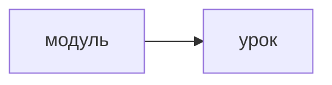

# Продукт

> Открытые вопросы О-… — в разделе 13. Решения — в [decisions.md](decisions.md).

## 1. Суть

Платформа учит (R01; concepts 2, 2.1). Как в MathTrail — product 5.4 и 8 canvas-api, privacy 1 canvas-api.

## 13. Открытые вопросы

Номера не меняются. Новые вопросы получают следующий номер — О-3.

### 13.1. Решено

| № | Вопрос | Решение |
|---|---|---|
| О-2 | Второй вопрос | R02 |

### 13.2. Открыто

| № | Вопрос | Рекомендация |
|---|---|---|
| О-1 | Первый вопрос | как О-56 standalone |
